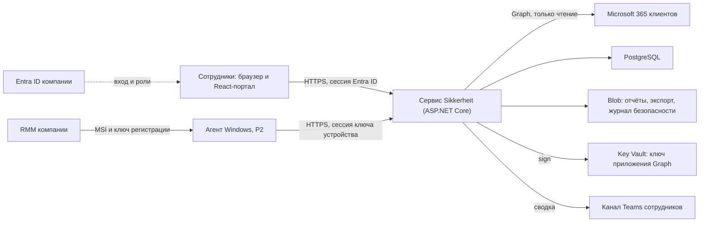

# Архитектура и технический стек

Сервер — один развёртываемый модульный монолит на ASP.NET Core 10 (ADR-02). В одном процессе работают портал и его API, сборщик Microsoft 365, API агента (P2) и фоновые задания. Данные хранятся в PostgreSQL, файлы — в Blob Storage, ключ приложения Graph — в Key Vault. Агент Windows (P2) — одна служба, которую ставит RMM компании. Масштаб — около 40 организаций и 400 ПК, нагрузка — сотни пакетов и десятки запусков сбора в сутки, поэтому отдельные процессы и очереди сообщений не нужны.



## Компоненты

| Компонент | Технология | Ответственность |
| --- | --- | --- |
| Портал | React, TypeScript, Vite | Сводка по клиентам, общая очередь, проблемы и история, подключения, политика, администрирование. Интерфейс на nb по умолчанию с переключением на nn и en; строки во внешних ресурсах; статические файлы отдаёт тот же сервис |
| Сервис Sikkerheit | ASP.NET Core 10, один процесс | Модули: организации и политика, вход и роли, Microsoft 365, агенты (P2), оценка и проблемы, отчёты, задания и журнал безопасности. Модули общаются через интерфейсы внутри процесса и владеют своими таблицами |
| Хранение | PostgreSQL 16 или новее, EF Core 10, Npgsql 10 | Транзакции, история, JSONB для evidence, разделение клиентов с RLS |
| Файлы | Azure Blob Storage | Отчёты, экспорты, журнал безопасности (контейнер с неизменяемостью), подписанные MSI (P2) |
| Секреты | Azure Key Vault | Неэкспортируемый ключ сертификата приложения Graph (операция sign), ключ шифрования ключей Data Protection, ключ HMAC nonce агента (P2), адрес webhook Teams Workflows |
| Идентичность | Entra ID компании, Microsoft.Identity.Web и MSAL | Вход сотрудников с app roles; отдельное multi-tenant приложение Graph с правами только на чтение |
| Агент, P2 | .NET 10 Windows Service, self-contained | Фиксированные сборщики WMI/CIM, COM и Win32, буфер SQLite, ключ устройства CNG, регистрация и сессия |
| Наблюдаемость | OpenTelemetry, Application Insights и Log Analytics | Метрики, трассировка и журналы без тел запросов и секретов; дневной лимит приёма журналов |

.NET 10 — выпуск с долгосрочной поддержкой; версии пакетов закрепляются lock-файлами. Сборки агента self-contained включают runtime, поэтому исправления .NET выпускаются новой версией агента.

## Развёртывание и окружения

Окружения test и production разделены: у каждого свой план App Service, база, хранилище, Key Vault и регистрация приложения входа. Приложение Graph одно на production; у test — отдельное приложение, подключаемое только к тестовым tenant.

- **Сервис** — Azure App Service (Linux) с одним экземпляром и Always On. Два hostname одного приложения: hostname портала (портал, API портала, завершение consent) и hostname агента (только `/api/v1/agent/*`). Промежуточный слой отвечает 404 на пути, пришедшие не на свой hostname. Список hostname — настройка слота: в слоте staging оба набора путей обслуживает hostname слота, и для него в регистрации входа есть отдельный redirect URI.
- **Слоты.** Развёртывание идёт через слот staging с переключением. Настройки слота закреплены за слотом: `Jobs:Enabled` (production — true, staging — false) и `Database:MigrateOnStart` (только staging). Поэтому новая версия до переключения и прежняя после него заданий не выполняют; во время самого переключения два экземпляра могут работать одновременно, и lease заданий это допускают (раздел «Фоновые задания»). После переключения слот staging останавливается.
- **База** — Azure Database for PostgreSQL Flexible Server с приватным доступом через интеграцию VNet и входом по managed identity, без паролей. PITR хранится 14 суток.
- **Миграции** выполняет сам образ сервиса при старте в слоте staging: GitHub-hosted runner вне VNet к базе с приватным доступом не подключится, а приватный доступ после создания сервера не меняется. У каждого слота своя managed identity с ролью приложения; слоту staging, кроме того, назначена user-assigned identity с ролью-владельцем схемы. Схема меняется по правилу expand/contract: релиз содержит только расширения, совместимые с предыдущей версией, а удаление прежних столбцов (contract) выходит следующим релизом, когда прежняя версия нигде не работает. Разрушающих миграций при старте production нет. В окружении без слота (test на плане B1 и запасной вариант production на B2: у планов Basic слотов нет) конвейер на время развёртывания назначает приложению identity миграций и включает `Database:MigrateOnStart`, а после успешного старта снимает их; сервис при этом ненадолго перезапускается вне окна сбора. Обе процедуры при выключенном публичном доступе к базе проверяет SP-02.
- **Infrastructure as code** — Bicep. CI — GitHub Actions или система компании; вход в Azure по OIDC (federated credentials). Сборка агента и MSI — Windows runner, сервиса — Linux runner.

Ресурсы, конфигурация и стоимость — `06`.

## Сбор данных Microsoft 365

Доступ к tenant клиентов даёт одно multi-tenant приложение Entra в tenant компании с application permissions только на чтение (ADR-05; перечень и назначение прав — `04`, «Права Graph»). Администратор каждого клиента выдаёт admin consent один раз. Токен для tenant получается по client credentials. Client assertion (PS256, заголовок `x5t#S256`) подписывается операцией sign Key Vault неэкспортируемым RSA-ключом сертификата приложения, поэтому закрытый ключ не попадает в процесс; RS256 — запасной вариант, если SP-01 покажет отказ PS256. Кэш токенов — в памяти, по tenant.

Запуск сбора выполняется по организации, а не по пользователю:

1. **Сверка tenant.** Токен запрашивается для `entraTenantId` подключения; `/organization` должен вернуть тот же id.
2. **Лицензии.** `subscribedSkus` определяет наличие Entra ID P1 или P2.
3. **Пользователи.** Полный список `/users` со всеми страницами.
4. **Роли.** Активные назначения ролей каталога, члены групп, которым назначена роль, и роль учётной записи синхронизации Entra Connect. При Entra ID P2 временные активации PIM отделяются по `roleAssignmentScheduleInstances` и не учитываются.
5. **Методы аутентификации.** Запрашиваются через JSON batch, до 20 запросов в пакете, для объединения двух групп: включённые member-пользователи вне `excludedUserIds` и все пользователи с привилегированной ролью. Первыми идут пользователи, чьи методы читались давнее всего, поэтому при таймауте запуска непрочитанными каждый раз остаются разные пользователи.
6. **Политики.** Security Defaults, политики Conditional Access (при P1), политика авторизации, активность входов (при P1). Состояние per-user MFA (модуль `per_user_mfa`, Graph beta, гипотеза H-MFA1 в SP-01) читается, если Security Defaults выключены и ни одна включённая политика CA не требует MFA безусловно для всех.

Каждый модуль получает статус возможности (`03`, «Возможности подключения»). Наблюдения проверяются allowlist-схемой `specs/graph-observation.schema.json` до записи. Оценка всех наблюдений запуска и обновление проблем выполняются в одной транзакции в конце запуска.

Ограничения:

- плановый запуск — раз в сутки в час `collectionHourLocal` политики (по умолчанию 03:00 по времени организации) со случайной задержкой до 30 минут;
- внеплановый запуск — по `requestCollection`;
- у организации не больше одного незавершённого запуска; одновременно обслуживаются не больше 8 tenant;
- лимиты Graph соблюдает общий ограничитель сервиса: методы аутентификации и отчёты — не больше 5 запросов за 10 секунд на tenant и 122 за 10 секунд на все tenant; `signInActivity` — не больше 10 запросов в минуту на все tenant, страница 500; Conditional Access — 1 запрос в секунду на tenant. Каждый запрос внутри JSON batch учитывается отдельно. Поэтому tenant с 300 пользователями собирается около 10 минут, а расчётная модель — в ночном окне;
- таймаут запроса — 30 секунд, запуска — 30 минут; запуск, не успевший прочитать методы всех пользователей, получает `partial`, а непрочитанные пользователи — unavailable/`temporary_error`. При лимите 5 запросов за 10 секунд это граница около 850 включённых пользователей на tenant;
- `Retry-After` соблюдается всегда, без него — экспоненциальная пауза (Conditional Access его не возвращает);
- следующая страница берётся только по `@odata.nextLink` на `graph.microsoft.com`;
- частичный результат допустим и помечается.

Правила подключения, сбора и вывода пользователей из учёта — `05`, раздел «Подключение M365 и сбор».

## Выполнение локальной проверки

Агент P2 — одна служба Windows под LocalSystem с фиксированными сборщиками (ADR-08). Большинству сборщиков нужны права администратора (BitLocker, Secure Boot, состав локальной группы администраторов в домене), а разделение на непривилегированный хост и привилегированный сборщик стоит дороже, чем даёт при таком масштабе. Компенсирующие требования обязательны:

- сборщики вызывают WMI/CIM, COM и Win32 API напрямую из .NET; `Process.Start`, PowerShell, cmd, скриптовые движки, загрузка плагинов и динамического кода запрещены;
- входящих сетевых listener и named pipe нет;
- сервер не может передать команду: конфигурация содержит только расписание, список проверок, лимиты и признак повторной проверки, а агент разбирает её строго по схеме своей версии и отклоняет целиком при поле вне схемы, продолжая с прежней (версии схемы — `05`, «API агента»);
- каждое наблюдение проверяется встроенной схемой до записи в буфер; не прошедшее проверку, в том числе неизвестное значение перечисления, заменяется на `unavailable/unsupported`, и остальные проверки пакета не теряются;
- исходящие соединения — только HTTPS на hostname агента; сертификат сервера проверяется по хранилищу доверия Windows; прокси — свойство MSI `PROXY` или системный прокси WinHTTP, иначе прямое соединение; PAC и WPAD в P2 не поддерживаются;
- каталог установки доступен на запись только SYSTEM и администраторам; каталог данных (SQLite, ссылка на ключ, ключ регистрации под DPAPI, входящий файл ключа) — только SYSTEM;
- бинарные файлы и MSI подписаны (`06`, «Распространение агента через RMM»);
- каждый сборщик выполняется в своём потоке (STA для COM, где нужно) и ограничен 30 секундами, сессия сбора — 120 секундами; оставшиеся проверки получают `unavailable/collector_timeout`. .NET не прерывает зависший COM-вызов, поэтому поток не ждут, а оставляют, и счётчик `abandonedCollectors` уходит в check-in. При трёх оставленных потоках служба завершается с кодом ошибки, и SCM перезапускает её по recovery actions MSI. Запросы WMI получают собственный таймаут (`EnumerationOptions.Timeout`);
- плановый сбор начинается не раньше чем через 60 минут после загрузки ОС; пакет — не больше 256 КиБ, буфер — не больше 100 МБ и `maxBufferDays` (по умолчанию 7 суток).

Модель угроз. На тех же ПК уже работает агент RMM под SYSTEM, и он умеет выполнять удалённые команды. У агента Sikkerheit канала команд нет, поэтому компрометация сервера Sikkerheit не даёт выполнить код на ПК клиентов. Худший случай — ложные факты с уже захваченного ПК; достоверность измерений на полностью скомпрометированном ПК не обещается.

Сборщик возвращает факт либо причину недоступности и не решает, применима ли проверка. Агент записывает пакет в SQLite и отправляет пакеты по одному, от старых к новым, ожидая ответа 200. Сервер принимает и оценивает пакет в одной транзакции (ADR-04). Check-in передаёт телеметрию: глубину очереди, удалённые и отклонённые пакеты, отказ конфигурации, число запусков службы, время последнего сбоя, память, процессорное время и оставленные сборщики; по ней видны критерии остановки кольца выпуска (RB-08). Кандидаты API сборщиков — `03`, раздел «Сбор данных и источники»; права и время каждого вызова подтверждает SP-04.

## Фоновые задания

Фоновые задания хранятся в таблице `job` PostgreSQL и выполняются внутри сервиса. Приём пакетов агента в задания не входит: он синхронный.

| Задание | Когда | Что делает |
| --- | --- | --- |
| `m365_collect` | Раз в сутки по организации; по запросу | Запуск сбора Microsoft 365 |
| `recalculate_policy` | После новой ревизии политики или `ruleVersion` | Пересчёт текущих проекций организации |
| `report_generate` | По `createReport` | Отчёт за неделю |
| `weekly_report` | Понедельник 06:00 по времени организации | Отчёт за прошедшую неделю для активных организаций |
| `organization_export` | По `createOrganizationExport` | Архив данных организации |
| `organization_delete` | Ежечасно для организаций с `deletionDueAt ≤ now` | Удаление данных и файлов |
| `freshness_sweep`, `review_expiry`, `scan_request_expiry` | Ежечасно | Смена свежести, истечение решений о риске и запросов повторной проверки; вывод из учёта устройств без check-in дольше 90 суток |
| `retention_purge` | Ежедневно 02:00 | Удаление по срокам хранения |
| `teams_digest` | Ежедневно 07:30 Europe/Oslo | Сводка сотрудникам: новые критические проблемы и сбои сбора |
| `patch_level_sweep` | Ежедневно 04:00 по времени организации (`periodKey` — дата) и в ближайший такт планировщика после `verifyWindowsReleaseMonth` (`periodKey` — сверенный месяц), P2 | Пересчёт SYS-002 и SYS-003 по времени и сверенным месяцам каталога |
| `release_import` | По `importWindowsReleases`, P2 | Загрузка документа MSRC CVRF месяца (только `api.msrc.microsoft.com` по фиксированному пути) или ручных записей в черновик каталога |
| `release_catalog_check` | Ежедневно, P2 | Оповещение, если месяц каталога выпусков не сверен через 7 суток после второго вторника |

Порядок выполнения заданий:

1. **Планирование.** Планировщик каждые 5 минут вставляет периодические задания с уникальным ключом (`type`, `organizationId`, `periodKey`) с `NULLS NOT DISTINCT` через `INSERT … ON CONFLICT DO NOTHING`. Пропущенные периоды догоняются не глубже 24 часов, для `weekly_report` — 4 недель.
2. **Захват.** Задание захватывается через `FOR UPDATE SKIP LOCKED` с lease на 5 минут. Долгое задание продлевает lease; `leaseToken` растёт при каждом захвате.
3. **Завершение.** Завершение и бизнес-эффект выполняются в одной транзакции с условием `leaseToken`; если обновлено 0 строк, транзакция откатывается. Эффекты идемпотентны за счёт уникальных ограничений.
4. **Ошибки.** Ошибка даёт повтор через 1, 5, 15 и 60 минут, затем раз в час. После 10 попыток задание переходит в `failed` и поднимает оповещение.

Метрика «последний такт планировщика» поднимает оповещение, если периодические задания не создавались дольше двух периодов. Детали состояний и времени — `05`, раздел «Фоновые задания и планировщик».

## Разделение клиентов

Каждая клиентская таблица содержит `organization_id NOT NULL`; ссылки между клиентскими сущностями — составные внешние ключи (`organization_id`, `id`). Область запроса определяет сервер (ADR-12):

- **Область организации** — для операций под `/api/v1/organizations/{organizationId}`, запросов агента (организация берётся из сессии устройства) и заданий (организация берётся из строки `job`). Изменения клиентских данных возможны только в ней. `createOrganization` работает в области новой организации; `getCurrentStaff` и `listStaff` читают только платформенную таблицу сотрудников.
- **Область чтения всех организаций** — только в транзакции `READ ONLY` и только в закрытом перечне: операции `listOrganizations` и `listFindingsAcrossOrganizations`; планировщик (организации, их timezone и час сбора); задание `teams_digest`; выбор организаций к удалению; метрики оповещений. Всё, что эти компоненты меняют, они меняют затем в области конкретной организации.
- **Поиск по секрету до известной организации** — функции `SECURITY DEFINER` без области, возвращающие только `organizationId` и при необходимости id объекта: ключ регистрации по SHA-256 и устройство по `deviceId` (P2), владелец tenant для проверки `tenant_conflict`. Глобальная уникальность `entraTenantId` дополнительно обеспечена индексом, а его нарушение отображается в 409 `tenant_conflict`.

Механизм области в PostgreSQL:

- **Политики RLS.** На клиентских таблицах включены RLS и `FORCE ROW LEVEL SECURITY`. Политики заданы отдельно по командам: SELECT — `USING (organization_id = app.scope_org() OR app.scope_all())`; INSERT — `WITH CHECK (organization_id = app.scope_org())`; UPDATE — `USING` и `WITH CHECK` по тому же правилу записи; DELETE — `USING (organization_id = app.scope_org())`. Поэтому в области чтения всех организаций изменения и удаления затрагивают 0 строк.
- **Установка области.** Область задаётся первым оператором транзакции функцией `app.set_scope(organization_id)` или `app.set_scope_all()` через `set_config(..., true)`, то есть до конца транзакции. Без области запрос возвращает 0 строк, а запись невозможна.
- **Сброс.** Соединение при возврате в pool сбрасывается (`DISCARD ALL`).
- **Роли.** Роль приложения не владеет таблицами, не является superuser и не имеет BYPASSRLS. Владелец схемы — отдельная роль миграций.
- **Статическая проверка.** В коде запрещён `set_config` параметров `app.*` вне этих функций, а `app.set_scope_all()` вызывается только из компонентов перечня.

Таблицы без клиентских данных — платформенные, без RLS: `staff_user`, `job`, `organization_tombstone`, а в P2 — `windows_release`, `windows_release_month`, `agent_challenge` и `agent_session`. Обработка задания читает только данные его организации, потому что устанавливает её область. Файлы в Blob лежат под префиксом `organizationId`; выдача идёт только через сервис после проверки области и роли. RLS дополняет прикладные проверки и не покрывает Blob, журналы и сообщения в Teams; поэтому проверку организации делает и приложение, а негативные испытания AT-01 проверяют все пути. [Row Security Policies](https://www.postgresql.org/docs/current/ddl-rowsecurity.html).

## Структура репозитория

```text
src/Sikkerheit.Host                  запуск, конфигурация, маршрутизация по hostname
src/Modules/Organizations            организации, политика, жизненный цикл, экспорт
src/Modules/Access                   вход сотрудников, роли, CSRF, аудит
src/Modules/M365                     подключение, клиент Graph, сборщики M365
src/Modules/Agents                   ключи регистрации, устройства, сессии, приём пакетов (P2)
src/Modules/Assessment               правила, оценки, проблемы, события, покрытие
src/Modules/Reports                  отчёты и сводка в Teams
src/Modules/Operations               задания, планировщик, журнал безопасности, хранение
src/Sikkerheit.Contracts             модели, сгенерированные из OpenAPI и схем
src/Agent/Sikkerheit.Agent           служба Windows (P2)
src/Agent/Sikkerheit.Agent.Collectors
src/Portal                           React SPA
tests/Unit
tests/Integration                    PostgreSQL в контейнере, поддельный Graph
tests/Contract                       негативные тесты реестра инвариантов
tests/Portal
tests/WindowsLab
infra/bicep
installer                            MSI (P2)
docs
```

Модуль не обращается к таблицам другого модуля напрямую, только через его интерфейс. Одна модель контрактов генерирует типы C# и TypeScript; зависимости Windows не попадают в сборку сервиса.
