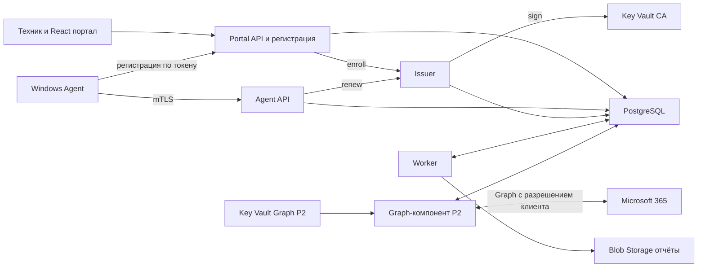

# Архитектура и технический стек

Общий серверный код организован как модульный монолит. Развёртываются три процесса Portal API, Agent API и Worker и внутренний компонент Issuer (ADR-03, ADR-12). Отдельный Agent API нужен из-за обязательного клиентского сертификата на ingress; он размещается в отдельном Container Apps environment без других приложений. Браузерный вход и первоначальная регистрация доступны через Portal API. Worker и Issuer работают без публичного ingress. Схема ниже описывает вариант A с собственным агентом; при варианте B агентская часть заменяется импортом (раздел «Вариант B: импорт без агента»). Graph-компонент появляется только в P2.



## Компоненты

| Компонент | Технология | Ответственность |
| --- | --- | --- |
| Agent Host | C# .NET 10 Worker Service | Расписание, сеть, локальная очередь, проверка конфигурации |
| Privileged Collector | Минимальная Windows-служба C# | Фиксированные сборщики, которым нужны повышенные права (по решению ADR-02) |
| Локальные данные | SQLite и ACL Windows | Буфер и последовательность пакетов; криптографические ключи отдельно |
| Portal API | ASP.NET Core 10 | Сессия портала, доступ сотрудников, регистрация устройств, управление клиентами |
| Agent API | ASP.NET Core 10 | Аутентификация устройств, приём пакетов, heartbeat, конфигурация и продление сертификата |
| Issuer | .NET 10, отдельный Container App с собственной managed identity | Единственный обладатель права sign на ключ в Key Vault CA; заново проверяет CSR и добавляет записи `device_certificate`; вызывается Portal API (enroll) и Agent API (renew) |
| Worker | .NET 10 | Очередь заданий и планировщик, оценки, HTML-отчёты и жизненный цикл данных; Graph-сертификатов не получает |
| Graph-компонент (P2) | Тот же образ модульного монолита, отдельный Container App с собственной managed identity | Сбор данных Microsoft 365 по организации; доступ к отдельному Key Vault Graph есть только у него |
| Persistence | PostgreSQL, EF Core 10, Npgsql 10 | Транзакции, история, JSONB, клиентская изоляция |
| Portal | React, TypeScript, Vite | Обзор клиентов, устройств, проблем и истории; интерфейс на nb по умолчанию с переключением на nn и en, строки во внешних ресурсах, выбранный язык передаётся заголовком `Accept-Language` |
| Identity | Entra ID, Microsoft.Identity.Web или MSAL | Вход сотрудников и отдельно токены облачных интеграций |
| Observability | OpenTelemetry и Azure Monitor | Метрики, трассировка и отредактированные журналы |

Сетевой путь от Portal API и Agent API к Issuer выбирается в PKI-дизайне до WP-03 по итогам SP-02. Предпочтительный вариант — Issuer во внутреннем VNet-environment с ingress через внутренний load balancer и сетевой связностью из environments Portal API и Agent API. Запасные варианты — асинхронный renew через задание в БД (он меняет контракт renew и вносится в 0.3.0) либо право sign у identities API с остаточным риском, который явно принимает Security Owner. Отчёт строится на языке организации независимо от языка, выбранного в портале; правила языка — `01`, раздел «Язык портала и отчёта».

.NET 10 имеет поддержку LTS до ноября 2028 года; Npgsql 10 выпущен для EF Core 10. Используются стабильные совместимые пакеты с зафиксированными версиями и lock files. [Политика .NET](https://dotnet.microsoft.com/en-us/platform/support/policy), [Npgsql](https://www.npgsql.org/efcore/release-notes/10.0.html).

## Выполнение локальной проверки

Плановая гипотеза H-02: сетевой Agent Host работает под виртуальной учётной записью службы без прав администратора, а сборщики, которым нужны повышенные права, выполняются в привилегированном сборщике с фиксированным протоколом. Привилегированный сборщик не имеет сетевых функций и принимает по named pipe только известный `collectorId` и параметры из enum. Произвольные пути, скрипты, команды и имена исполняемых файлов в протоколе отсутствуют. Обязательные требования к разделённому варианту: service SID; pipe только локальный (`PIPE_REJECT_REMOTE_CLIENTS`), создаётся первым экземпляром (`FILE_FLAG_FIRST_PIPE_INSTANCE`) и проверяет SID клиента; ACL на каталог установки, конфигурацию, helpers и ключи разрешают запись только SYSTEM и администраторам; запрос не больше 4 KiB и ответ не больше 64 KiB, по схеме; не больше 10 вызовов одного `collectorId` в час; таймаут вызова 30 секунд, зависшая работа завершается в пределах 120 секунд.

Решение ADR-02 принимается по итогам SP-01 на основе таблицы «collectorId → минимальная учётная запись → API → замер» для всех 11 WIN-проверок, двух моделей угроз и стоимости разделения; WP-04 не стартует, пока решение не записано. Единая служба LocalSystem выбирается, только если Agent Host сам требует повышенных прав для большинства сборщиков либо стоимость разделения превышает порог, и при этом Security Owner принимает модель угроз с компенсирующими мерами: нет входящих listener, ответы разбираются строго и с ограничениями, нет дочерних процессов, бинарные файлы подписаны, на каталог установки стоит ACL. Установка выполняется администратором; режим чтения сам по себе не означает отсутствие повышенных прав.

Сборщики обращаются к WMI/CIM, COM и Win32 API напрямую из .NET. Запуск `powershell.exe`, `cmd.exe` и любых дочерних процессов (`Process.Start`) запрещён; исключение возможно только через ADR-02 с замером бюджета в SP-01. Кандидаты API для проверок перечислены в `03` и подтверждаются в SP-01.

Сборщик возвращает факт либо причину недоступности. Agent Host записывает пакет в SQLite, затем отправляет его на Agent API. Успешный HTTP-ответ выдаётся после транзакционной записи пакета и задания оценки. Worker оценивает факты и обновляет проекции для портала.

Агент собирает факты; правила и рекомендации выполняются на сервере. Политика и версия правила сохраняются вместе с результатом. При изменении правила пересчёт помечается отдельно от изменений на устройстве.

## Выполнение облачной проверки

В P2 для клиента регистрируется отдельное приложение Entra с разрешениями чтения и отдельным сертификатом. Токен для конкретного Entra tenant получает отдельный Graph-компонент; его сертификаты хранятся в отдельном Key Vault Graph вашей инфраструктуры, а Worker Graph-сертификатов не получает ни в одном варианте. Такое подключение увеличивает ручную работу, но уменьшает область воздействия одного credential; массовое multitenant-подключение оценивается в ADR-06 после пилота. Остаточный риск сохраняется: компрометация общего Graph-компонента затрагивает всех подключённых клиентов (R-14), поэтому его изоляция, отдельный vault и учения массового отзыва — условие входа в WP-08.

Сбор выполняется по организации, а не с каждого ПК. У каждой интеграции есть набор возможностей, права, время последней успешной загрузки и результаты пробных запросов. 403 не интерпретируется автоматически как отсутствие лицензии. Повторные попытки соблюдают `Retry-After`; допускается частичный успешный сбор по доступным модулям. [Ограничения Graph](https://learn.microsoft.com/en-us/graph/throttling).

## Очередь заданий

P1 использует таблицу `job` в PostgreSQL. API записывает пакет и задание в одной транзакции. Типы заданий: `evaluate_batch`, `recalculate_policy`, `report_generate` и `organization_export`; `freshness_sweep`, `scan_request_expiry` и `review_expiry` — раз в час; `weekly_report` — в понедельник в 06:00 по timezone организации за прошедшую неделю, только для активных организаций; `retention_purge` — ежедневно в 02:00; `organization_delete` — планировщик ежечасно ставит его для организаций с `deletionDueAt ≤ now`. В P2 добавляется `graph_collect`. Поля задания включают `leaseOwner`, `leaseToken` и `periodKey`; уникальность — (type, organizationId, coalesce(inputId, periodKey)).

Планировщик работает внутри каждой реплики Worker: каждые 5 минут он вставляет периодические задания через `INSERT … ON CONFLICT DO NOTHING`. Пропущенные периоды догоняются не глубже 24 часов для часовых заданий и 4 недель для `weekly_report`. Захват выполняется через `FOR UPDATE SKIP LOCKED` с lease на 5 минут; долгое задание продлевает lease, а `leaseToken` при каждом захвате увеличивается. Завершение и бизнес-эффект выполняются в одной транзакции с условием `WHERE id=? AND leaseToken=?`; если обновлено 0 строк, транзакция откатывается. Эффекты идемпотентны за счёт уникальных ограничений. После повторяющихся ошибок задание попадает в состояние failed и вызывает оповещение. Метрика «последний такт планировщика» поднимает оповещение, если периодические задания не создавались дольше двух периодов.

`retention_purge` выполняется по каждой организации в её контексте RLS, идемпотентно и с аудитом сводки: сколько записей удалено и сколько заменено неизменяемым снимком. Сроки хранения всей цепочки — `04`, раздел «Сроки хранения».

Worker в Container Apps имеет минимум одну работающую реплику: очередь в PostgreSQL сама по себе не запускает процесс после scale to zero. При росте добавить Service Bus с outbox и сохранить дедупликацию обработчиков, уникальный ключ периода и fencing по `leaseToken`; доставка сообщения не означает однократное выполнение бизнес-операции.

## Разделение клиентов

OrganizationId определяется серверной связью сертификата, проверенным членством пользователя либо платформенной ролью PlatformAdmin. В Agent API этот идентификатор отсутствует в клиентском теле запроса. В Portal API выбранный OrganizationId проверяется по назначению, роли и действию.

Таблицы клиента используют OrganizationId, составные ограничения и Row-Level Security с `FORCE ROW LEVEL SECURITY`; без контекста запрос возвращает 0 строк. Контекст организации устанавливается только SECURITY DEFINER-функцией `app.begin_org_context(organizationId, actor, purpose)` от роли без входа. Функция сначала проверяет `platform_role`, затем членство; если у субъекта есть `platform_role`, она в той же транзакции записывает `audit_event`, даже если у него есть и членство, и только затем выполняет `SET LOCAL`. Политик межклиентского обхода нет: глобальное чтение PlatformAdmin означает право войти в контекст любой организации, а не bypass. Контекст очищается при возврате соединения в pool. Роль приложения не является владельцем таблиц, superuser и не имеет BYPASSRLS; роль миграций отделена. Остаточный риск: роль приложения технически может выставить параметр контекста напрямую; компенсация — статическая проверка, запрещающая прямой SET, а также SP-04 и AT-01.

В Worker выбор и обработка заданий разделены. Выбор выполняет SECURITY DEFINER-функция `claim_jobs` от роли без входа; она видит только метаданные заданий. Обработка идёт в отдельной транзакции с контекстом организации из `job.organizationId`, установленным той же функцией контекста с `purpose=job` и проверкой lease. Принадлежность входных сущностей организации задания проверяется явно. RLS дополняет прикладные проверки и не покрывает автоматически Blob, фоновые задания и аудит. [Правила PostgreSQL](https://www.postgresql.org/docs/current/ddl-rowsecurity.html).

## Вариант B: импорт без агента

Если SP-05 выбирает вариант B, собственный агент не разрабатывается: не выполняются WP-03, WP-04 и WP-07a, отпадают Agent API, PKI и Issuer, MSI и офлайн-буфер. Вместо них выполняется WP-04B — импорт фактов из Intune и RMM отдельным компонентом импорта. Модель observation, assessment и finding остаётся той же; provenance и время источника берутся из внешнего инструмента, а отчёт явно указывает источник данных. Гибрид, в котором агент закрывает только пробелы импорта, в P1 не вводится (ADR-11).

Вариант B вводит в P1 новые классы секретов: Graph-сертификаты для чтения managedDevices и ключи RMM API. Они хранятся в отдельном Key Vault импорта, доступ к которому есть только у компонента импорта — отдельного Container App с собственной managed identity. Worker не получает Graph-сертификатов и в этом варианте. Остаточная область воздействия компонента импорта — риск R-14. Изоляция компонента, отдельный vault, runbook onboarding и offboarding (RB-13) и учения массового отзыва (RB-14) становятся условием до старта WP-04B, а не до P2. FR-02, FR-03, FR-04 и FR-13 и агентские приёмочные сценарии заменяются требованиями импорта; для этого нужны пакет 0.3.0 и G1.

## Структура будущего репозитория

```text
src/Agent.Host
src/Agent.Collectors
src/Agent.PrivilegedCollector
src/Server.PortalApi
src/Server.AgentApi
src/Server.Worker
src/Server.Domain
src/Server.Infrastructure
src/Contracts
src/Portal
tests/Domain
tests/Integration
tests/WindowsLab
tests/Portal
infra/bicep
installer
docs
```

Это целевая структура будущего кода. Одна модель контрактов генерирует клиент агента и TypeScript-типы; зависимости Windows не включаются в контейнеры сервера. Сборки агента self-contained включают runtime, поэтому выпуск исправлений .NET должен обновлять сам агент.
