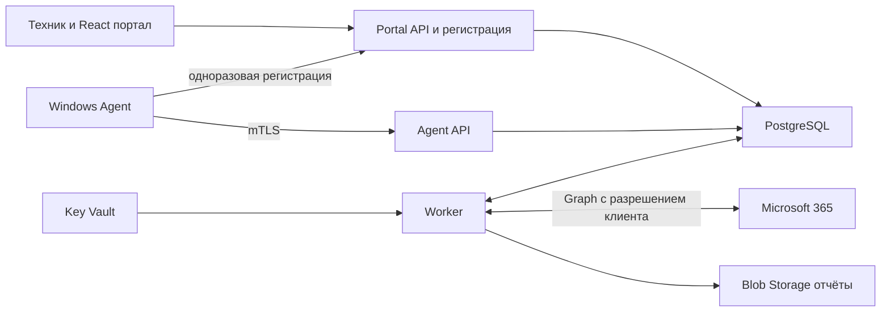

# Архитектура и технический стек

Общий серверный код организован как модульный монолит. Развёртываются Portal API, Agent API и Worker. Отдельный Agent API нужен из-за обязательного клиентского сертификата на ingress; браузерный вход и первоначальная регистрация доступны через Portal API. Worker работает без публичного ingress.



## Компоненты

| Компонент | Технология | Ответственность |
| --- | --- | --- |
| Agent Host | C# .NET 10 Worker Service | Расписание, сеть, локальная очередь, проверка конфигурации |
| Privileged Collector | Минимальная Windows-служба C# | Фиксированные сборщики, которым нужны повышенные права |
| Локальные данные | SQLite и ACL Windows | Буфер и последовательность пакетов; криптографические ключи отдельно |
| Portal API | ASP.NET Core 10 | Сессия портала, доступ сотрудников, регистрация устройств, управление клиентами |
| Agent API | ASP.NET Core 10 | Аутентификация устройств, приём пакетов, heartbeat и конфигурация |
| Worker | .NET 10 | Очередь заданий, оценки, отчёты, Graph и жизненный цикл данных |
| Persistence | PostgreSQL, EF Core 10, Npgsql 10 | Транзакции, история, JSONB, клиентская изоляция |
| Portal | React, TypeScript, Vite | Обзор клиентов, устройств, проблем и истории |
| Identity | Entra ID, Microsoft.Identity.Web или MSAL | Вход сотрудников и отдельно токены облачных интеграций |
| Observability | OpenTelemetry и Azure Monitor | Метрики, трассировка и отредактированные журналы |

.NET 10 имеет поддержку LTS до ноября 2028 года; Npgsql 10 выпущен для EF Core 10. Используются стабильные совместимые пакеты с зафиксированными версиями и lock files. [Политика .NET](https://dotnet.microsoft.com/en-us/platform/support/policy), [Npgsql](https://www.npgsql.org/efcore/release-notes/10.0.html).

## Выполнение локальной проверки

Agent Host работает с минимальными правами службы, проверенными в P0. Привилегированный сборщик не имеет сетевых функций и принимает по защищённому named pipe только известный `collectorId` и валидированные параметры. Доступ к pipe разрешён выделенной идентичности Agent Host. Произвольные пути, скрипты, команды и имена исполняемых файлов в протоколе отсутствуют.

Если разделение невозможно для обязательных проверок, это требует отдельного решения ADR-02 и оценки расширенной границы доверия. Установка выполняется администратором; режим чтения сам по себе не означает отсутствие повышенных прав.

Сборщик возвращает факт либо причину недоступности. Agent Host записывает пакет в SQLite, затем отправляет его на Agent API. Успешный HTTP-ответ выдаётся после транзакционной записи пакета и задания оценки. Worker оценивает факты и обновляет проекции для портала.

Агент собирает факты; правила и рекомендации выполняются на сервере. Политика и версия правила сохраняются вместе с результатом. При изменении правила пересчёт помечается отдельно от изменений на устройстве.

## Выполнение облачной проверки

В пилоте для клиента регистрируется отдельное приложение Entra с разрешениями чтения и отдельным сертификатом. Worker получает токен для конкретного Entra tenant. Секреты хранятся в Key Vault вашей инфраструктуры. Такое подключение увеличивает ручную работу, но уменьшает область воздействия одного credential; массовое multitenant-подключение оценивается в ADR-06 после пилота.

Сбор выполняется по организации, а не с каждого ПК. У каждой интеграции есть набор возможностей, права, время последней успешной загрузки и результаты пробных запросов. 403 не интерпретируется автоматически как отсутствие лицензии. Повторные попытки соблюдают `Retry-After`; допускается частичный успешный сбор по доступным модулям. [Ограничения Graph](https://learn.microsoft.com/en-us/graph/throttling).

## Очередь заданий

P1 использует таблицу `job` в PostgreSQL. API записывает пакет и задание в одной транзакции. Worker захватывает задания с lease, фиксирует время истечения и повторяет после сбоя; параллельные обработчики используют блокировку строк. Результаты обработки идемпотентны. После повторяющихся ошибок задание попадает в состояние failed и вызывает оповещение.

Worker в Container Apps имеет минимум одну работающую реплику: очередь в PostgreSQL сама по себе не запускает процесс после scale to zero. При росте добавить Service Bus с outbox и сохранить дедупликацию обработчиков; доставка сообщения не означает однократное выполнение бизнес-операции.

## Разделение клиентов

OrganizationId определяется серверной связью сертификата либо проверенным членством пользователя. В Agent API этот идентификатор отсутствует в клиентском теле запроса. В Portal API выбранный OrganizationId проверяется по таблице назначений, роли и действию.

Таблицы клиента используют OrganizationId, составные ограничения и Row-Level Security. Контекст задаётся только сервером в транзакции, очищается при возврате соединения в pool. Роль приложения не является владельцем таблиц, superuser и не имеет BYPASSRLS; роль миграций отделена. RLS дополняет прикладные проверки и не покрывает автоматически Blob, фоновые задания и аудит. [Правила PostgreSQL](https://www.postgresql.org/docs/current/ddl-rowsecurity.html).

## Структура будущего репозитория

```text
src/Agent.Host
src/Agent.Collectors
src/Agent.PrivilegedCollector
src/Server.PortalApi
src/Server.AgentApi
src/Server.Worker
src/Server.Domain
src/Server.Infrastructure
src/Contracts
src/Portal
tests/Domain
tests/Integration
tests/WindowsLab
tests/Portal
infra/bicep
installer
docs
```

Это целевая структура будущего кода. Одна модель контрактов генерирует клиент агента и TypeScript-типы; зависимости Windows не включаются в контейнеры сервера. Сборки агента self-contained включают runtime, поэтому выпуск исправлений .NET должен обновлять сам агент.
