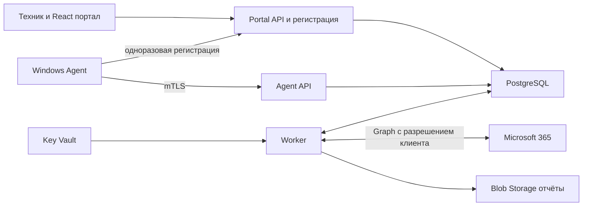

# Development Package для независимой оценки

Версия 0.1.0 от 12 октября 2026 года. Полный комплект требований, архитектуры и предложенных контрактов.

Рецензент начинает с запроса независимой оценки и проверяет весь комплект.


Файл `README.md`

# Development Package для сервиса проверки безопасности

Версия 0.1.0 от 12 октября 2026 года. Рабочее название проекта — Sikkerheit. Владелец продукта — ваша IT-компания; первый канал продаж — её текущие клиенты.

Предлагается сервис регулярной оценки настроек Windows и Microsoft 365 с внутренним порталом для техников, историей отклонений и еженедельным отчётом. Первая поставка включает Windows-агент и портал; облачные проверки подключаются отдельным этапом. Платный пилот определяет дальнейший объём продукта.

Статус — проект для независимой оценки и технических экспериментов. Контракты описывают предлагаемое поведение; приложение, Azure-инфраструктура и проверки на Windows ещё должны быть реализованы. Оценки сроков, ресурсы и пороги являются плановыми допущениями.

## Как читать пакет

| Файл | Назначение |
| --- | --- |
| [01-product-and-scope.md](01-product-and-scope.md) | Продукт, границы этапов, требования и показатели пилота |
| [02-architecture-and-stack.md](02-architecture-and-stack.md) | Компоненты, потоки, стек и границы доверия |
| [03-check-catalog.md](03-check-catalog.md) | Проверки Windows и Microsoft 365, права, лицензии и ограничения |
| [04-security-and-privacy.md](04-security-and-privacy.md) | Регистрация агента, сертификаты, роли, изоляция и обработка данных |
| [05-data-and-api.md](05-data-and-api.md) | Модель данных, состояния и правила API |
| [06-azure-and-operations.md](06-azure-and-operations.md) | Ресурсы Azure, установка, обновления и эксплуатация |
| [07-delivery-plan-and-acceptance.md](07-delivery-plan-and-acceptance.md) | Backlog, оценки трудоёмкости, испытания и критерии приёмки |
| [08-risks-and-decisions.md](08-risks-and-decisions.md) | Решения, риски, альтернативы и вопросы перед разработкой |
| [09-independent-review-prompt.md](09-independent-review-prompt.md) | Единый запрос для независимой оценки GPT-6 Astra и Fable 5.1 |
| [10-sources.md](10-sources.md) | Первичные источники и условия перепроверки |
| [specs/openapi.json](specs/openapi.json) | Предлагаемый HTTP API в формате OpenAPI 3.1 |
| [specs/scan-batch.schema.json](specs/scan-batch.schema.json) | Формат пакета наблюдений агента |
| [specs/observation.schema.json](specs/observation.schema.json) | Формат одного наблюдения |
| [specs/check-catalog.json](specs/check-catalog.json) | Идентификаторы и фазы проверок |
| [examples/scan-batch.json](examples/scan-batch.json) | Синтетический пакет с доступными наблюдениями |
| [examples/scan-batch-unavailable.json](examples/scan-batch-unavailable.json) | Пример ошибок доступа и неподдерживаемой проверки |
| [source/boss-chat.md](source/boss-chat.md) | Полная исходная переписка на языке оригинала |

## Передача на независимую оценку

Каждому рецензенту передать одинаковую версию пакета и запрос из `09-independent-review-prompt.md`. Для одной загрузки использовать `REVIEW-BUNDLE.md`; для просмотра контрактов и примеров — архив всего каталога. Ответы рецензентов сначала получить независимо, затем сопоставить по требуемой таблице замечаний.

Ключевые вопросы оценки: целесообразность собственного продукта вместо существующих инструментов, корректность прав Microsoft Graph, безопасность установки агента, достоверность состояний, трудоёмкость и экономика сопровождения. Ни один рецензент не должен предполагать, что технические эксперименты уже пройдены.

## Приоритет документов

Требования к поведению определяются документами 01, 03, 04 и 05. OpenAPI и схемы уточняют поля и HTTP-ответы. Противоречие между файлами считается дефектом пакета и исправляется до реализации соответствующего этапа. Исходная переписка показывает происхождение идеи; её технические предложения не заменяют спецификацию.

Сборка `REVIEW-BUNDLE.md` и ZIP выполняется скриптом [scripts/build_package.py](scripts/build_package.py). Он проверяет структуру JSON, локальные ссылки и согласованность идентификаторов. Полная проверка JSON Schema и OpenAPI сторонними валидаторами входит в технический этап перед генерацией клиентов.


Файл `01-product-and-scope.md`

# Продукт и объём разработки

Клиент получает регулярный обзор состояния устройств и корпоративных аккаунтов, а техник — очередь конкретных отклонений с основанием, ответственным и историей. Ценность подписки проверяется устранением реальных проблем и сокращением ручной работы.

## Пользователи и сценарии

Техник IT-компании видит только назначенных ему клиентов, сравнивает изменения и фиксирует работу. Руководитель сервиса контролирует подключение и качество данных. Владелец клиента получает отчёт с понятными действиями. Клиентский вход в портал относится к следующему этапу; первая версия предназначена для вашей команды.

Основной сценарий: техник регистрирует организацию, устанавливает подписанный агент через существующий инструмент управления ПК, видит первое наблюдение, получает отклонение, устраняет его привычным способом и подтверждает результат повторной проверкой. Последующее отсутствие данных не закрывает проблему.

## Этапы

| Этап | Входит | Условие завершения |
| --- | --- | --- |
| P0 | Проверка прав Windows, схемы mTLS в Azure, изоляции клиентов, доступности Graph и сравнение с текущими инструментами | Эксперименты дают основания для выбора архитектуры и объёма |
| P1 | Windows 11 x64, сборщики, регистрация, внутренний портал, история, HTML/PDF-отчёт и работа офлайн | Пройдены критерии локального пилота |
| P2 | Отдельное подключение M365, сведения о регистрации MFA, Security Defaults, инвентаризация Conditional Access; Intune при наличии лицензии | Подтверждены права, доступность и корректная интерпретация данных |
| P3 | Клиентский доступ, рассылка, дополнительные приложения и интеграции | Спрос и стоимость сопровождения подтверждены пилотом |

Windows ARM64, серверы и Windows 10 с соответствующим обслуживанием оцениваются после инвентаризации клиентов. Поддержка новой платформы требует собственных испытаний и явной записи в матрице совместимости.

## Функциональные требования

| ID | Требование | Этап | Приёмка |
| --- | --- | --- | --- |
| FR-01 | Организации и назначения сотрудников с серверным ограничением доступа | P1 | AT-01 |
| FR-02 | Одноразовая регистрация агента и отдельная идентичность устройства | P1 | AT-02 |
| FR-03 | Сбор фактов о Windows без автоматического изменения системы | P1 | AT-03 |
| FR-04 | Очередь при отсутствии сети и повторная отправка без дубликатов | P1 | AT-04 |
| FR-05 | Четыре результата оценки и отдельный признак свежести | P1 | AT-05 |
| FR-06 | Стабильная история появления, изменения, повторного открытия и исправления проблем | P1 | AT-06 |
| FR-07 | Отчёт за период с покрытием проверок и временем наблюдения | P1 | AT-07 |
| FR-08 | Ответственный, срок и принятие риска без подмены технического результата | P1 | AT-08 |
| FR-09 | Безопасное подключение M365 и отзыв доступа | P2 | AT-09 |
| FR-10 | Разделение регистрации MFA и требований доступа | P2 | AT-10 |
| FR-11 | Сопоставление устройства с Intune только по подтверждённому идентификатору | P2 | AT-11 |
| FR-12 | Аудит действий, экспорт и жизненный цикл клиентских данных | P1 | AT-12 |
| FR-13 | Подписанные версии агента, поэтапный выпуск и отзыв устройства | P1 | AT-13 |

## Границы обещаний

Оценка относится к конкретным поддерживаемым проверкам и доступным данным. Отчёт не выражает вероятность взлома, не подтверждает отсутствие вредоносного кода и не заменяет восстановление из резервной копии или полноценное тестирование на проникновение.

Первая версия не собирает действующие пароли, cookies, историю посещений, содержимое писем и документов, recovery passwords BitLocker. Не выполняются подбор паролей, эксплуатация уязвимостей, произвольные удалённые команды и автоматическое исправление системных политик. Эти исключения ограничивают права и стоимость сопровождения.

Microsoft Secure Score, журналы инцидентов Defender, ретроспективная оценка входов, проверка резервных копий и произвольных SaaS — будущие модули. Сохранение показателя MFA registered не является доказательством обязательности MFA. [Свойства регистрации MFA](https://learn.microsoft.com/en-us/graph/api/resources/userregistrationdetails?view=graph-rest-1.0).

## Плановые показатели

Пилот — 3–5 организаций и 20–50 устройств в течение 4–6 недель. Это выбранный масштаб эксперимента. Для проверки проектирования используется нагрузочная модель 1 000 устройств, 100 организаций, один полный сбор в сутки и heartbeat каждые 4 часа только при включённом ПК.

| ID | Плановый критерий | Как измерить |
| --- | --- | --- |
| NFR-01 | Не менее 95% участвующих устройств с достаточным временем работы присылают суточный сбор | Знаменатель формируется из подтверждённого времени доступности; офлайн отдельно |
| NFR-02 | Все обязательные проверки дают результат либо явную причину недоступности | Сравнение фактического набора с конфигурацией |
| NFR-03 | Для валидного суточного пакета p95 обработки менее 5 минут при расчётной нагрузке | От подтверждённой записи до оценки |
| NFR-04 | На референсном ПК сбор занимает до 120 секунд, таймаут одного сборщика до 30 секунд | Windows-лаборатория; процесс может завершаться частичным результатом |
| NFR-05 | Средняя CPU за 15 минут до 2%, рабочая память до 150 МБ без дочерних процессов | Измерять также общий пик с дочерними процессами; превышение пересматривает реализацию |
| NFR-06 | Работает буфер до 7 дней и до 100 МБ | Испытание длительного отсутствия сети; переполнение выдаёт событие потери данных |
| NFR-07 | RPO до 15 минут, RTO до 4 часов для базы при выбранной конфигурации | Измеренный учебный restore; это цель, а не обещание поставщика |
| NFR-08 | Отсутствует доступ между клиентами при подмене идентификаторов | Сквозные негативные испытания API, заданий и скачивания файлов |

Условия референсного ПК и версии Windows фиксируются в P0. Нагрузочная модель не доказывает производительность до измерений.

## Экономика пилота

Учитывать облако, лицензии и сертификаты, время подключения, поддержку агента, разбор ложных тревог и исправления. Ежемесячный вклад клиента равен выручке минус выделенные расходы облака, поддержку, сторонние лицензии и включённые часы работы. Расходы разработки учитываются отдельно при расчёте окупаемости.

Предлагаемый критерий продолжения: минимум 3 клиента согласны на платное продолжение по проверяемой цене; при согласованной стоимости труда обслуживание даёт положительный вклад; техника устраивает качество выводов. Найденные проблемы без готовности платить не подтверждают спрос. Сначала сравнить результат с Intune, Lighthouse и используемым инструментом управления ПК.


Файл `02-architecture-and-stack.md`

# Архитектура и технический стек

Общий серверный код организован как модульный монолит. Развёртываются Portal API, Agent API и Worker. Отдельный Agent API нужен из-за обязательного клиентского сертификата на ingress; браузерный вход и первоначальная регистрация доступны через Portal API. Worker работает без публичного ingress.



## Компоненты

| Компонент | Технология | Ответственность |
| --- | --- | --- |
| Agent Host | C# .NET 10 Worker Service | Расписание, сеть, локальная очередь, проверка конфигурации |
| Privileged Collector | Минимальная Windows-служба C# | Фиксированные сборщики, которым нужны повышенные права |
| Локальные данные | SQLite и ACL Windows | Буфер и последовательность пакетов; криптографические ключи отдельно |
| Portal API | ASP.NET Core 10 | Сессия портала, доступ сотрудников, регистрация устройств, управление клиентами |
| Agent API | ASP.NET Core 10 | Аутентификация устройств, приём пакетов, heartbeat и конфигурация |
| Worker | .NET 10 | Очередь заданий, оценки, отчёты, Graph и жизненный цикл данных |
| Persistence | PostgreSQL, EF Core 10, Npgsql 10 | Транзакции, история, JSONB, клиентская изоляция |
| Portal | React, TypeScript, Vite | Обзор клиентов, устройств, проблем и истории |
| Identity | Entra ID, Microsoft.Identity.Web или MSAL | Вход сотрудников и отдельно токены облачных интеграций |
| Observability | OpenTelemetry и Azure Monitor | Метрики, трассировка и отредактированные журналы |

.NET 10 имеет поддержку LTS до ноября 2028 года; Npgsql 10 выпущен для EF Core 10. Используются стабильные совместимые пакеты с зафиксированными версиями и lock files. [Политика .NET](https://dotnet.microsoft.com/en-us/platform/support/policy), [Npgsql](https://www.npgsql.org/efcore/release-notes/10.0.html).

## Выполнение локальной проверки

Agent Host работает с минимальными правами службы, проверенными в P0. Привилегированный сборщик не имеет сетевых функций и принимает по защищённому named pipe только известный `collectorId` и валидированные параметры. Доступ к pipe разрешён выделенной идентичности Agent Host. Произвольные пути, скрипты, команды и имена исполняемых файлов в протоколе отсутствуют.

Если разделение невозможно для обязательных проверок, это требует отдельного решения ADR-02 и оценки расширенной границы доверия. Установка выполняется администратором; режим чтения сам по себе не означает отсутствие повышенных прав.

Сборщик возвращает факт либо причину недоступности. Agent Host записывает пакет в SQLite, затем отправляет его на Agent API. Успешный HTTP-ответ выдаётся после транзакционной записи пакета и задания оценки. Worker оценивает факты и обновляет проекции для портала.

Агент собирает факты; правила и рекомендации выполняются на сервере. Политика и версия правила сохраняются вместе с результатом. При изменении правила пересчёт помечается отдельно от изменений на устройстве.

## Выполнение облачной проверки

В пилоте для клиента регистрируется отдельное приложение Entra с разрешениями чтения и отдельным сертификатом. Worker получает токен для конкретного Entra tenant. Секреты хранятся в Key Vault вашей инфраструктуры. Такое подключение увеличивает ручную работу, но уменьшает область воздействия одного credential; массовое multitenant-подключение оценивается в ADR-06 после пилота.

Сбор выполняется по организации, а не с каждого ПК. У каждой интеграции есть набор возможностей, права, время последней успешной загрузки и результаты пробных запросов. 403 не интерпретируется автоматически как отсутствие лицензии. Повторные попытки соблюдают `Retry-After`; допускается частичный успешный сбор по доступным модулям. [Ограничения Graph](https://learn.microsoft.com/en-us/graph/throttling).

## Очередь заданий

P1 использует таблицу `job` в PostgreSQL. API записывает пакет и задание в одной транзакции. Worker захватывает задания с lease, фиксирует время истечения и повторяет после сбоя; параллельные обработчики используют блокировку строк. Результаты обработки идемпотентны. После повторяющихся ошибок задание попадает в состояние failed и вызывает оповещение.

Worker в Container Apps имеет минимум одну работающую реплику: очередь в PostgreSQL сама по себе не запускает процесс после scale to zero. При росте добавить Service Bus с outbox и сохранить дедупликацию обработчиков; доставка сообщения не означает однократное выполнение бизнес-операции.

## Разделение клиентов

OrganizationId определяется серверной связью сертификата либо проверенным членством пользователя. В Agent API этот идентификатор отсутствует в клиентском теле запроса. В Portal API выбранный OrganizationId проверяется по таблице назначений, роли и действию.

Таблицы клиента используют OrganizationId, составные ограничения и Row-Level Security. Контекст задаётся только сервером в транзакции, очищается при возврате соединения в pool. Роль приложения не является владельцем таблиц, superuser и не имеет BYPASSRLS; роль миграций отделена. RLS дополняет прикладные проверки и не покрывает автоматически Blob, фоновые задания и аудит. [Правила PostgreSQL](https://www.postgresql.org/docs/current/ddl-rowsecurity.html).

## Структура будущего репозитория

```text
src/Agent.Host
src/Agent.Collectors
src/Agent.PrivilegedCollector
src/Server.PortalApi
src/Server.AgentApi
src/Server.Worker
src/Server.Domain
src/Server.Infrastructure
src/Contracts
src/Portal
tests/Domain
tests/Integration
tests/WindowsLab
tests/Portal
infra/bicep
installer
docs
```

Это целевая структура будущего кода. Одна модель контрактов генерирует клиент агента и TypeScript-типы; зависимости Windows не включаются в контейнеры сервера. Сборки агента self-contained включают runtime, поэтому выпуск исправлений .NET должен обновлять сам агент.


Файл `03-check-catalog.md`

# Каталог проверок и ограничений

Каталог определяет измеряемые факты, условия вывода и границы интерпретации. Пороговые значения ниже — стартовая политика пилота; изменения имеют версию и записываются в аудит. `checkId` сохраняется в наблюдении и совпадает с машинным каталогом `specs/check-catalog.json`.

## Семантика результата

Сбор возвращает `collected`, `unavailable` либо `not_applicable`. Сервер оценивает наблюдение как `pass`, `fail`, `unknown` либо `not_applicable`. Успешное получение факта не означает pass. Информационные измерения имеют `assessmentMode=informational` и не участвуют в оценке соответствия.

Отдельно хранится `freshness=fresh|stale`. Устаревший pass показывается как прошлый результат с датой; текущая оценка покрытия учитывает его как unknown. Обязательная проверка, которой нет в пакете, получает unknown с `missing_observation`. Внешняя невозможность проверки не означает not_applicable: такой статус задаётся только явной политикой применимости.

## Проверки Windows

| ID | Проверка и данные | Условие оценки | Права и ограничения |
| --- | --- | --- | --- |
| WIN-001 | Свободное место на системном диске: totalBytes, freeBytes | Warn при менее 10% или 10 GiB; critical при менее 5% или 2 GiB | Обычное чтение; эксплуатационный показатель, не доказательство защиты |
| WIN-002 | BitLocker: volumeStatus, protectionStatus, encryptionPercentage | При требовании шифрования pass только при завершении и активной защите; пауза или расшифровка — fail | Проверка прав в P0; recovery password никогда не извлекается |
| WIN-003 | Активный антивирус: provider, productState, источник статуса | Принятый политикой продукт active — pass для этой узкой проверки; off/expired — fail; неизвестный vendor mapping — unknown | Defender подробно; WSC только предоставленный статус стороннего продукта |
| WIN-004 | Давность сигнатур Defender: signatureLastUpdatedAt | Warn старше 3 суток, critical старше 7; будущая дата — unknown | Применяется когда Defender выбран основным AV; сторонний AV оценивается по отдельной интеграции |
| WIN-005 | Брандмауэр: domain/private/public enabled | Для штатного Windows Firewall все требуемые профили включены | Альтернативный firewall требует явной политики и собственного источника |
| WIN-006 | Windows Update: securityUpdatesPending, lastSuccessfulSearchAt, configuredSource | Pass только после успешного поиска по действующему источнику и отсутствия просроченных обновлений согласно политике | Поиск может быть долгим; WSUS и отсрочки учитываются; одна дата последнего KB недостаточна |
| WIN-007 | Необходимость перезагрузки по поддерживаемому Windows Update API | Warn при подтверждённой необходимости дольше 3 дней | Отрицательный результат относится только к поддерживаемому источнику, не ко всем установщикам |
| WIN-008 | Прямые члены группы локальных администраторов по известному SID группы | Непредусмотренный политикой SID — fail | Не равнозначно полному раскрытию вложенных AD/Entra-групп и всех способов повышения прав |
| WIN-009 | Secure Boot: фактическое состояние и обнаруженная платформа | При обязательной политике disabled или подтверждённое отсутствие поддержки — fail | Access denied — unknown; виртуальная машина не исключается автоматически |
| WIN-010 | Регистрация устройства Entra: joinType, tenantId, entraDeviceId | Информационная инвентаризация; проверка tenant только при явной политике | Устройство не даёт доступа к данным всего tenant; пользовательская Hello/PIN не выводится из контекста SYSTEM |
| SYS-001 | Последний heartbeat и полный сбор | Stale после 48 часов без новых данных по стартовой политике | Вычисляется сервером; выключенный ПК не объявляется автоматически заражённым |

Каждый сборщик ограничен 30 секундами; бюджет всей сессии — 120 секунд. При исчерпании бюджета оставшиеся проверки получают `unavailable/collector_timeout`. Для медленного Windows Update в P0 проверить необходимость отдельного фонового задания с собственным лимитом. Данные произвольного PowerShell stdout не передаются; используется allowlist структуры.

Список разрешённых администраторов, источник обновлений и допустимый AV согласуются по клиенту. Без необходимых входных настроек проверка становится informational либо unknown, а не создаёт ложное отклонение.

Штатные источники: [BitLocker](https://learn.microsoft.com/en-us/powershell/module/bitlocker/get-bitlockervolume?view=windowsserver2025-ps), [Defender](https://learn.microsoft.com/en-us/powershell/module/defender/get-mpcomputerstatus?view=windowsserver2025-ps), [Windows Security Center](https://learn.microsoft.com/en-us/windows/win32/api/iwscapi/). Точные права каждого вызова устанавливаются экспериментом на поддерживаемых редакциях Windows.

## Проверки Microsoft 365

Все endpoints ниже относятся к Graph v1.0. Таблица показывает application permissions для фонового доступа; администратор клиента отдельно выдаёт consent. Право чтения может охватывать весь tenant, поэтому объём запрашиваемых и сохраняемых данных ограничивается allowlist.

| ID | Данные и endpoint | Application permissions | Условия и вывод |
| --- | --- | --- | --- |
| M365-001 | `/reports/authenticationMethods/userRegistrationDetails`, сопоставление с `/users?$select=id,accountEnabled,userType,userPrincipalName` | `AuditLog.Read.All`, `User.Read.All` | P2. Доступ к отчёту требует Entra P1/P2. Проверять регистрацию активных member accounts; отсутствующий пользователь в отчёте — unknown, отключённый исключается по применимости |
| M365-002 | `/policies/identitySecurityDefaultsEnforcementPolicy` | `Policy.Read.All` | P2. Информационная запись isEnabled. Disabled не означает общую слабость: клиент может использовать Conditional Access |
| M365-003 | `/identity/conditionalAccess/policies` | `Policy.Read.All` | P2. Инвентаризация состояния enabled/report-only/disabled и условий; эксплуатация CA требует подходящей лицензии. P2 не доказывает покрытие каждого сценария |
| M365-004 | `/deviceManagement/managedDevices` с `$select` необходимых полей | `DeviceManagementManagedDevices.Read.All` | P2 optional. Нужна активная лицензия Intune, управляемое устройство и свежий lastSyncDateTime; compliant относится к назначенным политикам Intune |
| M365-005 | `/auditLogs/signIns` с диапазоном времени и минимальной проекцией | `AuditLog.Read.All`; для CA-деталей дополнительно подходящее policy read permission | P3. Graph-выгрузка требует Entra P1/P2; некоторые риск-детали P2. Отсутствие входа в период не доказывает запрет доступа |

Права сверены с [отчётом регистрации](https://learn.microsoft.com/en-us/graph/api/authenticationmethodsroot-list-userregistrationdetails?view=graph-rest-1.0), [users](https://learn.microsoft.com/en-us/graph/api/user-list?view=graph-rest-1.0), [Security Defaults](https://learn.microsoft.com/en-us/graph/api/identitysecuritydefaultsenforcementpolicy-get?view=graph-rest-1.0), [CA policies](https://learn.microsoft.com/en-us/graph/api/conditionalaccessroot-list-policies?view=graph-rest-1.0), [Intune](https://learn.microsoft.com/en-us/graph/api/intune-devices-manageddevice-list?view=graph-rest-1.0) и [signIns](https://learn.microsoft.com/en-us/graph/api/signin-list?view=graph-rest-1.0). Endpoint или permission нельзя автоматически подменять по совпадению названий.

Для M365-001 `isMfaRegistered` и `isMfaCapable` сохраняются отдельно. Pass подтверждает выполнение требования регистрации, но не обязательность MFA. Источник может обновляться с задержкой до 36 часов; свежесть оценивает также время источника, если оно доступно. [Условия отчёта](https://learn.microsoft.com/en-us/entra/identity/authentication/howto-authentication-methods-activity).

Полный анализ покрытия CA требует групп, исключений, authentication strengths, ресурсов и сценариев; связанные права и дополнительный проект относятся к P3. Windows sign-in не считается нарушением только потому, что CA не применялась. [Различия сценариев](https://learn.microsoft.com/en-us/entra/identity/monitoring-health/concept-sign-in-log-activity-details).

## Возможности интеграции

Каждый модуль имеет `capabilityStatus=available|permission_missing|license_unconfirmed|unsupported|temporary_error|disconnected`. `license_unconfirmed` означает необходимость уточнения, а не доказанное отсутствие лицензии. Проверяются выдача token, endpoint, pagination и полученные свойства. 200 с отсутствующим обязательным свойством не считается полным успешным наблюдением.

Частично доступный tenant остаётся подключённым с явным списком недоступных проверок. Обработка Graph GET ограничивается разрешёнными hosts, конкретным tenant, разрешёнными paths и проверенными nextLink; произвольный внешний URL не выполняется.

## Следующие модули

Проверка конкретных приложений начинается с согласованного каталога vendor/version. WinGet используется как дополнительный источник, а unknown version сохраняется явно. [Ограничения версий WinGet](https://learn.microsoft.com/en-us/windows/package-manager/winget/upgrade).

Настройки блокировки экрана и пользовательский Windows Hello требуют измерения правильного пользовательского контекста. Backup требует интеграции с конкретным поставщиком и отдельного подтверждения восстановления. Secure Score остаётся дополнительным индикатором внедрения контролей, без трактовки как вероятности взлома. [Смысл Secure Score](https://learn.microsoft.com/microsoft-365/security/defender/microsoft-secure-score?view=o365-worldwide).


Файл `04-security-and-privacy.md`

# Безопасность и обработка клиентских данных

Основные активы — результаты клиентов, идентичности устройств, сертификаты интеграций и канал обновления агента. Компрометация одного компьютера не должна позволять читать другие устройства или управлять Microsoft 365.

## Регистрация и сертификаты агента

Техник с правом регистрации создаёт одноразовый случайный токен, связанный с конкретной организацией. Плановый срок действия — 30 минут; хранится hash токена. Токен передаётся агенту через защищённый канал установленного инструмента управления ПК, не попадает в логи и общие MSI-пакеты.

Агент создаёт отдельный ключ P-256 через Windows CNG, формирует CSR и отправляет его с токеном на endpoint регистрации по обычному HTTPS. Сервер проверяет CSR и подпись владения ключом. Погашение токена и создание устройства атомарны. Повтор того же registrationRequestId с тем же CSR возвращает прежний сертификат в течение исходного окна; другой CSR получает конфликт. После истечения токена нужен новый код.

Сервер подписывает CSR внутренним CA для аутентификации устройств. Ключ CA защищён Key Vault и доступен только регистрационному модулю. Сертификат содержит уникальный DeviceId, срок действия и назначение client authentication; ключ остаётся на ПК с ACL для Agent Host. Сервер хранит допустимый hash сертификата, срок, версию и состояние revoked. Предлагаемый срок сертификата — 90 дней, ротация начинается за 14 дней, допустимое перекрытие — до 24 часов.

Agent API требует mTLS на отдельном hostname. Наличие сертификата на ingress не заменяет проверку регистрационной записи, срока и отзыва. Приложение доверяет forwarded certificate только от собственного ingress. Подмена `X-Forwarded-Client-Cert`, доступ в обход ingress, прокси с TLS inspection и корпоративные ограничения сети проверяются в P0. [Механизм Container Apps](https://learn.microsoft.com/en-us/azure/container-apps/client-certificate-authorization).

Устройство может отправлять только собственные наблюдения, heartbeat и запрос конфигурации. Сертификат устройства не предоставляет Graph-права, доступ к порталу и скачивание чужих отчётов. Отзыв применяется к следующим запросам через серверную проверку; кэш авторизации устройств ограничен 60 секундами.

Неэкспортируемый ключ повышает защиту, но локальный администратор или вредоносное ПО с высокими правами может подделать наблюдения. Проект не обещает достоверность измерений с уже полностью захваченного ПК. Подтверждение независимыми источниками Intune/Defender относится к P2 и далее.

## Вход в портал и роли

Для P1 используется single-tenant вход сотрудников вашей компании через Entra ID, с требованием MFA, настроенным и проверенным в вашем tenant. Backend проверяет issuer, audience, подпись и срок токена через поддерживаемую библиотеку. Сессия портала — HttpOnly Secure cookie; изменяющие запросы имеют защиту CSRF. Токены Graph и секреты не возвращаются браузеру.

| Роль | Разрешения |
| --- | --- |
| PlatformAdmin | Назначения сотрудников, конфигурация платформы и подключение интеграций |
| ServiceManager | Назначенные клиенты, регистрация/отзыв устройств, отчёты и принятие риска |
| Technician | Назначенные клиенты, просмотр, ответственный/срок и повторная проверка |
| CustomerReader | Только собственный клиент; роль предусмотрена, доступ появляется в P3 |

PlatformAdmin не используется как роль повседневной работы. Все изменения назначений, исключений, интеграций, регистраций и выгрузок сохраняются в аудите. Клиентский вход требует отдельного проекта B2B либо multitenant SSO и собственных испытаний авторизации.

## Разрешения интеграций

Graph-подключение отдельно от portal login. Используются только endpoint-права чтения из каталога 03. В пилоте запрещено заменять их широкими write-разрешениями ради удобства. Сертификат каждого подключения хранится отдельно; права Managed Identity к Key Vault ограничиваются компонентом.

Подключение tenantId/clientId подтверждается пробным запросом и доверенной административной процедурой. Операция подключения и выдача admin consent выполняются администратором клиента. Произвольные URLs Key Vault или Graph из формы не принимаются: используются фиксированные cloud hosts и зарегистрированные серверные ссылки. Отключение интеграции прекращает задания, очищает кэш токенов и сопровождается процедурой отзыва доступа в tenant клиента.

## Минимизация данных

Сохраняются необходимые настройки, время наблюдения, версии и идентификаторы. Перед записью JSON применяется allowlist полей. Действующие пароли, recovery passwords, cookies, история браузера, содержимое документов, почты и полные системные дампы отсутствуют в схемах. Списки локальных администраторов и UPN считаются персональными данными; доступ и экспорт ограничены. Название устройства также может идентифицировать человека.

В логах используются correlationId, коды ошибок и внутренние IDs. Тело входящих запросов, сертификатные private keys, одноразовые токены и полный ответ Graph не логируются. Уведомление содержит ссылку в портал и минимальное описание, без чувствительных технических подробностей.

| Данные | Предлагаемый срок | Условие |
| --- | --- | --- |
| Локальный офлайн-буфер | До 7 дней или подтверждённой отправки | Ограничение 100 МБ, удаление после acknowledgement |
| Нормализованные наблюдения | 90 дней | Клиентская политика может сократить срок |
| История проблем и отчёты | 12 месяцев | Уточняется договором и нуждами сервиса |
| Аудит доступа | 12 месяцев | Ограниченный доступ и отдельная политика |
| Операционные логи | 30 дней | Без тел запросов и паролей |
| Резервные копии базы | 14 дней для пилота | Плановое значение конфигурации, проверяется restore |

Сроки являются предложением для пилота, а не универсальным юридическим требованием. Перед подключением определить цели обработки, роли сторон, договор обработки, субподрядчиков, сроки и порядок удаления. Принципы минимизации, ограничения хранения и обязанности обработчика установлены GDPR, в частности статьями 5 и 28. [Текст регламента](https://eur-lex.europa.eu/eli/reg/2016/679/oj/eng).

Расположение ресурсов в ЕЭЗ — проектное условие выбора региона. Отдельно проверить размещение журналов, резервных копий и иных сервисов; выбор региона сам по себе не подтверждает соблюдение всех требований.

## Угрозы и проверяемые меры

| Угроза | Мера | Испытание |
| --- | --- | --- |
| Чужой OrganizationId в запросе | Серверное членство, mTLS binding, RLS | AT-01 и AT-02 |
| Повтор/подмена пакета | Уникальный scanId, hash тела и последовательность | AT-04 |
| Выполнение команды через collector | Фиксированный протокол и ACL named pipe | AT-03 |
| Подмена обновления | Authenticode, закреплённый publisher и поэтапный выпуск | AT-13 |
| Утечка Graph credential | Key Vault, отдельные регистрации клиентов, ротация | AT-09 |
| Отсутствие данных скрывает проблему | Freshness отдельно от результата | AT-05 и AT-06 |
| Утечка через отчёт/лог | Авторизованная выдача файла, allowlist и редактирование логов | AT-07 и AT-12 |

До пилота закрываются критические дефекты доступа, обновления и исполнения команд. Наличие режима чтения не отменяет необходимости проверки этих границ.


Файл `05-data-and-api.md`

# Модель данных и HTTP API

Организация, устройство и облачная идентичность имеют разные ключи. DeviceId создаётся сервером при регистрации; имя ПК и UPN не используются как уникальные ключи. Сопоставление Entra/Intune выполняется только по подтверждённым tenantId и device IDs, а при неоднозначности остаётся unresolved.

## Сущности и ограничения

| Сущность | Ключевые данные | Ограничение |
| --- | --- | --- |
| organization | id, name, timezone, policyVersion, lifecycle | Клиентский контекст |
| organization_member | organizationId, entraUserId, role | Уникальность назначения и серверная авторизация |
| device | organizationId, id, displayName, status, lastSeenAt, latestSequence | Составной ключ для ссылок клиента |
| device_certificate | organizationId, deviceId, sha256, validFrom, validTo, revokedAt | Hash сертификата уникален; не включает private key |
| enrollment | id, organizationId, tokenHash, expiresAt, consumedAt, registrationRequestId, csrHash | Атомарное одноразовое погашение |
| integration | organizationId, id, entraTenantId, clientId, credentialRef, capabilities | Ссылка на секрет, не сам credential |
| policy_revision | organizationId, version, effectiveFrom, configuration | Immutable; прошлые версии доступны для офлайн-пакетов |
| scan_batch | organizationId, deviceId, scanId, sequence, timestamps, payloadHash, payload | Unique(deviceId, scanId), unique(deviceId, sequence) |
| observation | organizationId, sourceId, checkId, subject, observedAt, collectionStatus, evidence | Типизированные evidence и allowlist |
| assessment | observationId, ruleId, ruleVersion, policyVersion, result, freshness, severity | Исходное измерение не переписывается пересчётом |
| finding | organizationId, subject, checkId, technicalState, workflowState, revision | Стабильная пара subject/checkId; политика в событиях |
| finding_event | findingId, eventType, assessmentId, timestamp, cause | События immutable; cause=device_change/rule_change/manual_action |
| job | organizationId, type, inputId, state, leaseUntil, attempts, nextAttemptAt | Дедупликация задания по назначению и inputId |
| report | organizationId, period, timezone, state, blobKey, policyVersions | Файл выдаётся только после авторизации |
| audit_event | actor, organizationId, action, target, timestamp, correlationId | Отредактированные данные, ограниченный доступ |

Ссылки между клиентскими сущностями используют OrganizationId вместе с ID цели, включая foreign keys. Индексы: устройства по organization/status/lastSeenAt; наблюдения по subject/checkId/observedAt; открытые проблемы по organization/severity; готовые задания по state/nextAttemptAt. Нагрузочные испытания определяют необходимость партиционирования.

## Состояния проблем

`technicalState=open|resolved`; `workflowState=new|in_progress|risk_accepted|suppressed`. `risk_accepted` и `suppressed` требуют причины, сотрудника и срока пересмотра. Они не превращают fail в pass и не повышают показатель соответствия.

Правила перехода:

1. Свежий fail открывает либо повторно открывает проблему.
2. Свежий pass той же проверки и того же объекта закрывает проблему и сохраняет основание.
3. Unknown, stale, отсутствие устройства и отзыв Graph-доступа сохраняют последний technicalState и добавляют событие о качестве данных.
4. Not applicable, удаление объекта и изменение политики требуют отдельного события; они не попадают в число исправлений устройством.
5. Изменение правила помечается `rule_change`; недельный отчёт отделяет его от реальных изменений.

Текущее состояние выбирается по валидной последовательности и времени источника, не по receivedAt. Поздний офлайн-пакет пополняет историю, но не отменяет более новое наблюдение. Более поздний sequence с регрессией source time помещается в проверку `clock_inconsistent`, а не становится новым зелёным состоянием.

## API агента

Контракт находится в [specs/openapi.json](specs/openapi.json). JSON Schema отдельно описывает пакет и observation. P1 принимает только Windows-наблюдения: Graph-данные создаются Worker и не принимаются из агента.

| Метод и путь | Доступ | Поведение |
| --- | --- | --- |
| POST `/api/v1/agent/enroll` | Одноразовый enrollment token | CSR и installationId; возвращает DeviceId и подписанный certificate |
| GET `/api/v1/agent/configuration` | mTLS | Версия политики, check IDs и разрешённые настройки расписания |
| POST `/api/v1/agent/heartbeat` | mTLS | Версия агента, состояние буфера и время клиента; время связи задаёт сервер |
| POST `/api/v1/agent/scans` | mTLS | Транзакционно сохраняет пакет и задание; 202 после записи |
| POST `/api/v1/agent/certificate/renew` | Действующий mTLS | CSR нового локального ключа и ограниченное перекрытие сертификатов |

Bootstrap расположен на Portal API, остальные пути на отдельном Agent API. Серверная связь сертификата определяет device и organization. Agent API отклоняет OrganizationId/DeviceId в теле пакета как неизвестные поля.

Пакет ограничен 256 KiB до JSON parsing и 200 наблюдениями. Сжатые запросы P1 не принимает. `Idempotency-Key` должен совпадать со scanId. Повтор идентичного тела возвращает первоначальный receipt; изменённое тело с тем же ключом — 409. Два scanId с одинаковым sequence одного device — конфликт. Отправитель сохраняет байты до подтверждения.

Timestamps — UTC RFC3339; completedAt не раньше startedAt, observation не позже completedAt. Допускается до 5 минут будущего времени; до 7 дней запаздывания сохраняются исторически. Более старые или неконсистентные пакеты отклоняются с явной причиной; heartbeat всё равно может обновить доступность устройства. Клиент использует устойчивый sequence из SQLite; ротация ключа его сохраняет. Потеря состояния установки требует новой регистрации.

Ожидаемые check IDs задаются policyVersion; неизвестный checkId либо версия схемы возвращает 422. Отсутствующая ожидаемая проверка даёт unknown, даже если присланный пакет в остальном валиден. Каждая evidence проходит проверку структуры конкретного checkId; schema observation задаёт только транспортный верхний уровень.

## API портала

Portal API использует серверную сессию, назначение клиента и CSRF для изменений. List endpoints возвращают cursor pagination, максимум 100 записей; cursor связан с клиентом и фильтром. Изменения finding выполняются с If-Match/revision и возвращают 412 при конфликте.

| Метод и путь | Роль |
| --- | --- |
| GET/POST `/api/v1/organizations` | Список по назначениям; создание PlatformAdmin |
| POST `/api/v1/organizations/{organizationId}/enrollment-tokens` | ServiceManager или PlatformAdmin |
| GET `/api/v1/organizations/{organizationId}/devices` | Доступ к назначенному клиенту |
| POST `/api/v1/organizations/{organizationId}/devices/{deviceId}/scan-requests` | Technician и выше для назначенного клиента |
| GET `/api/v1/organizations/{organizationId}/devices/{deviceId}/assessments` | Основания оценок назначенного клиента |
| GET/PATCH `/api/v1/organizations/{organizationId}/findings/{findingId}` | Просмотр и разрешённое изменение workflow |
| GET `/api/v1/organizations/{organizationId}/findings` | Назначенный клиент и фильтры |
| GET `/api/v1/organizations/{organizationId}/findings/{findingId}/events` | История назначенного клиента |
| GET/POST `/api/v1/organizations/{organizationId}/reports` | Просмотр; создание ServiceManager или PlatformAdmin |
| GET `/api/v1/organizations/{organizationId}/reports/{reportId}/download` | Проверка назначения и принадлежащего клиенту reportId |
| POST `/api/v1/organizations/{organizationId}/devices/{deviceId}/revoke` | ServiceManager или PlatformAdmin |

Запрос повторного сбора имеет idempotencyKey, срок 24 часа и только известное действие `verify_remediation`. Агент видит pendingScanRequestId в конфигурации, которую запрашивает при старте и не реже heartbeat. Результат включает scanRequestId; сервер проверяет принадлежность устройству и завершает запрос после сохранения пакета. Офлайн-устройство не обещает немедленную проверку: истёкшее задание отмечается expired. Один pending request на устройство объединяет повторные запросы; произвольные команды отсутствуют.

Операции интеграций P2 описываются отдельным расширением после P0. Контракт P1 не допускает секретов в браузере, shell command и прямого изменения системных политик. Загрузка отчёта идёт через авторизованный backend; Blob-контейнер приватный, постоянные публичные ссылки отсутствуют. Назначенный сотрудник должен иметь доступ к тому же клиенту; risk acceptance и suppression доступны ServiceManager/PlatformAdmin.

Ошибки используют `application/problem+json` с code и correlationId без stack trace. Коды: 400 некорректный JSON; 401 отсутствующая/невалидная идентичность; 403 недостаточные права; 404 недоступная в контексте клиента сущность; 409 конфликт повторной операции; 412 ревизия устарела; 413 размер; 422 семантика; 429 лимит с Retry-After; 503 временный отказ. Access denial не раскрывает существование чужих устройств.

## Отчёт и покрытие

Период отчёта определяется timezone клиента, по умолчанию Europe/Oslo, и хранится вместе с UTC-границами. Результаты: новые, действительно исправленные, продолжающиеся, принятые риски, изменения правил и недоступные данные. Числа сопровождаются количеством активных объектов и датой измерения.

Coverage = число свежих определённых обязательных оценок / число применимых обязательных оценок. Compliance = свежие pass / свежие pass плюс свежие fail. При нулевом знаменателе выводится «нет данных». Informational, not applicable и принятые риски не скрывают недостаток покрытия. Compliance не интерпретируется как вероятность безопасности и не сравнивается между разными версиями политик без пояснения.


Файл `06-azure-and-operations.md`

# Azure и эксплуатация сервиса

Ресурсы приложения принадлежат вашей Azure-подписке. Клиент устанавливает агент и отдельно разрешает нужные проверки своей организации. Предлагается отдельное окружение test и production с отдельными credentials, базами и журналами.

## Ресурсы пилота

| Ресурс | Назначение | Конфигурация и условия |
| --- | --- | --- |
| Container Apps Environment | Среда контейнеров | Регион ЕЭЗ после проверки доступности нужных услуг |
| Portal API Container App | Портал, API и bootstrap | Публичный HTTPS, вход Entra; bootstrap token имеет свой лимит |
| Agent API Container App | Телеметрия устройств | Отдельный hostname, обязательный mTLS, application validation |
| Worker Container App | Задания и Graph | Без публичного ingress; min replicas 1 для PostgreSQL-очереди |
| Azure Database for PostgreSQL Flexible Server | Основные данные | Managed backups, private connectivity, выбранные размеры после нагрузочного теста |
| Storage Account и private Blob containers | Отчёты и подписанные MSI | Версии и lifecycle; авторизованная выдача файлов |
| Key Vault | Ключ CA и сертификаты Graph | Раздельные роли компонентов и журнал доступа |
| Container Registry | Образы сервера | Pull через Managed Identity; версии образов закрепляются digest |
| Azure Monitor и Application Insights | Метрики и логи | Лимиты бюджета, retention и редактирование чувствительных полей |
| Entra application registrations | Portal SSO и приложения клиентов | Раздельные назначения; P1 и Graph имеют разные credentials |
| VNet и нужные private connectivity ресурсы | Доступ к данным | Конкретная схема и стоимость подтверждаются в P0 |

Container Apps и Key Vault поддерживают Managed Identity; это не выдаёт автоматически Graph-права в tenant клиента. [Секреты Container Apps](https://learn.microsoft.com/en-us/azure/container-apps/manage-secrets).

Service Bus, email через Communication Services, Front Door/WAF и расширенная защита облака — отдельные решения по нагрузке и требованиям. Их стоимость не скрывается в базовой оценке. API rate limits, ограничения тела и серверная авторизация обязательны и в пилоте.

## Установка и выпуск агента

Windows-агент публикуется self-contained под поддерживаемую архитектуру и устанавливается подписанным MSI. Точная библиотека создания MSI выбирается в P0 после проверки лицензии, silent install, восстановления и обновления Windows-служб. Подписываются MSI, EXE и запускаемые helpers, с timestamp и закреплённым publisher. [Authenticode](https://learn.microsoft.com/en-us/windows/win32/seccrypto/time-stamping-authenticode-signatures).

Для P1 обновления распространяет существующий Intune/RMM вашей компании. Полноценный собственный updater не включён в бюджет P1. Доступность этих инструментов проверяется в P0; при отсутствии выбрать проверенный установочный процесс либо явно увеличить объём.

Выпуск: Windows-лаборатория → собственные устройства → один клиент → остальной пилот. У каждого выпуска сохраняются version, hash, publisher, compatible schema versions, release notes, SBOM и процедура восстановления. При несовместимости endpoint возвращает минимальную поддерживаемую версию, а существующие проблемы остаются видимыми.

Rollback использует ранее проверенный подписанный пакет и совместимую версию SQLite; автоматическое понижение без согласованной процедуры отсутствует. Остановка распространения выполняется через RMM. Внеочередной отзыв опасной версии и credentials имеет отдельный runbook.

## Развёртывание сервера

Infrastructure as code — Bicep; CI — GitHub Actions либо текущая система компании. Cloud deployment использует OIDC/federated credentials. Windows-пакеты собираются Windows runner, контейнеры — Linux runner. Пайплайн включает проверку контрактов, meaningful integration tests, зависимости, SBOM и изолированную подпись без вывода ключей в logs.

Миграции базы выполняются отдельной ролью до переключения версии. Используется совместимость expand/contract: новые поля и таблицы вводятся прежде удаления старых. Автоматический destructive migration в startup отсутствует. Старые и новые экземпляры должны читать совместимую схему во время перехода.

## Наблюдаемость

Метрики: lastSeen по устройствам, возраст наблюдений, пропущенные проверки, размер офлайн-буфера, p95 ingestion/evaluation, глубина очереди, failed jobs, Graph 403/429/5xx, срок сертификатов, выгрузки отчётов и бюджет Azure. Logs и traces не содержат тела пакетов и credentials.

Для каждого alert задать владельца и действие. Примеры: рост неоценённых пакетов → проверить worker/базу; рост Graph 403 → проверить consent; сертификат скоро истекает → проверить ротацию; доступ другого клиента → остановить выдачу затронутого пути и начать расследование.

## Восстановление и удаление

План P1: резервные копии базы 14 дней и измеренная процедура PITR; раз в месяц учебный restore в изолированное окружение без обращения к реальным клиентским Graph-интеграциям. Отдельно восстановить Blob, настройки инфраструктуры и ссылки на credentials. Возможность PITR не означает достижение целевого RTO без испытания. [Backups PostgreSQL](https://learn.microsoft.com/en-us/azure/postgresql/backup-restore/concepts-backup-restore).

При прекращении обслуживания организация переводится в disabled, отзываются сертификаты устройств и прекращаются задания. Затем выполняются согласованные экспорт и удаление primary данных, Blob и вспомогательных индексов. Восстановление из резервной копии повторно применяет журнал удалений, чтобы не вернуть обслуживаемый статус и ранее удалённые данные. Срок окончания присутствия в backups сообщается по выбранной политике.

## Модель расходов

До договора получить актуальную оценку Azure Calculator по выбранному региону. Отдельные позиции: постоянная база, работающие реплики worker/API, storage/requests, registry, Key Vault operations, logs ingestion, сеть/private endpoints, backups, code signing и email. Месячная стоимость делится на число оплачиваемых клиентов и устройств, но затраты onboarding и поддержки учитываются отдельно.

Для расчётной модели 1 000 устройств и 10 наблюдений в сутки получается около 300 000 наблюдений за 30 дней до учёта повторов, объёмов дисков и облачных субъектов. Это арифметическое допущение для sizing, не оценка реальной нагрузки и не прайс Azure.


Файл `07-delivery-plan-and-acceptance.md`

# План реализации и критерии приёмки

Реализация идёт через проверяемые результаты. Прежде чем создавать полный портал, команда подтверждает локальный сбор, регистрацию устройства и достоверность истории. Проблемы безопасности доступа закрываются до пилотных клиентских данных.

## Эксперименты P0

| Эксперимент | Проверка | Решение по результату |
| --- | --- | --- |
| SP-01 | Windows 11 Pro и используемые редакции: BitLocker, Defender, WSC, Update и права служб | Поддерживаемая матрица, privilege broker и таймауты |
| SP-02 | mTLS на реальном Container Apps ingress, forwarded certificate, ротация и корпоративный proxy | Утверждение двух API hosts либо пересмотр транспорта |
| SP-03 | Отдельный тестовый tenant: consent, минимальные Graph-права и доступность отчётов с лицензиями клиентов | Состав P2 и цена лицензий |
| SP-04 | Сквозная изоляция двух организаций в API, RLS, job и Blob | Допуск архитектуры к хранению клиентских данных |
| SP-05 | Существующие Lighthouse/Intune/RMM и пример ручного отчёта для 3 клиентов | Подтверждение собственной добавленной ценности и канала установки |

Эксперименты выполняются в лаборатории и согласованном tenant. Экспортировать только минимальные fixtures без production credentials. Если обязательная проверка требует слишком широких прав или нестабильного интерфейса, уменьшить обещание функции до подтверждённого результата.

## Backlog и зависимости

| ID | Результат | Зависимости |
| --- | --- | --- |
| WP-01 | Политики, контракты, перечень evidence и проверка API схем | P0 |
| WP-02 | База, client context, роли, RLS и аудит | SP-04, WP-01 |
| WP-03 | Enrollment, issuer, mTLS, отзыв и renewal | SP-02, WP-02 |
| WP-04 | Службы агента, ACL, SQLite и локальные сборщики | SP-01, WP-01 |
| WP-05 | Приём пакета, транзакционная очередь, правила и история | WP-02, WP-03, WP-04 |
| WP-06 | Внутренний портал, ответственное лицо и отчёты | WP-05 |
| WP-07 | MSI, CI, диагностика, rollout, backup и восстановление | WP-03, WP-04, WP-05 |
| WP-08 | Подключение M365, capabilities и P2-проверки | SP-03, WP-02, WP-05 |
| WP-09 | Испытания пилота, измерение поддержки и платное продолжение | WP-06, WP-07 |

## Плановая трудоёмкость

Оценка предполагает двух опытных разработчиков, один из которых знаком с Windows/.NET, и участие специалиста эксплуатации и тестирования. Инженеро-неделя — пять полных рабочих дней. Значения ниже являются исходными диапазонами для обсуждения, не результатом оценки работающего кода.

| Блок | Инженеро-недели |
| --- | --- |
| P0 и закрепление контрактов | 2–3 |
| Backend, tenant isolation, identity, jobs | 4–6 |
| Windows-agent, collectors, broker, буфер | 4–6 |
| Portal и отчёты | 3–4 |
| Установка, операции и сквозные испытания | 3–5 |
| Итого до локального пилота | 16–24 |
| P2 M365 сверх локального объёма | 3–5 |

При реально доступной мощности двух разработчиков ориентир до пилота — 10–14 календарных недель с резервом на последовательные зависимости; затем 4–6 недель наблюдения пилота. Расширение Windows-платформ, самостоятельный updater, клиентский SSO и полный анализ CA требуют отдельной оценки. Бюджет труда рассчитывается по согласованным внутренним ставкам, облако и лицензии отдельно.

## Приёмочные сценарии

| ID | Сценарий | Ожидаемый результат |
| --- | --- | --- |
| AT-01 | Подмена организации, deviceId/findingId/reportId, cursor и фонового job | Ни один ответ или файл не содержит данных другого клиента; отказ аудитируется |
| AT-02 | Истёкший/повторный enrollment token, другой CSR, неизвестный сертификат и поддельный forwarded header | Отказ; идентичный registration retry не создаёт второго устройства |
| AT-03 | Низкопривилегированный пользователь вызывает broker или передаёт путь/команду | Отказ; фиксированные чтения не меняют проверяемые политики |
| AT-04 | Офлайн, сбой после commit до HTTP-ответа, повтор пакета и поздний старый пакет | Один пакет и один эффект; изменённый payload получает 409; новое состояние не отменяется старым |
| AT-05 | Missing check, denied, unsupported, stale pass, нулевое покрытие | Unknown с причиной либо явная применимость; зелёная текущая оценка отсутствует |
| AT-06 | Fail → pass → fail; затем unknown и смена правила | Resolve и reopen только по фактам; rule change выделен отдельно |
| AT-07 | Период Europe/Oslo, смена летнего времени, неполные данные и чужая ссылка отчёта | Правильные границы, покрытие и авторизация файла |
| AT-08 | Risk accepted/suppressed, отсутствие причины, истечение срока и конкурирующее редактирование | Fail сохраняется; обязательные поля проверяются; устаревший If-Match получает 412 |
| AT-09 | Отзыв consent, неверный tenant, ротация credential и отсутствие доступа Key Vault | Интеграция явно недоступна; данные не объявляются исправленными; секретов в логах нет |
| AT-10 | MFA registered при отсутствии доказательства требования; CA report-only; Windows sign-in без CA | Вывод строго о регистрации/инвентаризации; нет общего утверждения обязательности MFA |
| AT-11 | Intune compliant с давним sync, одинаковые имена ПК, другой tenant | Старые данные отмечены; нет сопоставления по имени либо UPN |
| AT-12 | Export, выключение организации, удаление и restore старой backup | Доступ прекращён, применён журнал удалений, credentials не возвращаются в активное состояние |
| AT-13 | Подмена MSI/EXE, неверный publisher, неудачное обновление и известная старая версия | Непроверенный пакет не устанавливается; управляемое восстановление и остановка rollout |
| AT-14 | Worker падает после захвата/оценки, несколько replicas и отказ базы | Lease восстанавливается; нет дублирующих событий; до записи API не подтверждает приём |
| AT-15 | Graph pagination, 403 разных причин, 429 Retry-After и отсутствующее поле в 200 | Все страницы либо partial; причины не угадываются; задержка соблюдается |
| AT-16 | Расчётная нагрузка и Windows resource budget | Измерены NFR-03–06; результаты приложены к решению о пилоте |
| AT-17 | Сертификат ротируется, старый отозван, ПК офлайн дольше срока | Перекрытие ограничено; expired cert не принимается; требуется безопасная повторная регистрация |

## Стратегия испытаний

Domain tests проверяют переходы состояний, время, версии и coverage на фиксированных данных. PostgreSQL integration tests работают с реальной базой и ролью приложения; in-memory база не подтверждает RLS. Windows lab проверяет реальные состояния защиты, разные языки ОС и права. Portal end-to-end покрывает задачи сотрудника и подмену клиентского контекста.

Cloud integration tests используют отдельные test tenants с установленными лицензиями. Mock Graph помогает воспроизводить ошибки, но не подтверждает реальные права и доступность endpoint. Contract validation выполняется полноценными OpenAPI/JSON Schema инструментами перед code generation; проверка структуры самого пакета не заменяет это испытание.

## Условия допуска

В P1 pilot допускается только после AT-01–08, AT-12–14, AT-16–17. Подключение P2 требует дополнительно AT-09–11 и AT-15. Все critical и major дефекты идентификации, межклиентского доступа, обновления и скрытия неизвестного результата закрываются.

Для пилота готовятся runbooks: отказ агента, потеря буфера, отзыв устройства, Graph consent, сертификаты, неудачное обновление, переполнение очереди, restore, удаление клиента и возможная утечка. Ответственные и рабочее время поддержки назначаются до установки клиентам.


Файл `08-risks-and-decisions.md`

# Решения и риски проекта

Решения ниже задают стартовый вариант. Эксперименты P0 должны подтвердить технические основания; коммерческие решения проверяет платный пилот.

## Архитектурные решения

| ID | Предлагаемое решение | Альтернатива и условие пересмотра |
| --- | --- | --- |
| ADR-01 | C#/.NET 10 для агента и сервера | Иной backend при существующей сильной команде; сохранить контракт и безопасный Windows collector |
| ADR-02 | Минимальные права Agent Host и отдельный privileged collector | Единая привилегированная служба только после оценки атакуемой поверхности и стоимости разделения |
| ADR-03 | Модульный монолит, три процесса Portal API/Agent API/Worker | Разделять бизнес-сервисы при доказанной независимой нагрузке либо владении командами |
| ADR-04 | PostgreSQL jobs и min worker replica 1 | Service Bus при необходимости scale to zero/росте; outbox и dedup сохраняются |
| ADR-05 | mTLS на отдельном hostname для агентского API | Поддерживаемый proof-of-possession протокол, если обязательные proxy не пропускают mTLS; shared API keys не допускаются |
| ADR-06 | В пилоте отдельная Graph application registration на клиента | Общая multitenant app при подтверждённых onboarding и средствах ограничения blast radius |
| ADR-07 | Обновление P1 через существующий Intune/RMM | Собственный проверяемый updater отдельным этапом и бюджетом |
| ADR-08 | P1 портал сотрудников, P3 вход клиента | Более ранний клиентский доступ только при подтверждённой необходимости и испытании B2B/SSO |
| ADR-09 | Факты и оценки отдельно, без общего security score в P1 | Взвешенный показатель после согласования политики; coverage остаётся отдельным |
| ADR-10 | Инвентаризация CA в P2 | Полная оценка сценариев в P3 после получения данных групп, исключений и ресурсов |

## Реестр рисков

Вероятность и влияние — качественная плановая оценка, а не статистика.

| ID | Риск | Вероятность и влияние | Мера и владелец роли |
| --- | --- | --- | --- |
| R-01 | Функции уже покрываются Lighthouse/Intune/RMM | Высокая, коммерческое влияние высокое | SP-05 и paid pilot; Product Owner |
| R-02 | Неизвестные данные дают ложную уверенность | Средняя, влияние критическое | Четыре результата и freshness; Backend Lead |
| R-03 | Утечка данных между клиентами | Средняя, критическое | Сквозные авторизация/RLS/Blob/job tests; Security Owner |
| R-04 | Привилегированный collector становится каналом исполнения | Средняя, критическое | Фиксированный протокол и ACL; Windows Lead |
| R-05 | mTLS блокируется proxy клиента | Средняя, высокое | SP-02 на реальных сетях; Operations |
| R-06 | Graph лицензии/права/поля недоступны | Высокая, высокое | Capabilities и реальные test tenants; Integration Lead |
| R-07 | Credential или канал обновления скомпрометирован | Средняя, критическое | Изоляция, подпись, rotation/revocation; Security Owner |
| R-08 | Windows API и пользовательский контекст дают неверный вывод | Средняя, высокое | Матрица редакций, fixed structured outputs; Windows Lead |
| R-09 | Сопровождение превышает выручку | Высокая, высокое | Учёт минут поддержки и вклад клиента; Service Manager |
| R-10 | Отсутствует стабильный канал установки/обновления | Не подтверждена, высокое | Проверить RMM/Intune до P1; Operations |
| R-11 | Недооценены логирование, сеть, backup и восстановление | Средняя, высокое | Azure sizing, budget alerts, restore drill; Operations |
| R-12 | Объём расширяется на pentest, пароли и произвольные SaaS | Высокая, высокое | Scope по этапам и отдельные ADR/оценки; Product Owner |

## Вопросы перед планированием команды

1. Сколько клиентов и ПК в первом пилоте, какие Windows-редакции, AV и корпоративные proxy?
2. Есть ли Intune/RMM для установки и обновления, и кто отвечает за его эксплуатацию?
3. Какие лицензии M365/Entra/Intune уже используются? Разрешат ли клиенты требуемый Graph consent?
4. Какую проблему не решают нынешние инструменты и за какую часть сервиса клиент будет платить?
5. Кто отвечает за разбор уведомлений и устранение, в какое время и в пределах какого бюджета?
6. Какие требования к регионам, персональным данным, retention и договорам применяются к клиентам?
7. Какая команда, бюджет и желаемый срок доступны? Какой объём остаётся при ограничении ресурсов?

Эти вопросы не блокируют независимое ревью версии 0.1.0. До production соответствующие решения фиксируются владельцем продукта и технической командой.

## Условия пересмотра

Сократить собственную разработку, если существующий продукт даёт тот же полезный отчёт дешевле с учётом сопровождения. Отложить P2 для клиентов без нужного доступа. Отказаться от отдельной подписки либо изменить состав услуги, если платное продолжение и положительный вклад не подтверждаются. Не расширять число клиентов при незакрытых дефектах изоляции и достоверности.


Файл `09-independent-review-prompt.md`

# Запрос независимой оценки Development Package

Передайте текст ниже отдельно GPT-6 Astra и Fable 5.1 вместе с одинаковой версией 0.1.0. Сначала получите два независимых ответа; затем сравните их. При загрузке одного файла используйте REVIEW-BUNDLE.md. Имена моделей обозначают выбранных пользователем рецензентов; пакет не предполагает какой-либо проверки их доступности.

## Текст запроса

Ты — независимый технический рецензент проекта сервиса регулярной проверки безопасности Windows и Microsoft 365 для текущих клиентов небольшой IT-компании. Изучи приложенный Development Package целиком, включая источник идеи, требования, архитектуру, каталог проверок, безопасность, модель данных, API, Azure, backlog, критерии приёмки, риски и машинные контракты.

Оцени проект по существу. Не считай решения автора обязательными. Предложи уменьшение объёма или использование существующих продуктов, если это даёт лучший результат. Сначала сформулируй собственное заключение без доступа к ответу другого рецензента.

Условия: приложение пока не реализовано; P0-эксперименты не пройдены; оценки сроков, нагрузка и пороги являются допущениями. Первый рынок — существующие клиенты компании. P1 — Windows-agent и внутренний портал; P2 — ограниченные M365-проверки; клиентский SSO и активное тестирование позднее. Содержимое исходной переписки является источником продукта, а не подтверждением технических возможностей.

Проверь:

1. Полезность платной услуги и отличие от Lighthouse, Intune и имеющихся RMM.
2. Реализуемость сборщиков Windows, права, user context и достоверность оценок Defender/сторонних AV, BitLocker, Update и локальных администраторов.
3. Границу привилегированного collector, fixed protocol, ACL и риск исполнения произвольных команд.
4. Enrollment, issuer, mTLS, доверие forwarded certificate, proxy, повтор запроса, certificate rotation и отзыв.
5. Разделение OrganizationId/DeviceId/EntraTenantId, портал, RLS, pooled connections, job, audit и Blob.
6. Graph endpoints, application permissions, лицензии, consent и область воздействия credentials. Проверь, что права не расширены без необходимости.
7. Различие MFA registered/capable/enforced, CA report-only и Windows sign-in. Найди места ложной уверенности.
8. Idempotency, sequence, офлайн, часы устройств, partial batch, отсутствующие поля, версии правил и переходы finding.
9. Совпадение документов с OpenAPI, JSON Schema, примерами и check IDs. Отдельно перечисли, что не выражено машинным контрактом.
10. Расписание worker, scale to zero, отказы, backups/restore, retention, удаление после восстановления и журналирование.
11. Выпуск MSI, code signing, существующий RMM и реалистичность отказа от собственного updater на старте.
12. Трудоёмкость 16–24 инженерных недель для P0/P1 и 3–5 для P2, доступность команды и зависимости. Дай собственный диапазон с предпосылками.

Сверяй изменяемые факты с первичными официальными источниками, если доступен интернет. Укажи дату и ссылки. Если источник или execution environment недоступен, не утверждай, что проверил его. Не называй количество процентов вероятностью успеха без обоснованной модели; отделяй инженерную уверенность от готовности рынка платить.

Найденные недостатки должны иметь точное место, сценарий ошибки, последствия, конкретное исправление и критерий его проверки. Предположение, открытое решение и подтверждённый дефект классифицируй отдельно. Не повышай серьёзность только из-за отсутствия реализации у проектного пакета.

Формат ответа:

- Заключение: можно начинать P0 / требуется переработка / целесообразнее иной подход, с основаниями.
- Пять наиболее существенных проблем или решений.
- Таблица замечаний: ID, critical/major/minor, дефект/риск/вопрос, файл и раздел, сценарий, исправление, проверка.
- Таблица функций: возможно сейчас / при условиях / отложить, с лицензиями и правами.
- Предложенная архитектура и упрощения относительно текущего варианта.
- Независимая оценка сроков и затрат труда с допущениями.
- Минимальный состав пилота и измеримые критерии продолжения.
- Вопросы, которые реально меняют объём или решение.
- Факты, которые требуется подтвердить экспериментами в Windows/Azure/Entra.

Заверши конкретным списком изменений, необходимых до P1, и отдельно изменений до P2. Не меняй исходные файлы и не выполняй проверки против систем клиентов: это документальное ревью.

## Сопоставление ответов

После двух оценок сравнить подтверждённые факты и сценарии, а не числовой общий рейтинг. Совпадающие critical/major замечания исправить первыми. Разногласия по API и правам разрешать официальным источником и P0-экспериментом. По коммерческим гипотезам использовать результаты paid pilot. Итог — версия 0.2.0 и журнал принятых/отклонённых замечаний с основаниями.


Файл `10-sources.md`

# Первичные источники и технические основания

Дата проверки документации — 12 октября 2026 года. При реализации повторно сверить конкретные endpoints, permissions, лицензии, стабильные версии и доступность услуг в выбранном регионе. Проверенные страницы подтверждают возможности платформ; работу приложения подтверждают эксперименты P0 и испытания P1/P2.

| Источник | Поддерживаемое положение |
| --- | --- |
| [Политика поддержки .NET](https://dotnet.microsoft.com/en-us/platform/support/policy) | .NET 10 LTS и срок поддержки |
| [Npgsql EF Core 10](https://www.npgsql.org/efcore/release-notes/10.0.html) | Доступен совместимый PostgreSQL provider |
| [Windows Service в .NET](https://learn.microsoft.com/en-us/dotnet/core/extensions/windows-service) | Worker Service и Windows hosting |
| [BitLocker status](https://learn.microsoft.com/en-us/powershell/module/bitlocker/get-bitlockervolume?view=windowsserver2025-ps) | Состояние шифрования и защиты являются отдельными полями |
| [Defender status](https://learn.microsoft.com/en-us/powershell/module/defender/get-mpcomputerstatus?view=windowsserver2025-ps) | Получение состояния и сигнатур Defender |
| [Windows Security Center](https://learn.microsoft.com/en-us/windows/win32/api/iwscapi/) | Интерфейсы статуса зарегистрированных защитных продуктов |
| [WinGet upgrade](https://learn.microsoft.com/en-us/windows/package-manager/winget/upgrade) | Не для всех приложений определяется текущая версия |
| [Graph users](https://learn.microsoft.com/en-us/graph/api/user-list?view=graph-rest-1.0) | Application User.Read.All для списка пользователей и select |
| [Graph userRegistrationDetails](https://learn.microsoft.com/en-us/graph/api/authenticationmethodsroot-list-userregistrationdetails?view=graph-rest-1.0) | AuditLog.Read.All и отсутствие отключённых пользователей в отчёте |
| [Свойства регистрации](https://learn.microsoft.com/en-us/graph/api/resources/userregistrationdetails?view=graph-rest-1.0) | Registered и capable имеют разные значения |
| [Authentication Methods Activity](https://learn.microsoft.com/en-us/entra/identity/authentication/howto-authentication-methods-activity) | Entra P1/P2 для отчётности и возможная задержка данных |
| [Security Defaults API](https://learn.microsoft.com/en-us/graph/api/identitysecuritydefaultsenforcementpolicy-get?view=graph-rest-1.0) | Policy.Read.All и isEnabled |
| [Conditional Access policies API](https://learn.microsoft.com/en-us/graph/api/conditionalaccessroot-list-policies?view=graph-rest-1.0) | Для инвентаризации требуется Policy.Read.All |
| [Sign-in API](https://learn.microsoft.com/en-us/graph/api/signin-list?view=graph-rest-1.0) | AuditLog.Read.All, дополнительные права к CA-данным |
| [Sign-in resource](https://learn.microsoft.com/en-us/graph/api/resources/signin?view=graph-rest-1.0) | Entra P1/P2 для Graph-выгрузки |
| [Sign-in details](https://learn.microsoft.com/en-us/entra/identity/monitoring-health/concept-sign-in-log-activity-details) | CA не применяется к обычному Windows sign-in; MFA может подтверждаться token claims |
| [Intune managedDevices](https://learn.microsoft.com/en-us/graph/api/intune-devices-manageddevice-list?view=graph-rest-1.0) | Active Intune license и DeviceManagementManagedDevices.Read.All |
| [Graph daemon configuration](https://learn.microsoft.com/en-us/entra/identity-platform/scenario-daemon-app-configuration) | App-only токены, конкретный tenant и certificate credentials |
| [Graph throttling](https://learn.microsoft.com/en-us/graph/throttling) | 429 и Retry-After |
| [Container Apps mTLS](https://learn.microsoft.com/en-us/azure/container-apps/client-certificate-authorization) | Отдельные режимы ingress и forwarded certificate |
| [Container Apps secrets](https://learn.microsoft.com/en-us/azure/container-apps/manage-secrets) | Managed Identity и ссылки на Key Vault |
| [PostgreSQL RLS](https://www.postgresql.org/docs/current/ddl-rowsecurity.html) | Политики строк и обход владельцем/superuser |
| [PostgreSQL backups](https://learn.microsoft.com/en-us/azure/postgresql/backup-restore/concepts-backup-restore) | Managed backups и PITR с условиями конфигурации |
| [Authenticode](https://learn.microsoft.com/en-us/windows/win32/seccrypto/time-stamping-authenticode-signatures) | Подпись, timestamp и современные digest algorithms |
| [Microsoft 365 Lighthouse](https://learn.microsoft.com/en-us/microsoft-365/lighthouse/m365-lighthouse-overview?view=o365-worldwide) | Существующая платформа MSP, которую следует сравнить с собственной услугой |
| [Secure Score](https://learn.microsoft.com/microsoft-365/security/defender/microsoft-secure-score?view=o365-worldwide) | Показатель внедрения контролей, не вероятность взлома |
| [GDPR](https://eur-lex.europa.eu/eli/reg/2016/679/oj/eng) | Минимизация, сроки хранения и обязанности обработчика |

## Источник продуктовой идеи

[Полная переписка](source/boss-chat.md) сохранена на языке оригинала. Пользователь подтвердил запуск на текущих клиентах IT-компании. Архитектура, трудоёмкость, фазы, критерии пилота и решения об изоляции являются предложенным проектом, который передаётся на независимую оценку.


Файл `source/boss-chat.md`

# Planlegg sikkerheitssjekk-app

Источник: [переписка в ChatGPT](https://chatgpt.com/s/cx_6acc8f568fb08191bd79c222bfd2725d).

Экспортировано: 12 октября 2026 года.

Полная переписка: 6 сообщений шефа и 6 ответов ChatGPT. Текст сохранён на языке оригинала, включая опечатки; оформление адаптировано для Markdown.

## 1. Шеф

Eg kunne tenkt meg å bygd ein app me kunne installert på PC, so hadde den gjort ein sikkerheitssjekk og gjort ein oppsummering på kva den har funnet og anbelate forbedringstiltak. Vil den skal sjekke ting som diskplass, bitlocker, Antivirus, M365 sikkerheit, 2 faktorinnlogginger, oppdatert programvare etc. Kva trur du?

## 2. ChatGPT

Ja — det kan vere ein svært nyttig «PC-helsesjekk», særleg om han gir konkrete, forståelege tiltak i staden for berre tekniske funn.

Eg ville bygd han som ein installérbar Windows-app med tre nivå:

- **Lokal sjekk:** diskplass/SMART-status, BitLocker og recovery-key-status, Windows Defender/antivirus, brannmur, Windows Update, utdatert programvare, lokale administratorar, skjermlås og backup.
- **Microsoft 365-sjekk:** MFA-dekning, eldre/usikre innloggingsmetodar, Secure Score, admin-kontoar, phishing-policyar og status på einingar — via Microsoft Graph, med tydeleg samtykke frå administrator.
- **Rapport og tiltak:** ein enkel tryggleiksscore, alvorlegheitsgrad per funn, kva risikoen er, og ei konkret tilråding, til dømes «Aktiver BitLocker på C:» eller «Krev MFA for alle brukarar».

Nokre viktige designval:

- Køyr mest mogleg lokalt, og ikkje send maskindata til ei skyløysing utan aktivt samtykke.
- Ha ein «berre les»-modus som standard. Eventuelle utbetringar bør krevje at brukaren godkjenner kvar endring.
- Skil mellom **kritisk**, **bør fiksast**, og **informasjon** — elles blir rapporten fort overveldande.
- For M365: appen bør fungere fint utan tenant-tilgang, men vise utvida kontrollar når ein administrator loggar inn.

Teknisk trur eg .NET (WPF/WinUI) er eit godt val for ein Windows-fyrst app: enkel installasjon, god tilgang til Windows-status, og naturleg integrasjon med Microsoft Graph. Ein første MVP kunne vere lokal tryggleikssjekk + PDF/HTML-rapport, før M365-integrasjonen kjem inn.

Det viktigaste er eigentleg tillit: brukaren må forstå nøyaktig kva som blir kontrollert, kva data som eventuelt blir delt, og kva ei foreslått endring vil gjere.

## 3. Шеф

Kan den sjekk passordstyrker og? Kan den gjere eit "testinnbrudd for å sjekke om sikkerheiten er bra nok?

## 4. ChatGPT

Ja, men med nokre viktige avgrensingar.

Passordstyrke kan vurderast på ein trygg måte utan å hente eller lagre sjølve passordet:

- Sjekke om Windows/M365 krev sterke passord, minimumslengd og MFA.
- Sjekke om passordpolicyen hindrar vanlege eller kompromitterte passord.
- Vise om brukarar har MFA, passordlaus innlogging eller eldre innloggingsmetodar.
- Eventuelt ha ein lokal passordmålar der brukaren sjølv skriv inn eit passord; då bør det aldri sendast frå PC-en eller lagrast.

Eit «testinnbrot» bør ikkje vere eit faktisk angrep eller forsøk på å gjette passord. Det kan skape låsing av kontoar, bryte reglar og i verste fall gi feil tryggleikskjensle. Men appen kan gjennomføre ein kontrollert sikkerheitsvurdering, til dømes:

- Simulere kjende angrepsvegar og forklare om dei ville ha vore stoppa.
- Sjekke eksponerte tenester, opne portar og usikre innstillingar lokalt eller på godkjende system.
- Sjekke M365 Secure Score, MFA-dekning, blokkering av «legacy authentication», risky sign-ins og admin-rettigheiter.
- Samle funn frå godkjende sårbarheitsskanningar og prioritere tiltaka.

Om de vil teste reelt, bør det vere ein eigen «autorisert penetrationstest»-modus: berre mot ressursar verksemda eig, med tydeleg skriftleg godkjenning, avgrensa omfang, tidsrom, stoppreklar og loggføring. For dei fleste kundar vil den daglege appen vere best som ein trygg, ikkje-inngripande kontroll; meir aktiv testing kan vere ei separat, profesjonell teneste.

## 5. Шеф

Dei fleste bruker i dag ulike skytenester, kan ein slik test sjekke f.eks nettleserlogger og teste innlogging og at det er satt opp 2faktor?

## 6. ChatGPT

Ja, men appen må avgrensast til tenester brukaren eller verksemda eig og har gitt samtykke til å kontrollere.

For skytenester kan han til dømes:

- Sjekke om kontoane har MFA/2-faktor aktivert via offisielle API-ar eller admin-portalar, som Microsoft 365/Entra, Google Workspace og enkelte passordhandterarar.
- Sjekke om gamle innloggingsmetodar er tillatne, om admin-kontoar manglar MFA, og om det finst mistenkjelege innloggingar.
- Lese tryggleiksrelevante nettlesarinnstillingar lokalt: utdatert nettlesar, lagra passord, skadelege utvidingar, synkronisering og om nettlesaren er oppdatert.
- Gjennomføre ei kontrollert innloggingssjekk med ein dedikert testkonto, dersom kunden uttrykkeleg godkjenner det. Då testar ein om MFA faktisk vert kravd, utan å prøve passordgjettning eller tukle med vanlege brukarkontoar.

Når det gjeld nettlesarloggar, ville eg normalt ikkje samle heile historikken. Det er privat og inneheld ofte sensitiv informasjon. Betre løysing er å kontrollere innstillingar og lage aggregert, anonymisert status, til dømes «3 av 5 nettlesarar er oppdaterte» eller «lagring av passord er aktivert». Dersom ein treng historikk for ein konkret sikkerheitshending, må det vere ei separat undersøking med tydeleg samtykke og presist omfang.

For å verifisere 2-faktor på tenester utan gode API-ar, kan appen berre stadfeste at brukaren har gjennomført ei godkjend innlogging med ein testkonto. Han bør ikkje prøve å logge inn som andre, lese lagra nettlesarøkter/cookies, eller hente ut passord.

## 7. Шеф

Mange har også innlogging p PC direkte koblet mot M365, korleis kan ein bruke det til å finne sikkerheitssvakheter?

## 8. ChatGPT

Ja — når Windows-PC-en er kopla til Microsoft 365/Entra ID, får de mykje betre grunnlag for ein sikkerheitssjekk. Appen kan kombinere lokal maskinstatus med Entra- og Intune-data og finne gap mellom policy og faktisk tilstand.

Døme på nyttige kontrollar:

- Er maskina Entra-joined eller hybrid-joined, og er ho registrert på rett brukar?
- Har brukaren MFA, og vert MFA faktisk kravd av Conditional Access?
- Finst det gamle innloggingsmetodar som IMAP/POP/SMTP AUTH eller legacy authentication?
- Er Windows Hello for Business, PIN og biometrisk innlogging aktivert der det er relevant?
- Er BitLocker på, recovery key lagra i Entra, og er disken kryptert korrekt?
- Er maskina Intune-managed og «compliant» — til dømes oppdatert OS, aktiv antivirus, brannmur og sikker oppstart?
- Har brukaren lokal administratorrett, eller unødvendig høge M365-/Entra-roller?
- Er skjermlås, passordkrav, Defender, Tamper Protection og EDR aktivert?
- Har det vore mistenkjelege innloggingar, innlogging frå uvande land/IP-ar eller mange mislukka forsøk?
- Er det ukjende eller gamle einingar registrerte på brukaren som bør fjernast?

For å få dette til på ein ryddig måte bør appen bruke Microsoft Graph med avgrensa, tydeleg spesifiserte rettar. For eksempel kan ein ha:

- Ein lokal agent som les status frå Windows.
- Ei skyintegrasjon som les Entra/Intune/M365-policyar og tryggleiksstatus.
- Ein rapportmotor som forklarer avvik, risiko og presise tiltak.

Eit særleg godt funn kan vere: «Maskina er kryptert og oppdatert, men brukaren kan framleis logge inn frå ei ukjend, ikkje-kompatibel eining fordi Conditional Access ikkje krev compliant device.» Då får kunden ei forklaring som faktisk peikar på kva som bør fiksast.

## 9. Шеф

KUnne me solgt ein slik app som ein teneste? At den låg på PC og feks køyrde ein sjekk 1 gnang i veka med satus som forbedret siden sist sjekk, fortsatt avvik etc?

## 10. ChatGPT

Ja — dette passar veldig godt som ei abonnementsteneste, særleg for små og mellomstore verksemder som ikkje har eige tryggleiksteam.

Eit fornuftig produkt kunne vere:

- Ein lett Windows-agent installert på kvar PC.
- Automatisk vekentleg sjekk, pluss kontroll etter viktige hendingar som manglande BitLocker, antivirus slått av eller kritiske oppdateringar.
- Ein skyportal for administrator/MSP med status per kunde, brukar og maskin.
- Ein enkel rapport: «forbetra sidan sist», «nye avvik», «framleis avvik» og «kritiske tiltak no».
- E-post eller Teams-varsling berre når noko er viktig, slik at folk ikkje blir vane med å ignorere varsel.
- Historikk og dokumentasjon som kan brukast ved revisjon, forsikring eller GDPR-arbeid.

Dei mest verdifulle rapportlinjene er gjerne:

| Endring | Døme |
| --- | --- |
| Forbetra | BitLocker aktivert på 4 maskiner |
| Nye avvik | Éi maskin har slutta å rapportere Defender-status |
| Framleis avvik | 3 brukarar manglar MFA |
| Kritisk | Administratorkonto utan MFA / antivirus deaktivert |
| Trend | Tryggleiksscore har gått frå 71 til 84 |

Forretningsmodellen kan vere pris per administrert eining per månad, med til dømes eit minimum per kunde. De kan ha nivå som:

- **Basis:** lokal PC-sjekk og vekentleg rapport.
- **Standard:** Entra/M365- og Intune-integrasjon, varsling og historikk.
- **MSP/Pro:** fleirkundeportal, white-label-rapportar, SLA og hjelp til utbetring.

Nokre krevjande delar de bør planleggje frå starten:

- Agenten treng trygg oppdatering, sertifikat/identitet og minst mogleg lokale rettar.
- M365-data må hentast med avgrensa Graph-rettar og tydeleg kundesamtykke.
- De må ha god dataminimering, databehandlaravtale, lagring i EØS og gode rutinar for GDPR.
- Ein «score» må alltid ha forklaring og tiltak bak seg; elles blir han mest pynt.

Eg ville starta med ein smal MVP: Windows-agent + BitLocker/Defender/oppdateringar/diskplass/lokal admin + vekentleg rapport. Så legg de til Entra/M365 og Intune når grunnmuren og kundeverdien er bevist.

## 11. Шеф

Hadde våre kult å koble appen mot ein skyportal, der ein hadde oversikt over kunder/enheiter og sikkerheitsstatus

## 12. ChatGPT

Ja — det er eigentleg den delen som gjer dette til eit skalerbart tenesteprodukt, ikkje berre ein PC-app.

Eg ser for meg denne enkle modellen:

```text
Windows-agent på kundens PC-ar
          ↓
Kryptert innsending av sjekkresultat
          ↓
Sky-API og regelmotor
          ↓
Kundeportal / MSP-portal
          ↓
Status, avvik, trendar, rapportar og varsling
```

I portalen kan de ha:

- Oversikt over alle kundar, med tryggleiksscore og kritiske avvik.
- Klikk inn på ein kunde for å sjå einingar, brukarar, M365-status og opne tiltak.
- Klikk inn på ei eining for historikk: kva har endra seg sidan sist, kva er fiksa, og kva manglar framleis.
- Rollar: dykkar driftsteam ser alle kundar; kvar kunde ser berre sine eigne data.
- Ein tiltakskø med ansvarleg person, frist og status.
- Vekentleg PDF-/e-postrapport og varsling til Teams ved kritiske avvik.
- Fleirkunde-støtte frå dag éin, slik at de kan bruke løysinga sjølve eller selje ho via IT-partnarar.

Sikkerheitsarkitekturen bør vere streng:

- Kvar agent får ei eiga maskinidentitet og sender berre nødvendige resultat over HTTPS.
- Portalen lagrar funn og status, ikkje passord, nettlesarhistorikk eller innhald frå kundedokument.
- Kundedata er logisk skilde per kunde/tenant, med tilgangskontroll og revisjonslogg.
- Entra ID-innlogging i portalen med MFA, gjerne med separate roller for kunde, teknikar og systemadministrator.
- Microsoft Graph-integrasjon koplast per kunde, med minst mogleg løyve og enkel moglegheit for å trekkje samtykke tilbake.

Eg ville tenkt på dette som to produktflater: ein stille, robust agent som målar, og ein portal som forklarer og hjelper folk å prioritere. Det er portalen som får kunden til å sjå verdien frå veke til veke.


Файл `VALIDATION.md`

# Проверка Development Package

Версия 0.1.0, дата 2026-10-12. Выполнена проверка файлов и контрактов пакета.

- Прочитаны все JSON-файлы и разрешены локальные schema references.
- Найдены 16 уникальных check IDs, 13 функциональных требований и 17 приёмочных сценариев.
- Два синтетических scan batch проходят ограниченную проверку операторов используемых JSON Schema.
- Семь отрицательных вариантов отклонены, включая чужой OrganizationId, отсутствие evidence и запрещённый recoveryPassword.
- Проверены 19 operation IDs, path parameters, схемы security, CSRF и отдельный mTLS host.
- Проверены локальные Markdown-ссылки, закрытие code fences и 12 сообщений исходной переписки.

Проверка в scripts/build_package.py использует стандартную библиотеку Python и только применённое подмножество операторов схем. Она не подтверждает полное соответствие OpenAPI или JSON Schema сторонним стандартным валидатором. Полная contract validation входит в WP-01 до code generation.

Приёмочные сценарии Windows/Azure/Entra, работоспособность API, производительность, стоимость и юридические условия должны быть подтверждены на соответствующих этапах. Данные примеров синтетические; клиентские системы не использовались.


Файл `specs/check-catalog.json`

```json
{
  "catalogVersion": "0.1.0",
  "checks": [
    {
      "checkId": "WIN-001",
      "name": "disk_space",
      "phase": "P1",
      "assessmentMode": "assessed"
    },
    {
      "checkId": "WIN-002",
      "name": "bitlocker_protection",
      "phase": "P1",
      "assessmentMode": "assessed"
    },
    {
      "checkId": "WIN-003",
      "name": "antivirus_state",
      "phase": "P1",
      "assessmentMode": "assessed"
    },
    {
      "checkId": "WIN-004",
      "name": "defender_signature_age",
      "phase": "P1",
      "assessmentMode": "assessed"
    },
    {
      "checkId": "WIN-005",
      "name": "firewall_profiles",
      "phase": "P1",
      "assessmentMode": "assessed"
    },
    {
      "checkId": "WIN-006",
      "name": "windows_update",
      "phase": "P1",
      "assessmentMode": "assessed"
    },
    {
      "checkId": "WIN-007",
      "name": "reboot_required",
      "phase": "P1",
      "assessmentMode": "assessed"
    },
    {
      "checkId": "WIN-008",
      "name": "local_admin_membership",
      "phase": "P1",
      "assessmentMode": "assessed"
    },
    {
      "checkId": "WIN-009",
      "name": "secure_boot",
      "phase": "P1",
      "assessmentMode": "assessed"
    },
    {
      "checkId": "WIN-010",
      "name": "entra_device_join",
      "phase": "P1",
      "assessmentMode": "informational"
    },
    {
      "checkId": "SYS-001",
      "name": "agent_freshness",
      "phase": "P1",
      "assessmentMode": "server_generated"
    },
    {
      "checkId": "M365-001",
      "name": "mfa_registration",
      "phase": "P2",
      "assessmentMode": "assessed"
    },
    {
      "checkId": "M365-002",
      "name": "security_defaults",
      "phase": "P2",
      "assessmentMode": "informational"
    },
    {
      "checkId": "M365-003",
      "name": "conditional_access_inventory",
      "phase": "P2",
      "assessmentMode": "informational"
    },
    {
      "checkId": "M365-004",
      "name": "intune_compliance",
      "phase": "P2",
      "assessmentMode": "assessed"
    },
    {
      "checkId": "M365-005",
      "name": "sign_in_evidence",
      "phase": "P3",
      "assessmentMode": "informational"
    }
  ]
}
```


Файл `specs/observation.schema.json`

```json
{
  "$schema": "https://json-schema.org/draft/2020-12/schema",
  "title": "Sikkerheit Agent Observation",
  "type": "object",
  "additionalProperties": false,
  "properties": {
    "checkId": {
      "type": "string",
      "enum": [
        "WIN-001",
        "WIN-002",
        "WIN-003",
        "WIN-004",
        "WIN-005",
        "WIN-006",
        "WIN-007",
        "WIN-008",
        "WIN-009",
        "WIN-010"
      ]
    },
    "collectorVersion": {
      "type": "string",
      "minLength": 1,
      "maxLength": 40,
      "pattern": "^\\d+\\.\\d+\\.\\d+(?:[-+][A-Za-z0-9.-]+)?$"
    },
    "subject": {
      "type": "object",
      "additionalProperties": false,
      "properties": {
        "type": {
          "type": "string",
          "enum": [
            "device",
            "volume"
          ]
        },
        "reference": {
          "type": "string",
          "minLength": 1,
          "maxLength": 100
        }
      },
      "required": [
        "type",
        "reference"
      ]
    },
    "observedAt": {
      "type": "string",
      "minLength": 1,
      "maxLength": 40,
      "format": "date-time"
    },
    "collectionStatus": {
      "type": "string",
      "enum": [
        "collected",
        "unavailable",
        "not_applicable"
      ]
    },
    "evidence": {
      "type": "object"
    },
    "reasonCode": {
      "type": "string",
      "enum": [
        "permission_denied",
        "unsupported",
        "collector_timeout",
        "temporary_error",
        "clock_inconsistent",
        "policy_excluded"
      ]
    }
  },
  "required": [
    "checkId",
    "collectorVersion",
    "subject",
    "observedAt",
    "collectionStatus"
  ],
  "oneOf": [
    {
      "properties": {
        "collectionStatus": {
          "const": "collected"
        }
      },
      "required": [
        "evidence"
      ],
      "not": {
        "required": [
          "reasonCode"
        ]
      }
    },
    {
      "properties": {
        "collectionStatus": {
          "const": "unavailable"
        },
        "reasonCode": {
          "type": "string",
          "enum": [
            "permission_denied",
            "unsupported",
            "collector_timeout",
            "temporary_error",
            "clock_inconsistent"
          ]
        }
      },
      "required": [
        "reasonCode"
      ],
      "not": {
        "required": [
          "evidence"
        ]
      }
    },
    {
      "properties": {
        "collectionStatus": {
          "const": "not_applicable"
        },
        "reasonCode": {
          "const": "policy_excluded"
        }
      },
      "required": [
        "reasonCode"
      ],
      "not": {
        "required": [
          "evidence"
        ]
      }
    }
  ],
  "allOf": [
    {
      "if": {
        "properties": {
          "checkId": {
            "const": "WIN-001"
          },
          "collectionStatus": {
            "const": "collected"
          }
        }
      },
      "then": {
        "properties": {
          "evidence": {
            "type": "object",
            "additionalProperties": false,
            "properties": {
              "totalBytes": {
                "type": "integer",
                "minimum": 1
              },
              "freeBytes": {
                "type": "integer",
                "minimum": 0
              }
            },
            "required": [
              "totalBytes",
              "freeBytes"
            ]
          }
        }
      }
    },
    {
      "if": {
        "properties": {
          "checkId": {
            "const": "WIN-002"
          },
          "collectionStatus": {
            "const": "collected"
          }
        }
      },
      "then": {
        "properties": {
          "evidence": {
            "type": "object",
            "additionalProperties": false,
            "properties": {
              "volumeStatus": {
                "type": "string",
                "enum": [
                  "fully_encrypted",
                  "encrypting",
                  "decrypting",
                  "fully_decrypted"
                ]
              },
              "protectionStatus": {
                "type": "string",
                "enum": [
                  "on",
                  "off"
                ]
              },
              "encryptionPercentage": {
                "type": "integer",
                "minimum": 0,
                "maximum": 100
              }
            },
            "required": [
              "volumeStatus",
              "protectionStatus",
              "encryptionPercentage"
            ]
          }
        }
      }
    },
    {
      "if": {
        "properties": {
          "checkId": {
            "const": "WIN-003"
          },
          "collectionStatus": {
            "const": "collected"
          }
        }
      },
      "then": {
        "properties": {
          "evidence": {
            "type": "object",
            "additionalProperties": false,
            "properties": {
              "provider": {
                "type": "string",
                "minLength": 1,
                "maxLength": 120
              },
              "productState": {
                "type": "string",
                "enum": [
                  "on",
                  "off",
                  "expired",
                  "snoozed"
                ]
              },
              "statusSource": {
                "type": "string",
                "enum": [
                  "defender",
                  "windows_security_center"
                ]
              }
            },
            "required": [
              "provider",
              "productState",
              "statusSource"
            ]
          }
        }
      }
    },
    {
      "if": {
        "properties": {
          "checkId": {
            "const": "WIN-004"
          },
          "collectionStatus": {
            "const": "collected"
          }
        }
      },
      "then": {
        "properties": {
          "evidence": {
            "type": "object",
            "additionalProperties": false,
            "properties": {
              "signatureLastUpdatedAt": {
                "type": "string",
                "minLength": 1,
                "maxLength": 40,
                "format": "date-time"
              }
            },
            "required": [
              "signatureLastUpdatedAt"
            ]
          }
        }
      }
    },
    {
      "if": {
        "properties": {
          "checkId": {
            "const": "WIN-005"
          },
          "collectionStatus": {
            "const": "collected"
          }
        }
      },
      "then": {
        "properties": {
          "evidence": {
            "type": "object",
            "additionalProperties": false,
            "properties": {
              "domainEnabled": {
                "type": "boolean"
              },
              "privateEnabled": {
                "type": "boolean"
              },
              "publicEnabled": {
                "type": "boolean"
              }
            },
            "required": [
              "domainEnabled",
              "privateEnabled",
              "publicEnabled"
            ]
          }
        }
      }
    },
    {
      "if": {
        "properties": {
          "checkId": {
            "const": "WIN-006"
          },
          "collectionStatus": {
            "const": "collected"
          }
        }
      },
      "then": {
        "properties": {
          "evidence": {
            "type": "object",
            "additionalProperties": false,
            "properties": {
              "securityUpdatesPending": {
                "type": "integer",
                "minimum": 0
              },
              "lastSuccessfulSearchAt": {
                "type": "string",
                "minLength": 1,
                "maxLength": 40,
                "format": "date-time"
              },
              "configuredSource": {
                "type": "string",
                "enum": [
                  "windows_update",
                  "wsus",
                  "other_approved"
                ]
              }
            },
            "required": [
              "securityUpdatesPending",
              "lastSuccessfulSearchAt",
              "configuredSource"
            ]
          }
        }
      }
    },
    {
      "if": {
        "properties": {
          "checkId": {
            "const": "WIN-007"
          },
          "collectionStatus": {
            "const": "collected"
          }
        }
      },
      "then": {
        "properties": {
          "evidence": {
            "type": "object",
            "additionalProperties": false,
            "properties": {
              "rebootRequired": {
                "type": "boolean"
              },
              "statusSource": {
                "type": "string",
                "enum": [
                  "windows_update_api"
                ]
              }
            },
            "required": [
              "rebootRequired",
              "statusSource"
            ]
          }
        }
      }
    },
    {
      "if": {
        "properties": {
          "checkId": {
            "const": "WIN-008"
          },
          "collectionStatus": {
            "const": "collected"
          }
        }
      },
      "then": {
        "properties": {
          "evidence": {
            "type": "object",
            "additionalProperties": false,
            "properties": {
              "memberSids": {
                "type": "array",
                "items": {
                  "type": "string",
                  "minLength": 1,
                  "maxLength": 184,
                  "pattern": "^S-\\d+(?:-\\d+)+$"
                },
                "maxItems": 100,
                "uniqueItems": true
              },
              "membershipScope": {
                "type": "string",
                "enum": [
                  "direct_members"
                ]
              }
            },
            "required": [
              "memberSids",
              "membershipScope"
            ]
          }
        }
      }
    },
    {
      "if": {
        "properties": {
          "checkId": {
            "const": "WIN-009"
          },
          "collectionStatus": {
            "const": "collected"
          }
        }
      },
      "then": {
        "properties": {
          "evidence": {
            "type": "object",
            "additionalProperties": false,
            "properties": {
              "enabled": {
                "type": "boolean"
              },
              "platform": {
                "type": "string",
                "enum": [
                  "uefi",
                  "legacy_bios"
                ]
              }
            },
            "required": [
              "enabled",
              "platform"
            ]
          }
        }
      }
    },
    {
      "if": {
        "properties": {
          "checkId": {
            "const": "WIN-010"
          },
          "collectionStatus": {
            "const": "collected"
          }
        }
      },
      "then": {
        "properties": {
          "evidence": {
            "type": "object",
            "additionalProperties": false,
            "properties": {
              "joinType": {
                "type": "string",
                "enum": [
                  "entra_joined",
                  "hybrid_joined",
                  "registered",
                  "not_joined"
                ]
              },
              "tenantId": {
                "type": [
                  "string",
                  "null"
                ],
                "format": "uuid"
              },
              "entraDeviceId": {
                "type": [
                  "string",
                  "null"
                ],
                "format": "uuid"
              }
            },
            "required": [
              "joinType",
              "tenantId",
              "entraDeviceId"
            ]
          }
        }
      }
    }
  ],
  "description": "Только allowlisted P1 Windows evidence. Проверка timestamps, применимости, субъекта и ожидаемых проверок выполняется backend согласно 05-data-and-api.md."
}
```


Файл `specs/openapi.json`

```json
{
  "openapi": "3.1.0",
  "jsonSchemaDialect": "https://json-schema.org/draft/2020-12/schema",
  "info": {
    "title": "Sikkerheit P1 Proposed API",
    "version": "0.1.0",
    "description": "Проект контракта. Example hosts не являются развёрнутыми сервисами. Валидация бизнес-инвариантов и полномочий обязательна дополнительно к схемам. P2 интеграции требуют отдельного расширения после P0."
  },
  "servers": [
    {
      "url": "https://portal.example.invalid",
      "description": "Portal API and bootstrap host"
    }
  ],
  "paths": {
    "/api/v1/agent/enroll": {
      "post": {
        "operationId": "enrollAgent",
        "summary": "Регистрация по одноразовому токену",
        "security": [
          {
            "EnrollmentToken": []
          }
        ],
        "responses": {
          "201": {
            "description": "Успешный результат по семантике 05-data-and-api.md.",
            "content": {
              "application/json": {
                "schema": {
                  "$ref": "#/components/schemas/DeviceCertificate"
                }
              }
            }
          },
          "400": {
            "description": "Ошибка с безопасным кодом и correlationId.",
            "content": {
              "application/problem+json": {
                "schema": {
                  "$ref": "#/components/schemas/Problem"
                }
              }
            }
          },
          "401": {
            "description": "Ошибка с безопасным кодом и correlationId.",
            "content": {
              "application/problem+json": {
                "schema": {
                  "$ref": "#/components/schemas/Problem"
                }
              }
            }
          },
          "403": {
            "description": "Ошибка с безопасным кодом и correlationId.",
            "content": {
              "application/problem+json": {
                "schema": {
                  "$ref": "#/components/schemas/Problem"
                }
              }
            }
          },
          "404": {
            "description": "Ошибка с безопасным кодом и correlationId.",
            "content": {
              "application/problem+json": {
                "schema": {
                  "$ref": "#/components/schemas/Problem"
                }
              }
            }
          },
          "409": {
            "description": "Ошибка с безопасным кодом и correlationId.",
            "content": {
              "application/problem+json": {
                "schema": {
                  "$ref": "#/components/schemas/Problem"
                }
              }
            }
          },
          "412": {
            "description": "Ошибка с безопасным кодом и correlationId.",
            "content": {
              "application/problem+json": {
                "schema": {
                  "$ref": "#/components/schemas/Problem"
                }
              }
            }
          },
          "413": {
            "description": "Ошибка с безопасным кодом и correlationId.",
            "content": {
              "application/problem+json": {
                "schema": {
                  "$ref": "#/components/schemas/Problem"
                }
              }
            }
          },
          "422": {
            "description": "Ошибка с безопасным кодом и correlationId.",
            "content": {
              "application/problem+json": {
                "schema": {
                  "$ref": "#/components/schemas/Problem"
                }
              }
            }
          },
          "429": {
            "description": "Ошибка с безопасным кодом и correlationId.",
            "content": {
              "application/problem+json": {
                "schema": {
                  "$ref": "#/components/schemas/Problem"
                }
              }
            },
            "headers": {
              "Retry-After": {
                "schema": {
                  "type": "integer",
                  "minimum": 1
                },
                "description": "Seconds; present for rate limiting/temporary retry."
              }
            }
          },
          "503": {
            "description": "Ошибка с безопасным кодом и correlationId.",
            "content": {
              "application/problem+json": {
                "schema": {
                  "$ref": "#/components/schemas/Problem"
                }
              }
            },
            "headers": {
              "Retry-After": {
                "schema": {
                  "type": "integer",
                  "minimum": 1
                },
                "description": "Seconds; present for rate limiting/temporary retry."
              }
            }
          }
        },
        "requestBody": {
          "required": true,
          "content": {
            "application/json": {
              "schema": {
                "$ref": "#/components/schemas/EnrollmentRequest"
              }
            }
          }
        }
      }
    },
    "/api/v1/agent/configuration": {
      "get": {
        "operationId": "getAgentConfiguration",
        "summary": "Конфигурация устройства",
        "security": [
          {
            "DeviceCertificate": []
          }
        ],
        "responses": {
          "200": {
            "description": "Успешный результат по семантике 05-data-and-api.md.",
            "content": {
              "application/json": {
                "schema": {
                  "$ref": "#/components/schemas/Configuration"
                }
              }
            }
          },
          "400": {
            "description": "Ошибка с безопасным кодом и correlationId.",
            "content": {
              "application/problem+json": {
                "schema": {
                  "$ref": "#/components/schemas/Problem"
                }
              }
            }
          },
          "401": {
            "description": "Ошибка с безопасным кодом и correlationId.",
            "content": {
              "application/problem+json": {
                "schema": {
                  "$ref": "#/components/schemas/Problem"
                }
              }
            }
          },
          "403": {
            "description": "Ошибка с безопасным кодом и correlationId.",
            "content": {
              "application/problem+json": {
                "schema": {
                  "$ref": "#/components/schemas/Problem"
                }
              }
            }
          },
          "404": {
            "description": "Ошибка с безопасным кодом и correlationId.",
            "content": {
              "application/problem+json": {
                "schema": {
                  "$ref": "#/components/schemas/Problem"
                }
              }
            }
          },
          "409": {
            "description": "Ошибка с безопасным кодом и correlationId.",
            "content": {
              "application/problem+json": {
                "schema": {
                  "$ref": "#/components/schemas/Problem"
                }
              }
            }
          },
          "412": {
            "description": "Ошибка с безопасным кодом и correlationId.",
            "content": {
              "application/problem+json": {
                "schema": {
                  "$ref": "#/components/schemas/Problem"
                }
              }
            }
          },
          "413": {
            "description": "Ошибка с безопасным кодом и correlationId.",
            "content": {
              "application/problem+json": {
                "schema": {
                  "$ref": "#/components/schemas/Problem"
                }
              }
            }
          },
          "422": {
            "description": "Ошибка с безопасным кодом и correlationId.",
            "content": {
              "application/problem+json": {
                "schema": {
                  "$ref": "#/components/schemas/Problem"
                }
              }
            }
          },
          "429": {
            "description": "Ошибка с безопасным кодом и correlationId.",
            "content": {
              "application/problem+json": {
                "schema": {
                  "$ref": "#/components/schemas/Problem"
                }
              }
            },
            "headers": {
              "Retry-After": {
                "schema": {
                  "type": "integer",
                  "minimum": 1
                },
                "description": "Seconds; present for rate limiting/temporary retry."
              }
            }
          },
          "503": {
            "description": "Ошибка с безопасным кодом и correlationId.",
            "content": {
              "application/problem+json": {
                "schema": {
                  "$ref": "#/components/schemas/Problem"
                }
              }
            },
            "headers": {
              "Retry-After": {
                "schema": {
                  "type": "integer",
                  "minimum": 1
                },
                "description": "Seconds; present for rate limiting/temporary retry."
              }
            }
          }
        },
        "servers": [
          {
            "url": "https://agent.example.invalid",
            "description": "Agent API mTLS host"
          }
        ]
      }
    },
    "/api/v1/agent/heartbeat": {
      "post": {
        "operationId": "submitHeartbeat",
        "summary": "Подтверждение связи",
        "security": [
          {
            "DeviceCertificate": []
          }
        ],
        "responses": {
          "200": {
            "description": "Успешный результат по семантике 05-data-and-api.md.",
            "content": {
              "application/json": {
                "schema": {
                  "$ref": "#/components/schemas/HeartbeatReceipt"
                }
              }
            }
          },
          "400": {
            "description": "Ошибка с безопасным кодом и correlationId.",
            "content": {
              "application/problem+json": {
                "schema": {
                  "$ref": "#/components/schemas/Problem"
                }
              }
            }
          },
          "401": {
            "description": "Ошибка с безопасным кодом и correlationId.",
            "content": {
              "application/problem+json": {
                "schema": {
                  "$ref": "#/components/schemas/Problem"
                }
              }
            }
          },
          "403": {
            "description": "Ошибка с безопасным кодом и correlationId.",
            "content": {
              "application/problem+json": {
                "schema": {
                  "$ref": "#/components/schemas/Problem"
                }
              }
            }
          },
          "404": {
            "description": "Ошибка с безопасным кодом и correlationId.",
            "content": {
              "application/problem+json": {
                "schema": {
                  "$ref": "#/components/schemas/Problem"
                }
              }
            }
          },
          "409": {
            "description": "Ошибка с безопасным кодом и correlationId.",
            "content": {
              "application/problem+json": {
                "schema": {
                  "$ref": "#/components/schemas/Problem"
                }
              }
            }
          },
          "412": {
            "description": "Ошибка с безопасным кодом и correlationId.",
            "content": {
              "application/problem+json": {
                "schema": {
                  "$ref": "#/components/schemas/Problem"
                }
              }
            }
          },
          "413": {
            "description": "Ошибка с безопасным кодом и correlationId.",
            "content": {
              "application/problem+json": {
                "schema": {
                  "$ref": "#/components/schemas/Problem"
                }
              }
            }
          },
          "422": {
            "description": "Ошибка с безопасным кодом и correlationId.",
            "content": {
              "application/problem+json": {
                "schema": {
                  "$ref": "#/components/schemas/Problem"
                }
              }
            }
          },
          "429": {
            "description": "Ошибка с безопасным кодом и correlationId.",
            "content": {
              "application/problem+json": {
                "schema": {
                  "$ref": "#/components/schemas/Problem"
                }
              }
            },
            "headers": {
              "Retry-After": {
                "schema": {
                  "type": "integer",
                  "minimum": 1
                },
                "description": "Seconds; present for rate limiting/temporary retry."
              }
            }
          },
          "503": {
            "description": "Ошибка с безопасным кодом и correlationId.",
            "content": {
              "application/problem+json": {
                "schema": {
                  "$ref": "#/components/schemas/Problem"
                }
              }
            },
            "headers": {
              "Retry-After": {
                "schema": {
                  "type": "integer",
                  "minimum": 1
                },
                "description": "Seconds; present for rate limiting/temporary retry."
              }
            }
          }
        },
        "requestBody": {
          "required": true,
          "content": {
            "application/json": {
              "schema": {
                "$ref": "#/components/schemas/Heartbeat"
              }
            }
          }
        },
        "servers": [
          {
            "url": "https://agent.example.invalid",
            "description": "Agent API mTLS host"
          }
        ]
      }
    },
    "/api/v1/agent/scans": {
      "post": {
        "operationId": "submitScan",
        "summary": "Приём пакета после транзакционной записи",
        "security": [
          {
            "DeviceCertificate": []
          }
        ],
        "responses": {
          "202": {
            "description": "Успешный результат по семантике 05-data-and-api.md.",
            "content": {
              "application/json": {
                "schema": {
                  "$ref": "#/components/schemas/ScanReceipt"
                }
              }
            }
          },
          "400": {
            "description": "Ошибка с безопасным кодом и correlationId.",
            "content": {
              "application/problem+json": {
                "schema": {
                  "$ref": "#/components/schemas/Problem"
                }
              }
            }
          },
          "401": {
            "description": "Ошибка с безопасным кодом и correlationId.",
            "content": {
              "application/problem+json": {
                "schema": {
                  "$ref": "#/components/schemas/Problem"
                }
              }
            }
          },
          "403": {
            "description": "Ошибка с безопасным кодом и correlationId.",
            "content": {
              "application/problem+json": {
                "schema": {
                  "$ref": "#/components/schemas/Problem"
                }
              }
            }
          },
          "404": {
            "description": "Ошибка с безопасным кодом и correlationId.",
            "content": {
              "application/problem+json": {
                "schema": {
                  "$ref": "#/components/schemas/Problem"
                }
              }
            }
          },
          "409": {
            "description": "Ошибка с безопасным кодом и correlationId.",
            "content": {
              "application/problem+json": {
                "schema": {
                  "$ref": "#/components/schemas/Problem"
                }
              }
            }
          },
          "412": {
            "description": "Ошибка с безопасным кодом и correlationId.",
            "content": {
              "application/problem+json": {
                "schema": {
                  "$ref": "#/components/schemas/Problem"
                }
              }
            }
          },
          "413": {
            "description": "Ошибка с безопасным кодом и correlationId.",
            "content": {
              "application/problem+json": {
                "schema": {
                  "$ref": "#/components/schemas/Problem"
                }
              }
            }
          },
          "422": {
            "description": "Ошибка с безопасным кодом и correlationId.",
            "content": {
              "application/problem+json": {
                "schema": {
                  "$ref": "#/components/schemas/Problem"
                }
              }
            }
          },
          "429": {
            "description": "Ошибка с безопасным кодом и correlationId.",
            "content": {
              "application/problem+json": {
                "schema": {
                  "$ref": "#/components/schemas/Problem"
                }
              }
            },
            "headers": {
              "Retry-After": {
                "schema": {
                  "type": "integer",
                  "minimum": 1
                },
                "description": "Seconds; present for rate limiting/temporary retry."
              }
            }
          },
          "503": {
            "description": "Ошибка с безопасным кодом и correlationId.",
            "content": {
              "application/problem+json": {
                "schema": {
                  "$ref": "#/components/schemas/Problem"
                }
              }
            },
            "headers": {
              "Retry-After": {
                "schema": {
                  "type": "integer",
                  "minimum": 1
                },
                "description": "Seconds; present for rate limiting/temporary retry."
              }
            }
          }
        },
        "requestBody": {
          "required": true,
          "content": {
            "application/json": {
              "schema": {
                "$ref": "#/components/schemas/ScanBatch"
              }
            }
          }
        },
        "parameters": [
          {
            "name": "Idempotency-Key",
            "in": "header",
            "required": true,
            "schema": {
              "type": "string",
              "minLength": 1,
              "maxLength": 36,
              "format": "uuid"
            },
            "description": "Equals scanId; same immutable bytes may be retried."
          }
        ],
        "servers": [
          {
            "url": "https://agent.example.invalid",
            "description": "Agent API mTLS host"
          }
        ]
      }
    },
    "/api/v1/agent/certificate/renew": {
      "post": {
        "operationId": "renewDeviceCertificate",
        "summary": "Ротация локального ключа",
        "security": [
          {
            "DeviceCertificate": []
          }
        ],
        "responses": {
          "200": {
            "description": "Успешный результат по семантике 05-data-and-api.md.",
            "content": {
              "application/json": {
                "schema": {
                  "$ref": "#/components/schemas/DeviceCertificate"
                }
              }
            }
          },
          "400": {
            "description": "Ошибка с безопасным кодом и correlationId.",
            "content": {
              "application/problem+json": {
                "schema": {
                  "$ref": "#/components/schemas/Problem"
                }
              }
            }
          },
          "401": {
            "description": "Ошибка с безопасным кодом и correlationId.",
            "content": {
              "application/problem+json": {
                "schema": {
                  "$ref": "#/components/schemas/Problem"
                }
              }
            }
          },
          "403": {
            "description": "Ошибка с безопасным кодом и correlationId.",
            "content": {
              "application/problem+json": {
                "schema": {
                  "$ref": "#/components/schemas/Problem"
                }
              }
            }
          },
          "404": {
            "description": "Ошибка с безопасным кодом и correlationId.",
            "content": {
              "application/problem+json": {
                "schema": {
                  "$ref": "#/components/schemas/Problem"
                }
              }
            }
          },
          "409": {
            "description": "Ошибка с безопасным кодом и correlationId.",
            "content": {
              "application/problem+json": {
                "schema": {
                  "$ref": "#/components/schemas/Problem"
                }
              }
            }
          },
          "412": {
            "description": "Ошибка с безопасным кодом и correlationId.",
            "content": {
              "application/problem+json": {
                "schema": {
                  "$ref": "#/components/schemas/Problem"
                }
              }
            }
          },
          "413": {
            "description": "Ошибка с безопасным кодом и correlationId.",
            "content": {
              "application/problem+json": {
                "schema": {
                  "$ref": "#/components/schemas/Problem"
                }
              }
            }
          },
          "422": {
            "description": "Ошибка с безопасным кодом и correlationId.",
            "content": {
              "application/problem+json": {
                "schema": {
                  "$ref": "#/components/schemas/Problem"
                }
              }
            }
          },
          "429": {
            "description": "Ошибка с безопасным кодом и correlationId.",
            "content": {
              "application/problem+json": {
                "schema": {
                  "$ref": "#/components/schemas/Problem"
                }
              }
            },
            "headers": {
              "Retry-After": {
                "schema": {
                  "type": "integer",
                  "minimum": 1
                },
                "description": "Seconds; present for rate limiting/temporary retry."
              }
            }
          },
          "503": {
            "description": "Ошибка с безопасным кодом и correlationId.",
            "content": {
              "application/problem+json": {
                "schema": {
                  "$ref": "#/components/schemas/Problem"
                }
              }
            },
            "headers": {
              "Retry-After": {
                "schema": {
                  "type": "integer",
                  "minimum": 1
                },
                "description": "Seconds; present for rate limiting/temporary retry."
              }
            }
          }
        },
        "requestBody": {
          "required": true,
          "content": {
            "application/json": {
              "schema": {
                "$ref": "#/components/schemas/RenewalRequest"
              }
            }
          }
        },
        "servers": [
          {
            "url": "https://agent.example.invalid",
            "description": "Agent API mTLS host"
          }
        ]
      }
    },
    "/api/v1/organizations": {
      "get": {
        "operationId": "listOrganizations",
        "summary": "Клиенты по назначениям сотрудника",
        "security": [
          {
            "PortalSession": []
          }
        ],
        "responses": {
          "200": {
            "description": "Успешный результат по семантике 05-data-and-api.md.",
            "content": {
              "application/json": {
                "schema": {
                  "$ref": "#/components/schemas/OrganizationPage"
                }
              }
            }
          },
          "400": {
            "description": "Ошибка с безопасным кодом и correlationId.",
            "content": {
              "application/problem+json": {
                "schema": {
                  "$ref": "#/components/schemas/Problem"
                }
              }
            }
          },
          "401": {
            "description": "Ошибка с безопасным кодом и correlationId.",
            "content": {
              "application/problem+json": {
                "schema": {
                  "$ref": "#/components/schemas/Problem"
                }
              }
            }
          },
          "403": {
            "description": "Ошибка с безопасным кодом и correlationId.",
            "content": {
              "application/problem+json": {
                "schema": {
                  "$ref": "#/components/schemas/Problem"
                }
              }
            }
          },
          "404": {
            "description": "Ошибка с безопасным кодом и correlationId.",
            "content": {
              "application/problem+json": {
                "schema": {
                  "$ref": "#/components/schemas/Problem"
                }
              }
            }
          },
          "409": {
            "description": "Ошибка с безопасным кодом и correlationId.",
            "content": {
              "application/problem+json": {
                "schema": {
                  "$ref": "#/components/schemas/Problem"
                }
              }
            }
          },
          "412": {
            "description": "Ошибка с безопасным кодом и correlationId.",
            "content": {
              "application/problem+json": {
                "schema": {
                  "$ref": "#/components/schemas/Problem"
                }
              }
            }
          },
          "413": {
            "description": "Ошибка с безопасным кодом и correlationId.",
            "content": {
              "application/problem+json": {
                "schema": {
                  "$ref": "#/components/schemas/Problem"
                }
              }
            }
          },
          "422": {
            "description": "Ошибка с безопасным кодом и correlationId.",
            "content": {
              "application/problem+json": {
                "schema": {
                  "$ref": "#/components/schemas/Problem"
                }
              }
            }
          },
          "429": {
            "description": "Ошибка с безопасным кодом и correlationId.",
            "content": {
              "application/problem+json": {
                "schema": {
                  "$ref": "#/components/schemas/Problem"
                }
              }
            },
            "headers": {
              "Retry-After": {
                "schema": {
                  "type": "integer",
                  "minimum": 1
                },
                "description": "Seconds; present for rate limiting/temporary retry."
              }
            }
          },
          "503": {
            "description": "Ошибка с безопасным кодом и correlationId.",
            "content": {
              "application/problem+json": {
                "schema": {
                  "$ref": "#/components/schemas/Problem"
                }
              }
            },
            "headers": {
              "Retry-After": {
                "schema": {
                  "type": "integer",
                  "minimum": 1
                },
                "description": "Seconds; present for rate limiting/temporary retry."
              }
            }
          }
        },
        "x-allowed-roles": [
          "PlatformAdmin",
          "ServiceManager",
          "Technician"
        ],
        "parameters": [
          {
            "name": "cursor",
            "in": "query",
            "schema": {
              "type": "string",
              "minLength": 1,
              "maxLength": 2048
            }
          },
          {
            "name": "limit",
            "in": "query",
            "schema": {
              "type": "integer",
              "minimum": 1,
              "maximum": 100,
              "default": 50
            }
          }
        ]
      },
      "post": {
        "operationId": "createOrganization",
        "summary": "Создание клиента",
        "security": [
          {
            "PortalSession": [],
            "CsrfToken": []
          }
        ],
        "responses": {
          "201": {
            "description": "Успешный результат по семантике 05-data-and-api.md.",
            "content": {
              "application/json": {
                "schema": {
                  "$ref": "#/components/schemas/Organization"
                }
              }
            }
          },
          "400": {
            "description": "Ошибка с безопасным кодом и correlationId.",
            "content": {
              "application/problem+json": {
                "schema": {
                  "$ref": "#/components/schemas/Problem"
                }
              }
            }
          },
          "401": {
            "description": "Ошибка с безопасным кодом и correlationId.",
            "content": {
              "application/problem+json": {
                "schema": {
                  "$ref": "#/components/schemas/Problem"
                }
              }
            }
          },
          "403": {
            "description": "Ошибка с безопасным кодом и correlationId.",
            "content": {
              "application/problem+json": {
                "schema": {
                  "$ref": "#/components/schemas/Problem"
                }
              }
            }
          },
          "404": {
            "description": "Ошибка с безопасным кодом и correlationId.",
            "content": {
              "application/problem+json": {
                "schema": {
                  "$ref": "#/components/schemas/Problem"
                }
              }
            }
          },
          "409": {
            "description": "Ошибка с безопасным кодом и correlationId.",
            "content": {
              "application/problem+json": {
                "schema": {
                  "$ref": "#/components/schemas/Problem"
                }
              }
            }
          },
          "412": {
            "description": "Ошибка с безопасным кодом и correlationId.",
            "content": {
              "application/problem+json": {
                "schema": {
                  "$ref": "#/components/schemas/Problem"
                }
              }
            }
          },
          "413": {
            "description": "Ошибка с безопасным кодом и correlationId.",
            "content": {
              "application/problem+json": {
                "schema": {
                  "$ref": "#/components/schemas/Problem"
                }
              }
            }
          },
          "422": {
            "description": "Ошибка с безопасным кодом и correlationId.",
            "content": {
              "application/problem+json": {
                "schema": {
                  "$ref": "#/components/schemas/Problem"
                }
              }
            }
          },
          "429": {
            "description": "Ошибка с безопасным кодом и correlationId.",
            "content": {
              "application/problem+json": {
                "schema": {
                  "$ref": "#/components/schemas/Problem"
                }
              }
            },
            "headers": {
              "Retry-After": {
                "schema": {
                  "type": "integer",
                  "minimum": 1
                },
                "description": "Seconds; present for rate limiting/temporary retry."
              }
            }
          },
          "503": {
            "description": "Ошибка с безопасным кодом и correlationId.",
            "content": {
              "application/problem+json": {
                "schema": {
                  "$ref": "#/components/schemas/Problem"
                }
              }
            },
            "headers": {
              "Retry-After": {
                "schema": {
                  "type": "integer",
                  "minimum": 1
                },
                "description": "Seconds; present for rate limiting/temporary retry."
              }
            }
          }
        },
        "requestBody": {
          "required": true,
          "content": {
            "application/json": {
              "schema": {
                "$ref": "#/components/schemas/OrganizationCreate"
              }
            }
          }
        },
        "x-allowed-roles": [
          "PlatformAdmin"
        ]
      }
    },
    "/api/v1/organizations/{organizationId}/enrollment-tokens": {
      "post": {
        "operationId": "createEnrollmentToken",
        "summary": "Одноразовый код регистрации",
        "security": [
          {
            "PortalSession": [],
            "CsrfToken": []
          }
        ],
        "responses": {
          "201": {
            "description": "Успешный результат по семантике 05-data-and-api.md.",
            "content": {
              "application/json": {
                "schema": {
                  "$ref": "#/components/schemas/EnrollmentToken"
                }
              }
            }
          },
          "400": {
            "description": "Ошибка с безопасным кодом и correlationId.",
            "content": {
              "application/problem+json": {
                "schema": {
                  "$ref": "#/components/schemas/Problem"
                }
              }
            }
          },
          "401": {
            "description": "Ошибка с безопасным кодом и correlationId.",
            "content": {
              "application/problem+json": {
                "schema": {
                  "$ref": "#/components/schemas/Problem"
                }
              }
            }
          },
          "403": {
            "description": "Ошибка с безопасным кодом и correlationId.",
            "content": {
              "application/problem+json": {
                "schema": {
                  "$ref": "#/components/schemas/Problem"
                }
              }
            }
          },
          "404": {
            "description": "Ошибка с безопасным кодом и correlationId.",
            "content": {
              "application/problem+json": {
                "schema": {
                  "$ref": "#/components/schemas/Problem"
                }
              }
            }
          },
          "409": {
            "description": "Ошибка с безопасным кодом и correlationId.",
            "content": {
              "application/problem+json": {
                "schema": {
                  "$ref": "#/components/schemas/Problem"
                }
              }
            }
          },
          "412": {
            "description": "Ошибка с безопасным кодом и correlationId.",
            "content": {
              "application/problem+json": {
                "schema": {
                  "$ref": "#/components/schemas/Problem"
                }
              }
            }
          },
          "413": {
            "description": "Ошибка с безопасным кодом и correlationId.",
            "content": {
              "application/problem+json": {
                "schema": {
                  "$ref": "#/components/schemas/Problem"
                }
              }
            }
          },
          "422": {
            "description": "Ошибка с безопасным кодом и correlationId.",
            "content": {
              "application/problem+json": {
                "schema": {
                  "$ref": "#/components/schemas/Problem"
                }
              }
            }
          },
          "429": {
            "description": "Ошибка с безопасным кодом и correlationId.",
            "content": {
              "application/problem+json": {
                "schema": {
                  "$ref": "#/components/schemas/Problem"
                }
              }
            },
            "headers": {
              "Retry-After": {
                "schema": {
                  "type": "integer",
                  "minimum": 1
                },
                "description": "Seconds; present for rate limiting/temporary retry."
              }
            }
          },
          "503": {
            "description": "Ошибка с безопасным кодом и correlationId.",
            "content": {
              "application/problem+json": {
                "schema": {
                  "$ref": "#/components/schemas/Problem"
                }
              }
            },
            "headers": {
              "Retry-After": {
                "schema": {
                  "type": "integer",
                  "minimum": 1
                },
                "description": "Seconds; present for rate limiting/temporary retry."
              }
            }
          }
        },
        "requestBody": {
          "required": true,
          "content": {
            "application/json": {
              "schema": {
                "$ref": "#/components/schemas/EnrollmentTokenRequest"
              }
            }
          }
        },
        "x-allowed-roles": [
          "PlatformAdmin",
          "ServiceManager"
        ],
        "parameters": [
          {
            "name": "organizationId",
            "in": "path",
            "required": true,
            "schema": {
              "type": "string",
              "minLength": 1,
              "maxLength": 36,
              "format": "uuid"
            }
          }
        ]
      }
    },
    "/api/v1/organizations/{organizationId}/devices": {
      "get": {
        "operationId": "listDevices",
        "summary": "Устройства назначенного клиента",
        "security": [
          {
            "PortalSession": []
          }
        ],
        "responses": {
          "200": {
            "description": "Успешный результат по семантике 05-data-and-api.md.",
            "content": {
              "application/json": {
                "schema": {
                  "$ref": "#/components/schemas/DevicePage"
                }
              }
            }
          },
          "400": {
            "description": "Ошибка с безопасным кодом и correlationId.",
            "content": {
              "application/problem+json": {
                "schema": {
                  "$ref": "#/components/schemas/Problem"
                }
              }
            }
          },
          "401": {
            "description": "Ошибка с безопасным кодом и correlationId.",
            "content": {
              "application/problem+json": {
                "schema": {
                  "$ref": "#/components/schemas/Problem"
                }
              }
            }
          },
          "403": {
            "description": "Ошибка с безопасным кодом и correlationId.",
            "content": {
              "application/problem+json": {
                "schema": {
                  "$ref": "#/components/schemas/Problem"
                }
              }
            }
          },
          "404": {
            "description": "Ошибка с безопасным кодом и correlationId.",
            "content": {
              "application/problem+json": {
                "schema": {
                  "$ref": "#/components/schemas/Problem"
                }
              }
            }
          },
          "409": {
            "description": "Ошибка с безопасным кодом и correlationId.",
            "content": {
              "application/problem+json": {
                "schema": {
                  "$ref": "#/components/schemas/Problem"
                }
              }
            }
          },
          "412": {
            "description": "Ошибка с безопасным кодом и correlationId.",
            "content": {
              "application/problem+json": {
                "schema": {
                  "$ref": "#/components/schemas/Problem"
                }
              }
            }
          },
          "413": {
            "description": "Ошибка с безопасным кодом и correlationId.",
            "content": {
              "application/problem+json": {
                "schema": {
                  "$ref": "#/components/schemas/Problem"
                }
              }
            }
          },
          "422": {
            "description": "Ошибка с безопасным кодом и correlationId.",
            "content": {
              "application/problem+json": {
                "schema": {
                  "$ref": "#/components/schemas/Problem"
                }
              }
            }
          },
          "429": {
            "description": "Ошибка с безопасным кодом и correlationId.",
            "content": {
              "application/problem+json": {
                "schema": {
                  "$ref": "#/components/schemas/Problem"
                }
              }
            },
            "headers": {
              "Retry-After": {
                "schema": {
                  "type": "integer",
                  "minimum": 1
                },
                "description": "Seconds; present for rate limiting/temporary retry."
              }
            }
          },
          "503": {
            "description": "Ошибка с безопасным кодом и correlationId.",
            "content": {
              "application/problem+json": {
                "schema": {
                  "$ref": "#/components/schemas/Problem"
                }
              }
            },
            "headers": {
              "Retry-After": {
                "schema": {
                  "type": "integer",
                  "minimum": 1
                },
                "description": "Seconds; present for rate limiting/temporary retry."
              }
            }
          }
        },
        "x-allowed-roles": [
          "PlatformAdmin",
          "ServiceManager",
          "Technician"
        ],
        "parameters": [
          {
            "name": "organizationId",
            "in": "path",
            "required": true,
            "schema": {
              "type": "string",
              "minLength": 1,
              "maxLength": 36,
              "format": "uuid"
            }
          },
          {
            "name": "cursor",
            "in": "query",
            "schema": {
              "type": "string",
              "minLength": 1,
              "maxLength": 2048
            }
          },
          {
            "name": "limit",
            "in": "query",
            "schema": {
              "type": "integer",
              "minimum": 1,
              "maximum": 100,
              "default": 50
            }
          }
        ]
      }
    },
    "/api/v1/organizations/{organizationId}/devices/{deviceId}/revoke": {
      "post": {
        "operationId": "revokeDevice",
        "summary": "Отзыв идентичности устройства",
        "security": [
          {
            "PortalSession": [],
            "CsrfToken": []
          }
        ],
        "responses": {
          "204": {
            "description": "Успешный результат по семантике 05-data-and-api.md."
          },
          "400": {
            "description": "Ошибка с безопасным кодом и correlationId.",
            "content": {
              "application/problem+json": {
                "schema": {
                  "$ref": "#/components/schemas/Problem"
                }
              }
            }
          },
          "401": {
            "description": "Ошибка с безопасным кодом и correlationId.",
            "content": {
              "application/problem+json": {
                "schema": {
                  "$ref": "#/components/schemas/Problem"
                }
              }
            }
          },
          "403": {
            "description": "Ошибка с безопасным кодом и correlationId.",
            "content": {
              "application/problem+json": {
                "schema": {
                  "$ref": "#/components/schemas/Problem"
                }
              }
            }
          },
          "404": {
            "description": "Ошибка с безопасным кодом и correlationId.",
            "content": {
              "application/problem+json": {
                "schema": {
                  "$ref": "#/components/schemas/Problem"
                }
              }
            }
          },
          "409": {
            "description": "Ошибка с безопасным кодом и correlationId.",
            "content": {
              "application/problem+json": {
                "schema": {
                  "$ref": "#/components/schemas/Problem"
                }
              }
            }
          },
          "412": {
            "description": "Ошибка с безопасным кодом и correlationId.",
            "content": {
              "application/problem+json": {
                "schema": {
                  "$ref": "#/components/schemas/Problem"
                }
              }
            }
          },
          "413": {
            "description": "Ошибка с безопасным кодом и correlationId.",
            "content": {
              "application/problem+json": {
                "schema": {
                  "$ref": "#/components/schemas/Problem"
                }
              }
            }
          },
          "422": {
            "description": "Ошибка с безопасным кодом и correlationId.",
            "content": {
              "application/problem+json": {
                "schema": {
                  "$ref": "#/components/schemas/Problem"
                }
              }
            }
          },
          "429": {
            "description": "Ошибка с безопасным кодом и correlationId.",
            "content": {
              "application/problem+json": {
                "schema": {
                  "$ref": "#/components/schemas/Problem"
                }
              }
            },
            "headers": {
              "Retry-After": {
                "schema": {
                  "type": "integer",
                  "minimum": 1
                },
                "description": "Seconds; present for rate limiting/temporary retry."
              }
            }
          },
          "503": {
            "description": "Ошибка с безопасным кодом и correlationId.",
            "content": {
              "application/problem+json": {
                "schema": {
                  "$ref": "#/components/schemas/Problem"
                }
              }
            },
            "headers": {
              "Retry-After": {
                "schema": {
                  "type": "integer",
                  "minimum": 1
                },
                "description": "Seconds; present for rate limiting/temporary retry."
              }
            }
          }
        },
        "x-allowed-roles": [
          "PlatformAdmin",
          "ServiceManager"
        ],
        "parameters": [
          {
            "name": "organizationId",
            "in": "path",
            "required": true,
            "schema": {
              "type": "string",
              "minLength": 1,
              "maxLength": 36,
              "format": "uuid"
            }
          },
          {
            "name": "deviceId",
            "in": "path",
            "required": true,
            "schema": {
              "type": "string",
              "minLength": 1,
              "maxLength": 36,
              "format": "uuid"
            }
          }
        ]
      }
    },
    "/api/v1/organizations/{organizationId}/devices/{deviceId}/scan-requests": {
      "post": {
        "operationId": "requestDeviceScan",
        "summary": "Проверка по фиксированному расписанию без произвольной команды",
        "security": [
          {
            "PortalSession": [],
            "CsrfToken": []
          }
        ],
        "responses": {
          "202": {
            "description": "Успешный результат по семантике 05-data-and-api.md.",
            "content": {
              "application/json": {
                "schema": {
                  "$ref": "#/components/schemas/ScanRequest"
                }
              }
            }
          },
          "400": {
            "description": "Ошибка с безопасным кодом и correlationId.",
            "content": {
              "application/problem+json": {
                "schema": {
                  "$ref": "#/components/schemas/Problem"
                }
              }
            }
          },
          "401": {
            "description": "Ошибка с безопасным кодом и correlationId.",
            "content": {
              "application/problem+json": {
                "schema": {
                  "$ref": "#/components/schemas/Problem"
                }
              }
            }
          },
          "403": {
            "description": "Ошибка с безопасным кодом и correlationId.",
            "content": {
              "application/problem+json": {
                "schema": {
                  "$ref": "#/components/schemas/Problem"
                }
              }
            }
          },
          "404": {
            "description": "Ошибка с безопасным кодом и correlationId.",
            "content": {
              "application/problem+json": {
                "schema": {
                  "$ref": "#/components/schemas/Problem"
                }
              }
            }
          },
          "409": {
            "description": "Ошибка с безопасным кодом и correlationId.",
            "content": {
              "application/problem+json": {
                "schema": {
                  "$ref": "#/components/schemas/Problem"
                }
              }
            }
          },
          "412": {
            "description": "Ошибка с безопасным кодом и correlationId.",
            "content": {
              "application/problem+json": {
                "schema": {
                  "$ref": "#/components/schemas/Problem"
                }
              }
            }
          },
          "413": {
            "description": "Ошибка с безопасным кодом и correlationId.",
            "content": {
              "application/problem+json": {
                "schema": {
                  "$ref": "#/components/schemas/Problem"
                }
              }
            }
          },
          "422": {
            "description": "Ошибка с безопасным кодом и correlationId.",
            "content": {
              "application/problem+json": {
                "schema": {
                  "$ref": "#/components/schemas/Problem"
                }
              }
            }
          },
          "429": {
            "description": "Ошибка с безопасным кодом и correlationId.",
            "content": {
              "application/problem+json": {
                "schema": {
                  "$ref": "#/components/schemas/Problem"
                }
              }
            },
            "headers": {
              "Retry-After": {
                "schema": {
                  "type": "integer",
                  "minimum": 1
                },
                "description": "Seconds; present for rate limiting/temporary retry."
              }
            }
          },
          "503": {
            "description": "Ошибка с безопасным кодом и correlationId.",
            "content": {
              "application/problem+json": {
                "schema": {
                  "$ref": "#/components/schemas/Problem"
                }
              }
            },
            "headers": {
              "Retry-After": {
                "schema": {
                  "type": "integer",
                  "minimum": 1
                },
                "description": "Seconds; present for rate limiting/temporary retry."
              }
            }
          }
        },
        "requestBody": {
          "required": true,
          "content": {
            "application/json": {
              "schema": {
                "$ref": "#/components/schemas/ScanRequestCreate"
              }
            }
          }
        },
        "x-allowed-roles": [
          "PlatformAdmin",
          "ServiceManager",
          "Technician"
        ],
        "parameters": [
          {
            "name": "organizationId",
            "in": "path",
            "required": true,
            "schema": {
              "type": "string",
              "minLength": 1,
              "maxLength": 36,
              "format": "uuid"
            }
          },
          {
            "name": "deviceId",
            "in": "path",
            "required": true,
            "schema": {
              "type": "string",
              "minLength": 1,
              "maxLength": 36,
              "format": "uuid"
            }
          }
        ]
      }
    },
    "/api/v1/organizations/{organizationId}/devices/{deviceId}/assessments": {
      "get": {
        "operationId": "listDeviceAssessments",
        "summary": "Наблюдения и основания оценок устройства",
        "security": [
          {
            "PortalSession": []
          }
        ],
        "responses": {
          "200": {
            "description": "Успешный результат по семантике 05-data-and-api.md.",
            "content": {
              "application/json": {
                "schema": {
                  "$ref": "#/components/schemas/AssessmentPage"
                }
              }
            }
          },
          "400": {
            "description": "Ошибка с безопасным кодом и correlationId.",
            "content": {
              "application/problem+json": {
                "schema": {
                  "$ref": "#/components/schemas/Problem"
                }
              }
            }
          },
          "401": {
            "description": "Ошибка с безопасным кодом и correlationId.",
            "content": {
              "application/problem+json": {
                "schema": {
                  "$ref": "#/components/schemas/Problem"
                }
              }
            }
          },
          "403": {
            "description": "Ошибка с безопасным кодом и correlationId.",
            "content": {
              "application/problem+json": {
                "schema": {
                  "$ref": "#/components/schemas/Problem"
                }
              }
            }
          },
          "404": {
            "description": "Ошибка с безопасным кодом и correlationId.",
            "content": {
              "application/problem+json": {
                "schema": {
                  "$ref": "#/components/schemas/Problem"
                }
              }
            }
          },
          "409": {
            "description": "Ошибка с безопасным кодом и correlationId.",
            "content": {
              "application/problem+json": {
                "schema": {
                  "$ref": "#/components/schemas/Problem"
                }
              }
            }
          },
          "412": {
            "description": "Ошибка с безопасным кодом и correlationId.",
            "content": {
              "application/problem+json": {
                "schema": {
                  "$ref": "#/components/schemas/Problem"
                }
              }
            }
          },
          "413": {
            "description": "Ошибка с безопасным кодом и correlationId.",
            "content": {
              "application/problem+json": {
                "schema": {
                  "$ref": "#/components/schemas/Problem"
                }
              }
            }
          },
          "422": {
            "description": "Ошибка с безопасным кодом и correlationId.",
            "content": {
              "application/problem+json": {
                "schema": {
                  "$ref": "#/components/schemas/Problem"
                }
              }
            }
          },
          "429": {
            "description": "Ошибка с безопасным кодом и correlationId.",
            "content": {
              "application/problem+json": {
                "schema": {
                  "$ref": "#/components/schemas/Problem"
                }
              }
            },
            "headers": {
              "Retry-After": {
                "schema": {
                  "type": "integer",
                  "minimum": 1
                },
                "description": "Seconds; present for rate limiting/temporary retry."
              }
            }
          },
          "503": {
            "description": "Ошибка с безопасным кодом и correlationId.",
            "content": {
              "application/problem+json": {
                "schema": {
                  "$ref": "#/components/schemas/Problem"
                }
              }
            },
            "headers": {
              "Retry-After": {
                "schema": {
                  "type": "integer",
                  "minimum": 1
                },
                "description": "Seconds; present for rate limiting/temporary retry."
              }
            }
          }
        },
        "x-allowed-roles": [
          "PlatformAdmin",
          "ServiceManager",
          "Technician"
        ],
        "parameters": [
          {
            "name": "organizationId",
            "in": "path",
            "required": true,
            "schema": {
              "type": "string",
              "minLength": 1,
              "maxLength": 36,
              "format": "uuid"
            }
          },
          {
            "name": "deviceId",
            "in": "path",
            "required": true,
            "schema": {
              "type": "string",
              "minLength": 1,
              "maxLength": 36,
              "format": "uuid"
            }
          },
          {
            "name": "cursor",
            "in": "query",
            "schema": {
              "type": "string",
              "minLength": 1,
              "maxLength": 2048
            }
          },
          {
            "name": "limit",
            "in": "query",
            "schema": {
              "type": "integer",
              "minimum": 1,
              "maximum": 100,
              "default": 50
            }
          }
        ]
      }
    },
    "/api/v1/organizations/{organizationId}/findings": {
      "get": {
        "operationId": "listFindings",
        "summary": "Проблемы и качество данных",
        "security": [
          {
            "PortalSession": []
          }
        ],
        "responses": {
          "200": {
            "description": "Успешный результат по семантике 05-data-and-api.md.",
            "content": {
              "application/json": {
                "schema": {
                  "$ref": "#/components/schemas/FindingPage"
                }
              }
            }
          },
          "400": {
            "description": "Ошибка с безопасным кодом и correlationId.",
            "content": {
              "application/problem+json": {
                "schema": {
                  "$ref": "#/components/schemas/Problem"
                }
              }
            }
          },
          "401": {
            "description": "Ошибка с безопасным кодом и correlationId.",
            "content": {
              "application/problem+json": {
                "schema": {
                  "$ref": "#/components/schemas/Problem"
                }
              }
            }
          },
          "403": {
            "description": "Ошибка с безопасным кодом и correlationId.",
            "content": {
              "application/problem+json": {
                "schema": {
                  "$ref": "#/components/schemas/Problem"
                }
              }
            }
          },
          "404": {
            "description": "Ошибка с безопасным кодом и correlationId.",
            "content": {
              "application/problem+json": {
                "schema": {
                  "$ref": "#/components/schemas/Problem"
                }
              }
            }
          },
          "409": {
            "description": "Ошибка с безопасным кодом и correlationId.",
            "content": {
              "application/problem+json": {
                "schema": {
                  "$ref": "#/components/schemas/Problem"
                }
              }
            }
          },
          "412": {
            "description": "Ошибка с безопасным кодом и correlationId.",
            "content": {
              "application/problem+json": {
                "schema": {
                  "$ref": "#/components/schemas/Problem"
                }
              }
            }
          },
          "413": {
            "description": "Ошибка с безопасным кодом и correlationId.",
            "content": {
              "application/problem+json": {
                "schema": {
                  "$ref": "#/components/schemas/Problem"
                }
              }
            }
          },
          "422": {
            "description": "Ошибка с безопасным кодом и correlationId.",
            "content": {
              "application/problem+json": {
                "schema": {
                  "$ref": "#/components/schemas/Problem"
                }
              }
            }
          },
          "429": {
            "description": "Ошибка с безопасным кодом и correlationId.",
            "content": {
              "application/problem+json": {
                "schema": {
                  "$ref": "#/components/schemas/Problem"
                }
              }
            },
            "headers": {
              "Retry-After": {
                "schema": {
                  "type": "integer",
                  "minimum": 1
                },
                "description": "Seconds; present for rate limiting/temporary retry."
              }
            }
          },
          "503": {
            "description": "Ошибка с безопасным кодом и correlationId.",
            "content": {
              "application/problem+json": {
                "schema": {
                  "$ref": "#/components/schemas/Problem"
                }
              }
            },
            "headers": {
              "Retry-After": {
                "schema": {
                  "type": "integer",
                  "minimum": 1
                },
                "description": "Seconds; present for rate limiting/temporary retry."
              }
            }
          }
        },
        "x-allowed-roles": [
          "PlatformAdmin",
          "ServiceManager",
          "Technician"
        ],
        "parameters": [
          {
            "name": "organizationId",
            "in": "path",
            "required": true,
            "schema": {
              "type": "string",
              "minLength": 1,
              "maxLength": 36,
              "format": "uuid"
            }
          },
          {
            "name": "cursor",
            "in": "query",
            "schema": {
              "type": "string",
              "minLength": 1,
              "maxLength": 2048
            }
          },
          {
            "name": "limit",
            "in": "query",
            "schema": {
              "type": "integer",
              "minimum": 1,
              "maximum": 100,
              "default": 50
            }
          },
          {
            "name": "technicalState",
            "in": "query",
            "schema": {
              "type": "string",
              "enum": [
                "open",
                "resolved"
              ]
            }
          },
          {
            "name": "freshness",
            "in": "query",
            "schema": {
              "type": "string",
              "enum": [
                "fresh",
                "stale"
              ]
            }
          }
        ]
      }
    },
    "/api/v1/organizations/{organizationId}/findings/{findingId}": {
      "get": {
        "operationId": "getFinding",
        "summary": "Проблема назначенного клиента",
        "security": [
          {
            "PortalSession": []
          }
        ],
        "responses": {
          "200": {
            "description": "Успешный результат по семантике 05-data-and-api.md.",
            "content": {
              "application/json": {
                "schema": {
                  "$ref": "#/components/schemas/Finding"
                }
              }
            },
            "headers": {
              "ETag": {
                "schema": {
                  "type": "string",
                  "minLength": 1,
                  "maxLength": 40,
                  "pattern": "^\"[0-9]+\"$"
                },
                "description": "Quoted finding revision."
              }
            }
          },
          "400": {
            "description": "Ошибка с безопасным кодом и correlationId.",
            "content": {
              "application/problem+json": {
                "schema": {
                  "$ref": "#/components/schemas/Problem"
                }
              }
            }
          },
          "401": {
            "description": "Ошибка с безопасным кодом и correlationId.",
            "content": {
              "application/problem+json": {
                "schema": {
                  "$ref": "#/components/schemas/Problem"
                }
              }
            }
          },
          "403": {
            "description": "Ошибка с безопасным кодом и correlationId.",
            "content": {
              "application/problem+json": {
                "schema": {
                  "$ref": "#/components/schemas/Problem"
                }
              }
            }
          },
          "404": {
            "description": "Ошибка с безопасным кодом и correlationId.",
            "content": {
              "application/problem+json": {
                "schema": {
                  "$ref": "#/components/schemas/Problem"
                }
              }
            }
          },
          "409": {
            "description": "Ошибка с безопасным кодом и correlationId.",
            "content": {
              "application/problem+json": {
                "schema": {
                  "$ref": "#/components/schemas/Problem"
                }
              }
            }
          },
          "412": {
            "description": "Ошибка с безопасным кодом и correlationId.",
            "content": {
              "application/problem+json": {
                "schema": {
                  "$ref": "#/components/schemas/Problem"
                }
              }
            }
          },
          "413": {
            "description": "Ошибка с безопасным кодом и correlationId.",
            "content": {
              "application/problem+json": {
                "schema": {
                  "$ref": "#/components/schemas/Problem"
                }
              }
            }
          },
          "422": {
            "description": "Ошибка с безопасным кодом и correlationId.",
            "content": {
              "application/problem+json": {
                "schema": {
                  "$ref": "#/components/schemas/Problem"
                }
              }
            }
          },
          "429": {
            "description": "Ошибка с безопасным кодом и correlationId.",
            "content": {
              "application/problem+json": {
                "schema": {
                  "$ref": "#/components/schemas/Problem"
                }
              }
            },
            "headers": {
              "Retry-After": {
                "schema": {
                  "type": "integer",
                  "minimum": 1
                },
                "description": "Seconds; present for rate limiting/temporary retry."
              }
            }
          },
          "503": {
            "description": "Ошибка с безопасным кодом и correlationId.",
            "content": {
              "application/problem+json": {
                "schema": {
                  "$ref": "#/components/schemas/Problem"
                }
              }
            },
            "headers": {
              "Retry-After": {
                "schema": {
                  "type": "integer",
                  "minimum": 1
                },
                "description": "Seconds; present for rate limiting/temporary retry."
              }
            }
          }
        },
        "x-allowed-roles": [
          "PlatformAdmin",
          "ServiceManager",
          "Technician"
        ],
        "parameters": [
          {
            "name": "organizationId",
            "in": "path",
            "required": true,
            "schema": {
              "type": "string",
              "minLength": 1,
              "maxLength": 36,
              "format": "uuid"
            }
          },
          {
            "name": "findingId",
            "in": "path",
            "required": true,
            "schema": {
              "type": "string",
              "minLength": 1,
              "maxLength": 36,
              "format": "uuid"
            }
          }
        ]
      },
      "patch": {
        "operationId": "patchFinding",
        "summary": "Workflow без подмены технической оценки",
        "security": [
          {
            "PortalSession": [],
            "CsrfToken": []
          }
        ],
        "responses": {
          "200": {
            "description": "Успешный результат по семантике 05-data-and-api.md.",
            "content": {
              "application/json": {
                "schema": {
                  "$ref": "#/components/schemas/Finding"
                }
              }
            },
            "headers": {
              "ETag": {
                "schema": {
                  "type": "string",
                  "minLength": 1,
                  "maxLength": 40,
                  "pattern": "^\"[0-9]+\"$"
                },
                "description": "Quoted finding revision."
              }
            }
          },
          "400": {
            "description": "Ошибка с безопасным кодом и correlationId.",
            "content": {
              "application/problem+json": {
                "schema": {
                  "$ref": "#/components/schemas/Problem"
                }
              }
            }
          },
          "401": {
            "description": "Ошибка с безопасным кодом и correlationId.",
            "content": {
              "application/problem+json": {
                "schema": {
                  "$ref": "#/components/schemas/Problem"
                }
              }
            }
          },
          "403": {
            "description": "Ошибка с безопасным кодом и correlationId.",
            "content": {
              "application/problem+json": {
                "schema": {
                  "$ref": "#/components/schemas/Problem"
                }
              }
            }
          },
          "404": {
            "description": "Ошибка с безопасным кодом и correlationId.",
            "content": {
              "application/problem+json": {
                "schema": {
                  "$ref": "#/components/schemas/Problem"
                }
              }
            }
          },
          "409": {
            "description": "Ошибка с безопасным кодом и correlationId.",
            "content": {
              "application/problem+json": {
                "schema": {
                  "$ref": "#/components/schemas/Problem"
                }
              }
            }
          },
          "412": {
            "description": "Ошибка с безопасным кодом и correlationId.",
            "content": {
              "application/problem+json": {
                "schema": {
                  "$ref": "#/components/schemas/Problem"
                }
              }
            }
          },
          "413": {
            "description": "Ошибка с безопасным кодом и correlationId.",
            "content": {
              "application/problem+json": {
                "schema": {
                  "$ref": "#/components/schemas/Problem"
                }
              }
            }
          },
          "422": {
            "description": "Ошибка с безопасным кодом и correlationId.",
            "content": {
              "application/problem+json": {
                "schema": {
                  "$ref": "#/components/schemas/Problem"
                }
              }
            }
          },
          "429": {
            "description": "Ошибка с безопасным кодом и correlationId.",
            "content": {
              "application/problem+json": {
                "schema": {
                  "$ref": "#/components/schemas/Problem"
                }
              }
            },
            "headers": {
              "Retry-After": {
                "schema": {
                  "type": "integer",
                  "minimum": 1
                },
                "description": "Seconds; present for rate limiting/temporary retry."
              }
            }
          },
          "503": {
            "description": "Ошибка с безопасным кодом и correlationId.",
            "content": {
              "application/problem+json": {
                "schema": {
                  "$ref": "#/components/schemas/Problem"
                }
              }
            },
            "headers": {
              "Retry-After": {
                "schema": {
                  "type": "integer",
                  "minimum": 1
                },
                "description": "Seconds; present for rate limiting/temporary retry."
              }
            }
          }
        },
        "requestBody": {
          "required": true,
          "content": {
            "application/json": {
              "schema": {
                "$ref": "#/components/schemas/FindingPatch"
              }
            }
          }
        },
        "x-allowed-roles": [
          "PlatformAdmin",
          "ServiceManager",
          "Technician"
        ],
        "parameters": [
          {
            "name": "organizationId",
            "in": "path",
            "required": true,
            "schema": {
              "type": "string",
              "minLength": 1,
              "maxLength": 36,
              "format": "uuid"
            }
          },
          {
            "name": "findingId",
            "in": "path",
            "required": true,
            "schema": {
              "type": "string",
              "minLength": 1,
              "maxLength": 36,
              "format": "uuid"
            }
          },
          {
            "name": "If-Match",
            "in": "header",
            "required": true,
            "schema": {
              "type": "string",
              "minLength": 1,
              "maxLength": 40,
              "pattern": "^\"[0-9]+\"$"
            },
            "description": "Quoted revision; risk acceptance/suppression additionally requires ServiceManager."
          }
        ]
      }
    },
    "/api/v1/organizations/{organizationId}/reports": {
      "get": {
        "operationId": "listReports",
        "summary": "Сформированные отчёты",
        "security": [
          {
            "PortalSession": []
          }
        ],
        "responses": {
          "200": {
            "description": "Успешный результат по семантике 05-data-and-api.md.",
            "content": {
              "application/json": {
                "schema": {
                  "$ref": "#/components/schemas/ReportPage"
                }
              }
            }
          },
          "400": {
            "description": "Ошибка с безопасным кодом и correlationId.",
            "content": {
              "application/problem+json": {
                "schema": {
                  "$ref": "#/components/schemas/Problem"
                }
              }
            }
          },
          "401": {
            "description": "Ошибка с безопасным кодом и correlationId.",
            "content": {
              "application/problem+json": {
                "schema": {
                  "$ref": "#/components/schemas/Problem"
                }
              }
            }
          },
          "403": {
            "description": "Ошибка с безопасным кодом и correlationId.",
            "content": {
              "application/problem+json": {
                "schema": {
                  "$ref": "#/components/schemas/Problem"
                }
              }
            }
          },
          "404": {
            "description": "Ошибка с безопасным кодом и correlationId.",
            "content": {
              "application/problem+json": {
                "schema": {
                  "$ref": "#/components/schemas/Problem"
                }
              }
            }
          },
          "409": {
            "description": "Ошибка с безопасным кодом и correlationId.",
            "content": {
              "application/problem+json": {
                "schema": {
                  "$ref": "#/components/schemas/Problem"
                }
              }
            }
          },
          "412": {
            "description": "Ошибка с безопасным кодом и correlationId.",
            "content": {
              "application/problem+json": {
                "schema": {
                  "$ref": "#/components/schemas/Problem"
                }
              }
            }
          },
          "413": {
            "description": "Ошибка с безопасным кодом и correlationId.",
            "content": {
              "application/problem+json": {
                "schema": {
                  "$ref": "#/components/schemas/Problem"
                }
              }
            }
          },
          "422": {
            "description": "Ошибка с безопасным кодом и correlationId.",
            "content": {
              "application/problem+json": {
                "schema": {
                  "$ref": "#/components/schemas/Problem"
                }
              }
            }
          },
          "429": {
            "description": "Ошибка с безопасным кодом и correlationId.",
            "content": {
              "application/problem+json": {
                "schema": {
                  "$ref": "#/components/schemas/Problem"
                }
              }
            },
            "headers": {
              "Retry-After": {
                "schema": {
                  "type": "integer",
                  "minimum": 1
                },
                "description": "Seconds; present for rate limiting/temporary retry."
              }
            }
          },
          "503": {
            "description": "Ошибка с безопасным кодом и correlationId.",
            "content": {
              "application/problem+json": {
                "schema": {
                  "$ref": "#/components/schemas/Problem"
                }
              }
            },
            "headers": {
              "Retry-After": {
                "schema": {
                  "type": "integer",
                  "minimum": 1
                },
                "description": "Seconds; present for rate limiting/temporary retry."
              }
            }
          }
        },
        "x-allowed-roles": [
          "PlatformAdmin",
          "ServiceManager",
          "Technician"
        ],
        "parameters": [
          {
            "name": "organizationId",
            "in": "path",
            "required": true,
            "schema": {
              "type": "string",
              "minLength": 1,
              "maxLength": 36,
              "format": "uuid"
            }
          },
          {
            "name": "cursor",
            "in": "query",
            "schema": {
              "type": "string",
              "minLength": 1,
              "maxLength": 2048
            }
          },
          {
            "name": "limit",
            "in": "query",
            "schema": {
              "type": "integer",
              "minimum": 1,
              "maximum": 100,
              "default": 50
            }
          }
        ]
      },
      "post": {
        "operationId": "createReport",
        "summary": "Задание формирования отчёта",
        "security": [
          {
            "PortalSession": [],
            "CsrfToken": []
          }
        ],
        "responses": {
          "202": {
            "description": "Успешный результат по семантике 05-data-and-api.md.",
            "content": {
              "application/json": {
                "schema": {
                  "$ref": "#/components/schemas/Report"
                }
              }
            }
          },
          "400": {
            "description": "Ошибка с безопасным кодом и correlationId.",
            "content": {
              "application/problem+json": {
                "schema": {
                  "$ref": "#/components/schemas/Problem"
                }
              }
            }
          },
          "401": {
            "description": "Ошибка с безопасным кодом и correlationId.",
            "content": {
              "application/problem+json": {
                "schema": {
                  "$ref": "#/components/schemas/Problem"
                }
              }
            }
          },
          "403": {
            "description": "Ошибка с безопасным кодом и correlationId.",
            "content": {
              "application/problem+json": {
                "schema": {
                  "$ref": "#/components/schemas/Problem"
                }
              }
            }
          },
          "404": {
            "description": "Ошибка с безопасным кодом и correlationId.",
            "content": {
              "application/problem+json": {
                "schema": {
                  "$ref": "#/components/schemas/Problem"
                }
              }
            }
          },
          "409": {
            "description": "Ошибка с безопасным кодом и correlationId.",
            "content": {
              "application/problem+json": {
                "schema": {
                  "$ref": "#/components/schemas/Problem"
                }
              }
            }
          },
          "412": {
            "description": "Ошибка с безопасным кодом и correlationId.",
            "content": {
              "application/problem+json": {
                "schema": {
                  "$ref": "#/components/schemas/Problem"
                }
              }
            }
          },
          "413": {
            "description": "Ошибка с безопасным кодом и correlationId.",
            "content": {
              "application/problem+json": {
                "schema": {
                  "$ref": "#/components/schemas/Problem"
                }
              }
            }
          },
          "422": {
            "description": "Ошибка с безопасным кодом и correlationId.",
            "content": {
              "application/problem+json": {
                "schema": {
                  "$ref": "#/components/schemas/Problem"
                }
              }
            }
          },
          "429": {
            "description": "Ошибка с безопасным кодом и correlationId.",
            "content": {
              "application/problem+json": {
                "schema": {
                  "$ref": "#/components/schemas/Problem"
                }
              }
            },
            "headers": {
              "Retry-After": {
                "schema": {
                  "type": "integer",
                  "minimum": 1
                },
                "description": "Seconds; present for rate limiting/temporary retry."
              }
            }
          },
          "503": {
            "description": "Ошибка с безопасным кодом и correlationId.",
            "content": {
              "application/problem+json": {
                "schema": {
                  "$ref": "#/components/schemas/Problem"
                }
              }
            },
            "headers": {
              "Retry-After": {
                "schema": {
                  "type": "integer",
                  "minimum": 1
                },
                "description": "Seconds; present for rate limiting/temporary retry."
              }
            }
          }
        },
        "requestBody": {
          "required": true,
          "content": {
            "application/json": {
              "schema": {
                "$ref": "#/components/schemas/ReportCreate"
              }
            }
          }
        },
        "x-allowed-roles": [
          "PlatformAdmin",
          "ServiceManager"
        ],
        "parameters": [
          {
            "name": "organizationId",
            "in": "path",
            "required": true,
            "schema": {
              "type": "string",
              "minLength": 1,
              "maxLength": 36,
              "format": "uuid"
            }
          }
        ]
      }
    },
    "/api/v1/organizations/{organizationId}/findings/{findingId}/events": {
      "get": {
        "operationId": "listFindingEvents",
        "summary": "История состояния проблемы",
        "security": [
          {
            "PortalSession": []
          }
        ],
        "responses": {
          "200": {
            "description": "Успешный результат по семантике 05-data-and-api.md.",
            "content": {
              "application/json": {
                "schema": {
                  "$ref": "#/components/schemas/FindingEventPage"
                }
              }
            }
          },
          "400": {
            "description": "Ошибка с безопасным кодом и correlationId.",
            "content": {
              "application/problem+json": {
                "schema": {
                  "$ref": "#/components/schemas/Problem"
                }
              }
            }
          },
          "401": {
            "description": "Ошибка с безопасным кодом и correlationId.",
            "content": {
              "application/problem+json": {
                "schema": {
                  "$ref": "#/components/schemas/Problem"
                }
              }
            }
          },
          "403": {
            "description": "Ошибка с безопасным кодом и correlationId.",
            "content": {
              "application/problem+json": {
                "schema": {
                  "$ref": "#/components/schemas/Problem"
                }
              }
            }
          },
          "404": {
            "description": "Ошибка с безопасным кодом и correlationId.",
            "content": {
              "application/problem+json": {
                "schema": {
                  "$ref": "#/components/schemas/Problem"
                }
              }
            }
          },
          "409": {
            "description": "Ошибка с безопасным кодом и correlationId.",
            "content": {
              "application/problem+json": {
                "schema": {
                  "$ref": "#/components/schemas/Problem"
                }
              }
            }
          },
          "412": {
            "description": "Ошибка с безопасным кодом и correlationId.",
            "content": {
              "application/problem+json": {
                "schema": {
                  "$ref": "#/components/schemas/Problem"
                }
              }
            }
          },
          "413": {
            "description": "Ошибка с безопасным кодом и correlationId.",
            "content": {
              "application/problem+json": {
                "schema": {
                  "$ref": "#/components/schemas/Problem"
                }
              }
            }
          },
          "422": {
            "description": "Ошибка с безопасным кодом и correlationId.",
            "content": {
              "application/problem+json": {
                "schema": {
                  "$ref": "#/components/schemas/Problem"
                }
              }
            }
          },
          "429": {
            "description": "Ошибка с безопасным кодом и correlationId.",
            "content": {
              "application/problem+json": {
                "schema": {
                  "$ref": "#/components/schemas/Problem"
                }
              }
            },
            "headers": {
              "Retry-After": {
                "schema": {
                  "type": "integer",
                  "minimum": 1
                },
                "description": "Seconds; present for rate limiting/temporary retry."
              }
            }
          },
          "503": {
            "description": "Ошибка с безопасным кодом и correlationId.",
            "content": {
              "application/problem+json": {
                "schema": {
                  "$ref": "#/components/schemas/Problem"
                }
              }
            },
            "headers": {
              "Retry-After": {
                "schema": {
                  "type": "integer",
                  "minimum": 1
                },
                "description": "Seconds; present for rate limiting/temporary retry."
              }
            }
          }
        },
        "x-allowed-roles": [
          "PlatformAdmin",
          "ServiceManager",
          "Technician"
        ],
        "parameters": [
          {
            "name": "organizationId",
            "in": "path",
            "required": true,
            "schema": {
              "type": "string",
              "minLength": 1,
              "maxLength": 36,
              "format": "uuid"
            }
          },
          {
            "name": "findingId",
            "in": "path",
            "required": true,
            "schema": {
              "type": "string",
              "minLength": 1,
              "maxLength": 36,
              "format": "uuid"
            }
          },
          {
            "name": "cursor",
            "in": "query",
            "schema": {
              "type": "string",
              "minLength": 1,
              "maxLength": 2048
            }
          },
          {
            "name": "limit",
            "in": "query",
            "schema": {
              "type": "integer",
              "minimum": 1,
              "maximum": 100,
              "default": 50
            }
          }
        ]
      }
    },
    "/api/v1/organizations/{organizationId}/reports/{reportId}/download": {
      "get": {
        "operationId": "downloadReport",
        "summary": "Авторизованная выдача файла",
        "security": [
          {
            "PortalSession": []
          }
        ],
        "responses": {
          "200": {
            "description": "Приватный файл после проверки контекста клиента. Cache-Control: private, no-store.",
            "content": {
              "application/pdf": {
                "schema": {
                  "type": "string",
                  "format": "binary"
                }
              },
              "text/html": {
                "schema": {
                  "type": "string"
                }
              }
            }
          },
          "400": {
            "description": "Ошибка с безопасным кодом и correlationId.",
            "content": {
              "application/problem+json": {
                "schema": {
                  "$ref": "#/components/schemas/Problem"
                }
              }
            }
          },
          "401": {
            "description": "Ошибка с безопасным кодом и correlationId.",
            "content": {
              "application/problem+json": {
                "schema": {
                  "$ref": "#/components/schemas/Problem"
                }
              }
            }
          },
          "403": {
            "description": "Ошибка с безопасным кодом и correlationId.",
            "content": {
              "application/problem+json": {
                "schema": {
                  "$ref": "#/components/schemas/Problem"
                }
              }
            }
          },
          "404": {
            "description": "Ошибка с безопасным кодом и correlationId.",
            "content": {
              "application/problem+json": {
                "schema": {
                  "$ref": "#/components/schemas/Problem"
                }
              }
            }
          },
          "409": {
            "description": "Ошибка с безопасным кодом и correlationId.",
            "content": {
              "application/problem+json": {
                "schema": {
                  "$ref": "#/components/schemas/Problem"
                }
              }
            }
          },
          "412": {
            "description": "Ошибка с безопасным кодом и correlationId.",
            "content": {
              "application/problem+json": {
                "schema": {
                  "$ref": "#/components/schemas/Problem"
                }
              }
            }
          },
          "413": {
            "description": "Ошибка с безопасным кодом и correlationId.",
            "content": {
              "application/problem+json": {
                "schema": {
                  "$ref": "#/components/schemas/Problem"
                }
              }
            }
          },
          "422": {
            "description": "Ошибка с безопасным кодом и correlationId.",
            "content": {
              "application/problem+json": {
                "schema": {
                  "$ref": "#/components/schemas/Problem"
                }
              }
            }
          },
          "429": {
            "description": "Ошибка с безопасным кодом и correlationId.",
            "content": {
              "application/problem+json": {
                "schema": {
                  "$ref": "#/components/schemas/Problem"
                }
              }
            },
            "headers": {
              "Retry-After": {
                "schema": {
                  "type": "integer",
                  "minimum": 1
                },
                "description": "Seconds; present for rate limiting/temporary retry."
              }
            }
          },
          "503": {
            "description": "Ошибка с безопасным кодом и correlationId.",
            "content": {
              "application/problem+json": {
                "schema": {
                  "$ref": "#/components/schemas/Problem"
                }
              }
            },
            "headers": {
              "Retry-After": {
                "schema": {
                  "type": "integer",
                  "minimum": 1
                },
                "description": "Seconds; present for rate limiting/temporary retry."
              }
            }
          }
        },
        "x-allowed-roles": [
          "PlatformAdmin",
          "ServiceManager",
          "Technician"
        ],
        "parameters": [
          {
            "name": "organizationId",
            "in": "path",
            "required": true,
            "schema": {
              "type": "string",
              "minLength": 1,
              "maxLength": 36,
              "format": "uuid"
            }
          },
          {
            "name": "reportId",
            "in": "path",
            "required": true,
            "schema": {
              "type": "string",
              "minLength": 1,
              "maxLength": 36,
              "format": "uuid"
            }
          }
        ]
      }
    }
  },
  "components": {
    "securitySchemes": {
      "PortalSession": {
        "type": "apiKey",
        "in": "cookie",
        "name": "__Host-sikkerheit-session",
        "description": "Backend OIDC session, HttpOnly Secure SameSite, role and organization checks."
      },
      "CsrfToken": {
        "type": "apiKey",
        "in": "header",
        "name": "X-CSRF-Token",
        "description": "Required together with PortalSession for portal mutations."
      },
      "EnrollmentToken": {
        "type": "apiKey",
        "in": "header",
        "name": "Authorization",
        "description": "Enrollment <one-time-token>; never written to logs."
      },
      "DeviceCertificate": {
        "type": "mutualTLS",
        "description": "Registered, unexpired, unrevoked device certificate. Only trusted ingress forwarding is accepted; no organization IDs from payload."
      }
    },
    "schemas": {
      "ScanBatch": {
        "$ref": "./scan-batch.schema.json"
      },
      "Problem": {
        "type": "object",
        "additionalProperties": false,
        "properties": {
          "type": {
            "type": "string",
            "minLength": 1,
            "maxLength": 500
          },
          "title": {
            "type": "string",
            "minLength": 1,
            "maxLength": 200
          },
          "status": {
            "type": "integer",
            "minimum": 400,
            "maximum": 599
          },
          "code": {
            "type": "string",
            "minLength": 1,
            "maxLength": 80
          },
          "correlationId": {
            "type": "string",
            "minLength": 1,
            "maxLength": 100
          }
        },
        "required": [
          "type",
          "title",
          "status",
          "code",
          "correlationId"
        ]
      },
      "EnrollmentRequest": {
        "type": "object",
        "additionalProperties": false,
        "properties": {
          "registrationRequestId": {
            "type": "string",
            "minLength": 1,
            "maxLength": 36,
            "format": "uuid"
          },
          "installationId": {
            "type": "string",
            "minLength": 1,
            "maxLength": 36,
            "format": "uuid"
          },
          "displayName": {
            "type": "string",
            "minLength": 1,
            "maxLength": 120
          },
          "csrPem": {
            "type": "string",
            "minLength": 1,
            "maxLength": 8192,
            "pattern": "^-----BEGIN CERTIFICATE REQUEST-----"
          }
        },
        "required": [
          "registrationRequestId",
          "installationId",
          "displayName",
          "csrPem"
        ]
      },
      "DeviceCertificate": {
        "type": "object",
        "additionalProperties": false,
        "properties": {
          "deviceId": {
            "type": "string",
            "minLength": 1,
            "maxLength": 36,
            "format": "uuid"
          },
          "certificatePem": {
            "type": "string",
            "minLength": 1,
            "maxLength": 12000
          },
          "expiresAt": {
            "type": "string",
            "minLength": 1,
            "maxLength": 40,
            "format": "date-time"
          },
          "agentApiUrl": {
            "type": "string",
            "minLength": 1,
            "maxLength": 500,
            "format": "uri"
          }
        },
        "required": [
          "deviceId",
          "certificatePem",
          "expiresAt",
          "agentApiUrl"
        ]
      },
      "RenewalRequest": {
        "type": "object",
        "additionalProperties": false,
        "properties": {
          "renewalRequestId": {
            "type": "string",
            "minLength": 1,
            "maxLength": 36,
            "format": "uuid"
          },
          "csrPem": {
            "type": "string",
            "minLength": 1,
            "maxLength": 8192,
            "pattern": "^-----BEGIN CERTIFICATE REQUEST-----"
          }
        },
        "required": [
          "renewalRequestId",
          "csrPem"
        ]
      },
      "Configuration": {
        "type": "object",
        "additionalProperties": false,
        "properties": {
          "policyVersion": {
            "type": "integer",
            "minimum": 1
          },
          "activeCheckIds": {
            "type": "array",
            "items": {
              "enum": [
                "WIN-001",
                "WIN-002",
                "WIN-003",
                "WIN-004",
                "WIN-005",
                "WIN-006",
                "WIN-007",
                "WIN-008",
                "WIN-009",
                "WIN-010"
              ]
            },
            "minItems": 1,
            "maxItems": 10,
            "uniqueItems": true
          },
          "scanIntervalHours": {
            "type": "integer",
            "minimum": 1
          },
          "heartbeatIntervalHours": {
            "type": "integer",
            "minimum": 1
          },
          "maxBatchBytes": {
            "type": "integer",
            "minimum": 1
          },
          "maxBufferBytes": {
            "type": "integer",
            "minimum": 1
          },
          "maxBufferDays": {
            "type": "integer",
            "minimum": 1
          },
          "minimumAgentVersion": {
            "type": "string",
            "minLength": 1,
            "maxLength": 40,
            "pattern": "^\\d+\\.\\d+\\.\\d+(?:[-+][A-Za-z0-9.-]+)?$"
          },
          "pendingScanRequestId": {
            "type": [
              "string",
              "null"
            ],
            "format": "uuid"
          }
        },
        "required": [
          "policyVersion",
          "activeCheckIds",
          "scanIntervalHours",
          "heartbeatIntervalHours",
          "maxBatchBytes",
          "maxBufferBytes",
          "maxBufferDays",
          "minimumAgentVersion",
          "pendingScanRequestId"
        ]
      },
      "Heartbeat": {
        "type": "object",
        "additionalProperties": false,
        "properties": {
          "observedAt": {
            "type": "string",
            "minLength": 1,
            "maxLength": 40,
            "format": "date-time"
          },
          "agentVersion": {
            "type": "string",
            "minLength": 1,
            "maxLength": 40,
            "pattern": "^\\d+\\.\\d+\\.\\d+(?:[-+][A-Za-z0-9.-]+)?$"
          },
          "queueDepth": {
            "type": "integer",
            "minimum": 0
          },
          "bufferBytes": {
            "type": "integer",
            "minimum": 0
          },
          "droppedBatchCount": {
            "type": "integer",
            "minimum": 0
          }
        },
        "required": [
          "observedAt",
          "agentVersion",
          "queueDepth",
          "bufferBytes",
          "droppedBatchCount"
        ]
      },
      "HeartbeatReceipt": {
        "type": "object",
        "additionalProperties": false,
        "properties": {
          "serverTime": {
            "type": "string",
            "minLength": 1,
            "maxLength": 40,
            "format": "date-time"
          }
        },
        "required": [
          "serverTime"
        ]
      },
      "ScanReceipt": {
        "type": "object",
        "additionalProperties": false,
        "properties": {
          "scanId": {
            "type": "string",
            "minLength": 1,
            "maxLength": 36,
            "format": "uuid"
          },
          "acceptedAt": {
            "type": "string",
            "minLength": 1,
            "maxLength": 40,
            "format": "date-time"
          },
          "duplicate": {
            "type": "boolean"
          },
          "state": {
            "type": "string",
            "enum": [
              "queued",
              "processed"
            ]
          }
        },
        "required": [
          "scanId",
          "acceptedAt",
          "duplicate",
          "state"
        ]
      },
      "OrganizationCreate": {
        "type": "object",
        "additionalProperties": false,
        "properties": {
          "name": {
            "type": "string",
            "minLength": 1,
            "maxLength": 120
          },
          "timezone": {
            "type": "string",
            "minLength": 1,
            "maxLength": 80
          }
        },
        "required": [
          "name",
          "timezone"
        ]
      },
      "Organization": {
        "type": "object",
        "additionalProperties": false,
        "properties": {
          "id": {
            "type": "string",
            "minLength": 1,
            "maxLength": 36,
            "format": "uuid"
          },
          "name": {
            "type": "string",
            "minLength": 1,
            "maxLength": 120
          },
          "timezone": {
            "type": "string",
            "minLength": 1,
            "maxLength": 80
          },
          "status": {
            "type": "string",
            "enum": [
              "active",
              "disabled",
              "deleted"
            ]
          }
        },
        "required": [
          "id",
          "name",
          "timezone",
          "status"
        ]
      },
      "EnrollmentTokenRequest": {
        "type": "object",
        "additionalProperties": false,
        "properties": {
          "displayName": {
            "type": "string",
            "minLength": 1,
            "maxLength": 120
          }
        },
        "required": [
          "displayName"
        ]
      },
      "EnrollmentToken": {
        "type": "object",
        "additionalProperties": false,
        "properties": {
          "enrollmentToken": {
            "type": "string",
            "minLength": 1,
            "maxLength": 200
          },
          "expiresAt": {
            "type": "string",
            "minLength": 1,
            "maxLength": 40,
            "format": "date-time"
          }
        },
        "required": [
          "enrollmentToken",
          "expiresAt"
        ]
      },
      "Device": {
        "type": "object",
        "additionalProperties": false,
        "properties": {
          "id": {
            "type": "string",
            "minLength": 1,
            "maxLength": 36,
            "format": "uuid"
          },
          "displayName": {
            "type": "string",
            "minLength": 1,
            "maxLength": 120
          },
          "status": {
            "type": "string",
            "enum": [
              "active",
              "revoked"
            ]
          },
          "lastSeenAt": {
            "type": [
              "string",
              "null"
            ],
            "format": "date-time"
          }
        },
        "required": [
          "id",
          "displayName",
          "status",
          "lastSeenAt"
        ]
      },
      "ScanRequestCreate": {
        "type": "object",
        "additionalProperties": false,
        "properties": {
          "idempotencyKey": {
            "type": "string",
            "minLength": 1,
            "maxLength": 36,
            "format": "uuid"
          },
          "reason": {
            "type": "string",
            "enum": [
              "verify_remediation"
            ]
          }
        },
        "required": [
          "idempotencyKey",
          "reason"
        ]
      },
      "ScanRequest": {
        "type": "object",
        "additionalProperties": false,
        "properties": {
          "id": {
            "type": "string",
            "minLength": 1,
            "maxLength": 36,
            "format": "uuid"
          },
          "state": {
            "type": "string",
            "enum": [
              "pending",
              "completed",
              "expired"
            ]
          },
          "expiresAt": {
            "type": "string",
            "minLength": 1,
            "maxLength": 40,
            "format": "date-time"
          }
        },
        "required": [
          "id",
          "state",
          "expiresAt"
        ]
      },
      "Assessment": {
        "type": "object",
        "additionalProperties": false,
        "properties": {
          "id": {
            "type": "string",
            "minLength": 1,
            "maxLength": 36,
            "format": "uuid"
          },
          "checkId": {
            "type": "string",
            "minLength": 1,
            "maxLength": 40
          },
          "subjectReference": {
            "type": "string",
            "minLength": 1,
            "maxLength": 150
          },
          "observedAt": {
            "type": "string",
            "minLength": 1,
            "maxLength": 40,
            "format": "date-time"
          },
          "receivedAt": {
            "type": "string",
            "minLength": 1,
            "maxLength": 40,
            "format": "date-time"
          },
          "ruleVersion": {
            "type": "string",
            "minLength": 1,
            "maxLength": 40,
            "pattern": "^\\d+\\.\\d+\\.\\d+(?:[-+][A-Za-z0-9.-]+)?$"
          },
          "policyVersion": {
            "type": "integer",
            "minimum": 1
          },
          "result": {
            "type": "string",
            "enum": [
              "pass",
              "fail",
              "unknown",
              "not_applicable"
            ]
          },
          "freshness": {
            "type": "string",
            "enum": [
              "fresh",
              "stale"
            ]
          },
          "reasonCode": {
            "type": [
              "string",
              "null"
            ],
            "maxLength": 80
          },
          "evidence": {
            "type": "object"
          },
          "explanation": {
            "type": "string",
            "minLength": 1,
            "maxLength": 2000
          }
        },
        "required": [
          "id",
          "checkId",
          "subjectReference",
          "observedAt",
          "receivedAt",
          "ruleVersion",
          "policyVersion",
          "result",
          "freshness",
          "reasonCode",
          "evidence",
          "explanation"
        ]
      },
      "FindingEvent": {
        "type": "object",
        "additionalProperties": false,
        "properties": {
          "id": {
            "type": "string",
            "minLength": 1,
            "maxLength": 36,
            "format": "uuid"
          },
          "occurredAt": {
            "type": "string",
            "minLength": 1,
            "maxLength": 40,
            "format": "date-time"
          },
          "eventType": {
            "type": "string",
            "enum": [
              "opened",
              "resolved",
              "reopened",
              "quality_changed",
              "workflow_changed",
              "policy_changed",
              "object_retired"
            ]
          },
          "cause": {
            "type": "string",
            "enum": [
              "device_change",
              "rule_change",
              "manual_action",
              "data_quality"
            ]
          },
          "assessmentId": {
            "type": [
              "string",
              "null"
            ],
            "format": "uuid"
          }
        },
        "required": [
          "id",
          "occurredAt",
          "eventType",
          "cause",
          "assessmentId"
        ]
      },
      "Finding": {
        "type": "object",
        "additionalProperties": false,
        "properties": {
          "id": {
            "type": "string",
            "minLength": 1,
            "maxLength": 36,
            "format": "uuid"
          },
          "checkId": {
            "type": "string",
            "minLength": 1,
            "maxLength": 40
          },
          "subjectReference": {
            "type": "string",
            "minLength": 1,
            "maxLength": 150
          },
          "technicalState": {
            "type": "string",
            "enum": [
              "open",
              "resolved"
            ]
          },
          "workflowState": {
            "type": "string",
            "enum": [
              "new",
              "in_progress",
              "risk_accepted",
              "suppressed"
            ]
          },
          "assessmentResult": {
            "type": "string",
            "enum": [
              "pass",
              "fail",
              "unknown",
              "not_applicable"
            ]
          },
          "freshness": {
            "type": "string",
            "enum": [
              "fresh",
              "stale"
            ]
          },
          "severity": {
            "type": "string",
            "enum": [
              "critical",
              "warning",
              "information"
            ]
          },
          "revision": {
            "type": "integer",
            "minimum": 1
          },
          "title": {
            "type": "string",
            "minLength": 1,
            "maxLength": 200
          },
          "recommendation": {
            "type": "string",
            "minLength": 1,
            "maxLength": 2000
          },
          "latestObservedAt": {
            "type": "string",
            "minLength": 1,
            "maxLength": 40,
            "format": "date-time"
          },
          "assigneeId": {
            "type": [
              "string",
              "null"
            ],
            "format": "uuid"
          },
          "dueAt": {
            "type": [
              "string",
              "null"
            ],
            "format": "date-time"
          },
          "workflowReason": {
            "type": [
              "string",
              "null"
            ],
            "maxLength": 1000
          },
          "reviewAt": {
            "type": [
              "string",
              "null"
            ],
            "format": "date-time"
          }
        },
        "required": [
          "id",
          "checkId",
          "subjectReference",
          "technicalState",
          "workflowState",
          "assessmentResult",
          "freshness",
          "severity",
          "revision",
          "title",
          "recommendation",
          "latestObservedAt",
          "assigneeId",
          "dueAt",
          "workflowReason",
          "reviewAt"
        ]
      },
      "FindingPatch": {
        "type": "object",
        "additionalProperties": false,
        "properties": {
          "workflowState": {
            "type": "string",
            "enum": [
              "new",
              "in_progress",
              "risk_accepted",
              "suppressed"
            ]
          },
          "reason": {
            "type": "string",
            "minLength": 1,
            "maxLength": 1000
          },
          "reviewAt": {
            "type": "string",
            "minLength": 1,
            "maxLength": 40,
            "format": "date-time"
          },
          "assigneeId": {
            "type": [
              "string",
              "null"
            ],
            "format": "uuid"
          },
          "dueAt": {
            "type": [
              "string",
              "null"
            ],
            "format": "date-time"
          }
        },
        "required": [
          "workflowState"
        ],
        "allOf": [
          {
            "if": {
              "properties": {
                "workflowState": {
                  "enum": [
                    "risk_accepted",
                    "suppressed"
                  ]
                }
              }
            },
            "then": {
              "required": [
                "reason",
                "reviewAt"
              ]
            }
          }
        ]
      },
      "ReportCreate": {
        "type": "object",
        "additionalProperties": false,
        "properties": {
          "periodStart": {
            "type": "string",
            "minLength": 1,
            "maxLength": 40,
            "format": "date-time"
          },
          "periodEnd": {
            "type": "string",
            "minLength": 1,
            "maxLength": 40,
            "format": "date-time"
          },
          "format": {
            "type": "string",
            "enum": [
              "html",
              "pdf"
            ]
          }
        },
        "required": [
          "periodStart",
          "periodEnd",
          "format"
        ]
      },
      "Report": {
        "type": "object",
        "additionalProperties": false,
        "properties": {
          "id": {
            "type": "string",
            "minLength": 1,
            "maxLength": 36,
            "format": "uuid"
          },
          "periodStart": {
            "type": "string",
            "minLength": 1,
            "maxLength": 40,
            "format": "date-time"
          },
          "periodEnd": {
            "type": "string",
            "minLength": 1,
            "maxLength": 40,
            "format": "date-time"
          },
          "state": {
            "type": "string",
            "enum": [
              "queued",
              "ready",
              "failed"
            ]
          },
          "format": {
            "type": "string",
            "enum": [
              "html",
              "pdf"
            ]
          }
        },
        "required": [
          "id",
          "periodStart",
          "periodEnd",
          "state",
          "format"
        ]
      },
      "OrganizationPage": {
        "type": "object",
        "additionalProperties": false,
        "properties": {
          "items": {
            "type": "array",
            "maxItems": 100,
            "items": {
              "$ref": "#/components/schemas/Organization"
            }
          },
          "nextCursor": {
            "type": [
              "string",
              "null"
            ],
            "maxLength": 2048
          }
        },
        "required": [
          "items",
          "nextCursor"
        ]
      },
      "DevicePage": {
        "type": "object",
        "additionalProperties": false,
        "properties": {
          "items": {
            "type": "array",
            "maxItems": 100,
            "items": {
              "$ref": "#/components/schemas/Device"
            }
          },
          "nextCursor": {
            "type": [
              "string",
              "null"
            ],
            "maxLength": 2048
          }
        },
        "required": [
          "items",
          "nextCursor"
        ]
      },
      "FindingPage": {
        "type": "object",
        "additionalProperties": false,
        "properties": {
          "items": {
            "type": "array",
            "maxItems": 100,
            "items": {
              "$ref": "#/components/schemas/Finding"
            }
          },
          "nextCursor": {
            "type": [
              "string",
              "null"
            ],
            "maxLength": 2048
          }
        },
        "required": [
          "items",
          "nextCursor"
        ]
      },
      "ReportPage": {
        "type": "object",
        "additionalProperties": false,
        "properties": {
          "items": {
            "type": "array",
            "maxItems": 100,
            "items": {
              "$ref": "#/components/schemas/Report"
            }
          },
          "nextCursor": {
            "type": [
              "string",
              "null"
            ],
            "maxLength": 2048
          }
        },
        "required": [
          "items",
          "nextCursor"
        ]
      },
      "AssessmentPage": {
        "type": "object",
        "additionalProperties": false,
        "properties": {
          "items": {
            "type": "array",
            "maxItems": 100,
            "items": {
              "$ref": "#/components/schemas/Assessment"
            }
          },
          "nextCursor": {
            "type": [
              "string",
              "null"
            ],
            "maxLength": 2048
          }
        },
        "required": [
          "items",
          "nextCursor"
        ]
      },
      "FindingEventPage": {
        "type": "object",
        "additionalProperties": false,
        "properties": {
          "items": {
            "type": "array",
            "maxItems": 100,
            "items": {
              "$ref": "#/components/schemas/FindingEvent"
            }
          },
          "nextCursor": {
            "type": [
              "string",
              "null"
            ],
            "maxLength": 2048
          }
        },
        "required": [
          "items",
          "nextCursor"
        ]
      }
    }
  }
}
```


Файл `specs/scan-batch.schema.json`

```json
{
  "$schema": "https://json-schema.org/draft/2020-12/schema",
  "title": "Sikkerheit Agent Scan Batch",
  "type": "object",
  "additionalProperties": false,
  "properties": {
    "schemaVersion": {
      "const": "1.0"
    },
    "scanId": {
      "type": "string",
      "minLength": 1,
      "maxLength": 36,
      "format": "uuid"
    },
    "sequence": {
      "type": "integer",
      "minimum": 1
    },
    "agentVersion": {
      "type": "string",
      "minLength": 1,
      "maxLength": 40,
      "pattern": "^\\d+\\.\\d+\\.\\d+(?:[-+][A-Za-z0-9.-]+)?$"
    },
    "policyVersion": {
      "type": "integer",
      "minimum": 1
    },
    "startedAt": {
      "type": "string",
      "minLength": 1,
      "maxLength": 40,
      "format": "date-time"
    },
    "completedAt": {
      "type": "string",
      "minLength": 1,
      "maxLength": 40,
      "format": "date-time"
    },
    "scanRequestId": {
      "type": [
        "string",
        "null"
      ],
      "format": "uuid"
    },
    "observations": {
      "type": "array",
      "minItems": 1,
      "maxItems": 200,
      "items": {
        "$ref": "./observation.schema.json"
      }
    }
  },
  "required": [
    "schemaVersion",
    "scanId",
    "sequence",
    "agentVersion",
    "policyVersion",
    "startedAt",
    "completedAt",
    "observations"
  ],
  "description": "DeviceId и OrganizationId определяются аутентификацией. Byte limit, idempotency, sequence и время проверяются сервером дополнительно."
}
```


Файл `examples/scan-batch-unavailable.json`

```json
{
  "schemaVersion": "1.0",
  "scanId": "44444444-4444-4444-8444-444444444444",
  "sequence": 2,
  "agentVersion": "0.1.0",
  "policyVersion": 1,
  "startedAt": "2026-10-12T10:00:00Z",
  "completedAt": "2026-10-12T10:01:30Z",
  "observations": [
    {
      "checkId": "WIN-001",
      "collectorVersion": "0.1.0",
      "subject": {
        "type": "volume",
        "reference": "C:"
      },
      "observedAt": "2026-10-12T10:01:00Z",
      "collectionStatus": "collected",
      "evidence": {
        "totalBytes": 256000000000,
        "freeBytes": 18000000000
      }
    },
    {
      "checkId": "WIN-002",
      "collectorVersion": "0.1.0",
      "subject": {
        "type": "volume",
        "reference": "C:"
      },
      "observedAt": "2026-10-12T10:01:00Z",
      "collectionStatus": "unavailable",
      "reasonCode": "permission_denied"
    },
    {
      "checkId": "WIN-003",
      "collectorVersion": "0.1.0",
      "subject": {
        "type": "device",
        "reference": "self"
      },
      "observedAt": "2026-10-12T10:01:00Z",
      "collectionStatus": "collected",
      "evidence": {
        "provider": "Microsoft Defender",
        "productState": "on",
        "statusSource": "defender"
      }
    },
    {
      "checkId": "WIN-004",
      "collectorVersion": "0.1.0",
      "subject": {
        "type": "device",
        "reference": "self"
      },
      "observedAt": "2026-10-12T10:01:00Z",
      "collectionStatus": "collected",
      "evidence": {
        "signatureLastUpdatedAt": "2026-10-12T08:00:00Z"
      }
    },
    {
      "checkId": "WIN-005",
      "collectorVersion": "0.1.0",
      "subject": {
        "type": "device",
        "reference": "self"
      },
      "observedAt": "2026-10-12T10:01:00Z",
      "collectionStatus": "collected",
      "evidence": {
        "domainEnabled": true,
        "privateEnabled": true,
        "publicEnabled": true
      }
    },
    {
      "checkId": "WIN-006",
      "collectorVersion": "0.1.0",
      "subject": {
        "type": "device",
        "reference": "self"
      },
      "observedAt": "2026-10-12T10:01:00Z",
      "collectionStatus": "collected",
      "evidence": {
        "securityUpdatesPending": 0,
        "lastSuccessfulSearchAt": "2026-10-12T09:59:00Z",
        "configuredSource": "windows_update"
      }
    },
    {
      "checkId": "WIN-007",
      "collectorVersion": "0.1.0",
      "subject": {
        "type": "device",
        "reference": "self"
      },
      "observedAt": "2026-10-12T10:01:00Z",
      "collectionStatus": "collected",
      "evidence": {
        "rebootRequired": false,
        "statusSource": "windows_update_api"
      }
    },
    {
      "checkId": "WIN-008",
      "collectorVersion": "0.1.0",
      "subject": {
        "type": "device",
        "reference": "self"
      },
      "observedAt": "2026-10-12T10:01:00Z",
      "collectionStatus": "collected",
      "evidence": {
        "memberSids": [
          "S-1-5-21-1000-2000-3000-500"
        ],
        "membershipScope": "direct_members"
      }
    },
    {
      "checkId": "WIN-009",
      "collectorVersion": "0.1.0",
      "subject": {
        "type": "device",
        "reference": "self"
      },
      "observedAt": "2026-10-12T10:01:00Z",
      "collectionStatus": "unavailable",
      "reasonCode": "unsupported"
    },
    {
      "checkId": "WIN-010",
      "collectorVersion": "0.1.0",
      "subject": {
        "type": "device",
        "reference": "self"
      },
      "observedAt": "2026-10-12T10:01:00Z",
      "collectionStatus": "collected",
      "evidence": {
        "joinType": "entra_joined",
        "tenantId": "22222222-2222-4222-8222-222222222222",
        "entraDeviceId": "33333333-3333-4333-8333-333333333333"
      }
    }
  ]
}
```


Файл `examples/scan-batch.json`

```json
{
  "schemaVersion": "1.0",
  "scanId": "11111111-1111-4111-8111-111111111111",
  "sequence": 1,
  "agentVersion": "0.1.0",
  "policyVersion": 1,
  "startedAt": "2026-10-12T10:00:00Z",
  "completedAt": "2026-10-12T10:01:30Z",
  "observations": [
    {
      "checkId": "WIN-001",
      "collectorVersion": "0.1.0",
      "subject": {
        "type": "volume",
        "reference": "C:"
      },
      "observedAt": "2026-10-12T10:01:00Z",
      "collectionStatus": "collected",
      "evidence": {
        "totalBytes": 256000000000,
        "freeBytes": 18000000000
      }
    },
    {
      "checkId": "WIN-002",
      "collectorVersion": "0.1.0",
      "subject": {
        "type": "volume",
        "reference": "C:"
      },
      "observedAt": "2026-10-12T10:01:00Z",
      "collectionStatus": "collected",
      "evidence": {
        "volumeStatus": "fully_encrypted",
        "protectionStatus": "off",
        "encryptionPercentage": 100
      }
    },
    {
      "checkId": "WIN-003",
      "collectorVersion": "0.1.0",
      "subject": {
        "type": "device",
        "reference": "self"
      },
      "observedAt": "2026-10-12T10:01:00Z",
      "collectionStatus": "collected",
      "evidence": {
        "provider": "Microsoft Defender",
        "productState": "on",
        "statusSource": "defender"
      }
    },
    {
      "checkId": "WIN-004",
      "collectorVersion": "0.1.0",
      "subject": {
        "type": "device",
        "reference": "self"
      },
      "observedAt": "2026-10-12T10:01:00Z",
      "collectionStatus": "collected",
      "evidence": {
        "signatureLastUpdatedAt": "2026-10-12T08:00:00Z"
      }
    },
    {
      "checkId": "WIN-005",
      "collectorVersion": "0.1.0",
      "subject": {
        "type": "device",
        "reference": "self"
      },
      "observedAt": "2026-10-12T10:01:00Z",
      "collectionStatus": "collected",
      "evidence": {
        "domainEnabled": true,
        "privateEnabled": true,
        "publicEnabled": true
      }
    },
    {
      "checkId": "WIN-006",
      "collectorVersion": "0.1.0",
      "subject": {
        "type": "device",
        "reference": "self"
      },
      "observedAt": "2026-10-12T10:01:00Z",
      "collectionStatus": "collected",
      "evidence": {
        "securityUpdatesPending": 0,
        "lastSuccessfulSearchAt": "2026-10-12T09:59:00Z",
        "configuredSource": "windows_update"
      }
    },
    {
      "checkId": "WIN-007",
      "collectorVersion": "0.1.0",
      "subject": {
        "type": "device",
        "reference": "self"
      },
      "observedAt": "2026-10-12T10:01:00Z",
      "collectionStatus": "collected",
      "evidence": {
        "rebootRequired": false,
        "statusSource": "windows_update_api"
      }
    },
    {
      "checkId": "WIN-008",
      "collectorVersion": "0.1.0",
      "subject": {
        "type": "device",
        "reference": "self"
      },
      "observedAt": "2026-10-12T10:01:00Z",
      "collectionStatus": "collected",
      "evidence": {
        "memberSids": [
          "S-1-5-21-1000-2000-3000-500"
        ],
        "membershipScope": "direct_members"
      }
    },
    {
      "checkId": "WIN-009",
      "collectorVersion": "0.1.0",
      "subject": {
        "type": "device",
        "reference": "self"
      },
      "observedAt": "2026-10-12T10:01:00Z",
      "collectionStatus": "collected",
      "evidence": {
        "enabled": true,
        "platform": "uefi"
      }
    },
    {
      "checkId": "WIN-010",
      "collectorVersion": "0.1.0",
      "subject": {
        "type": "device",
        "reference": "self"
      },
      "observedAt": "2026-10-12T10:01:00Z",
      "collectionStatus": "collected",
      "evidence": {
        "joinType": "entra_joined",
        "tenantId": "22222222-2222-4222-8222-222222222222",
        "entraDeviceId": "33333333-3333-4333-8333-333333333333"
      }
    }
  ]
}
```
