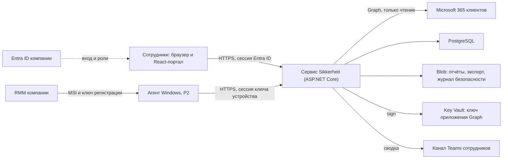

# Development Package для независимой оценки

Версия 0.3.1 от 16 октября 2026 года. Полный комплект требований, архитектуры и предложенных контрактов.

Рецензент начинает с запроса независимой оценки и проверяет весь комплект.


Файл `README.md`

# Development Package для сервиса проверки безопасности

Версия 0.3.1 от 16 октября 2026 года. Рабочее название проекта — Sikkerheit. Владелец продукта — IT-компания, обслуживающая около 40 клиентов и около 400 компьютеров Windows через RMM.

Sikkerheit — внутренний сервис регулярной проверки безопасности клиентов. Техники видят на портале отклонения всех клиентов с основанием и историей, клиенты получают еженедельный отчёт. Первый этап (P1) — проверки Microsoft 365 и Entra ID через одно приложение Graph только для чтения, без установки ПО на ПК. Второй (P2) — агент Windows, который распространяет RMM компании. Код и тесты пишут ИИ-агенты, человек ставит задачи и принимает результат.

Статус — сервис P1 написан по версии 0.3.0 и проверен автоматическими тестами на локальных данных; версия 0.3.1 приводит пакет в соответствие с решениями, принятыми при реализации и по итогам независимой оценки 0.3.0. Развёртывание в Azure, эксперименты SP-01…SP-05, приёмка человеком, пилоты и агент Windows (P2) впереди. Контракты описывают требуемое поведение; оценки сроков, нагрузка и пороги — плановые допущения.

## Как читать пакет

| Файл | Назначение |
| --- | --- |
| [01-product-and-scope.md](01-product-and-scope.md) | Продукт, роли, этапы, требования, показатели и экономика пилотов |
| [02-architecture-and-stack.md](02-architecture-and-stack.md) | Компоненты, развёртывание, сбор Microsoft 365, агент, задания, разделение клиентов, структура репозитория |
| [03-check-catalog.md](03-check-catalog.md) | Семантика результата, проверки Microsoft 365 и Windows, возможности модулей Graph, поддержка ОС и уровень патчей |
| [04-security-and-privacy.md](04-security-and-privacy.md) | Вход и роли, права Graph и ключ приложения, регистрация и аутентификация агента, журнал безопасности, данные и сроки хранения, угрозы |
| [05-data-and-api.md](05-data-and-api.md) | Модель данных, политика, подключение M365, состояния проблем, API агента и портала, отчёт и покрытие |
| [06-azure-and-operations.md](06-azure-and-operations.md) | Ресурсы Azure, развёртывание, распространение агента через RMM, оповещения, восстановление, удаление, расходы |
| [07-delivery-plan-and-acceptance.md](07-delivery-plan-and-acceptance.md) | Гейты, эксперименты, backlog, план приёмки и календарь, приёмочные сценарии, пилоты, допуск, runbooks |
| [08-risks-and-decisions.md](08-risks-and-decisions.md) | Архитектурные решения, риски, вопросы владельцу, условия пересмотра |
| [09-independent-review-prompt.md](09-independent-review-prompt.md) | Запрос независимой оценки, если владелец решит её провести |
| [10-sources.md](10-sources.md) | Первичные источники с датами сверки |
| [specs/openapi.json](specs/openapi.json) | HTTP API P1 и P2 в формате OpenAPI 3.1; этап операции — `x-phase` |
| [specs/observation.schema.json](specs/observation.schema.json), [specs/scan-batch.schema.json](specs/scan-batch.schema.json) | Наблюдение и пакет агента Windows |
| [specs/graph-observation.schema.json](specs/graph-observation.schema.json), [specs/graph-collection.schema.json](specs/graph-collection.schema.json) | Allowlist наблюдений и запуск сбора Microsoft 365 |
| [specs/check-catalog.json](specs/check-catalog.json) | Идентификаторы, этапы и режимы проверок; закрытые evidence серверных проверок SYS-* |
| [specs/invariants.json](specs/invariants.json) | Реестр правил вне JSON Schema с отрицательным примером, ожидаемым результатом и приёмочным сценарием |
| [examples/](examples/) | Синтетические пакеты агента и запуск сбора Microsoft 365 с эталонными отрицательными случаями |
| [source/boss-chat.md](source/boss-chat.md) | Исходная переписка на языке оригинала |
| [scripts/validate_package.py](scripts/validate_package.py) | Проверка контрактов, примеров, документов и инвариантов; файлы не изменяет |

## Приоритет документов

Требования к поведению определяются документами 01, 03, 04 и 05. OpenAPI и схемы уточняют поля и HTTP-ответы. Реестр инвариантов `specs/invariants.json` уточняет поведение, не выраженное машинным контрактом, и подчиняется документам 01, 03, 04 и 05: каждая запись ссылается на раздел документа, и при расхождении действует документ, а запись исправляется. Противоречие между файлами считается дефектом пакета. Исходная переписка показывает происхождение идеи; её технические предложения спецификацией не являются.

Проверка и сборка разделены. [scripts/validate_package.py](scripts/validate_package.py) ничего не записывает и читает только файлы внутри пакета. Он проверяет:

- структуру JSON и используемое подмножество JSON Schema встроенным валидатором;
- разрешение локальных `$ref`;
- согласованность OpenAPI с документами;
- каталог проверок и примеры с отрицательными вариантами;
- реестр инвариантов;
- ссылки на идентификаторы и локальные ссылки;
- таблицы плана: часы приёмки и календарь, этапы приёмочных сценариев и допусков, операции runbooks;
- таблицы жизненного цикла ОС и состояний агента;
- `manifest.json`: структуру всегда, а с ключом `--manifest` — размер и SHA-256 каждого файла и отсутствие лишних и недостающих файлов. Получатель пакета запускает `python3 -I scripts/validate_package.py --manifest`; без ключа устаревший манифест только отмечается в сводке, потому что его перезаписывает сборка.

При ошибке он возвращает ненулевой код. `scripts/build_package.py` вызывает validate и после успешной проверки записывает `VALIDATION.md`, `REVIEW-BUNDLE.md`, `manifest.json` и ZIP. Стандартная проверка сторонними валидаторами (`jsonschema`, `openapi-spec-validator`) выполняется, если они установлены; иначе `VALIDATION.md` это фиксирует. Полная стандартная проверка, генерация клиентов и CI — первый результат WP-01.

## Изменения в 0.3.1

Пакет приведён в соответствие с кодом P1, ответами владельца и решениями по итогам независимой оценки 0.3.0.

- **Этапы и план.** Отдельной стадии P0 нет: SP-01 и SP-02 выполняются по ходу разработки, когда появляется доступ к tenant и Azure, SP-03 — по решению владельца. Код пишут ИИ-агенты, поэтому план считается в часах приёмки человеком, а календарь — делением на часы приёмки в неделю (по умолчанию 10, вопрос 17). Работы идут подряд, гейты — решения о пилоте и распространении. Security Owner по умолчанию — владелец, у него есть заместитель с аварийным доступом.
- **Пилот.** Клиенты платят за анализ безопасности: критерии «исправление раз в две недели» и подтверждения цены сняты, измеряются польза отчёта и затраты. Клиент без Entra ID P1 проходит пилот с честным unknown.
- **Права Graph.** `GroupMember.Read.All` вместо несуществующего `GroupMember.ReadBasic.All`; M365-007 и `AuditLog.Read.All` отложены, первый consent — шесть прав.
- **Правила M365.** Per-user MFA: pass только в состоянии enforced, enabled — unknown до SP-01 (отдельный счётчик `enabled`). M365-007 до её ввода нельзя перевести в assessed. Неизвестная форма ответа Security Defaults и условие CA вне перечня дают unknown, а не pass. Временные активации PIM учитываются в M365-002 отдельным видом назначения, роли вне политики перечисляет M365-005. Сборщик M365 не выставляет `unsupported`.
- **Вход сотрудников.** Access token v1 собственного API ради claim `amr`; обновление сессии раз в час погашает refresh token, отключение и снятие роли прекращают доступ отдельно. Учётные данные приложения портала — federated credential от managed identity слотов.
- **Данные и отчёт.** Неизменяемая запись каждого решения о риске; неизменяемый снимок отчёта при генерации; отчёт только за завершённую неделю, `failed` можно повторить, `ready` не переписывается; ключ периода `weekly_report` — ISO-неделя без догона до создания организации; подключённый tenant до первого сбора даёт покрытие 0; пересчёт политики даёт `missing_observation` только проверкам assessed; UPDATE истории у роли приложения отозван.
- **Задания и сбор.** Lease проверяется в каждой транзакции порции; сводка Teams идемпотентна по периоду, недоверенные имена — в `TextRun`; плановый сбор не присоединяется к открытому запуску и закрывает зависший дольше 6 часов с `run_timeout`; пересчёт по новой `ruleVersion` планировщик ставит заданием `recalculate_policy` с `inputId` = `rule:<ruleVersion>` раз на организацию.
- **Azure и восстановление.** P1 на стандартном hostname App Service; identity миграций — администратор Entra PostgreSQL, identity слотов — в роли `sikkerheit_app`; журнал безопасности пишется ролью Storage Blob Data Contributor под заблокированной неизменяемостью; query-строки удалены из телеметрии. После восстановления версии политики продолжаются со следующей эпохи — наименьшего кратного 10 000, большего и сохранённой версии, и восстановленного счётчика, — а состоявшееся удаление повторяется сразу. Описаны запуск команды восстановления, её коды выхода и аудит; команда входит в закрытый перечень области чтения всех организаций, а по ключу файла отчёта `<organizationId>/<ISO-неделя>/<reportId>.html` отмечает выполненным `weekly_report` недели, чей файл попал в карантин.
- **Модули.** У каждой таблицы один модуль-владелец, таблица владельцев — в `02`, «Структура репозитория»; там же проект контрактных тестов реестра инвариантов.
- **P2.** Замена ключа устройства — только с подписью прежним ключом или по решению Admin (`accept_new_key`), с удалением прежних сессий; `revoked_installation` хранится, пока у организации есть активный ключ регистрации; полнота пакета — по проверкам агента; RMM ставит только утверждённый MSI по версии и SHA-256.
- **Проверка пакета.** Валидатор не читает файлы вне пакета и сверяет `manifest.json` (`--manifest`); пример запуска M365 — запуск P1 без отложенной M365-007; сводка `retention.purge_summary` считает и удалённые решения о риске; реестр инвариантов дополнен записями INV-177…INV-201 без смены прежних ID.

## Изменения в 0.3.0

Архитектура пересобрана под фактический масштаб и команду.

- **Этапы.** P1 — портал и семь проверок Microsoft 365 для всех клиентов без установки ПО; P2 — агент Windows через RMM; P3 — расширения по отдельным решениям. Выбор «агент или импорт из Intune и RMM» снят: агент ставит RMM, Intune — кандидат P3.
- **Один сервис** (модульный монолит) на App Service вместо четырёх процессов и трёх сред Container Apps. Пакет агента принимается и оценивается синхронно; асинхронная очередь оценки и правила поздних пакетов удалены.
- **Microsoft 365** — одно multi-tenant приложение только с правами чтения и admin consent клиента. Ключ сертификата неэкспортируемый в Key Vault HSM, подпись client assertion — в Key Vault. Права, лицензии и лимиты Graph сверены с первоисточниками.
- **Агент** аутентифицируется ключом устройства (TPM или неэкспортируемый программный ключ) и сессией по challenge-response с nonce без записи в базу. Собственный CA, Issuer, mTLS и продление сертификатов удалены. Регистрация — ключом организации, который скрипт RMM передаёт файлом, а не командной строкой; агент сам регистрируется заново, если сервер не знает устройство. Конфликт идентичности разбирается без отзыва оригинала.
- **Агент — одна служба LocalSystem** без канала команд и дочерних процессов; обновление только через RMM. Автомат состояний задан полной таблицей, конфигурация и пакет версионируются, недопустимое значение наблюдения не отбрасывает пакет.
- **Уровень патчей Windows** — серверная проверка SYS-003 по build и UBR и сверенным месяцам каталога выпусков; отставание считается в месяцах безопасности с учётом hotpatch, каталог ведётся операциями портала. История ожидающих обновлений удалена; WIN-006 — информационное состояние службы обновлений. WIN-007 больше не утверждает непрерывность требования перезагрузки.
- **Матрица ОС**: клиентские Windows 10 (LTSC 2019 и новее) и Windows 11 x64 с таблицей жизненного цикла, включая IoT Enterprise LTSC, сверенной 2026-10-15. ОС, которую поддерживает Microsoft, но не агент, даёт unknown, а не fail.
- **Роли и изоляция.** Роли Admin, Technician и Reader; все сотрудники видят всех клиентов. Изоляция — область запроса и простая RLS: запись только в области одной организации.
- **Восстановление.** Вместо версионированного журнала жизненного цикла и карантина в девять шагов — append-only журнал ограничивающих действий безопасности и отмены удаления, который повторяется после восстановления базы; отозванные установки помнятся без строки устройства, а удаление после восстановления откладывается.
- **Эксплуатация.** Миграции выполняет образ сервиса в слоте staging, задания работают только в production-слоте; сводка Teams идёт через Workflows.
- **План** — на одного разработчика с загрузкой 0,8, с отпуском и эксплуатацией P1 в календаре и пересчётом на гейтах; эксперименты SP-01…SP-05, работы WP-01…WP-12, приёмочные сценарии AT-01…AT-17 с частями P1 и P2 и runbooks RB-01…RB-14.


Файл `01-product-and-scope.md`

# Продукт и объём разработки

Sikkerheit — внутренний сервис IT-компании для регулярной проверки безопасности клиентов: около 40 организаций и около 400 компьютеров Windows. Техник получает очередь конкретных отклонений с основанием, ответственным и историей, клиент — еженедельный отчёт с понятными действиями. Клиенты платят компании за анализ безопасности; ценность сервиса — регулярная проверка, честные ограничения, история и готовый отчёт, которые сокращают ручную работу техников.

## Пользователи и сценарии

Пользователи P1 и P2 — сотрудники компании; клиенты получают отчёт от техника, собственного входа у них нет до P3 (ADR-15). Все сотрудники видят всех клиентов (ADR-11). Роли:

- **Admin** — руководитель сервиса или ведущий техник. Создаёт клиентов, подключает Microsoft 365, меняет политику, выпускает ключи регистрации агентов, принимает решения о риске и ведёт жизненный цикл клиента.
- **Technician** — работает с проблемами всех клиентов: назначает ответственного и срок, отмечает работу, запрашивает повторный сбор, формирует отчёт.
- **Reader** — только просмотр, например для руководства и продаж.

Права ролей — `04`, раздел «Вход сотрудников и роли».

Основной сценарий P1 — Microsoft 365:

1. Admin создаёт организацию; политика v1 создаётся вместе с ней.
2. Admin указывает tenant клиента и получает ссылку admin consent для этого tenant. Consent выдаёт Admin компании, если у него есть нужная роль в tenant клиента через GDAP, либо администратор клиента по пересланной ссылке. Затем Admin проверяет подключение в портале.
3. Первый сбор выполняется сразу, дальше — ежедневно ночью и по запросу.
4. Отклонения появляются в общей очереди: пользователи без MFA, администраторы без MFA, MFA не обязательна, лишние глобальные администраторы, пользователи сами выдают согласие приложениям.
5. Техник исправляет проблему привычными средствами (центр администрирования Entra), повторный сбор подтверждает исправление, и в отчёте оно попадает в категорию «исправлено».

Основной сценарий P2 — Windows:

1. Admin выпускает ключ регистрации организации.
2. Техник распространяет подписанный MSI агента через RMM компании; скрипт RMM передаёт ключ файлом, доступным только SYSTEM.
3. Агент регистрируется, собирает факты раз в сутки и передаёт их серверу.
4. Отклонения Windows попадают в ту же очередь и отчёт. Повторную проверку после исправления техник запрашивает из портала.

Отсутствие данных проблему не закрывает: устаревший результат показывается как прошлый, с датой.

## Этапы

Отдельной подготовительной стадии нет. Код и тесты пишут ИИ-агенты, человек ставит задачи и принимает результат; работы идут подряд, а гейты — решения о пилоте и распространении после приёмки человеком (`07`, «Правила этапов и гейты»). До доступа к Azure и tenant сервис разрабатывается и испытывается локально на поддельном Graph.

| Этап | Входит | Условие завершения |
| --- | --- | --- |
| P1 — платформа и Microsoft 365 | Портал на bokmål с переключением на nynorsk и английский; организации и политика; подключение Microsoft 365 и проверки M365-001…M365-006 (M365-007 отложена до отдельного решения); история и workflow; недельный HTML-отчёт; ежедневная сводка сотрудникам в Teams; экспорт и удаление; эксплуатация. Эксперименты по ходу разработки: SP-01 — доступ Graph на tenant компании и двух пробных tenant (Business Premium с Entra ID P1 и Business Standard без него), как только они доступны; SP-02 — каркас в Azure после доступа к подписке; SP-03 — база ценности по решению владельца. Данные клиентов до договоров обработки не читаются. Пилот на 3–5 клиентах (G1 — допуск пилота), затем подключение всех клиентов | Критерии пилота M365 выполнены (разделы «Плановые показатели» и «Экономика пилотов»); G2 — решение о подключении всех клиентов |
| P2 — агент Windows | Эксперименты SP-04 и SP-05; служба агента, регистрация ключом организации, проверки WIN-001…WIN-011 и SYS-001…SYS-003; подписанный MSI; распространение через RMM. Пилот на 3–5 клиентах (20–40 ПК), затем все ПК клиентов | Критерии пилота Windows выполнены; G3 — решение о распространении |
| P3 — расширения | Каждое по отдельному решению и оценке: клиентский вход и рассылка отчётов, данные Intune и Defender, инвентарь ПО и сторонние обновления, интеграция с PSA, Secure Score, ARM64 и серверы | Спрос и стоимость сопровождения подтверждены пилотами |

Агент P2 устанавливается на клиентские Windows 10 и Windows 11 x64 по матрице совместимости в `03`. Windows 10 включена, чтобы клиент видел устаревшую ОС: SYS-002 даёт для 22H2 fail, а оплаченный ESU оформляется решением о риске со сроком пересмотра. ARM64 и серверы — P3: MSI на них не устанавливается, а если агент всё же оказался на такой ОС, SYS-002 даёт unknown, а не fail.

## Функциональные требования

| ID | Требование | Этап | Приёмка | Контракт |
| --- | --- | --- | --- | --- |
| FR-01 | Организации: создание, изменение, отключение, экспорт и удаление с отсрочкой; сводка по каждому клиенту | P1 | AT-01, AT-09 | listOrganizations, createOrganization, getOrganization, updateOrganization, changeOrganizationLifecycle, createOrganizationExport, getOrganizationExport, downloadOrganizationExport |
| FR-02 | Вход сотрудников через Entra ID компании с MFA, роли Admin, Technician и Reader, аудит изменений | P1 | AT-02 | getCurrentStaff, listStaff, listAuditEvents |
| FR-03 | Политика клиента: неизменяемые версии, режим и параметры каждой проверки | P1 | AT-06 | listPolicyRevisions, createPolicyRevision |
| FR-04 | Подключение Microsoft 365 через admin consent клиента для заранее указанного tenant, проверка подключения, видимое состояние и отключение | P1 | AT-03 | getTenantConnection, startTenantConsent, verifyTenantConnection, disconnectTenant |
| FR-05 | Ежедневный и внеплановый сбор Microsoft 365 с явными возможностями модулей и частичными результатами | P1 | AT-04, AT-10 | listCollectionRuns, requestCollection |
| FR-06 | Оценки: четыре результата, отдельная свежесть, информационный режим и основание вывода | P1 | AT-05, AT-06 | listAssessments |
| FR-07 | Стабильная история проблем с причиной каждого события; ответственный, срок и решение о риске без подмены технического результата | P1 | AT-06, AT-08 | listFindings, getFinding, patchFinding, decideFindingRisk, listFindingEvents |
| FR-08 | Еженедельный HTML-отчёт на языке организации с покрытием, категориями изменений и неизменяемым снимком данных | P1 | AT-07 | listReports, createReport, downloadReport |
| FR-09 | Общая очередь проблем всех клиентов и ежедневная сводка сотрудникам в канал Teams | P1 | AT-01, AT-10 | listFindingsAcrossOrganizations |
| FR-10 | Сроки хранения и восстановление из резервной копии без возврата отозванного доступа | P1 | AT-09, AT-11 | процедура: RB-05, процедура: RB-07 |
| FR-11 | Регистрация агента ключом организации, отдельный ключ каждого устройства, отзыв устройства и ключа, разбор конфликта идентичности | P2 | AT-12 | createEnrollmentKey, listEnrollmentKeys, revokeEnrollmentKey, createAgentChallenge, enrollAgent, createAgentSession, listDevices, updateDevice, revokeDevice, resolveDeviceIdentity |
| FR-12 | Сбор фактов Windows без изменения системы, офлайн-буфер, повтор без дубликатов, повторная проверка по запросу и каталог выпусков Windows для уровня исправлений | P2 | AT-13, AT-14, AT-15 | agentCheckIn, submitScan, requestDeviceScan, listWindowsReleases, importWindowsReleases, verifyWindowsReleaseMonth |
| FR-13 | Подписанные версии агента, распространение через RMM, поэтапный выпуск и откат | P2 | AT-16 | процедура: RB-08, процедура: RB-09 |

Колонка «Контракт» называет операции OpenAPI своего этапа (расширение `x-phase`) либо процедуру из раздела «Runbooks» в `07`. Сверх связей в таблице: AT-10 относится также к FR-08 (задания отчётов), AT-11 — к FR-11 (повторная регистрация после восстановления), AT-14 — к FR-06 в части правил Windows, AT-17 — к показателям NFR-04…NFR-06.

## Язык портала и отчёта

Решение владельца: еженедельный отчёт формируется на языке, выбранном для каждой организации, а портал по умолчанию работает на bokmål (nb) с переключением на nynorsk (nn) и английский (en).

- **Язык отчёта.** Задаёт поле `Organization.reportLanguage` со значениями nb, nn или en. Оно обязательно при создании организации и меняется через `updateOrganization`; `Report.language` фиксируется при генерации.
- **Нет перевода.** Смешения языков в отчёте нет: если перевода текста правила нет, отчёт получает `state=failed` и `failureCode=translation_missing`. Резервный язык не подставляется до ответа на вопрос 9 в `08`.
- **Язык портала.** Выбор языка хранится в браузере и не меняет API; при пустом хранилище действует nb. Портал передаёт язык заголовком `Accept-Language`, и сервер возвращает на нём заголовки, рекомендации и пояснения правил.
- **Что не переводится.** Идентификаторы, коды и evidence.
- **Сводка в Teams.** Ежедневная сводка сотрудникам пишется на nb.
- **Где хранятся тексты.** Строки портала и отчёта с первого дня лежат во внешних ресурсах; тексты правил — это локализованные шаблоны по правилу, версии правила и языку. Подробности — `05`, раздел «Отчёт и покрытие».

## Границы обещаний

Оценка относится к конкретным поддерживаемым проверкам и доступным данным. Отчёт не выражает вероятность взлома, не подтверждает отсутствие вредоносного кода и не заменяет восстановление из резервной копии или тестирование на проникновение.

Сервис не собирает:

- пароли, cookies и историю браузера;
- содержимое писем и документов;
- recovery passwords BitLocker;
- номера телефонов и адреса методов аутентификации.

Сервис не выполняет:

- подбор паролей и эксплуатацию уязвимостей;
- произвольные команды на ПК;
- автоматическое исправление политик Windows или Microsoft 365.

Приложение Graph имеет только права чтения и ничего не меняет в tenant клиента. Эти исключения ограничивают права, риски и стоимость сопровождения.

Сервис работает на любом плане Microsoft 365, но одинаковой глубины анализа на всех планах не обещает. Наличие Entra ID P1 он определяет сам по `subscribedSkus` и показывает в подключении. Без P1 нет данных Conditional Access: обязательность MFA подтверждается только Security Defaults или per-user MFA в состоянии enforced, блокировка устаревшей аутентификации — Security Defaults. Если подтвердить нельзя (per-user MFA в состоянии enabled, модуль per-user MFA выключен), результат — unknown с причиной, а не fail; если Security Defaults выключены и у части пользователей per-user MFA disabled, M365-003 даёт fail critical.

Регистрация метода MFA не доказывает, что MFA обязательна при входе; обязательность оценивает отдельная проверка M365-003 по консервативному правилу (`03`). Проверка Conditional Access не доказывает покрытие каждого сценария входа. Secure Score, журналы входов и инцидентов, проверка резервных копий и SaaS вне Microsoft 365 — модули P3.

## Плановые показатели

Масштаб компании — около 40 организаций, около 400 ПК и обычно 5–50 пользователей Microsoft 365 у клиента. Проектирование и нагрузочные испытания используют расчётную модель с запасом в 2,5 раза:

- 100 организаций, 1 000 устройств и 5 000 пользователей Microsoft 365;
- один полный сбор агента в сутки и check-in каждые 4 часа при включённом ПК;
- утренний старт: 70% устройств включаются в течение 30 минут;
- сбор Microsoft 365 раз в сутки по каждому tenant в окне 01:00–05:00 по времени организации.

| ID | Плановый критерий | Как измерить |
| --- | --- | --- |
| NFR-01 | Не менее 98% tenant-суток с активным подключением имеют завершённый сбор (`completed` или `partial`) в течение 26 часов | Запуски сбора по `listCollectionRuns`; отключённые подключения не входят в знаменатель |
| NFR-02 | Не менее 95% устройство-суток с подтверждённой доступностью имеют валидный пакет агента в течение 48 часов | Знаменатель — устройство-сутки, в которые устройство было в сети по `device_presence` (check-in или пакет) или по выгрузке RMM за период пилота; офлайн учитывается отдельно |
| NFR-03 | `coveragePeriod` за неделю не ниже 90% отдельно для Microsoft 365 и для Windows среди пар, вывод по которым возможен при лицензиях и настройках клиента | Определения — `05`, раздел «Отчёт и покрытие»; в числитель входят только pass и fail, unknown с причиной покрытие не повышает. Пары с unknown из-за ограничений самого tenant или неподтверждённой семантики источника (`license_missing`, `enforcement_unconfirmed`) остаются в покрытии отчёта и видны в нём с причиной, но в этот критерий не входят (покрытие для NFR-03 — `05`, «Отчёт и покрытие»): клиент без P1 проходит пилот с честным unknown. Для Windows знаменатель — устройства с check-in в этой неделе (подтверждённая доступность); выключенные устройства показываются отдельно |
| NFR-04 | p95 приёма и оценки пакета агента — менее 2 секунд; сбор одного tenant до 300 пользователей — менее 15 минут, всех tenant расчётной модели — в ночном окне | При расчётной нагрузке, включая утренний старт; время сбора определяют лимиты Graph на методы аутентификации (`02`, «Сбор данных Microsoft 365») |
| NFR-05 | Сессия сбора на референсном ПК — до 120 секунд, один сборщик — до 30 секунд; средняя CPU за 15 минут — до 2%, память — до 150 МБ | Windows-лаборатория SP-04; по всем процессам агента |
| NFR-06 | Буфер агента до `maxBufferDays` (7 суток) и 100 МБ; сервер принимает пакеты возрастом до `maxBatchAgeDays` (9 суток) | Испытание длительного отсутствия сети; переполнение даёт счётчик потерянных пакетов |
| NFR-07 | RPO до 15 минут, RTO до 4 часов, после восстановления отозванный доступ не возвращается | Учебный restore с повтором журнала безопасности (AT-11); это цель, а не обещание поставщика |
| NFR-08 | Нет доступа между клиентами при подмене идентификаторов | Сквозные негативные испытания API, заданий, файлов и запросов агента (AT-01) |
| NFR-09 | Стоимость Azure — ориентир до 200 USD в месяц для production и до 50 USD для test при расчётной нагрузке | Фактический счёт и оповещение бюджета (RB-14); расчёт — `06`, «Модель расходов» |

Референсный ПК и лабораторные условия фиксируются в SP-04. Нагрузочная модель не доказывает производительность до измерений.

## Экономика пилотов

В расходы входят облако, лицензии и подпись кода, время подключения клиентов, поддержка агента, разбор ложных срабатываний и исправления. Ежемесячный вклад клиента — выручка минус выделенные расходы облака, поддержки и сторонних лицензий; разработка учитывается отдельно при расчёте окупаемости.

Пилот M365 — 3–5 организаций (не меньше 3), 4 недели. Пилот Windows — 3–5 организаций, 20–40 ПК, 6 недель. Клиенты уже платят за анализ безопасности, поэтому пилот не доказывает готовность платить и не требует находить новые проблемы с заданной частотой: здоровый клиент без отклонений проходит пилот при честном отчёте.

| Область | Критерий продолжения |
| --- | --- |
| Доставка | Пилот M365 — NFR-01; пилот Windows — NFR-02 |
| Достоверность | NFR-03 по каждой неделе. 0 ложных pass в эталонных отрицательных сценариях: M365-003 с политикой report-only (AT-05) и BitLocker с приостановленной защитой (AT-14). Ложных fail — не больше 10% от fail, разобранных техником |
| Польза | Техник и клиент каждой пилотной организации подтверждают, что отчёт понятен, ограничения названы, а рекомендации выполнимы. Исправления с участием техника (проблема была в работе, имела ответственного или повторную проверку и закрыта `resolved` с `source_change`; без самозакрывающихся SYS-003, WIN-004 и WIN-007) и отклонения, которых не показывали текущие инструменты, считаются как показатели, а не как порог. Время подготовки недельного отчёта — не больше 50% от ручной подготовки: базы SP-03, если она снималась, иначе — замера ручного отчёта по одной пилотной организации в первую неделю |
| Эксплуатация | Пройдены сценарии допуска своего пилота (`07`, «Условия допуска»). Учебный restore укладывается в RTO. Время техников на подключение, разбор срабатываний и поддержку — в среднем не больше 1 часа в месяц на организацию в пилоте M365 и не больше 2 часов в пилоте Windows; в расчёте вклада это время оценивается по ставке техника |
| Затраты | Выделенные затраты на организацию — облако, лицензии и время техников — не выше оплаты анализа, вклад после них положительный |

Если критерии пользы или затрат не выполнены, действует условие пересмотра в `08`. Пилот также фиксирует, нужен ли клиентам PDF-файл отчёта вместо печати из браузера.


Файл `02-architecture-and-stack.md`

# Архитектура и технический стек

Сервер — один развёртываемый модульный монолит на ASP.NET Core 10 (ADR-02). В одном процессе работают портал и его API, сборщик Microsoft 365, API агента (P2) и фоновые задания. Данные хранятся в PostgreSQL, файлы — в Blob Storage, ключ приложения Graph — в Key Vault. Агент Windows (P2) — одна служба, которую ставит RMM компании. Масштаб — около 40 организаций и 400 ПК, нагрузка — сотни пакетов и десятки запусков сбора в сутки, поэтому отдельные процессы и очереди сообщений не нужны.



## Компоненты

| Компонент | Технология | Ответственность |
| --- | --- | --- |
| Портал | React, TypeScript, Vite | Сводка по клиентам, общая очередь, проблемы и история, подключения, политика, администрирование. Интерфейс на nb по умолчанию с переключением на nn и en; строки во внешних ресурсах; статические файлы отдаёт тот же сервис |
| Сервис Sikkerheit | ASP.NET Core 10, один процесс | Модули: организации и политика, вход и роли, Microsoft 365, агенты (P2), оценка и проблемы, отчёты, задания и журнал безопасности. Модули общаются через интерфейсы внутри процесса и владеют своими таблицами |
| Хранение | PostgreSQL 17, EF Core 10, Npgsql 10; схема — SQL-миграции | Транзакции, история, JSONB для evidence, разделение клиентов с RLS |
| Файлы | Azure Blob Storage | Отчёты, экспорты, журнал безопасности (контейнер с неизменяемостью), подписанные MSI (P2) |
| Секреты | Azure Key Vault | Неэкспортируемый ключ сертификата приложения Graph (операция sign), ключ шифрования ключей Data Protection, ключ HMAC cursor, ключ HMAC nonce агента (P2), адрес webhook Teams Workflows |
| Идентичность | Entra ID компании, MSAL.NET | Вход сотрудников с app roles; отдельное multi-tenant приложение Graph с правами только на чтение |
| Агент, P2 | .NET 10 Windows Service, self-contained | Фиксированные сборщики WMI/CIM, COM и Win32, буфер SQLite, ключ устройства CNG, регистрация и сессия |
| Наблюдаемость | OpenTelemetry, Application Insights и Log Analytics | Метрики, трассировка и журналы без тел запросов и секретов; дневной лимит приёма журналов |

.NET 10 — выпуск с долгосрочной поддержкой; версии пакетов закрепляются lock-файлами. Сборки агента self-contained включают runtime, поэтому исправления .NET выпускаются новой версией агента.

## Развёртывание и окружения

Окружения test и production разделены: у каждого свой план App Service, база, хранилище, Key Vault и регистрация приложения входа. Приложение Graph одно на production; у test — отдельное приложение, подключаемое только к тестовым tenant.

- **Сервис** — Azure App Service (Linux) с одним экземпляром и Always On. В P1 сервис работает на стандартном hostname App Service (`*.azurewebsites.net`): портал, API портала и завершение consent. В P2 добавляется hostname агента (только `/api/v1/agent/*`), а при необходимости — собственные домены; промежуточный слой отвечает 404 на пути, пришедшие не на свой hostname. Список hostname — настройка слота: в слоте staging пути обслуживает hostname слота, и для него в регистрации входа есть отдельный redirect URI.
- **Слоты.** Развёртывание идёт через слот staging с переключением. Настройки слота закреплены за слотом: `Jobs:Enabled` (production — true, staging — false) и `Database:MigrateOnStart` (только staging). Поэтому новая версия до переключения и прежняя после него заданий не выполняют; во время самого переключения два экземпляра могут работать одновременно, и lease заданий это допускают (раздел «Фоновые задания»). После переключения слот staging останавливается.
- **База** — Azure Database for PostgreSQL Flexible Server с приватным доступом через интеграцию VNet и только входом Entra, без паролей. PITR хранится 14 суток.
- **Миграции** выполняет сам образ сервиса при старте в слоте staging: GitHub-hosted runner вне VNet к базе с приватным доступом не подключится, а приватный доступ после создания сервера не меняется. Identity миграций — user-assigned identity, единственный администратор Entra сервера PostgreSQL и владелец схемы; она назначена только слоту staging. При старте staging она создаёт роль `sikkerheit_app` (NOLOGIN, без BYPASSRLS), роли system-assigned identity обоих слотов (`pgaadauth_create_principal_with_oid`) и включает их в `sikkerheit_app`. Поэтому установке не нужен SQL извне VNet, а у слотов нет прав владельца. Схема меняется по правилу expand/contract: релиз содержит только расширения, совместимые с предыдущей версией, а удаление прежних столбцов (contract) выходит следующим релизом, когда прежняя версия нигде не работает. Разрушающих миграций при старте production нет. В окружении без слота (test на плане B1 и запасной вариант production на B2: у планов Basic слотов нет) конвейер на время развёртывания назначает приложению identity миграций и включает `Database:MigrateOnStart`, а после успешного старта снимает их; сервис при этом ненадолго перезапускается вне окна сбора. Обе процедуры при выключенном публичном доступе к базе проверяет SP-02.
- **Infrastructure as code** — Bicep. CI — GitHub Actions или система компании; вход в Azure по OIDC (federated credentials). Сборка агента и MSI — Windows runner, сервиса — Linux runner.

Ресурсы, конфигурация и стоимость — `06`.

## Сбор данных Microsoft 365

Доступ к tenant клиентов даёт одно multi-tenant приложение Entra в tenant компании с application permissions только на чтение (ADR-05; перечень и назначение прав — `04`, «Права Graph»). Администратор каждого клиента выдаёт admin consent один раз. Токен для tenant получается по client credentials. Client assertion (PS256, заголовок `x5t#S256`) подписывается операцией sign Key Vault неэкспортируемым RSA-ключом сертификата приложения, поэтому закрытый ключ не попадает в процесс; RS256 — запасной вариант, если SP-01 покажет отказ PS256. Кэш токенов — в памяти, по tenant.

Запуск сбора выполняется по организации, а не по пользователю:

1. **Сверка tenant.** Токен запрашивается для `entraTenantId` подключения; `/organization` должен вернуть тот же id.
2. **Лицензии.** `subscribedSkus` определяет наличие Entra ID P1 или P2.
3. **Пользователи.** Полный список `/users` со всеми страницами.
4. **Роли.** Активные назначения ролей каталога, члены групп, которым назначена роль, и роль учётной записи синхронизации Entra Connect. При Entra ID P2 временные активации PIM отделяются по `roleAssignmentScheduleInstances`: в M365-002 они учитываются отдельным видом назначения, а в счёт M365-005 не входят. Роли вне `privilegedRoleTemplateIds` перечисляются в evidence M365-005 (`03`, «Правило M365-001 и M365-002» и «Правило M365-005»).
5. **Методы аутентификации.** Запрашиваются через JSON batch, до 20 запросов в пакете, для объединения двух групп: включённые member-пользователи вне `excludedUserIds` и все пользователи с привилегированной ролью. Первыми идут пользователи, чьи методы читались давнее всего, поэтому при таймауте запуска непрочитанными каждый раз остаются разные пользователи.
6. **Политики.** Security Defaults, политики Conditional Access (при P1), политика авторизации. Активность входов (модуль `sign_in_activity`) отложена вместе с M365-007 и правом `AuditLog.Read.All`. Состояние per-user MFA (модуль `per_user_mfa`, Graph beta, гипотеза H-MFA1 в SP-01) читается, если Security Defaults выключены и ни одна включённая политика CA не требует MFA безусловно для всех; состояния enabled и enforced хранятся раздельно (`03`, «Правило M365-003»).

Каждый модуль получает статус возможности (`03`, «Возможности подключения»). Наблюдения проверяются allowlist-схемой `specs/graph-observation.schema.json` до записи. Оценка всех наблюдений запуска и обновление проблем выполняются в одной транзакции в конце запуска.

Ограничения:

- плановый запуск — раз в сутки в час `collectionHourLocal` политики (по умолчанию 03:00 по времени организации) со случайной задержкой до 30 минут;
- внеплановый запуск — по `requestCollection`;
- у организации не больше одного незавершённого запуска; одновременно обслуживаются не больше 8 tenant;
- лимиты Graph соблюдает общий ограничитель сервиса: методы аутентификации и отчёты — не больше 5 запросов за 10 секунд на tenant и 122 за 10 секунд на все tenant; `signInActivity` — не больше 10 запросов в минуту на все tenant, страница 500; Conditional Access — 1 запрос в секунду на tenant. Каждый запрос внутри JSON batch учитывается отдельно. Поэтому tenant с 300 пользователями собирается около 10 минут, а расчётная модель — в ночном окне;
- таймаут запроса — 30 секунд, запуска — 30 минут; запуск, не успевший прочитать методы всех пользователей, получает `partial`, а непрочитанные пользователи — unavailable/`temporary_error`. При лимите 5 запросов за 10 секунд это граница около 850 включённых пользователей на tenant. Запуск, оставшийся открытым дольше 6 часов (сбой процесса), закрывает следующее плановое задание с `failed`/`run_timeout`;
- `Retry-After` соблюдается всегда, без него — экспоненциальная пауза (Conditional Access его не возвращает);
- следующая страница берётся только по `@odata.nextLink` на `graph.microsoft.com`;
- частичный результат допустим и помечается.

Правила подключения, сбора и вывода пользователей из учёта — `05`, раздел «Подключение M365 и сбор».

## Выполнение локальной проверки

Агент P2 — одна служба Windows под LocalSystem с фиксированными сборщиками (ADR-08). Большинству сборщиков нужны права администратора (BitLocker, Secure Boot, состав локальной группы администраторов в домене), а разделение на непривилегированный хост и привилегированный сборщик стоит дороже, чем даёт при таком масштабе. Компенсирующие требования обязательны:

- сборщики вызывают WMI/CIM, COM и Win32 API напрямую из .NET; `Process.Start`, PowerShell, cmd, скриптовые движки, загрузка плагинов и динамического кода запрещены;
- входящих сетевых listener и named pipe нет;
- сервер не может передать команду: конфигурация содержит только расписание, список проверок, лимиты и признак повторной проверки, а агент разбирает её строго по схеме своей версии и отклоняет целиком при поле вне схемы, продолжая с прежней (версии схемы — `05`, «API агента»);
- каждое наблюдение проверяется встроенной схемой до записи в буфер; не прошедшее проверку, в том числе неизвестное значение перечисления, заменяется на `unavailable/unsupported`, и остальные проверки пакета не теряются;
- исходящие соединения — только HTTPS на hostname агента; сертификат сервера проверяется по хранилищу доверия Windows; прокси — свойство MSI `PROXY` или системный прокси WinHTTP, иначе прямое соединение; PAC и WPAD в P2 не поддерживаются;
- каталог установки доступен на запись только SYSTEM и администраторам; каталог данных (SQLite, ссылка на ключ, ключ регистрации под DPAPI, входящий файл ключа) — только SYSTEM;
- бинарные файлы и MSI подписаны (`06`, «Распространение агента через RMM»);
- каждый сборщик выполняется в своём потоке (STA для COM, где нужно) и ограничен 30 секундами, сессия сбора — 120 секундами; оставшиеся проверки получают `unavailable/collector_timeout`. .NET не прерывает зависший COM-вызов, поэтому поток не ждут, а оставляют, и счётчик `abandonedCollectors` уходит в check-in. При трёх оставленных потоках служба завершается с кодом ошибки, и SCM перезапускает её по recovery actions MSI. Запросы WMI получают собственный таймаут (`EnumerationOptions.Timeout`);
- плановый сбор начинается не раньше чем через 60 минут после загрузки ОС; пакет — не больше 256 КиБ, буфер — не больше 100 МБ и `maxBufferDays` (по умолчанию 7 суток).

Модель угроз. На тех же ПК уже работает агент RMM под SYSTEM, и он умеет выполнять удалённые команды. У агента Sikkerheit канала команд нет, поэтому компрометация сервера Sikkerheit не даёт выполнить код на ПК клиентов. Худший случай — ложные факты с уже захваченного ПК; достоверность измерений на полностью скомпрометированном ПК не обещается.

Сборщик возвращает факт либо причину недоступности и не решает, применима ли проверка. Агент записывает пакет в SQLite и отправляет пакеты по одному, от старых к новым, ожидая ответа 200. Сервер принимает и оценивает пакет в одной транзакции (ADR-04). Check-in передаёт телеметрию: глубину очереди, удалённые и отклонённые пакеты, отказ конфигурации, число запусков службы, время последнего сбоя, память, процессорное время и оставленные сборщики; по ней видны критерии остановки кольца выпуска (RB-08). Кандидаты API сборщиков — `03`, раздел «Сбор данных и источники»; права и время каждого вызова подтверждает SP-04.

## Фоновые задания

Фоновые задания хранятся в таблице `job` PostgreSQL и выполняются внутри сервиса. Приём пакетов агента в задания не входит: он синхронный.

| Задание | Когда | Что делает |
| --- | --- | --- |
| `m365_collect` | Раз в сутки по организации; по запросу | Запуск сбора Microsoft 365 |
| `recalculate_policy` | После новой ревизии политики или `ruleVersion` | Пересчёт текущих проекций организации |
| `report_generate` | По `createReport` | Отчёт за неделю |
| `weekly_report` | Понедельник 06:00 по времени организации; `periodKey` — завершённая ISO-неделя | Отчёт за прошедшую неделю для активных организаций со снимком данных на момент генерации |
| `organization_export` | По `createOrganizationExport` | Архив данных организации |
| `organization_delete` | Ежечасно для организаций с `deletionDueAt ≤ now` | Удаление данных и файлов |
| `freshness_sweep`, `review_expiry`, `scan_request_expiry` | Ежечасно | Смена свежести, истечение решений о риске и запросов повторной проверки; вывод из учёта устройств без check-in дольше 90 суток |
| `retention_purge` | Ежедневно 02:00 | Удаление по срокам хранения |
| `teams_digest` | Ежедневно 07:30 Europe/Oslo | Сводка сотрудникам: новые критические проблемы и сбои сбора; отправленный период отмечается в `teams_digest` |
| `patch_level_sweep` | Ежедневно 04:00 по времени организации (`periodKey` — дата) и в ближайший такт планировщика после `verifyWindowsReleaseMonth` (`periodKey` — сверенный месяц), P2 | Пересчёт SYS-002 и SYS-003 по времени и сверенным месяцам каталога |
| `release_import` | По `importWindowsReleases`, P2 | Загрузка документа MSRC CVRF месяца (только `api.msrc.microsoft.com` по фиксированному пути) или ручных записей в черновик каталога |
| `release_catalog_check` | Ежедневно, P2 | Оповещение, если месяц каталога выпусков не сверен через 7 суток после второго вторника |

Порядок выполнения заданий:

1. **Планирование.** Планировщик каждые 5 минут вставляет периодические задания с уникальным ключом (`type`, `organizationId`, `periodKey`) с `NULLS NOT DISTINCT` через `INSERT … ON CONFLICT DO NOTHING`. Пропущенные периоды догоняются не глубже 24 часов, для `weekly_report` — 4 недель, но не раньше недели, в которую создана организация.
2. **Захват.** Задание захватывается через `FOR UPDATE SKIP LOCKED` с lease на 5 минут. Долгое задание продлевает lease; `leaseToken` растёт при каждом захвате.
3. **Завершение.** Завершение и бизнес-эффект выполняются в одной транзакции с условием `leaseToken`; если обновлено 0 строк, транзакция откатывается. Эффекты идемпотентны за счёт уникальных ограничений. Задание с несколькими транзакциями (порции `recalculate_policy`) проверяет lease в каждой из них, поэтому прежний владелец после потери lease не пишет следующую порцию. Сообщение в Teams откатить нельзя: отметка периода пишется сразу после ответа webhook, и сбой между ними даёт повтор сообщения, а не его потерю.
4. **Ошибки.** Ошибка даёт повтор через 1, 5, 15 и 60 минут, затем раз в час. После 10 попыток задание переходит в `failed` и поднимает оповещение.

Планировщик раз в час удаляет и платформенные строки с истёкшим сроком: сессии сотрудников и отметки `teams_digest` старше 90 дней. Метрика «последний такт планировщика» поднимает оповещение, если периодические задания не создавались дольше двух периодов. Детали состояний и времени — `05`, раздел «Фоновые задания и планировщик».

## Разделение клиентов

Каждая клиентская таблица содержит `organization_id NOT NULL`; ссылки между клиентскими сущностями — составные внешние ключи (`organization_id`, `id`). Область запроса определяет сервер (ADR-12):

- **Область организации** — для операций под `/api/v1/organizations/{organizationId}`, запросов агента (организация берётся из сессии устройства) и заданий (организация берётся из строки `job`). Изменения клиентских данных возможны только в ней. `createOrganization` работает в области новой организации; `getCurrentStaff` и `listStaff` читают только платформенную таблицу сотрудников.
- **Область чтения всех организаций** — только в транзакции `READ ONLY` и только в закрытом перечне: операции `listOrganizations` и `listFindingsAcrossOrganizations`; планировщик (организации, их timezone и час сбора); задание `teams_digest`; выбор организаций к удалению; метрики оповещений; команда восстановления (организации с их статусом и сроком удаления, ключи файлов отчётов и экспорта; `06`, «Резервное копирование и восстановление»). Всё, что эти компоненты меняют, они меняют затем в области конкретной организации.
- **Поиск по секрету до известной организации** — функции `SECURITY DEFINER` без области, возвращающие только `organizationId` и при необходимости id объекта: ключ регистрации по SHA-256 и устройство по `deviceId` (P2), владелец tenant для проверки `tenant_conflict`. Глобальная уникальность `entraTenantId` дополнительно обеспечена индексом, а его нарушение отображается в 409 `tenant_conflict`.

Механизм области в PostgreSQL:

- **Политики RLS.** На клиентских таблицах включены RLS и `FORCE ROW LEVEL SECURITY`. Политики заданы отдельно по командам: SELECT — `USING (organization_id = app.scope_org() OR app.scope_all())`; INSERT — `WITH CHECK (organization_id = app.scope_org())`; UPDATE — `USING` и `WITH CHECK` по тому же правилу записи; DELETE — `USING (organization_id = app.scope_org())`. Поэтому UPDATE и DELETE не видят строк чужой организации и затрагивают 0 строк, вставка или изменение строки с чужой организацией отклоняется ошибкой `WITH CHECK`, а в области чтения всех организаций любую запись отклоняет транзакция READ ONLY. Испытания считают защитой и 0 строк, и отказ с ошибкой, и проверяют, что данные не изменились.
- **Установка области.** Область задаётся первым оператором транзакции функцией `app.set_scope(organization_id)` или `app.set_scope_all()` через `set_config(..., true)`, то есть до конца транзакции. Без области запрос возвращает 0 строк, а запись невозможна.
- **Сброс.** Соединение при возврате в pool сбрасывается (`DISCARD ALL`).
- **Роли.** Роль приложения `sikkerheit_app` не владеет таблицами, не является superuser и не имеет BYPASSRLS; identity слотов входят в неё. Владелец схемы — identity миграций. У роли приложения отозван UPDATE таблиц истории `finding_event`, `risk_decision` и `audit_event`: их строки не переписываются, а только добавляются и удаляются по срокам хранения.
- **Статическая проверка.** В коде запрещён `set_config` параметров `app.*` вне этих функций, а `app.set_scope_all()` вызывается только из компонентов перечня.

Таблицы без клиентских данных — платформенные, без RLS: `staff_user`, серверные сессии и незавершённые входы сотрудников (`staff_session`, `staff_login`), `job`, `teams_digest`, `organization_tombstone`, а в P2 — `windows_release`, `windows_release_month`, `agent_challenge` и `agent_session`. Обработка задания читает только данные его организации, потому что устанавливает её область. Файлы в Blob лежат под префиксом `organizationId`; выдача идёт только через сервис после проверки области и роли. RLS дополняет прикладные проверки и не покрывает Blob, журналы и сообщения в Teams; поэтому проверку организации делает и приложение, а негативные испытания AT-01 проверяют все пути. [Row Security Policies](https://www.postgresql.org/docs/current/ddl-rowsecurity.html).

## Структура репозитория

```text
src/Sikkerheit.Host                  запуск, конфигурация, маршрутизация по hostname; модули — папки проекта
  Access                             вход сотрудников, сессии, роли, CSRF
  Organizations                      организации, политика, жизненный цикл, API журнала аудита
  M365                               подключение, клиент Graph, сборщик, задание сбора
  Assessment                         правила, оценки, проблемы, события, пересчёт политики, каталог выпусков (P2)
  Reports                            покрытие, снимок и HTML-отчёт, сводка в Teams
  Exports                            экспорт организации
  Jobs                               задания, планировщик, удаление и сроки хранения
  Operations                         журнал безопасности, аудит, файлы, идемпотентность, команда восстановления
  Data                               SQL-миграции, области RLS, соединения с базой
  Platform                           Problem, cursor, заголовки, телеметрия
  Agents                             ключи регистрации, устройства, сессии, приём пакетов (P2)
src/Sikkerheit.Contracts             схемы пакета и каталог, сгенерированный из контракта
src/Agent/Sikkerheit.Agent           служба Windows (P2)
src/Agent/Sikkerheit.Agent.Collectors
src/Portal                           React SPA; тесты портала лежат рядом с кодом
tests/Sikkerheit.UnitTests           правила, контракты, отчёт
tests/Sikkerheit.IntegrationTests    PostgreSQL в контейнере, поддельный Graph, API и задания
tests/Sikkerheit.ContractTests       негативные тесты реестра инвариантов
tests/WindowsLab                     (P2)
infra/bicep, infra/scripts
installer                            MSI (P2)
tools                                генерация каталога, проверка исходников, локальная разработка
docs
```

Модули — папки одного проекта, а не отдельные сборки: так проще сборка и общие транзакции. У каждой таблицы один модуль-владелец; модуль не обращается к таблицам другого модуля напрямую, только через его интерфейс, а границы держатся пространствами имён.

| Модуль | Таблицы |
| --- | --- |
| `Access` | `staff_user`, `staff_session`, `staff_login` |
| `Organizations` | `organization`, `policy_revision` |
| `M365` | `tenant_connection`, `collection_run` |
| `Assessment` | `subject`, `observation`, `assessment`, `finding`, `finding_event`, `risk_decision`; в P2 — `windows_release`, `windows_release_month` |
| `Reports` | `report`, `teams_digest` |
| `Exports` | `organization_export` |
| `Jobs` | `job`, `organization_tombstone` |
| `Operations` | `audit_event`, `idempotency_record` |
| `Agents` (P2) | `enrollment_key`, `enrollment`, `device`, `device_presence`, `revoked_installation`, `scan_batch`, `scan_request`, `agent_challenge`, `agent_session` |

`Data` (схема, области RLS, соединения) и точка композиции сервиса модулям не принадлежат. Архитектурный тест разбирает исходники сервиса и сверяет обращения к таблицам — через контекст базы и в тексте SQL — с владельцами: у каждой таблицы схемы есть владелец, а новое обращение модуля к чужой таблице роняет сборку. Каталог проверок и закрытые перечни C# генерируются из контракта пакета, типы TypeScript — из OpenAPI; зависимости Windows не попадают в сборку сервиса.


Файл `03-check-catalog.md`

# Каталог проверок и ограничений

Каталог определяет измеряемые факты, условия вывода и границы интерпретации. Пороговые значения ниже — параметры политики v1, которую сервер создаёт вместе с организацией; любое изменение даёт новую неизменяемую ревизию политики и запись в аудите. `checkId` хранится в наблюдении и совпадает с машинным каталогом `specs/check-catalog.json`.

Каталог содержит 21 проверку. Семь проверок Microsoft 365 (M365-*) относятся к P1; M365-007 отложена вместе с правом `AuditLog.Read.All` (правило M365-007 ниже), поэтому в P1 собираются шесть. Одиннадцать проверок агента Windows (WIN-*) и три серверные проверки (SYS-*) — в P2. Для каждой проверки каталог задаёт:

- `defaultAssessmentMode` — `assessed` или `informational`;
- `source` — `graph`, `agent` или `server`;
- `subjectType` — тип объекта.

Колонки «Объект» и «Режим по умолчанию» в таблицах ниже совпадают с этими полями каталога.

## Семантика результата

Сборщик возвращает для каждого наблюдения `collectionStatus` — `collected` либо `unavailable`. Evidence передаётся только при `collected` и только по закрытой схеме проверки:

- агента — `specs/observation.schema.json`;
- M365 — `specs/graph-observation.schema.json`;
- серверных проверок SYS-* — `evidenceSchema` в `specs/check-catalog.json`.

Причины недоступности описывают только сбор. Агент передаёт `permission_denied`, `unsupported`, `collector_timeout` или `temporary_error`. Сборщик M365 выставляет только четыре причины (`GRAPH_COLLECTOR_REASONS` каталога, перечисление `reasonCode` схемы `specs/graph-observation.schema.json`):

- `permission_denied` — 403 на запрос;
- `temporary_error` — сбой или исчерпаны повторы;
- `license_missing` — модулю нужна лицензия, которой нет по `subscribedSkus`;
- `partial_data` — неполные страницы, нет обязательного свойства или наблюдение не прошло схему.

`unsupported` и `collector_timeout` сборщик M365 не выставляет: функция, которой нет в tenant, проявляется как `license_missing` или 403, а таймаут запуска — как `temporary_error`.

Сборщик не решает, применима ли проверка: это делает сервер по действующей ревизии политики и фактам того же источника.

Сервер оценивает наблюдение как `pass`, `fail`, `unknown` либо `not_applicable`; успешное получение факта не означает pass. Причины unknown и not_applicable, которые выставляет только сервер:

- `missing_observation`, `clock_inconsistent`, `unmapped_state`;
- `applicability_input_missing`, `policy_not_applicable`, `evidence_time_invalid`;
- `os_version_unknown`, `os_inventory_missing`;
- `release_catalog_stale`, `build_not_in_catalog`;
- `enforcement_unconfirmed`.

Вместе с шестью причинами сбора они образуют закрытый перечень `Assessment.reasonCode` из 17 значений.

Оценка определяется по порядку, действует первое совпадение:

1. Признак часов пакета агента — unknown/`clock_inconsistent` (`05`, «Время и часы устройства»).
2. Применимость, если она зависит от другого наблюдения того же пакета или от атрибутов субъекта. Вход отсутствует или `unavailable` — unknown/`applicability_input_missing`; применимость известна и проверка не применима — not_applicable/`policy_not_applicable`.
3. Собственное наблюдение: отсутствует — unknown/`missing_observation`; `unavailable` — unknown с причиной наблюдения.
4. Правило проверки.

`assessmentMode` хранится в ревизии политики явно для каждой проверки; наличие входных настроек — необходимое, но не достаточное условие режима `assessed`.

Informational-оценка всегда имеет `result=null`, `severity=null`, не создаёт finding и не участвует в compliance. В неё переносятся только причины отсутствия данных — шесть причин сбора, `missing_observation`, `clock_inconsistent` и `applicability_input_missing`. Остальные причины правил informational-оценке не присваиваются: `result=null`, `reasonCode=null`.

`Finding.severity` — `critical` или `warning` по колонке «Severity при fail».

Отдельно хранится `freshness=fresh|stale`. Окно свежести `freshnessWindowHours` задаётся в политике для каждой проверки: 48 часов для M365 (сбор раз в сутки), 72 часа для Windows. Свежесть вычисляется при чтении на текущий момент и при формировании отчёта на `periodEnd`. Устаревший pass показывается как прошлый результат с датой. Метрики покрытия и пример — `05`, раздел «Отчёт и покрытие».

## Проверки Microsoft 365

| ID | Проверка и данные | Объект | Режим по умолчанию | Условие оценки | Severity при fail | Права и ограничения |
| --- | --- | --- | --- | --- | --- | --- |
| M365-001 | Регистрация MFA пользователя: `accountEnabled`, `userType`, признак учётной записи синхронизации, `methodKinds` | user | assessed | По правилу M365-001 ниже; входные настройки не нужны | warning | `User.Read.All`, `UserAuthenticationMethod.Read.All`; без лицензии P1. Регистрация метода не доказывает обязательность MFA |
| M365-002 | Регистрация MFA администратора: роли, способ назначения, временные активации PIM, `methodKinds` | user | assessed | По правилу M365-002 ниже; список ролей не пуст по схеме | critical; гость с ролью — warning | `RoleManagement.Read.Directory`, `GroupMember.Read.All`; активные назначения, включая временные активации PIM |
| M365-003 | Принуждение к MFA: Security Defaults, политики CA с MFA, per-user MFA | tenant | assessed | По правилу M365-003 ниже | critical | `Policy.Read.All`; Conditional Access требует Entra ID P1; per-user MFA — только Graph beta |
| M365-004 | Блокировка устаревшей аутентификации: Security Defaults и политики CA | tenant | informational | Инвентаризация; правило для assessed — ниже | warning | `Policy.Read.All` |
| M365-005 | Число включённых глобальных администраторов | tenant | assessed | fail вне [`minGlobalAdmins`, `maxGlobalAdmins`] (2…4) | warning | Активные назначения, прямые или через группу; отключённые учётные записи не считаются |
| M365-006 | Согласие пользователей на приложения: `permissionGrantPolicies` | tenant | assessed | По правилу M365-006 ниже | warning | `Policy.Read.All` |
| M365-007 | Неактивные учётные записи: последний успешный вход | user | informational | Инвентаризация; для assessed — `inactiveDays` (90) | warning | Отложена: `AuditLog.Read.All` не входит в первый consent. Требует Entra ID P1; лимит `signInActivity` — 10 запросов в минуту |

Все запросы — Graph v1.0, кроме модуля `per_user_mfa` (раздел «Возможности подключения»). Приложение имеет только права чтения и ничего не меняет в tenant. Объём сохраняемых данных ограничен allowlist-схемой: номера телефонов, адреса и названия методов не сохраняются. Наблюдение, не прошедшее схему, сохраняется как unavailable/`partial_data`, а его модуль получает `partial`. Строки из Graph с недопустимыми символами (управляющие, `<`, `>`) нормализуются заменой символа на U+FFFD, а не отклоняются.

Причина `partial_data` возникает тремя путями: модуль получил неполные данные, ответ неизвестной формы (правило M365-003 ниже), или правило M365-005 не смогло прочитать членов группы с ролью. Причины `permission_denied`, `temporary_error`, `license_missing` и `partial_data` переносятся в наблюдения из статусов модулей по таблице «Проверка → модули» ниже.

Чего проверки не видят:

- доступ сотрудников компании в tenant клиента через GDAP: он не отражается в назначениях ролей клиента (проверяет SP-01);
- назначения eligible в PIM до активации;
- регистрацию методов гостя в его домашнем tenant;
- администраторов ролей вне `privilegedRoleTemplateIds`: M365-002 их не оценивает, но шаблоны таких ролей перечисляет M365-005 (`uncoveredRoleTemplateIds`), чтобы Admin решил, добавить ли роль в политику.

Explanation называет эти ограничения там, где они влияют на вывод.

### Правило M365-001 и M365-002

Сборщик нормализует `@odata.type` методов аутентификации в `methodKinds`:

- `microsoftAuthenticatorAuthenticationMethod` → `microsoft_authenticator`;
- `fido2AuthenticationMethod` → `fido2`;
- `windowsHelloForBusinessAuthenticationMethod` → `windows_hello_for_business`;
- `platformCredentialAuthenticationMethod` → `platform_credential`;
- `softwareOathAuthenticationMethod` → `software_oath`;
- `phoneAuthenticationMethod` → `phone`;
- `externalAuthenticationMethod` → `external`;
- `emailAuthenticationMethod` → `email`;
- `temporaryAccessPassAuthenticationMethod` → `temporary_access_pass`;
- `passwordAuthenticationMethod` → `password`;
- `qrCodePinAuthenticationMethod` → `qr_code_pin`;
- остальные типы → `other`.

`methodKinds` равен null, если методы пользователя не запрашивались.

Метод MFA — `microsoft_authenticator`, `fido2`, `windows_hello_for_business`, `platform_credential`, `software_oath`, `hardware_oath`, `external`, а при `phoneMethodsAccepted=true` — также `phone`. Не считаются: `password`, `email` (используется только для сброса пароля), `temporary_access_pass` (временный), `qr_code_pin` (вход сотрудников с общими устройствами) и `other`. Аппаратные токены OATH Graph показывает только в beta. В P1 они не читаются: пользователь только с аппаратным токеном получит fail, а explanation назовёт эту причину. Гипотеза H-MFA2 в SP-01 решает, читать ли их в новой `ruleVersion`; до этого такой fail оформляется решением `suppressed`.

M365-001 — объект: каждый пользователь tenant.

- **Применимость.** Проверка применима к пользователю с `accountEnabled=true`, `userType=Member` (null считается Member), id вне `excludedUserIds` и без роли Directory Synchronization Accounts (`d29b2b05-8046-44ba-8758-1e26182fcf32`). Учётная запись синхронизации Entra Connect не может иметь MFA, и Security Defaults её тоже исключают. Остальные пользователи — not_applicable/`policy_not_applicable`; методы для них не запрашиваются.
- **Результат.** Pass — есть хотя бы один метод MFA. Fail warning — метода MFA нет. Отказ 403 на методы пользователя — unknown/`permission_denied`, сбой — unknown/`temporary_error`.
- **Границы вывода.** Explanation называет зарегистрированные виды методов и не утверждает, что MFA обязательна при входе: это оценивает M365-003.

M365-002 — объект: пользователь, у которого есть или была в предыдущем полном сборе активная роль из `privilegedRoleTemplateIds`.

- **Источник ролей.** Назначение прямое или через группу с назначаемыми ролями. Такие группы требуют Entra ID P1 и не бывают вложенными, поэтому члены читаются одним запросом `transitiveMembers`. Если членов группы прочитать не удалось, модуль `roles` получает `partial`: прямые администраторы оцениваются, M365-005 даёт unknown/`partial_data`.
- **Что учитывается.** Назначения с областью административной единицы считаются: MFA нужна и ограниченному администратору. Активные временные назначения PIM учитываются отдельным видом назначения: при Entra ID P2 сборщик сверяет назначения с `roleAssignmentScheduleInstances`, и роли, которые у пользователя действуют только как активация (`assignmentType=Activated`), перечисляются в `temporaryRoleTemplateIds`, а explanation называет активацию. Администратор, активировавший роль без метода MFA, получает fail, как и постоянный: именно в это время у него есть привилегии. Когда активация заканчивается, пара получает not_applicable и в отчёте попадает в «стали неприменимыми», а не в «исправлено». Назначения eligible до активации не видны.
- **Сбор методов.** Методы администраторов читаются всегда, даже если они в `excludedUserIds`: учётные записи аварийного доступа тоже должны иметь метод MFA, лучше FIDO2.
- **Результат** по порядку:
  1. Ролей больше нет (`roleTemplateIds` пуст) — not_applicable/`policy_not_applicable`; finding закрывается событием `resolved`/`applicability_change` и в отчёте попадает в «стали неприменимыми», а не в «исправлено».
  2. `accountEnabled=false` — not_applicable/`policy_not_applicable`.
  3. Гость (`userType=Guest`) — fail warning: методы гостя хранятся в его домашнем tenant и здесь не подтверждаются, а гость в привилегированной роли — отдельный риск. Explanation рекомендует выдавать такой доступ через GDAP или учётную запись в tenant.
  4. Есть метод MFA — pass.
  5. Иначе — fail critical.

Обязательная MFA Microsoft для порталов администрирования, введённая в 2024–2025 годах, не делает регистрацию лишней: без метода MFA администратор остаётся уязвим в остальных сценариях входа.

Роли политики v1 (`privilegedRoleTemplateIds`), идентификаторы шаблонов сверены со справочником встроенных ролей Microsoft Entra:

| Роль | Template ID |
| --- | --- |
| Global Administrator | 62e90394-69f5-4237-9190-012177145e10 |
| Privileged Role Administrator | e8611ab8-c189-46e8-94e1-60213ab1f814 |
| Privileged Authentication Administrator | 7be44c8a-adaf-4e2a-84d6-ab2649e08a13 |
| Security Administrator | 194ae4cb-b126-40b2-bd5b-6091b380977d |
| Conditional Access Administrator | b1be1c3e-b65d-4f19-8427-f6fa0d97feb9 |
| Exchange Administrator | 29232cdf-9323-42fd-ade2-1d097af3e4de |
| SharePoint Administrator | f28a1f50-f6e7-4571-818b-6a12f2af6b6c |
| User Administrator | fe930be7-5e62-47db-91af-98c3a49a38b1 |
| Authentication Administrator | c4e39bd9-1100-46d3-8c65-fb160da0071f |
| Authentication Policy Administrator | 0526716b-113d-4c15-b2c8-68e3c22b9f80 |
| Password Administrator | 966707d0-3269-4727-9be2-8c3a10f19b9d |
| Application Administrator | 9b895d92-2cd3-44c7-9d02-a6ac2d5ea5c3 |
| Cloud Application Administrator | 158c047a-c907-4556-b7ef-446551a6b5f7 |
| Intune Administrator | 3a2c62db-5318-420d-8d74-23affee5d9d5 |
| Helpdesk Administrator | 729827e3-9c14-49f7-bb1b-9608f156bbb8 |
| Billing Administrator | b0f54661-2d74-4c50-afa3-1ec803f12efe |
| Directory Writers | 9360feb5-f418-4baa-8175-e2a00bac4301 |
| Partner Tier2 Support | e00e864a-17c5-4a4b-9c06-f5b95a8d5bd8 |

Microsoft помечает привилегированными и другие роли, например Hybrid Identity Administrator и Domain Name Administrator. Гипотеза H-ROLES в SP-01: доступен ли признак `isPrivileged` определений ролей в Graph v1.0. Если доступен, следующая версия правила дополняет список ролями с этим признаком; до этого Admin может добавить их в политику.

### Правило M365-003

Evidence:

- `securityDefaults` — `enabled` или `disabled`;
- `conditionalAccess` — `available` или `license_missing` (нет Entra ID P1 или P2 по `subscribedSkus`);
- `mfaPolicies` — сводка политик CA с grant control `mfa` или authentication strength в любом state. По каждой политике хранятся:
  - охват: все пользователи, все приложения и число исключённых приложений, все типы клиентов;
  - заданные условия: риск пользователя и входа, внутренний риск, расположения с отдельным признаком «исключены только доверенные», платформы, фильтр устройств, потоки аутентификации, клиентские приложения;
  - оператор grant (`AND` или `OR`) и набор grant controls;
  - даёт ли authentication strength требование MFA (`requirementsSatisfied = mfa`);
  - число исключённых пользователей вне `excludedUserIds` (прямо, через группы и роли) и число исключений, членов которых прочитать не удалось;
- `perUserMfa` — счётчики состояния per-user MFA включённых member-пользователей вне `excludedUserIds` и без роли синхронизации: `required` — enforced, `notRequired` — disabled, `enabled` — enabled, `unknown` — отсутствующее или нераспознанное состояние. Счётчик `enabled` необязателен: если его нет, состояние enabled учтено в `unknown`. null — модуль `per_user_mfa` не выполнялся.

**Безусловная политика** — политика, у которой выполнено всё перечисленное:

- state `enabled`;
- все пользователи, все приложения без исключённых приложений, все типы клиентов;
- нет условий. Исключение только доверенных расположений допускается, если `trustedLocationsExclusionAccepted=true`;
- MFA требуется всегда: grant содержит `mfa` или authentication strength с `requirementsSatisfied = mfa`, и при операторе `OR` других grant controls нет. Grant «MFA или соответствующее либо гибридное устройство» допускается, если `deviceAlternativeAccepted=true`;
- `excludedUsersOutsidePolicy` = 0 и `unresolvedExclusions` = 0. Исключения учётных записей аварийного доступа допустимы, если они внесены в `excludedUserIds`.

Исключение гостей и внешних пользователей не мешает: M365-001 их не оценивает.

Правило применяется по порядку, действует первое совпадение:

| № | Условие | Результат |
| --- | --- | --- |
| 1 | `securityDefaults=enabled` | pass; explanation: Security Defaults требуют MFA «при необходимости», а не при каждом входе |
| 2 | `conditionalAccess=available` и есть безусловная политика | pass; explanation называет политику и исключения |
| 3 | `perUserMfa` не null, у всех пользователей per-user MFA в состоянии enforced (`notRequired` = 0, `unknown` = 0, `enabled` = 0 или нет) | pass |
| 4 | `perUserMfa` не null, `notRequired` = 0, `enabled` + `unknown` > 0: у части пользователей состояние enabled или не распознано | unknown/`enforcement_unconfirmed`: enabled до подтверждения в SP-01 принуждением не считается |
| 5 | `conditionalAccess=available` и есть политики в state `enabled`, требующие MFA, но ни одна не безусловна | unknown/`enforcement_unconfirmed`: охват объединением или условиями политик не доказывается |
| 6 | `perUserMfa` null — модуль `per_user_mfa` выключен по итогам H-MFA1 | unknown/`enforcement_unconfirmed`; рекомендация — включить Security Defaults или политику CA |
| 7 | Иначе: Security Defaults выключены, безусловной политики нет, а per-user MFA у части пользователей disabled | fail critical |

Политики в состоянии report-only (`enabledForReportingButNotEnforced`) и disabled MFA не требуют. Поэтому единственная report-only политика при выключенных Security Defaults и per-user MFA даёт fail, а не pass — это эталонный отрицательный случай (пример `examples/m365-collection.json`, AT-05).

Модули `security_defaults` и, при Entra ID P1, `conditional_access` обязательны: их сбой (`temporary_error`, `permission_missing`) делает наблюдение M365-003 unavailable с той же причиной. Сбой не превращается в `disabled` и не даёт ложный fail.

Неизвестная форма ответа даёт unknown, а не pass. Неизвестной формой считаются:

- ответ Security Defaults без логического свойства `isEnabled`;
- политика CA с grant control `mfa`, authentication strength или block, у которой state не `enabled`, `enabledForReportingButNotEnforced` или `disabled`;
- такая же политика с заданным условием вне перечня `CA_CONDITIONS`, в том числе `servicePrincipalRiskLevels`, `times` и `deviceStates`.

Такой ответ не нормализуется с потерей смысла: модуль получает `partial`, наблюдения M365-003 и M365-004 — unavailable/`partial_data`, и M365-003 даёт unknown/`partial_data`. Положительная ветвь правила включается только для проверенной формы ответа; новое условие или новая защита попадают в перечень новой версией правила.

Per-user MFA читается только в Graph beta (`/beta/users/{id}/authentication/requirements`, право `Policy.Read.All`) и только когда шаги 1–2 не дают pass. Состояния `enabled` и `enforced` хранятся раздельно: pass даёт только enforced. В состоянии enabled MFA требуется лишь после регистрации метода, и обход в отдельных сценариях не исключён, поэтому до проверки в SP-01 оно даёт unknown/`enforcement_unconfirmed` (шаг 4). Гипотеза H-MFA1 в SP-01: endpoint работает стабильно на трёх tenant, а ответ различает disabled, enabled до регистрации метода и enforced при контролируемых входах. Если SP-01 подтвердит, что enabled означает принуждение, новая версия правила засчитывает его; если endpoint нестабилен, модуль `per_user_mfa` выключается (статус `skipped`), и шаг 6 даёт unknown.

Гипотеза H-SD1 в SP-01: Microsoft вводит отдельное включение защит Security Defaults (preview). Нужно выяснить, как Graph это показывает. Пока форма ответа не проверена, ответ с отдельными защитами вместо логического `isEnabled` даёт unknown/`partial_data`; если `isEnabled=true` перестанет означать включённую MFA для всех, шаг 1 в новой версии правила проверяет конкретную защиту.

### Правило M365-004

Informational по умолчанию: показывает, блокирует ли tenant устаревшую аутентификацию. Блокировку дают включённые Security Defaults либо политика CA с grant control block, которая отвечает всем условиям:

- state `enabled`;
- все пользователи и все приложения без исключённых приложений;
- без условий;
- типы клиентов Exchange ActiveSync и «другие клиенты»;
- без исключений вне `excludedUserIds`.

Если политика переводит проверку в `assessed`:

- блокировка есть — pass;
- Conditional Access доступен, Security Defaults выключены, такой политики нет — fail warning;
- Conditional Access недоступен и Security Defaults выключены — unknown/`enforcement_unconfirmed`.

Exchange Online выключает Basic-аутентификацию SMTP AUTH по умолчанию в конце декабря 2026 года, но администратор может включить её обратно, а окончательная дата отключения ещё не объявлена; поэтому инвентаризация остаётся полезной.

### Правило M365-005

Evidence:

- `globalAdminUserIds` — включённые пользователи с активным назначением Global Administrator, прямым или через группу, без временных активаций PIM;
- `disabledGlobalAdminUserIds` — отключённые учётные записи с этой ролью;
- `unresolvedGroupAssignments` — группы с ролью, членов которых прочитать не удалось;
- `uncoveredRoleTemplateIds` — необязательное поле: шаблоны ролей каталога вне `privilegedRoleTemplateIds` политики, назначенные включённым пользователям. На результат оно не влияет, explanation перечисляет такие роли и предлагает Admin проверить, не добавить ли их в политику M365-002.

Сервисные principal в число не входят.

- `unresolvedGroupAssignments` > 0 — unknown/`partial_data`.
- Число включённых администраторов вне [`minGlobalAdmins`, `maxGlobalAdmins`] — fail warning.
- Иначе — pass.

Explanation называет число и UPN администраторов и отдельно — отключённые учётные записи с ролью, у которых роль лучше снять. Рекомендация: два–четыре включённых глобальных администратора, включая учётную запись аварийного доступа. Один администратор — единая точка отказа, больше четырёх — лишняя поверхность атаки.

### Правило M365-006

Evidence — записи `ManagePermissionGrantsForSelf.*` из `defaultUserRolePermissions.permissionGrantPoliciesAssigned`. Префикс сравнивается без учёта регистра и сохраняется в каноническом написании; записи `ManagePermissionGrantsForOwnedResource.*` к согласию пользователей не относятся и не сохраняются.

Известные политики Microsoft — данные правила:

| Политика | Смысл | По умолчанию |
| --- | --- | --- |
| `…microsoft-user-default-legacy` | Пользователи согласуют любые приложения | fail |
| `…microsoft-user-default-recommended` | Управляемая Microsoft политика, по умолчанию для новых tenant; допускает приложения непроверенных издателей для многих разрешений | fail, пока не разрешена политикой клиента |
| `…microsoft-user-default-low` | Только проверенные издатели и разрешения низкого влияния | Разрешена (`allowedPermissionGrantPolicies` v1) |
| Политика почтовых клиентов Microsoft (`…microsoft-user-default-allow-consent-apps`, в документации встречается и другое написание) | Согласие только для одобренных Microsoft почтовых приложений | Не влияет на результат; фактическое написание подтверждает SP-01 |

Правило по порядку:

1. Есть `…-legacy` — fail warning.
2. Список пуст — согласие пользователей выключено — pass.
3. Каждая запись входит в `allowedPermissionGrantPolicies` или является политикой почтовых клиентов — pass.
4. Есть известная политика Microsoft вне разрешённых — fail warning.
5. Иначе (собственная политика клиента) — unknown/`unmapped_state`; Admin может разрешить её после проверки.

### Правило M365-007

M365-007 отложена: право `AuditLog.Read.All` в первый consent не входит, модуль `sign_in_activity` всегда получает `skipped`, и наблюдений M365-007 сборщик не пишет. В режиме informational (по умолчанию) оценок M365-007 нет, а перевод в assessed даёт каждому пользователю unknown/`missing_observation`. Проверка вводится новой версией правил с повторным consent всех клиентов (`04`, «Права Graph»; RB-03); правило ниже действует с этой версии.

Informational по умолчанию: число дней с последнего успешного входа (`lastSuccessfulSignInAt` из `signInActivity`). Поле заполняется Microsoft с 1 декабря 2023 года; null означает, что успешного входа с этой даты не было. Применимость — как у M365-001. Без Entra ID P1 модуль получает `license_missing`, и оценка — `result=null` с этой причиной.

Если политика переводит проверку в `assessed`, fail warning даёт любое из условий:

- `lastSuccessfulSignInAt` старше `inactiveDays`;
- `lastSuccessfulSignInAt` null при `createdAt` старше `inactiveDays`;
- `lastSuccessfulSignInAt` null при `createdAt` null — учётная запись создана до июня 2018 года.

Иначе — pass.

## Возможности подключения

Каждый модуль запуска сбора получает статус:

- `available` — данные получены полностью;
- `skipped` — модуль в этом запуске не нужен или выключен;
- `permission_missing` — 403 Authorization_RequestDenied на основной запрос модуля;
- `license_missing` — по `subscribedSkus` нет нужного плана, запрос не выполнялся;
- `partial` — не все страницы, нет обязательного свойства, наблюдение вне схемы, отклонён `@odata.nextLink` или 403 на часть вложенных запросов (члены отдельных групп);
- `temporary_error` — 5xx, таймаут или исчерпаны повторы.

| Модуль | Endpoints | Права | Лицензия |
| --- | --- | --- | --- |
| tenant | `/organization` | `Organization.Read.All` | — |
| licenses | `/subscribedSkus` | `Organization.Read.All` | — |
| users | `/users` со списком полей | `User.Read.All` | — |
| auth_methods | `/users/{id}/authentication/methods` в JSON batch | `UserAuthenticationMethod.Read.All` | — |
| roles | `/roleManagement/directory/roleAssignments`, `/groups/{id}/transitiveMembers`; при Entra ID P2 — `roleAssignmentScheduleInstances` | `RoleManagement.Read.Directory`, `GroupMember.Read.All` | — |
| security_defaults | `/policies/identitySecurityDefaultsEnforcementPolicy` | `Policy.Read.All` | — |
| conditional_access | `/identity/conditionalAccess/policies`; члены исключённых групп — `transitiveMembers` | `Policy.Read.All`, `GroupMember.Read.All` | Entra ID P1 |
| authorization_policy | `/policies/authorizationPolicy` | `Policy.Read.All` | — |
| sign_in_activity | `/users` с `signInActivity`; отложен вместе с M365-007, в P1 всегда `skipped` | `User.Read.All`, `AuditLog.Read.All` | Entra ID P1 |
| per_user_mfa | `/beta/users/{id}/authentication/requirements` | `Policy.Read.All` | — |

Проверка → модули. Сбой обязательного модуля делает наблюдение проверки `unavailable` с причиной, перенесённой из статуса модуля. Условный модуль со статусом `license_missing` отражается в evidence, а не в причине.

| Проверка | Обязательные модули | Условные модули |
| --- | --- | --- |
| M365-001 | users, roles; auth_methods — для пользователя, к которому проверка применима | — |
| M365-002 | users, roles; auth_methods — для каждого администратора | — |
| M365-003 | licenses, security_defaults; conditional_access — при Entra ID P1; per_user_mfa — когда он нужен по правилу | conditional_access без P1 (`conditionalAccess=license_missing`) |
| M365-004 | licenses, security_defaults; conditional_access — при Entra ID P1 | conditional_access без P1 |
| M365-005 | roles | — |
| M365-006 | authorization_policy | — |
| M365-007 | users, roles | sign_in_activity — после ввода проверки; без P1 — `license_missing` в оценке |

Как модули влияют на сбор и оценку:

- **Лицензия P1 или P2.** Определяется только по планам `AAD_PREMIUM` (servicePlanId `41781fb2-bc02-4b7c-bd55-b576c07bb09d`) и `AAD_PREMIUM_P2` (`eec0eb4f-6444-4f95-aba0-50c24d67f998`) во включённых подписках, а не по имени SKU: например, `O365_BUSINESS_PREMIUM` — это Business Standard без P1.
- **403 и лицензия.** Ответ 403 не считается доказательством отсутствия лицензии.
- **Неполный ответ.** Ответ 200 без обязательного свойства не считается полным наблюдением.
- **Перенос статуса в наблюдения.** `permission_missing` → `permission_denied`, `license_missing` → `license_missing`, `partial` → `partial_data`, `temporary_error` → `temporary_error`.
- **Частичный доступ.** Tenant с частично доступными модулями остаётся подключённым с явным перечнем недоступных проверок; запуск получает `partial`.
- **Ограничения запросов.** Запросы идут только к `graph.microsoft.com` по фиксированным путям; следующая страница — только по `@odata.nextLink` того же host и пути. Произвольные URL не выполняются.

Фактическую достаточность прав, ответы без лицензии (в том числе Conditional Access в tenant без P1, поведение которого не документировано), стабильность модуля `per_user_mfa`, отражение Security Defaults по отдельным защитам (H-SD1), признак `isPrivileged` ролей (H-ROLES), написание политики почтовых клиентов и видимость доступа GDAP проверяет SP-01 на трёх tenant.

## Проверки Windows

| ID | Проверка и данные | Объект | Режим по умолчанию | Условие оценки | Severity при fail | Права и ограничения |
| --- | --- | --- | --- | --- | --- | --- |
| WIN-001 | Свободное место на томе ОС: `totalBytes`, `freeBytes` | volume | assessed | fail warning при менее 10% или 10 GiB; fail critical при менее 5% или 2 GiB | по порогу | Объект — том ОС (`volumeId`, `role=os`); эксплуатационный показатель, не доказательство защиты |
| WIN-002 | BitLocker тома ОС: `volumeStatus`, `protectionStatus`, `encryptionPercentage` | volume | assessed | По таблице правила WIN-002 ниже: pass только при завершённом шифровании и включённой защите, приостановленная защита — fail (эталонный отрицательный тест). Редакции из `notApplicableEditionIds` по `editionId` WIN-011 — not_applicable | critical | Recovery password никогда не извлекается и не передаётся |
| WIN-003 | Антивирусы: `products[]` до 10 элементов и объект `defender` | device | informational | По таблице решений WIN-003; для assessed нужен непустой `approvedProviders` или `defenderApproved=true` | critical | Сторонний продукт — только статус, который он сообщает Windows Security Center |
| WIN-004 | Давность сигнатур Defender: `signatureLastUpdatedAt` | device | assessed | fail warning старше `warnDays` (3) суток, critical — старше `criticalDays` (7); время позже `observedAt` — unknown/`evidence_time_invalid`. Применима только при `defenderApproved=true` и `amRunningMode=normal` по WIN-003 того же пакета | по порогу | Без пригодного WIN-003 — unknown/`applicability_input_missing`. Плановый сбор начинается не раньше чем через 60 минут после загрузки ОС, чтобы после отпуска Defender успел обновить сигнатуры |
| WIN-005 | Брандмауэр: `domainEnabled`, `privateEnabled`, `publicEnabled`, `firewallProducts[]` | device | assessed | Включены все профили из `requiredProfiles` либо активен одобренный сторонний firewall (правило WIN-005 ниже) | critical | Сторонний firewall — по статусу, который он сообщает Windows Security Center |
| WIN-006 | Служба обновлений: `lastSearchSuccessAt`, `lastInstallSuccessAt`, `wsusConfigured` | device | informational | По правилу WIN-006 ниже | warning | Уровень установленных исправлений оценивает SYS-003 |
| WIN-007 | Требование перезагрузки: `rebootRequired`, `lastBootAt` | device | assessed | Эпизод по правилу WIN-007 длится не меньше `warnDays` (3) суток — fail warning | warning | Снятие требования внутри одного сеанса между сборами не обнаруживается |
| WIN-008 | Прямые члены группы локальных администраторов: `members[]` до 100 — SID, класс и RID | device | informational | По правилу WIN-008 ниже | warning | Вложенные группы AD и Entra не раскрываются |
| WIN-009 | Secure Boot: `enabled`, `platform` | device | assessed | При `secureBootRequired=true` выключенный Secure Boot или `legacy_bios` — fail | critical | Нет доступа — unknown/`permission_denied` |
| WIN-010 | Присоединение устройства: `joinType`, `tenantId`, `entraDeviceId` | device | informational | По правилу WIN-010 ниже; для assessed нужен `expectedTenantId` | warning | Регистрация уровня пользователя (workplace join) не наблюдается |
| WIN-011 | OS-инвентарь: `editionId`, `displayVersion` (у старых сборок — `ReleaseId`), `build`, `ubr`, `architecture` | device | informational | Всегда informational; вход SYS-002, SYS-003 и применимости WIN-002 | — | Обязательна в `activeCheckIds` |
| SYS-001 | Свежий полный сбор: `lastFullScanAt`, `lastSeenAt` | device | informational | Всегда informational: истинно, если последний полный сбор не старше окна свежести SYS-001 | — | Вычисляется сервером; выключенный ПК не получает fail |
| SYS-002 | Версия ОС на обслуживании Microsoft | device | assessed | По подразделу «Жизненный цикл ОС» | critical | Вычисляется сервером по последнему collected WIN-011 в окне свежести; ОС вне матрицы агента даёт unknown, а не fail |
| SYS-003 | Уровень установленных исправлений ОС | device | assessed | По подразделу «Правило SYS-003 и каталог выпусков» | по отставанию | Вычисляется сервером по WIN-011 и сверенным месяцам каталога выпусков |

### Политика по умолчанию и входные настройки

Разрешённые члены группы администраторов (например, SID ролей Entra на присоединённых к Entra ПК), одобренные антивирусы и firewall, ожидаемый tenant согласуются с клиентом и записываются в параметры политики. Политика v1 включает в `activeCheckIds` все проверки M365 и WIN; режимы равны `defaultAssessmentMode` каталога; стартовые параметры — `05`, подраздел «Политика клиента». Без входных настроек проверка остаётся informational и не создаёт ложных отклонений.

Применимость проверки может зависеть от наблюдения другой проверки того же пакета:

- WIN-002 — от `editionId` из WIN-011 (`notApplicableEditionIds`; в политике v1 — Core, CoreN, CoreSingleLanguage, CoreCountrySpecific);
- WIN-004 — от объекта `defender` из WIN-003.

Если такого наблюдения в пакете нет или оно `unavailable`, зависимая проверка получает unknown/`applicability_input_missing`, а не not_applicable.

### Правило WIN-003

**Одобренный продукт** — элемент `products[]`, у которого `provider` начинается с записи из `approvedProviders` (без учёта регистра, поэтому смена версии в названии продукта не ломает сопоставление), а также Defender при `defenderApproved=true`. SP-04 проверяет, стабилен ли GUID продукта в Windows Security Center и не надёжнее ли сопоставлять по нему. Defender опознаётся по элементу со `statusSource=defender`. Он активен только при `amRunningMode=normal` и `realTimeProtectionEnabled=true`; режимы `passive`, `edr_block`, `sxs_passive`, `not_running` и `other` активным антивирусом не считаются. **Активный продукт** — продукт с `productState=on`, Defender — по правилу выше.

| № | Условие | Результат |
| --- | --- | --- |
| 1 | Хотя бы один одобренный продукт активен | pass |
| 2 | Активного одобренного нет, а хотя бы у одного одобренного `productState=unknown` | unknown/`unmapped_state` |
| 3 | Одобренные продукты есть, все в `off`, `snoozed` или `expired` либо Defender не активен | fail |
| 4 | Ни одного одобренного продукта (включая пустой `products[]`) | fail |

Лабораторная матрица SP-04 состоит из пяти конфигураций:

1. только Defender;
2. активен сторонний антивирус;
3. сторонний антивирус вместе с MDE или Smart App Control;
4. у стороннего антивируса истекла лицензия;
5. snoozed.

При политике «одобрен только Defender» ожидаются pass/fail/fail/fail/fail, при политике «Defender + VendorX» — pass/pass/pass/fail/fail.

### Правило WIN-002

При `encryptionRequired=false` проверка даёт not_applicable/`policy_not_applicable`. При `encryptionRequired=true`:

| volumeStatus | protectionStatus | Результат |
| --- | --- | --- |
| fully_encrypted | on | pass |
| fully_encrypted | off | fail: защита приостановлена (эталонный отрицательный тест ниже) |
| fully_encrypted | unknown | unknown/`unmapped_state` |
| encrypting | любой | unknown/`unmapped_state`: идёт первичное шифрование, итог покажет следующий сбор |
| encryption_paused, decrypting, decryption_paused, fully_decrypted | любой | fail |

Значение `Win32_EncryptableVolume` вне этих перечней агент передаёт как unavailable/`unsupported` (`02`, «Выполнение локальной проверки»).

### Правило WIN-005

1. Включены все профили из `requiredProfiles` — pass.
2. Иначе среди `firewallProducts[]` есть продукт, у которого `provider` начинается с записи из `approvedFirewallProviders` (без учёта регистра), в `productState=on` — pass.
3. Иначе одобренный продукт есть, но его состояние `unknown` — unknown/`unmapped_state`.
4. Иначе — fail.

### Правило WIN-008

Агент передаёт для каждого прямого члена группы SID, класс и RID относительно SID машины или домена присоединения. Класс определяется через LSA.

| kind | Член группы |
| --- | --- |
| builtin_administrator | Встроенная учётная запись Administrator (RID 500 SID машины); убрать её из группы нельзя |
| local_account | Другая локальная учётная запись или группа ПК, в том числе учётная запись Windows LAPS или RMM |
| domain | Учётная запись или группа домена, к которому присоединён ПК |
| entra | SID Entra (`S-1-12-1-…`): пользователь, группа или роль каталога |
| well_known | Известный SID Windows |
| unknown | SID другого домена или SID, который не удалось разрешить |

Член группы разрешён, если это `builtin_administrator` при `allowBuiltinAdministrator=true`, `domain` с RID из `allowedDomainRids` (512 — Domain Admins) или SID из `allowedSids`. Локальных учётных записей вне `allowedSids` допускается не больше `maxOtherLocalAccounts` (например, 1 для учётной записи LAPS). Все члены разрешены и лимит соблюдён — pass, иначе fail warning с перечнем лишних членов. Windows добавляет в группу ПК, присоединённого к Entra, SID ролей «Global Administrator» и «Microsoft Entra Joined Device Local Administrator» и по умолчанию — пользователя, выполнившего присоединение. Поэтому перед переводом в assessed SID ролей этого tenant вносятся в `allowedSids`, а пользователь с правами администратора остаётся отклонением.

### Правило WIN-010

Без `expectedTenantId` проверка informational и только показывает присоединение. При заданном `expectedTenantId`:

| joinType | tenantId | Результат |
| --- | --- | --- |
| entra_joined, hybrid_joined | равен `expectedTenantId` | pass |
| entra_joined, hybrid_joined | другой | fail |
| entra_joined, hybrid_joined | null | unknown/`unmapped_state` |
| domain_joined, not_joined | — | fail |

### Правило WIN-006

Evidence — время последнего успешного поиска и последней успешной установки службы автоматического обновления (`LastSearchSuccessDate`, `LastInstallationSuccessDate`) и признак политики WSUS. Это показатель работоспособности службы обновлений, а не уровня исправлений: уровень оценивает SYS-003.

По умолчанию проверка informational, потому что поиск может управляться WSUS или RMM. Если политика переводит её в `assessed`:

1. `lastSearchSuccessAt` позже `observedAt` — unknown/`evidence_time_invalid`.
2. `lastSearchSuccessAt` null или старше `maxSearchAgeDays` (7) до `observedAt` — fail warning.
3. Иначе — pass.

### Правило WIN-007

Эпизод требования перезагрузки — последовательность принятых по `sequence` сборов текущего сеанса загрузки, в каждом из которых `rebootRequired=true`. Сбор относится к тому же сеансу, если его `lastBootAt` отличается от начала сеанса (`device.rebootEpisodeBootAt`) не больше чем на 2 минуты: `LastBootUpTime` — расчётное значение и сдвигается при коррекции часов и гибернации.

- **Начало эпизода** — `observedAt` первого такого сбора (`device.rebootEpisodeSince`).
- **Сброс.** Значение `false` или `lastBootAt`, отличающийся больше чем на 2 минуты, эпизод прерывают; следующий `true` начинает новый.
- **Пропуски.** Сбор без наблюдения WIN-007 или с `unavailable` эпизод не прерывает. Пакеты с признаком часов в эпизод не входят.
- **Результат.** Fail warning — `observedAt` текущего сбора минус начало эпизода не меньше `warnDays`.

Вывод формулируется только как наблюдение: «требование перезагрузки зафиксировано во всех сборах с T; последний запуск ПК — B». Непрерывность требования между сборами не утверждается: оно могло исчезнуть и возникнуть снова, и такое снятие внутри сеанса не обнаруживается.

Поведение `LastBootUpTime` при Fast Startup, после синхронизации времени и после гибернации проверяет SP-04. Если источник окажется ненадёжным, WIN-007 переводится в informational «требование перезагрузки обнаружено» без длительности.

### Эталонный отрицательный тест BitLocker

В синтетическом примере `examples/scan-batch.json` у WIN-002 записаны `volumeStatus=fully_encrypted`, `protectionStatus=off` и `encryptionPercentage=100`. При `encryptionRequired=true` ожидается fail, а не pass: защита приостановлена, хотя том полностью зашифрован. Случай закреплён в domain-тесте AT-14, в записи реестра инвариантов с ожидаемым результатом fail и в сборочной проверке, что пример его содержит.

### Сбор данных и источники

Сборщики обращаются к WMI/CIM, COM и Win32 API напрямую из .NET. Запуск `powershell.exe`, `cmd.exe` и любых дочерних процессов запрещён (`02`, «Выполнение локальной проверки»). Evidence передаётся только по закрытой схеме проверки. Кандидаты API, которые подтверждает SP-04:

| Проверка | Источник |
| --- | --- |
| Свободное место, том ОС | `GetVolumeNameForVolumeMountPoint` для `volumeId` тома ОС, `Win32_Volume` |
| BitLocker | `Win32_EncryptableVolume` |
| Defender | `MSFT_MpComputerStatus` |
| Антивирусы и сторонний firewall | Windows Security Center (`IWSCProductList`) |
| Брандмауэр | `INetFwPolicy2` |
| Служба обновлений | `IAutomaticUpdatesResults` (`LastSearchSuccessDate`, `LastInstallationSuccessDate`), политика `WUServer` и `UseWUServer` |
| Перезагрузка | `ISystemInformation.RebootRequired`, `Win32_OperatingSystem.LastBootUpTime` |
| Локальные администраторы | `NetLocalGroupGetMembers` по известному SID группы, класс и RID — через LSA |
| Secure Boot | `GetFirmwareEnvironmentVariable` либо реестр `SecureBoot\State` |
| Присоединение к Entra | `NetGetAadJoinInformation` и сведения о домене |
| OS-инвентарь | `HKLM\SOFTWARE\Microsoft\Windows NT\CurrentVersion` (`EditionID`, `DisplayVersion`, у старых сборок `ReleaseId`, `CurrentBuild`, `UBR`); архитектура — `IsWow64Process2` |

Учётная запись LocalSystem, права и время каждого вызова на поддерживаемых редакциях фиксирует протокол SP-04. Каждый сборщик ограничен 30 секундами, сессия — 120 секундами; при исчерпании бюджета оставшиеся проверки получают `unavailable/collector_timeout`. Изоляция зависшего вызова — `02`, «Выполнение локальной проверки».

## Поддержка ОС и уровень патчей

SYS-001…SYS-003 вычисляет сервер; их наблюдения имеют `source=server`, а evidence — закрытые структуры `evidenceSchema` в `specs/check-catalog.json`: SYS-001 — `lastFullScanAt` и `lastSeenAt`; SYS-002 — продукт, семейство, версия, build, архитектура и `servicingEndsAt`; SYS-003 — ветка, UBR, уровень устройства, ожидаемый месяц, отставание, KB недостающего выпуска и `verifiedThroughMonth`. Вход SYS-002 и SYS-003 — последнее collected наблюдение WIN-011 в окне свежести WIN-011 из пакетов, которые могли менять проекцию, а время оценки — время сервера (`05`, «Выбор текущего состояния» и «Время и часы устройства»).

### Матрица совместимости агента

| Продукт | Версии | Семейства | Архитектура |
| --- | --- | --- | --- |
| Windows 11 | 21H2 (22000) и новее | home_pro, enterprise_education, ltsc, iot_ltsc | x64 |
| Windows 10 | LTSC 2019 (1809, 17763) и новее | home_pro, enterprise_education, ltsc, iot_ltsc | x64 |

MSI устанавливается только на клиентскую ОС (`MsiNTProductType=1`) с нативной архитектурой x64 (`06`, «Распространение агента через RMM»). ARM64 и серверы — P3: если агент всё же работает на такой ОС, WIN-011 сообщает фактическую архитектуру и редакцию, а SYS-002 даёт unknown/`os_version_unknown`, а не fail, потому что Microsoft такую ОС может поддерживать. Windows 10 22H2 и старые версии Windows 11 включены, чтобы клиент видел устаревшую ОС: SYS-002 даёт для них fail. Оплаченный ESU (только 22H2) оформляется решением `risk_accepted` по SYS-002 со сроком пересмотра не позже окончания оплаченного года ESU. Windows 11 26H1 выпускается для новых устройств на отдельных новых процессорах, обновление на неё с других версий не предлагается. В лаборатории SP-04 испытываются версии с действующим обслуживанием и Windows 10 22H2, а LTSC, IoT LTSC и Education — если они есть у клиентов (вопрос 3 в `08`).

### Жизненный цикл ОС

Семейство определяется по `editionId` из WIN-011:

| Семейство | editionId |
| --- | --- |
| home_pro | Core, CoreN, CoreSingleLanguage, CoreCountrySpecific, Professional, ProfessionalN, ProfessionalEducation, ProfessionalEducationN, ProfessionalWorkstation, ProfessionalWorkstationN |
| enterprise_education | Enterprise, EnterpriseN, Education, EducationN, IoTEnterprise, ServerRdsh |
| ltsc | EnterpriseS, EnterpriseSN |
| iot_ltsc | IoTEnterpriseS |

Продукт определяется по `build`: ниже 22000 — Windows 10, от 22000 — Windows 11. Версия — `DisplayVersion`, а у сборок без него (2004 и старше) — `ReleaseId`. Строка таблицы выбирается по семейству и `build`, поэтому отсутствие версии в реестре старой сборки результат не меняет.

Конвенция времени. «Последний день обслуживания» — дата окончания обновлений со страниц Windows release information и Microsoft Lifecycle. `servicingEndsAt` — исключающая граница: начало следующего календарного дня в America/Los_Angeles, переведённое в UTC по действующему в этот момент смещению (−07:00 летом, −08:00 зимой). Данные правила хранят только `servicingEndsAt`.

Таблица — данные правила SYS-002, а не параметр клиентской политики; её изменение выпускается новой версией сервиса и даёт `rule_change`. Значения сверены 2026-10-15.

| Продукт | Семейство | displayVersion | build | Последний день обслуживания | servicingEndsAt |
| --- | --- | --- | --- | --- | --- |
| Windows 10 | ltsc | 1809 | 17763 | 2029-01-09 | 2029-01-10T08:00:00Z |
| Windows 10 | iot_ltsc | 1809 | 17763 | 2029-01-09 | 2029-01-10T08:00:00Z |
| Windows 10 | ltsc | 21H2 | 19044 | 2027-01-12 | 2027-01-13T08:00:00Z |
| Windows 10 | iot_ltsc | 21H2 | 19044 | 2032-01-13 | 2032-01-14T08:00:00Z |
| Windows 10 | home_pro | 22H2 | 19045 | 2025-10-14 | 2025-10-15T07:00:00Z |
| Windows 10 | enterprise_education | 22H2 | 19045 | 2025-10-14 | 2025-10-15T07:00:00Z |
| Windows 11 | home_pro | 21H2 | 22000 | 2023-10-10 | 2023-10-11T07:00:00Z |
| Windows 11 | enterprise_education | 21H2 | 22000 | 2024-10-08 | 2024-10-09T07:00:00Z |
| Windows 11 | home_pro | 22H2 | 22621 | 2024-10-08 | 2024-10-09T07:00:00Z |
| Windows 11 | enterprise_education | 22H2 | 22621 | 2025-10-14 | 2025-10-15T07:00:00Z |
| Windows 11 | home_pro | 23H2 | 22631 | 2025-11-11 | 2025-11-12T08:00:00Z |
| Windows 11 | enterprise_education | 23H2 | 22631 | 2026-11-10 | 2026-11-11T08:00:00Z |
| Windows 11 | home_pro | 24H2 | 26100 | 2026-10-13 | 2026-10-14T07:00:00Z |
| Windows 11 | enterprise_education | 24H2 | 26100 | 2027-10-12 | 2027-10-13T07:00:00Z |
| Windows 11 | ltsc | 24H2 | 26100 | 2029-10-09 | 2029-10-10T07:00:00Z |
| Windows 11 | iot_ltsc | 24H2 | 26100 | 2034-10-10 | 2034-10-11T07:00:00Z |
| Windows 11 | home_pro | 25H2 | 26200 | 2027-10-12 | 2027-10-13T07:00:00Z |
| Windows 11 | enterprise_education | 25H2 | 26200 | 2028-10-10 | 2028-10-11T07:00:00Z |
| Windows 11 | home_pro | 26H1 | 28000 | 2028-03-14 | 2028-03-15T07:00:00Z |
| Windows 11 | enterprise_education | 26H1 | 28000 | 2029-03-13 | 2029-03-14T07:00:00Z |
| Windows 11 | home_pro | 26H2 | 26300 | 2028-10-10 | 2028-10-11T07:00:00Z |
| Windows 11 | enterprise_education | 26H2 | 26300 | 2029-10-09 | 2029-10-10T07:00:00Z |

Правило SYS-002 на время оценки t:

1. Нет collected WIN-011 в окне свежести — unknown/`os_inventory_missing`.
2. Архитектура не x64 или `editionId` вне таблицы семейств (например, серверная редакция) — unknown/`os_version_unknown`: ОС вне матрицы агента.
3. Есть строка с тем же семейством и `build`: t ≥ `servicingEndsAt` — fail, иначе — pass.
4. Строки нет:
   - `build` ниже 19045 у home_pro и enterprise_education или ниже наименьшего `build` своего семейства у ltsc и iot_ltsc — fail: обслуживание всех таких версий закончено;
   - иначе (новая версия до обновления таблицы, Insider) — unknown/`os_version_unknown`.

Explanation называет дату окончания обслуживания и, для Windows 10 22H2, возможность ESU.

### Правило SYS-003 и каталог выпусков

SYS-003 сравнивает установленный уровень исправлений (`build`.`ubr` из WIN-011) с каталогом выпусков Windows и считает отставание в месяцах безопасности, а не в числе выпусков.

Каталог — платформенная таблица `windows_release` с ключом (продукт, ветка `build`, `ubr`). Продукт в P2 один — `client`: серверные выпуски общей ветки 26100 (Windows Server 2025) не импортируются. Каждая запись содержит KB, `releaseAt`, вид и `securityMonth` — месяц, исправления безопасности которого включены в выпуск:

- `security_monthly` — ежемесячный выпуск безопасности второго вторника;
- `security_oob` — внеочередной выпуск с исправлениями безопасности;
- `nonsecurity_oob` и `preview` — без новых исправлений безопасности; `securityMonth` — месяц выпуска безопасности, на котором они построены;
- `hotpatch` — выпуск hotpatch: меняет UBR без перезагрузки, и его UBR может быть ниже UBR обычного выпуска того же месяца (май 2026: hotpatch 26100.8390 и обычный выпуск 26100.8457).

`autoOffered` отмечает, предлагает ли Windows Update выпуск автоматически; в P2 он только дополняет пояснение. Ветки 24H2 (26100), 25H2 (26200) и 26H2 (26300) хранятся отдельно, потому что часть внеочередных выпусков выходит не для всех веток.

Записи импортируются черновиком (`importWindowsReleases`) и участвуют в оценке только после сверки месяца Admin (`verifyWindowsReleaseMonth`). Месяц без новых записей подтверждается флагом `noNewReleases`. `verifiedThroughMonth` — последний месяц, до которого сверены все месяцы подряд. Пополнение каталога не меняет `ruleVersion`: `verifiedThroughMonth` пишется в `basisSnapshot`, а сверка месяца ставит `patch_level_sweep`, и отставшие устройства получают события с `source_change`. Ошибочная сверенная запись исправляется новой версией сервиса с новой `ruleVersion` SYS-003 и пересчётом с `rule_change`.

Обозначения для устройства с веткой B и UBR u в момент оценки t:

- **Уровень устройства** — `securityMonth` сверенной записи ветки B с точным совпадением UBR; без точного совпадения — наибольший `securityMonth` сверенных записей ветки, кроме `hotpatch`, с UBR не выше u.
- **Ожидаемый месяц** E(t) — последний месяц M, у которого дата второго вторника + `graceDays` (14) ≤ дата t в UTC.
- **Отставание** — число месяцев с записью `security_monthly` ветки B после уровня устройства и не позже E(t). Ветка, обслуживание которой закончилось, новых месяцев не получает, поэтому отставание не растёт: устаревшую ОС оценивает SYS-002.

Правило:

1. Нет collected WIN-011 в окне свежести — unknown/`os_inventory_missing`.
2. Ветки нет в каталоге (например, Insider) — unknown/`build_not_in_catalog`.
3. `verifiedThroughMonth` раньше E(t) — unknown/`release_catalog_stale`: месяц, срок grace которого наступил, ещё не сверен.
4. Отставание 0 — pass; от 1 до `criticalBehindMonths` − 1 — fail warning; не меньше `criticalBehindMonths` (2) — fail critical. UBR ниже самой ранней записи ветки даёт отставание не меньше `criticalBehindMonths`.

Внеочередные выпуски отставание не увеличивают: месяц считается один раз, и hotpatch даёт тот же уровень, что обычный выпуск своего месяца. Explanation называет build и UBR, уровень устройства, ожидаемый месяц, KB недостающего выпуска безопасности ветки и число пропущенных месяцев, а при доступном внеочередном выпуске безопасности с `autoOffered` — и его KB. Обновление, которое установлено, но ждёт перезагрузки, UBR ещё не меняет и даёт отставание вместе с WIN-007. SYS-003 не оценивает обновления Office, драйверов и стороннего ПО.

Месяц сверяется по RB-13 в течение 7 суток после второго вторника, а внеочередные выпуски безопасности — по мере выхода. Предпочтительный источник — API MSRC CVRF (`api.msrc.microsoft.com/cvrf/v3.0`): без аутентификации, с KB и `FixedBuild` по продуктам. Документы CVRF меняются и после выпуска, а данные бывают неточными, поэтому записи месяца до использования сверяются Admin со страницей Windows release information. Альтернатива — Graph Windows Updates API: он только в beta и требует лицензий Autopatch. Окончательный источник и формат импорта выбирает SP-04. Задание `release_catalog_check` поднимает оповещение, если месяц не сверен через 7 суток после второго вторника; при `graceDays` 14 это неделя запаса до unknown. Сверка через 1–13 суток после выпуска не даёт ни одного unknown по календарю 2026–2027, в том числе в месяцы с интервалом 35 суток между выпусками. При `graceDays` меньше 7 сверка должна идти быстрее, иначе SYS-003 этой организации временно даёт unknown.

## Следующие модули

Модули P3 оцениваются отдельно, после пилотов:

- **Microsoft 365:**
  - сопоставление устройств Intune по подтверждённому `entraDeviceId` (без сопоставления по имени и UPN);
  - соответствие Intune;
  - инциденты и состояние Defender;
  - Secure Score — как индикатор внедрения контролей, а не вероятности взлома;
  - назначения eligible в PIM;
  - журналы входов.
- **Windows:**
  - каталог приложений vendor/version и сторонние обновления; WinGet — дополнительный источник, неизвестная версия хранится явно;
  - блокировка экрана и Windows Hello — нужен пользовательский контекст измерения;
  - резервное копирование — нужна интеграция с поставщиком и подтверждение восстановления;
  - ARM64 и серверы;
  - сертификаты Secure Boot 2023: сертификаты Microsoft 2011 для Secure Boot истекают в 2026 году, а WIN-009 видит только, включён ли Secure Boot.


Файл `04-security-and-privacy.md`

# Безопасность и обработка клиентских данных

Основные активы:

- данные клиентов: проблемы, оценки, сведения о пользователях Microsoft 365 и ПК;
- ключ приложения Graph — он даёт право чтения во всех подключённых tenant;
- ключи регистрации организаций и ключи устройств;
- сессии сотрудников;
- канал распространения агента;
- журнал безопасности.

Цели защиты: компрометация одного ПК не даёт читать данные других устройств и клиентов; компрометация сервиса не даёт выполнить код на ПК клиентов и ничего не меняет в их tenant.

## Вход сотрудников и роли

Сотрудники входят через отдельное single-tenant приложение Entra в tenant компании.

- **Сессия.** Сервис выполняет OIDC authorization code flow с PKCE на стороне сервера (маршруты входа, обратного вызова и выхода — вне JSON API) и хранит сессию на сервере. Браузер получает только cookie `__Host-sikkerheit-session` (HttpOnly, Secure, SameSite=Lax) с идентификатором, который меняется после входа. Выход удаляет серверную сессию. Токены и секреты в браузер не попадают. Изменяющие запросы требуют заголовок `X-CSRF-Token` со значением из `getCurrentStaff`.
- **MFA.** Conditional Access tenant компании требует MFA для приложения портала; политику настраивает Admin tenant компании при установке. Сервис дополнительно проверяет claim `amr` в access token, который при входе и при каждом обновлении сессии запрашивается для собственного API приложения (область `access_as_user`). API выдаёт access token версии 1 (`requestedAccessTokenVersion: 1` в регистрации приложения): в токенах версии 2 claim `amr` не выдаётся, а в ID-токене на него не опираются. Принимается только значение `mfa`, а `wiaormfa` не считается доказательством MFA. Фактические значения для используемых методов (Authenticator, FIDO2, Windows Hello) подтверждает SP-02. Запасной вариант — authentication context Conditional Access (claim `acrs`).
- **Роли** — app roles приложения с обязательным назначением (`appRoleAssignmentRequired`), назначаемые группами Entra; сервис читает их из токена при входе и при каждом обновлении сессии.
- **Обновление сессии.** Абсолютный срок сессии — 8 часов, простой — 60 минут. Сервис раз в 60 минут погашает refresh token сотрудника в Entra ID (не берёт токен из кэша) и заново проверяет `amr`, tenant и роли. Если Entra отказал (учётная запись отключена), признака MFA нет или не осталось ни одной роли, серверная сессия удаляется, а сотрудник помечается неактивным; поэтому отключение и снятие роли — каждое отдельно — прекращают доступ не позже чем через час. Ответственным за проблему можно назначить только активного сотрудника: вход за последние 30 дней, обновление сессии не отклонено.

| Роль | Область | Разрешения |
| --- | --- | --- |
| Admin | все клиенты | Всё, что может Technician; создание и жизненный цикл организаций, экспорт, журнал аудита; политика; подключение и отключение Microsoft 365; ключи регистрации агентов; имя и отзыв устройств, разбор конфликта идентичности (`resolveDeviceIdentity`); импорт и сверка каталога выпусков Windows (`importWindowsReleases`, `verifyWindowsReleaseMonth`); решения о риске (`decideFindingRisk`) |
| Technician | все клиенты | Просмотр; ответственный, срок и переходы `new` ↔ `in_progress`; внеплановый сбор Microsoft 365; повторная проверка устройства; формирование отчёта |
| Reader | все клиенты | Только просмотр, включая скачивание отчётов |

Все сотрудники видят всех клиентов (ADR-11): в компании такого размера техники работают со всеми клиентами, а разграничение по клиентам появится вместе с клиентским входом в P3. В tenant компании должно быть не меньше двух Admin; перечень утверждает владелец роли Security Owner.

Аудит:

- **Изменения.** Каждое изменение пишет `audit_event` организации.
- **Чтения.** Выдача отчётов и экспорта и чтение журнала аудита пишут аудит при каждом обращении.
- **Входы и прочие запросы.** Входы сотрудников и журнал запросов с `entraUserId`, операцией и организацией хранятся в Log Analytics 90 дней. Это след доступа к персональным данным без записи в БД на каждое чтение.

Клиентский вход требует отдельного проекта (B2B или multitenant SSO) с собственными испытаниями авторизации и разграничением по организациям (P3).

## Доступ к Microsoft 365

Доступ к tenant клиентов даёт одно multi-tenant приложение Entra «Sikkerheit Graph Reader» в tenant компании (ADR-05). Оно имеет только application permissions на чтение; delegated-права и права на запись не запрашиваются. Отдельная регистрация на каждого клиента отклонена: 40 приложений и сертификатов вручную слишком дороги в сопровождении.

### Права Graph

| Право | Endpoints | Проверки |
| --- | --- | --- |
| `Organization.Read.All` | `/organization`, `/subscribedSkus` | Сверка tenant и лицензий для всех проверок |
| `User.Read.All` | `/users` | M365-001, M365-002 |
| `UserAuthenticationMethod.Read.All` | `/users/{id}/authentication/methods` | M365-001, M365-002 |
| `RoleManagement.Read.Directory` | `/roleManagement/directory/roleAssignments`; при Entra ID P2 — `roleAssignmentScheduleInstances` | M365-002, M365-005 |
| `GroupMember.Read.All` | `/groups/{id}/transitiveMembers` | M365-002, M365-005, исключения политик CA |
| `Policy.Read.All` | Security Defaults, Conditional Access, политика авторизации, per-user MFA (beta) | M365-003, M365-004, M365-006 |

Это права первого consent. Для `roleAssignmentScheduleInstances` наименьшее право — `RoleAssignmentSchedule.Read.Directory`, но его покрывает `RoleManagement.Read.Directory`. Для `subscribedSkus` наименьшее право — `LicenseAssignment.Read.All`, но `Organization.Read.All` всё равно нужно для `/organization` и покрывает оба запроса, поэтому отдельное право не запрашивается. Для `transitiveMembers` страница API называет `GroupMember.ReadBasic.All`, но такого права в справочнике прав Graph нет; `GroupMember.Read.All` — наименьшее существующее application-право из перечня страницы (`10-sources.md`). `Directory.Read.All` не запрашивается. `AuditLog.Read.All` (активность входов для M365-007) в первый consent не входит: M365-007 отложена и вводится только новой версией правил с повторным consent всех клиентов (RB-03). `UserAuthenticationMethod.Read.All` позволяет читать подробности методов, например номера телефонов; сборщик сохраняет только вид метода по allowlist-схеме.

Admin consent на application permissions Microsoft Graph может выдать только Global Administrator или Privileged Role Administrator tenant клиента. Компания выдаёт его сама, если у неё есть такая роль через GDAP, иначе — администратор клиента. Consent охватывает все права приложения сразу. Добавление права требует повторного consent в каждом tenant по RB-03, поэтому новые права вводятся только вместе с новой версией правил и решением владельца. Минимальность и достаточность прав подтверждает SP-01 на трёх tenant.

### Подключение и отзыв

Подключение выполняет Admin по `05`, раздел «Подключение M365 и сбор»:

- Admin заранее указывает tenant клиента (tenant ID или домен), и ссылка admin consent строится только для этого tenant. Подключить tenant самой компании можно только явным флагом. Так consent нельзя случайно выдать в tenant компании или подключить чужой tenant;
- ссылку открывает Admin, если у него есть нужная роль через GDAP, или администратор клиента, которому её переслали. Страница возврата портала публична и ничего не делает с данными, параметры её адреса не пишутся в журналы;
- подключение становится активным только после `verifyTenantConnection`: сервис получает собственный токен для ожидаемого tenant и сверяет его запросом `/organization`. Значению `tenant` из ответа Microsoft сервис не доверяет;
- произвольные URL Graph или Key Vault из формы не принимаются: хосты фиксированы.

Издатель приложения «Sikkerheit Graph Reader» подтверждается через Microsoft AI Cloud Partner Program (publisher verification) до пилота. Тогда администратор клиента видит на экране consent подтверждённого издателя, а не пометку «unverified»; это снижает риск спутать запрос с фишингом.

Отключение (`disconnectTenant`) сначала записывается в журнал безопасности, затем прекращает сбор и очищает кэш токенов. Право приложения в tenant клиента при этом остаётся, пока сервисный principal не удалён в tenant: это делает администратор клиента либо компания через GDAP по RB-03. Отзыв consent или удаление приложения в tenant клиента сервис обнаруживает при следующем сборе (`failureCode=consent_missing`) и сообщает в сводке Teams.

### Ключ приложения

Credential приложения Graph — сертификат с RSA-ключом 3072 бит, созданным в Key Vault (уровень Premium, ключ в HSM) как неэкспортируемый. В регистрацию приложения загружается только публичный сертификат; срок — 12 месяцев.

- **Подпись.** Client assertion подписывается операцией sign Key Vault (PS256, заголовок `x5t#S256`), закрытый ключ не покидает Key Vault. Право sign на ключ есть только у managed identity сервиса; администраторы Key Vault управляют ключом, но не используют его.
- **Ротация.** За 30 дней до окончания срока создаётся новый ключ, его сертификат добавляется в приложение, сервис переключается, старый сертификат удаляется (RB-02).
- **Обнаружение злоупотребления.** Каждый новый токен требует операции sign, и сервис записывает `correlationId` каждой подписи вместе с запуском сбора или проверкой подключения, ради которых она сделана. Журнал Key Vault сверяется с этими записями: подпись без записи или необычное число подписей поднимает оповещение безопасности (RB-02).
- **Аварийный отзыв.** Удаление сертификата из регистрации приложения прекращает выдачу новых токенов во всех tenant сразу; уже выданные токены действуют до своего срока, обычно около часа.

Остаточный риск (R-04): злоумышленник, исполняющий код в сервисе, пока он там находится, может получать подписи и читать каталог всех подключённых tenant. Записывать и менять что-либо в tenant он не может: права только на чтение.

## Регистрация и аутентификация агента

Агент P2 аутентифицируется собственной парой ключей устройства; собственного CA, сертификатов X.509 и mTLS нет (ADR-06).

Почему так:

- нет CA, который нужно защищать и ротировать, и нет отказов из-за истёкших сертификатов;
- запросы проходят через TLS-inspection proxy клиентов, которым доверяет устройство;
- восстановление базы не рассинхронизирует состояние сертификатов.

Если клиент потребует аутентификацию устройств по сертификатам, это отдельный проект по условию пересмотра ADR-06.

### Ключ регистрации организации

Admin создаёт ключ в портале (`createEnrollmentKey`). Формат — `sikk_` и 32 случайных байта в base64url. Хранится SHA-256, секрет показывается один раз. Активных ключей у организации не больше двух, чтобы ротировать без перерыва.

- **Доставка.** Ключ не передаётся свойством MSI и командной строкой: командную строку процесса записывают аудит 4688, Sysmon, EDR и журналы скриптов RMM. Скрипт RMM под SYSTEM берёт ключ из секретной переменной и записывает его в файл `enrollment.key` каталога данных агента, доступного только SYSTEM. Служба при запуске и раз в минуту проверяет файл: найденный ключ сохраняется под DPAPI, файл удаляется, и агент без регистрации сразу регистрируется. Отсутствие ключа в журналах 4688, 4104, Sysmon и RMM подтверждает SP-05. Ключ не входит в файл MSI и в журналы агента.
- **Хранение на ПК.** Агент хранит ключ под DPAPI (LocalMachine) в файле, доступном только SYSTEM.
- **Использование.** Ключ нужен только для `enrollAgent`: первой регистрации, повторной регистрации после `device_unknown`, замены потерянного ключа устройства и регистрации из состояний Suspended и IdentityConflict, когда подпись прежним ключом невозможна.
- **Ротация.** Admin создаёт новый ключ, скрипт RMM записывает новый файл ключа на все ПК организации, затем старый ключ отзывается. Переустановка MSI не нужна. Зарегистрированные агенты работают и после отзыва ключа: он нужен только для регистрации.

Угроза (R-15): локальный администратор любого ПК клиента может прочитать сохранённый ключ и зарегистрировать посторонние устройства в организации. Данных он не читает и чужие устройства не подменяет: у них свои ключи. Меры:

- лимит регистраций по ключу — 20 в час и 200 в сутки, лимит анонимных запросов агента по IP-адресу (`05`, «API агента»);
- новые устройства в ежедневной сводке Teams;
- оповещение о необычном числе регистраций (`06`, «Наблюдаемость и оповещения»);
- ротация и отзыв ключа;
- отбор устройств по ключу (`listDevices?enrollmentKeyId=…`) и их отзыв по RB-10.

### Ключ устройства и сессия

Агент при первом запуске создаёт ключ P-256:

- **TPM.** В Microsoft Platform Crypto Provider (TPM 2.0), если создание ключа и пробная подпись SHA-256 проходят.
- **Без TPM.** Иначе — неэкспортируемый машинный ключ Microsoft Software Key Storage Provider с ACL только для SYSTEM.
- **Учёт.** `keyProtection` (`tpm` или `software`) передаётся при регистрации, входит в подписываемую строку и виден в списке устройств. Это заявление агента без аттестации TPM, поэтому решения доверия на него не опираются.
- **Клоны.** Ключ TPM не переносится образом диска, поэтому клон ПК не может подписать запрос.

Поддержку P-256 в TPM лабораторных ПК подтверждает гипотеза H-KEY в SP-04: документация Microsoft не перечисляет алгоритмы провайдера, и поддержка зависит от модели TPM.

Сервер хранит публичный ключ (JWK), его отпечаток по RFC 7638 и `keyProtection`. Сессия устанавливается по challenge-response:

1. Агент получает одноразовый nonce сервера. Nonce защищён HMAC ключом сервиса и сроком, поэтому анонимный запрос не пишет в базу; в базу попадает только погашенный nonce. Анонимные запросы ограничены по IP-адресу и в целом по сервису (`05`, «Регистрация и сессия»).
2. Агент подписывает строку с nonce и `deviceId` и получает токен на 60 минут.
3. Сервер хранит SHA-256 токена и на каждом запросе проверяет по БД срок токена, статус устройства и организации, без кэша.

Отзыв действует со следующего запроса. Подписываемые строки и порядок проверок — `05`, «Регистрация и сессия». Аутентификация не зависит от часов ПК: nonce и срок токена задаёт сервер.

Транспорт — HTTPS с сертификатом публичного CA на hostname агента; агент проверяет его по хранилищу доверия Windows. Целостность тела запроса обеспечивает TLS; закрытый ключ устройства не передаётся никогда.

Ограничение: локальный администратор или вредоносное ПО с высокими правами на ПК может использовать ключ (экспортировать ключ TPM нельзя) и отправить ложные факты. Достоверность измерений на захваченном ПК не обещается.

### Отзыв и повторная регистрация

- **Отзыв устройства.** `revokeDevice` сначала пишет журнал безопасности (с `installationId`, отпечатком ключа и ключом регистрации устройства), затем помечает устройство `revoked` и создаёт запись `revoked_installation`. Его проблемы закрываются событием `subject_retired`/`manual_action`, следующий запрос агента получает `device_revoked`. Агент удаляет ключ и прекращает обращения (`Revoked`). Повторная регистрация того же `installationId` отклоняется, в том числе после восстановления базы на точку до регистрации устройства: повтор журнала создаёт `revoked_installation` и без строки устройства. Переустановка создаёт новый `installationId` и новое устройство. При краже или компрометации ПК по RB-10 отзывается и ключ регистрации организации.
- **Сервер не знает устройство** (`device_unknown`) — после восстановления базы на точку до регистрации устройства или после удаления организации. Агент сам регистрируется заново сохранённым ключом организации и становится новым устройством. Если ключ недействителен, агент переходит в `EnrollmentBlocked` и ждёт новый ключ от RMM.
- **Замена ключа устройства.** `installationId` и признак машины копируются вместе с образом диска и владения устройством не доказывают, поэтому новый ключ заменяет прежний только с подписью прежним ключом (`previousKeySignature`) или по решению Admin. Если ключ потерян (например, очищен TPM), агент создаёт новый ключ и регистрируется с тем же `installationId` и признаком машины; сервер отвечает `identity_conflict` вида `key`, сохраняет новый ключ, а Admin после проверки ПК принимает его операцией `resolveDeviceIdentity` (`accept_new_key`) по RB-11. Тот же путь срабатывает после восстановления базы на точку до прежней замены ключа: сервер помнит старый публичный ключ, и действующий ключ агента принимает Admin. При каждой замене все сессии устройства удаляются, а замена видна в аудите `device.key_replaced` и в сводке Teams. Так клон с копией диска и ключом организации не перехватывает идентичность оригинала.
- **Клон** с тем же `installationId` на другом ПК получает `identity_conflict`; оригинал продолжает работу. Разбор — RB-11: агент на клоне удаляется вместе с данными и ставится заново, оригинал не отзывается. Законная смена признака машины (замена материнской платы) подтверждается операцией `resolveDeviceIdentity` с сохранением истории устройства.

## Защита агента на ПК

Агент — одна служба Windows под LocalSystem с фиксированными сборщиками (ADR-08). Обязательные меры — `02`, раздел «Выполнение локальной проверки»:

- нет дочерних процессов и скриптов;
- нет входящих сетевых listener и named pipe;
- канала команд нет, конфигурация разбирается строго;
- запись в каталог установки — только SYSTEM и администраторам, каталог данных доступен только SYSTEM;
- ограничены время сбора, размеры пакета и буфера.

Обновление выполняет только RMM (ADR-09): у агента нет самообновления, и сервер не может доставить код. Подписываются MSI, EXE и DLL агента; скрипт RMM перед `msiexec` проверяет подпись Authenticode и закреплённого издателя по subject (`06`, «Распространение агента через RMM»).

## Изоляция клиентов

Область каждого запроса определяет сервер (`02`, «Разделение клиентов»). Запись клиентских данных возможна только в области одной организации, это обеспечивают RLS PostgreSQL и проверка в приложении. Чтение во всех организациях разрешено только закрытому перечню компонентов (`02`, «Разделение клиентов»): операциям сводки и общей очереди, планировщику, сводке Teams, выбору организаций к удалению и метрикам оповещений — всегда в транзакции READ ONLY. Файлы в Blob лежат под префиксом организации и выдаются только через сервис. Обработка задания работает в области организации задания.

Агент не передаёт `organizationId`: организацию и устройство определяет сессия. Сущность другой организации по ID в пути отвечает 404. Изоляцию проверяет AT-01 на всех путях: API, задания, файлы и запросы агента.

## Журнал безопасности

Ограничивающие действия безопасности записываются в append-only журнал до commit в базе (ADR-13):

- `device.revoke`, `enrollment_key.revoke`;
- `organization.disable`, `organization.schedule_deletion`, `organization.delete`;
- `m365.disconnect`;
- `organization.cancel_deletion` — разрешающее действие, которое журналируется, чтобы восстановление не исполнило отменённое удаление.

Журнал — контейнер Blob Storage с политикой неизменяемости по времени (locked, 30 суток) и правилом жизненного цикла, удаляющим записи старше 45 суток. Каждая запись — отдельный blob, создаётся только при отсутствии имени (`If-None-Match: *`). Запись содержит действие, `organizationId`, тип и id объекта, `occurredAt`, `correlationId`, `entraUserId` исполнителя, для `organization.schedule_deletion` — `deletionDueAt`, для `device.revoke` — `installationId`, отпечаток ключа устройства и `enrollmentKeyId`.

| Кто | Право |
| --- | --- |
| Identity сервиса | Роль Storage Blob Data Contributor; запись создаётся только при отсутствии имени, а изменить или удалить её не даёт заблокированная политика неизменяемости |
| Identity команды восстановления | Только читать |
| Любая identity, включая владельца подписки | Изменить или удалить запись до конца срока неизменяемости нельзя; заблокированную политику можно только продлить |

Встроенной роли Azure «только создавать» для blob нет, поэтому запрет изменения обеспечивает не RBAC, а неизменяемость контейнера. Политика создаётся при установке и блокируется отдельным шагом; пока она не заблокирована, журнал не считается защищённым, и это проверяют IaC-тест и SP-02.

Порядок записи:

1. **Создание.** Транзакция блокирует строку объекта, проверяет переход и создаёт запись журнала (таймаут 5 секунд).
2. **Commit.** Затем меняет состояние и выполняет commit.
3. **Сбой записи.** Если запись не создана, транзакция откатывается, операция отвечает 503 `temporarily_unavailable`, а задание повторяется.
4. **Сбой commit.** Запись создана, а commit не выполнен: операция ответила ошибкой, и сотрудник её повторяет (действия идемпотентны). При восстановлении такая запись всё равно применяется: у ограничивающих действий итог только строже, а незакоммиченная отмена удаления сохраняет организацию, и Admin при необходимости повторяет планирование по отчёту RB-05.

Остальные разрешающие действия (`enable`, новый ключ регистрации, подключение M365, решения по проблемам) в журнал не пишутся и после восстановления не воспроизводятся. Это консервативно: Admin повторяет их по отчёту RB-05.

После восстановления базы из PITR команда восстановления повторно применяет все записи журнала с `occurredAt` не раньше точки восстановления минус 5 минут (`06`, «Резервное копирование и восстановление»). Срок неизменяемости журнала (30 суток) больше срока PITR (14 суток), поэтому журнал покрывает любую допустимую точку восстановления. При увеличении срока PITR сначала увеличивается срок журнала. Политику контейнера проверяет IaC-тест (WP-07).

## Минимизация данных

Схемы наблюдений — allowlist; поля сверх схемы сервис отклоняет до записи. Сохраняются:

- **Microsoft 365** — object id, UPN, `accountEnabled`, `userType`, дата создания учётной записи, виды методов аутентификации, идентификаторы ролей, дата последнего успешного входа; сводки политик Conditional Access без названий: охват, виды условий, grant controls и число исключений.
- **Windows** — технические факты проверок; recovery passwords BitLocker не извлекаются.

Не сохраняются пароли, cookies, история браузера, содержимое писем и документов, номера телефонов и адреса методов аутентификации, названия устройств методов. Персональные данные — UPN, имена ПК, SID членов группы локальных администраторов, идентификаторы сотрудников. Доступ к ним есть только у сотрудников компании, экспорт — у Admin.

Журналы и сводки:

- **Журналы** содержат correlationId, коды ошибок и внутренние id. Тела запросов, токены, ключи регистрации, nonce, подписи и ответы Graph не пишутся.
- **Сводка Teams** содержит названия организаций, проверки, счётчики и ссылки в портал, но не UPN и не имена ПК.

### Сроки хранения

| Данные | Срок |
| --- | --- |
| Буфер агента | `maxBufferDays` (7 суток) или до подтверждения сервером; не больше 100 МБ |
| `observation`, включая evidence | 90 дней |
| `scan_batch`, `collection_run` | 90 дней |
| `assessment` | 12 месяцев от `evaluatedAt`; не удаляется, пока на неё ссылается сохраняемое событие. Через 90 дней evidence заменяется `basisSnapshot`, `evidenceAvailability=expired` |
| `finding_event` | 12 месяцев; последнее событие `opened` или `reopened` открытого finding и событие, на которое ссылается сохраняемая запись `risk_decision`, не удаляются |
| `risk_decision` | 12 месяцев от решения, если finding уже `resolved`; решения открытого finding хранятся вместе с ним |
| `finding` | Удаляется, когда удалено его последнее событие и он `resolved` |
| `subject` | 12 месяцев после `retiredAt`, если на него не ссылаются сохраняемые записи |
| `device` | 12 месяцев после отзыва и последнего события; до удаления организации |
| `device_presence` | 12 месяцев |
| `revoked_installation` | 24 месяца после отзыва и, кроме того, пока у организации есть активный ключ регистрации: иначе отозванный офлайн-агент с сохранённым ключом зарегистрировался бы заново после удаления записи |
| `scan_request` | 90 дней |
| `idempotency_record` | 7 суток |
| `enrollment`, `agent_session` | 30 дней после истечения |
| `agent_challenge` (погашенные nonce) | Сутки после истечения |
| `enrollment_key` | 12 месяцев после отзыва |
| Отчёты (файл, метаданные и снимок), `audit_event` | 12 месяцев |
| `policy_revision` | Не меньше 12 месяцев и пока на неё ссылаются сохраняемые записи |
| `job` | Завершённые 30 дней, failed 90 дней |
| `teams_digest` (отметки отправленных сводок) | 90 дней |
| Файлы экспорта | 7 дней |
| Tombstone удалённой организации | 12 месяцев |
| Журнал безопасности | Неизменяемость 30 суток, удаление после 45 суток |
| Журналы сервиса (Log Analytics) | 90 дней |
| Резервные копии БД (PITR) | 14 дней |

Задание `retention_purge` выполняется ежедневно по каждой организации в её области. Оно удаляет данные в порядке `risk_decision` → `finding_event` → `assessment` → `finding` → `observation` → `collection_run` → `scan_batch` → `scan_request` → `subject` → `device_presence` → `device` → `revoked_installation` и пишет в аудит сводку `retention.purge_summary` с числом удалённых строк каждой сущности. Платформенные отметки `teams_digest` старше 90 дней удаляет планировщик. Клиентская политика сроков в P1–P2 не меняется.

Сроки — предложение для пилота, а не универсальное юридическое требование. До подключения клиента договор обработки данных должен покрывать эту обработку: цели, роли сторон, субподрядчиков (Microsoft Azure), сроки и порядок удаления (вопрос 6 в `08`; GDPR, статьи 5 и 28). [Текст регламента](https://eur-lex.europa.eu/eli/reg/2016/679/oj/eng). Ресурсы размещаются в регионе Norway East (запасной — Sweden Central). Резервные копии хранятся в том же регионе, Application Insights и Log Analytics — в нём же. Выбор региона сам по себе соблюдение требований не подтверждает.

## Недоверенные строки и выдача отчёта

Недоверенные строки:

- `Organization.name`, `tenantDisplayName`, UPN и имена ПК;
- `EnrollmentKey.label`, `products[].provider`, `firewallProducts[].provider`, `displayName` сотрудника, имя ПК из запроса агента при конфликте идентичности;
- `Finding.workflowReason`, `RiskDecision.reason`, `OrganizationLifecycleChange.reason`.

К машинным строкам, названиям и UPN применяется SAFE_TEXT как дополнительная мера; основная — контекстное экранирование при выводе. Отчёт строит шаблонизатор с автоматическим экранированием тела и атрибутов HTML; ссылки и URL из таких строк не строятся. Отчёт самодостаточен: без скриптов и внешних ресурсов, с print stylesheet; генератор не делает сетевых обращений. В портале такие поля выводятся только как текст React, `dangerouslySetInnerHTML` запрещён правилом линтера. Сводка в Teams использует только текстовые элементы Adaptive Card: недоверенные имена передаются элементами `TextRun`, в которых разметка Markdown не обрабатывается; единственная ссылка ведёт на очередь проблем портала, адреса из данных не строятся.

`downloadReport` отвечает с заголовками `Content-Type: text/html; charset=utf-8`, `Content-Disposition: attachment`, `X-Content-Type-Options: nosniff`, `Content-Security-Policy: sandbox; default-src 'none'; style-src 'unsafe-inline'; img-src data:` и `Cache-Control: private, no-store`. HTML отчёта дублирует политику элементом `<meta http-equiv="Content-Security-Policy">`; директиву `sandbox` браузер из `<meta>` не применяет, поэтому основная мера — заголовок. CSP портала: `default-src 'self'; script-src 'self'; object-src 'none'; base-uri 'none'; frame-ancestors 'none'`.

## Угрозы и проверяемые меры

| Угроза | Мера | Испытание |
| --- | --- | --- |
| Чужой organizationId, cursor или id в запросе | Область запроса, RLS, составные ключи, 404 | AT-01 |
| Вход без MFA или после увольнения сотрудника | Conditional Access, проверка `amr`, обновление сессии раз в час | AT-02 |
| Consent в tenant компании или подключение чужого tenant | Ожидаемый tenant задаётся до consent, ссылка только для него, активация только проверкой собственным токеном и `/organization` | AT-03 |
| Компрометация сервиса и чтение tenant клиентов | Только права чтения, неэкспортируемый ключ в Key Vault, сверка подписей с запусками, аварийный отзыв по RB-02 с замером прекращения новых токенов; остаточный риск принят (R-04) | AT-03 |
| Блокировка приложения Graph из-за перегрузки | Общий ограничитель запросов, Retry-After, пауза без него | AT-04 |
| Утечка ключа регистрации | Ключ не попадает в командную строку и журналы, лимит регистраций, сводка, ротация, массовый отзыв по RB-10 | AT-12, AT-16 |
| Поток анонимных запросов агента раздувает базу или блокирует офис за NAT | Nonce без записи в базу до погашения, лимиты по IP-адресу и по сервису | AT-17 |
| Подмена или повтор пакета | Сессия устройства, идемпотентность по scanId, sequence | AT-13 |
| Клон ПК | Признак машины, ключ TPM, identity_conflict, замена ключа только с подписью прежним ключом или по решению Admin, разбор без отзыва оригинала, оповещение о частом `device.sequence_resync` | AT-12 |
| Выполнение команды через агента | Нет канала команд, строгая конфигурация, нет дочерних процессов | AT-15 |
| Подмена обновления агента или откат на уязвимую версию | Подпись Authenticode, закреплённый издатель, утверждённые версия и SHA-256 MSI в задании RMM, поэтапный выпуск | AT-16 |
| Восстановление базы возвращает отозванный доступ или исполняет отменённое удаление | Журнал безопасности с отменой удаления и `revoked_installation`, повтор журнала, отсрочка запланированного удаления на 7 суток после восстановления (состоявшееся удаление повторяется сразу) | AT-11 |
| Stored XSS и SSRF через строки | SAFE_TEXT, экранирование, CSP sandbox, без URL из строк | AT-07 |
| Утечка через отчёт, экспорт или журнал | Выдача только через сервис, аудит выдачи, минимизация, редактирование журналов | AT-07, AT-09 |

Критические дефекты доступа, изоляции и распространения агента закрываются до пилота с данными клиентов.


Файл `05-data-and-api.md`

# Модель данных и HTTP API

Организация, объект проверки и облачная идентичность имеют разные ключи. Пользователь Microsoft 365 определяется object id в tenant клиента, устройство — `deviceId`, который создаёт сервер при регистрации агента. Имя ПК и UPN уникальными ключами не служат. Контракт — 45 операций (29 для P1, 16 для P2) в [specs/openapi.json](specs/openapi.json); этап операции задаёт расширение `x-phase`. Правила, которые не выражаются JSON Schema, перечислены в разделе «Инварианты вне JSON Schema» и в реестре [specs/invariants.json](specs/invariants.json).

## Сущности и ограничения

| Сущность | Ключевые данные | Ограничение |
| --- | --- | --- |
| organization | id, name, timezone, reportLanguage (nb, nn, en), status (active, disabled, deletion_scheduled), deletionDueAt, nextPolicyVersion, createdAt | Клиентский контекст. `timezone` — зона IANA, обязательна при создании; неизвестная зона — 422 `validation_failed`. `deletionDueAt` заполнено только в `deletion_scheduled`. Удалённая организация оставляет tombstone (id, deletedAt) и в API не отдаётся |
| staff_user | entraUserId, displayName, roles, lastSignInAt, active | Платформенная таблица: сотрудники, входившие в портал; роли берутся из app roles токена при входе и обновлении сессии. `active` — вход за последние 30 дней и последнее обновление сессии не отклонено Entra. Ответственным можно назначить только активного сотрудника с ролью Admin или Technician |
| policy_revision | organizationId, version, effectiveFrom, createdAt, createdBy, configuration | Неизменяема; хранится, пока на неё ссылаются сохраняемые записи, но не меньше 12 месяцев. Номер следующей версии хранит организация; после восстановления базы он переходит на следующую эпоху (`06`, «Резервное копирование и восстановление»). Структура — подраздел «Политика клиента» |
| tenant_connection | organizationId, status (not_connected, consent_pending, active, disconnected), entraTenantId, tenantDisplayName, primaryDomain, pendingTenantId, pendingExpiresAt, entraP1, connectedAt, connectedBy, disconnectedAt, lastCollectedAt, lastCollectionState | Одна на организацию. `entraTenantId` уникален среди подключений `active` всех организаций (частичный уникальный индекс). Автомат — раздел «Подключение M365 и сбор» |
| idempotency_record | organizationId, operationId, key, requestHash, responseStatus, resultId, createdAt, expiresAt | Повтор операций портала с `idempotencyKey`: тот же ключ и `requestHash` в течение 24 часов возвращают прежний результат, тот же ключ с другим телом — 409 `idempotency_conflict`. Удаляется через 7 суток |
| collection_run | organizationId, id, trigger (scheduled, manual), state (queued, running, completed, partial, failed), queuedAt, startedAt, completedAt, failureCode, capabilities, usersComplete | Не больше одного запуска в `queued` или `running` на организацию (частичный уникальный индекс) |
| subject | organizationId, id, type (tenant, user, device, volume), key, displayName, deviceId, firstSeenAt, lastSeenAt, retiredAt | Unique(organizationId, type, key). Ключ — подраздел «Субъекты и идентичность устройства». `displayName` — UPN пользователя или имя ПК, недоверенная строка |
| device | organizationId, id, displayName, status (active, revoked), installationId, machineFingerprintHash, publicKeyJwk, keyThumbprint, keyProtection, identityState, identityConflictAt, conflictKind (fingerprint, key), conflictFingerprintHash, conflictPublicKeyJwk, conflictDisplayName, clockStatus, enrollmentKeyId, enrolledAt, lastSeenAt, lastFullScanAt, lastAcceptedSequence, projectionSequence, projectionCompletedAt, agentVersion, configSchemaVersion, telemetry, rebootEpisodeSince, rebootEpisodeBootAt | P2. `installationId` уникален среди неудалённых устройств организации, включая отозванные; `keyThumbprint` уникален глобально. Строка устройства — точка сериализации приёма пакетов и заданий по субъектам устройства (`SELECT … FOR UPDATE`). `telemetry` — счётчики последнего check-in. Признак `dormant` в API вычисляется: последний check-in старше 14 суток |
| device_presence | organizationId, deviceId, day | P2. Unique(deviceId, day): сутки UTC, в которые был check-in или принятый пакет. Основа знаменателя покрытия Windows за период и NFR-02 |
| revoked_installation | organizationId, installationId, keyThumbprint, deviceId, revokedAt, source (revoke, restore_replay) | P2. Unique(organizationId, installationId). Создаётся при каждом отзыве устройства, а при повторе журнала безопасности — и тогда, когда строки устройства в восстановленной базе нет. `enrollAgent` отклоняет такой `installationId` |
| enrollment_key | organizationId, id, keyHash, keyPrefix, label, createdAt, createdBy, revokedAt, lastUsedAt | P2. Хранится SHA-256 ключа; активных (без `revokedAt`) не больше двух на организацию — для ротации |
| enrollment | organizationId, id, registrationRequestId, enrollmentKeyId, deviceId, requestHash, response, createdAt | P2. Unique(organizationId, registrationRequestId); основа идемпотентного повтора регистрации в течение 24 часов |
| agent_challenge | nonceHash, purpose (enroll, session), deviceId, expiresAt, usedAt | P2, платформенная: только погашенные nonce, unique(nonceHash); строка удаляется через сутки после `expiresAt`. Выдача nonce в базу не пишет (подраздел «Регистрация и сессия») |
| agent_session | tokenHash, organizationId, deviceId, expiresAt | P2, платформенная: SHA-256 сессионного токена на 60 минут. При замене ключа устройства все его сессии удаляются |
| scan_batch | organizationId, deviceId, id, scanId, sequence, policyVersion, startedAt, completedAt, sentAt (заголовок принятой попытки), receivedAt, payloadHash, clockInconsistent, full | P2. Unique(deviceId, scanId), unique(deviceId, sequence). Тело пакета не хранится: сохраняются наблюдения |
| scan_request | organizationId, id, deviceId, requestedBy, createdAt, expiresAt, state (requested, delivered, completed, expired) | P2. Не больше одного незавершённого запроса на устройство |
| observation | organizationId, id, subjectId, checkId, source (agent, graph, server), scanBatchId, collectionRunId, inputObservationId, observedAt, receivedAt, collectionStatus, evidence, reasonCode | Evidence — только по закрытой схеме проверки: агента, M365 или серверной (`evidenceSchema` проверок SYS-* в `specs/check-catalog.json`). У `agent` заполнен `scanBatchId`, у `graph` — `collectionRunId`, у `server` — ни одно из них; `inputObservationId` у SYS-002 и SYS-003 ссылается на наблюдение WIN-011, по которому они вычислены |
| assessment | organizationId, id, observationId, subjectId, checkId, ruleId, ruleVersion, sourcePolicyVersion, evaluatedPolicyVersion, assessmentScope (historical, current), assessmentMode, result, severity, reasonCode, evaluatedAt, basisSnapshot, evidenceAvailability | Исходное измерение пересчётом не переписывается. Свежесть вычисляется при чтении и при формировании отчёта |
| finding | organizationId, id, subjectId, checkId, technicalState, workflowState, severity, assigneeId, dueAt, workflowReason, reviewAt, workflowDecidedBy, revision, openedAt, resolvedAt | Unique(organizationId, subjectId, checkId). Создаётся только для режима `assessed` |
| finding_event | organizationId, findingId, id, eventType, cause, assessmentId, actorId, fromWorkflowState, toWorkflowState, occurredAt | Неизменяемы: UPDATE у роли приложения отозван. Допустимые сочетания — подраздел «Допустимые сочетания eventType и cause»; `actorId` не null тогда и только тогда, когда `cause=manual_action` |
| risk_decision | organizationId, id, findingId, decision (risk_accepted, suppressed, withdrawn), reason, reviewAt, decidedBy, decidedAt, findingEventId | Неизменяемая запись каждого решения `decideFindingRisk`, созданная в одной транзакции с его событием `workflow_changed`/`manual_action`; UPDATE у роли приложения отозван. Подраздел «Автомат workflowState» |
| report | organizationId, id, periodStart, periodEnd, timezone, language, format, state, failureCode, blobKey, policyVersions, snapshot | Unique(organizationId, periodStart, language). При переходе в `ready` записывается неизменяемый снимок, и строку `ready` изменить нельзя: UPDATE отклоняет триггер базы. Опубликованный отчёт не пересчитывается. Подраздел «Отчёт и покрытие» |
| organization_export | organizationId, id, state (queued, ready, failed, expired), blobKey, createdAt, expiresAt, requestedBy | Файл хранится 7 дней и выдаётся только через сервис |
| audit_event | organizationId, id, occurredAt, actorType (staff, device, system), actorId, action, targetType, targetId, outcome, correlationId, details | Клиентская таблица под RLS; UPDATE у роли приложения отозван. `details` — закрытая структура для трёх действий (`organization.lifecycle_change`, `finding.assignment_change`, `retention.purge_summary`), для остальных null |
| job | id, type, organizationId, inputId, periodKey, state, leaseOwner, leaseToken, leaseUntil, attempts, nextAttemptAt | Платформенная таблица. Unique(type, organizationId, coalesce(inputId, periodKey)) NULLS NOT DISTINCT: задания без организации тоже уникальны. Раздел «Фоновые задания и планировщик» |
| teams_digest | periodKey, sentAt | Платформенная: отметка отправленной ежедневной сводки Teams за дату Europe/Oslo (первичный ключ — `periodKey`); хранится 90 дней |
| windows_release | product (client), branchBuild, ubr, kb, releaseAt, kind (security_monthly, security_oob, nonsecurity_oob, preview, hotpatch), securityMonth, autoOffered, state (draft, verified), source, importedBy | P2, платформенная: каталог выпусков Windows для SYS-003. Unique(product, branchBuild, ubr). Правило — `03`, «Правило SYS-003 и каталог выпусков» |
| windows_release_month | securityMonth, state (draft, verified), verifiedAt, verifiedBy, noNewReleases | P2, платформенная: сверка месяца каталога. `verifiedThroughMonth` — последний месяц, до которого сверены все месяцы подряд |

Сотрудник в модели и API определяется `entraUserId` — object id в Entra tenant компании. Это значения `createdBy`, `requestedBy`, `connectedBy`, `assigneeId`, `workflowDecidedBy`, `finding_event.actorId` и `audit_event.actorId` при `actorType=staff`; при `actorType=device` `actorId` — `deviceId`, при `system` — null.

Ссылки между клиентскими сущностями — составные внешние ключи (`organizationId`, id). Каскада от наблюдений к истории нет: `finding_event` и `assessment` переживают удаление наблюдений по сроку. Индексы: проблемы по организации, состоянию и severity; оценки по субъекту, проверке и `observedAt`; задания по состоянию и `nextAttemptAt`. Сроки хранения — `04`, раздел «Сроки хранения»: `retention_purge` удаляет данные в порядке `risk_decision` → `finding_event` → `assessment` → `finding` → `observation` → `collection_run` → `scan_batch` → `scan_request` → `subject` → `device_presence` → `device` → `revoked_installation`.

`basisSnapshot` неизменяем и содержит checkId, ruleId, ruleVersion, evaluatedPolicyVersion, result, severity, reasonCode, observedAt и минимальные поля для explanation; у SYS-003 — также `verifiedThroughMonth` каталога, ожидаемый месяц и число пропущенных месяцев. Через 90 дней evidence удаляется, остаётся `basisSnapshot`, `evidenceAvailability=expired`, `observationId=NULL`.

### Политика клиента

`policy_revision.configuration` описывается закрытой схемой `PolicyConfiguration`. Поля:

- `activeCheckIds` — собираемые проверки M365 и WIN, по умолчанию все.
- `m365` — `collectionHourLocal` 0…23 (по умолчанию 3) и `excludedUserIds` — до 50 object id учётных записей аварийного доступа и служебных; исключение действует на M365-001 и M365-007, на M365-002 — нет.
- `agent` — `scanIntervalHours` 1…168 (24), `checkInIntervalHours` 1…24 (4), `scanJitterMinutes` 0…60 (10), `maxBufferDays` 1…30 (7), `maxBatchAgeDays` 2…32 (9).
- `checks` — объект по каждой проверке каталога: `assessmentMode`, `freshnessWindowHours` 1…720 (48 для M365, 72 для Windows), `parameters`, а для проверок Windows также `notApplicableEditionIds`.

| checkId | parameters (политика v1) | Что нужно для assessed |
| --- | --- | --- |
| M365-001 | `phoneMethodsAccepted` true | — |
| M365-002 | `privilegedRoleTemplateIds` — 18 встроенных ролей (`03`, «Правило M365-001 и M365-002»); пустой список отклоняет схема | — |
| M365-003 | `deviceAlternativeAccepted` false, `trustedLocationsExclusionAccepted` false | — |
| M365-004 | `{}` | — |
| M365-005 | `minGlobalAdmins` 2, `maxGlobalAdmins` 4 | — |
| M365-006 | `allowedPermissionGrantPolicies` [`ManagePermissionGrantsForSelf.microsoft-user-default-low`] | — |
| M365-007 | `inactiveDays` 90 | — |
| WIN-001 | `warnFreePercent` 10, `warnFreeBytes` 10737418240, `criticalFreePercent` 5, `criticalFreeBytes` 2147483648 | — |
| WIN-002 | `encryptionRequired` true; `notApplicableEditionIds` [Core, CoreN, CoreSingleLanguage, CoreCountrySpecific] | — |
| WIN-003 | `approvedProviders` [], `defenderApproved` true | Непустой `approvedProviders` или `defenderApproved=true` |
| WIN-004 | `warnDays` 3, `criticalDays` 7 | WIN-003 в `activeCheckIds` |
| WIN-005 | `requiredProfiles` [domain, private, public], `approvedFirewallProviders` [] | — |
| WIN-006 | `maxSearchAgeDays` 7 | — |
| WIN-007 | `warnDays` 3 | — |
| WIN-008 | `allowBuiltinAdministrator` true, `allowedDomainRids` [512], `allowedSids` [], `maxOtherLocalAccounts` 0 | — |
| WIN-009 | `secureBootRequired` true | — |
| WIN-010 | `expectedTenantId` null | `expectedTenantId` не null |
| WIN-011, SYS-001, SYS-002 | `{}` | WIN-011 и SYS-001 — всегда informational |
| SYS-003 | `graceDays` 14, `criticalBehindMonths` 2 | — |

`createPolicyRevision` возвращает 422 `policy_inputs_missing` в четырёх случаях: режим `assessed` без входных настроек; режим `assessed` для отложенной M365-007, которая не собирается (`03`, «Правило M365-007»); `activeCheckIds` без WIN-011; активна WIN-004 без WIN-003. Сочетания `maxBatchAgeDays` < `maxBufferDays` + 1, `minGlobalAdmins` > `maxGlobalAdmins`, порог warning WIN-001 ниже порога critical (`warnFreePercent` < `criticalFreePercent` или `warnFreeBytes` < `criticalFreeBytes`) и `warnDays` > `criticalDays` у WIN-004 дают 422 `validation_failed`. Значения вне диапазонов схемы — 422 `schema_violation`.

Политика v1 создаётся вместе с организацией; её значения — `default` схемы, режимы равны `defaultAssessmentMode` каталога. Новая ревизия создаётся только с `If-Match`, равным текущей версии; ревизии неизменяемы. Каждая новая ревизия ставит задание `recalculate_policy`.

## Субъекты и идентичность устройства

Субъект — объект, к которому относится наблюдение. Его ключ:

| Тип | `key` | Источник |
| --- | --- | --- |
| tenant | `entraTenantId` | Подключение M365 |
| user | object id пользователя в tenant клиента | `/users` |
| device | `deviceId` | Регистрация агента |
| volume | `<deviceId>/<volumeId>`, где `volumeId` — `\\?\Volume{GUID}\`; буква диска — только атрибут `mountPoint` | Пакет агента |

В API `subject` имеет вид `{type, key, displayName, deviceId}`. Внутри пакета агента уникален ключ (`checkId`, `subject.type`, `localKey`), где `localKey` = `device` для устройства и `volumeId` для тома; внутри запуска сбора M365 — (`checkId`, `subject.key`). Поэтому два ПК с томом C:, смена буквы тома ОС и повторная регистрация того же устройства не смешивают объекты.

Субъект выводится из учёта (`retiredAt`) только по положительному доказательству:

- пользователь — отсутствует в полном списке `/users` (`usersComplete=true`);
- том — полный пакет содержит наблюдения тома ОС с другим `volumeId` (переустановка ОС, замена диска). Агент определяет `volumeId` тома ОС функцией Win32 `GetVolumeNameForVolumeMountPoint` независимо от сборщиков, поэтому сбой сборщика даёт unavailable того же тома, а не его исчезновение;
- устройство — при отзыве и после 90 суток без check-in (задание `freshness_sweep`, событие `subject_retired`/`source_change`); тома устройства выводятся вместе с ним.

Если выведенный субъект снова появляется в источнике, `retiredAt` сбрасывается, и оценки идут обычным порядком: fail по закрытой проблеме даёт `reopened`.

Идентичность устройства (P2):

- `deviceId` создаёт сервер при первой регистрации.
- `installationId` — UUID, который агент создаёт при первом запуске и хранит в каталоге данных.
- `machineFingerprint` — HMAC-SHA256 в hex нижнего регистра. Ключ — 16 байт `installationId` в порядке RFC 4122. Сообщение — UTF-8 строка `Win32_ComputerSystemProduct.UUID` в нижнем регистре в виде 8-4-4-4-12 (пустая строка, если значения нет или оно состоит только из нулей или только из F), байт `0x00` и UTF-8 строка `MachineGuid` из `HKLM\SOFTWARE\Microsoft\Cryptography` в нижнем регистре без фигурных скобок. Сервер хранит SHA-256 строки признака; сырые идентификаторы не передаются. Канонизация меняется только новой версией признака с переходным периодом, в который сервер принимает обе версии.
- Тестовый вектор для контрактных тестов агента и сервиса: `installationId` `6f1c2d3e-4a5b-4c6d-8e7f-9a0b1c2d3e4f`, UUID `4C4C4544-0042-3510-8058-B4C04F4E3732`, MachineGuid `{8C1F7A2E-3B4D-4E5F-9A6B-7C8D9E0F1A2B}` дают признак `150364374d6891dc5194327d8c0500ed000a876f0d7da212e8f1b67ae6a39bd9`.
- Признак передаётся при регистрации, в check-in и в пакетах. Несовпадение даёт 409 `identity_conflict`: сервер выставляет `identityState=identity_conflict`, `conflictKind=fingerprint` и сохраняет время, хеш несовпавшего признака и имя ПК из запроса как недоверенную строку, чтобы техник опознал ПК. Устройство с совпадающим признаком продолжает работу.
- Новый ключ устройства без подписи прежним ключом — тоже конфликт идентичности (`conflictKind=key`): `installationId` и признак машины копируются вместе с образом диска и владения устройством не доказывают. Сервер отвечает 409 `identity_conflict`, сохраняет новый публичный ключ и имя ПК, а прежний ключ продолжает работать.
- `identityState` возвращается в `ok` сам, если 7 суток не было несовпадений, или операцией Admin `resolveDeviceIdentity`: `accept_new_fingerprint` принимает последний несовпавший признак (замена материнской платы), `accept_new_key` — последний отклонённый новый ключ (очищенный TPM), оба с сохранением `deviceId` и истории; `keep` оставляет прежнее. Решения пишут аудит `device.identity_resolved`, а `accept_new_key` — также `device.key_replaced`.
- Агент не входит в golden image. Клон ПК разбирается по RB-11: на клоне агент удаляется вместе с каталогом данных через RMM и ставится заново (новый `installationId`, новое устройство). Оригинал не отзывается: клон и оригинал делят один `deviceId`.
- Клон с тем же SMBIOS UUID, MachineGuid и программным ключом признаком не отличается. Такие ПК по очереди получают `sequence_conflict`, и повторяющийся `device.sequence_resync` поднимает оповещение (`06`, «Наблюдаемость и оповещения»): законный откат ПК из checkpoint даёт один resync, а пара клонов — resync почти каждые сутки.

Повторная регистрация с тем же `installationId`, совпадающим признаком машины и прежним отпечатком ключа отвечает 201 без новых эффектов. Новый ключ заменяет прежний с сохранением `deviceId` и истории (аудит `device.key_replaced`), только если запрос подписан и прежним ключом (`previousKeySignature`) или Admin принял его решением `accept_new_key`. Подпись прежним ключом — путь для плановой смены ключа, который у агента ещё есть (например, перехода с программного ключа на TPM); агент P2 сам ключ не меняет и создаёт новый только при потере прежнего, поэтому на практике замена идёт через `accept_new_key`. При любой замене все сессии устройства удаляются: токен, выданный прежнему ключу, отклоняется со следующего запроса. Так агент восстанавливается после потери ключа (очищен TPM), а клон с копией диска и новым ключом идентичность оригинала не перехватывает. Отозванное устройство повторно не регистрируется: его `installationId` записан в `revoked_installation`, и нужна переустановка с новым `installationId`, которая создаёт новое устройство.

`sequence` пакетов монотонен для устройства; `lastAcceptedSequence` — наибольший принятый, пропуски допустимы. После 409 `sequence_conflict` (например, ПК восстановлен из checkpoint) агент получает в конфигурации `lastAcceptedSequence` и `lastAcceptedCompletedAt` (это `completedAt` пакета текущей проекции), удаляет из буфера пакеты с `completedAt` не позже `lastAcceptedCompletedAt` (они уже были приняты до снимка) и перенумеровывает остальные с `lastAcceptedSequence + 1` с новыми `scanId`. Это единственное исключение из правила неизменности пакета; сервер пишет аудит `device.sequence_resync`.

## Жизненный цикл организации

Переходы выполняет Admin операцией `changeOrganizationLifecycle` с `idempotencyKey` в теле: повтор с тем же ключом возвращает прежний результат, тот же ключ с другим телом — 409 `idempotency_conflict`. Обязательное поле `reason` — свободный текст до 1000 символов, недоверенная строка; оно сохраняется в аудите `organization.lifecycle_change`. Переходы `disable`, `schedule_deletion`, `cancel_deletion` и удаление сначала записываются в журнал безопасности (`04`, «Журнал безопасности»); если запись не создана, переход не выполняется и операция отвечает 503. Отмена удаления журналируется, чтобы восстановление базы не исполнило отменённое удаление.

| Из | Действие | В | Условие | Эффекты |
| --- | --- | --- | --- | --- |
| active | disable | disabled | — | Журнал безопасности, затем БД. Сбор M365 и приём пакетов прекращаются; ключи регистрации не отзываются |
| disabled | enable | active | — | Сбор и приём возобновляются |
| disabled | schedule_deletion | deletion_scheduled | Есть экспорт, созданный после перехода в `disabled`, в состоянии `ready` или `expired`, либо `exportWaived=true` | Журнал безопасности, затем БД. `deletionDueAt` = now + 30 суток |
| deletion_scheduled | cancel_deletion | disabled | До `deletionDueAt` | Журнал безопасности, затем БД. `deletionDueAt` = null |
| deletion_scheduled | Задание `organization_delete` при `deletionDueAt ≤ now` | удалена | — | Журнал безопасности (`organization.delete`), затем удаление данных БД и Blob, tombstone |

Остальные сочетания дают 409 `lifecycle_transition_forbidden`; `exportWaived` допустим только при `schedule_deletion`.

| Статус | Портал | Агент | Задания |
| --- | --- | --- | --- |
| active | Все операции по ролям | Все операции | Все |
| disabled, deletion_scheduled | Чтение; из изменений — только `changeOrganizationLifecycle`, `createOrganizationExport` и `disconnectTenant`, остальные — 409 `lifecycle_transition_forbidden` | 403 `organization_inactive` | Только `organization_export`, `retention_purge` и `organization_delete` |
| удалена | 404 `not_found` | `createAgentSession` — 401 `device_unknown`, регистрация — 401 `enrollment_key_invalid` | — |

После восстановления базы запланированное удаление выполняется не раньше чем через 7 суток, а удаление, которое уже состоялось до сбоя (запись `organization.delete` в журнале безопасности), повторяется сразу (`06`, «Резервное копирование и восстановление»). После удаления согласие приложения Graph в tenant клиента остаётся, пока его не удалит администратор клиента; процедура — RB-03. Срок между планированием удаления и удалением (30 суток) и порядок утверждения — вопрос 6 в `08`.

## Подключение M365 и сбор

Подключение связывает организацию с одним tenant клиента. Поля `tenant_connection`:

- `status` — `not_connected`, `consent_pending`, `active` или `disconnected`;
- `entraTenantId` — tenant действующего или последнего подключения;
- `pendingTenantId` и `pendingExpiresAt` — ожидаемый tenant consent, который ещё не проверен.

| Из | Действие | В | Условие |
| --- | --- | --- | --- |
| not_connected, disconnected | `startTenantConsent` | consent_pending | Ожидаемый tenant не подключён к другой организации |
| active | `startTenantConsent` с тем же tenant | active | Повторный consent при расширении прав; сбор продолжается |
| consent_pending | `verifyTenantConnection` с выданным consent | active | Токен для ожидаемого tenant выдан, `/organization` вернул тот же id |
| active | `verifyTenantConnection` | active | Повторная проверка; повтор после успеха возвращает то же подключение |
| active | `disconnectTenant` | disconnected | Журнал безопасности, затем БД |
| consent_pending | Истёк `pendingExpiresAt` | прежний статус | Статус вычисляется при чтении: `pendingTenantId` без проверки старше 7 суток не учитывается |

1. **`startTenantConsent` (Admin)** принимает `tenantHint` — tenant ID или проверенный домен клиента. Домен сервис переводит в tenant ID через OpenID discovery Microsoft (`/{domain}/v2.0/.well-known/openid-configuration`). Проверки по порядку:
   1. tenant компании без `allowCompanyTenant=true` — 422 `validation_failed`;
   2. tenant подключён к другой организации или отличается от `entraTenantId` подключения в статусе `active` — 409 `tenant_conflict`.

   Затем записываются `pendingTenantId` и `pendingExpiresAt` = now + 7 суток. Ответ содержит ссылку admin consent именно для этого tenant: `https://login.microsoftonline.com/{pendingTenantId}/v2.0/adminconsent?client_id=…&scope=https://graph.microsoft.com/.default&redirect_uri=…`.
2. **Consent.** Ссылку открывает Admin компании, если у него есть роль Global Administrator или Privileged Role Administrator в tenant клиента через GDAP. Иначе Admin пересылает ссылку администратору клиента. Microsoft возвращает браузер на публичную страницу портала, которая без запросов к API показывает только «consent получен» или «consent не выдан». Параметры адреса этой страницы не пишутся в журналы.
3. **`verifyTenantConnection` (Admin)** — единственный путь к `active`. Целевой tenant — `pendingTenantId`, а если его нет — `entraTenantId` действующего подключения. Проверки по порядку:
   1. целевого tenant нет — 409 `connection_state_conflict`;
   2. tenant подключён к другой организации — 409 `tenant_conflict`. Глобальная уникальность обеспечена индексом, нарушение тоже даёт 409;
   3. сервис получает токен client credentials для целевого tenant и читает `/organization`; отказ в токене или другой id — 422 `consent_not_granted`;
   4. иначе подключение получает `active`, `entraTenantId`, `tenantDisplayName` и `primaryDomain`, пишется аудит `m365.connect` и ставится внеплановый сбор.

   Если новый tenant отличается от прежнего `entraTenantId` (подключение после `disconnected`), субъекты прежнего tenant выводятся из учёта событием `subject_retired`/`manual_action`. Активный субъект tenant — тот, чей ключ равен текущему `entraTenantId`. Параметрам браузера сервис не доверяет: организацию и tenant определяют запись подключения и собственный токен.
4. **`disconnectTenant` (Admin).** Сначала журнал безопасности (`m365.disconnect`), затем `disconnected`; незавершённые запуски отменяются. Проблемы остаются и со временем становятся stale. Повтор идемпотентен. Удалить приложение из tenant клиента — RB-03.

Изменения подключения в организации не в статусе `active` дают 409 `lifecycle_transition_forbidden`, кроме `disconnectTenant` (раздел «Жизненный цикл организации»).

Запуск сбора (`collection_run`): `queued` → `running` → `completed`, `partial` или `failed`. `requestCollection` (Admin, Technician) при подключении не в статусе `active` — 409 `connection_state_conflict`; при незавершённом запуске возвращается он же. Плановое задание к незавершённому запуску не присоединяется: если запуск открыт меньше 6 часов, задание завершается без сбора, а запуск старше 6 часов (процесс упал во время сбора) оно закрывает `failed`/`run_timeout` без записи наблюдений и начинает новый. Модули и порядок вызовов — `02`, «Сбор данных Microsoft 365»; статусы модулей — `03`, «Возможности подключения».

- `completed` — все модули `available`, `license_missing` или `skipped`.
- `partial` — модули `tenant` и `users` получены, а хотя бы один модуль `partial`, `permission_missing` или `temporary_error`. Сюда же относится запуск, упёршийся в таймаут после чтения пользователей: незавершённые модули получают `temporary_error`.
- `failed` — модули `tenant` или `users` не получены. `failureCode`:
  - `consent_missing` — токен не выдан, потому что consent отозван или приложение удалено;
  - `tenant_mismatch` — `/organization` вернул другой id;
  - `credential_error` — сбой подписи Key Vault или сертификата приложения;
  - `cancelled` — во время запуска подключение отключено, tenant сменился или организация перестала быть `active`;
  - `run_timeout` — таймаут запуска (30 минут) до чтения пользователей или запуск, открытый дольше 6 часов и закрытый плановым заданием;
  - `temporary_error` — остальные сбои.

  Failed-запуск наблюдений не пишет, поднимает оповещение и попадает в ежедневную сводку.

Наблюдения запуска:

- M365-001 — по каждому пользователю. Методы запрашиваются для включённых member-пользователей вне `excludedUserIds` и без роли синхронизации, а также для всех администраторов (`02`); у остальных `methodKinds` равен null, и правило даёт not_applicable. M365-007 отложена и наблюдений не имеет (`03`, «Правило M365-007»).
- M365-002 — по каждому пользователю с активной привилегированной ролью и по каждому, у кого в предыдущем полном сборе такая роль была (у него `roleTemplateIds` пуст).
- M365-003…M365-006 — по tenant.

Каждое наблюдение проверяется схемой `specs/graph-observation.schema.json` до записи. Оценка, обновление проблем и вывод субъектов из учёта выполняются в одной финальной транзакции. Эта транзакция блокирует строки организации и подключения и пишет данные, только если организация `active`, подключение `active` с прежним `entraTenantId`, а запуск всё ещё `running`; иначе запуск получает `failed`/`cancelled` без записи. Пользователь, которого нет в полном списке `/users`, выводится из учёта; при `usersComplete=false` никто не выводится, а пользователи вне полученных страниц сохраняют прежние оценки, которые со временем становятся stale.

## Состояния проблем

`technicalState=open|resolved`; `workflowState=new|in_progress|risk_accepted|suppressed`. Finding создаётся только для режима `assessed`; informational-оценка всегда имеет `result=null` и finding не создаёт. Пороги warn и critical дают `result=fail` и `Finding.severity` = `warning` или `critical`. `risk_accepted` означает, что риск реален и организация сознательно принимает его до `reviewAt`. `suppressed` означает, что срабатывание признано ложным или неприменимым для этой организации без изменения политики, до `reviewAt`.

Термины:

- **Правило** — глобальная логика проверки с `ruleId` и `ruleVersion`. Таблица жизненного цикла ОС и каталог выпусков Windows — данные правил SYS-002 и SYS-003.
- **Политика** — параметры клиента в `policy_revision`.
- **`rule_change`** пишется только при смене `ruleVersion`, **`policy_change`** — только при смене ревизии политики, в том числе окна свежести.
- **`source_change`** — изменились факты источника: настройка tenant или состояние устройства. Для SYS-002 и SYS-003 сюда же относится изменение положения устройства относительно времени и сверенного каталога: ОС вышла из обслуживания или наступил ожидаемый месяц, а устройство его не установило. Это реальное новое отклонение, поэтому оно попадает в «Новые проблемы».
- **`applicability_change`** пишется только с `resolved`, когда проверка стала not_applicable из-за фактов источника без смены ревизии (пользователь отключён, редакция Windows сменилась на Home).

Исправлением считается только `resolved` с `cause=source_change`. Событий задним числом нет: пакет с признаком часов событий не создаёт. События уровня устройства и подключения (`device.identity_conflict`, `device.key_replaced`, `device.sequence_resync`, `m365.connect`, `m365.disconnect`) пишутся в `audit_event`, а не в `finding_event`.

Свежесть задаётся `freshnessWindowHours` политики для каждой проверки: 48 часов для M365, 72 — для Windows. Она вычисляется при чтении (на текущий момент) и при формировании отчёта (на `periodEnd`). Check-in обновляет `lastSeenAt`, но не свежесть оценок. Задание `freshness_sweep` раз в час пишет `quality_changed` при переходе свежести открытого finding (идемпотентно) и записывает оценку SYS-001 при смене её значения.

### Таблица переходов finding

| Текущее | Свежий fail | Свежий pass | unknown или stale | not_applicable после смены ревизии политики | not_applicable по фактам источника | Субъект выведен из учёта |
| --- | --- | --- | --- | --- | --- | --- |
| Нет finding | Создать `open`, `new`, событие `opened` | Ничего | Ничего (видно в оценках и покрытии) | Ничего | Ничего | Ничего |
| open | Без события; `quality_changed`, если раньше качество было не свежий fail | `resolved`, `workflowState` не меняется | Остаётся `open`; `quality_changed` только при смене качества | `policy_changed`/`policy_change`, `resolved` | `resolved`/`applicability_change` | `subject_retired`, `resolved` |
| resolved | `reopened`; `workflowState=new`, если нет действующего решения (`reviewAt > now`) | Без события | Без события | Без события | Без события | Без события |

`cause` у `opened`, `resolved` и `reopened` соответствует триггеру: `source_change`, `rule_change` или `policy_change`; у `resolved` из-за неприменимости по фактам — `applicability_change`. Если проверка снова применима и даёт fail, пишется `reopened` с `source_change`. Причины вывода субъекта:

- отзыв устройства — `subject_retired`/`manual_action`;
- исчезновение пользователя или тома — `subject_retired`/`source_change`;
- исключение проверки из `activeCheckIds` или перевод в informational — `policy_changed`/`policy_change`.

Ни одна из этих категорий не считается исправлением; недельный отчёт показывает их отдельно.

### Автомат workflowState

| Переход | Кто | Как |
| --- | --- | --- |
| new ↔ in_progress | Technician, Admin | patchFinding |
| new или in_progress → risk_accepted или suppressed | Admin | decideFindingRisk |
| risk_accepted ↔ suppressed | Admin | decideFindingRisk |
| risk_accepted или suppressed → new | Admin | decideFindingRisk `withdrawn` |
| risk_accepted или suppressed → new | Система | Задание `review_expiry` при наступлении `reviewAt`, `workflow_changed`/`review_expired`, идемпотентно |
| Resolve | Система | `workflowState` не меняется |

`patchFinding` (Technician, Admin; `If-Match` обязателен) меняет независимые поля: `workflowState` (`new` ↔ `in_progress`), `assigneeId` и `dueAt`. Все поля необязательны, но нужно хотя бы одно.

- `assigneeId` — `entraUserId` сотрудника из `listStaff` с ролью Admin или Technician; иное значение — 422 `validation_failed`; `null` снимает ответственного.
- В `risk_accepted` и `suppressed` меняются только `assigneeId` и `dueAt`, передача `workflowState` — 409 `workflow_transition_forbidden`.
- Значения `risk_accepted` и `suppressed` в PATCH отклоняются схемой с 422 `schema_violation`.
- Изменение ответственного или срока пишет аудит `finding.assignment_change` с изменившимися полями.

`decideFindingRisk` (Admin; `If-Match` обязателен) принимает `decision` (`risk_accepted`, `suppressed`, `withdrawn`), `reason` (1…1000) и `reviewAt`.

- `risk_accepted` и `suppressed` допустимы только при `technicalState=open` (иначе 409 `workflow_transition_forbidden`) и при `reviewAt` в (now, now + 365 сут] (иначе 422 `validation_failed`).
- `withdrawn` возвращает `new` и допустим только из `risk_accepted` или `suppressed`; при нём `reason` необязателен, а `reviewAt` запрещён.
- Каждое решение пишет `workflow_changed`/`manual_action` с `actorId`, заполняет `workflowDecidedBy` и в той же транзакции создаёт неизменяемую запись `risk_decision`: решение, причина, срок, исполнитель, время и ссылка на событие. `reason` сохраняется как `Finding.workflowReason`; при `withdrawn` оно очищается, а переданная причина остаётся в записи.
- Записи решений создаёт только `decideFindingRisk`; истечение `reviewAt` и сброс workflow при `reopened` видны по событиям. По записям решений восстанавливаются все прежние основания и сроки, в том числе после смены `risk_accepted` на `suppressed` и отзыва: они есть в экспорте организации и в снимке отчёта. API отдаёт текущее решение (`Finding.workflowReason`, `reviewAt`, `workflowDecidedBy`) и события перехода.

Ответ обеих операций — Finding с новым ETag. Оплаченный ESU Windows 10 оформляется решением `risk_accepted` по SYS-002 с `reviewAt` не позже окончания ESU.

### Допустимые сочетания eventType и cause

| eventType | Допустимые cause | assessmentId |
| --- | --- | --- |
| opened | source_change, rule_change, policy_change | обязателен |
| resolved | source_change, rule_change, policy_change, applicability_change | обязателен |
| reopened | source_change, rule_change, policy_change | обязателен |
| quality_changed | data_quality | может быть null (переход в stale без новой оценки) |
| workflow_changed | manual_action, review_expired | null |
| policy_changed | policy_change | может быть null (без пересчёта) |
| subject_retired | source_change, manual_action | null |

`fromWorkflowState` и `toWorkflowState` равны null, если workflow не менялся. Сочетание вне таблицы — дефект реализации.

### Выбор текущего состояния

1. Историческая оценка выполняется по версии политики источника (`sourcePolicyVersion`): для пакета агента — `policyVersion` пакета, для запуска M365 — ревизия, действовавшая при старте запуска.
2. Текущая проекция пары (субъект, проверка):
   - для агента — наблюдение из пакета устройства с `sequence` = `device.projectionSequence`;
   - для M365 — наблюдение последнего завершённого (`completed` или `partial`) запуска, в котором есть этот субъект. Наблюдение `unavailable` тоже становится проекцией и даёт unknown с причиной; прежний результат остаётся в истории и учитывается в `coveragePeriod` своего периода.

   Проекция оценивается по действующей политике (`evaluatedPolicyVersion`, `assessmentScope=current`).
3. Проверка, которой нет в источнике, даёт unknown/`missing_observation` только в режиме `assessed`. При пересчёте политики пара без наблюдения в режиме informational оценки не получает, а M365-002 пересчитывается только у пользователей, о которых сообщил сборщик (у них есть проекция). В запуске сбора M365 активные проверки tenant без наблюдения получают `missing_observation` в любом режиме; informational — с `result=null`.
4. Новая ревизия политики пересчитывает текущие проекции с `cause=policy_change`, смена `ruleVersion` — с `rule_change`. Пересчёт выполняет задание `recalculate_policy` по последней ревизии организации. После новой ревизии его ставит `createPolicyRevision` с `inputId` = `policy:<version>`. Новую `ruleVersion` приносит версия сервиса, и планировщик ставит задание с `inputId` = `rule:<ruleVersion>` каждой активной организации: пока строка задания хранится, уникальность `job` не даёт поставить его повторно, а повтор после её удаления по сроку хранения пропускает уже оценённые пары. `rule_change` получает пара, у которой с последней оценки сменилась только `ruleVersion`; если сменилась и ревизия, причина — `policy_change`. `recalculate_policy` обрабатывает субъекты организации пакетами по 200 в отдельных транзакциях. Каждая транзакция порции первой проверяет lease задания (строка `job` с прежним `leaseToken` в `running`, под блокировкой); без lease порция откатывается, а уже записанные порции остаются. Пары, уже пересчитанные по той же ревизии, правилу и наблюдению, повтор пропускает, поэтому эффекты идемпотентны.
5. Пакет агента заменяет проекцию устройства, если у него нет признака часов и его `completedAt` не раньше `completedAt` пакета текущей проекции (`projectionCompletedAt`). Иначе пакет пополняет только историю (`assessmentScope=historical`), событий не создаёт и эпизод WIN-007 не меняет. Так перенумерованные старые пакеты ПК, восстановленного из checkpoint, не откатывают проекцию.
6. История, от которой зависит правило (эпизод WIN-007), ведётся в порядке приёма пакетов и задним числом не меняется.
7. Серверные проверки: SYS-002 и SYS-003 вычисляются по последнему collected наблюдению WIN-011 устройства в окне свежести WIN-011 среди пакетов, которые могли менять проекцию (без признака часов и не старше проекции по `completedAt`), даже если в последнем пакете WIN-011 `unavailable`; SYS-001 — по `lastFullScanAt`. Их наблюдения `source=server` создаются при приёме пакета, заданием `patch_level_sweep` и после ввода месяца каталога выпусков в действие (`03`, «Поддержка ОС и уровень патчей»).

Текущее состояние не выбирается по `receivedAt` или `observedAt`. Порядок пакетов задаёт `sequence`, а пакет старше проекции по `completedAt` её не меняет; порядок запусков M365 — время их завершения.

## Фоновые задания и планировщик

Типы и расписание заданий — `02`, раздел «Фоновые задания». Состояния задания: `queued` → `running` → `succeeded` или `failed`.

- **Захват.** Задание захватывается через `FOR UPDATE SKIP LOCKED` с lease 5 минут. Захват увеличивает `leaseToken` и `attempts`; долгое задание продлевает lease.
- **Завершение.** Завершение и бизнес-эффект — одна транзакция с условием `id = ? AND leaseToken = ?`; при 0 обновлённых строк транзакция откатывается. Задание с истёкшим lease захватывается заново, а прежний владелец эффекта не получает. Задание, которое пишет эффект несколькими транзакциями (порции `recalculate_policy`), проверяет lease в каждой из них.
- **Внешняя отправка.** Сообщение в Teams транзакция базы откатить не может. Отметка периода в `teams_digest` пишется сразу после того, как webhook принял сводку, и до завершения задания; повтор задания с отметкой ничего не отправляет. Сбой между принятием webhook и отметкой даёт одно повторное сообщение, а не пропуск сводки: доставка — «хотя бы один раз», а не «ровно один».
- **Область.** Обработка выполняется в области организации `job.organizationId` (`02`, «Разделение клиентов») и явно проверяет принадлежность входных сущностей организации. Задания без организации (`teams_digest`, `release_catalog_check`, `release_import`) работают только с платформенными таблицами или в области чтения всех организаций по закрытому перечню `02`.
- **Сериализация с приёмом.** Задания, меняющие проблемы субъектов устройства (`recalculate_policy`, `freshness_sweep`, `review_expiry`, `patch_level_sweep`), берут блокировку строки устройства, как приём пакета; для субъектов M365 точка сериализации — строка `tenant_connection`.
- **Ключ периода.** У периодических заданий `periodKey` — дата или час периода по времени организации; у `weekly_report` — завершённая ISO-неделя (`2026-W41`) по времени организации. Пропущенные недели догоняются не глубже 4 недель и не раньше недели, в которую создана организация. Уникальность (`type`, `organizationId`, `periodKey`) с `NULLS NOT DISTINCT` делает создание идемпотентным при нескольких экземплярах сервиса, в том числе для заданий без организации (`teams_digest`, `release_catalog_check`). Внеплановый `patch_level_sweep` после сверки месяца получает `periodKey` — сверенный месяц, поэтому не сливается с ежедневным за ту же дату.
- **Слоты.** Задания выполняет только production-слот: в слоте staging они выключены настройкой слота (`02`, «Развёртывание и окружения»).
- **Ошибки.** Повтор через 1, 5, 15 и 60 минут, затем раз в час; после 10 попыток — `failed` и оповещение (RB-04).
- **Один запуск сбора.** `m365_collect` одной организации не выполняется параллельно (частичный уникальный индекс `collection_run`): `requestCollection` возвращает незавершённый запуск, а плановое задание к нему не присоединяется и закрывает только запуск, открытый дольше 6 часов (раздел «Подключение M365 и сбор»).
- **Хранение.** Завершённые задания хранятся 30 дней, failed — 90.

## API агента

API агента (P2) обслуживается на hostname агента того же сервиса. Тела — `application/json` без `Content-Encoding`. Ответы об ошибках — Problem с кодом из каталога (подраздел «Ошибки и действия агента»). Таймаут HTTP-запроса агента — 100 секунд, с большим запасом сверх времени обработки (NFR-04).

| operationId | Метод и путь | Аутентификация | Повтор и конкуренция | Успех |
| --- | --- | --- | --- | --- |
| createAgentChallenge | POST `/api/v1/agent/challenges` | Нет; лимит частоты по IP | Каждый вызов — новый nonce без записи в базу | 201 Challenge |
| enrollAgent | POST `/api/v1/agent/enrollments` | `Authorization: Enrollment <key>` и подпись nonce новым ключом устройства | Идемпотентно по `registrationRequestId` 24 часа | 201 Enrollment |
| createAgentSession | POST `/api/v1/agent/sessions` | Подпись nonce ключом устройства | Каждый вызов — новый токен; прежний действует до срока | 201 AgentSession |
| agentCheckIn | POST `/api/v1/agent/check-ins` | Bearer-токен сессии | Последняя запись выигрывает | 200 Configuration |
| submitScan | POST `/api/v1/agent/scans` | Bearer-токен сессии | `Idempotency-Key` = `scanId`; повтор — те же байты с новым заголовком `Sikkerheit-Sent-At`, ответ — прежний receipt | 200 ScanReceipt |

Анонимные операции `createAgentChallenge`, `enrollAgent` и `createAgentSession` ограничены 60 запросами в минуту с одного IP-адреса и 1 200 в минуту на сервис; регистрации, кроме того, — 20 в час и 200 в сутки на ключ организации (`04`, «Ключ регистрации организации»). Превышение — 429 `rate_limited` с `Retry-After`.

Конфигурация версионируется. Check-in передаёт `configSchemaVersion` агента, и сервер отвечает формой этой версии, а для неизвестной ему более новой версии — формой наибольшей своей. Сервер поддерживает версии схемы конфигурации всех агентов не ниже `minimumAgentVersion`; новое поле появляется только с новой версией схемы. Внутри своей версии агент разбирает конфигурацию строго: поле вне схемы отклоняет её целиком, агент продолжает с прежней и сообщает `configRejected=true` в следующем check-in. Схемы пакета сервер поддерживает в версиях N и N−1, и агент со схемой N выпускается только после сервера, который её принимает. Контрактный тест проверяет конфигурацию и пакет каждой поддерживаемой версии их схемами.

### Регистрация и сессия

Ключ устройства — пара P-256, созданная агентом в TPM (Microsoft Platform Crypto Provider) или, если TPM нет, неэкспортируемым программным ключом CNG (`04`, «Ключ устройства и сессия»). Подпись — ECDSA P-256 SHA-256 в формате IEEE P1363, base64url. Подписываемые строки — UTF-8 с разделителем `\n`:

- регистрация: `sikkerheit-enroll-v1`, nonce, `registrationRequestId`, `installationId`, `machineFingerprint`, `keyProtection`, отпечаток JWK по RFC 7638;
- сессия: `sikkerheit-session-v1`, nonce, `deviceId`.

`keyProtection` — заявление агента без аттестации: портал его показывает, а решения доверия на него не опираются.

`createAgentChallenge` принимает `purpose` (`enroll` или `session`) и для `session` — `deviceId`; тело больше 1024 байт — 413. Nonce — 32 байта: 12 случайных, 4 байта срока (секунды Unix, через 5 минут) и первые 16 байт HMAC-SHA256 ключом сервиса от строки `sikkerheit-nonce-v1`, случайной части, срока, `purpose` и `deviceId`. Выдача nonce в базу не пишет. При использовании сервер проверяет HMAC, срок, `purpose` и `deviceId`, затем погашает nonce вставкой его SHA-256 в `agent_challenge` с уникальным ключом; повторное погашение — 401 `challenge_invalid`. Ключ HMAC — секрет Key Vault, который сервис читает при старте; смена ключа делает недействительными только уже выданные nonce, и агент повторяет запрос с новым.

`enrollAgent` выполняет проверки по порядку; первая сработавшая определяет ответ:

1. Тело больше 16384 байт — 413 `payload_too_large`, не JSON — 400 `invalid_json`, не по схеме — 422 `schema_violation`.
2. Ключ регистрации неизвестен — 401 `enrollment_key_invalid`. Отозванный ключ на этом шаге ещё принимается: он нужен для повтора.
3. Запись `enrollment` с тем же `registrationRequestId` в организации ключа: тот же `requestHash` (SHA-256 сырых байтов тела) в течение 24 часов — прежний ответ 201 без новых эффектов; иначе — 409 `idempotency_conflict`. Поэтому повтор после потерянного ответа проходит и тогда, когда ключ уже ротирован.
4. Ключ отозван — 401 `enrollment_key_invalid`.
5. Организация не `active` — 403 `organization_inactive`.
6. Nonce неизвестен, истёк, использован или не `enroll`; подпись не проверяется ключом `publicKey` — 401 `challenge_invalid`.
7. `installationId` есть в `revoked_installation` организации или устройство с ним отозвано — 401 `device_revoked`.
8. Устройство с этим `installationId` есть, а признак машины не совпадает — 409 `identity_conflict`; ключ не меняется, сведения о конфликте сохраняются.
9. Устройство есть и признак совпадает: отпечаток ключа равен сохранённому (в том числе принятому решением `accept_new_key`) — 201 с `reenrolled=true` без новых эффектов. Новый ключ с `previousKeySignature`, которая проверяется сохранённым ключом устройства, заменяет прежний (`device.key_replaced`, `reenrolled=true`), и все сессии устройства удаляются. Новый ключ без такой подписи — 409 `identity_conflict` с `conflictKind=key`: ключ не меняется, новый публичный ключ сохраняется для разбора.
10. Иначе создаются устройство и субъект `device`.

Шаги 7–10 выполняются под транзакционной advisory-блокировкой по (`organizationId`, `installationId`), поэтому два одновременных запроса одной установки не создают двух устройств. Nonce погашается, запись `enrollment` создаётся, `enrollment_key.lastUsedAt` обновляется в той же транзакции.

`createAgentSession`: тело больше 1024 байт — 413. Затем проверки по порядку:

1. Устройства нет — 401 `device_unknown`.
2. Устройство отозвано — 401 `device_revoked`.
3. Nonce не годится или подпись не проверяется сохранённым ключом — 401 `challenge_invalid`.
4. Организация не `active` — 403 `organization_inactive`.
5. Иначе выдаётся токен — 32 случайных байта, хранится SHA-256, срок 60 минут.

Запросы с токеном проверяют по БД на каждом запросе срок токена (401 `session_invalid`), статус устройства (401 `device_revoked`) и статус организации (403 `organization_inactive`), без кэша.

### Порядок приёма пакета

`submitScan` выполняет шаги по порядку; первый сработавший отказ определяет ответ:

1. Токен сессии и статусы — по правилам подраздела «Регистрация и сессия».
2. `Content-Type` не `application/json` или есть `Content-Encoding` — 415. Тело больше `maxBatchBytes` (262144 байт) — 413 до разбора.
3. Не JSON — 400 `invalid_json`.
4. `agentVersion` ниже `minimumAgentVersion` — 422 `agent_version_unsupported` с полем `minimumAgentVersion`. Версия проверяется раньше схемы, чтобы агент со снятой с поддержки схемой пакета перешёл в VersionBlocked и сохранил буфер.
5. Неизвестная `schemaVersion` — 422 `unsupported_schema_version`. Не по схеме, в том числе `freeBytes` > `totalBytes`, а также нет заголовка `Sikkerheit-Sent-At` или он не в формате date-time UTC — 422 `schema_violation`.
6. Пакет с этим `scanId` у устройства уже есть: тот же `payloadHash` — прежний receipt с `duplicate=true`; иначе — 409 `idempotency_conflict`.
7. Признак машины не совпадает — 409 `identity_conflict`.
8. `completedAt` < `startedAt` или `observedAt` вне [`startedAt`, `completedAt`] — 422 `batch_time_inconsistent`.
9. `Sikkerheit-Sent-At` − `completedAt` больше `maxBatchAgeDays` — 422 `batch_too_old`. Возраст считается по часам ПК, поэтому отстающие часы не делают свежий пакет старым.
10. `policyVersion` больше текущей версии политики или такой ревизии у организации нет (например, ревизия потеряна при восстановлении базы) — 422 `unknown_policy_version`.
11. Повтор ключа (`checkId`, `subject.type`, `localKey`) — 422 `duplicate_observation`. Наблюдение проверки, не активной в `policyVersion` пакета, или объект не того типа — 422 `unexpected_subject`.
12. Под блокировкой строки устройства шаг 6 повторяется: одновременный повтор того же `scanId` получает прежний receipt, а не `sequence_conflict`. Затем `sequence` ≤ `lastAcceptedSequence` — 409 `sequence_conflict`. Иначе в одной транзакции:
    - записываются `scan_batch` и наблюдения, вычисляется признак часов;
    - выполняется оценка: история, текущая проекция, серверные проверки SYS-*, проблемы и события;
    - обновляются `lastAcceptedSequence`, проекция (`projectionSequence` и `projectionCompletedAt`, если пакет её заменил), `lastSeenAt`, `lastFullScanAt` (если пакет полный) и строка `device_presence` за сутки;
    - `scan_request` с этим `scanRequestId` переходит в `completed`;
    - commit.
13. Ответ 200 ScanReceipt отправляется после commit.

Полный сбор — пакет, в котором есть наблюдение для каждой проверки агента (`source=agent`, WIN-*) из `activeCheckIds` своей `policyVersion` (любой `collectionStatus`), без признака часов; проверки M365 и серверные SYS-* в пакет не входят. Агент не отправляет частичных пакетов; повторную проверку он выполняет как полный сбор. Отсутствующая ожидаемая пара даёт unknown/`missing_observation`. `scanRequestId` чужого устройства или истёкшего запроса игнорируется с записью диагностики.

Агент проверяет каждое наблюдение встроенной схемой до отправки и заменяет не прошедшее проверку (в том числе неизвестное значение перечисления) на `unavailable/unsupported` с записью в свой журнал. Поэтому одно недопустимое значение не отбрасывает пакет целиком. Отказы 422 сервер считает по устройствам и кодам, а агент передаёт число удалённых пакетов `rejectedBatchCount` в check-in (`06`, «Наблюдаемость и оповещения»).

### Время и часы устройства

При приёме сервер сравнивает со своим `receivedAt` время отправки из заголовка `Sikkerheit-Sent-At` текущей попытки, а также `startedAt`, `completedAt` и каждый `observedAt`. Пакет принимается с признаком часов (`clockInconsistent=true`), если время отправки отличается от `receivedAt` больше чем на 5 минут в любую сторону, если `completedAt` позже времени отправки больше чем на 5 минут или если любая метка позже `receivedAt` + 5 минут. Время отправки в тело не входит: повтор отправляет те же байты с новым заголовком, поэтому пакет, принятый после паузы backoff, признака часов не получает.

- оценки assessed получают unknown/`clock_inconsistent`, informational — `result=null` и `clock_inconsistent`;
- все оценки пакета исторические, текущую проекцию и эпизод WIN-007 они не меняют;
- `device.clockStatus` становится `inconsistent` и возвращается в `ok` с первым пакетом без признака.

Check-in сравнивает `CheckIn.observedAt` со временем сервера по тому же правилу, обновляет `clockStatus` и без пакета и отмечает сутки в `device_presence`. SYS-002 и SYS-003 вычисляются по времени сервера: при приёме — на `receivedAt`, при пересчёте заданием — на время пересчёта; часы ПК не используются.

Метки внутри evidence при приёме не проверяются, их оценивает правило проверки (`03`). Аутентификация агента от часов ПК не зависит: nonce и срок токена задаёт сервер. В конфигурации передаётся `serverTime`, и агент пишет в свой журнал расхождение больше 5 минут. Признак `late` (`receivedAt − completedAt` больше 24 часов) показывается в оценках и на результат не влияет.

### Ошибки и действия агента

| code | HTTP | Операции | Когда | Действие агента |
| --- | --- | --- | --- | --- |
| invalid_json | 400 | Операции с телом | Тело не разбирается как JSON | submitScan: drop_batch; прочие агентские: skip_request |
| unsupported_media_type | 415 | Операции с телом | Content-Type не application/json или задан Content-Encoding | submitScan: drop_batch; прочие агентские: skip_request |
| payload_too_large | 413 | Операции с телом | Тело больше лимита: submitScan — 262144 байт, enrollAgent — 16384, createAgentChallenge и createAgentSession — 1024, agentCheckIn — 4096, портал — 65536 | submitScan: drop_batch; прочие агентские: skip_request |
| schema_violation | 422 | Операции с телом | Тело не соответствует схеме, включая межполевые правила | submitScan: drop_batch + refresh_configuration; прочие агентские: skip_request |
| unsupported_schema_version | 422 | submitScan | schemaVersion пакета не поддерживается сервером | stop_until_upgrade |
| unexpected_subject | 422 | submitScan | Проверка не активна в policyVersion пакета или объект не того типа | drop_batch + refresh_configuration |
| duplicate_observation | 422 | submitScan | Повтор ключа (checkId, subject.type, localKey) | drop_batch |
| unknown_policy_version | 422 | submitScan | policyVersion больше текущей или такой ревизии у организации нет | drop_batch + refresh_configuration |
| batch_too_old | 422 | submitScan | Время отправки `Sikkerheit-Sent-At` минус completedAt больше maxBatchAgeDays | drop_batch |
| batch_time_inconsistent | 422 | submitScan | completedAt раньше startedAt или observedAt вне [startedAt, completedAt] | drop_batch |
| agent_version_unsupported | 422 | submitScan | agentVersion ниже minimumAgentVersion | stop_until_upgrade |
| idempotency_conflict | 409 | enrollAgent, submitScan, портальные операции с idempotencyKey | Тот же ключ идемпотентности с другим содержимым | enrollAgent: reenroll; submitScan: drop_batch |
| sequence_conflict | 409 | submitScan | sequence не больше lastAcceptedSequence при новом scanId | resync_sequence |
| identity_conflict | 409 | enrollAgent, agentCheckIn, submitScan | Признак машины не совпадает с устройством; в enrollAgent также — новый ключ устройства без подписи прежним | identity_stop |
| organization_inactive | 403 | enrollAgent, createAgentSession, agentCheckIn, submitScan | Организация disabled или deletion_scheduled | suspend_until_active |
| enrollment_key_invalid | 401 | enrollAgent | Ключ регистрации неизвестен или отозван | await_enrollment_key |
| challenge_invalid | 401 | enrollAgent, createAgentSession | Nonce неизвестен, истёк, использован, другого purpose или deviceId; подпись не проверяется | new_challenge |
| session_invalid | 401 | agentCheckIn, submitScan | Токен сессии неизвестен или истёк | renew_session |
| device_unknown | 401 | createAgentSession | Устройства с этим deviceId нет | reenroll |
| device_revoked | 401 | enrollAgent, createAgentSession, agentCheckIn, submitScan | Устройство отозвано | stop_until_reinstall |
| rate_limited | 429 | Все | Превышен лимит частоты; Retry-After | retry_after |
| temporarily_unavailable | 503 | Все | Временный сбой, в том числе недоступность журнала безопасности; Retry-After, если известен | retry_after; без Retry-After: retry_backoff |
| session_required | 401 | Портал | Нет действующей сессии сотрудника | — |
| csrf_failed | 403 | Изменения портала | Нет X-CSRF-Token или он от другой сессии | — |
| forbidden | 403 | Портал | Роли не хватает для операции | — |
| not_found | 404 | Портал | Сущности нет в организации пути, или организация удалена | — |
| invalid_cursor | 400 | Списки портала | Cursor другой операции, организации или фильтра либо изменён | — |
| revision_mismatch | 412 | patchFinding, decideFindingRisk, createPolicyRevision | If-Match устарел | — |
| if_match_required | 428 | patchFinding, decideFindingRisk, createPolicyRevision | Нет If-Match | — |
| workflow_transition_forbidden | 409 | patchFinding, decideFindingRisk | Недопустимый переход workflowState | — |
| lifecycle_transition_forbidden | 409 | changeOrganizationLifecycle и изменения в неактивной организации | Переход вне таблицы или изменение в disabled и deletion_scheduled | — |
| connection_state_conflict | 409 | requestCollection, verifyTenantConnection | Подключение не в статусе active, или нет tenant для проверки | — |
| tenant_conflict | 409 | startTenantConsent, verifyTenantConnection | Tenant подключён к другой организации или отличается от действующего подключения | — |
| consent_not_granted | 422 | verifyTenantConnection | Токен для ожидаемого tenant не выдан (consent нет) или /organization вернул другой id | — |
| resource_not_ready | 409 | downloadReport, downloadOrganizationExport | Файл не в состоянии ready | — |
| validation_failed | 422 | Портал | Значение по схеме верно, но нарушает правило: timezone, неделя отчёта (не ISO-неделя или не завершена), reviewAt, assigneeId, сочетания политики, третий активный ключ регистрации, запись каталога выпусков против сверенной, сверка пустого месяца без `noNewReleases` | — |
| policy_inputs_missing | 422 | createPolicyRevision | assessed без входных настроек; нет WIN-011; WIN-004 без WIN-003 | — |

Действия агента:

- `retry_after` — пауза по `Retry-After`; `retry_backoff` — экспоненциальная пауза от 1 минуты до 1 часа с джиттером. После паузы агент возвращается в состояние, из которого вошёл в Backoff, и повторяет запрос.
- `drop_batch` — удалить пакет из буфера, записать это в журнал агента и увеличить `rejectedBatchCount`.
- `refresh_configuration` — получить конфигурацию через check-in; `resync_sequence` — получить конфигурацию и перенумеровать очередь по подразделу «Субъекты и идентичность устройства»; `renew_session` — получить новую сессию. Эти действия и `drop_batch` состояние агента не меняют.
- `new_challenge` — один повтор с новым nonce. Второй отказ подряд при доступном локальном ключе ведёт к регистрации заново с тем же `installationId` не чаще раза в сутки; без локального ключа агент создаёт новый ключ и регистрируется заново. Если сервер помнит другой ключ (например, после восстановления базы на точку до прежней замены), регистрация получает `identity_conflict` вида `key`, и действующий ключ принимает Admin (`accept_new_key`).
- `reenroll` — регистрация заново сохранённым ключом организации с новым `registrationRequestId`.
- `skip_request` — пропустить запрос; плановые запросы повторяются по расписанию: check-in — через `checkInIntervalHours`, регистрация — раз в сутки и при запуске службы.
- Остальные действия переводят агент в состояние по подразделу «Конечный автомат агента».

Ответ без тела Problem или с кодом вне каталога (500, 502 и 504 фронтенда App Service, 404 при ошибке маршрутизации hostname, 401 без кода), сетевая ошибка и таймаут — `retry_backoff`. Для `submitScan` тот же пакет повторяется. Если на один пакет сервер 5 раз подряд ответил 500, а check-in между попытками проходил, пакет считается непригодным и удаляется как при `drop_batch`, чтобы очередь не остановилась.

### Конечный автомат агента

| Состояние | Что делает агент | Выход |
| --- | --- | --- |
| Unenrolled | Регистрируется сохранённым ключом организации сразу при входе в состояние, при запуске службы и при появлении нового файла ключа; после `skip_request` — через сутки; сбор в буфер продолжается | Нет сохранённого ключа — EnrollmentBlocked; 201 — Active; `enrollment_key_invalid` — EnrollmentBlocked; `organization_inactive` — Suspended; `device_revoked` — Revoked; `identity_conflict` — IdentityConflict; `idempotency_conflict` — повтор с новым `registrationRequestId`; `challenge_invalid` — один повтор с новым nonce, затем `retry_backoff`; 429, 503 и ответы вне каталога — Backoff |
| EnrollmentBlocked | Повторяет регистрацию раз в сутки, при запуске службы и при появлении нового файла ключа от RMM; сбор в буфер продолжается | Как у Unenrolled; `enrollment_key_invalid` — остаётся в EnrollmentBlocked |
| Active | Собирает факты по расписанию, выполняет check-in, отправляет пакеты по одному от старых к новым | Действия таблицы ошибок; `device_unknown` — Unenrolled; 429, 503 и ответы вне каталога — Backoff |
| Backoff | Ждёт по `Retry-After` или экспоненциально; сбор в буфер продолжается | Пауза истекла — возврат в исходное состояние и повтор запроса |
| VersionBlocked | Пакеты не отправляет; check-in раз в 4 часа; сбор в буфер продолжается | Новая версия агента от RMM — Active; конфигурация с `minimumAgentVersion` не выше своей версии — пробная отправка одного пакета, при успехе Active; `device_unknown` — Unenrolled; `device_revoked` — Revoked |
| Suspended | Пакеты не отправляет; раз в сутки выполняет check-in, а без `deviceId` — регистрацию; сбор в буфер продолжается | Успешный check-in или регистрация — Active; `device_unknown` — Unenrolled; `device_revoked` — Revoked; `enrollment_key_invalid` — EnrollmentBlocked |
| Revoked | Удаляет ключ устройства, сессию и буфер, прекращает сбор и обращения | Только переустановка с новым `installationId` |
| IdentityConflict | Пакеты не отправляет; раз в сутки выполняет check-in, а если подпись невозможна — регистрацию; сбор в буфер продолжается | Успешный check-in или регистрация после `resolveDeviceIdentity` — Active; `device_revoked` — Revoked; переустановка по RB-11 |

`device_unknown` из любого состояния, кроме Revoked, ведёт в Unenrolled: сервер не знает устройство, например после восстановления базы или удаления организации, и агент регистрируется заново без участия техника (`04`, «Отзыв и повторная регистрация»). Буфер в любом состоянии ограничен `maxBufferDays` и 100 МБ; при переполнении удаляются самые старые пакеты, а счётчик `droppedBatchCount` передаётся в check-in. Модельный тест автомата проходит каждую строку таблицы и каждый код каталога в каждом состоянии.

## API портала

Портал использует серверную сессию сотрудника (`PortalSession`) и CSRF-токен (`CsrfToken`) для изменений. Списки возвращают cursor pagination, максимум 100 записей. Cursor связан с операцией, организацией и фильтром; чужой или изменённый cursor — 400 `invalid_cursor`. Изменения finding и политики требуют `If-Match`: устаревшая ревизия — 412 `revision_mismatch`, отсутствующий заголовок — 428 `if_match_required`. Тело запроса портала ограничено 65536 байт. Префикс `{org}` означает `/api/v1/organizations/{organizationId}`. Роли: A — Admin, T — Technician, R — Reader (`04`, «Вход сотрудников и роли»).

| operationId | Метод и путь | Роли | Повтор и конкуренция | Успех |
| --- | --- | --- | --- | --- |
| getCurrentStaff | GET `/api/v1/me` | A, T, R | Возвращает роли и CSRF-токен сессии | 200 CurrentStaff |
| listStaff | GET `/api/v1/staff` | A, T, R | cursor | 200 StaffUserPage |
| listOrganizations | GET `/api/v1/organizations` | A, T, R | cursor; область чтения всех организаций; сводка: статус M365, открытые critical и warning, активные устройства, `coverageAt` | 200 OrganizationOverviewPage |
| createOrganization | POST `/api/v1/organizations` | A | Создаёт политику v1 и `tenant_connection` в `not_connected` | 201 Organization |
| getOrganization | GET `{org}` | A, T, R | — | 200 Organization |
| updateOrganization | PATCH `{org}` | A | Хотя бы одно поле; последняя запись выигрывает, аудит | 200 Organization |
| changeOrganizationLifecycle | POST `{org}/lifecycle` | A | `idempotencyKey` в теле; раздел «Жизненный цикл организации» | 200 Organization |
| createOrganizationExport | POST `{org}/exports` | A | `idempotencyKey` в теле | 202 OrganizationExport |
| getOrganizationExport | GET `{org}/exports/{exportId}` | A | — | 200 OrganizationExport |
| downloadOrganizationExport | GET `{org}/exports/{exportId}/download` | A | Аудит каждого чтения | 200 `application/zip` |
| listAuditEvents | GET `{org}/audit-events` | A | cursor; аудит каждого чтения | 200 AuditEventPage |
| listPolicyRevisions | GET `{org}/policy-revisions` | A, T, R | cursor | 200 PolicyRevisionPage |
| createPolicyRevision | POST `{org}/policy-revisions` | A | `If-Match` = `"<текущая версия>"` | 201 PolicyRevision + ETag |
| getTenantConnection | GET `{org}/m365-connection` | A, T, R | — | 200 TenantConnection |
| startTenantConsent | POST `{org}/m365-connection/consent` | A | Тело `tenantHint`; ссылка только для ожидаемого tenant, действует 7 суток | 201 ConsentStart |
| verifyTenantConnection | POST `{org}/m365-connection/verify` | A | Повтор после успеха возвращает активное подключение | 200 TenantConnection |
| disconnectTenant | POST `{org}/m365-connection/disconnect` | A | Идемпотентно; сначала журнал безопасности | 200 TenantConnection |
| listCollectionRuns | GET `{org}/collection-runs` | A, T, R | cursor | 200 CollectionRunPage |
| requestCollection | POST `{org}/collection-runs` | A, T | `idempotencyKey`; незавершённый запуск объединяет запросы | 202 CollectionRun |
| listFindingsAcrossOrganizations | GET `/api/v1/findings` | A, T, R | cursor; область чтения всех организаций; фильтры как у listFindings; `Accept-Language` | 200 FindingPage |
| listAssessments | GET `{org}/assessments` | A, T, R | cursor; фильтры `subjectType`, `subjectKey`, `checkId`, `scope` (current или all); `Accept-Language` | 200 AssessmentPage |
| listFindings | GET `{org}/findings` | A, T, R | Фильтры `technicalState`, `freshness`, `severity`, `checkId`, `workflowState` (несколько значений через запятую); `Accept-Language` | 200 FindingPage |
| getFinding | GET `{org}/findings/{findingId}` | A, T, R | `Accept-Language` | 200 Finding + ETag |
| patchFinding | PATCH `{org}/findings/{findingId}` | A, T | `If-Match` обязателен; `Accept-Language` | 200 Finding + ETag |
| decideFindingRisk | POST `{org}/findings/{findingId}/risk-decisions` | A | `If-Match` обязателен; `Accept-Language`; запись `risk_decision` | 200 Finding + ETag |
| listFindingEvents | GET `{org}/findings/{findingId}/events` | A, T, R | cursor | 200 FindingEventPage |
| listReports | GET `{org}/reports` | A, T, R | cursor | 200 ReportPage |
| createReport | POST `{org}/reports` | A, T | Только завершённая неделя; один отчёт на неделю и язык: повтор возвращает существующий, `failed` ставит в генерацию заново, `ready` не меняет | 202 Report |
| downloadReport | GET `{org}/reports/{reportId}/download` | A, T, R | Аудит каждого чтения | 200 только `text/html` |
| createEnrollmentKey | POST `{org}/enrollment-keys` | A | Секрет показывается один раз; не больше двух активных ключей | 201 EnrollmentKey |
| listEnrollmentKeys | GET `{org}/enrollment-keys` | A | cursor, без секрета; число устройств по ключу | 200 EnrollmentKeySummaryPage |
| revokeEnrollmentKey | POST `{org}/enrollment-keys/{keyId}/revoke` | A | Идемпотентно; сначала журнал безопасности | 204 |
| listDevices | GET `{org}/devices` | A, T, R | cursor; фильтры `enrollmentKeyId`, `status` | 200 DevicePage |
| updateDevice | PATCH `{org}/devices/{deviceId}` | A | Только `displayName`; аудит | 200 Device |
| revokeDevice | POST `{org}/devices/{deviceId}/revoke` | A | Идемпотентно; сначала журнал безопасности, затем `revoked_installation` | 204 |
| resolveDeviceIdentity | POST `{org}/devices/{deviceId}/identity-resolutions` | A | `accept_new_fingerprint`, `accept_new_key` или `keep`; без конфликта этого вида — устройство без изменений; аудит | 200 Device |
| requestDeviceScan | POST `{org}/devices/{deviceId}/scan-requests` | A, T | `idempotencyKey`, срок 24 ч, один незавершённый запрос на устройство | 202 ScanRequest |
| listWindowsReleases | GET `/api/v1/windows-releases` | A, T, R | cursor; фильтры `securityMonth`, `state`; платформенные данные | 200 WindowsReleasePage |
| importWindowsReleases | POST `/api/v1/windows-releases/imports` | A | Записи месяца из MSRC CVRF или ручной ввод в состоянии draft; совпадающие со сверенными пропускаются, противоречащие им — 422 `validation_failed` | 202 WindowsReleaseMonth |
| verifyWindowsReleaseMonth | POST `/api/v1/windows-releases/months/{securityMonth}/verify` | A | Идемпотентно; вводит записи месяца в действие и ставит `patch_level_sweep` всех организаций; месяц без записей — только с `noNewReleases=true`, иначе 422 `validation_failed` | 200 WindowsReleaseMonth |

Аудит:

- **Изменения.** Каждое изменение портала пишет `audit_event` своей организации; `createOrganization` — в аудит созданной организации. Изменения каталога выпусков — платформенные: автор и время записываются в `importedBy`, `verifiedBy` и `verifiedAt` и в журнал запросов сервиса.
- **Чтения.** Выдача отчёта и экспорта и чтение журнала аудита пишут аудит при каждом обращении (расширение `x-audit-read`).
- **Прочие чтения** аудитом не сопровождаются: журнал запросов сервиса с `entraUserId`, операцией и организацией хранится 90 дней в Log Analytics (`04`, «Вход сотрудников и роли»).

Повтор с тем же `idempotencyKey` возвращает прежний результат, тот же ключ с другим телом — 409 `idempotency_conflict`.

Запрос повторной проверки (`requestDeviceScan`) хранится сущностью `scan_request`:

- состояния: `requested` после создания, `delivered` после выдачи `pendingScanRequestId` в конфигурации, `completed` после приёма пакета с этим `scanRequestId`, `expired` по истечении 24 часов;
- агент узнаёт о запросе при check-in и выполняет полный сбор без случайной задержки;
- офлайн-устройство немедленной проверки не обещает.

Языковые заголовки. `listAssessments`, `listFindings`, `listFindingsAcrossOrganizations`, `getFinding`, `patchFinding` и `decideFindingRisk` принимают необязательный `Accept-Language` (nb, nn, en; иначе nb, без ошибки) и отвечают с `Content-Language`. На выбранном языке отдаются `Finding.title`, `Finding.recommendation` и `Assessment.explanation`. Если перевода нет, API отдаёт текст на nb с `Content-Language: nb`, а портал помечает его «перевод отсутствует».

Выдача файлов:

- Отчёты и экспорт выдаются только через сервис; Blob-контейнер приватный, публичных ссылок нет.
- `downloadReport` отвечает с заголовками `Content-Type: text/html; charset=utf-8`, `Content-Disposition: attachment; filename="report-<reportId>.html"`, `X-Content-Type-Options: nosniff`, `Content-Security-Policy: sandbox; default-src 'none'; style-src 'unsafe-inline'; img-src data:` и `Cache-Control: private, no-store`.
- `downloadOrganizationExport` отдаёт `application/zip` как attachment с `nosniff` и `no-store`.
- До состояния `ready` обе выдачи отвечают 409 `resource_not_ready`.

## Отчёт и покрытие

Отчёт формируется только в HTML: `ReportCreate.format` и `Report.format` принимают единственное значение `html`. Отчёт самодостаточен — без скриптов и внешних ресурсов, с print stylesheet; PDF клиент получает печатью из браузера.

Язык отчёта — `Organization.reportLanguage`; `Report.language` фиксируется при генерации, смешения языков нет:

- нет перевода текста правила — `state=failed`, `failureCode=translation_missing`;
- иной сбой генерации — `failureCode=generation_error`;
- переход в `failed` поднимает оповещение и попадает в сводку Teams; повторный `createReport` за ту же неделю и язык ставит такой отчёт в генерацию заново (`failed` → `queued`), а отчёт `ready` не меняет;
- резервный язык не используется до ответа на вопрос 9 в `08`;
- новая `ruleVersion` вводится в действие только с текстами на nb, nn и en.

Период — ISO-неделя с понедельника 00:00 по понедельник 00:00 в timezone организации; UTC-границы хранятся. `createReport` принимает только такие границы и только завершённую неделю (`periodEnd` не позже текущего момента); иные границы, текущая и будущая неделя — 422 `validation_failed`. Свежесть и `coverageAt` в отчёте считаются на `periodEnd`. Задание `weekly_report` создаёт отчёт за завершённую неделю автоматически в понедельник 06:00 и догоняет пропущенные недели, не глубже 4 и не раньше недели создания организации. В P1–P2 отчёт выдаётся сотрудникам через портал, клиенту его передаёт техник.

**Снимок отчёта.** При генерации сервис один раз записывает неизменяемый снимок (`report.snapshot`), и HTML строится только из него:

- версии политики, действовавшие в периоде, состояние подключения Microsoft 365 на момент генерации и последний запуск сбора до конца периода. Метрики считаются на `periodEnd`, а состояние подключения при догоне пропущенной недели относится к моменту после конца периода;
- состав пар покрытия: субъект, проверка, категория (обязательная, informational, not_applicable), результат, severity, причина, `observedAt`, свежесть на `periodEnd`, определённость в периоде и активность субъекта на конец периода; счётчики и метрики покрытия;
- события периода, проблемы, открытые на конец периода, решения о риске и недоступные данные.

Поэтому смена ролей, исключений и политики, возврат субъекта и удаление evidence после генерации не меняют показатели закрытой недели. Строку `ready` изменить нельзя: UPDATE отклоняет триггер базы, а отдельной исправленной редакции отчёта в P1 нет. Если файл в Blob потерян, при выдаче он строится заново из снимка; заголовки и рекомендации берутся при этом из текстов текущей версии правил.

Содержание отдельно для Microsoft 365 и Windows:

- **Новые проблемы** — `opened` и `reopened` с `source_change`.
- **Исправленные** — `resolved` с `source_change`.
- **Продолжающиеся** проблемы.
- **Критические сейчас** — открытые `critical`.
- **Решения о риске** — «принятые риски» и «подавленные срабатывания» раздельно.
- **Отдельные категории без засчитывания как исправление** — изменения правил, изменения политики, «стали неприменимыми» (`resolved` с `applicability_change`) и выведенные субъекты.
- **Недоступные данные** с причинами и статусом модулей M365.
- **Счётчики** informational, not_applicable и «не настроено политикой».
- **Устройства** без свежего полного сбора (SYS-001) с `lastSeenAt` и отдельно — не выходившие на связь в периоде.
- **Покрытие** — `coveragePeriod`, `coverageAt` на `periodEnd`, доля stale и compliance; дата измерения и источник.

Отчёт, который впервые формируется за период старше 90 дней, строится из `basisSnapshot` и `finding_event`, а истёкшие подробности помечаются «подробности удалены по сроку хранения». Уже сформированный отчёт выдаётся из своего снимка.

Определения:

- **Обязательная проверка** — проверка с режимом `assessed` в действующей ревизии политики; собираемая проверка, кроме того, должна входить в `activeCheckIds`.
- **Применимая пара** — пара (субъект, проверка), у которой текущая оценка не not_applicable. Для M365-002 субъекты — только пользователи с привилегированной ролью.
- **Активный субъект.** Пользователь — присутствует в последнем полном списке `/users` и не выведен из учёта. Устройство на момент t — `status=active`, `enrolledAt` ≤ t и последний check-in не старше 14 суток (не dormant); в периоде — устройство с хотя бы одними сутками в `device_presence` внутри периода, то есть с подтверждённой доступностью. Остальные устройства показываются отдельным счётчиком «не выходили на связь». Tenant — подключение `active`; подключённый tenant до первого сбора тоже активен: его обязательные проверки дают пары без данных, и покрытие равно 0, а не «нет данных». У организации без подключения пар M365 нет, и покрытие — «нет данных».
- **Определённая оценка** — `result` pass или fail.
- **Покрытие для NFR-03** — `coveragePeriod`, из знаменателя которого исключены пары, у которых за период нет определённой оценки, а последняя оценка — unknown с причиной `license_missing` или `enforcement_unconfirmed` (ограничение tenant клиента или неподтверждённая семантика источника). Его считают по строкам снимка отчёта для критериев пилота (`01`, NFR-03); сам отчёт показывает `coveragePeriod` без исключений, а такие пары — с причиной в «Недоступных данных».
- **«Не настроено политикой»** — пары в режиме informational из-за отсутствующих входных настроек (WIN-010 без `expectedTenantId`, WIN-003 без одобренных продуктов).

Метрики:

- **Покрытие на момент t** (`coverageAt`) = свежие pass и fail обязательных применимых пар активных субъектов / все такие пары на момент t.
- **Покрытие периода** (`coveragePeriod`) = пары, у которых есть хотя бы одна определённая оценка с `observedAt` в периоде / обязательные применимые пары субъектов, активных в периоде, по политике на конец периода.
- **Compliance** = свежие pass / (свежие pass + свежие fail) на момент; при нулевом знаменателе выводится «нет данных».

Informational исключаются из числителя и знаменателя, not_applicable — из знаменателя; обе группы показываются счётчиками. Принятые риски остаются fail в compliance. Портал показывает `coverageAt` на текущий момент; сервис и отчёт используют одну функцию расчёта.

Пример для Microsoft 365. В tenant четыре включённых member-пользователя U1…U4 и гость G; U3 — единственный глобальный администратор. Чтение методов U4 закончилось таймаутом. В последнем запуске модуль политики авторизации получил `temporary_error`, поэтому текущая оценка M365-006 — unknown. Pass M365-006 получен во вторник той же недели и остался в истории. Обязательные проверки: M365-001, M365-002, M365-003, M365-005 и M365-006; M365-004 и M365-007 — informational.

| Субъект | M365-001 | M365-002 | M365-003 | M365-005 | M365-006 |
| --- | --- | --- | --- | --- | --- |
| U1 | pass, свежий | — | — | — | — |
| U2 | fail, свежий | — | — | — | — |
| U3 | pass, свежий | pass, свежий | — | — | — |
| U4 | unknown (`temporary_error`) | — | — | — | — |
| G | not_applicable | — | — | — | — |
| Tenant | — | — | fail, свежий | fail, свежий | unknown (`temporary_error`); pass во вторник |

Знаменатель — 8 пар: M365-001 у U1…U4, M365-002 у U3 и три проверки tenant. Числитель `coverageAt` — 6 свежих определённых оценок, без двух unknown. `coverageAt` = 6/8 = 75,0%. Если все оценки таблицы получены в отчётной неделе, `coveragePeriod` = 7/8 = 87,5%: у M365-006 есть определённая оценка в периоде (pass во вторник), у M365-001 пользователя U4 — нет. Compliance = 3/6 = 50%. Счётчики:

- informational — 1: M365-004 у tenant (informational-оценка всегда `result=null` и not_applicable не бывает; M365-007 отложена и оценок не имеет, informational-пара без оценки не считается);
- not_applicable — 1: M365-001 у G;
- unknown — 2, stale — 0.

Informational, not_applicable и принятые риски не скрывают недостаток покрытия. Compliance не означает вероятность безопасности и не сравнивается между разными версиями политик без пояснения.

## Инварианты вне JSON Schema

JSON Schema и OpenAPI задают структуру; закрытые evidence каждой проверки записаны только в схемах наблюдений агента и M365. Правила, которые зависят от нескольких полей, состояния сервера, времени или нескольких наблюдений, проверяет сервис, и каждое записано в реестре [specs/invariants.json](specs/invariants.json).

Запись реестра содержит `id` (`INV-nnn`), `rule`, `sourceDoc` (файл и раздел пакета), `phase` (P1 или P2), `enforcement` и `negativeExample`, а также `expectedError` и `acceptance` (сценарий из `07`). Значения `enforcement`: `schema`, `agent_api`, `portal_api`, `collector`, `evaluator`, `worker`, `db_rls`, `agent`, `infra`.

`expectedError` описывает ожидаемый отказ или эффект в одной из форм:

- HTTP-статус и `Problem.code`;
- оценка — `assessmentMode`, `result` и при необходимости `reasonCode`. Режим указывается всегда: у pass и fail `reasonCode` нет, у informational `result=null`, а причина — переносимая или отсутствует;
- допустимая пара `eventType` и `cause`;
- действие аудита;
- повтор без второго эффекта;
- состояние автомата агента;
- для RLS и прав базы — 0 строк: чтение без области возвращает 0 строк, а изменение чужой организации, в области чтения all или таблицы истории затрагивает 0 строк либо отклоняется ошибкой PostgreSQL (`WITH CHECK`, `READ ONLY`, отозванное право); данные не меняются;
- статус модуля M365;
- эффект задания (`none` или `single`).

Fixture записи с оценкой задаёт режим проверки в политике явно. Число записей реестра не доказывает полноту правил; её подтверждают автоматические негативные тесты, которые пишет WP, реализующий правило, на инфраструктуре WP-01.

Каждое новое текстовое правило в `01`, `03`, `04` или `05`, которое не выражается схемой, получает запись в реестре; реестр подчинён этим документам, и расхождение с ними — дефект пакета. Встроенная проверка пакета поддерживает только используемое подмножество JSON Schema и не заменяет стандартные валидаторы; полная стандартная проверка, генерация клиентов C# и TypeScript и CI — первый результат WP-01.


Файл `06-azure-and-operations.md`

# Azure и эксплуатация сервиса

Ресурсы принадлежат Azure-подписке компании. Окружения test и production разделены: у каждого свои база, хранилище, Key Vault, журналы и регистрация приложения входа. Эксплуатацию ведёт сам разработчик с ролью Operations; владельцы ролей и действия по оповещениям перечислены в разделе «Наблюдаемость и оповещения», процедуры — в `07`, раздел «Runbooks».

## Ресурсы

Регион — Norway East. На странице регионов PostgreSQL Flexible Server Norway East помечен как регион с доступом по запросу, хотя список регионов Azure ограничений не показывает; SP-02 проверяет развёртывание. Если сервер в Norway East создать нельзя, всё окружение размещается в Sweden Central.

| Ресурс | Назначение | Конфигурация |
| --- | --- | --- |
| App Service plan (Linux) | Сервис Sikkerheit | production — P0v3 со слотом staging, который работает только во время развёртывания; test — B1; один экземпляр, Always On, health check |
| Web App | Портал, API портала, API агента (P2), задания | В P1 — стандартный hostname App Service (`*.azurewebsites.net`), hostname агента с управляемым сертификатом — в P2; интеграция с VNet; system-assigned managed identity у каждого слота и user-assigned identity миграций только у слота staging; настройки слота `Jobs:Enabled` и `Database:MigrateOnStart`; без секретов в настройках |
| Azure Database for PostgreSQL Flexible Server | Основные данные | PostgreSQL 17; production — Burstable B1ms (2 GiB, до 50 соединений; пул сервиса — не больше 20) с переходом на B2s по измерениям AT-17, test — B1ms; 32 GiB с автоувеличением; PITR 14 суток; приватный доступ через VNet, после создания он не меняется; только вход Entra, пароли выключены: identity миграций — единственный администратор Entra сервера и владелец схемы, identity слотов — члены роли `sikkerheit_app` без BYPASSRLS (`02`, «Развёртывание и окружения»). Геоизбыточный backup выбирается только при создании сервера и включается, если SP-02 подтвердит его для региона |
| VNet и Private DNS | Связь сервиса с базой | Подсеть интеграции App Service и делегированная подсеть PostgreSQL |
| Storage account (StorageV2) | Отчёты, экспорт, журнал безопасности, ключи Data Protection, MSI агента | Доступ по ключу учётной записи выключен, только RBAC managed identity; контейнеры `reports`, `exports`, `agent-releases`, `dataprotection` — приватные, soft delete 7 дней; контейнер `security-log` — неизменяемость по времени 30 суток (locked) и удаление по жизненному циклу после 45 суток; identity слотов пишут в хранилище ролью Storage Blob Data Contributor, а изменить или удалить запись журнала до конца срока не даёт заблокированная политика |
| Key Vault (Premium) | Ключ приложения Graph, ключ шифрования Data Protection, ключ HMAC cursor, ключ HMAC nonce агента (P2), адрес webhook Teams | Ключ приложения Graph — RSA-HSM 3072, неэкспортируемый; identity production-слота — право sign только на этот ключ и чтение секретов; identity слота staging — чтение секретов без права sign; soft delete и purge protection; журналы операций в Log Analytics |
| Log Analytics и Application Insights | Метрики, трассировка, журналы, аудит запросов | Срок хранения 90 дней, дневной лимит приёма, редактирование чувствительных полей |
| Регистрации приложений Entra | Вход сотрудников; доступ к Graph | «Sikkerheit Portal» на каждое окружение: single-tenant, app roles Admin, Technician, Reader с обязательным назначением, собственный API с областью `access_as_user` и access token v1 (`requestedAccessTokenVersion: 1`), потому что claim `amr` есть только в токенах v1; учётные данные — federated credential от system-assigned managed identity каждого слота (audience `api://AzureADTokenExchange`), без секрета и сертификата. «Sikkerheit Graph Reader» (multi-tenant, только чтение, сертификат) для production и отдельное для test, подключаемое только к тестовым tenant |
| Artifact Signing (P2) | Подпись кода агента | Уровень Basic; регион West Europe или North Europe (в Norway East сервис не предлагается; на подпись уходит только дайджест файла); проверка организации для Public Trust (Норвегия поддерживается) |
| Канал Teams | Ежедневная сводка | Поток Workflows (Power Automate) «отправка в канал по запросу webhook», владелец — служебная учётная запись компании с лицензией Microsoft 365. Office 365 Connectors в Teams отключены в 2026 году. URL webhook — секрет Key Vault |
| Бюджет подписки | Контроль расходов | Оповещения на 80% и 100% месячного бюджета (RB-14) |

Ресурсы описаны в Bicep (`infra/bicep`). IaC-тест проверяет политику контейнера `security-log`, выключенный доступ по ключу хранилища, приватность контейнеров, отсутствие публичного доступа к базе и то, что identity миграций в production назначена только слоту staging, а в test — только на время развёртывания.

## Окружения и развёртывание

Конвейер CI на каждое изменение выполняет:

1. Сборку и unit-тесты.
2. Интеграционные тесты с PostgreSQL в контейнере и поддельным Graph.
3. Негативные тесты реестра инвариантов.
4. `validate_package.py` и стандартные валидаторы JSON Schema и OpenAPI.
5. Генерацию клиентов C# и TypeScript из контракта.
6. Проверку зависимостей, SBOM и сборку артефактов.

Развёртывание production:

1. Публикация в слот staging и его запуск.
2. Миграции expand при старте слота staging под identity миграций (`02`, «Развёртывание и окружения»).
3. Smoke-тесты через hostname слота: health, портал, страница входа, ответ 401 на `getCurrentStaff` без сессии, CSP портала; с P2 — `createAgentChallenge`.
4. Переключение слотов.
5. Остановка слота staging.

В test (план B1 без слотов) и в запасном варианте production на плане B2 развёртывание идёт без слота: конвейер на время развёртывания назначает приложению identity миграций и включает `Database:MigrateOnStart`, публикует версию, проверяет smoke-тесты и снимает identity и настройку (`02`, «Развёртывание и окружения»).

До настройки конвейера CD установку окружения и выпуск версии выполняют скрипты `infra/scripts` под учётной записью владельца подписки (`az login` в его терминале); секреты не попадают в репозиторий и в журналы скриптов.

Откат — запуск слота staging с прежней версией и обратное переключение: схема совместима с предыдущей версией. Contract-миграции выходят только следующим релизом. Вход конвейера в Azure — OIDC (federated credentials), без секретов; к базе конвейер не подключается. Версии сервиса — SemVer с тегом в репозитории и release notes.

Плановые работы выполняются вне окна ночного сбора (01:00–05:00). Задания выполняет только production-слот; во время самого переключения два экземпляра могут работать одновременно, и lease заданий это допускают (`02`, «Фоновые задания»).

## Распространение агента через RMM

Агент публикуется self-contained для Windows x64 и устанавливается MSI (ADR-09). Инструмент сборки MSI — WiX Toolset v7 (лицензия MS-RL). Для коммерческого использования при выручке компании от 10 000 USD в год нужен взнос Open Source Maintenance Fee: 10 USD в месяц для организации до 20 сотрудников и 40 USD при 20–100 сотрудниках (вопрос 8 в `08`); v7 требует явного принятия EULA в проекте. Альтернативу и окончательный выбор фиксирует SP-05.

MSI устанавливается только на клиентскую ОС (`MsiNTProductType=1`) с нативной архитектурой x64 (не ARM64 под эмуляцией) и сборкой не ниже 17763; способ проверки архитектуры в условиях запуска MSI подтверждает SP-05. Службе заданы recovery actions: перезапуск через 1 минуту после сбоя.

Подпись:

- **Что и как подписывается.** EXE, собственные DLL и MSI подписываются Artifact Signing с отметкой времени. Подпись выполняется в CI по OIDC, закрытых ключей в конвейере нет.
- **Две точки проверки.** CI перед публикацией выполняет `signtool verify /pa` и сверяет издателя по subject (CN и O). Скрипт RMM перед `msiexec` проверяет статус Authenticode и тот же subject.
- **Утверждённый артефакт.** Подпись того же издателя есть и у старых уязвимых версий, поэтому задание RMM закрепляет ещё и конкретный утверждённый MSI: версию и SHA-256. Правильно подписанный, но не утверждённый MSI скрипт не устанавливает. Утверждённые версии и их SHA-256 перечисляет release notes выпуска.
- **Без закрепления по thumbprint.** Artifact Signing выдаёт короткоживущие сертификаты, поэтому издатель закрепляется по subject, а не по thumbprint. Набор полей для закрепления подтверждает SP-05.

Установка и ключ регистрации:

1. MSI размещается в библиотеке ПО RMM. Если RMM требует URL, используется контейнер `agent-releases` по user delegation SAS: доступ по ключу учётной записи выключен, поэтому срок ссылки — не больше 7 суток, и RB-08 выпускает её заново на время раскатки кольца.
2. RMM запускает от SYSTEM `msiexec /i Sikkerheit.Agent.msi /qn /norestart`, при необходимости со свойством `PROXY`. Ключ регистрации в командной строке не передаётся.
3. Тот же скрипт RMM записывает ключ из секретной переменной в файл `enrollment.key` каталога данных агента, доступного только SYSTEM (`04`, «Ключ регистрации организации»).
4. Служба при первом запуске создаёт `installationId`. Файл ключа она проверяет раз в минуту: как только он появился, ключ сохраняется под DPAPI машины, файл удаляется, и агент сразу регистрируется.

Агент не входит в golden image: его ставит RMM после развёртывания ОС.

Обновление и откат:

- **Обновление** — MajorUpgrade без перезагрузки (`REBOOT=ReallySuppress`). Каталог данных сохраняется: `installationId`, ключ устройства, буфер SQLite, sequence и ключ регистрации. Миграции SQLite совместимы с предыдущей версией агента. Ротация ключа регистрации — новый файл ключа скриптом RMM без переустановки (RB-10).
- **Кольца выпуска:** лаборатория → ПК компании → один клиент → остальные пилотные клиенты → все клиенты. Критерии остановки измеряются по телеметрии check-in: доля ошибок check-in, рост `serviceStarts` и свежий `lastCrashAt`, `workingSetMb` и `cpuSeconds` сверх бюджета NFR-05, `abandonedCollectors`, `rejectedBatchCount` и `configRejected`. Процедура — RB-08.
- **Обслуживание .NET.** Агент self-contained, поэтому исправление уязвимости .NET runtime требует выпуска агента. Выпуски .NET проверяются ежемесячно; исправление безопасности выходит новой версией агента по кольцам не позже 14 суток, а критическое — по RB-09.
- **Минимальная версия.** Сервер задаёт `minimumAgentVersion`; старая версия получает 422 `agent_version_unsupported` и переходит в `VersionBlocked`, оставаясь видимой через check-in.
- **Откат** — установка предыдущей утверждённой версии через RMM с её SHA-256 (MSI допускает понижение версии с сохранением каталога данных); на неутверждённую версию откат не выполняется. Аварийный отзыв опасной версии или ключа подписи — RB-09: версия снимается из утверждённых.

Удаление агента через RMM удаляет службу и её данные; устройство остаётся в портале, пока его не отзовут (RB-11).

## Наблюдаемость и оповещения

Журналы и трассировки не содержат тел запросов, токенов, ключей и ответов Graph. Query-строки удаляются из всех span (`url.query`, `url.full`, `http.url`, `http.target` и имя span): в них бывают подпись webhook Teams и параметры возврата consent. Журналы запросов ASP.NET Core и HttpClient уровня Information не пишутся. Телеметрию check-in сервис публикует метриками Application Insights по устройству, версии агента и организации; по ним работают оповещения ниже, критерии остановки колец RB-08 и разбор RB-12. Метрики и действия:

| Сигнал | Порог | Владелец и действие |
| --- | --- | --- |
| Запуск сбора M365 `failed` (`consent_missing`, `tenant_mismatch`, `credential_error`) | Любой | Service Manager — RB-01 |
| Tenant без завершённого сбора за 26 часов | Больше 2% активных подключений | Operations — RB-04 |
| Подпись ключом Graph в Key Vault вне запуска сбора или резкий рост числа подписей | Любой | Security Owner — RB-02 |
| Срок сертификата приложения Graph | Меньше 30 дней | Operations — RB-02 |
| Последний такт планировщика; задания `failed` | Старше двух периодов; любое | Operations — RB-04 |
| Запись журнала безопасности не создаётся (503 у ограничивающих действий) | Любой | Operations — проверить хранилище и права identity |
| Регистрации по ключу организации | Выше лимита; за сутки новых устройств больше половины активных и не меньше 10, кроме ключа младше 14 суток и суток после восстановления базы | Security Owner — RB-10 |
| Устройства без check-in дольше 72 часов; `droppedBatchCount` > 0 | Не меньше 3 устройств и больше 10% не dormant устройств организации; любое | Service Manager — RB-12 |
| Отказы 422 пакетов одного устройства, `rejectedBatchCount` | Два отказа подряд у устройства или больше 5% пакетов за сутки | Service Manager — RB-12 |
| `clockStatus=inconsistent`; `queueDepth` | Дольше суток; больше 3 пакетов дольше суток | Service Manager — RB-12 |
| `identity_conflict`, `device.key_replaced`; `device.sequence_resync` | Любое; у одного устройства в 2 из 3 последних суток (возможен точный клон) | Service Manager — RB-11 |
| Версия агента ниже `minimumAgentVersion`, `configRejected`; `abandonedCollectors`, перезапуски службы | Дольше суток; больше 0 или больше 3 запусков службы за сутки | Operations — RB-08 |
| p95 `submitScan`, доля 5xx | Больше 2 секунд; больше 1% | Operations — разбор по трассировкам |
| Ответы Graph 429 | Рост за сутки вдвое | Operations — проверить ограничитель запросов |
| Отчёт `failed` | Любой | Admin — восполнить перевод (`translation_missing`) или устранить сбой и повторить `createReport`: отчёт `failed` ставится в генерацию заново |
| Месяц каталога выпусков Windows не сверен | Через 7 суток после второго вторника | Admin — RB-13 |
| Бюджет Azure, дневной лимит Log Analytics | 80% и 100%; достигнут | Owner — RB-14 |

Оповещения Azure Monitor уходят группой действий на один почтовый адрес эксплуатации, который читают Operations и Security Owner (по умолчанию Product Owner) с заместителем (`07`, «Правила этапов и гейты»). Отдельной маршрутизации по владельцам ролей в P1 нет: владелец в таблице ниже — тот, кто действует по оповещению.

Ежедневная сводка в канале Teams сотрудников (задание `teams_digest`, webhook Workflows) содержит новые критические проблемы по организациям, неудачные сборы, новые устройства и замены ключей, неудачные отчёты и состояние каталога выпусков. Она не заменяет оповещения выше, а дублирует их для дежурного техника.

## Резервное копирование и восстановление

| Ресурс | Защита |
| --- | --- |
| База | PITR 14 суток; восстановление создаёт новый сервер в том же регионе. Цели — RPO до 15 минут и RTO до 4 часов (NFR-07), подтверждаются учебным восстановлением |
| Blob | Отчёты и экспорт восстанавливаются генерацией заново; soft delete 7 дней; журнал безопасности неизменяем |
| Key Vault | Soft delete и purge protection |

Потеря ключа Graph не требует действий клиентов: новый ключ и сертификат добавляются в регистрацию приложения в tenant компании, и consent клиентов остаётся в силе (RB-02).

Восстановление базы выполняется по RB-05:

1. **Закрыть доступ.** Ограничения доступа App Service запрещают входящие запросы на hostname сервиса (с P2 — и на hostname агента); задания выключаются настройкой режима обслуживания.
2. **Восстановить базу.** PITR на точку T в новый сервер; сервис переключается на него.
3. **Повторить журнал безопасности.** Команда восстановления — режим обслуживания образа сервиса, без произвольного SQL — читает журнал своей identity с правом только на чтение. Она применяет все записи с `occurredAt` ≥ T − 5 минут в порядке времени, идемпотентно:
   - `device.revoke` — отзыв устройства; если строки устройства нет, создаётся `revoked_installation` по `installationId` записи;
   - `enrollment_key.revoke` — отзыв ключа;
   - `organization.disable` — `disabled`, если организация активна;
   - `organization.schedule_deletion` — `deletion_scheduled` со сроком из записи, но не раньше now + 7 суток;
   - `organization.cancel_deletion` — `disabled` с `deletionDueAt` = null, если организация в `deletion_scheduled`;
   - `organization.delete` — удаление данных и файлов сразу: удаление уже состоялось до сбоя, и отсрочка к нему не применяется;
   - `m365.disconnect` — отключение.

   Каждая применённая запись пишет аудит `restore.replay_applied` с `correlationId` вида `restore:<T>:<действие>:<id записи>`: по нему повторный запуск с той же точкой T узнаёт уже применённые записи.

   Команда выполняет шаги 3–6 за один запуск, без веб-сервера и заданий: `dotnet Sikkerheit.Host.dll restore-replay --since <T> [--drill] [--report <file>]`. `<T>` — точка восстановления в ISO 8601 со смещением, например `2026-11-03T14:20:00Z`; `--drill` — учебное восстановление, в котором файлы шага 5 только перечисляются; `--report` — копия отчёта в файл. Команда работает только при `Jobs__Enabled=false` (шаг 1). Отчёт JSON она пишет в stdout, журнал — в stderr. Код выхода: 0 — шаги выполнены и проверки шага 6 пройдены; 1 — сбой или проверка не пройдена; 2 — неверные аргументы или включённые задания. После устранения причины команду повторяют с тем же `--since`.
4. **Защитить запланированное удаление.** У каждой организации в `deletion_scheduled` срок удаления сдвигается не раньше now + 7 суток с аудитом `restore.deletion_postponed`, и отчёт RB-05 перечисляет их для сверки Admin. Повтор состоявшегося удаления (шаг 3) не откладывается.
5. **Сверить счётчики, файлы и задания.** Версии политики каждой организации продолжаются со следующей эпохи: следующая версия — наименьшее кратное 10 000, большее максимума из сохранённой версии и восстановленного счётчика `nextPolicyVersion`. Номера, потерянные после T, начинаются со счётчика, а он может стоять ровно на границе эпохи — после прежнего восстановления или когда сохранена версия 9999; отсчёт от одной сохранённой версии выдал бы такой номер повторно. Так номера ревизий, потерянных после T, не повторяются с другим содержимым, сколько бы их ни было в пределах эпохи; пакеты агентов с номерами потерянных ревизий получают 422 `unknown_policy_version` и обновляют конфигурацию. Сдвиг эпохи пишет аудит `restore.policy_epoch`, и повторный запуск с той же точкой T эпоху больше не сдвигает. Файлы Blob отчётов и экспорта без строк в базе переносятся в префикс `restore-orphans/` с удалением через 30 суток и перечисляются в отчёте RB-05: отчёт, уже переданный клиенту, остаётся доступен для сверки, а персональные данные не хранятся сверх срока. `teams_digest` за сутки после T отмечаются выполненными без повтора, `weekly_report` — за недели, для которых нашёлся файл в карантине: ключ файла отчёта — `<organizationId>/<ISO-неделя>/<reportId>.html` с неделей в виде `periodKey` (`2026-W41`), поэтому по файлу без строки команда узнаёт организацию и неделю, и отчёт, уже дошедший до клиента, заново не создаётся. `m365_collect` и `retention_purge` идут обычным порядком.
6. **Проверить.** Команда проверяет, что состояние каждого объекта из журнала не мягче записи, ни одно запланированное удаление не наступит раньше now + 7 суток и lease всех заданий сброшены. Затем по RB-05 проверяется, что ключ Graph работает и у каждой организации с устройствами есть активный ключ регистрации.
7. **Отчёт для ручного повтора.** По журналу запросов Log Analytics составляется перечень изменений после T, которые восстановление потеряло: разрешающие переходы, новые ключи регистрации и подключения, ревизии политики, решения по проблемам, отчёты. Admin повторяет их вручную. Новый ключ регистрации раздаётся новым файлом через RMM (RB-10); до этого агенты, зарегистрированные после T с потерянным ключом, ждут в `EnrollmentBlocked`.
8. **Открыть доступ.** Агенты, зарегистрированные после T, получают `device_unknown` и сами регистрируются заново действующим ключом. Отозванные после T остаются отозванными, в том числе зарегистрированные после T. Устройство, ключ которого был заменён после T, получает конфликт идентичности вида `key`, и Admin принимает его действующий ключ по RB-11. Подключения M365, созданные после T, Admin восстанавливает повторным consent, а он у клиента уже есть.

Учебное восстановление проводится до пилота M365 и затем раз в квартал. Резервная копия production восстанавливается в изолированную группу ресурсов без входящего доступа и без сбора M365; журнал безопасности и файлы Blob production читаются без права записи, поэтому шаг 5 для файлов выполняется только как отчёт (команда с `--drill`); после измерения RTO группа удаляется. Перенос файлов в карантин проверяется в AT-11 на test. Отчёт RB-05 содержит число прочитанных записей журнала, перечень применённых и время каждого шага.

## Удаление данных клиента

Прекращение обслуживания выполняется операциями контракта по RB-07 учётной записью Admin, без SQL:

1. `disable`.
2. Экспорт данных.
3. `schedule_deletion` — 30 суток до удаления.
4. Задание `organization_delete` пишет журнал безопасности, удаляет все клиентские строки базы и файлы Blob организации и оставляет tombstone.

После удаления:

- агенты организации получают `device_unknown`, повторная регистрация отклоняется, и агент остаётся в `EnrollmentBlocked`, пока RMM его не удалит;
- приложение Graph удаляется из tenant клиента по RB-03;
- данные остаются в резервных копиях до 14 дней; этот срок сообщается клиенту.

Срок между планированием и удалением и порядок утверждения — вопрос 6 в `08`.

## Модель расходов

Ориентир в долларах США в месяц для Norway East по Azure Retail Prices API на 2026-10-15; до договора пересчитать в Azure Pricing Calculator:

| Позиция | Production | Test |
| --- | --- | --- |
| App Service | P0v3 со слотом — около 72 | B1 — около 13 |
| PostgreSQL Flexible Server с хранилищем 32 GiB и backup | B1ms — около 20; B2s — около 70 | B1ms — около 20 |
| Storage, VNet, Private DNS | около 5 | около 3 |
| Key Vault Premium (ключ HSM RSA 3072 и операции) | около 5 | около 5 |
| Log Analytics и Application Insights с лимитом | около 10–20 | около 5 |
| Artifact Signing Basic (P2) | 9,99 | — |
| WiX OSMF (P2, если применим) | 10 или 40 | — |
| **Итого** | **P1 — около 110–125; P2 — около 130–175 на B1ms** | **около 45, без слота** |

Если AT-17 потребует B2s, итог P2 составит около 180–225 USD, и при взносе WiX 40 USD ориентир NFR-09 (200 USD) будет превышен. Тогда production переходит на план B2 без слота staging (около 26 USD вместо 72; развёртывание с коротким перерывом вне окна сбора), либо ориентир пересматривается на G2. При 40 клиентах стоимость облака — около 3–6 USD в месяц на клиента. Время подключения клиентов, поддержки и разбора срабатываний учитывается отдельно (`01`, «Экономика пилотов»).

Нагрузка расчётной модели — до 1 000 пакетов агента и до 100 запусков сбора M365 в сутки, около 400 000 оценок агента и 150 000 оценок M365 за 30 дней. Это помещается в Burstable-сервер; переход с B1ms на B2s, а затем на General Purpose — по измерениям AT-17.


Файл `07-delivery-plan-and-acceptance.md`

# План реализации и критерии приёмки

Реализация идёт этапами с проверяемыми результатами: P1 даёт ценность по Microsoft 365 всем клиентам без установки ПО на ПК, P2 добавляет агент Windows. Код, тесты и изменения пакета пишут ИИ-агенты; человек ставит задачи и принимает результат, поэтому узкое место плана — время приёмки человеком. Отдельной подготовительной стадии нет: эксперименты выполняются по ходу разработки, когда появляется нужный доступ. Изоляция клиентов, честность unknown, отзыв доступа и восстановление не сокращаются ни в одном варианте плана.

## Правила этапов и гейты

Роли проекта:

- **Product Owner** — владелец компании или назначенный им руководитель;
- **Service Manager** — ведущий техник, он же Admin портала;
- **Security Owner** — отвечает за ключ приложения Graph, Key Vault и реакцию на инциденты. По умолчанию это Product Owner, и оповещения безопасности уходят ему. Заместитель с тем же аварийным доступом назначается из сотрудников компании, по умолчанию — Service Manager: отсутствие одного человека не должно останавливать отзыв ключа (RB-02, RB-10) и реакцию на критическое оповещение;
- **Developer** — ИИ-агенты пишут код, тесты и изменения пакета; человек-разработчик ставит задачи, проверяет и принимает результат;
- **Operations** — тот же человек-разработчик.

Работа ИИ-агентов, техническая приёмка, эксплуатация и работа с клиентами планируются раздельно. Календарь ограничен только временем приёмки человеком (раздел «План приёмки и календарь»); время Product Owner, Service Manager и техников на клиентов в него не входит.

Работы WP идут подряд и гейтов не ждут. Гейт — решение Product Owner по результатам приёмки человеком; он открывает пилот или распространение на клиентов, а не разработку. Решение записывается в протокол гейта вместе с пересчитанным календарём.

| Гейт | Когда | Условие |
| --- | --- | --- |
| G1 | Перед пилотом M365 | Шаг «Пилот M365» раздела «Условия допуска»: протоколы SP-01 и SP-02, приняты части P1 сценариев AT-01…AT-11 |
| G2 | Конец пилота M365 | Критерии продолжения пилота M365 (`01`, «Экономика пилотов»). Решение о подключении всех клиентов |
| Допуск пилота Windows | Перед пилотом Windows | Шаг «Пилот Windows» раздела «Условия допуска» |
| G3 | Конец пилота Windows | Критерии продолжения пилота Windows. Решение о раскатке на все ПК и о кандидатах P3 |

Протокол каждого эксперимента ведётся в Markdown в репозитории проекта и содержит:

- ID и гипотезу;
- дату и окружение (версии, редакции, tenant, регион);
- процедуру и сырые замеры;
- результат по каждому критерию: прошёл, не прошёл или сужено;
- решение и затронутые ADR, WP, FR и AT;
- остаточные риски;
- fixtures без данных клиентов и секретов;
- подпись владельца эксперимента.

Выводы протоколов переносятся в следующую версию пакета. Если проверка требует слишком широких прав или нестабильного интерфейса, обещание функции сужается до подтверждённого результата: проверка остаётся informational, даёт unknown или исключается.

## Эксперименты

SP-01 и SP-02 выполняются по ходу разработки P1: SP-01 — когда есть tenant компании и пробные tenant, SP-02 — когда есть доступ к подписке Azure. До этого сервис разрабатывается и испытывается локально: PostgreSQL в Docker, файлы и журнал безопасности в локальных каталогах, поддельный Graph в интеграционных тестах. Данные клиентов до SP-01, SP-02 и договоров обработки не читаются. SP-03 выполняется по решению Product Owner. SP-04 и SP-05 выполняются перед соответствующими частями P2. Лимит SP — календарная длительность после получения доступа.

| SP | Владелец | Лимит | Гипотеза и проверки | Успех | Провал |
| --- | --- | --- | --- | --- | --- |
| SP-01 | Разработчик (+ Service Manager для consent) | 2 нед. | Доступ Graph на трёх tenant: tenant компании и два пробных tenant — Business Premium (Entra ID P1) и Business Standard (без P1); tenant клиентов до договоров обработки данных не используются (вопрос 6 в `08`). Admin consent тестового multi-tenant приложения: экран consent содержит только права `04`, «Права Graph», без `AuditLog.Read.All`. Каждый модуль `03`, «Возможности подключения»: статус, поля, наименьшие права, включая `GroupMember.Read.All` для `transitiveMembers`. Ответ Conditional Access без P1. H-MFA1 — per-user MFA через beta: отдельные учётные записи в состояниях disabled, enabled до регистрации метода и enforced; ответ API сопоставляется с контролируемыми входами. H-MFA2 — видимость аппаратных токенов OATH. H-SD1 — как Graph показывает отдельно включённые защиты Security Defaults. H-ROLES — признак `isPrivileged` ролей в v1.0. Временные активации PIM при Entra ID P2 и их отражение в назначениях ролей. Написание политики почтовых клиентов в `permissionGrantPoliciesAssigned`; видимость доступа GDAP в назначениях ролей клиента. Consent обоими путями: Admin через GDAP и администратор клиента по пересланной ссылке, затем `verifyTenantConnection`. Client assertion PS256 с подписью Key Vault. Время сбора 50 и 300 пользователей при лимитах Graph. Отзыв consent и удаление приложения в tenant (`consent_missing`). Подтверждение издателя приложения | Датированная матрица «модуль → endpoint → право → лицензия → ответ» по трём tenant; время сбора в пределах NFR-04; отзыв обнаруживается; per-user MFA в состоянии enabled отличается от enforced в ответе API | Модуль, которому нужны более широкие права или который нестабилен, сужается или исключается; per-user MFA выключается; состояние enabled остаётся unknown |
| SP-02 | Разработчик (+ Security Owner) | 2 нед. | Каркас в Azure: App Service и PostgreSQL Flexible Server в Norway East (иначе Sweden Central), VNet, вход Entra в PostgreSQL: identity миграций — администратор Entra сервера, роли identity слотов в группе `sikkerheit_app` без BYPASSRLS. Вход сотрудников: OIDC, app roles, access token v1 собственного API портала, значения `amr` для Authenticator, FIDO2 и Windows Hello; federated credential приложения портала от managed identity слотов; отключение учётной записи и снятие роли отдельно прекращают доступ в срок `04`. RLS: 0 строк без области, отказ записи в чужую организацию, сброс соединения в pool. Журнал безопасности: неизменяемость контейнера (locked) и запись ролью Storage Blob Data Contributor. Подпись Key Vault и аварийное прекращение выдачи токенов Graph: удаление сертификата из регистрации приложения выполняет человек с резервным доступом, замеряются прекращение новых токенов и остаточное время уже выданных (RB-02). Миграции при выключенном публичном доступе к базе по обеим процедурам: при старте слота staging под identity миграций (план production P0v3, временное окружение) и без слота (test на B1); настройки слота `Jobs:Enabled` и остановка слота после переключения; lease заданий при двух экземплярах. Webhook Teams через Workflows | Все проверки прошли; оценка стоимости подтверждена | Запасной регион или уровень плана; изменения вносятся в 0.3.x |
| SP-03 | Product Owner (+ Service Manager) | 3 нед. | По решению Product Owner. База ценности: ручной недельный отчёт для трёх клиентов текущими средствами с замером времени. Что уже показывают RMM, центр администрирования Microsoft 365 и Lighthouse. Выбор 3–5 пилотных клиентов. Статус договоров обработки данных (вопрос 6 в `08`) | Базовое время, перечень пробелов текущих инструментов, согласованные пилотные клиенты | Если текущие инструменты дают тот же отчёт дешевле — сокращение объёма по условию пересмотра в `08` |
| SP-04 | Разработчик | 2 нед. | Перед приёмкой сборщиков P2, Windows-лаборатория: Windows 11 23H2, 24H2, 25H2 и 26H2 Pro и Enterprise, Windows 10 22H2; Home, Education, LTSC и IoT LTSC — если они есть у клиентов (вопрос 3 в `08`); ПК с TPM и без; Defender, сторонний антивирус и сторонний firewall; присоединение к домену и к Entra, учётная запись LAPS. Сборщики под LocalSystem: API, права и время каждой проверки (NFR-05), зависший COM-вызов. H-KEY: ключ P-256 в TPM, создание и подпись SHA-256; различие потери ключа и временной недоступности TPM. Стабильность SMBIOS UUID, MachineGuid и GUID продуктов Windows Security Center после перезагрузки и обновления; тестовый вектор признака. `LastBootUpTime` при Fast Startup, после синхронизации времени и гибернации. Матрица WIN-003. Источник и формат импорта каталога выпусков, hotpatch при наличии. Прокси: свойство `PROXY`, WinHTTP и TLS-inspection proxy | Протокол с таблицей «сборщик → API → права → время»; доля ПК с ключом в TPM; выбранный источник каталога; `graceDays`, согласованный с отсрочкой обновлений в RMM | Проверки без надёжного источника остаются informational; программный ключ вместо TPM |
| SP-05 | Разработчик (+ Operations) | 1 нед. | Перед WP-11, канал RMM (продукт — вопрос 1 в `08`): установка подписанного тестового MSI без секрета в командной строке; запись файла ключа скриптом RMM от SYSTEM и отсутствие ключа в событиях 4688 и 4104, Sysmon, EDR и журналах RMM; проверка подписи, издателя, версии и SHA-256 утверждённого MSI в скрипте RMM; отказ на изменённом MSI, MSI чужого издателя и правильно подписанной, но не утверждённой версии; отказ установки на ARM64 и серверной ОС; кольца и остановка раскатки по телеметрии check-in; обновление с сохранением каталога данных; понижение версии до утверждённой; удаление; ссылка SAS, если RMM требует URL. Статус проверки организации в Artifact Signing; WiX v7 — EULA и взнос | Канал подтверждён на ПК лаборатории и компании; ключ не найден ни в одном журнале | Если RMM не может записать файл от SYSTEM, пилот сужается до ПК с подходящим каналом |

Проверка организации в Artifact Signing занимает рабочие дни, поэтому Product Owner запускает её во время P1 (вопрос 8 в `08`).

## Backlog и зависимости

| ID | Результат | Зависимости | Этап |
| --- | --- | --- | --- |
| WP-01 | Репозиторий по структуре `02`; контракты в коде и генерация клиентов C# и TypeScript; CI: validate пакета на чистом checkout, стандартные валидаторы JSON Schema и OpenAPI, инфраструктура контрактных тестов реестра инвариантов; Bicep для test и production | — | P1 |
| WP-02 | Ядро: база, миграции, RLS и области запроса, вход сотрудников и роли, CSRF, организации и жизненный цикл, политика, аудит, журнал безопасности и его повтор | WP-01; приёмка в Azure — SP-02 | P1 |
| WP-03 | Оценка и проблемы: модель правил с `ruleVersion`, оценки, проекции, проблемы и события, workflow и записи решений о риске, `recalculate_policy`, свежесть и функция покрытия | WP-02 | P1 |
| WP-04 | Модуль M365: подключение и consent, клиент Graph с ограничителем запросов и подписью Key Vault, модули сбора, правила M365-001…M365-006, статусы возможностей, вывод пользователей из учёта | WP-03; приёмка на tenant — SP-01 | P1 |
| WP-05 | Портал: сводка клиентов, общая очередь, страница организации, пользователи и проблемы, история, подключение M365, политика, администрирование; nb, nn и en во внешних ресурсах | WP-03; вопрос 9 в `08` | P1 |
| WP-06 | Отчёты с неизменяемым снимком, ежедневная сводка Teams через webhook Workflows, экспорт с манифестом (сущности, версии схем, хэши), удаление организации, `retention_purge` | WP-03 | P1 |
| WP-07 | Эксплуатация: конвейер CD со слотом staging, миграциями при старте слота и остановкой слота, оповещения и сводка, IaC-тесты, учебное восстановление (AT-11), runbooks RB-01…RB-07 и RB-14 | WP-02, WP-06; SP-02 | P1 |
| WP-08 | Пилот M365 на 3–5 клиентах, исправления по его итогам, подключение остальных клиентов по RB-03 | G1; G2 для подключения всех | P1 |
| WP-09 | Агент Windows: служба, сборщики WIN-001…WIN-011 в отдельных потоках, проверка наблюдений встроенной схемой, буфер SQLite, ключ устройства, файл ключа регистрации, регистрация и сессия, автомат состояний по таблице `05`, версии конфигурации, check-in с телеметрией и отправка пакетов | WP-03; приёмка сборщиков — SP-04 | P2 |
| WP-10 | Сервер P2: ключи регистрации, устройства и разбор идентичности, замена ключа устройства, `createAgentChallenge` без записи в базу, `enrollAgent`, `createAgentSession`, `agentCheckIn` с версиями конфигурации, синхронный приём `submitScan`, правила WIN и SYS-001…SYS-003, каталог выпусков (импорт, сверка, `patch_level_sweep`) и RB-13, страницы устройств и каталога в портале, оповещения P2 | WP-03; приёмка правил Windows — SP-04 | P2 |
| WP-11 | MSI с условиями установки и recovery actions, подпись Artifact Signing, скрипты RMM (установка утверждённой версии по SHA-256, файл ключа, проверка подписи), кольца по телеметрии, обновление и откат, `minimumAgentVersion`, ежемесячное обслуживание .NET, RB-08…RB-12 | WP-09, SP-05; проверка организации в Artifact Signing завершена | P2 |
| WP-12 | Пилот Windows на 3–5 клиентах (20–40 ПК), исправления, раскатка на все ПК клиентов | Допуск пилота Windows; G3 для раскатки | P2 |

Каждый WP включает автоматические негативные тесты записей реестра инвариантов, которые он реализует, на их `enforcement`; WP-01 даёт для них только инфраструктуру. Сценарии приёмки проходятся в том WP, который указан в колонке «Ответственный WP».

## План приёмки и календарь

ИИ-агенты пишут код и тесты быстрее, чем человек успевает их принять, поэтому их время календарь не ограничивает. План считается в часах технической приёмки человеком: постановка задач, проверка семантики Microsoft 365 и Windows, изоляции, восстановления и текстов, эксперименты SP, разбор замечаний пилота и решение о готовности. Час приёмки — час сосредоточенной работы разработчика. Значения — плановое допущение, а не измерение: первые две недели время приёмки учитывается фактически, затем план и календарь пересчитываются, а также на каждом гейте.

| Параметр | Значение |
| --- | --- |
| Часы приёмки человеком в неделю | 10 |

Значение по умолчанию действует до ответа на вопрос 17 в `08`.

| Работа | Этап | Часы приёмки |
| --- | --- | --- |
| SP-01 | P1 | 12–20 |
| SP-02 | P1 | 12–20 |
| WP-01 | P1 | 2–4 |
| WP-02 | P1 | 10–16 |
| WP-03 | P1 | 6–10 |
| WP-04 | P1 | 10–16 |
| WP-05 | P1 | 8–14 |
| WP-06 | P1 | 6–10 |
| WP-07 | P1 | 10–16 |
| WP-08 | P1 | 16–24 |
| **Итого P1** | P1 | 92–150 |
| SP-04 | P2 | 16–24 |
| SP-05 | P2 | 6–10 |
| WP-09 | P2 | 12–20 |
| WP-10 | P2 | 10–16 |
| WP-11 | P2 | 6–10 |
| WP-12 | P2 | 12–20 |
| Эксплуатация P1 | P2 | 10–20 |
| **Итого P2** | P2 | 72–120 |

«Эксплуатация P1» — сопровождение сервиса для 40 клиентов во время разработки P2, около 2–3 часов в неделю: оповещения RB-01 и RB-04, изменения Graph, подключения, ежеквартальное учебное восстановление. Время Service Manager на подключение клиентов и разбор проблем сюда не входит.

Календарь считается по одной формуле: часы приёмки отрезка делятся на часы приёмки в неделю и округляются до целой недели; пилоты и раскатка не короче своего минимума. Каждая работа плана входит ровно в один отрезок. Отсчёт идёт от начала приёмки P1.

| Отрезок | Состав | Часы приёмки | Минимум, недель | Календарные недели |
| --- | --- | --- | --- | --- |
| Приёмка P1 до пилота | SP-01, SP-02, WP-01, WP-02, WP-03, WP-04, WP-05, WP-06, WP-07 | 76–126 | — | 8–13 |
| Пилот M365 и подготовка P2 | WP-08, SP-04, SP-05 | 38–58 | 4 | 4–6 |
| Разработка P2 до пилота | WP-09, WP-10, WP-11, Эксплуатация P1 | 38–66 | — | 4–7 |
| Пилот Windows и раскатка | WP-12 | 12–20 | 8–10 | 8–10 |

Пилот M365 длится 4 недели; в это же время разработчик принимает лабораторию Windows и канал RMM, а ИИ-агенты пишут агент. Подключение остальных клиентов после G2 — 2–3 недели работы Service Manager (около 30 минут на клиента по RB-03) параллельно с разработкой P2. Пилот Windows — 6 недель, раскатка на все ПК — 2–4 недели по кольцам.

Без отпусков пилот M365 начинается через 8–13 недель от начала приёмки P1, все клиенты подключены к M365 через 14–20 недель, пилот Windows начинается через 16–26 недель, раскатка агента завершается через 24–36 недель. Отпуск (5 недель летом) и праздники (около 2 недель) сдвигают эти сроки на время, которое на них приходится. При 20 часах приёмки в неделю отрезки приёмки сокращаются, а пилоты нет: раскатка завершается через 18–23 недели. Если человеку доступно меньше часов, календарь пересчитывается той же формулой; ускорить его без сокращения объёма приёмки нельзя.

## Приёмочные сценарии

Сценарии связаны с требованиями колонкой «Приёмка» таблицы FR в `01`. Колонка «Этап» называет этапы, к допуску которых сценарий проходится; сценарий с двумя этапами делится на части P1 и P2, и каждая часть проходится к допуску своего этапа. Запись реестра инвариантов ссылается на сценарий, в котором есть часть её этапа. Fixture каждого сценария задаёт режим проверок в политике и начальное состояние finding явно.

| ID | Этап | Сценарий | Ожидаемый результат | Ответственный WP |
| --- | --- | --- | --- | --- |
| AT-01 | P1, P2 | P1: подмена organizationId, findingId, reportId, exportId и cursor другой организации; задание с inputId другой организации; запрос без области к клиентской таблице; INSERT, UPDATE и DELETE в чужой организации и в области чтения all; область all вне перечня компонентов; соединение из pool после запроса другой организации; общая очередь и сводка клиентов. P2: подмена deviceId и keyId; пакет агента с organizationId в теле; сессия устройства другой организации | 404 или 400 без раскрытия данных; 0 строк без области; изменения в чужой организации и в области all затрагивают 0 строк или отклоняются ошибкой PostgreSQL, данные не меняются; область all открывается только READ ONLY и только компонентами перечня `02`; соединение очищено; 422 для тела агента; общая очередь и сводка показывают только данные запроса без смешения | WP-02; WP-10 |
| AT-02 | P1 | Вход с Authenticator, FIDO2 и Windows Hello; вход без MFA, из другого tenant, без app role; Reader пытается изменить, Technician — выполнить операцию Admin; мутация без CSRF и с CSRF другой сессии; учётная запись отключена в Entra во время сессии; роль снята во время сессии | Методы MFA дают в access token v1 `amr` со значением `mfa` и проходят; 401 `session_required`, 403 `forbidden` или `csrf_failed`; отключение учётной записи и снятие роли — каждое отдельно — заканчивают сессию не позже чем через час; закэшированный токен проверкой отзыва не считается | WP-02 |
| AT-03 | P1 | Подключение: tenantHint доменом и tenant ID; tenant компании без флага; tenant другой организации; consent, выданный в другом tenant, чем ожидается; consent администратором клиента без сессии сотрудника и затем проверка; возврат после consent с параметрами в адресе; проверка до consent; повторная проверка; истечение ожидания 7 суток; повторный consent на активном подключении; смена tenant после отключения; отключение во время запуска; отзыв consent и удаление приложения в tenant клиента; ротация ключа приложения Graph; аварийное удаление сертификата из регистрации приложения (RB-02); подпись Key Vault без записи запуска или проверки | 422 или 409 по таблице кодов; активно только подключение к ожидаемому tenant, проверенному собственным токеном; запуск при отключении — `failed`/`cancelled` без записи; при отзыве — `failed`/`consent_missing`, оповещение, проблемы не закрываются; при смене tenant субъекты прежнего выведены из учёта; ротация без перерыва сбора; после аварийного удаления сертификата новые токены не выдаются, остаточное время уже выданных измерено; параметры адреса возврата и подпись webhook Teams не попадают в журналы и трассировки; оповещение безопасности | WP-04, WP-07 |
| AT-04 | P1 | Сбор: страницы `@odata.nextLink` на чужой хост, 429 с `Retry-After` и без него, 403 разных модулей, 200 без обязательного свойства, наблюдение вне схемы, `userType` null, таймаут запуска при 900 пользователях, tenant без P1, группа с ролью без доступа к членам, обрыв на третьей странице `/users`, сбой Conditional Access и Security Defaults в tenant с P1; ответ Security Defaults без логического `isEnabled`; политика CA с MFA и условием вне перечня; запуск, открытый дольше 6 часов, при плановом задании; внеплановый запрос при открытом запуске | Статусы модулей и состояния запуска по `03` и `05`; причины не угадываются; паузы соблюдены; при `usersComplete=false` пользователи не выводятся из учёта; сбой обязательного модуля даёт unknown с причиной, а не fail; неизвестная форма ответа даёт unknown/`partial_data`, а не pass; при таймауте непрочитанные пользователи следующего запуска идут первыми; запуск старше 6 часов закрыт `failed`/`run_timeout` без записи и начат новый; внеплановый запрос возвращает открытый запуск | WP-04 |
| AT-05 | P1 | Правила M365 на fixtures SP-01: методы MFA (только пароль и email; только телефон при `phoneMethodsAccepted=false`); исключённый, гость, отключённый, учётная запись синхронизации; администратор из `excludedUserIds` с FIDO2 и только с паролем; гость с ролью; временная активация PIM администратором без метода MFA и её окончание; роль вне `privilegedRoleTemplateIds`; Security Defaults; CA на всех и на группу. Отрицательные случаи M365-003: report-only; политика с условием риска; исключение доверенных расположений; grant «MFA или устройство»; исключённое приложение; исключённая группа вне `excludedUserIds`; authentication strength без MFA. Per-user MFA enforced у всех при P1 и без P1, enabled у части до регистрации метода, disabled у части, модуль выключен. Глобальные администраторы: 1, 1 включённый и 1 отключённый, 5. Политики согласия legacy, low, recommended, почтовых клиентов и собственная. M365-007 после её ввода: без P1 и с `createdAt` null | Результаты и причины по правилам `03`; ни один отрицательный случай M365-003 не даёт pass; per-user MFA enabled даёт unknown/`enforcement_unconfirmed`; активированный администратор без метода MFA — fail critical, после окончания активации пара уходит в «стали неприменимыми», а счёт M365-005 активация не меняет; роль вне политики видна в M365-005; параметры `deviceAlternativeAccepted` и `trustedLocationsExclusionAccepted` меняют результат только своих случаев | WP-04 |
| AT-06 | P1, P2 | P1: начальные состояния (а) нет finding; (б) open/new, свежий fail; (в) open/in_progress, stale fail; (г) resolved. Последовательности: свежий pass, свежий fail, unknown с причиной, stale по времени, новая ревизия политики, исключающая субъекта, неприменимость по фактам источника, новая `ruleVersion`, вывод пользователя из учёта, снятие последней привилегированной роли у администратора без MFA; повтор обработки и задания `freshness_sweep`. P2: те же последовательности с данными Windows, отзыв устройства, вывод тома и возврат выведенного субъекта | Точный список событий для каждой пары: (а)+fail — `opened`/`source_change`; (б)+pass — `resolved`/`source_change` без смены workflowState; (б)+unknown — один `quality_changed`/`data_quality`; (в)+свежий fail — `quality_changed`; (г)+fail — `reopened`; исключение — `policy_changed`; неприменимость — `resolved`/`applicability_change`; правило — `rule_change`; вывод — `subject_retired`; снятие роли — `resolved`/`applicability_change`, пара уходит из знаменателя покрытия; возврат субъекта — `reopened` при fail. Повторы второго события не пишут | WP-03; WP-10 |
| AT-07 | P1, P2 | P1: отчёт за неделю Europe/Oslo с переходом летнего времени; `createReport` за текущую и будущую неделю; язык организации и отсутствующий перевод, затем повтор `failed` после перевода; повторный `createReport` для `ready`; смена ролей, политики, возврат субъекта и удаление evidence после генерации; потерянный файл отчёта; язык портала; недоверенные строки (`<script>`, `">`, управляющие символы) в имени организации, UPN, причине решения; заголовки выдачи; категории изменений; покрытие на fixture примера `05`; подключённый tenant до первого сбора; `weekly_report` у организации, созданной в середине недели, и догон пропущенных недель; первое формирование отчёта за неделю старше 90 дней; сводка Teams с недоверенными строками. P2: отчёт с данными Windows: устройства без свежего сбора, dormant и не выходившие на связь в периоде, недоверенное имя ПК | Границы недели верны; текущая и будущая неделя — 422 `validation_failed`; `translation_missing` без смешения языков и с оповещением, повтор ставит `failed` в генерацию заново, `ready` не меняется; показатели закрытой недели после изменений те же; потерянный файл построен из снимка; строки выводятся как текст, в сводке Teams — элементами `TextRun`; заголовки и CSP по `04`; `coverageAt` 75,0%, `coveragePeriod` 87,5%, compliance 50% на fixture; до первого сбора `coverageAt` 0, а не «нет данных»; отчёта за неделю до создания организации нет, догон не глубже 4 недель; подробности после 90 дней помечены; dormant и не выходившие на связь устройства не входят в знаменатели и показаны отдельно | WP-06; WP-10 |
| AT-08 | P1 | Workflow: PATCH без If-Match и с устаревшим; PATCH со значением risk_accepted; ответственный — не сотрудник или Reader; решение о риске Technician; риск для resolved; reviewAt через 400 дней; withdrawn из new; два решения подряд и отзыв; истечение reviewAt; reopen при действующем решении; конкурентное изменение | 428, 412, 422, 403 и 409 по таблицам `05`; `workflow_changed` с actorId и запись `risk_decision` на каждое решение; каждое прежнее основание и срок восстанавливаются по записям решений в экспорте; истечение возвращает `new` один раз; при действующем решении reopen сохраняет workflowState | WP-03 |
| AT-09 | P1, P2 | P1: жизненный цикл — создание организации и политики v1, изменение, disable, enable, экспорт, schedule_deletion без экспорта и с ним, cancel, удаление заданием; повтор с тем же idempotencyKey и другим телом; `retention_purge` на 91-й и 366-й день; хранилище журнала безопасности недоступно при disable и cancel. P2: агент и регистрация в отключённой и удалённой организации; `retention_purge` устройств и `revoked_installation` | Переходы по таблице; 503 без изменения состояния при недоступном журнале; данные и файлы удалены, tombstone есть; агенты получают `organization_inactive`, затем `device_unknown`/`enrollment_key_invalid`; сроки хранения соблюдены, сводка в аудите | WP-02, WP-06; WP-10 |
| AT-10 | P1, P2 | P1: задания — падение сервиса после захвата; два экземпляра при переключении слотов, в том числе для заданий без организации; задания в слоте staging до и после переключения; истечение lease у живого процесса, в том числе между порциями `recalculate_policy`; перезапуск во время расписания; пропущенные периоды; внеплановый сбор во время планового; сбой после принятия webhook Teams до отметки периода; сбой базы. P2: задания по субъектам устройства во время приёма пакета; `patch_level_sweep` после сверки месяца | Lease восстанавливается; эффект ровно один, а прежний владелец не пишет следующую порцию; в staging нет захватов (метрика по `leaseOwner`); периоды догоняются в пределах глубины; запуски сбора не параллелятся; сводка за период отмечается один раз, а сбой до отметки даёт не больше одного повторного сообщения; задания и приём пакетов одного устройства сериализованы | WP-02, WP-04, WP-07; WP-10 |
| AT-11 | P1, P2 | P1: учебное восстановление — PITR на точку T при записях журнала безопасности после T (disable, удаление организации, отключение M365); удаление, запланированное до T и отменённое после T, срок которого уже прошёл; планирование и отмена удаления после T; подключение M365 и больше 100 ревизий политики после T; отчёт после T. P2: отзыв устройства и ключа регистрации после T; устройство, зарегистрированное и отозванное после T, пока агент был офлайн; устройство, зарегистрированное после T; ротация ключа регистрации после T | P1: все ограничивающие действия после T применены; состоявшееся после T удаление повторено сразу, запланированное выполняется не раньше 7 суток после восстановления, отменённое не исполнено; номера ревизий политики не повторяются: новые версии начинаются со следующей эпохи, кратной 10 000; файлы без строк перенесены в карантин (на test), а при учебном восстановлении из production только перечислены; подключение восстановлено повторным consent; RTO измерен и не больше 4 часов. P2: отозванное после T устройство получает `device_revoked`, новое не создаётся; устройство после T само регистрируется заново; организация без активного ключа регистрации есть в отчёте RB-05 | WP-07; WP-10 |
| AT-12 | P2 | Регистрация и сессия агента: ключ неизвестный, отозванный, ротированный; лимит регистраций и лимит анонимных запросов по IP; nonce повторный, истёкший, чужого purpose, повторно погашенный после перезапуска сервиса; подпись другим ключом; повтор после потери ответа и ротации ключа; тот же registrationRequestId с другим ключом; регистрация тем же ключом устройства; одновременная регистрация двух клонов; отозванное устройство; клон с тем же installationId; клон с копией диска, ключом организации и новым ключом; замена ключа с подписью прежним; замена материнской платы; потерянный ключ TPM и решение `accept_new_key`; токен истёк; отзыв во время сессии; организация отключена; отозванная установка через 24 месяца при активном ключе регистрации | Коды и состояния автомата по `05`; новый ключ без подписи прежним — `identity_conflict` вида `key`, ключ оригинала не меняется; замена с подписью прежним ключом и `accept_new_key` сохраняют deviceId и историю с аудитом `device.key_replaced`, а токен прежнего ключа отклоняется со следующего запроса; регистрация тем же ключом — без аудита замены; на установку создаётся одно устройство; клон — `identity_conflict`, оригинал работает и не отзывается; `accept_new_fingerprint` сохраняет deviceId и историю; отзыв действует со следующего запроса; `revoked_installation` хранится, пока у организации есть активный ключ | WP-10, WP-09 |
| AT-13 | P2 | Приём пакетов: 7 суток офлайн; сбой после commit до ответа; повтор пакета и одновременный повтор того же scanId; тот же scanId с другим телом; sequence после восстановления ПК из checkpoint с пакетами, принятыми после снимка; пакеты возрастом `maxBufferDays`+1 и `maxBatchAgeDays`+1; противоречивые метки; часы ПК на сутки вперёд и на трое суток назад; размер больше лимита; поле вне схемы; одно недопустимое значение наблюдения; отсутствующая пара; пакет со всеми WIN-проверками политики, в которой активны и M365-проверки; сбой сборщика тома; ответы 500, 502 и 504 без Problem; переполнение буфера. Повторная проверка: requested → delivered → completed и expired, второй запрос при незавершённом, чужой и истёкший scanRequestId | Ответы по порядку приёма `05`; пакет со всеми WIN-проверками полный, без одной ожидаемой пары — нет; ровно один эффект на scanId; ресинхронизация sequence без отката проекции; признак часов без изменения проекции; при одном недопустимом значении остальные проверки приняты; оповещение после двух отказов устройства подряд; том не выводится из учёта при сбое сборщика; непригодный пакет удаляется после 5 ответов 500; `droppedBatchCount` растёт при переполнении; состояния `scan_request` по `05` | WP-10, WP-09 |
| AT-14 | P2 | Правила Windows: эталонный BitLocker и все состояния WIN-002; редакция Home для WIN-002; Defender в режимах normal, passive и not_running; матрица WIN-003 из SP-04; WIN-004 по порогам, со временем позже `observedAt` и после отпуска; профили брандмауэра и сторонний firewall; WIN-006 в режиме assessed; WIN-007 с перезагрузками, значением false между сборами и сдвигом `lastBootAt`; WIN-008 со встроенным администратором, LAPS, SID ролей Entra и лишним пользователем; WIN-009 выключен и legacy BIOS; WIN-010 по таблице; SYS-001; SYS-002: Windows 10 22H2 и ESU через решение о риске, ARM64, серверная редакция, новая версия без строки таблицы, IoT LTSC 2021 в 2027 году, Enterprise 21H2, LTSC 2019 без DisplayVersion; SYS-003 на данных 2025–2026: hotpatch, месяц с двумя внеочередными выпусками, отставание 0, 1 и 2 месяца, несверенный месяц и черновик, Insider; сверка каталога сотрудником без роли Admin | Результаты и причины по правилам `03`; 0 ложных pass в эталонном BitLocker; hotpatch месяца — pass; ОС вне матрицы агента — unknown, а не fail; сверка каталога только Admin | WP-10 |
| AT-15 | P2 | Защита агента: обычный пользователь пытается изменить службу, каталог установки, конфигурацию, ключ или ключ регистрации; конфигурация сервера с полем command; зависший сборщик 7 суток подряд; бюджет CPU, памяти и времени сбора на референсном ПК | Отказ во всех попытках изменения; конфигурация отклонена, агент работает с прежней; зависший сборщик оставлен, после трёх служба перезапускается; таймауты по `02`; NFR-05 выполнен | WP-09 |
| AT-16 | P2 | Распространение: изменённый MSI, MSI чужого издателя, правильно подписанная, но не утверждённая версия, установка на ARM64 и серверную ОС, тихое обновление с сохранением идентичности и буфера, неудачное обновление, остановка кольца по телеметрии, откат на предыдущую версию, версия ниже `minimumAgentVersion` и снятие ограничения, агент N−1 с сервером N+1, ротация ключа регистрации файлом, поиск ключа в событиях 4688 и 4104 и журналах RMM | Изменённый, чужой и не утверждённый MSI отклоняет скрипт RMM по подписи, версии и SHA-256; на ARM64 и сервере MSI не устанавливается; идентичность и очередь сохранены; откат на утверждённую версию выполнен; старая версия в `VersionBlocked` видна через check-in и выходит из него после снятия ограничения; конфигурация версии N−1 принята, resync и повторная проверка работают; ключа нет в журналах | WP-11 |
| AT-17 | P1, P2 | P1: нагрузка M365 — 100 tenant и 5 000 пользователей в ночном окне при лимитах Graph. P2: 1 000 устройств и утренний старт 70% за 30 минут; массовые 429 и 503; лимиты анонимных запросов при офисе за NAT | NFR-02…NFR-04 измерены; агент соблюдает `Retry-After`; сбор укладывается в ночное окно без блокировки приложения Graph; офис из 50 ПК за одним IP-адресом не упирается в лимит | WP-04; WP-10 |

## Стратегия испытаний

- **Domain-тесты** проверяют правила, переходы, время, версии и функцию покрытия на фиксированных данных. Сервис и генератор отчёта используют одну функцию расчёта и общий набор данных. Сюда входят эталонные отрицательные случаи BitLocker и M365-003, границы свежести (сбор в пятницу 16:00 и отчёт за неделю, тишина с понедельника, переход летнего времени), эпизоды WIN-007 и отставание SYS-003.
- **Локальная разработка.** До доступа к Azure и tenant сервис запускается локально: PostgreSQL в Docker, файлы и журнал безопасности в локальных каталогах, вход сотрудников через режим разработки, поддельный Graph — в интеграционных тестах.
- **Интеграционные тесты** запускают сервис с PostgreSQL в контейнере. Они проверяют RLS (защитой считаются и 0 строк, и отказ с ошибкой при неизменных данных), области запроса, задания и lease, конкуренцию приёма пакетов одного устройства, журнал безопасности в локальном каталоге с той же семантикой «создать только при отсутствии имени» и повтор журнала. Неизменяемость контейнера Blob подтверждают IaC-тест и SP-02.
- **Поддельный Graph** воспроизводит страницы, 429 с `Retry-After` и без него, 403, отсутствующие свойства и таймауты по fixtures SP-01 без данных клиентов. Реальные права и лицензии подтверждают только SP-01 и пилот: поддельный сервер их не доказывает.
- **Контрактные тесты.** Каждая запись реестра `specs/invariants.json` получает автоматический негативный тест на своём `enforcement`; тест пишет WP, реализующий правило, на инфраструктуре WP-01. Тестовый вектор признака машины проверяется в агенте и сервисе, конфигурация и пакет каждой поддерживаемой версии — схемами своих версий. `validate_package.py` проверяет пакет, но не реализацию.
- **Модельный тест автомата агента** проходит каждую строку таблицы «Конечный автомат агента» `05` и каждый код каталога Problem в каждом состоянии, включая ответы вне каталога.
- **Windows-лаборатория** (P2) проверяет сборщики на ПК матрицы, бюджет ресурсов и сценарии AT-14…AT-16.
- **Сквозные тесты портала** — Playwright на test-окружении.
- **Нагрузка** — AT-17 на test-окружении с синтетическими устройствами и поддельным Graph, повторяющим лимиты.

## Пилоты

| Пилот | Состав | Длительность | Проверки |
| --- | --- | --- | --- |
| Microsoft 365 | 3–5 организаций (не меньше 3) по выбору Product Owner, разные лицензии: с Entra ID P1 и без | 4 недели | M365-001…M365-006; политика по умолчанию, исключения учётных записей аварийного доступа согласуются до старта |
| Windows | 3–5 организаций, 20–40 ПК из матрицы совместимости, включая ПК без TPM и хотя бы один ПК на Windows 10 | 6 недель | WIN-001…WIN-011, SYS-001…SYS-003; WIN-003 и WIN-008 в режиме assessed после внесения одобренных антивирусов и SID ролей Entra в политику; `graceDays` SYS-003 калибруется по отсрочке обновлений в RMM |

Критерии продолжения — `01`, раздел «Экономика пилотов». Пилот также фиксирует, нужен ли клиентам PDF-файл отчёта и клиентский доступ раньше P3.

## Условия допуска

| Шаг | Условия |
| --- | --- |
| Пилот M365 | G1: протоколы SP-01 и SP-02; пройдены части P1 сценариев AT-01…AT-11. RB-01…RB-07 и RB-14 имеют владельцев и рабочее время поддержки. Договоры обработки данных пилотных клиентов покрывают сбор (вопрос 6 в `08`). Учебное восстановление выполнено. Security Owner и его заместитель с аварийным доступом известны, ключ приложения Graph в HSM, оповещение о подписях вне сбора работает, аварийное прекращение выдачи токенов проверено по RB-02 |
| Подключение всех клиентов к M365 | G2 пройден; пройдена часть P1 сценария AT-17 |
| Пилот Windows | Пройдены AT-12…AT-16, часть P2 сценария AT-17 и части P2 сценариев AT-01, AT-06, AT-07, AT-09, AT-10 и AT-11. RB-08…RB-13 имеют владельцев. Подпись Artifact Signing активна. Канал RMM подтверждён SP-05 на ПК компании |
| Раскатка агента на все ПК | G3 пройден; кольца RB-08 |

На любой шаг допуска все critical и major дефекты изоляции клиентов, идентичности устройств, распространения агента и сокрытия unknown должны быть закрыты.

## Runbooks

| RB-nn | Название | Владелец роли | Этап | Операции |
| --- | --- | --- | --- | --- |
| RB-01 | Сбой подключения M365: отозван consent, нет прав, другой tenant, сбой подписи | Service Manager | P1 | getTenantConnection, startTenantConsent, verifyTenantConnection, listCollectionRuns, requestCollection |
| RB-02 | Ключ приложения Graph: плановая ротация, подпись вне сбора, аварийный отзыв сертификата с замером прекращения новых токенов; выполняет Security Owner или заместитель с резервным доступом | Security Owner | P1 | — |
| RB-03 | Подключение клиента (организация, политика, consent, первый сбор), повторный consent при новых правах и отключение с удалением приложения из tenant | Service Manager | P1 | createOrganization, createPolicyRevision, startTenantConsent, verifyTenantConnection, requestCollection, disconnectTenant |
| RB-04 | Сбой заданий и планировщика, tenant без сбора дольше 26 часов | Operations | P1 | listCollectionRuns, requestCollection |
| RB-05 | Восстановление базы из PITR: повтор журнала безопасности, защита запланированного удаления, новая эпоха версий политики, сверка файлов и заданий, отчёт об изменениях после точки восстановления | Operations (+ Security Owner) | P1 | — |
| RB-06 | Возможная утечка данных или инцидент безопасности: локализация, оценка, уведомления | Security Owner | P1 | listAuditEvents, changeOrganizationLifecycle, disconnectTenant |
| RB-07 | Уход клиента: экспорт, отключение, удаление, удаление агента и приложения Graph | Service Manager | P1 | changeOrganizationLifecycle, createOrganizationExport, getOrganizationExport, downloadOrganizationExport, disconnectTenant |
| RB-08 | Выпуск агента через RMM: кольца, критерии остановки по метрикам телеметрии в Application Insights, откат, ежемесячное обслуживание .NET, ссылка SAS на время кольца | Operations | P2 | listDevices |
| RB-09 | Аварийный отзыв опасной версии агента или компрометация подписи кода | Security Owner | P2 | listDevices, revokeDevice |
| RB-10 | Ротация и утечка ключа регистрации организации, массовый отзыв устройств по ключу; кража ПК — отзыв устройства и ключа | Security Owner | P2 | createEnrollmentKey, listEnrollmentKeys, revokeEnrollmentKey, listDevices, revokeDevice |
| RB-11 | Конфликт идентичности: клон — переустановка агента на клоне через RMM без отзыва оригинала; законная смена признака — `resolveDeviceIdentity`; частый `device.sequence_resync`; отзыв устройства и замена ключа устройства | Service Manager | P2 | listDevices, resolveDeviceIdentity, updateDevice, revokeDevice |
| RB-12 | Агент не выходит на связь, отказы 422, расхождение часов, переполнение буфера, потеря пакетов | Service Manager | P2 | listDevices, requestDeviceScan |
| RB-13 | Ежемесячная сверка каталога выпусков Windows: импорт, сверка со страницей Windows release information, ввод месяца в действие, месяц без новых выпусков | Service Manager | P2 | listWindowsReleases, importWindowsReleases, verifyWindowsReleaseMonth |
| RB-14 | Бюджет Azure и дневной лимит журналов | Product Owner (+ Operations) | P1 | — |

Каждый runbook содержит признак запуска, шаги с операциями портала из колонки «Операции» или командами Azure, проверку результата и запись в протокол. «—» означает, что шаги выполняются в Azure или режимом обслуживания образа, без произвольного SQL. Runbooks P1 готовы к допуску пилота M365, runbooks P2 — к допуску пилота Windows.


Файл `08-risks-and-decisions.md`

# Решения и риски проекта

Решения ниже рассчитаны на фактический масштаб компании: около 40 клиентов, около 400 ПК, ИИ-агенты, которые пишут код, человек, который принимает результат, и RMM как канал установки. Технические основания подтверждают эксперименты SP-01…SP-05, польза для клиентов — пилоты. Каждое решение имеет условие пересмотра; при его наступлении меняется пакет и проходит гейт.

## Архитектурные решения

| ID | Решение | Альтернатива и условие пересмотра |
| --- | --- | --- |
| ADR-01 | C#/.NET 10 (LTS до ноября 2028) для сервиса и агента, React и TypeScript для портала, PostgreSQL | Переход на следующий LTS .NET до окончания поддержки .NET 10; иной стек — только при смене команды, с сохранением контракта |
| ADR-02 | Один развёртываемый модульный монолит: портал, API агента, сборщик M365 и задания в одном процессе; в P1 — стандартный hostname App Service, hostname агента и собственные домены — в P2 | Выделить сборщик M365 или API агента в отдельный процесс при доказанной нагрузке, требованиях изоляции клиента или росте команды |
| ADR-03 | Azure App Service (Linux), PostgreSQL Flexible Server, Blob Storage, Key Vault и Application Insights; регион Norway East, запасной — Sweden Central | Container Apps при необходимости масштабирования до нуля; другой регион, если PostgreSQL Flexible Server в Norway East недоступен (SP-02) |
| ADR-04 | Пакет агента принимается и оценивается синхронно в одной транзакции под блокировкой строки устройства; фоновые задания — таблица PostgreSQL с lease и fencing по `leaseToken` | Асинхронная очередь (Service Bus с outbox) при нагрузке больше 5 000 устройств или p95 приёма больше NFR-04 |
| ADR-05 | Microsoft 365 читается одним multi-tenant приложением только с application permissions на чтение; admin consent клиента; неэкспортируемый ключ сертификата в Key Vault HSM, client assertion подписывается в Key Vault. HSM защищает ключ от извлечения, но не изолирует клиентов: исполнение кода в сервисе даёт чтение всех подключённых tenant. Этот риск принят (R-04); аварийное прекращение выдачи токенов проверяется в SP-02 и RB-02 | Отдельная регистрация приложения для клиента, который этого требует договором; данные через Lighthouse или GDAP вместо приложения — если Microsoft закроет нужные данные для app-only доступа |
| ADR-06 | Устройство агента аутентифицируется парой ключей P-256 (TPM, иначе неэкспортируемый программный ключ) и сессией по challenge-response; собственного CA, X.509 и mTLS нет | mTLS с собственным CA отдельным проектом, если клиент потребует аутентификацию устройств по сертификатам |
| ADR-07 | Агент регистрируется ключом организации, который скрипт RMM передаёт файлом, доступным только SYSTEM (не командной строкой); агент хранит ключ под DPAPI и сам регистрируется заново, если сервер не знает устройство | Одноразовые токены регистрации без хранения на ПК, если утечки ключа (R-15) станут реальными; тогда повторная регистрация после восстановления требует действий RMM |
| ADR-08 | Агент — одна служба Windows под LocalSystem с фиксированными сборщиками, без дочерних процессов, входящих listener и канала команд | Разделение на непривилегированный хост и привилегированный сборщик, если появятся сборщики, разбирающие сложные внешние данные, или этого потребует модель угроз клиента |
| ADR-09 | Распространение и обновление агента — только через RMM компании; подписанный MSI; самообновления нет | Собственный проверяемый механизм обновления отдельным проектом, если у части клиентов RMM не будет |
| ADR-10 | Уровень исправлений Windows оценивается сервером по build и UBR из WIN-011 и сверенным месяцам каталога выпусков; отставание считается в месяцах безопасности с учётом hotpatch (SYS-003); поиск ожидающих обновлений WUA на ПК не выполняется | Добавить сведения об ожидающих обновлениях, если пилот покажет, что отставание по UBR не объясняет причины проблем с обновлениями; заменить ручную сверку каталога автоматическим источником, если он окажется надёжным |
| ADR-11 | Все сотрудники видят всех клиентов; роли Admin, Technician и Reader — app roles Entra; назначений по клиентам в P1–P2 нет | Разграничение по клиентам, если этого потребуют договоры клиентов или вырастет штат; обязательно вместе с клиентским входом в P3 |
| ADR-12 | Изоляция клиентов: `organization_id` и составные ключи, область запроса, RLS PostgreSQL с записью только в области одной организации; чтение всех организаций — только закрытому перечню компонентов в транзакции READ ONLY (сводка, общая очередь, планировщик, сводка Teams, выбор к удалению, метрики) | Расширение RLS до разграничения по ролям вместе с клиентским входом |
| ADR-13 | Ограничивающие действия безопасности и отмена удаления организации пишутся в неизменяемый журнал Blob до commit и повторяются после восстановления базы; прочие разрешающие действия не повторяются. Состоявшееся удаление повторяется сразу, а запланированное после восстановления откладывается не меньше чем на 7 суток | Версионированный журнал всех решений, если появятся разрешающие действия, потеря которых недопустима |
| ADR-14 | Факты, оценки и проблемы хранятся раздельно; общего «security score» нет; покрытие — две метрики (на момент и за период) | Взвешенный показатель после согласования методики с клиентами; покрытие остаётся отдельным |
| ADR-15 | В P1–P2 портал только для сотрудников; отчёт клиенту передаёт техник | Клиентский вход и рассылка отчётов в P3 при подтверждённом спросе (вопрос 12) и после испытаний авторизации |
| ADR-16 | Отчёт только в HTML (PDF — печать из браузера) на языке организации; портал на nb с переключением на nn и en; оповещения сотрудникам — ежедневная сводка в канал Teams | Серверный PDF — после пилота при подтверждённой потребности, отдельным процессом без доступа к Key Vault и сети; письма клиентам — P3 |

## Реестр рисков

Вероятность и влияние — качественная плановая оценка.

| ID | Риск | Вероятность и влияние | Мера и владелец роли |
| --- | --- | --- | --- |
| R-01 | Ценность уже покрывают RMM, центр администрирования Microsoft 365, Lighthouse или Secure Score | Средняя, коммерческое влияние высокое | Клиенты платят за анализ безопасности; пилоты измеряют полезность отчёта и время техников, SP-03 — по решению Product Owner, сокращение объёма по условию пересмотра; Product Owner |
| R-02 | Неизвестные или устаревшие данные дают ложную уверенность | Средняя, влияние критическое | Четыре результата, свежесть, две метрики покрытия, unknown не закрывает проблему, эталонные отрицательные случаи; Developer |
| R-03 | Данные одного клиента попадают к другому (отчёт, экспорт, будущий клиентский вход) | Низкая, влияние критическое | Область запроса и RLS, составные ключи, AT-01 на всех путях; Security Owner |
| R-04 | Компрометация сервиса или ключа приложения Graph даёт чтение каталога всех подключённых tenant | Низкая, влияние критическое | Риск принят (ADR-05). Только права чтения, ключ в Key Vault HSM без экспорта, право sign только у сервиса, сверка подписей с запусками, аварийный отзыв сертификата (RB-02) человеком с резервным доступом; прекращение новых токенов и остаточное время уже выданных измеряются в SP-02; Security Owner |
| R-05 | Компрометация сервиса используется для выполнения кода на ПК клиентов | Низкая, влияние критическое | У агента нет канала команд и самообновления, конфигурация строгая, код доставляет только RMM (ADR-08, ADR-09); Developer |
| R-06 | Права, лицензии и ответы Graph различаются по tenant; beta-endpoint per-user MFA меняется; Microsoft вводит отдельные защиты Security Defaults; лимиты Graph замедляют сбор | Высокая, влияние среднее | Статусы модулей и таблица «проверка → модули», определение лицензии по планам, сбой обязательного модуля даёт unknown, неизвестная форма ответа Security Defaults и условие CA вне перечня дают unknown, per-user MFA засчитывается только в состоянии enforced, SP-01 на трёх tenant (H-MFA1, H-SD1, H-ROLES), выключаемый модуль `per_user_mfa`, общий ограничитель запросов; для крупных tenant — условие пересмотра; Developer |
| R-07 | Компрометация подписи кода или канала RMM | Низкая, влияние критическое | Artifact Signing без ключей в CI, проверка подписи и издателя в CI и в скрипте RMM, кольца выпуска, RB-09; Security Owner |
| R-08 | API Windows и решения клиентов дают неверный вывод: редакции, пассивный Defender, Fast Startup и сдвиг `LastBootUpTime`, hotpatch и внеочередные выпуски, отсрочка обновлений в RMM, IoT LTSC и ARM64 | Средняя, влияние высокое | Лабораторная матрица SP-04, закрытые evidence, проверка наблюдений агентом, эталонные отрицательные тесты, помесячная модель SYS-003, калибровка `graceDays` на пилоте, unknown вместо fail для ОС вне матрицы агента, informational при ненадёжном источнике; Developer |
| R-09 | Сопровождение дороже выручки | Средняя, влияние высокое | Учёт времени поддержки на организацию в пилотах, вклад клиента, стоимость облака около 3–6 USD на клиента в месяц; Service Manager |
| R-10 | Работу ИИ-агентов принимает один человек: зависимость от его времени и доступности | Высокая, влияние высокое | Календарь по часам приёмки, пакет и карта контекста как документация, CI и тесты, малое число компонентов, runbooks, заместитель Security Owner с аварийным доступом, этапы с самостоятельной ценностью (M365 без агента); Product Owner |
| R-11 | Недооценены эксплуатация, восстановление и стоимость журналов | Средняя, влияние среднее | Бюджет и дневной лимит журналов, ежеквартальное учебное восстановление, IaC-тесты; Operations |
| R-12 | Объём расширяется на тестирование на проникновение, пароли и произвольные SaaS | Высокая, влияние высокое | Границы обещаний в `01`, этапы и отдельные решения P3; Product Owner |
| R-13 | Недооценка времени приёмки и календаря | Высокая, влияние высокое | План в часах приёмки, фактический учёт времени за первые две недели и пересчёт на каждом гейте, календарь с отпуском и эксплуатацией P1, проверяемая арифметика плана, ценность P1 до пилота Windows; Product Owner |
| R-14 | Каталог выпусков Windows устарел или содержит ошибку | Средняя, влияние среднее | Импорт черновиком и сверка месяца Admin до использования, устаревание по расписанию вторников с `graceDays`, `release_catalog_stale` вместо pass, оповещение через 7 суток после второго вторника, RB-13; Service Manager |
| R-15 | Утечка ключа регистрации организации позволяет регистрировать посторонние устройства | Средняя, влияние низкое | Лимит регистраций, новые устройства в сводке, оповещение, ротация и массовый отзыв (RB-10); данных ключ не даёт; Security Owner |
| R-16 | Клиент отзывает consent или меняет администратора, и сбор незаметно прекращается | Средняя, влияние среднее | `failureCode=consent_missing`, оповещение и сводка, проблемы не закрываются, статус в отчёте; Service Manager |
| R-17 | Персональные данные пользователей клиентов (UPN, сведения о входах) обрабатываются без надлежащего договора | Средняя, влияние высокое | Минимизация по allowlist, сроки хранения, регион ЕЭЗ, договоры обработки до пилота (вопрос 6); Product Owner |

## Вопросы владельцу

1. Какой RMM использует компания (продукт и версия)? Умеет ли он записать файл от SYSTEM из секретной переменной без следа в журналах, запускать MSI от SYSTEM, проверять подпись и останавливать раскатку по кольцам? Какая отсрочка обновлений Windows задана в RMM? Рубеж — до SP-05.
2. **Закрыт 2026-10-15.** Лицензии клиентов заранее не собираются: сервис работает на любом плане, наличие Entra ID P1 определяет сам по `subscribedSkus` и показывает в подключении. Без P1 нет данных Conditional Access и входов: M365-003 подтверждается Security Defaults или per-user MFA, M365-004 — Security Defaults, а M365-007 после её ввода получает `license_missing`. Consent поддерживается обоими путями — через GDAP и администратором клиента.
3. Сколько у клиентов ПК на Windows 10, в том числе LTSC 2019, LTSC 2021 и IoT Enterprise LTSC, на ARM64 и серверов; у кого оплачен ESU; у кого Intune с Windows Enterprise E3 или E5, где hotpatch включается по умолчанию? Рубеж — до SP-04.
4. **Закрыт 2026-10-15.** Клиент платит за анализ безопасности; пилот не доказывает готовность платить, а измеряет полезность отчёта и затраты (`01`, «Экономика пилотов»).
5. Кто разбирает сводку и устраняет проблемы, в какое время и с каким бюджетом часов? Рубеж — допуск пилота M365.
6. Покрывают ли договоры обработки данных с клиентами сбор сведений о пользователях Microsoft 365 и ПК? Сроки хранения; кто утверждает удаление организации и какой срок между планированием удаления и удалением (по умолчанию 30 суток)? Рубеж — допуск пилота M365; до него SP-01 использует только tenant компании и пробные tenant.
7. **Закрыт 2026-10-15.** Код пишет ИИ-агент, человек тестирует: календарь по инженерным неделям не действует, узкое место — приёмка человеком. Работы WP идут подряд без ожидания гейтов, гейты — приёмка человеком (`07`). Часы приёмки — вопрос 17.
8. Источник подписи кода: Artifact Signing на юрлицо компании (Норвегия поддерживается) или сертификат OV в облачном HSM; кто проходит проверку организации? Сколько сотрудников в компании (взнос WiX OSMF — 10 USD в месяц до 20 сотрудников и 40 USD при 20–100)? Рубеж — оформление начинается в P1 и завершается до WP-11.
9. Кто переводит и утверждает тексты правил и портала на nb, nn и en; допустим ли резервный язык в отчёте? Рубеж — до WP-05.
10. **Закрыт 2026-10-15.** Security Owner по умолчанию — владелец (Product Owner), оповещения безопасности уходят ему; заместитель по умолчанию — Service Manager (`07`, «Правила этапов и гейты»).
11. **Закрыт 2026-10-15.** P1 работает на стандартном hostname App Service; hostname агента и собственные домены — в P2. Канал Teams для сводки задаётся адресом webhook потока Workflows при установке (`06`, «Ресурсы»).
12. Нужен ли клиентам вход в портал или рассылка отчётов раньше P3? Рубеж — G2.
13. Подтвердить значения правил M365 по умолчанию. Рубеж — допуск пилота M365. Владелец может изменить любое из них параметром политики клиента или новой версией правила:
    - grant «MFA или соответствующее устройство» и исключение доверенных расположений не засчитываются как принуждение к MFA (M365-003);
    - снятие привилегированной роли у администратора без MFA попадает в «стали неприменимыми», а не в «исправлено» (M365-002);
    - политика согласия `…microsoft-user-default-recommended` даёт fail, разрешена только `…-low` (M365-006);
    - гость с привилегированной ролью получает fail warning (M365-002);
    - временная активация роли в PIM учитывается в M365-002, и администратор без метода MFA на время активации получает fail critical; в счёт M365-005 активации не входят;
    - per-user MFA в состоянии enabled до проверки в SP-01 даёт по M365-003 unknown, а не pass.
14. Кто сверяет каталог выпусков Windows в течение 7 суток после второго вторника (роль Admin) и кто его замещает в отпуске; допустима ли отметка месяца «новых выпусков нет»? Рубеж — допуск пилота Windows.
15. Допустимо ли, что устройство без check-in дольше 14 суток выпадает из покрытия как dormant, а через 90 суток выводится из учёта? Рубеж — допуск пилота Windows.
16. Подтвердить значения правил Windows по умолчанию. Рубеж — допуск пилота Windows:
    - WIN-008 разрешает встроенного администратора и Domain Admins, но не другие локальные учётные записи;
    - идущее шифрование BitLocker даёт unknown, а не fail (WIN-002);
    - ОС, которую поддерживает Microsoft, но не агент (ARM64, сервер, новая версия), даёт по SYS-002 unknown, а не fail;
    - `graceDays` SYS-003 — 14 суток, critical — отставание на 2 месяца.

17. Сколько часов технической приёмки в неделю человек выделяет проекту? Это главный параметр календаря `07`; до ответа план считает 10 часов. Вопрос не блокирует работу.
18. Что считается готовым первым выпуском: оплачиваемый анализ M365 или единый отчёт вместе с Windows? По умолчанию — P1 с Microsoft 365. Вопрос не блокирует работу.

Масштаб (около 40 клиентов и 400 ПК), команда (ИИ-агенты и человек, который принимает результат), канал установки (RMM) и порядок этапов (сначала M365) определены 2026-10-15; тогда же закрыты вопросы 2, 4, 7, 10 и 11. Язык портала и отчёта решён владельцем и записан в `01`.

## Условия пересмотра

- **Текущие инструменты дешевле.** Собственная разработка сокращается, если существующий инструмент даёт тот же полезный отчёт дешевле с учётом сопровождения: SP-03, если Product Owner его проводит, и пилот M365.
- **Нет пользы для клиентов.** Если пилот M365 показал, что отчёт не помогает клиентам и техникам или выделенные затраты выше оплаты анализа, состав услуги меняется до пилота Windows.
- **Незакрытые дефекты.** Число клиентов не расширяется при незакрытых дефектах изоляции и достоверности.
- **Лицензии клиентов.** Сервис работает на любом плане; Entra ID P1 определяется по `subscribedSkus`. Для клиентов без P1 проверки, требующие P1, остаются с явной причиной `license_missing`. Если per-user MFA через beta окажется нестабильным или состояние enabled не будет подтверждено как принуждение, M365-003 у таких клиентов даёт unknown, а рекомендацией остаётся включить Security Defaults.
- **Крупный tenant.** Таймаут запуска (30 минут) при лимите Graph на методы аутентификации ограничивает tenant примерно 850 включёнными пользователями. Если у клиента больше 300 включённых пользователей и запуски регулярно получают `partial` по таймауту, для tenant с P1 вводится чтение отчёта `userRegistrationDetails` (задержка до 36 часов) новой версией правила.
- **Права Graph.** Новые права Graph запрашиваются только вместе с новой версией правил и повторным consent всех клиентов (RB-03). Так вводятся M365-007 и право `AuditLog.Read.All`, если владелец решит их включить.
- **Каталог выпусков.** Если ручная сверка каталога регулярно запаздывает или занимает больше 30 минут в месяц, SYS-003 переводится в informational до появления надёжного автоматического источника.


Файл `09-independent-review-prompt.md`

# Запрос независимой оценки Development Package

Если владелец решит провести независимую оценку, передайте текст ниже каждому рецензенту вместе с одинаковой версией 0.3.1. Сначала получите независимые ответы, затем сравните их. При загрузке одного файла используйте `REVIEW-BUNDLE.md`.

## Текст запроса

Ты — независимый технический рецензент проекта Sikkerheit: внутреннего сервиса небольшой IT-компании (около 40 клиентов и около 400 ПК Windows) для регулярной проверки безопасности Microsoft 365 и Windows. Изучи Development Package целиком: источник идеи, требования, архитектуру, каталог проверок, безопасность, модель данных, API, эксплуатацию в Azure, план, приёмку, риски и машинные контракты.

Оцени проект по существу. Не считай решения автора обязательными. Предложи уменьшение объёма или существующие продукты, если это даёт лучший результат. Сформулируй собственное заключение без доступа к ответам других рецензентов.

Условия: сервис P1 написан ИИ-агентами и проверен автоматическими тестами на локальных данных, но не развёрнут в Azure и не принят человеком; эксперименты SP-01…SP-05 не пройдены, агент Windows (P2) не написан. Оценки сроков, нагрузка и пороги — плановые допущения. Код пишут ИИ-агенты, человек ставит задачи и принимает результат. P1 — портал и проверки Microsoft 365 через одно multi-tenant приложение Graph только для чтения. P2 — агент Windows, который распространяет RMM компании. Клиентский вход и интеграции — P3. Переписка в `source/` — источник идеи, а не подтверждение технических возможностей.

Проверь:

1. Полезность услуги по сравнению с RMM, центром администрирования Microsoft 365, Lighthouse и Secure Score.
2. Права Graph, лицензии, consent, лимиты запросов, использование beta-endpoint и область воздействия ключа приложения. Проверь, что права не шире необходимого.
3. Правила M365: регистрация MFA против обязательности, Security Defaults, Conditional Access и report-only, per-user MFA, администраторы, согласие пользователей. Найди места ложной уверенности.
4. Аутентификацию агента ключом устройства и сессией, ключ регистрации организации, повторную регистрацию, клоны и отзыв.
5. Модель угроз агента под LocalSystem без канала команд и распространение через RMM: подпись, кольца, откат.
6. Разделение клиентов: область запроса, RLS, задания, файлы, общая очередь всех клиентов.
7. Синхронный приём пакетов, sequence, офлайн-буфер, часы устройства, эпизоды WIN-007, уровень патчей по UBR и каталог выпусков.
8. Состояния проблем, причины событий, workflow, покрытие и отчёт.
9. Журнал безопасности и восстановление из резервной копии без возврата отозванного доступа.
10. Совпадение документов с OpenAPI, JSON Schema, примерами и реестром инвариантов; что машинным контрактом не выражено.
11. Эксплуатацию одним человеком: оповещения, runbooks, стоимость Azure.
12. План в часах приёмки человеком и календарь; дай собственный диапазон с предпосылками.

Сверяй изменяемые факты с первичными официальными источниками, если доступен интернет, и указывай дату и ссылку. Если источник недоступен, не утверждай, что проверил его.

Каждое замечание должно содержать точное место, сценарий ошибки, последствия, исправление и критерий проверки. Отдельно классифицируй предположения, открытые решения и подтверждённые дефекты.

Формат ответа:

- Заключение: можно продолжать по этапам / требуется переработка / целесообразнее иной подход — с основаниями.
- Пять наиболее существенных проблем или решений.
- Таблица замечаний: ID, critical/major/minor, дефект/риск/вопрос, файл и раздел, сценарий, исправление, проверка.
- Предложенные упрощения или усиления.
- Независимая оценка сроков с допущениями.
- Вопросы, которые меняют объём или решение.
- Факты, которые нужно подтвердить экспериментами в Microsoft 365, Windows или Azure.

Не меняй исходные файлы и не выполняй проверки против систем клиентов: это документальное ревью.

## Сопоставление ответов

Сравниваются подтверждённые факты и сценарии, а не общий рейтинг. Совпадающие critical и major замечания исправляются первыми. Разногласия по API и правам разрешаются официальным источником и экспериментом; коммерческие гипотезы — пилотами. Итог — новая версия пакета; решения по замечаниям фиксируются вне пакета.


Файл `10-sources.md`

# Первичные источники и технические основания

«Сверено» означает сверку документации, а не поведения: поведение API Microsoft 365 подтверждает SP-01, поведение Windows — SP-04, хостинг — SP-02. Даты — день сверки по первоисточнику. Перед реализацией этапа его endpoints, права, лицензии, версии и доступность услуг в регионе сверяются повторно.

## Microsoft 365 и Entra ID

| Источник | Поддерживаемое положение | Сверено |
| --- | --- | --- |
| [List users](https://learn.microsoft.com/en-us/graph/api/user-list?view=graph-rest-1.0) | Наименьшее application-право — User.Read.All; `signInActivity` требует Entra ID P1/P2 и AuditLog.Read.All, страница — до 500 записей | 2026-10-15 |
| [signInActivity](https://learn.microsoft.com/en-us/graph/api/resources/signinactivity?view=graph-rest-1.0) | `lastSuccessfulSignInDateTime` в v1.0, заполняется с 2023-12-01 без досчёта | 2026-10-15 |
| [List authentication methods](https://learn.microsoft.com/en-us/graph/api/authentication-list-methods?view=graph-rest-1.0) | Наименьшее application-право — UserAuthenticationMethod.Read.All; требований к лицензии нет | 2026-10-15 |
| [authenticationMethod](https://learn.microsoft.com/en-us/graph/api/resources/authenticationmethod?view=graph-rest-1.0) | Виды методов v1.0; аппаратный OATH — только beta | 2026-10-15 |
| [Per-user MFA state (beta)](https://learn.microsoft.com/en-us/graph/api/authentication-get?view=graph-rest-beta) | `perUserMfaState` только в beta, право Policy.Read.All | 2026-10-15 |
| [userRegistrationDetails](https://learn.microsoft.com/en-us/graph/api/authenticationmethodsroot-list-userregistrationdetails?view=graph-rest-1.0) | AuditLog.Read.All; отключённые пользователи не входят; для условия пересмотра ADR | 2026-10-15 |
| [Authentication Methods Activity](https://learn.microsoft.com/en-us/entra/identity/authentication/howto-authentication-methods-activity) | Отчётность требует Entra ID P1/P2, задержка данных до 36 часов | 2026-10-15 |
| [List roleAssignments](https://learn.microsoft.com/en-us/graph/api/rbacapplication-list-roleassignments?view=graph-rest-1.0) | Наименьшее право — RoleManagement.Read.Directory; возвращаются активные назначения | 2026-10-15 |
| [PIM API overview](https://learn.microsoft.com/en-us/graph/api/resources/privilegedidentitymanagementv3-overview?view=graph-rest-1.0) | Назначения eligible — отдельные ресурсы и в roleAssignments до активации не видны | 2026-10-15 |
| [List roleAssignmentScheduleInstances](https://learn.microsoft.com/en-us/graph/api/rbacapplication-list-roleassignmentscheduleinstances?view=graph-rest-1.0) | Наименьшее application-право — RoleAssignmentSchedule.Read.Directory, RoleManagement.Read.Directory тоже достаточно; `assignmentType` — `Assigned` или `Activated` | 2026-10-16 |
| [Role-assignable groups](https://learn.microsoft.com/en-us/entra/identity/role-based-access-control/groups-concept) | Требуют Entra ID P1, не бывают вложенными, не больше 500 на tenant | 2026-10-15 |
| [List transitiveMembers](https://learn.microsoft.com/en-us/graph/api/group-list-transitivemembers?view=graph-rest-1.0) | Страница называет наименьшим правом GroupMember.ReadBasic.All, но в справочнике прав такого права нет; из перечисленных на странице наименьшее существующее application-право — GroupMember.Read.All | 2026-10-16 |
| [Permissions reference](https://learn.microsoft.com/en-us/graph/permissions-reference) | GroupMember.Read.All (application, `98830695-27a2-44f7-8c18-0c3ebc9698f6`) — членство и базовые свойства всех групп, требует admin consent; GroupMember.ReadBasic.All в справочнике нет | 2026-10-16 |
| [Security Defaults API](https://learn.microsoft.com/en-us/graph/api/identitysecuritydefaultsenforcementpolicy-get?view=graph-rest-1.0) | Policy.Read.All, свойство `isEnabled` | 2026-10-15 |
| [Conditional Access policies API](https://learn.microsoft.com/en-us/graph/api/conditionalaccessroot-list-policies?view=graph-rest-1.0) | Policy.Read.All; более широкого права нет | 2026-10-15 |
| [Conditional Access overview](https://learn.microsoft.com/en-us/entra/identity/conditional-access/overview) | Conditional Access требует Entra ID P1, Business Premium его включает | 2026-10-15 |
| [authorizationPolicy](https://learn.microsoft.com/en-us/graph/api/authorizationpolicy-get?view=graph-rest-1.0) | Policy.Read.All; `permissionGrantPoliciesAssigned` | 2026-10-15 |
| [Configure user consent](https://learn.microsoft.com/en-us/entra/identity/enterprise-apps/configure-user-consent?pivots=ms-graph) | Политики `…microsoft-user-default-legacy`, `…-low` и новая управляемая Microsoft `…-recommended` (по умолчанию для новых tenant); отсутствие записи — согласие выключено | 2026-10-15 |
| [List subscribedSkus](https://learn.microsoft.com/en-us/graph/api/subscribedsku-list?view=graph-rest-1.0) | Наименьшее право — LicenseAssignment.Read.All, Organization.Read.All тоже достаточно | 2026-10-15 |
| [Licensing service plan reference](https://learn.microsoft.com/en-us/entra/identity/users/licensing-service-plan-reference) | Планы `AAD_PREMIUM` и `AAD_PREMIUM_P2`; Business Premium включает P1, Business Standard — нет; имя SKU Business Standard — `O365_BUSINESS_PREMIUM` | 2026-10-15 |
| [Get organization](https://learn.microsoft.com/en-us/graph/api/organization-get?view=graph-rest-1.0) | Наименьшее право — Organization.Read.All | 2026-10-15 |
| [Certificate credentials](https://learn.microsoft.com/en-us/entra/identity-platform/certificate-credentials) | Client assertion: PS256 и заголовок `x5t#S256` | 2026-10-15 |
| [MSAL.NET client assertions](https://learn.microsoft.com/en-us/entra/msal/dotnet/acquiring-tokens/msal-net-client-assertions) | `WithClientAssertion` позволяет подписывать в Key Vault или HSM | 2026-10-15 |
| [Access tokens](https://learn.microsoft.com/en-us/entra/identity-platform/access-tokens) | Версию access token задаёт `requestedAccessTokenVersion` приложения API: null или 1 — v1.0, 2 — v2.0; в примерах страницы `amr` есть только в токене v1.0 | 2026-10-16 |
| [Access token claims](https://learn.microsoft.com/en-us/entra/identity-platform/access-token-claims-reference) | Значения `amr`: `mfa` — многофакторная аутентификация, `wiaormfa` — Windows или MFA; claim `acrs` — authentication context | 2026-10-16 |
| [Admin consent endpoint](https://learn.microsoft.com/en-us/entra/identity-platform/v2-admin-consent) | Параметры ответа; значению `tenant` из ответа нельзя доверять для авторизации | 2026-10-15 |
| [Grant tenant-wide admin consent](https://learn.microsoft.com/en-us/entra/identity/enterprise-apps/grant-admin-consent) | Application permissions Graph согласует Privileged Role Administrator (и Global Administrator) | 2026-10-15 |
| [Built-in roles](https://learn.microsoft.com/en-us/entra/identity/role-based-access-control/permissions-reference) | Идентификаторы шаблонов 18 ролей политики M365-002 | 2026-10-15 |
| [Throttling](https://learn.microsoft.com/en-us/graph/throttling) | 429 и Retry-After, без заголовка — экспоненциальная пауза | 2026-10-15 |
| [Throttling limits](https://learn.microsoft.com/en-us/graph/throttling-limits) | Методы аутентификации и отчёты — 5 запросов за 10 с на tenant и 122 на все tenant; `signInActivity` — 10 в минуту; Conditional Access — 1 в секунду без Retry-After | 2026-10-15 |
| [JSON batching](https://learn.microsoft.com/en-us/graph/json-batching) | До 20 запросов в пакете, каждый ограничивается отдельно | 2026-10-15 |
| [Mandatory MFA](https://learn.microsoft.com/en-us/entra/identity/authentication/concept-mandatory-multifactor-authentication) | Обязательная MFA для порталов администрирования с 2024–2025 годов; сервисные principal не затронуты | 2026-10-15 |
| [SMTP AUTH Basic authentication timeline](https://techcommunity.microsoft.com/blog/exchange/updated-exchange-online-smtp-auth-basic-authentication-deprecation-timeline/4489835) | Выключение по умолчанию в конце декабря 2026 года с возможностью включить; окончательная дата будет объявлена во второй половине 2027 года | 2026-10-15 |
| [Microsoft 365 Lighthouse](https://learn.microsoft.com/en-us/microsoft-365/lighthouse/m365-lighthouse-overview?view=o365-worldwide) | Существующая платформа MSP для сравнения в SP-03 | 2026-10-12 |
| [Secure Score](https://learn.microsoft.com/microsoft-365/security/defender/microsoft-secure-score?view=o365-worldwide) | Показатель внедрения контролей, не вероятность взлома | 2026-10-12 |

## Windows

| Источник | Поддерживаемое положение | Сверено |
| --- | --- | --- |
| [Windows 11 release information](https://learn.microsoft.com/en-us/windows/release-health/windows11-release-information) | Версии, build, даты окончания обновлений по семействам: 21H2, 22H2, 23H2, 24H2 (LTSC 2024 — до 2029-10-09, IoT Enterprise LTSC 2024 — до 2034-10-10), 25H2, 26H1 (build 28000, новые устройства), 26H2 (build 26300, выпуск 2026-09-29); hotpatch и внеочередные выпуски по веткам | 2026-10-15 |
| [Windows 10 release information](https://learn.microsoft.com/en-us/windows/release-health/release-information) | 22H2 (19045) — обслуживание закончилось 2025-10-14; LTSC 2021 — до 2027-01-12, IoT Enterprise LTSC 2021 — до 2032-01-13, LTSC 2019 — до 2029-01-09 | 2026-10-15 |
| [Windows 11 Home and Pro lifecycle](https://learn.microsoft.com/en-us/lifecycle/products/windows-11-home-and-pro) | Сроки обслуживания семейства Home — справочно | 2026-10-15 |
| [Windows 11 Enterprise and Education lifecycle](https://learn.microsoft.com/en-us/lifecycle/products/windows-11-enterprise-and-education) | Сроки обслуживания семейства Enterprise — справочно | 2026-10-15 |
| [Windows 10 ESU](https://learn.microsoft.com/en-us/windows/whats-new/extended-security-updates) | Коммерческий ESU для 22H2: годы до 2026-10-13, 2027-10-12 и 2028-10-10 | 2026-10-15 |
| [MSRC CVRF API](https://api.msrc.microsoft.com/cvrf/v3.0/updates) | Ежемесячные документы с KB и `FixedBuild` по продуктам, без аутентификации; встречаются расхождения данных | 2026-10-15 |
| [KB5089466](https://support.microsoft.com/kb/5089466) | Hotpatch мая 2026: 26100.8390 и 26200.8390 при обычном выпуске месяца .8457; UBR меняется без перезагрузки | 2026-10-15 |
| [KB5070881](https://support.microsoft.com/kb/5070881) | Внеочередной выпуск 2025-10-23 (26100.6905) — серверное исправление на общей ветке 26100 | 2026-10-15 |
| [Windows 11, version 26H1](https://techcommunity.microsoft.com/blog/windows-itpro-blog/what-to-know-about-windows-11-version-26h1/4491941) | 26H1 — для новых устройств на отдельных новых процессорах | 2026-10-15 |
| [Windows Updates API (beta)](https://learn.microsoft.com/en-us/graph/api/windowsupdates-catalog-list-entries?view=graph-rest-beta) | Каталог выпусков, только beta, лицензии Autopatch, WindowsUpdates.Read.All | 2026-10-15 |
| [Windows Service в .NET](https://learn.microsoft.com/en-us/dotnet/core/extensions/windows-service) | Worker Service и размещение как службы Windows | 2026-10-12 |
| [CNG Key Storage Providers](https://learn.microsoft.com/en-us/windows/win32/seccertenroll/cng-key-storage-providers) | Software KSP поддерживает ECDSA P-256; для Platform Crypto Provider (TPM) таблицы алгоритмов нет — поддержку P-256 проверяет SP-04 | 2026-10-15 |
| [TPM recommendations](https://learn.microsoft.com/en-us/windows/security/hardware-security/tpm/tpm-recommendations) | Не все TPM поддерживают все алгоритмы | 2026-10-15 |
| [NCryptCreatePersistedKey](https://learn.microsoft.com/en-us/windows/win32/api/ncrypt/nf-ncrypt-ncryptcreatepersistedkey) | Создание сохраняемого машинного ключа в выбранном KSP | 2026-10-13 |
| [Win32_EncryptableVolume](https://learn.microsoft.com/en-us/windows/win32/secprov/win32-encryptablevolume) | ConversionStatus и ProtectionStatus — отдельные значения; методы требуют прав администратора | 2026-10-13 |
| [GetConversionStatus](https://learn.microsoft.com/en-us/windows/win32/secprov/getconversionstatus-win32-encryptablevolume) | ConversionStatus 0–5, включая паузы шифрования и расшифровки | 2026-10-15 |
| [MSFT_MpComputerStatus](https://learn.microsoft.com/en-us/previous-versions/windows/desktop/defender/msft-mpcomputerstatus) | Поля состояния и сигнатур Defender (документация архивная) | 2026-10-13 |
| [Совместимость Defender](https://learn.microsoft.com/en-us/defender-endpoint/microsoft-defender-antivirus-compatibility) | При стороннем антивирусе Defender отключается или работает пассивно; режим показывает AMRunningMode | 2026-10-13 |
| [IWSCProductList](https://learn.microsoft.com/en-us/windows/win32/api/iwscapi/nn-iwscapi-iwscproductlist) | Перечень продуктов Windows Security Center; серверные ОС не поддерживаются | 2026-10-13 |
| [WSC_SECURITY_PRODUCT_STATE](https://learn.microsoft.com/en-us/windows/win32/api/iwscapi/ne-iwscapi-wsc_security_product_state) | Состояния ON, OFF, SNOOZED, EXPIRED | 2026-10-13 |
| [IAutomaticUpdatesResults](https://learn.microsoft.com/en-us/windows/win32/api/wuapi/nn-wuapi-iautomaticupdatesresults) | LastSearchSuccessDate и LastInstallationSuccessDate в UTC | 2026-10-13 |
| [ISystemInformation.RebootRequired](https://learn.microsoft.com/en-us/windows/win32/api/wuapi/nf-wuapi-isysteminformation-get_rebootrequired) | Только логический признак, без времени возникновения требования | 2026-10-13 |
| [Win32_OperatingSystem](https://learn.microsoft.com/en-us/windows/win32/cimwin32prov/win32-operatingsystem) | BuildNumber, OSArchitecture и LastBootUpTime | 2026-10-13 |
| [NetGetAadJoinInformation](https://learn.microsoft.com/en-us/windows/win32/api/lmjoin/nf-lmjoin-netgetaadjoininformation) | Сведения о присоединении к Entra ID зависят от контекста вызова | 2026-10-13 |
| [Local Accounts](https://learn.microsoft.com/en-us/windows/security/identity-protection/access-control/local-accounts) | Встроенную учётную запись Administrator нельзя убрать из группы Administrators | 2026-10-15 |
| [Confirm-SecureBootUEFI](https://learn.microsoft.com/en-us/powershell/module/secureboot/confirm-securebootuefi) | Проверка Secure Boot требует прав администратора (источник о правах, а не способ сбора) | 2026-10-13 |
| [WinGet upgrade](https://learn.microsoft.com/en-us/windows/package-manager/winget/upgrade) | Не для всех приложений определяется версия (модуль P3) | 2026-10-12 |

## Azure, платформа и поставка

| Источник | Поддерживаемое положение | Сверено |
| --- | --- | --- |
| [PostgreSQL Flexible Server overview](https://learn.microsoft.com/en-us/azure/postgresql/overview) | Norway East в таблице регионов помечен как регион с доступом по запросу; проверяет SP-02 | 2026-10-15 |
| [Azure regions list](https://learn.microsoft.com/en-us/azure/reliability/regions-list) | Norway East — обычный регион с зонами, ограничен Norway West | 2026-10-15 |
| [PostgreSQL backup and restore](https://learn.microsoft.com/en-us/azure/postgresql/backup-restore/concepts-backup-restore) | Хранение 7–35 суток, PITR в новый сервер того же региона, геоизбыточность выбирается при создании | 2026-10-15 |
| [PostgreSQL private access (CLI)](https://learn.microsoft.com/en-us/azure/postgresql/flexible-server/how-to-manage-virtual-network-cli) | Приватный доступ через VNet после создания сервера не меняется на публичный | 2026-10-15 |
| [Entra authentication for PostgreSQL](https://learn.microsoft.com/en-us/azure/postgresql/security/security-entra-concepts) | Вход managed identity и групп Entra | 2026-10-15 |
| [Manage Entra roles in PostgreSQL](https://learn.microsoft.com/en-us/azure/postgresql/security/security-manage-entra-users) | `pgaadauth_create_principal_with_oid(roleName, objectId, objectType, isAdmin, isMfa)` создаёт роль для объекта Entra по его object id | 2026-10-16 |
| [Trust a managed identity](https://learn.microsoft.com/en-us/entra/workload-id/workload-identity-federation-config-app-trust-managed-identity) | Federated credential приложения от managed identity: issuer `https://login.microsoftonline.com/{tenant}/v2.0`, subject — object (principal) id identity, audience `api://AzureADTokenExchange`; секрет и сертификат не нужны | 2026-10-16 |
| [Key Vault key types and algorithms](https://learn.microsoft.com/en-us/azure/key-vault/keys/about-keys-details) | Подпись RSA: PS256 и RS256 | 2026-10-15 |
| [Key Vault keys](https://learn.microsoft.com/en-us/azure/key-vault/keys/about-keys) | Ключи RSA-HSM требуют уровня Premium | 2026-10-15 |
| [Key Vault RBAC](https://learn.microsoft.com/en-us/azure/key-vault/general/rbac-guide) | Роль Key Vault Crypto User для криптографических операций | 2026-10-13 |
| [Immutable storage](https://learn.microsoft.com/en-us/azure/storage/blobs/immutable-storage-overview) | WORM по времени; заблокированную политику нельзя сократить или удалить | 2026-10-13 |
| [Storage built-in roles](https://learn.microsoft.com/en-us/azure/role-based-access-control/built-in-roles/storage) | Роли данных Blob: Reader, Contributor (чтение, запись и удаление), Owner, Delegator; роли «только создавать» нет | 2026-10-16 |
| [PostgreSQL row security](https://www.postgresql.org/docs/current/ddl-rowsecurity.html) | Политики строк, FORCE и обход владельцем или superuser | 2026-10-12 |
| [PostgreSQL SET](https://www.postgresql.org/docs/current/sql-set.html) | SET LOCAL и равнозначный `set_config(..., true)` действуют только до конца текущей транзакции | 2026-10-13 |
| [PostgreSQL CREATE INDEX](https://www.postgresql.org/docs/current/sql-createindex.html) | `NULLS NOT DISTINCT` для уникальных индексов с PostgreSQL 15 | 2026-10-15 |
| [App Service deployment slots](https://learn.microsoft.com/en-us/azure/app-service/deploy-staging-slots) | Настройки, закреплённые за слотом, и порядок переключения | 2026-10-15 |
| [Azure Retail Prices API](https://learn.microsoft.com/en-us/rest/api/cost-management/retail-prices/azure-retail-prices) | Цены Norway East: P0v3 Linux около 0,0985 USD/ч, PostgreSQL B2s около 0,0876 USD/ч, ключ HSM RSA 3072 — 5 USD в месяц | 2026-10-15 |
| [Retirement of Office 365 connectors in Teams](https://devblogs.microsoft.com/microsoft365dev/retirement-of-office-365-connectors-within-microsoft-teams/) | Коннекторы Office 365 в Teams отключены в 2026 году; замена — Workflows | 2026-10-15 |
| [Adaptive Cards text features](https://learn.microsoft.com/en-us/adaptive-cards/authoring-cards/text-features) | Markdown поддерживает TextBlock; RichTextBlock с элементами TextRun Markdown не обрабатывает | 2026-10-16 |
| [Политика поддержки .NET](https://dotnet.microsoft.com/en-us/platform/support/policy/dotnet-core) | .NET 10 LTS до 2028-11-14 | 2026-10-15 |
| [Npgsql EF Core provider](https://www.nuget.org/packages/Npgsql.EntityFrameworkCore.PostgreSQL) | Выпуск 10.x для EF Core 10 | 2026-10-15 |
| [Artifact Signing overview](https://learn.microsoft.com/en-us/azure/artifact-signing/overview) | Новое название Trusted Signing | 2026-10-15 |
| [Artifact Signing quickstart](https://learn.microsoft.com/en-us/azure/artifact-signing/quickstart) | Public Trust для организаций Норвегии; регионы сервиса без Norway East; проверка организации занимает рабочие дни | 2026-10-15 |
| [Artifact Signing FAQ](https://learn.microsoft.com/en-us/azure/artifact-signing/faq) | Нужна платная подписка; сертификаты хранятся в сервисе | 2026-10-15 |
| [Artifact Signing pricing](https://azure.microsoft.com/en-us/pricing/details/artifact-signing/) | Basic — 9,99 USD в месяц, 5 000 подписей | 2026-10-15 |
| [Authenticode](https://learn.microsoft.com/en-us/windows/win32/seccrypto/time-stamping-authenticode-signatures) | Подпись и отметка времени | 2026-10-12 |
| [WiX Toolset OSMF](https://docs.firegiant.com/wix/osmf/) | WiX v7 под MS-RL; взнос для коммерческого использования (10 USD в месяц до 20 сотрудников, 40 USD при 20–100) и явное принятие EULA | 2026-10-15 |
| [CSP sandbox](https://developer.mozilla.org/en-US/docs/Web/HTTP/Reference/Headers/Content-Security-Policy/sandbox) | Директива sandbox запрещает скрипты и даёт непрозрачный origin | 2026-10-13 |
| [GDPR](https://eur-lex.europa.eu/eli/reg/2016/679/oj/eng) | Минимизация, сроки хранения и обязанности обработчика | 2026-10-12 |

## Источник продуктовой идеи

[Полная переписка](source/boss-chat.md) сохранена на языке оригинала. Она объясняет происхождение идеи: агент на ПК, проверки Microsoft 365 и MFA, еженедельный отчёт «улучшено, новые отклонения, сохраняются», портал по клиентам. Технические предложения переписки спецификацией не являются. Масштаб, команда, канал установки и порядок этапов определены 2026-10-15.


Файл `source/boss-chat.md`

# Planlegg sikkerheitssjekk-app

Источник: [переписка в ChatGPT](https://chatgpt.com/s/cx_6acc8f568fb08191bd79c222bfd2725d).

Экспортировано: 12 октября 2026 года.

Полная переписка: 6 сообщений шефа и 6 ответов ChatGPT. Текст сохранён на языке оригинала, включая опечатки; оформление адаптировано для Markdown.

## 1. Шеф

Eg kunne tenkt meg å bygd ein app me kunne installert på PC, so hadde den gjort ein sikkerheitssjekk og gjort ein oppsummering på kva den har funnet og anbelate forbedringstiltak. Vil den skal sjekke ting som diskplass, bitlocker, Antivirus, M365 sikkerheit, 2 faktorinnlogginger, oppdatert programvare etc. Kva trur du?

## 2. ChatGPT

Ja — det kan vere ein svært nyttig «PC-helsesjekk», særleg om han gir konkrete, forståelege tiltak i staden for berre tekniske funn.

Eg ville bygd han som ein installérbar Windows-app med tre nivå:

- **Lokal sjekk:** diskplass/SMART-status, BitLocker og recovery-key-status, Windows Defender/antivirus, brannmur, Windows Update, utdatert programvare, lokale administratorar, skjermlås og backup.
- **Microsoft 365-sjekk:** MFA-dekning, eldre/usikre innloggingsmetodar, Secure Score, admin-kontoar, phishing-policyar og status på einingar — via Microsoft Graph, med tydeleg samtykke frå administrator.
- **Rapport og tiltak:** ein enkel tryggleiksscore, alvorlegheitsgrad per funn, kva risikoen er, og ei konkret tilråding, til dømes «Aktiver BitLocker på C:» eller «Krev MFA for alle brukarar».

Nokre viktige designval:

- Køyr mest mogleg lokalt, og ikkje send maskindata til ei skyløysing utan aktivt samtykke.
- Ha ein «berre les»-modus som standard. Eventuelle utbetringar bør krevje at brukaren godkjenner kvar endring.
- Skil mellom **kritisk**, **bør fiksast**, og **informasjon** — elles blir rapporten fort overveldande.
- For M365: appen bør fungere fint utan tenant-tilgang, men vise utvida kontrollar når ein administrator loggar inn.

Teknisk trur eg .NET (WPF/WinUI) er eit godt val for ein Windows-fyrst app: enkel installasjon, god tilgang til Windows-status, og naturleg integrasjon med Microsoft Graph. Ein første MVP kunne vere lokal tryggleikssjekk + PDF/HTML-rapport, før M365-integrasjonen kjem inn.

Det viktigaste er eigentleg tillit: brukaren må forstå nøyaktig kva som blir kontrollert, kva data som eventuelt blir delt, og kva ei foreslått endring vil gjere.

## 3. Шеф

Kan den sjekk passordstyrker og? Kan den gjere eit "testinnbrudd for å sjekke om sikkerheiten er bra nok?

## 4. ChatGPT

Ja, men med nokre viktige avgrensingar.

Passordstyrke kan vurderast på ein trygg måte utan å hente eller lagre sjølve passordet:

- Sjekke om Windows/M365 krev sterke passord, minimumslengd og MFA.
- Sjekke om passordpolicyen hindrar vanlege eller kompromitterte passord.
- Vise om brukarar har MFA, passordlaus innlogging eller eldre innloggingsmetodar.
- Eventuelt ha ein lokal passordmålar der brukaren sjølv skriv inn eit passord; då bør det aldri sendast frå PC-en eller lagrast.

Eit «testinnbrot» bør ikkje vere eit faktisk angrep eller forsøk på å gjette passord. Det kan skape låsing av kontoar, bryte reglar og i verste fall gi feil tryggleikskjensle. Men appen kan gjennomføre ein kontrollert sikkerheitsvurdering, til dømes:

- Simulere kjende angrepsvegar og forklare om dei ville ha vore stoppa.
- Sjekke eksponerte tenester, opne portar og usikre innstillingar lokalt eller på godkjende system.
- Sjekke M365 Secure Score, MFA-dekning, blokkering av «legacy authentication», risky sign-ins og admin-rettigheiter.
- Samle funn frå godkjende sårbarheitsskanningar og prioritere tiltaka.

Om de vil teste reelt, bør det vere ein eigen «autorisert penetrationstest»-modus: berre mot ressursar verksemda eig, med tydeleg skriftleg godkjenning, avgrensa omfang, tidsrom, stoppreklar og loggføring. For dei fleste kundar vil den daglege appen vere best som ein trygg, ikkje-inngripande kontroll; meir aktiv testing kan vere ei separat, profesjonell teneste.

## 5. Шеф

Dei fleste bruker i dag ulike skytenester, kan ein slik test sjekke f.eks nettleserlogger og teste innlogging og at det er satt opp 2faktor?

## 6. ChatGPT

Ja, men appen må avgrensast til tenester brukaren eller verksemda eig og har gitt samtykke til å kontrollere.

For skytenester kan han til dømes:

- Sjekke om kontoane har MFA/2-faktor aktivert via offisielle API-ar eller admin-portalar, som Microsoft 365/Entra, Google Workspace og enkelte passordhandterarar.
- Sjekke om gamle innloggingsmetodar er tillatne, om admin-kontoar manglar MFA, og om det finst mistenkjelege innloggingar.
- Lese tryggleiksrelevante nettlesarinnstillingar lokalt: utdatert nettlesar, lagra passord, skadelege utvidingar, synkronisering og om nettlesaren er oppdatert.
- Gjennomføre ei kontrollert innloggingssjekk med ein dedikert testkonto, dersom kunden uttrykkeleg godkjenner det. Då testar ein om MFA faktisk vert kravd, utan å prøve passordgjettning eller tukle med vanlege brukarkontoar.

Når det gjeld nettlesarloggar, ville eg normalt ikkje samle heile historikken. Det er privat og inneheld ofte sensitiv informasjon. Betre løysing er å kontrollere innstillingar og lage aggregert, anonymisert status, til dømes «3 av 5 nettlesarar er oppdaterte» eller «lagring av passord er aktivert». Dersom ein treng historikk for ein konkret sikkerheitshending, må det vere ei separat undersøking med tydeleg samtykke og presist omfang.

For å verifisere 2-faktor på tenester utan gode API-ar, kan appen berre stadfeste at brukaren har gjennomført ei godkjend innlogging med ein testkonto. Han bør ikkje prøve å logge inn som andre, lese lagra nettlesarøkter/cookies, eller hente ut passord.

## 7. Шеф

Mange har også innlogging p PC direkte koblet mot M365, korleis kan ein bruke det til å finne sikkerheitssvakheter?

## 8. ChatGPT

Ja — når Windows-PC-en er kopla til Microsoft 365/Entra ID, får de mykje betre grunnlag for ein sikkerheitssjekk. Appen kan kombinere lokal maskinstatus med Entra- og Intune-data og finne gap mellom policy og faktisk tilstand.

Døme på nyttige kontrollar:

- Er maskina Entra-joined eller hybrid-joined, og er ho registrert på rett brukar?
- Har brukaren MFA, og vert MFA faktisk kravd av Conditional Access?
- Finst det gamle innloggingsmetodar som IMAP/POP/SMTP AUTH eller legacy authentication?
- Er Windows Hello for Business, PIN og biometrisk innlogging aktivert der det er relevant?
- Er BitLocker på, recovery key lagra i Entra, og er disken kryptert korrekt?
- Er maskina Intune-managed og «compliant» — til dømes oppdatert OS, aktiv antivirus, brannmur og sikker oppstart?
- Har brukaren lokal administratorrett, eller unødvendig høge M365-/Entra-roller?
- Er skjermlås, passordkrav, Defender, Tamper Protection og EDR aktivert?
- Har det vore mistenkjelege innloggingar, innlogging frå uvande land/IP-ar eller mange mislukka forsøk?
- Er det ukjende eller gamle einingar registrerte på brukaren som bør fjernast?

For å få dette til på ein ryddig måte bør appen bruke Microsoft Graph med avgrensa, tydeleg spesifiserte rettar. For eksempel kan ein ha:

- Ein lokal agent som les status frå Windows.
- Ei skyintegrasjon som les Entra/Intune/M365-policyar og tryggleiksstatus.
- Ein rapportmotor som forklarer avvik, risiko og presise tiltak.

Eit særleg godt funn kan vere: «Maskina er kryptert og oppdatert, men brukaren kan framleis logge inn frå ei ukjend, ikkje-kompatibel eining fordi Conditional Access ikkje krev compliant device.» Då får kunden ei forklaring som faktisk peikar på kva som bør fiksast.

## 9. Шеф

KUnne me solgt ein slik app som ein teneste? At den låg på PC og feks køyrde ein sjekk 1 gnang i veka med satus som forbedret siden sist sjekk, fortsatt avvik etc?

## 10. ChatGPT

Ja — dette passar veldig godt som ei abonnementsteneste, særleg for små og mellomstore verksemder som ikkje har eige tryggleiksteam.

Eit fornuftig produkt kunne vere:

- Ein lett Windows-agent installert på kvar PC.
- Automatisk vekentleg sjekk, pluss kontroll etter viktige hendingar som manglande BitLocker, antivirus slått av eller kritiske oppdateringar.
- Ein skyportal for administrator/MSP med status per kunde, brukar og maskin.
- Ein enkel rapport: «forbetra sidan sist», «nye avvik», «framleis avvik» og «kritiske tiltak no».
- E-post eller Teams-varsling berre når noko er viktig, slik at folk ikkje blir vane med å ignorere varsel.
- Historikk og dokumentasjon som kan brukast ved revisjon, forsikring eller GDPR-arbeid.

Dei mest verdifulle rapportlinjene er gjerne:

| Endring | Døme |
| --- | --- |
| Forbetra | BitLocker aktivert på 4 maskiner |
| Nye avvik | Éi maskin har slutta å rapportere Defender-status |
| Framleis avvik | 3 brukarar manglar MFA |
| Kritisk | Administratorkonto utan MFA / antivirus deaktivert |
| Trend | Tryggleiksscore har gått frå 71 til 84 |

Forretningsmodellen kan vere pris per administrert eining per månad, med til dømes eit minimum per kunde. De kan ha nivå som:

- **Basis:** lokal PC-sjekk og vekentleg rapport.
- **Standard:** Entra/M365- og Intune-integrasjon, varsling og historikk.
- **MSP/Pro:** fleirkundeportal, white-label-rapportar, SLA og hjelp til utbetring.

Nokre krevjande delar de bør planleggje frå starten:

- Agenten treng trygg oppdatering, sertifikat/identitet og minst mogleg lokale rettar.
- M365-data må hentast med avgrensa Graph-rettar og tydeleg kundesamtykke.
- De må ha god dataminimering, databehandlaravtale, lagring i EØS og gode rutinar for GDPR.
- Ein «score» må alltid ha forklaring og tiltak bak seg; elles blir han mest pynt.

Eg ville starta med ein smal MVP: Windows-agent + BitLocker/Defender/oppdateringar/diskplass/lokal admin + vekentleg rapport. Så legg de til Entra/M365 og Intune når grunnmuren og kundeverdien er bevist.

## 11. Шеф

Hadde våre kult å koble appen mot ein skyportal, der ein hadde oversikt over kunder/enheiter og sikkerheitsstatus

## 12. ChatGPT

Ja — det er eigentleg den delen som gjer dette til eit skalerbart tenesteprodukt, ikkje berre ein PC-app.

Eg ser for meg denne enkle modellen:

```text
Windows-agent på kundens PC-ar
          ↓
Kryptert innsending av sjekkresultat
          ↓
Sky-API og regelmotor
          ↓
Kundeportal / MSP-portal
          ↓
Status, avvik, trendar, rapportar og varsling
```

I portalen kan de ha:

- Oversikt over alle kundar, med tryggleiksscore og kritiske avvik.
- Klikk inn på ein kunde for å sjå einingar, brukarar, M365-status og opne tiltak.
- Klikk inn på ei eining for historikk: kva har endra seg sidan sist, kva er fiksa, og kva manglar framleis.
- Rollar: dykkar driftsteam ser alle kundar; kvar kunde ser berre sine eigne data.
- Ein tiltakskø med ansvarleg person, frist og status.
- Vekentleg PDF-/e-postrapport og varsling til Teams ved kritiske avvik.
- Fleirkunde-støtte frå dag éin, slik at de kan bruke løysinga sjølve eller selje ho via IT-partnarar.

Sikkerheitsarkitekturen bør vere streng:

- Kvar agent får ei eiga maskinidentitet og sender berre nødvendige resultat over HTTPS.
- Portalen lagrar funn og status, ikkje passord, nettlesarhistorikk eller innhald frå kundedokument.
- Kundedata er logisk skilde per kunde/tenant, med tilgangskontroll og revisjonslogg.
- Entra ID-innlogging i portalen med MFA, gjerne med separate roller for kunde, teknikar og systemadministrator.
- Microsoft Graph-integrasjon koplast per kunde, med minst mogleg løyve og enkel moglegheit for å trekkje samtykke tilbake.

Eg ville tenkt på dette som to produktflater: ein stille, robust agent som målar, og ein portal som forklarer og hjelper folk å prioritere. Det er portalen som får kunden til å sjå verdien frå veke til veke.


Файл `VALIDATION.md`

# Проверка Development Package

Версия 0.3.1, дата 2026-10-16. Проверку выполняет `scripts/validate_package.py`; он ничего не записывает. `scripts/build_package.py` вызывает его первым и пишет этот файл, `REVIEW-BUNDLE.md`, `manifest.json` и архив только после успешной проверки.

- Состав каталога соответствует белому списку путей пакета, скрытые файлы и `__pycache__` в пакет не входят; версия совпадает в `build_package.py`, `contract_catalog.py`, `README.md` и `09`. Проверка читает только файлы внутри пакета, локальные ссылки документов его не покидают. `manifest.json` записывается после проверки; `validate_package.py --manifest` сверяет с ним размер и SHA-256 каждого файла полученного пакета и находит лишние и недостающие файлы.
- Прочитаны все JSON-файлы и разрешены локальные ссылки `$ref`; в `openapi.json` нет внешних ссылок, у четырёх отдельных схем (агент и Microsoft 365) есть `$id`.
- Каталог: уникальных check IDs — 21, из них M365-* — 7, WIN-* — 11; у каждой проверки есть строка в `03`, объект и режим по умолчанию совпадают с каталогом; этап проверки следует из источника (M365 — P1, Windows — P2).
- Документы: функциональных требований с колонкой «Контракт» — 13, приёмочных сценариев — 17, runbooks — 14; каждая операция OpenAPI входит в «Контракт» ровно своего этапа; ссылки на ID разрешаются в определения; порядок `retention_purge` в `04` и `05` совпадает с контрактом; права Graph в `04` совпадают с каталогом (всего 6); строки плана приёмки суммируются в итоги этапов (P1 — 92–150, P2 — 72–120 часов приёмки), а каждый отрезок календаря — в свои часы и календарные недели при 10 часах приёмки в неделю.
- Этапы: у каждого приёмочного сценария есть этап P1, P2 или обе части; требования, записи реестра инвариантов и условия допуска ссылаются только на сценарии своего этапа; операции runbooks существуют и не относятся к более позднему этапу; таблица состояний агента в `05` совпадает с каталогом.
- Таблица жизненного цикла ОС: строк — 22; семейства совпадают с каталогом; каждое `servicingEndsAt` равно началу следующего дня по America/Los_Angeles в UTC.
- Синтетические примеры (всего 3): два пакета агента содержат ровно все WIN-* и проходят схему и семантическую проверку, основной содержит эталонный случай BitLocker; запуск сбора M365 покрывает все собираемые M365-* (у отложенной M365-007 модуль `skipped` и наблюдений нет) и содержит эталонный случай report-only для M365-003.
- Отклонены все отрицательные варианты (всего 56: пакеты агента, запуски M365 и тела `createPolicyRevision`); положительные варианты (SAFE_TEXT, WIN-006 без успешного поиска, норвежский UPN) приняты (всего 3).
- Операции OpenAPI: всего 45 (P1 — 29, P2 — 16; агентских 5, портальных 40); проверены path parameters, `x-phase`, security, CSRF, hostname агента, роли, `x-audit-read`, `Accept-Language` и заголовки выдачи отчёта.
- Ответы: коды `Problem.code` (всего 37) совпадают с таблицей `05`, действия агента (всего 14) образуют закрытый перечень; наборы статусов операций соответствуют правилам.
- `Assessment.reasonCode`: значений — 17; события `finding_event` совпадают с таблицей `05`.
- Реестр инвариантов: записей — 201 (P1 — 105, P2 — 96); проверены поля, формы `expectedError`, разделы источников, покрытие кодов Problem, reasonCode, строк событий, обеих ветвей `assessmentMode` и каждой проверки в режиме assessed. Полноту правил число записей не доказывает.
- Проверены локальные Markdown-ссылки и закрытие code fences; копия переписки `source/boss-chat.md` совпадает с SHA-256, закреплённым в `scripts/validate_docs.py`, и содержит 12 сообщений.

Стандартная проверка выполнена: jsonschema и openapi-spec-validator с проверкой format. Полная стандартная проверка, пробная генерация клиентов C# и TypeScript и CI — первый результат WP-01.

Приёмочные сценарии Microsoft 365, Windows и Azure, работоспособность API, производительность, стоимость и юридические условия подтверждаются на соответствующих этапах. Данные примеров синтетические; клиентские системы не использовались.


Файл `specs/check-catalog.json`

```json
{
  "catalogVersion": "0.3.1",
  "checks": [
    {
      "checkId": "M365-001",
      "name": "mfa_registration",
      "phase": "P1",
      "defaultAssessmentMode": "assessed",
      "source": "graph",
      "subjectType": "user"
    },
    {
      "checkId": "M365-002",
      "name": "admin_mfa_registration",
      "phase": "P1",
      "defaultAssessmentMode": "assessed",
      "source": "graph",
      "subjectType": "user"
    },
    {
      "checkId": "M365-003",
      "name": "mfa_enforcement",
      "phase": "P1",
      "defaultAssessmentMode": "assessed",
      "source": "graph",
      "subjectType": "tenant"
    },
    {
      "checkId": "M365-004",
      "name": "legacy_auth_blocking",
      "phase": "P1",
      "defaultAssessmentMode": "informational",
      "source": "graph",
      "subjectType": "tenant"
    },
    {
      "checkId": "M365-005",
      "name": "global_admin_count",
      "phase": "P1",
      "defaultAssessmentMode": "assessed",
      "source": "graph",
      "subjectType": "tenant"
    },
    {
      "checkId": "M365-006",
      "name": "user_app_consent",
      "phase": "P1",
      "defaultAssessmentMode": "assessed",
      "source": "graph",
      "subjectType": "tenant"
    },
    {
      "checkId": "M365-007",
      "name": "inactive_accounts",
      "phase": "P1",
      "defaultAssessmentMode": "informational",
      "source": "graph",
      "subjectType": "user"
    },
    {
      "checkId": "WIN-001",
      "name": "disk_space",
      "phase": "P2",
      "defaultAssessmentMode": "assessed",
      "source": "agent",
      "subjectType": "volume"
    },
    {
      "checkId": "WIN-002",
      "name": "bitlocker_protection",
      "phase": "P2",
      "defaultAssessmentMode": "assessed",
      "source": "agent",
      "subjectType": "volume"
    },
    {
      "checkId": "WIN-003",
      "name": "antivirus_state",
      "phase": "P2",
      "defaultAssessmentMode": "informational",
      "source": "agent",
      "subjectType": "device"
    },
    {
      "checkId": "WIN-004",
      "name": "defender_signature_age",
      "phase": "P2",
      "defaultAssessmentMode": "assessed",
      "source": "agent",
      "subjectType": "device"
    },
    {
      "checkId": "WIN-005",
      "name": "firewall_profiles",
      "phase": "P2",
      "defaultAssessmentMode": "assessed",
      "source": "agent",
      "subjectType": "device"
    },
    {
      "checkId": "WIN-006",
      "name": "windows_update_health",
      "phase": "P2",
      "defaultAssessmentMode": "informational",
      "source": "agent",
      "subjectType": "device"
    },
    {
      "checkId": "WIN-007",
      "name": "reboot_pending",
      "phase": "P2",
      "defaultAssessmentMode": "assessed",
      "source": "agent",
      "subjectType": "device"
    },
    {
      "checkId": "WIN-008",
      "name": "local_admin_membership",
      "phase": "P2",
      "defaultAssessmentMode": "informational",
      "source": "agent",
      "subjectType": "device"
    },
    {
      "checkId": "WIN-009",
      "name": "secure_boot",
      "phase": "P2",
      "defaultAssessmentMode": "assessed",
      "source": "agent",
      "subjectType": "device"
    },
    {
      "checkId": "WIN-010",
      "name": "entra_device_join",
      "phase": "P2",
      "defaultAssessmentMode": "informational",
      "source": "agent",
      "subjectType": "device"
    },
    {
      "checkId": "WIN-011",
      "name": "os_inventory",
      "phase": "P2",
      "defaultAssessmentMode": "informational",
      "source": "agent",
      "subjectType": "device"
    },
    {
      "checkId": "SYS-001",
      "name": "agent_freshness",
      "phase": "P2",
      "defaultAssessmentMode": "informational",
      "source": "server",
      "subjectType": "device",
      "evidenceSchema": {
        "type": "object",
        "additionalProperties": false,
        "properties": {
          "lastFullScanAt": {
            "type": [
              "string",
              "null"
            ],
            "minLength": 1,
            "maxLength": 40,
            "format": "date-time",
            "pattern": "^[0-9]{4}-[0-9]{2}-[0-9]{2}T[0-9]{2}:[0-9]{2}:[0-9]{2}(\\.[0-9]{1,6})?Z$"
          },
          "lastSeenAt": {
            "type": [
              "string",
              "null"
            ],
            "minLength": 1,
            "maxLength": 40,
            "format": "date-time",
            "pattern": "^[0-9]{4}-[0-9]{2}-[0-9]{2}T[0-9]{2}:[0-9]{2}:[0-9]{2}(\\.[0-9]{1,6})?Z$"
          }
        },
        "required": [
          "lastFullScanAt",
          "lastSeenAt"
        ]
      }
    },
    {
      "checkId": "SYS-002",
      "name": "os_support_status",
      "phase": "P2",
      "defaultAssessmentMode": "assessed",
      "source": "server",
      "subjectType": "device",
      "evidenceSchema": {
        "type": "object",
        "additionalProperties": false,
        "properties": {
          "product": {
            "type": [
              "string",
              "null"
            ],
            "enum": [
              "windows_10",
              "windows_11",
              null
            ]
          },
          "family": {
            "type": [
              "string",
              "null"
            ],
            "enum": [
              "home_pro",
              "enterprise_education",
              "ltsc",
              "iot_ltsc",
              null
            ]
          },
          "displayVersion": {
            "type": [
              "string",
              "null"
            ],
            "minLength": 1,
            "maxLength": 8
          },
          "build": {
            "type": "integer",
            "minimum": 1
          },
          "architecture": {
            "type": "string",
            "enum": [
              "x64",
              "arm64"
            ]
          },
          "servicingEndsAt": {
            "type": [
              "string",
              "null"
            ],
            "minLength": 1,
            "maxLength": 40,
            "format": "date-time",
            "pattern": "^[0-9]{4}-[0-9]{2}-[0-9]{2}T[0-9]{2}:[0-9]{2}:[0-9]{2}(\\.[0-9]{1,6})?Z$"
          }
        },
        "required": [
          "product",
          "family",
          "displayVersion",
          "build",
          "architecture",
          "servicingEndsAt"
        ]
      }
    },
    {
      "checkId": "SYS-003",
      "name": "os_patch_level",
      "phase": "P2",
      "defaultAssessmentMode": "assessed",
      "source": "server",
      "subjectType": "device",
      "evidenceSchema": {
        "type": "object",
        "additionalProperties": false,
        "properties": {
          "branchBuild": {
            "type": "integer",
            "minimum": 1
          },
          "ubr": {
            "type": "integer",
            "minimum": 0
          },
          "deviceSecurityMonth": {
            "type": [
              "string",
              "null"
            ],
            "minLength": 7,
            "maxLength": 7,
            "pattern": "^[0-9]{4}-(0[1-9]|1[0-2])$"
          },
          "expectedSecurityMonth": {
            "type": [
              "string",
              "null"
            ],
            "minLength": 7,
            "maxLength": 7,
            "pattern": "^[0-9]{4}-(0[1-9]|1[0-2])$"
          },
          "monthsBehind": {
            "type": [
              "integer",
              "null"
            ],
            "minimum": 0
          },
          "missingKb": {
            "type": [
              "string",
              "null"
            ],
            "minLength": 6,
            "maxLength": 8,
            "pattern": "^[0-9]{6,8}$"
          },
          "verifiedThroughMonth": {
            "type": [
              "string",
              "null"
            ],
            "minLength": 7,
            "maxLength": 7,
            "pattern": "^[0-9]{4}-(0[1-9]|1[0-2])$"
          }
        },
        "required": [
          "branchBuild",
          "ubr",
          "deviceSecurityMonth",
          "expectedSecurityMonth",
          "monthsBehind",
          "missingKb",
          "verifiedThroughMonth"
        ]
      }
    }
  ]
}
```


Файл `specs/graph-collection.schema.json`

```json
{
  "$schema": "https://json-schema.org/draft/2020-12/schema",
  "$id": "https://contracts.sikkerheit.example.invalid/m365/graph-collection.schema.json",
  "title": "Sikkerheit M365 Collection Run",
  "type": "object",
  "additionalProperties": false,
  "properties": {
    "schemaVersion": {
      "const": "1.0"
    },
    "collectionRunId": {
      "type": "string",
      "minLength": 1,
      "maxLength": 36,
      "format": "uuid",
      "pattern": "^[0-9a-fA-F]{8}-[0-9a-fA-F]{4}-[0-9a-fA-F]{4}-[0-9a-fA-F]{4}-[0-9a-fA-F]{12}$"
    },
    "tenantId": {
      "type": "string",
      "minLength": 1,
      "maxLength": 36,
      "format": "uuid",
      "pattern": "^[0-9a-fA-F]{8}-[0-9a-fA-F]{4}-[0-9a-fA-F]{4}-[0-9a-fA-F]{4}-[0-9a-fA-F]{12}$"
    },
    "startedAt": {
      "type": "string",
      "minLength": 1,
      "maxLength": 40,
      "format": "date-time",
      "pattern": "^[0-9]{4}-[0-9]{2}-[0-9]{2}T[0-9]{2}:[0-9]{2}:[0-9]{2}(\\.[0-9]{1,6})?Z$"
    },
    "completedAt": {
      "type": "string",
      "minLength": 1,
      "maxLength": 40,
      "format": "date-time",
      "pattern": "^[0-9]{4}-[0-9]{2}-[0-9]{2}T[0-9]{2}:[0-9]{2}:[0-9]{2}(\\.[0-9]{1,6})?Z$"
    },
    "state": {
      "type": "string",
      "enum": [
        "completed",
        "partial"
      ],
      "description": "completed — все модули available, license_missing или skipped; иначе partial. Запуск без модулей tenant и users наблюдений не даёт и получает failed (05, «Подключение M365 и сбор»)."
    },
    "entraP1": {
      "type": [
        "boolean",
        "null"
      ],
      "description": "Есть ли в tenant план Entra ID P1 или P2 по subscribedSkus; null — лицензии прочитать не удалось."
    },
    "usersComplete": {
      "type": "boolean",
      "description": "Все страницы /users получены; без этого объекты user не выводятся из учёта (05, «Подключение M365 и сбор»)."
    },
    "modules": {
      "type": "array",
      "items": {
        "type": "object",
        "additionalProperties": false,
        "properties": {
          "module": {
            "type": "string",
            "enum": [
              "tenant",
              "licenses",
              "users",
              "auth_methods",
              "roles",
              "security_defaults",
              "conditional_access",
              "authorization_policy",
              "sign_in_activity",
              "per_user_mfa"
            ]
          },
          "status": {
            "type": "string",
            "enum": [
              "available",
              "skipped",
              "permission_missing",
              "license_missing",
              "partial",
              "temporary_error"
            ]
          }
        },
        "required": [
          "module",
          "status"
        ]
      },
      "minItems": 10,
      "maxItems": 10,
      "uniqueItems": true
    },
    "observations": {
      "type": "array",
      "items": {
        "$ref": "graph-observation.schema.json"
      },
      "minItems": 0,
      "maxItems": 20000
    }
  },
  "required": [
    "schemaVersion",
    "collectionRunId",
    "tenantId",
    "startedAt",
    "completedAt",
    "state",
    "entraP1",
    "usersComplete",
    "modules",
    "observations"
  ],
  "description": "Результат одного запуска сбора по tenant. Каждый модуль из закрытого перечня имеет ровно один статус; оценка выполняется по наблюдениям запуска в одной транзакции."
}
```


Файл `specs/graph-observation.schema.json`

```json
{
  "$schema": "https://json-schema.org/draft/2020-12/schema",
  "$id": "https://contracts.sikkerheit.example.invalid/m365/graph-observation.schema.json",
  "title": "Sikkerheit M365 Observation",
  "type": "object",
  "additionalProperties": false,
  "properties": {
    "checkId": {
      "type": "string",
      "enum": [
        "M365-001",
        "M365-002",
        "M365-003",
        "M365-004",
        "M365-005",
        "M365-006",
        "M365-007"
      ]
    },
    "collectorVersion": {
      "type": "string",
      "minLength": 1,
      "maxLength": 40,
      "pattern": "^[0-9]+\\.[0-9]+\\.[0-9]+(?:[-+][A-Za-z0-9.-]+)?$"
    },
    "subject": {
      "type": "object",
      "description": "Форма объекта задаётся по checkId (allOf)."
    },
    "observedAt": {
      "type": "string",
      "minLength": 1,
      "maxLength": 40,
      "format": "date-time",
      "pattern": "^[0-9]{4}-[0-9]{2}-[0-9]{2}T[0-9]{2}:[0-9]{2}:[0-9]{2}(\\.[0-9]{1,6})?Z$"
    },
    "collectionStatus": {
      "type": "string",
      "enum": [
        "collected",
        "unavailable"
      ]
    },
    "evidence": {
      "type": "object"
    },
    "reasonCode": {
      "type": "string",
      "enum": [
        "permission_denied",
        "temporary_error",
        "license_missing",
        "partial_data"
      ]
    }
  },
  "required": [
    "checkId",
    "collectorVersion",
    "subject",
    "observedAt",
    "collectionStatus"
  ],
  "oneOf": [
    {
      "properties": {
        "collectionStatus": {
          "const": "collected"
        }
      },
      "required": [
        "evidence"
      ],
      "not": {
        "required": [
          "reasonCode"
        ]
      }
    },
    {
      "properties": {
        "collectionStatus": {
          "const": "unavailable"
        }
      },
      "required": [
        "reasonCode"
      ],
      "not": {
        "required": [
          "evidence"
        ]
      }
    }
  ],
  "allOf": [
    {
      "if": {
        "properties": {
          "checkId": {
            "const": "M365-001"
          }
        },
        "required": [
          "checkId"
        ]
      },
      "then": {
        "properties": {
          "subject": {
            "type": "object",
            "additionalProperties": false,
            "properties": {
              "type": {
                "const": "user"
              },
              "key": {
                "type": "string",
                "minLength": 1,
                "maxLength": 36,
                "format": "uuid",
                "pattern": "^[0-9a-fA-F]{8}-[0-9a-fA-F]{4}-[0-9a-fA-F]{4}-[0-9a-fA-F]{4}-[0-9a-fA-F]{12}$"
              },
              "userPrincipalName": {
                "type": "string",
                "minLength": 1,
                "maxLength": 256,
                "pattern": "^[^\\u0000-\\u001F\\u007F-\\u009F​-‏‪-‮⁦-⁩<>]+$"
              }
            },
            "required": [
              "type",
              "key",
              "userPrincipalName"
            ]
          }
        }
      }
    },
    {
      "if": {
        "properties": {
          "checkId": {
            "const": "M365-002"
          }
        },
        "required": [
          "checkId"
        ]
      },
      "then": {
        "properties": {
          "subject": {
            "type": "object",
            "additionalProperties": false,
            "properties": {
              "type": {
                "const": "user"
              },
              "key": {
                "type": "string",
                "minLength": 1,
                "maxLength": 36,
                "format": "uuid",
                "pattern": "^[0-9a-fA-F]{8}-[0-9a-fA-F]{4}-[0-9a-fA-F]{4}-[0-9a-fA-F]{4}-[0-9a-fA-F]{12}$"
              },
              "userPrincipalName": {
                "type": "string",
                "minLength": 1,
                "maxLength": 256,
                "pattern": "^[^\\u0000-\\u001F\\u007F-\\u009F​-‏‪-‮⁦-⁩<>]+$"
              }
            },
            "required": [
              "type",
              "key",
              "userPrincipalName"
            ]
          }
        }
      }
    },
    {
      "if": {
        "properties": {
          "checkId": {
            "const": "M365-003"
          }
        },
        "required": [
          "checkId"
        ]
      },
      "then": {
        "properties": {
          "subject": {
            "type": "object",
            "additionalProperties": false,
            "properties": {
              "type": {
                "const": "tenant"
              },
              "key": {
                "type": "string",
                "minLength": 1,
                "maxLength": 36,
                "format": "uuid",
                "pattern": "^[0-9a-fA-F]{8}-[0-9a-fA-F]{4}-[0-9a-fA-F]{4}-[0-9a-fA-F]{4}-[0-9a-fA-F]{12}$"
              }
            },
            "required": [
              "type",
              "key"
            ]
          }
        }
      }
    },
    {
      "if": {
        "properties": {
          "checkId": {
            "const": "M365-004"
          }
        },
        "required": [
          "checkId"
        ]
      },
      "then": {
        "properties": {
          "subject": {
            "type": "object",
            "additionalProperties": false,
            "properties": {
              "type": {
                "const": "tenant"
              },
              "key": {
                "type": "string",
                "minLength": 1,
                "maxLength": 36,
                "format": "uuid",
                "pattern": "^[0-9a-fA-F]{8}-[0-9a-fA-F]{4}-[0-9a-fA-F]{4}-[0-9a-fA-F]{4}-[0-9a-fA-F]{12}$"
              }
            },
            "required": [
              "type",
              "key"
            ]
          }
        }
      }
    },
    {
      "if": {
        "properties": {
          "checkId": {
            "const": "M365-005"
          }
        },
        "required": [
          "checkId"
        ]
      },
      "then": {
        "properties": {
          "subject": {
            "type": "object",
            "additionalProperties": false,
            "properties": {
              "type": {
                "const": "tenant"
              },
              "key": {
                "type": "string",
                "minLength": 1,
                "maxLength": 36,
                "format": "uuid",
                "pattern": "^[0-9a-fA-F]{8}-[0-9a-fA-F]{4}-[0-9a-fA-F]{4}-[0-9a-fA-F]{4}-[0-9a-fA-F]{12}$"
              }
            },
            "required": [
              "type",
              "key"
            ]
          }
        }
      }
    },
    {
      "if": {
        "properties": {
          "checkId": {
            "const": "M365-006"
          }
        },
        "required": [
          "checkId"
        ]
      },
      "then": {
        "properties": {
          "subject": {
            "type": "object",
            "additionalProperties": false,
            "properties": {
              "type": {
                "const": "tenant"
              },
              "key": {
                "type": "string",
                "minLength": 1,
                "maxLength": 36,
                "format": "uuid",
                "pattern": "^[0-9a-fA-F]{8}-[0-9a-fA-F]{4}-[0-9a-fA-F]{4}-[0-9a-fA-F]{4}-[0-9a-fA-F]{12}$"
              }
            },
            "required": [
              "type",
              "key"
            ]
          }
        }
      }
    },
    {
      "if": {
        "properties": {
          "checkId": {
            "const": "M365-007"
          }
        },
        "required": [
          "checkId"
        ]
      },
      "then": {
        "properties": {
          "subject": {
            "type": "object",
            "additionalProperties": false,
            "properties": {
              "type": {
                "const": "user"
              },
              "key": {
                "type": "string",
                "minLength": 1,
                "maxLength": 36,
                "format": "uuid",
                "pattern": "^[0-9a-fA-F]{8}-[0-9a-fA-F]{4}-[0-9a-fA-F]{4}-[0-9a-fA-F]{4}-[0-9a-fA-F]{12}$"
              },
              "userPrincipalName": {
                "type": "string",
                "minLength": 1,
                "maxLength": 256,
                "pattern": "^[^\\u0000-\\u001F\\u007F-\\u009F​-‏‪-‮⁦-⁩<>]+$"
              }
            },
            "required": [
              "type",
              "key",
              "userPrincipalName"
            ]
          }
        }
      }
    },
    {
      "if": {
        "properties": {
          "checkId": {
            "const": "M365-001"
          },
          "collectionStatus": {
            "const": "collected"
          }
        },
        "required": [
          "checkId",
          "collectionStatus"
        ]
      },
      "then": {
        "properties": {
          "evidence": {
            "type": "object",
            "additionalProperties": false,
            "properties": {
              "accountEnabled": {
                "type": "boolean"
              },
              "userType": {
                "type": [
                  "string",
                  "null"
                ],
                "enum": [
                  "Member",
                  "Guest",
                  null
                ],
                "description": "null у части старых учётных записей; правило считает такую учётную запись member."
              },
              "directorySyncAccount": {
                "type": "boolean"
              },
              "methodKinds": {
                "type": [
                  "array",
                  "null"
                ],
                "items": {
                  "type": "string",
                  "enum": [
                    "password",
                    "microsoft_authenticator",
                    "fido2",
                    "windows_hello_for_business",
                    "platform_credential",
                    "software_oath",
                    "hardware_oath",
                    "phone",
                    "external",
                    "email",
                    "temporary_access_pass",
                    "qr_code_pin",
                    "other"
                  ]
                },
                "minItems": 0,
                "maxItems": 13,
                "uniqueItems": true,
                "description": "Нормализованные виды зарегистрированных методов; номера телефонов, адреса и названия устройств не сохраняются. null — методы не запрашивались (03, «Правило M365-001 и M365-002»)."
              }
            },
            "required": [
              "accountEnabled",
              "userType",
              "directorySyncAccount",
              "methodKinds"
            ]
          }
        }
      }
    },
    {
      "if": {
        "properties": {
          "checkId": {
            "const": "M365-002"
          },
          "collectionStatus": {
            "const": "collected"
          }
        },
        "required": [
          "checkId",
          "collectionStatus"
        ]
      },
      "then": {
        "properties": {
          "evidence": {
            "type": "object",
            "additionalProperties": false,
            "properties": {
              "accountEnabled": {
                "type": "boolean"
              },
              "userType": {
                "type": [
                  "string",
                  "null"
                ],
                "enum": [
                  "Member",
                  "Guest",
                  null
                ],
                "description": "null у части старых учётных записей; правило считает такую учётную запись member."
              },
              "roleTemplateIds": {
                "type": "array",
                "items": {
                  "type": "string",
                  "minLength": 1,
                  "maxLength": 36,
                  "format": "uuid",
                  "pattern": "^[0-9a-fA-F]{8}-[0-9a-fA-F]{4}-[0-9a-fA-F]{4}-[0-9a-fA-F]{4}-[0-9a-fA-F]{12}$"
                },
                "minItems": 0,
                "maxItems": 50,
                "description": "Активные роли из privilegedRoleTemplateIds, включая временные активации PIM; пустой список — роль снята.",
                "uniqueItems": true
              },
              "temporaryRoleTemplateIds": {
                "type": "array",
                "items": {
                  "type": "string",
                  "minLength": 1,
                  "maxLength": 36,
                  "format": "uuid",
                  "pattern": "^[0-9a-fA-F]{8}-[0-9a-fA-F]{4}-[0-9a-fA-F]{4}-[0-9a-fA-F]{4}-[0-9a-fA-F]{12}$"
                },
                "minItems": 0,
                "maxItems": 50,
                "description": "Роли из roleTemplateIds, которые действуют только как активация PIM (assignmentType Activated при Entra ID P2). Нет поля — активации не отделялись.",
                "uniqueItems": true
              },
              "assignment": {
                "type": "string",
                "enum": [
                  "direct",
                  "group",
                  "direct_and_group",
                  "none"
                ]
              },
              "methodKinds": {
                "type": [
                  "array",
                  "null"
                ],
                "items": {
                  "type": "string",
                  "enum": [
                    "password",
                    "microsoft_authenticator",
                    "fido2",
                    "windows_hello_for_business",
                    "platform_credential",
                    "software_oath",
                    "hardware_oath",
                    "phone",
                    "external",
                    "email",
                    "temporary_access_pass",
                    "qr_code_pin",
                    "other"
                  ]
                },
                "minItems": 0,
                "maxItems": 13,
                "uniqueItems": true,
                "description": "Нормализованные виды зарегистрированных методов; номера телефонов, адреса и названия устройств не сохраняются. null — методы не запрашивались (03, «Правило M365-001 и M365-002»)."
              }
            },
            "required": [
              "accountEnabled",
              "userType",
              "roleTemplateIds",
              "assignment",
              "methodKinds"
            ]
          }
        }
      }
    },
    {
      "if": {
        "properties": {
          "checkId": {
            "const": "M365-003"
          },
          "collectionStatus": {
            "const": "collected"
          }
        },
        "required": [
          "checkId",
          "collectionStatus"
        ]
      },
      "then": {
        "properties": {
          "evidence": {
            "type": "object",
            "additionalProperties": false,
            "properties": {
              "securityDefaults": {
                "type": "string",
                "enum": [
                  "enabled",
                  "disabled"
                ]
              },
              "conditionalAccess": {
                "type": "string",
                "enum": [
                  "available",
                  "license_missing"
                ]
              },
              "mfaPolicies": {
                "type": "array",
                "items": {
                  "type": "object",
                  "additionalProperties": false,
                  "properties": {
                    "policyId": {
                      "type": "string",
                      "minLength": 1,
                      "maxLength": 36,
                      "format": "uuid",
                      "pattern": "^[0-9a-fA-F]{8}-[0-9a-fA-F]{4}-[0-9a-fA-F]{4}-[0-9a-fA-F]{4}-[0-9a-fA-F]{12}$"
                    },
                    "state": {
                      "type": "string",
                      "enum": [
                        "enabled",
                        "enabledForReportingButNotEnforced",
                        "disabled"
                      ]
                    },
                    "allUsers": {
                      "type": "boolean"
                    },
                    "allApplications": {
                      "type": "boolean"
                    },
                    "excludedApplications": {
                      "type": "integer",
                      "minimum": 0
                    },
                    "conditions": {
                      "type": "array",
                      "items": {
                        "type": "string",
                        "enum": [
                          "user_risk",
                          "sign_in_risk",
                          "insider_risk",
                          "locations_trusted_excluded",
                          "locations_other",
                          "platforms",
                          "devices",
                          "authentication_flows",
                          "client_applications"
                        ]
                      },
                      "minItems": 0,
                      "maxItems": 9,
                      "description": "Заданные условия, которые сужают действие политики; пустой список — без условий.",
                      "uniqueItems": true
                    },
                    "excludedUsersOutsidePolicy": {
                      "type": "integer",
                      "minimum": 0,
                      "description": "Пользователи, исключённые прямо, через группы или роли, которых нет в excludedUserIds политики."
                    },
                    "unresolvedExclusions": {
                      "type": "integer",
                      "minimum": 0,
                      "description": "Исключённые группы и роли, членов которых прочитать не удалось."
                    },
                    "allClientAppTypes": {
                      "type": "boolean"
                    },
                    "grantOperator": {
                      "type": "string",
                      "enum": [
                        "AND",
                        "OR"
                      ]
                    },
                    "grantControls": {
                      "type": "array",
                      "items": {
                        "type": "string",
                        "enum": [
                          "mfa",
                          "authentication_strength",
                          "compliant_device",
                          "domain_joined_device",
                          "approved_application",
                          "compliant_application",
                          "password_change",
                          "terms_of_use",
                          "other"
                        ]
                      },
                      "minItems": 1,
                      "maxItems": 9,
                      "uniqueItems": true
                    },
                    "authStrengthRequiresMfa": {
                      "type": [
                        "boolean",
                        "null"
                      ],
                      "description": "requirementsSatisfied = mfa у authentication strength политики; null — strength не задана."
                    }
                  },
                  "required": [
                    "policyId",
                    "state",
                    "allUsers",
                    "allApplications",
                    "excludedApplications",
                    "conditions",
                    "excludedUsersOutsidePolicy",
                    "unresolvedExclusions",
                    "allClientAppTypes",
                    "grantOperator",
                    "grantControls",
                    "authStrengthRequiresMfa"
                  ]
                },
                "minItems": 0,
                "maxItems": 200,
                "description": "Политики CA с grant control mfa или authentication strength в любом state."
              },
              "perUserMfa": {
                "type": [
                  "object",
                  "null"
                ],
                "additionalProperties": false,
                "properties": {
                  "required": {
                    "type": "integer",
                    "minimum": 0
                  },
                  "notRequired": {
                    "type": "integer",
                    "minimum": 0
                  },
                  "unknown": {
                    "type": "integer",
                    "minimum": 0
                  },
                  "enabled": {
                    "type": "integer",
                    "minimum": 0
                  }
                },
                "required": [
                  "required",
                  "notRequired",
                  "unknown"
                ],
                "description": "Счётчики per-user MFA включённых member-пользователей вне excludedUserIds и без роли синхронизации: required — enforced, notRequired — disabled, enabled — enabled (до подтверждения в SP-01 не принуждение), unknown — отсутствующее или нераспознанное состояние, а без поля enabled — и enabled. null — модуль per_user_mfa не выполнялся."
              }
            },
            "required": [
              "securityDefaults",
              "conditionalAccess",
              "mfaPolicies",
              "perUserMfa"
            ]
          }
        }
      }
    },
    {
      "if": {
        "properties": {
          "checkId": {
            "const": "M365-004"
          },
          "collectionStatus": {
            "const": "collected"
          }
        },
        "required": [
          "checkId",
          "collectionStatus"
        ]
      },
      "then": {
        "properties": {
          "evidence": {
            "type": "object",
            "additionalProperties": false,
            "properties": {
              "securityDefaults": {
                "type": "string",
                "enum": [
                  "enabled",
                  "disabled"
                ]
              },
              "conditionalAccess": {
                "type": "string",
                "enum": [
                  "available",
                  "license_missing"
                ]
              },
              "legacyBlockPolicies": {
                "type": "array",
                "items": {
                  "type": "object",
                  "additionalProperties": false,
                  "properties": {
                    "policyId": {
                      "type": "string",
                      "minLength": 1,
                      "maxLength": 36,
                      "format": "uuid",
                      "pattern": "^[0-9a-fA-F]{8}-[0-9a-fA-F]{4}-[0-9a-fA-F]{4}-[0-9a-fA-F]{4}-[0-9a-fA-F]{12}$"
                    },
                    "state": {
                      "type": "string",
                      "enum": [
                        "enabled",
                        "enabledForReportingButNotEnforced",
                        "disabled"
                      ]
                    },
                    "allUsers": {
                      "type": "boolean"
                    },
                    "allApplications": {
                      "type": "boolean"
                    },
                    "excludedApplications": {
                      "type": "integer",
                      "minimum": 0
                    },
                    "conditions": {
                      "type": "array",
                      "items": {
                        "type": "string",
                        "enum": [
                          "user_risk",
                          "sign_in_risk",
                          "insider_risk",
                          "locations_trusted_excluded",
                          "locations_other",
                          "platforms",
                          "devices",
                          "authentication_flows",
                          "client_applications"
                        ]
                      },
                      "minItems": 0,
                      "maxItems": 9,
                      "description": "Заданные условия, которые сужают действие политики; пустой список — без условий.",
                      "uniqueItems": true
                    },
                    "excludedUsersOutsidePolicy": {
                      "type": "integer",
                      "minimum": 0,
                      "description": "Пользователи, исключённые прямо, через группы или роли, которых нет в excludedUserIds политики."
                    },
                    "unresolvedExclusions": {
                      "type": "integer",
                      "minimum": 0,
                      "description": "Исключённые группы и роли, членов которых прочитать не удалось."
                    },
                    "coversExchangeActiveSync": {
                      "type": "boolean"
                    },
                    "coversOtherClients": {
                      "type": "boolean"
                    }
                  },
                  "required": [
                    "policyId",
                    "state",
                    "allUsers",
                    "allApplications",
                    "excludedApplications",
                    "conditions",
                    "excludedUsersOutsidePolicy",
                    "unresolvedExclusions",
                    "coversExchangeActiveSync",
                    "coversOtherClients"
                  ]
                },
                "minItems": 0,
                "maxItems": 200,
                "description": "Политики CA с grant control block и типами клиентов устаревшей аутентификации."
              }
            },
            "required": [
              "securityDefaults",
              "conditionalAccess",
              "legacyBlockPolicies"
            ]
          }
        }
      }
    },
    {
      "if": {
        "properties": {
          "checkId": {
            "const": "M365-005"
          },
          "collectionStatus": {
            "const": "collected"
          }
        },
        "required": [
          "checkId",
          "collectionStatus"
        ]
      },
      "then": {
        "properties": {
          "evidence": {
            "type": "object",
            "additionalProperties": false,
            "properties": {
              "globalAdminUserIds": {
                "type": "array",
                "items": {
                  "type": "string",
                  "minLength": 1,
                  "maxLength": 36,
                  "format": "uuid",
                  "pattern": "^[0-9a-fA-F]{8}-[0-9a-fA-F]{4}-[0-9a-fA-F]{4}-[0-9a-fA-F]{4}-[0-9a-fA-F]{12}$"
                },
                "minItems": 0,
                "maxItems": 100,
                "description": "Включённые учётные записи.",
                "uniqueItems": true
              },
              "disabledGlobalAdminUserIds": {
                "type": "array",
                "items": {
                  "type": "string",
                  "minLength": 1,
                  "maxLength": 36,
                  "format": "uuid",
                  "pattern": "^[0-9a-fA-F]{8}-[0-9a-fA-F]{4}-[0-9a-fA-F]{4}-[0-9a-fA-F]{4}-[0-9a-fA-F]{12}$"
                },
                "minItems": 0,
                "maxItems": 100,
                "uniqueItems": true
              },
              "unresolvedGroupAssignments": {
                "type": "integer",
                "minimum": 0
              },
              "uncoveredRoleTemplateIds": {
                "type": "array",
                "items": {
                  "type": "string",
                  "minLength": 1,
                  "maxLength": 36,
                  "format": "uuid",
                  "pattern": "^[0-9a-fA-F]{8}-[0-9a-fA-F]{4}-[0-9a-fA-F]{4}-[0-9a-fA-F]{4}-[0-9a-fA-F]{12}$"
                },
                "minItems": 0,
                "maxItems": 200,
                "description": "Роли каталога вне privilegedRoleTemplateIds, назначенные включённым пользователям; на результат не влияют.",
                "uniqueItems": true
              }
            },
            "required": [
              "globalAdminUserIds",
              "disabledGlobalAdminUserIds",
              "unresolvedGroupAssignments"
            ]
          }
        }
      }
    },
    {
      "if": {
        "properties": {
          "checkId": {
            "const": "M365-006"
          },
          "collectionStatus": {
            "const": "collected"
          }
        },
        "required": [
          "checkId",
          "collectionStatus"
        ]
      },
      "then": {
        "properties": {
          "evidence": {
            "type": "object",
            "additionalProperties": false,
            "properties": {
              "permissionGrantPolicies": {
                "type": "array",
                "items": {
                  "type": "string",
                  "minLength": 1,
                  "maxLength": 120,
                  "pattern": "^ManagePermissionGrantsForSelf\\.[A-Za-z0-9._-]+$"
                },
                "minItems": 0,
                "maxItems": 20,
                "description": "Только записи ManagePermissionGrantsForSelf.* из defaultUserRolePermissions.permissionGrantPoliciesAssigned, префикс приведён к этому написанию; пустой список — согласие пользователей выключено.",
                "uniqueItems": true
              }
            },
            "required": [
              "permissionGrantPolicies"
            ]
          }
        }
      }
    },
    {
      "if": {
        "properties": {
          "checkId": {
            "const": "M365-007"
          },
          "collectionStatus": {
            "const": "collected"
          }
        },
        "required": [
          "checkId",
          "collectionStatus"
        ]
      },
      "then": {
        "properties": {
          "evidence": {
            "type": "object",
            "additionalProperties": false,
            "properties": {
              "accountEnabled": {
                "type": "boolean"
              },
              "userType": {
                "type": [
                  "string",
                  "null"
                ],
                "enum": [
                  "Member",
                  "Guest",
                  null
                ],
                "description": "null у части старых учётных записей; правило считает такую учётную запись member."
              },
              "directorySyncAccount": {
                "type": "boolean"
              },
              "lastSuccessfulSignInAt": {
                "type": [
                  "string",
                  "null"
                ],
                "minLength": 1,
                "maxLength": 40,
                "format": "date-time",
                "pattern": "^[0-9]{4}-[0-9]{2}-[0-9]{2}T[0-9]{2}:[0-9]{2}:[0-9]{2}(\\.[0-9]{1,6})?Z$"
              },
              "createdAt": {
                "type": [
                  "string",
                  "null"
                ],
                "minLength": 1,
                "maxLength": 40,
                "format": "date-time",
                "pattern": "^[0-9]{4}-[0-9]{2}-[0-9]{2}T[0-9]{2}:[0-9]{2}:[0-9]{2}(\\.[0-9]{1,6})?Z$",
                "description": "null у части учётных записей, созданных до июня 2018 года."
              }
            },
            "required": [
              "accountEnabled",
              "userType",
              "directorySyncAccount",
              "lastSuccessfulSignInAt",
              "createdAt"
            ]
          }
        }
      }
    }
  ],
  "description": "Allowlist данных, которые сборщик M365 сохраняет по каждой проверке. Сервер проверяет наблюдение этой схемой до записи; лишние поля ответа Graph не сохраняются (04, «Минимизация данных»)."
}
```


Файл `specs/invariants.json`

```json
{
  "version": "0.3.1",
  "invariants": [
    {
      "id": "INV-001",
      "rule": "Запрос портала без действующей сессии отклоняется.",
      "sourceDoc": {
        "file": "04-security-and-privacy.md",
        "section": "Вход сотрудников и роли"
      },
      "phase": "P1",
      "enforcement": "portal_api",
      "negativeExample": "GET /api/v1/organizations без cookie.",
      "expectedError": {
        "http": 401,
        "code": "session_required"
      },
      "acceptance": "AT-02"
    },
    {
      "id": "INV-002",
      "rule": "Токен входа без признака MFA (amr без mfa в access token v1 собственного API), из другого tenant или без app role не создаёт сессию.",
      "sourceDoc": {
        "file": "04-security-and-privacy.md",
        "section": "Вход сотрудников и роли"
      },
      "phase": "P1",
      "enforcement": "portal_api",
      "negativeExample": "Вход учётной записью без MFA.",
      "expectedError": {
        "http": 401,
        "code": "session_required"
      },
      "acceptance": "AT-02"
    },
    {
      "id": "INV-003",
      "rule": "Мутация портала без X-CSRF-Token или с токеном другой сессии отклоняется.",
      "sourceDoc": {
        "file": "04-security-and-privacy.md",
        "section": "Вход сотрудников и роли"
      },
      "phase": "P1",
      "enforcement": "portal_api",
      "negativeExample": "PATCH finding без заголовка X-CSRF-Token.",
      "expectedError": {
        "http": 403,
        "code": "csrf_failed"
      },
      "acceptance": "AT-02"
    },
    {
      "id": "INV-004",
      "rule": "Reader не выполняет изменений; Technician не выполняет операций с ролью Admin (решения о риске, политика, жизненный цикл, ключи, подключение M365).",
      "sourceDoc": {
        "file": "04-security-and-privacy.md",
        "section": "Вход сотрудников и роли"
      },
      "phase": "P1",
      "enforcement": "portal_api",
      "negativeExample": "Technician вызывает decideFindingRisk.",
      "expectedError": {
        "http": 403,
        "code": "forbidden"
      },
      "acceptance": "AT-02"
    },
    {
      "id": "INV-005",
      "rule": "Сущность другой организации по ID в пути отвечает 404 без раскрытия существования.",
      "sourceDoc": {
        "file": "02-architecture-and-stack.md",
        "section": "Разделение клиентов"
      },
      "phase": "P1",
      "enforcement": "portal_api",
      "negativeExample": "getFinding с findingId другой организации.",
      "expectedError": {
        "http": 404,
        "code": "not_found"
      },
      "acceptance": "AT-01"
    },
    {
      "id": "INV-006",
      "rule": "Cursor связан с операцией, организацией и фильтром; чужой или изменённый cursor отклоняется.",
      "sourceDoc": {
        "file": "05-data-and-api.md",
        "section": "API портала"
      },
      "phase": "P1",
      "enforcement": "portal_api",
      "negativeExample": "Cursor listFindings организации A в запросе организации B.",
      "expectedError": {
        "http": 400,
        "code": "invalid_cursor"
      },
      "acceptance": "AT-01"
    },
    {
      "id": "INV-007",
      "rule": "Без установленной области запрос к клиентской таблице возвращает 0 строк.",
      "sourceDoc": {
        "file": "02-architecture-and-stack.md",
        "section": "Разделение клиентов"
      },
      "phase": "P1",
      "enforcement": "db_rls",
      "negativeExample": "SELECT из finding на новом соединении без app.set_scope.",
      "expectedError": {
        "rows": 0
      },
      "acceptance": "AT-01"
    },
    {
      "id": "INV-008",
      "rule": "Изменения клиентских таблиц (INSERT, UPDATE, DELETE) возможны только в области одной организации: в области чтения all и для строк чужой организации они затрагивают 0 строк или отклоняются ошибкой PostgreSQL, данные не меняются.",
      "sourceDoc": {
        "file": "02-architecture-and-stack.md",
        "section": "Разделение клиентов"
      },
      "phase": "P1",
      "enforcement": "db_rls",
      "negativeExample": "DELETE FROM finding в области чтения all.",
      "expectedError": {
        "rows": 0
      },
      "acceptance": "AT-01"
    },
    {
      "id": "INV-009",
      "rule": "Область чтения all открывается только в транзакции READ ONLY и только операциями и системными компонентами из перечня 02.",
      "sourceDoc": {
        "file": "02-architecture-and-stack.md",
        "section": "Разделение клиентов"
      },
      "phase": "P1",
      "enforcement": "db_rls",
      "negativeExample": "UPDATE в транзакции планировщика с областью all.",
      "expectedError": {
        "rows": 0
      },
      "acceptance": "AT-01"
    },
    {
      "id": "INV-010",
      "rule": "Задание обрабатывает только сущности своей organizationId: inputId другой организации не читается.",
      "sourceDoc": {
        "file": "02-architecture-and-stack.md",
        "section": "Разделение клиентов"
      },
      "phase": "P1",
      "enforcement": "db_rls",
      "negativeExample": "report_generate с reportId другой организации.",
      "expectedError": {
        "rows": 0
      },
      "acceptance": "AT-01"
    },
    {
      "id": "INV-011",
      "rule": "startTenantConsent строит ссылку только для expectedTenantId, полученного из tenantHint; tenant компании без allowCompanyTenant отклоняется.",
      "sourceDoc": {
        "file": "04-security-and-privacy.md",
        "section": "Подключение и отзыв"
      },
      "phase": "P1",
      "enforcement": "portal_api",
      "negativeExample": "tenantHint — домен самой компании.",
      "expectedError": {
        "http": 422,
        "code": "validation_failed"
      },
      "acceptance": "AT-03"
    },
    {
      "id": "INV-012",
      "rule": "verifyTenantConnection активирует подключение, только если токен для ожидаемого tenant выдан и /organization вернул тот же id; иначе подключение не меняется.",
      "sourceDoc": {
        "file": "04-security-and-privacy.md",
        "section": "Подключение и отзыв"
      },
      "phase": "P1",
      "enforcement": "portal_api",
      "negativeExample": "Проверка до того, как администратор клиента выдал consent.",
      "expectedError": {
        "http": 422,
        "code": "consent_not_granted"
      },
      "acceptance": "AT-03"
    },
    {
      "id": "INV-013",
      "rule": "Tenant, подключённый к другой организации, или tenant, отличный от действующего подключения, не подключается.",
      "sourceDoc": {
        "file": "04-security-and-privacy.md",
        "section": "Подключение и отзыв"
      },
      "phase": "P1",
      "enforcement": "portal_api",
      "negativeExample": "startTenantConsent для tenant, подключённого к другой организации.",
      "expectedError": {
        "http": 409,
        "code": "tenant_conflict"
      },
      "acceptance": "AT-03"
    },
    {
      "id": "INV-014",
      "rule": "requestCollection при подключении не в статусе active и verifyTenantConnection без ожидаемого tenant отклоняются.",
      "sourceDoc": {
        "file": "05-data-and-api.md",
        "section": "Подключение M365 и сбор"
      },
      "phase": "P1",
      "enforcement": "portal_api",
      "negativeExample": "Внеплановый сбор после disconnectTenant.",
      "expectedError": {
        "http": 409,
        "code": "connection_state_conflict"
      },
      "acceptance": "AT-03"
    },
    {
      "id": "INV-015",
      "rule": "disconnectTenant сначала пишет журнал безопасности, затем прекращает сбор; повтор идемпотентен.",
      "sourceDoc": {
        "file": "04-security-and-privacy.md",
        "section": "Журнал безопасности"
      },
      "phase": "P1",
      "enforcement": "portal_api",
      "negativeExample": "Двойной вызов disconnectTenant.",
      "expectedError": {
        "audit": "m365.disconnect"
      },
      "acceptance": "AT-03"
    },
    {
      "id": "INV-016",
      "rule": "Сбор сверяет tenant ответом /organization; другой id прерывает запуск (failureCode=tenant_mismatch) без записи наблюдений.",
      "sourceDoc": {
        "file": "05-data-and-api.md",
        "section": "Подключение M365 и сбор"
      },
      "phase": "P1",
      "enforcement": "collector",
      "negativeExample": "Подключение указывает на tenant T, токен выдан для U.",
      "expectedError": {
        "audit": "m365.tenant_mismatch"
      },
      "acceptance": "AT-03"
    },
    {
      "id": "INV-017",
      "rule": "Если токен для tenant не выдан из-за отозванного consent, запуск получает failed/consent_missing, поднимается оповещение, а открытые finding не закрываются.",
      "sourceDoc": {
        "file": "05-data-and-api.md",
        "section": "Подключение M365 и сбор"
      },
      "phase": "P1",
      "enforcement": "collector",
      "negativeExample": "Приложение удалено из tenant клиента.",
      "expectedError": {
        "audit": "m365.collection_failed"
      },
      "acceptance": "AT-03"
    },
    {
      "id": "INV-018",
      "rule": "Запуск, во время которого подключение отключено, tenant сменился или организация перестала быть active, ничего не записывает и получает failed/cancelled.",
      "sourceDoc": {
        "file": "05-data-and-api.md",
        "section": "Подключение M365 и сбор"
      },
      "phase": "P1",
      "enforcement": "collector",
      "negativeExample": "disconnectTenant во время запуска.",
      "expectedError": {
        "effect": "none"
      },
      "acceptance": "AT-03"
    },
    {
      "id": "INV-019",
      "rule": "Следующая страница Graph запрашивается только по @odata.nextLink с хостом graph.microsoft.com и тем же путём; иной URL прерывает модуль со статусом partial.",
      "sourceDoc": {
        "file": "03-check-catalog.md",
        "section": "Возможности подключения"
      },
      "phase": "P1",
      "enforcement": "collector",
      "negativeExample": "nextLink на https://example.invalid/v1.0/users.",
      "expectedError": {
        "capabilityStatus": "partial"
      },
      "acceptance": "AT-04"
    },
    {
      "id": "INV-020",
      "rule": "Ответ 200 без обязательного свойства не считается полным: модуль получает partial.",
      "sourceDoc": {
        "file": "03-check-catalog.md",
        "section": "Возможности подключения"
      },
      "phase": "P1",
      "enforcement": "collector",
      "negativeExample": "Список методов без @odata.type у элемента.",
      "expectedError": {
        "capabilityStatus": "partial"
      },
      "acceptance": "AT-04"
    },
    {
      "id": "INV-021",
      "rule": "403 Authorization_RequestDenied модуля даёт permission_missing; отсутствие лицензии этим не доказывается.",
      "sourceDoc": {
        "file": "03-check-catalog.md",
        "section": "Возможности подключения"
      },
      "phase": "P1",
      "enforcement": "collector",
      "negativeExample": "403 на /identity/conditionalAccess/policies в tenant с P1.",
      "expectedError": {
        "capabilityStatus": "permission_missing"
      },
      "acceptance": "AT-04"
    },
    {
      "id": "INV-022",
      "rule": "Модуль, требующий Entra ID P1, в tenant без плана P1 или P2 по subscribedSkus получает license_missing без запроса.",
      "sourceDoc": {
        "file": "03-check-catalog.md",
        "section": "Возможности подключения"
      },
      "phase": "P1",
      "enforcement": "collector",
      "negativeExample": "Tenant Business Standard.",
      "expectedError": {
        "capabilityStatus": "license_missing"
      },
      "acceptance": "AT-04"
    },
    {
      "id": "INV-023",
      "rule": "429 и 503 Graph соблюдают Retry-After; после исчерпания попыток модуль получает temporary_error.",
      "sourceDoc": {
        "file": "03-check-catalog.md",
        "section": "Возможности подключения"
      },
      "phase": "P1",
      "enforcement": "collector",
      "negativeExample": "Пять ответов 429 подряд.",
      "expectedError": {
        "capabilityStatus": "temporary_error"
      },
      "acceptance": "AT-04"
    },
    {
      "id": "INV-024",
      "rule": "Обязательный модуль проверки с temporary_error делает её наблюдение unavailable с той же причиной: M365-003 при сбое Conditional Access в tenant с P1 — unknown/temporary_error, а не fail.",
      "sourceDoc": {
        "file": "03-check-catalog.md",
        "section": "Возможности подключения"
      },
      "phase": "P1",
      "enforcement": "evaluator",
      "negativeExample": "429 подряд на политики CA.",
      "expectedError": {
        "assessmentMode": "assessed",
        "result": "unknown",
        "reasonCode": "temporary_error"
      },
      "acceptance": "AT-04"
    },
    {
      "id": "INV-025",
      "rule": "Наблюдение, которое не проходит allowlist-схему, сохраняется как unavailable/partial_data, а модуль получает partial.",
      "sourceDoc": {
        "file": "05-data-and-api.md",
        "section": "Подключение M365 и сбор"
      },
      "phase": "P1",
      "enforcement": "collector",
      "negativeExample": "Неожиданное значение userType у одного пользователя.",
      "expectedError": {
        "assessmentMode": "assessed",
        "result": "unknown",
        "reasonCode": "partial_data"
      },
      "acceptance": "AT-04"
    },
    {
      "id": "INV-026",
      "rule": "Отказ 403 при чтении методов пользователя даёт unknown/permission_denied, а не fail.",
      "sourceDoc": {
        "file": "03-check-catalog.md",
        "section": "Правило M365-001 и M365-002"
      },
      "phase": "P1",
      "enforcement": "evaluator",
      "negativeExample": "403 на /users/{id}/authentication/methods.",
      "expectedError": {
        "assessmentMode": "assessed",
        "result": "unknown",
        "reasonCode": "permission_denied"
      },
      "acceptance": "AT-04"
    },
    {
      "id": "INV-027",
      "rule": "403 на членов группы с ролью даёт модулю roles статус partial: прямые администраторы оцениваются, а M365-005 — unknown/partial_data.",
      "sourceDoc": {
        "file": "03-check-catalog.md",
        "section": "Правило M365-005"
      },
      "phase": "P1",
      "enforcement": "evaluator",
      "negativeExample": "Глобальный администратор назначен группе с ролью, 403 на её членов.",
      "expectedError": {
        "assessmentMode": "assessed",
        "result": "unknown",
        "reasonCode": "partial_data"
      },
      "acceptance": "AT-04"
    },
    {
      "id": "INV-028",
      "rule": "Проверка, зависящая от модуля без лицензии, даёт license_missing: в режиме informational — result=null с этой причиной.",
      "sourceDoc": {
        "file": "03-check-catalog.md",
        "section": "Семантика результата"
      },
      "phase": "P1",
      "enforcement": "evaluator",
      "negativeExample": "M365-007 после её ввода в tenant без Entra ID P1.",
      "expectedError": {
        "assessmentMode": "informational",
        "result": null,
        "reasonCode": "license_missing"
      },
      "acceptance": "AT-05"
    },
    {
      "id": "INV-029",
      "rule": "M365-001: включённый member-пользователь без метода из MFA_METHOD_KINDS — fail; password, email и temporary_access_pass методом MFA не считаются.",
      "sourceDoc": {
        "file": "03-check-catalog.md",
        "section": "Правило M365-001 и M365-002"
      },
      "phase": "P1",
      "enforcement": "evaluator",
      "negativeExample": "methodKinds = [password, email].",
      "expectedError": {
        "assessmentMode": "assessed",
        "result": "fail"
      },
      "acceptance": "AT-05"
    },
    {
      "id": "INV-030",
      "rule": "M365-001: при phoneMethodsAccepted=false пользователь только с phone — fail.",
      "sourceDoc": {
        "file": "03-check-catalog.md",
        "section": "Правило M365-001 и M365-002"
      },
      "phase": "P1",
      "enforcement": "evaluator",
      "negativeExample": "methodKinds = [password, phone].",
      "expectedError": {
        "assessmentMode": "assessed",
        "result": "fail"
      },
      "acceptance": "AT-05"
    },
    {
      "id": "INV-031",
      "rule": "M365-001 и M365-007: пользователь из excludedUserIds, гость, отключённый или учётная запись синхронизации Entra Connect — not_applicable.",
      "sourceDoc": {
        "file": "03-check-catalog.md",
        "section": "Правило M365-001 и M365-002"
      },
      "phase": "P1",
      "enforcement": "evaluator",
      "negativeExample": "Учётная запись аварийного доступа в excludedUserIds.",
      "expectedError": {
        "assessmentMode": "assessed",
        "result": "not_applicable",
        "reasonCode": "policy_not_applicable"
      },
      "acceptance": "AT-05"
    },
    {
      "id": "INV-032",
      "rule": "M365-002 не учитывает excludedUserIds: методы администраторов читаются всегда, и администратор аварийного доступа только с паролем — fail critical.",
      "sourceDoc": {
        "file": "03-check-catalog.md",
        "section": "Правило M365-001 и M365-002"
      },
      "phase": "P1",
      "enforcement": "evaluator",
      "negativeExample": "Администратор в excludedUserIds, methodKinds = [password].",
      "expectedError": {
        "assessmentMode": "assessed",
        "result": "fail"
      },
      "acceptance": "AT-05"
    },
    {
      "id": "INV-033",
      "rule": "M365-002: гость с привилегированной ролью — fail warning независимо от методов.",
      "sourceDoc": {
        "file": "03-check-catalog.md",
        "section": "Правило M365-001 и M365-002"
      },
      "phase": "P1",
      "enforcement": "evaluator",
      "negativeExample": "Гостевая учётная запись с ролью Global Administrator.",
      "expectedError": {
        "assessmentMode": "assessed",
        "result": "fail"
      },
      "acceptance": "AT-05"
    },
    {
      "id": "INV-034",
      "rule": "M365-002: пользователь, у которого снята последняя привилегированная роль, — not_applicable; finding закрывается событием resolved/applicability_change.",
      "sourceDoc": {
        "file": "03-check-catalog.md",
        "section": "Правило M365-001 и M365-002"
      },
      "phase": "P1",
      "enforcement": "evaluator",
      "negativeExample": "Роль Global Administrator снята.",
      "expectedError": {
        "assessmentMode": "assessed",
        "result": "not_applicable",
        "reasonCode": "policy_not_applicable"
      },
      "acceptance": "AT-06"
    },
    {
      "id": "INV-035",
      "rule": "Временная активация роли Global Administrator в PIM не меняет счёт M365-005.",
      "sourceDoc": {
        "file": "03-check-catalog.md",
        "section": "Правило M365-005"
      },
      "phase": "P1",
      "enforcement": "collector",
      "negativeExample": "Активация роли во время ночного сбора.",
      "expectedError": {
        "effect": "none"
      },
      "acceptance": "AT-05"
    },
    {
      "id": "INV-036",
      "rule": "M365-003: единственная политика CA с MFA в режиме report-only при выключенных Security Defaults и per-user MFA — fail, а не pass.",
      "sourceDoc": {
        "file": "03-check-catalog.md",
        "section": "Правило M365-003"
      },
      "phase": "P1",
      "enforcement": "evaluator",
      "negativeExample": "Пример examples/m365-collection.json.",
      "expectedError": {
        "assessmentMode": "assessed",
        "result": "fail"
      },
      "acceptance": "AT-05"
    },
    {
      "id": "INV-037",
      "rule": "M365-003: включённые политики с MFA есть, но ни одна не охватывает всех пользователей, все приложения и все типы клиентов — unknown/enforcement_unconfirmed.",
      "sourceDoc": {
        "file": "03-check-catalog.md",
        "section": "Правило M365-003"
      },
      "phase": "P1",
      "enforcement": "evaluator",
      "negativeExample": "Политика MFA только для группы «Ansatte».",
      "expectedError": {
        "assessmentMode": "assessed",
        "result": "unknown",
        "reasonCode": "enforcement_unconfirmed"
      },
      "acceptance": "AT-05"
    },
    {
      "id": "INV-038",
      "rule": "M365-003: политика на всех с условием (риск, расположения, платформы, устройства) или с grant «MFA или устройство» даёт unknown/enforcement_unconfirmed, если параметры политики клиента этого не разрешают.",
      "sourceDoc": {
        "file": "03-check-catalog.md",
        "section": "Правило M365-003"
      },
      "phase": "P1",
      "enforcement": "evaluator",
      "negativeExample": "Политика MFA только при высоком риске входа.",
      "expectedError": {
        "assessmentMode": "assessed",
        "result": "unknown",
        "reasonCode": "enforcement_unconfirmed"
      },
      "acceptance": "AT-05"
    },
    {
      "id": "INV-039",
      "rule": "M365-003: authentication strength без requirementsSatisfied = mfa или исключённые пользователи вне excludedUserIds не дают pass.",
      "sourceDoc": {
        "file": "03-check-catalog.md",
        "section": "Правило M365-003"
      },
      "phase": "P1",
      "enforcement": "evaluator",
      "negativeExample": "Из политики исключена группа из 30 пользователей.",
      "expectedError": {
        "assessmentMode": "assessed",
        "result": "unknown",
        "reasonCode": "enforcement_unconfirmed"
      },
      "acceptance": "AT-05"
    },
    {
      "id": "INV-040",
      "rule": "M365-003: per-user MFA enforced у всех включённых member-пользователей вне исключений даёт pass и в tenant с Entra ID P1.",
      "sourceDoc": {
        "file": "03-check-catalog.md",
        "section": "Правило M365-003"
      },
      "phase": "P1",
      "enforcement": "evaluator",
      "negativeExample": "Business Premium без политики CA с MFA, per-user MFA enforced у всех.",
      "expectedError": {
        "assessmentMode": "assessed",
        "result": "pass"
      },
      "acceptance": "AT-05"
    },
    {
      "id": "INV-041",
      "rule": "M365-003: в tenant без Conditional Access и без Security Defaults хотя бы один включённый member-пользователь с per-user MFA disabled даёт fail critical; если модуль per_user_mfa выключен — unknown/enforcement_unconfirmed.",
      "sourceDoc": {
        "file": "03-check-catalog.md",
        "section": "Правило M365-003"
      },
      "phase": "P1",
      "enforcement": "evaluator",
      "negativeExample": "Tenant Business Standard, perUserMfa.notRequired = 3.",
      "expectedError": {
        "assessmentMode": "assessed",
        "result": "fail"
      },
      "acceptance": "AT-05"
    },
    {
      "id": "INV-042",
      "rule": "M365-005: число включённых глобальных администраторов вне [minGlobalAdmins, maxGlobalAdmins] — fail warning; отключённые учётные записи не считаются.",
      "sourceDoc": {
        "file": "03-check-catalog.md",
        "section": "Правило M365-005"
      },
      "phase": "P1",
      "enforcement": "evaluator",
      "negativeExample": "Один включённый и один отключённый глобальный администратор при minGlobalAdmins=2.",
      "expectedError": {
        "assessmentMode": "assessed",
        "result": "fail"
      },
      "acceptance": "AT-05"
    },
    {
      "id": "INV-043",
      "rule": "M365-006: политика согласия ManagePermissionGrantsForSelf.microsoft-user-default-legacy — fail; пустой список или только разрешённые политики — pass.",
      "sourceDoc": {
        "file": "03-check-catalog.md",
        "section": "Правило M365-006"
      },
      "phase": "P1",
      "enforcement": "evaluator",
      "negativeExample": "permissionGrantPolicies = [...microsoft-user-default-legacy].",
      "expectedError": {
        "assessmentMode": "assessed",
        "result": "fail"
      },
      "acceptance": "AT-05"
    },
    {
      "id": "INV-044",
      "rule": "M365-006: известная политика Microsoft вне allowedPermissionGrantPolicies — fail; по умолчанию так оценивается …microsoft-user-default-recommended.",
      "sourceDoc": {
        "file": "03-check-catalog.md",
        "section": "Правило M365-006"
      },
      "phase": "P1",
      "enforcement": "evaluator",
      "negativeExample": "permissionGrantPolicies = [...microsoft-user-default-recommended].",
      "expectedError": {
        "assessmentMode": "assessed",
        "result": "fail"
      },
      "acceptance": "AT-05"
    },
    {
      "id": "INV-045",
      "rule": "M365-006: собственная политика согласия клиента вне allowedPermissionGrantPolicies — unknown/unmapped_state.",
      "sourceDoc": {
        "file": "03-check-catalog.md",
        "section": "Правило M365-006"
      },
      "phase": "P1",
      "enforcement": "evaluator",
      "negativeExample": "Собственная политика согласия клиента.",
      "expectedError": {
        "assessmentMode": "assessed",
        "result": "unknown",
        "reasonCode": "unmapped_state"
      },
      "acceptance": "AT-05"
    },
    {
      "id": "INV-046",
      "rule": "M365-007 после её ввода в режиме assessed: lastSuccessfulSignInAt и createdAt равны null — fail, потому что учётная запись создана до июня 2018 года и с декабря 2023 года не входила.",
      "sourceDoc": {
        "file": "03-check-catalog.md",
        "section": "Правило M365-007"
      },
      "phase": "P1",
      "enforcement": "evaluator",
      "negativeExample": "Учётная запись 2016 года без входа.",
      "expectedError": {
        "assessmentMode": "assessed",
        "result": "fail"
      },
      "acceptance": "AT-05"
    },
    {
      "id": "INV-047",
      "rule": "Наблюдение, которого нет в запуске для активной проверки и известного субъекта, даёт unknown/missing_observation.",
      "sourceDoc": {
        "file": "03-check-catalog.md",
        "section": "Семантика результата"
      },
      "phase": "P1",
      "enforcement": "evaluator",
      "negativeExample": "Запуск без методов одного пользователя.",
      "expectedError": {
        "assessmentMode": "assessed",
        "result": "unknown",
        "reasonCode": "missing_observation"
      },
      "acceptance": "AT-05"
    },
    {
      "id": "INV-048",
      "rule": "Informational-оценка с причиной правила, а не отсутствия данных, получает result=null без reasonCode.",
      "sourceDoc": {
        "file": "03-check-catalog.md",
        "section": "Семантика результата"
      },
      "phase": "P1",
      "enforcement": "evaluator",
      "negativeExample": "M365-004 informational при неизвестной форме политики.",
      "expectedError": {
        "assessmentMode": "informational",
        "result": null
      },
      "acceptance": "AT-05"
    },
    {
      "id": "INV-049",
      "rule": "Свежий fail без finding создаёт open/new и событие opened с cause=source_change.",
      "sourceDoc": {
        "file": "05-data-and-api.md",
        "section": "Таблица переходов finding"
      },
      "phase": "P1",
      "enforcement": "evaluator",
      "negativeExample": "Пользователь без MFA в первом сборе.",
      "expectedError": {
        "event": {
          "eventType": "opened",
          "cause": "source_change"
        }
      },
      "acceptance": "AT-06"
    },
    {
      "id": "INV-050",
      "rule": "Свежий pass при open — resolved с cause=source_change; только эта категория считается исправлением.",
      "sourceDoc": {
        "file": "05-data-and-api.md",
        "section": "Таблица переходов finding"
      },
      "phase": "P1",
      "enforcement": "evaluator",
      "negativeExample": "Пользователь зарегистрировал Authenticator.",
      "expectedError": {
        "event": {
          "eventType": "resolved",
          "cause": "source_change"
        }
      },
      "acceptance": "AT-06"
    },
    {
      "id": "INV-051",
      "rule": "Fail после resolved — reopened; workflowState=new, если нет действующего решения о риске.",
      "sourceDoc": {
        "file": "05-data-and-api.md",
        "section": "Таблица переходов finding"
      },
      "phase": "P1",
      "enforcement": "evaluator",
      "negativeExample": "Метод MFA удалён через неделю.",
      "expectedError": {
        "event": {
          "eventType": "reopened",
          "cause": "source_change"
        }
      },
      "acceptance": "AT-06"
    },
    {
      "id": "INV-052",
      "rule": "Новая ревизия политики, после которой проверка неприменима или выключена, закрывает finding событием policy_changed/policy_change.",
      "sourceDoc": {
        "file": "05-data-and-api.md",
        "section": "Таблица переходов finding"
      },
      "phase": "P1",
      "enforcement": "evaluator",
      "negativeExample": "Пользователь добавлен в excludedUserIds.",
      "expectedError": {
        "event": {
          "eventType": "policy_changed",
          "cause": "policy_change"
        }
      },
      "acceptance": "AT-06"
    },
    {
      "id": "INV-053",
      "rule": "Неприменимость по фактам источника без смены политики закрывает finding событием resolved/applicability_change.",
      "sourceDoc": {
        "file": "05-data-and-api.md",
        "section": "Таблица переходов finding"
      },
      "phase": "P1",
      "enforcement": "evaluator",
      "negativeExample": "Пользователь с открытым M365-001 отключён.",
      "expectedError": {
        "event": {
          "eventType": "resolved",
          "cause": "applicability_change"
        }
      },
      "acceptance": "AT-06"
    },
    {
      "id": "INV-054",
      "rule": "Смена ruleVersion пересчитывает текущие проекции с cause=rule_change.",
      "sourceDoc": {
        "file": "05-data-and-api.md",
        "section": "Выбор текущего состояния"
      },
      "phase": "P1",
      "enforcement": "evaluator",
      "negativeExample": "Новая версия правила M365-003 начинает учитывать authentication strength.",
      "expectedError": {
        "event": {
          "eventType": "opened",
          "cause": "rule_change"
        }
      },
      "acceptance": "AT-06"
    },
    {
      "id": "INV-055",
      "rule": "Смена качества открытого finding (fresh ↔ stale или переход к unknown) пишет quality_changed/data_quality один раз; повтор freshness_sweep второго события не пишет.",
      "sourceDoc": {
        "file": "05-data-and-api.md",
        "section": "Таблица переходов finding"
      },
      "phase": "P1",
      "enforcement": "evaluator",
      "negativeExample": "Сбор M365 не выполнялся 49 часов.",
      "expectedError": {
        "event": {
          "eventType": "quality_changed",
          "cause": "data_quality"
        }
      },
      "acceptance": "AT-06"
    },
    {
      "id": "INV-056",
      "rule": "Исчезновение пользователя из полного списка /users или тома из пакета выводит его finding событием subject_retired/source_change; при usersComplete=false пользователи не выводятся.",
      "sourceDoc": {
        "file": "05-data-and-api.md",
        "section": "Выбор текущего состояния"
      },
      "phase": "P1",
      "enforcement": "evaluator",
      "negativeExample": "Пользователь удалён в tenant.",
      "expectedError": {
        "event": {
          "eventType": "subject_retired",
          "cause": "source_change"
        }
      },
      "acceptance": "AT-06"
    },
    {
      "id": "INV-057",
      "rule": "assessed без входных настроек, activeCheckIds без WIN-011 и WIN-004 без WIN-003 отклоняются.",
      "sourceDoc": {
        "file": "05-data-and-api.md",
        "section": "Политика клиента"
      },
      "phase": "P1",
      "enforcement": "portal_api",
      "negativeExample": "WIN-010 assessed при expectedTenantId = null.",
      "expectedError": {
        "http": 422,
        "code": "policy_inputs_missing"
      },
      "acceptance": "AT-06"
    },
    {
      "id": "INV-058",
      "rule": "maxBatchAgeDays меньше maxBufferDays + 1, minGlobalAdmins больше maxGlobalAdmins и порог warning строже порога critical (WIN-001, WIN-004) отклоняются.",
      "sourceDoc": {
        "file": "05-data-and-api.md",
        "section": "Политика клиента"
      },
      "phase": "P1",
      "enforcement": "portal_api",
      "negativeExample": "warnDays=10 при criticalDays=7.",
      "expectedError": {
        "http": 422,
        "code": "validation_failed"
      },
      "acceptance": "AT-06"
    },
    {
      "id": "INV-059",
      "rule": "patchFinding и decideFindingRisk без If-Match отклоняются.",
      "sourceDoc": {
        "file": "05-data-and-api.md",
        "section": "Автомат workflowState"
      },
      "phase": "P1",
      "enforcement": "portal_api",
      "negativeExample": "PATCH без If-Match.",
      "expectedError": {
        "http": 428,
        "code": "if_match_required"
      },
      "acceptance": "AT-08"
    },
    {
      "id": "INV-060",
      "rule": "patchFinding и decideFindingRisk с устаревшей ревизией отклоняются.",
      "sourceDoc": {
        "file": "05-data-and-api.md",
        "section": "Автомат workflowState"
      },
      "phase": "P1",
      "enforcement": "portal_api",
      "negativeExample": "Два сотрудника меняют срок одновременно.",
      "expectedError": {
        "http": 412,
        "code": "revision_mismatch"
      },
      "acceptance": "AT-08"
    },
    {
      "id": "INV-061",
      "rule": "PATCH с workflowState=risk_accepted или suppressed отклоняется схемой.",
      "sourceDoc": {
        "file": "05-data-and-api.md",
        "section": "Автомат workflowState"
      },
      "phase": "P1",
      "enforcement": "schema",
      "negativeExample": "FindingPatch {workflowState: risk_accepted}.",
      "expectedError": {
        "http": 422,
        "code": "schema_violation"
      },
      "acceptance": "AT-08"
    },
    {
      "id": "INV-062",
      "rule": "risk_accepted и suppressed допустимы только при technicalState=open; withdrawn — только из них.",
      "sourceDoc": {
        "file": "05-data-and-api.md",
        "section": "Автомат workflowState"
      },
      "phase": "P1",
      "enforcement": "portal_api",
      "negativeExample": "Принятие риска для resolved.",
      "expectedError": {
        "http": 409,
        "code": "workflow_transition_forbidden"
      },
      "acceptance": "AT-08"
    },
    {
      "id": "INV-063",
      "rule": "reviewAt вне (now, now + 365 сут] и assigneeId не из сотрудников с ролью Admin или Technician отклоняются.",
      "sourceDoc": {
        "file": "05-data-and-api.md",
        "section": "Автомат workflowState"
      },
      "phase": "P1",
      "enforcement": "portal_api",
      "negativeExample": "reviewAt через 400 суток.",
      "expectedError": {
        "http": 422,
        "code": "validation_failed"
      },
      "acceptance": "AT-08"
    },
    {
      "id": "INV-064",
      "rule": "Каждое решение о риске пишет workflow_changed/manual_action с actorId и заполняет workflowDecidedBy.",
      "sourceDoc": {
        "file": "05-data-and-api.md",
        "section": "Автомат workflowState"
      },
      "phase": "P1",
      "enforcement": "portal_api",
      "negativeExample": "Решение без записи события.",
      "expectedError": {
        "event": {
          "eventType": "workflow_changed",
          "cause": "manual_action"
        }
      },
      "acceptance": "AT-08"
    },
    {
      "id": "INV-065",
      "rule": "Наступление reviewAt возвращает finding в new событием workflow_changed/review_expired; повтор задания второго события не пишет.",
      "sourceDoc": {
        "file": "05-data-and-api.md",
        "section": "Автомат workflowState"
      },
      "phase": "P1",
      "enforcement": "worker",
      "negativeExample": "review_expiry выполнен дважды за час.",
      "expectedError": {
        "event": {
          "eventType": "workflow_changed",
          "cause": "review_expired"
        }
      },
      "acceptance": "AT-08"
    },
    {
      "id": "INV-066",
      "rule": "Изменение ответственного или срока пишет аудит finding.assignment_change только с изменившимися полями.",
      "sourceDoc": {
        "file": "05-data-and-api.md",
        "section": "Автомат workflowState"
      },
      "phase": "P1",
      "enforcement": "portal_api",
      "negativeExample": "Смена assigneeId без записи аудита.",
      "expectedError": {
        "audit": "finding.assignment_change"
      },
      "acceptance": "AT-08"
    },
    {
      "id": "INV-067",
      "rule": "Переход вне таблицы жизненного цикла, в том числе schedule_deletion без экспорта после disable и без exportWaived, отклоняется.",
      "sourceDoc": {
        "file": "05-data-and-api.md",
        "section": "Жизненный цикл организации"
      },
      "phase": "P1",
      "enforcement": "portal_api",
      "negativeExample": "schedule_deletion из active.",
      "expectedError": {
        "http": 409,
        "code": "lifecycle_transition_forbidden"
      },
      "acceptance": "AT-09"
    },
    {
      "id": "INV-068",
      "rule": "Повтор changeOrganizationLifecycle с тем же idempotencyKey возвращает прежний результат без второго эффекта.",
      "sourceDoc": {
        "file": "05-data-and-api.md",
        "section": "Жизненный цикл организации"
      },
      "phase": "P1",
      "enforcement": "portal_api",
      "negativeExample": "Повтор disable после таймаута.",
      "expectedError": {
        "replay": {
          "http": 200,
          "duplicate": true
        }
      },
      "acceptance": "AT-09"
    },
    {
      "id": "INV-069",
      "rule": "Тот же idempotencyKey с другим телом отклоняется.",
      "sourceDoc": {
        "file": "05-data-and-api.md",
        "section": "Жизненный цикл организации"
      },
      "phase": "P1",
      "enforcement": "portal_api",
      "negativeExample": "disable и enable с одним idempotencyKey.",
      "expectedError": {
        "http": 409,
        "code": "idempotency_conflict"
      },
      "acceptance": "AT-09"
    },
    {
      "id": "INV-070",
      "rule": "Ограничивающий переход сначала пишется в журнал безопасности; если запись не создана, переход не выполняется и операция отвечает 503.",
      "sourceDoc": {
        "file": "04-security-and-privacy.md",
        "section": "Журнал безопасности"
      },
      "phase": "P1",
      "enforcement": "portal_api",
      "negativeExample": "Хранилище журнала недоступно при disable.",
      "expectedError": {
        "http": 503,
        "code": "temporarily_unavailable"
      },
      "acceptance": "AT-09"
    },
    {
      "id": "INV-071",
      "rule": "retention_purge удаляет данные в порядке RETENTION_PURGE_ORDER и пишет сводку retention.purge_summary.",
      "sourceDoc": {
        "file": "05-data-and-api.md",
        "section": "Жизненный цикл организации"
      },
      "phase": "P1",
      "enforcement": "worker",
      "negativeExample": "Удаление finding раньше его событий.",
      "expectedError": {
        "audit": "retention.purge_summary"
      },
      "acceptance": "AT-09"
    },
    {
      "id": "INV-072",
      "rule": "Выдача файла экспорта и чтение журнала аудита пишут аудит при каждом чтении.",
      "sourceDoc": {
        "file": "05-data-and-api.md",
        "section": "API портала"
      },
      "phase": "P1",
      "enforcement": "portal_api",
      "negativeExample": "downloadOrganizationExport без записи аудита.",
      "expectedError": {
        "audit": "organization_export.download"
      },
      "acceptance": "AT-09"
    },
    {
      "id": "INV-073",
      "rule": "Выдача отчёта или экспорта до состояния ready отклоняется.",
      "sourceDoc": {
        "file": "05-data-and-api.md",
        "section": "Отчёт и покрытие"
      },
      "phase": "P1",
      "enforcement": "portal_api",
      "negativeExample": "downloadReport для queued.",
      "expectedError": {
        "http": 409,
        "code": "resource_not_ready"
      },
      "acceptance": "AT-07"
    },
    {
      "id": "INV-074",
      "rule": "createReport с границами не ISO-недели в timezone организации отклоняется.",
      "sourceDoc": {
        "file": "05-data-and-api.md",
        "section": "Отчёт и покрытие"
      },
      "phase": "P1",
      "enforcement": "portal_api",
      "negativeExample": "periodStart во вторник.",
      "expectedError": {
        "http": 422,
        "code": "validation_failed"
      },
      "acceptance": "AT-07"
    },
    {
      "id": "INV-075",
      "rule": "Отчёт без перевода правила на языке организации получает failed/translation_missing и оповещение сотрудникам; резервный язык не подставляется.",
      "sourceDoc": {
        "file": "05-data-and-api.md",
        "section": "Отчёт и покрытие"
      },
      "phase": "P1",
      "enforcement": "worker",
      "negativeExample": "Нет nn-текста новой ruleVersion.",
      "expectedError": {
        "audit": "report.failed"
      },
      "acceptance": "AT-07"
    },
    {
      "id": "INV-076",
      "rule": "downloadReport пишет аудит report.download при каждом чтении.",
      "sourceDoc": {
        "file": "04-security-and-privacy.md",
        "section": "Недоверенные строки и выдача отчёта"
      },
      "phase": "P1",
      "enforcement": "portal_api",
      "negativeExample": "Скачивание без записи аудита.",
      "expectedError": {
        "audit": "report.download"
      },
      "acceptance": "AT-07"
    },
    {
      "id": "INV-077",
      "rule": "Периодическое задание одного периода создаётся один раз при нескольких экземплярах сервиса.",
      "sourceDoc": {
        "file": "02-architecture-and-stack.md",
        "section": "Фоновые задания"
      },
      "phase": "P1",
      "enforcement": "worker",
      "negativeExample": "Два экземпляра во время развёртывания создают weekly_report.",
      "expectedError": {
        "effect": "single"
      },
      "acceptance": "AT-10"
    },
    {
      "id": "INV-078",
      "rule": "Задание с истёкшим lease захватывается заново; завершение прежним владельцем с устаревшим leaseToken не даёт эффекта.",
      "sourceDoc": {
        "file": "05-data-and-api.md",
        "section": "Фоновые задания и планировщик"
      },
      "phase": "P1",
      "enforcement": "worker",
      "negativeExample": "Пауза процесса дольше lease.",
      "expectedError": {
        "effect": "none"
      },
      "acceptance": "AT-10"
    },
    {
      "id": "INV-079",
      "rule": "Сбор M365 одной организации не выполняется параллельно: внеплановый запрос объединяется с незавершённым запуском.",
      "sourceDoc": {
        "file": "05-data-and-api.md",
        "section": "Фоновые задания и планировщик"
      },
      "phase": "P1",
      "enforcement": "worker",
      "negativeExample": "requestCollection во время планового запуска.",
      "expectedError": {
        "effect": "single"
      },
      "acceptance": "AT-10"
    },
    {
      "id": "INV-080",
      "rule": "После PITR команда восстановления повторно применяет все записи журнала безопасности с occurredAt не раньше точки restore минус 5 минут в порядке времени; повтор идемпотентен.",
      "sourceDoc": {
        "file": "06-azure-and-operations.md",
        "section": "Резервное копирование и восстановление"
      },
      "phase": "P1",
      "enforcement": "infra",
      "negativeExample": "Отключение организации после точки restore.",
      "expectedError": {
        "audit": "restore.replay_applied"
      },
      "acceptance": "AT-11"
    },
    {
      "id": "INV-081",
      "rule": "Файлы Blob без строк в восстановленной базе переносятся в карантин restore-orphans с удалением через 30 суток; учебное восстановление их только перечисляет.",
      "sourceDoc": {
        "file": "06-azure-and-operations.md",
        "section": "Резервное копирование и восстановление"
      },
      "phase": "P1",
      "enforcement": "infra",
      "negativeExample": "Отчёт создан после точки restore.",
      "expectedError": {
        "effect": "none"
      },
      "acceptance": "AT-11"
    },
    {
      "id": "INV-082",
      "rule": "Отмена удаления, записанная в журнал после планирования, после restore возвращает организацию в disabled; запланированное удаление после restore выполняется не раньше чем через 7 суток, а повтор состоявшегося удаления (organization.delete) — сразу.",
      "sourceDoc": {
        "file": "06-azure-and-operations.md",
        "section": "Резервное копирование и восстановление"
      },
      "phase": "P1",
      "enforcement": "infra",
      "negativeExample": "Удаление запланировано до точки restore, отменено после неё, срок уже прошёл.",
      "expectedError": {
        "effect": "none"
      },
      "acceptance": "AT-11"
    },
    {
      "id": "INV-083",
      "rule": "Записи журнала безопасности нельзя изменить или удалить до конца срока неизменяемости, хотя identity сервиса пишет ролью Storage Blob Data Contributor: запрет даёт заблокированная политика контейнера.",
      "sourceDoc": {
        "file": "04-security-and-privacy.md",
        "section": "Журнал безопасности"
      },
      "phase": "P1",
      "enforcement": "infra",
      "negativeExample": "Удаление blob identity приложения.",
      "expectedError": {
        "effect": "none"
      },
      "acceptance": "AT-11"
    },
    {
      "id": "INV-084",
      "rule": "Периодическое задание без организации уникально по (type, periodKey): индекс NULLS NOT DISTINCT не даёт второй сводки Teams.",
      "sourceDoc": {
        "file": "05-data-and-api.md",
        "section": "Фоновые задания и планировщик"
      },
      "phase": "P1",
      "enforcement": "worker",
      "negativeExample": "Два экземпляра при переключении слотов планируют teams_digest за одни сутки.",
      "expectedError": {
        "effect": "single"
      },
      "acceptance": "AT-10"
    },
    {
      "id": "INV-085",
      "rule": "Задания выполняет только production-слот: в слоте staging они выключены настройкой слота, а слот останавливается после переключения.",
      "sourceDoc": {
        "file": "02-architecture-and-stack.md",
        "section": "Развёртывание и окружения"
      },
      "phase": "P1",
      "enforcement": "infra",
      "negativeExample": "Прежняя версия в staging после swap захватывает retention_purge.",
      "expectedError": {
        "effect": "none"
      },
      "acceptance": "AT-10"
    },
    {
      "id": "INV-086",
      "rule": "createAgentChallenge с телом больше 1024 байт отклоняется до разбора JSON.",
      "sourceDoc": {
        "file": "05-data-and-api.md",
        "section": "Регистрация и сессия"
      },
      "phase": "P2",
      "enforcement": "agent_api",
      "negativeExample": "Тело 2 КиБ.",
      "expectedError": {
        "http": 413,
        "code": "payload_too_large"
      },
      "acceptance": "AT-12"
    },
    {
      "id": "INV-087",
      "rule": "Nonce одноразовый, действует 5 минут и только для своего purpose и deviceId.",
      "sourceDoc": {
        "file": "05-data-and-api.md",
        "section": "Регистрация и сессия"
      },
      "phase": "P2",
      "enforcement": "agent_api",
      "negativeExample": "Второй createAgentSession с тем же nonce.",
      "expectedError": {
        "http": 401,
        "code": "challenge_invalid"
      },
      "acceptance": "AT-12"
    },
    {
      "id": "INV-088",
      "rule": "Подпись enrollAgent проверяется ключом publicKey по канонической строке; неверная подпись не создаёт устройство.",
      "sourceDoc": {
        "file": "04-security-and-privacy.md",
        "section": "Ключ устройства и сессия"
      },
      "phase": "P2",
      "enforcement": "agent_api",
      "negativeExample": "Подпись другим ключом.",
      "expectedError": {
        "http": 401,
        "code": "challenge_invalid"
      },
      "acceptance": "AT-12"
    },
    {
      "id": "INV-089",
      "rule": "Неизвестный или отозванный ключ регистрации отклоняется без создания устройства.",
      "sourceDoc": {
        "file": "04-security-and-privacy.md",
        "section": "Ключ регистрации организации"
      },
      "phase": "P2",
      "enforcement": "agent_api",
      "negativeExample": "Ключ после revokeEnrollmentKey.",
      "expectedError": {
        "http": 401,
        "code": "enrollment_key_invalid"
      },
      "acceptance": "AT-12"
    },
    {
      "id": "INV-090",
      "rule": "Регистрация в организации не в статусе active отклоняется.",
      "sourceDoc": {
        "file": "05-data-and-api.md",
        "section": "Жизненный цикл организации"
      },
      "phase": "P2",
      "enforcement": "agent_api",
      "negativeExample": "enrollAgent ключом отключённой организации.",
      "expectedError": {
        "http": 403,
        "code": "organization_inactive"
      },
      "acceptance": "AT-09"
    },
    {
      "id": "INV-091",
      "rule": "Идентичный повтор enrollAgent с тем же registrationRequestId в течение 24 ч возвращает прежний ответ и не создаёт второе устройство.",
      "sourceDoc": {
        "file": "05-data-and-api.md",
        "section": "Регистрация и сессия"
      },
      "phase": "P2",
      "enforcement": "agent_api",
      "negativeExample": "Повтор после потери ответа.",
      "expectedError": {
        "replay": {
          "http": 201,
          "duplicate": true
        }
      },
      "acceptance": "AT-12"
    },
    {
      "id": "INV-092",
      "rule": "Повтор enrollAgent с тем же телом проверяется до статуса ключа регистрации: ротация ключа после потерянного ответа не блокирует агент.",
      "sourceDoc": {
        "file": "05-data-and-api.md",
        "section": "Регистрация и сессия"
      },
      "phase": "P2",
      "enforcement": "agent_api",
      "negativeExample": "Ответ потерян, ключ отозван при ротации, повтор.",
      "expectedError": {
        "replay": {
          "http": 201,
          "duplicate": true
        }
      },
      "acceptance": "AT-12"
    },
    {
      "id": "INV-093",
      "rule": "Повторная регистрация с тем же ключом устройства (тот же отпечаток JWK) отвечает 201 без аудита device.key_replaced.",
      "sourceDoc": {
        "file": "05-data-and-api.md",
        "section": "Регистрация и сессия"
      },
      "phase": "P2",
      "enforcement": "agent_api",
      "negativeExample": "Регистрация заново после двух challenge_invalid из-за истёкшего nonce.",
      "expectedError": {
        "effect": "none"
      },
      "acceptance": "AT-12"
    },
    {
      "id": "INV-094",
      "rule": "createAgentChallenge не пишет в базу: nonce проверяется по HMAC и сроку, в базу попадает только погашенный nonce.",
      "sourceDoc": {
        "file": "05-data-and-api.md",
        "section": "Регистрация и сессия"
      },
      "phase": "P2",
      "enforcement": "agent_api",
      "negativeExample": "Повтор погашенного nonce после перезапуска сервиса.",
      "expectedError": {
        "http": 401,
        "code": "challenge_invalid"
      },
      "acceptance": "AT-12"
    },
    {
      "id": "INV-095",
      "rule": "Тот же registrationRequestId с другим installationId или публичным ключом отклоняется.",
      "sourceDoc": {
        "file": "05-data-and-api.md",
        "section": "Регистрация и сессия"
      },
      "phase": "P2",
      "enforcement": "agent_api",
      "negativeExample": "Повтор с новым ключом.",
      "expectedError": {
        "http": 409,
        "code": "idempotency_conflict"
      },
      "acceptance": "AT-12"
    },
    {
      "id": "INV-096",
      "rule": "Регистрация с installationId отозванного устройства не возвращает доступ.",
      "sourceDoc": {
        "file": "05-data-and-api.md",
        "section": "Регистрация и сессия"
      },
      "phase": "P2",
      "enforcement": "agent_api",
      "negativeExample": "Агент отозванного ПК регистрируется сохранённым ключом.",
      "expectedError": {
        "http": 401,
        "code": "device_revoked"
      },
      "acceptance": "AT-12"
    },
    {
      "id": "INV-097",
      "rule": "Регистрация с installationId существующего устройства и другим признаком машины не меняет ключ устройства и выставляет identity_conflict.",
      "sourceDoc": {
        "file": "05-data-and-api.md",
        "section": "Регистрация и сессия"
      },
      "phase": "P2",
      "enforcement": "agent_api",
      "negativeExample": "Клон VM с тем же installationId.",
      "expectedError": {
        "http": 409,
        "code": "identity_conflict"
      },
      "acceptance": "AT-12"
    },
    {
      "id": "INV-098",
      "rule": "Новый ключ устройства с тем же installationId и признаком машины заменяет прежний с сохранением deviceId и истории, только если запрос подписан прежним ключом (previousKeySignature) или Admin принял ключ решением accept_new_key.",
      "sourceDoc": {
        "file": "05-data-and-api.md",
        "section": "Регистрация и сессия"
      },
      "phase": "P2",
      "enforcement": "agent_api",
      "negativeExample": "Агент меняет ключ и подписывает запрос прежним ключом.",
      "expectedError": {
        "audit": "device.key_replaced"
      },
      "acceptance": "AT-12"
    },
    {
      "id": "INV-099",
      "rule": "createAgentSession для неизвестного deviceId отвечает device_unknown.",
      "sourceDoc": {
        "file": "05-data-and-api.md",
        "section": "Регистрация и сессия"
      },
      "phase": "P2",
      "enforcement": "agent_api",
      "negativeExample": "Устройство отсутствует в восстановленной базе.",
      "expectedError": {
        "http": 401,
        "code": "device_unknown"
      },
      "acceptance": "AT-11"
    },
    {
      "id": "INV-100",
      "rule": "Подпись createAgentSession проверяется сохранённым публичным ключом устройства.",
      "sourceDoc": {
        "file": "04-security-and-privacy.md",
        "section": "Ключ устройства и сессия"
      },
      "phase": "P2",
      "enforcement": "agent_api",
      "negativeExample": "Подпись ключом другого устройства.",
      "expectedError": {
        "http": 401,
        "code": "challenge_invalid"
      },
      "acceptance": "AT-12"
    },
    {
      "id": "INV-101",
      "rule": "Токен сессии принимается до expiresAt и только для своего устройства.",
      "sourceDoc": {
        "file": "04-security-and-privacy.md",
        "section": "Ключ устройства и сессия"
      },
      "phase": "P2",
      "enforcement": "agent_api",
      "negativeExample": "Запрос через 61 минуту после выдачи.",
      "expectedError": {
        "http": 401,
        "code": "session_invalid"
      },
      "acceptance": "AT-12"
    },
    {
      "id": "INV-102",
      "rule": "Статус устройства проверяется по БД на каждом запросе с токеном: отзыв действует со следующего запроса.",
      "sourceDoc": {
        "file": "04-security-and-privacy.md",
        "section": "Ключ устройства и сессия"
      },
      "phase": "P2",
      "enforcement": "agent_api",
      "negativeExample": "submitScan после revokeDevice с действующим токеном.",
      "expectedError": {
        "http": 401,
        "code": "device_revoked"
      },
      "acceptance": "AT-12"
    },
    {
      "id": "INV-103",
      "rule": "Отзыв устройства, которого нет в восстановленной базе, создаёт запись revoked_installation, и регистрация с этим installationId отклоняется.",
      "sourceDoc": {
        "file": "06-azure-and-operations.md",
        "section": "Резервное копирование и восстановление"
      },
      "phase": "P2",
      "enforcement": "infra",
      "negativeExample": "Устройство зарегистрировано и отозвано после точки restore, агент был офлайн.",
      "expectedError": {
        "http": 401,
        "code": "device_revoked"
      },
      "acceptance": "AT-11"
    },
    {
      "id": "INV-104",
      "rule": "После restore отозванное позже точки restore устройство остаётся отозванным благодаря replay журнала безопасности.",
      "sourceDoc": {
        "file": "06-azure-and-operations.md",
        "section": "Резервное копирование и восстановление"
      },
      "phase": "P2",
      "enforcement": "infra",
      "negativeExample": "revokeDevice после точки restore.",
      "expectedError": {
        "http": 401,
        "code": "device_revoked"
      },
      "acceptance": "AT-11"
    },
    {
      "id": "INV-105",
      "rule": "device_unknown переводит агент к повторной регистрации сохранённым ключом организации без участия техника.",
      "sourceDoc": {
        "file": "05-data-and-api.md",
        "section": "Конечный автомат агента"
      },
      "phase": "P2",
      "enforcement": "agent",
      "negativeExample": "Сервер не знает устройство после restore.",
      "expectedError": {
        "agentState": "Unenrolled"
      },
      "acceptance": "AT-11"
    },
    {
      "id": "INV-106",
      "rule": "Повторный challenge_invalid при доступном локальном ключе ведёт к регистрации заново с тем же installationId не чаще раза в сутки; если сервер помнит другой ключ, регистрация получает identity_conflict вида key, и ключ принимает Admin.",
      "sourceDoc": {
        "file": "05-data-and-api.md",
        "section": "Конечный автомат агента"
      },
      "phase": "P2",
      "enforcement": "agent",
      "negativeExample": "Восстановление базы на точку до прежней замены ключа.",
      "expectedError": {
        "agentState": "Unenrolled"
      },
      "acceptance": "AT-11"
    },
    {
      "id": "INV-107",
      "rule": "enrollment_key_invalid переводит агент в EnrollmentBlocked: попытка регистрации не чаще раза в сутки до нового ключа через RMM.",
      "sourceDoc": {
        "file": "05-data-and-api.md",
        "section": "Конечный автомат агента"
      },
      "phase": "P2",
      "enforcement": "agent",
      "negativeExample": "Ключ организации отозван.",
      "expectedError": {
        "agentState": "EnrollmentBlocked"
      },
      "acceptance": "AT-12"
    },
    {
      "id": "INV-108",
      "rule": "После удаления организации агент получает device_unknown, а регистрация — enrollment_key_invalid.",
      "sourceDoc": {
        "file": "05-data-and-api.md",
        "section": "Жизненный цикл организации"
      },
      "phase": "P2",
      "enforcement": "agent",
      "negativeExample": "Организация удалена заданием.",
      "expectedError": {
        "agentState": "EnrollmentBlocked"
      },
      "acceptance": "AT-09"
    },
    {
      "id": "INV-109",
      "rule": "device_revoked окончателен для установки: агент удаляет ключ устройства и прекращает обращения до переустановки.",
      "sourceDoc": {
        "file": "05-data-and-api.md",
        "section": "Конечный автомат агента"
      },
      "phase": "P2",
      "enforcement": "agent",
      "negativeExample": "Устройство отозвано.",
      "expectedError": {
        "agentState": "Revoked"
      },
      "acceptance": "AT-12"
    },
    {
      "id": "INV-110",
      "rule": "organization_inactive приостанавливает отправку пакетов; check-in выполняется раз в сутки.",
      "sourceDoc": {
        "file": "05-data-and-api.md",
        "section": "Конечный автомат агента"
      },
      "phase": "P2",
      "enforcement": "agent",
      "negativeExample": "Организация отключена.",
      "expectedError": {
        "agentState": "Suspended"
      },
      "acceptance": "AT-09"
    },
    {
      "id": "INV-111",
      "rule": "agent_version_unsupported останавливает отправку пакетов; check-in продолжается.",
      "sourceDoc": {
        "file": "05-data-and-api.md",
        "section": "Конечный автомат агента"
      },
      "phase": "P2",
      "enforcement": "agent",
      "negativeExample": "Версия ниже minimumAgentVersion.",
      "expectedError": {
        "agentState": "VersionBlocked"
      },
      "acceptance": "AT-16"
    },
    {
      "id": "INV-112",
      "rule": "resolveDeviceIdentity с accept_new_fingerprint принимает новый признак машины, сохраняя deviceId и историю; identityState без несовпадений 7 суток сам возвращается в ok.",
      "sourceDoc": {
        "file": "05-data-and-api.md",
        "section": "Регистрация и сессия"
      },
      "phase": "P2",
      "enforcement": "portal_api",
      "negativeExample": "Замена материнской платы.",
      "expectedError": {
        "audit": "device.identity_resolved"
      },
      "acceptance": "AT-12"
    },
    {
      "id": "INV-113",
      "rule": "identity_conflict останавливает отправку пакетов до разбора по RB-11.",
      "sourceDoc": {
        "file": "05-data-and-api.md",
        "section": "Конечный автомат агента"
      },
      "phase": "P2",
      "enforcement": "agent",
      "negativeExample": "Признак машины не совпал.",
      "expectedError": {
        "agentState": "IdentityConflict"
      },
      "acceptance": "AT-12"
    },
    {
      "id": "INV-114",
      "rule": "Агент проверяет каждое наблюдение своей схемой до отправки: недопустимое значение даёт unavailable/unsupported только этому наблюдению, остальные проверки пакета принимаются.",
      "sourceDoc": {
        "file": "02-architecture-and-stack.md",
        "section": "Выполнение локальной проверки"
      },
      "phase": "P2",
      "enforcement": "agent",
      "negativeExample": "ConversionStatus BitLocker вне перечня.",
      "expectedError": {
        "assessmentMode": "assessed",
        "result": "unknown",
        "reasonCode": "unsupported"
      },
      "acceptance": "AT-13"
    },
    {
      "id": "INV-115",
      "rule": "Сервер отвечает конфигурацией той версии схемы, которую агент указал в check-in; новые поля появляются только с новой версией схемы.",
      "sourceDoc": {
        "file": "05-data-and-api.md",
        "section": "Конечный автомат агента"
      },
      "phase": "P2",
      "enforcement": "agent_api",
      "negativeExample": "Агент предыдущей версии после расширения конфигурации.",
      "expectedError": {
        "agentState": "Active"
      },
      "acceptance": "AT-16"
    },
    {
      "id": "INV-116",
      "rule": "Конфигурация с полем вне схемы отклоняется агентом целиком; агент продолжает с прежней конфигурацией и не выполняет команд.",
      "sourceDoc": {
        "file": "02-architecture-and-stack.md",
        "section": "Выполнение локальной проверки"
      },
      "phase": "P2",
      "enforcement": "agent",
      "negativeExample": "Ответ check-in с полем command.",
      "expectedError": {
        "agentState": "Active"
      },
      "acceptance": "AT-15"
    },
    {
      "id": "INV-117",
      "rule": "Тело submitScan с Content-Encoding или Content-Type не application/json отклоняется до разбора.",
      "sourceDoc": {
        "file": "05-data-and-api.md",
        "section": "Порядок приёма пакета"
      },
      "phase": "P2",
      "enforcement": "agent_api",
      "negativeExample": "Content-Encoding: gzip.",
      "expectedError": {
        "http": 415,
        "code": "unsupported_media_type"
      },
      "acceptance": "AT-13"
    },
    {
      "id": "INV-118",
      "rule": "Тело submitScan больше maxBatchBytes (262144 байт) отклоняется до разбора.",
      "sourceDoc": {
        "file": "05-data-and-api.md",
        "section": "Порядок приёма пакета"
      },
      "phase": "P2",
      "enforcement": "agent_api",
      "negativeExample": "Пакет 300 КиБ.",
      "expectedError": {
        "http": 413,
        "code": "payload_too_large"
      },
      "acceptance": "AT-13"
    },
    {
      "id": "INV-119",
      "rule": "Невалидный JSON отклоняется до проверки схемы.",
      "sourceDoc": {
        "file": "05-data-and-api.md",
        "section": "Порядок приёма пакета"
      },
      "phase": "P2",
      "enforcement": "agent_api",
      "negativeExample": "Обрезанное тело.",
      "expectedError": {
        "http": 400,
        "code": "invalid_json"
      },
      "acceptance": "AT-13"
    },
    {
      "id": "INV-120",
      "rule": "Неизвестная schemaVersion пакета отклоняется после проверки версии агента и переводит агент в VersionBlocked.",
      "sourceDoc": {
        "file": "05-data-and-api.md",
        "section": "Порядок приёма пакета"
      },
      "phase": "P2",
      "enforcement": "agent_api",
      "negativeExample": "schemaVersion 1.0.",
      "expectedError": {
        "http": 422,
        "code": "unsupported_schema_version"
      },
      "acceptance": "AT-13"
    },
    {
      "id": "INV-121",
      "rule": "Поле вне схемы, organizationId в теле или evidence чужой проверки отклоняют пакет целиком.",
      "sourceDoc": {
        "file": "05-data-and-api.md",
        "section": "Порядок приёма пакета"
      },
      "phase": "P2",
      "enforcement": "schema",
      "negativeExample": "Пакет с organizationId.",
      "expectedError": {
        "http": 422,
        "code": "schema_violation"
      },
      "acceptance": "AT-01"
    },
    {
      "id": "INV-122",
      "rule": "freeBytes больше totalBytes отклоняет пакет.",
      "sourceDoc": {
        "file": "05-data-and-api.md",
        "section": "Порядок приёма пакета"
      },
      "phase": "P2",
      "enforcement": "agent_api",
      "negativeExample": "WIN-001 freeBytes > totalBytes.",
      "expectedError": {
        "http": 422,
        "code": "schema_violation"
      },
      "acceptance": "AT-13"
    },
    {
      "id": "INV-123",
      "rule": "Версия агента ниже minimumAgentVersion не отправляет пакеты.",
      "sourceDoc": {
        "file": "05-data-and-api.md",
        "section": "Порядок приёма пакета"
      },
      "phase": "P2",
      "enforcement": "agent_api",
      "negativeExample": "agentVersion 0.0.9.",
      "expectedError": {
        "http": 422,
        "code": "agent_version_unsupported"
      },
      "acceptance": "AT-16"
    },
    {
      "id": "INV-124",
      "rule": "Повторы одного scanId, пришедшие одновременно, дают один эффект: под блокировкой устройства scanId проверяется до sequence.",
      "sourceDoc": {
        "file": "05-data-and-api.md",
        "section": "Порядок приёма пакета"
      },
      "phase": "P2",
      "enforcement": "agent_api",
      "negativeExample": "Повтор после таймаута ответа, пока первый запрос ещё обрабатывается.",
      "expectedError": {
        "replay": {
          "http": 200,
          "duplicate": true
        }
      },
      "acceptance": "AT-13"
    },
    {
      "id": "INV-125",
      "rule": "Пакет с completedAt раньше completedAt пакета текущей проекции идёт только в историю: проекция и проблемы не меняются, событий нет.",
      "sourceDoc": {
        "file": "05-data-and-api.md",
        "section": "Выбор текущего состояния"
      },
      "phase": "P2",
      "enforcement": "evaluator",
      "negativeExample": "Перенумерованный старый пакет после восстановления ПК из checkpoint.",
      "expectedError": {
        "effect": "none"
      },
      "acceptance": "AT-13"
    },
    {
      "id": "INV-126",
      "rule": "Повтор после паузы отправляет те же байты с новым заголовком времени: признак часов считается по текущей попытке, а повтор принятого пакета получает прежний receipt.",
      "sourceDoc": {
        "file": "05-data-and-api.md",
        "section": "Время и часы устройства"
      },
      "phase": "P2",
      "enforcement": "agent_api",
      "negativeExample": "Пакет принят с третьей попытки через 20 минут после 503.",
      "expectedError": {
        "replay": {
          "http": 200,
          "duplicate": true
        }
      },
      "acceptance": "AT-13"
    },
    {
      "id": "INV-127",
      "rule": "Повтор тех же байтов с тем же scanId возвращает исходный receipt с duplicate=true без второго эффекта.",
      "sourceDoc": {
        "file": "05-data-and-api.md",
        "section": "Порядок приёма пакета"
      },
      "phase": "P2",
      "enforcement": "agent_api",
      "negativeExample": "Повтор после потери ответа.",
      "expectedError": {
        "replay": {
          "http": 200,
          "duplicate": true
        }
      },
      "acceptance": "AT-13"
    },
    {
      "id": "INV-128",
      "rule": "Тот же scanId с другим содержимым отклоняется.",
      "sourceDoc": {
        "file": "05-data-and-api.md",
        "section": "Порядок приёма пакета"
      },
      "phase": "P2",
      "enforcement": "agent_api",
      "negativeExample": "Изменён evidence при том же scanId.",
      "expectedError": {
        "http": 409,
        "code": "idempotency_conflict"
      },
      "acceptance": "AT-13"
    },
    {
      "id": "INV-129",
      "rule": "Признак машины в пакете или check-in, не совпадающий с устройством сессии, отклоняется и выставляет identityState=identity_conflict.",
      "sourceDoc": {
        "file": "05-data-and-api.md",
        "section": "Порядок приёма пакета"
      },
      "phase": "P2",
      "enforcement": "agent_api",
      "negativeExample": "Восстановленный на другом ПК образ.",
      "expectedError": {
        "http": 409,
        "code": "identity_conflict"
      },
      "acceptance": "AT-13"
    },
    {
      "id": "INV-130",
      "rule": "completedAt раньше startedAt или observedAt вне [startedAt, completedAt] отклоняют пакет.",
      "sourceDoc": {
        "file": "05-data-and-api.md",
        "section": "Порядок приёма пакета"
      },
      "phase": "P2",
      "enforcement": "agent_api",
      "negativeExample": "observedAt после completedAt.",
      "expectedError": {
        "http": 422,
        "code": "batch_time_inconsistent"
      },
      "acceptance": "AT-13"
    },
    {
      "id": "INV-131",
      "rule": "Пакет старше maxBatchAgeDays по часам ПК (заголовок Sikkerheit-Sent-At минус completedAt) отклоняется.",
      "sourceDoc": {
        "file": "05-data-and-api.md",
        "section": "Порядок приёма пакета"
      },
      "phase": "P2",
      "enforcement": "agent_api",
      "negativeExample": "Пакет десятидневной давности.",
      "expectedError": {
        "http": 422,
        "code": "batch_too_old"
      },
      "acceptance": "AT-13"
    },
    {
      "id": "INV-132",
      "rule": "policyVersion пакета больше текущей или без ревизии у организации отклоняется.",
      "sourceDoc": {
        "file": "05-data-and-api.md",
        "section": "Порядок приёма пакета"
      },
      "phase": "P2",
      "enforcement": "agent_api",
      "negativeExample": "policyVersion 9 при текущей 3; номер ревизии, потерянной при восстановлении базы.",
      "expectedError": {
        "http": 422,
        "code": "unknown_policy_version"
      },
      "acceptance": "AT-13"
    },
    {
      "id": "INV-133",
      "rule": "Повтор ключа (checkId, subject.type, localKey) отклоняет пакет.",
      "sourceDoc": {
        "file": "05-data-and-api.md",
        "section": "Порядок приёма пакета"
      },
      "phase": "P2",
      "enforcement": "agent_api",
      "negativeExample": "Два наблюдения WIN-005.",
      "expectedError": {
        "http": 422,
        "code": "duplicate_observation"
      },
      "acceptance": "AT-13"
    },
    {
      "id": "INV-134",
      "rule": "Наблюдение проверки, не активной в policyVersion пакета, или объект не того типа отклоняют пакет.",
      "sourceDoc": {
        "file": "05-data-and-api.md",
        "section": "Порядок приёма пакета"
      },
      "phase": "P2",
      "enforcement": "agent_api",
      "negativeExample": "WIN-003 с объектом volume.",
      "expectedError": {
        "http": 422,
        "code": "unexpected_subject"
      },
      "acceptance": "AT-13"
    },
    {
      "id": "INV-135",
      "rule": "sequence не больше lastAcceptedSequence при новом scanId отклоняется; агент перенумеровывает очередь от lastAcceptedSequence + 1.",
      "sourceDoc": {
        "file": "05-data-and-api.md",
        "section": "Порядок приёма пакета"
      },
      "phase": "P2",
      "enforcement": "agent_api",
      "negativeExample": "VM восстановлена из checkpoint.",
      "expectedError": {
        "http": 409,
        "code": "sequence_conflict"
      },
      "acceptance": "AT-13"
    },
    {
      "id": "INV-136",
      "rule": "Том выводится из учёта только по положительному доказательству — полный пакет с томом ОС другого volumeId; сбой сборщика тома даёт unknown.",
      "sourceDoc": {
        "file": "05-data-and-api.md",
        "section": "Субъекты и идентичность устройства"
      },
      "phase": "P2",
      "enforcement": "evaluator",
      "negativeExample": "Win32_Volume не ответил за 30 секунд.",
      "expectedError": {
        "assessmentMode": "assessed",
        "result": "unknown",
        "reasonCode": "collector_timeout"
      },
      "acceptance": "AT-13"
    },
    {
      "id": "INV-137",
      "rule": "Задания, меняющие проблемы субъектов устройства, берут блокировку строки устройства, как приём пакета.",
      "sourceDoc": {
        "file": "05-data-and-api.md",
        "section": "Фоновые задания и планировщик"
      },
      "phase": "P2",
      "enforcement": "worker",
      "negativeExample": "recalculate_policy во время приёма пакета того же устройства.",
      "expectedError": {
        "effect": "single"
      },
      "acceptance": "AT-10"
    },
    {
      "id": "INV-138",
      "rule": "Активная проверка без наблюдения ожидаемого объекта в пакете даёт unknown/missing_observation.",
      "sourceDoc": {
        "file": "05-data-and-api.md",
        "section": "Порядок приёма пакета"
      },
      "phase": "P2",
      "enforcement": "evaluator",
      "negativeExample": "Пакет без WIN-005.",
      "expectedError": {
        "assessmentMode": "assessed",
        "result": "unknown",
        "reasonCode": "missing_observation"
      },
      "acceptance": "AT-13"
    },
    {
      "id": "INV-139",
      "rule": "Расхождение времени отправки (Sikkerheit-Sent-At) и receivedAt больше 5 минут в любую сторону даёт признак часов; SYS-002 и SYS-003 считаются на receivedAt.",
      "sourceDoc": {
        "file": "05-data-and-api.md",
        "section": "Время и часы устройства"
      },
      "phase": "P2",
      "enforcement": "evaluator",
      "negativeExample": "Часы ПК отстают на трое суток.",
      "expectedError": {
        "assessmentMode": "assessed",
        "result": "unknown",
        "reasonCode": "clock_inconsistent"
      },
      "acceptance": "AT-13"
    },
    {
      "id": "INV-140",
      "rule": "Метки пакета позже receivedAt + 5 мин: пакет принимается, оценки assessed получают unknown/clock_inconsistent и не меняют текущую проекцию.",
      "sourceDoc": {
        "file": "05-data-and-api.md",
        "section": "Время и часы устройства"
      },
      "phase": "P2",
      "enforcement": "evaluator",
      "negativeExample": "Часы ПК на сутки вперёд.",
      "expectedError": {
        "assessmentMode": "assessed",
        "result": "unknown",
        "reasonCode": "clock_inconsistent"
      },
      "acceptance": "AT-13"
    },
    {
      "id": "INV-141",
      "rule": "В режиме informational признак часов даёт result=null с clock_inconsistent.",
      "sourceDoc": {
        "file": "05-data-and-api.md",
        "section": "Время и часы устройства"
      },
      "phase": "P2",
      "enforcement": "evaluator",
      "negativeExample": "WIN-011 при часах на сутки вперёд.",
      "expectedError": {
        "assessmentMode": "informational",
        "result": null,
        "reasonCode": "clock_inconsistent"
      },
      "acceptance": "AT-13"
    },
    {
      "id": "INV-142",
      "rule": "WIN-002: fully_encrypted, protectionStatus=off, encryptionPercentage=100 при encryptionRequired=true — fail.",
      "sourceDoc": {
        "file": "03-check-catalog.md",
        "section": "Эталонный отрицательный тест BitLocker"
      },
      "phase": "P2",
      "enforcement": "evaluator",
      "negativeExample": "Пример examples/scan-batch.json.",
      "expectedError": {
        "assessmentMode": "assessed",
        "result": "fail"
      },
      "acceptance": "AT-14"
    },
    {
      "id": "INV-143",
      "rule": "WIN-002: идущее шифрование — unknown/unmapped_state, пауза шифрования или расшифровки — fail.",
      "sourceDoc": {
        "file": "03-check-catalog.md",
        "section": "Проверки Windows"
      },
      "phase": "P2",
      "enforcement": "evaluator",
      "negativeExample": "volumeStatus=encrypting при первичном шифровании нового ПК.",
      "expectedError": {
        "assessmentMode": "assessed",
        "result": "unknown",
        "reasonCode": "unmapped_state"
      },
      "acceptance": "AT-14"
    },
    {
      "id": "INV-144",
      "rule": "WIN-008: встроенный администратор (RID 500) при allowBuiltinAdministrator=true и доменная группа с RID из allowedDomainRids — разрешены; лишняя локальная учётная запись сверх maxOtherLocalAccounts — fail.",
      "sourceDoc": {
        "file": "03-check-catalog.md",
        "section": "Проверки Windows"
      },
      "phase": "P2",
      "enforcement": "evaluator",
      "negativeExample": "Пользователь ПК добавлен в локальные администраторы.",
      "expectedError": {
        "assessmentMode": "assessed",
        "result": "fail"
      },
      "acceptance": "AT-14"
    },
    {
      "id": "INV-145",
      "rule": "WIN-010 при заданном expectedTenantId: присоединение к другому tenant, только к домену или его отсутствие — fail.",
      "sourceDoc": {
        "file": "03-check-catalog.md",
        "section": "Проверки Windows"
      },
      "phase": "P2",
      "enforcement": "evaluator",
      "negativeExample": "joinType=domain_joined.",
      "expectedError": {
        "assessmentMode": "assessed",
        "result": "fail"
      },
      "acceptance": "AT-14"
    },
    {
      "id": "INV-146",
      "rule": "WIN-005: выключенные профили Windows Firewall при активном одобренном стороннем firewall — pass.",
      "sourceDoc": {
        "file": "03-check-catalog.md",
        "section": "Проверки Windows"
      },
      "phase": "P2",
      "enforcement": "evaluator",
      "negativeExample": "Firewall антивирусного пакета из approvedFirewallProviders включён.",
      "expectedError": {
        "assessmentMode": "assessed",
        "result": "pass"
      },
      "acceptance": "AT-14"
    },
    {
      "id": "INV-147",
      "rule": "WIN-002 для редакции из notApplicableEditionIds по editionId WIN-011 того же пакета — not_applicable.",
      "sourceDoc": {
        "file": "03-check-catalog.md",
        "section": "Проверки Windows"
      },
      "phase": "P2",
      "enforcement": "evaluator",
      "negativeExample": "editionId Core.",
      "expectedError": {
        "assessmentMode": "assessed",
        "result": "not_applicable",
        "reasonCode": "policy_not_applicable"
      },
      "acceptance": "AT-14"
    },
    {
      "id": "INV-148",
      "rule": "WIN-002 и WIN-004 без пригодного входного наблюдения того же пакета — unknown/applicability_input_missing.",
      "sourceDoc": {
        "file": "03-check-catalog.md",
        "section": "Проверки Windows"
      },
      "phase": "P2",
      "enforcement": "evaluator",
      "negativeExample": "WIN-011 unavailable.",
      "expectedError": {
        "assessmentMode": "assessed",
        "result": "unknown",
        "reasonCode": "applicability_input_missing"
      },
      "acceptance": "AT-14"
    },
    {
      "id": "INV-149",
      "rule": "WIN-003: нет активного одобренного продукта, а у одобренного productState=unknown — unknown/unmapped_state.",
      "sourceDoc": {
        "file": "03-check-catalog.md",
        "section": "Проверки Windows"
      },
      "phase": "P2",
      "enforcement": "evaluator",
      "negativeExample": "Сторонний AV с неизвестным rawState.",
      "expectedError": {
        "assessmentMode": "assessed",
        "result": "unknown",
        "reasonCode": "unmapped_state"
      },
      "acceptance": "AT-14"
    },
    {
      "id": "INV-150",
      "rule": "WIN-004: signatureLastUpdatedAt позже observedAt — unknown/evidence_time_invalid.",
      "sourceDoc": {
        "file": "03-check-catalog.md",
        "section": "Проверки Windows"
      },
      "phase": "P2",
      "enforcement": "evaluator",
      "negativeExample": "Сигнатуры «из будущего».",
      "expectedError": {
        "assessmentMode": "assessed",
        "result": "unknown",
        "reasonCode": "evidence_time_invalid"
      },
      "acceptance": "AT-14"
    },
    {
      "id": "INV-151",
      "rule": "Наблюдение unavailable в режиме informational даёт result=null с причиной сборщика.",
      "sourceDoc": {
        "file": "03-check-catalog.md",
        "section": "Семантика результата"
      },
      "phase": "P2",
      "enforcement": "evaluator",
      "negativeExample": "WIN-008 unavailable/permission_denied.",
      "expectedError": {
        "assessmentMode": "informational",
        "result": null,
        "reasonCode": "permission_denied"
      },
      "acceptance": "AT-14"
    },
    {
      "id": "INV-152",
      "rule": "Больше 10 антивирусных продуктов передаются как unavailable/unsupported.",
      "sourceDoc": {
        "file": "03-check-catalog.md",
        "section": "Проверки Windows"
      },
      "phase": "P2",
      "enforcement": "agent",
      "negativeExample": "11 продуктов в WSC.",
      "expectedError": {
        "assessmentMode": "assessed",
        "result": "unknown",
        "reasonCode": "unsupported"
      },
      "acceptance": "AT-14"
    },
    {
      "id": "INV-153",
      "rule": "Сборщик ограничен 30 с, сессия сбора — 120 с; оставшиеся проверки получают collector_timeout.",
      "sourceDoc": {
        "file": "02-architecture-and-stack.md",
        "section": "Выполнение локальной проверки"
      },
      "phase": "P2",
      "enforcement": "agent",
      "negativeExample": "WMI не отвечает.",
      "expectedError": {
        "assessmentMode": "assessed",
        "result": "unknown",
        "reasonCode": "collector_timeout"
      },
      "acceptance": "AT-15"
    },
    {
      "id": "INV-154",
      "rule": "Временная ошибка API Windows даёт unavailable/temporary_error.",
      "sourceDoc": {
        "file": "03-check-catalog.md",
        "section": "Проверки Windows"
      },
      "phase": "P2",
      "enforcement": "agent",
      "negativeExample": "RPC_E_SERVERCALL_RETRYLATER.",
      "expectedError": {
        "assessmentMode": "assessed",
        "result": "unknown",
        "reasonCode": "temporary_error"
      },
      "acceptance": "AT-14"
    },
    {
      "id": "INV-155",
      "rule": "WIN-006 assessed: lastSearchSuccessAt null или старше maxSearchAgeDays — fail.",
      "sourceDoc": {
        "file": "03-check-catalog.md",
        "section": "Правило WIN-006"
      },
      "phase": "P2",
      "enforcement": "evaluator",
      "negativeExample": "Последний успешный поиск 20 суток назад.",
      "expectedError": {
        "assessmentMode": "assessed",
        "result": "fail"
      },
      "acceptance": "AT-14"
    },
    {
      "id": "INV-156",
      "rule": "WIN-007: эпизод начинается первым сбором с rebootRequired=true в сеансе загрузки и прерывается значением false или сменой lastBootAt; fail только при observedAt − начало эпизода ≥ warnDays.",
      "sourceDoc": {
        "file": "03-check-catalog.md",
        "section": "Правило WIN-007"
      },
      "phase": "P2",
      "enforcement": "evaluator",
      "negativeExample": "true в день 0, false в день 1, true в день 3.",
      "expectedError": {
        "assessmentMode": "assessed",
        "result": "pass"
      },
      "acceptance": "AT-14"
    },
    {
      "id": "INV-157",
      "rule": "WIN-007: lastBootAt, отличающийся от начала сеанса не больше чем на 2 минуты, — тот же сеанс загрузки.",
      "sourceDoc": {
        "file": "03-check-catalog.md",
        "section": "Правило WIN-007"
      },
      "phase": "P2",
      "enforcement": "evaluator",
      "negativeExample": "Сдвиг LastBootUpTime на 40 секунд после синхронизации времени при эпизоде дольше warnDays.",
      "expectedError": {
        "assessmentMode": "assessed",
        "result": "fail"
      },
      "acceptance": "AT-14"
    },
    {
      "id": "INV-158",
      "rule": "WIN-009: при secureBootRequired=true выключенный Secure Boot или platform=legacy_bios — fail critical.",
      "sourceDoc": {
        "file": "03-check-catalog.md",
        "section": "Проверки Windows"
      },
      "phase": "P2",
      "enforcement": "evaluator",
      "negativeExample": "enabled=false на UEFI.",
      "expectedError": {
        "assessmentMode": "assessed",
        "result": "fail"
      },
      "acceptance": "AT-14"
    },
    {
      "id": "INV-159",
      "rule": "SYS-002: версия вне срока обслуживания — fail; Windows 10 22H2 после окончания обслуживания — fail.",
      "sourceDoc": {
        "file": "03-check-catalog.md",
        "section": "Жизненный цикл ОС"
      },
      "phase": "P2",
      "enforcement": "evaluator",
      "negativeExample": "Windows 10 Pro 22H2.",
      "expectedError": {
        "assessmentMode": "assessed",
        "result": "fail"
      },
      "acceptance": "AT-14"
    },
    {
      "id": "INV-160",
      "rule": "SYS-002: архитектура или редакция вне матрицы агента не даёт fail: unknown/os_version_unknown.",
      "sourceDoc": {
        "file": "03-check-catalog.md",
        "section": "Жизненный цикл ОС"
      },
      "phase": "P2",
      "enforcement": "evaluator",
      "negativeExample": "Windows 11 25H2 на ARM64.",
      "expectedError": {
        "assessmentMode": "assessed",
        "result": "unknown",
        "reasonCode": "os_version_unknown"
      },
      "acceptance": "AT-14"
    },
    {
      "id": "INV-161",
      "rule": "SYS-002: сборка home_pro или enterprise_education ниже 19045 без строки таблицы — fail.",
      "sourceDoc": {
        "file": "03-check-catalog.md",
        "section": "Жизненный цикл ОС"
      },
      "phase": "P2",
      "enforcement": "evaluator",
      "negativeExample": "Windows 10 Enterprise 21H2 (19044).",
      "expectedError": {
        "assessmentMode": "assessed",
        "result": "fail"
      },
      "acceptance": "AT-14"
    },
    {
      "id": "INV-162",
      "rule": "SYS-002: IoTEnterpriseS относится к семейству iot_ltsc со своими сроками обслуживания.",
      "sourceDoc": {
        "file": "03-check-catalog.md",
        "section": "Жизненный цикл ОС"
      },
      "phase": "P2",
      "enforcement": "evaluator",
      "negativeExample": "Windows 10 IoT Enterprise LTSC 2021 в феврале 2027 года.",
      "expectedError": {
        "assessmentMode": "assessed",
        "result": "pass"
      },
      "acceptance": "AT-14"
    },
    {
      "id": "INV-163",
      "rule": "SYS-002: сборка без DisplayVersion определяется по build; LTSC 2019 (17763) до 2029-01-09 — pass.",
      "sourceDoc": {
        "file": "03-check-catalog.md",
        "section": "Жизненный цикл ОС"
      },
      "phase": "P2",
      "enforcement": "evaluator",
      "negativeExample": "Windows 10 Enterprise LTSC 2019 с ReleaseId 1809.",
      "expectedError": {
        "assessmentMode": "assessed",
        "result": "pass"
      },
      "acceptance": "AT-14"
    },
    {
      "id": "INV-164",
      "rule": "SYS-002: версия из матрицы без строки в таблице жизненного цикла — unknown/os_version_unknown.",
      "sourceDoc": {
        "file": "03-check-catalog.md",
        "section": "Жизненный цикл ОС"
      },
      "phase": "P2",
      "enforcement": "evaluator",
      "negativeExample": "Новая displayVersion до обновления таблицы.",
      "expectedError": {
        "assessmentMode": "assessed",
        "result": "unknown",
        "reasonCode": "os_version_unknown"
      },
      "acceptance": "AT-14"
    },
    {
      "id": "INV-165",
      "rule": "SYS-002 и SYS-003 без свежего WIN-011 — unknown/os_inventory_missing.",
      "sourceDoc": {
        "file": "03-check-catalog.md",
        "section": "Жизненный цикл ОС"
      },
      "phase": "P2",
      "enforcement": "evaluator",
      "negativeExample": "WIN-011 старше окна свежести.",
      "expectedError": {
        "assessmentMode": "assessed",
        "result": "unknown",
        "reasonCode": "os_inventory_missing"
      },
      "acceptance": "AT-14"
    },
    {
      "id": "INV-166",
      "rule": "SYS-003: ветки build нет в каталоге выпусков — unknown/build_not_in_catalog.",
      "sourceDoc": {
        "file": "03-check-catalog.md",
        "section": "Правило SYS-003 и каталог выпусков"
      },
      "phase": "P2",
      "enforcement": "evaluator",
      "negativeExample": "Insider build.",
      "expectedError": {
        "assessmentMode": "assessed",
        "result": "unknown",
        "reasonCode": "build_not_in_catalog"
      },
      "acceptance": "AT-14"
    },
    {
      "id": "INV-167",
      "rule": "SYS-003: месяц безопасности, срок grace которого наступил, не сверен — unknown/release_catalog_stale, а не pass.",
      "sourceDoc": {
        "file": "03-check-catalog.md",
        "section": "Правило SYS-003 и каталог выпусков"
      },
      "phase": "P2",
      "enforcement": "evaluator",
      "negativeExample": "Сверка октябрьского выпуска не выполнена через 14 суток после второго вторника.",
      "expectedError": {
        "assessmentMode": "assessed",
        "result": "unknown",
        "reasonCode": "release_catalog_stale"
      },
      "acceptance": "AT-14"
    },
    {
      "id": "INV-168",
      "rule": "SYS-003: UBR hotpatch ниже UBR месячного выпуска того же месяца даёт уровень этого месяца — pass.",
      "sourceDoc": {
        "file": "03-check-catalog.md",
        "section": "Правило SYS-003 и каталог выпусков"
      },
      "phase": "P2",
      "enforcement": "evaluator",
      "negativeExample": "26100.8390 (hotpatch мая 2026) при месячном выпуске .8457.",
      "expectedError": {
        "assessmentMode": "assessed",
        "result": "pass"
      },
      "acceptance": "AT-14"
    },
    {
      "id": "INV-169",
      "rule": "SYS-003: отставание на один месяц безопасности с истёкшим graceDays — fail warning, на criticalBehindMonths и больше — fail critical; внеочередные выпуски месяца отставание не увеличивают.",
      "sourceDoc": {
        "file": "03-check-catalog.md",
        "section": "Правило SYS-003 и каталог выпусков"
      },
      "phase": "P2",
      "enforcement": "evaluator",
      "negativeExample": "UBR двухмесячной давности.",
      "expectedError": {
        "assessmentMode": "assessed",
        "result": "fail"
      },
      "acceptance": "AT-14"
    },
    {
      "id": "INV-170",
      "rule": "Записи каталога в состоянии draft в оценку SYS-003 не попадают: месяц вводит в действие только verifyWindowsReleaseMonth.",
      "sourceDoc": {
        "file": "03-check-catalog.md",
        "section": "Правило SYS-003 и каталог выпусков"
      },
      "phase": "P2",
      "enforcement": "evaluator",
      "negativeExample": "Импорт CVRF за месяц без сверки при наступившем сроке.",
      "expectedError": {
        "assessmentMode": "assessed",
        "result": "unknown",
        "reasonCode": "release_catalog_stale"
      },
      "acceptance": "AT-14"
    },
    {
      "id": "INV-171",
      "rule": "Ввод месяца каталога в действие не меняет ruleVersion SYS-003 и ставит пересчёт; отставшие устройства получают opened с source_change.",
      "sourceDoc": {
        "file": "03-check-catalog.md",
        "section": "Правило SYS-003 и каталог выпусков"
      },
      "phase": "P2",
      "enforcement": "worker",
      "negativeExample": "Сверка ноябрьского месяца при graceDays, уже истёкшем.",
      "expectedError": {
        "event": {
          "eventType": "opened",
          "cause": "source_change"
        }
      },
      "acceptance": "AT-14"
    },
    {
      "id": "INV-172",
      "rule": "importWindowsReleases и verifyWindowsReleaseMonth выполняет только Admin.",
      "sourceDoc": {
        "file": "03-check-catalog.md",
        "section": "Правило SYS-003 и каталог выпусков"
      },
      "phase": "P2",
      "enforcement": "portal_api",
      "negativeExample": "Technician вызывает verifyWindowsReleaseMonth.",
      "expectedError": {
        "http": 403,
        "code": "forbidden"
      },
      "acceptance": "AT-14"
    },
    {
      "id": "INV-173",
      "rule": "Устройство без check-in дольше 14 суток (dormant) не входит в знаменатель coverageAt, а устройство без дня в device_presence за период — в знаменатель coveragePeriod; оба показываются отдельно.",
      "sourceDoc": {
        "file": "05-data-and-api.md",
        "section": "Отчёт и покрытие"
      },
      "phase": "P2",
      "enforcement": "evaluator",
      "negativeExample": "Ноутбук три недели в отпуске.",
      "expectedError": {
        "effect": "none"
      },
      "acceptance": "AT-07"
    },
    {
      "id": "INV-174",
      "rule": "Устройство без check-in дольше 90 суток выводится из учёта вместе с томами; следующий check-in его возвращает.",
      "sourceDoc": {
        "file": "05-data-and-api.md",
        "section": "Субъекты и идентичность устройства"
      },
      "phase": "P2",
      "enforcement": "worker",
      "negativeExample": "ПК списан без отзыва.",
      "expectedError": {
        "event": {
          "eventType": "subject_retired",
          "cause": "source_change"
        }
      },
      "acceptance": "AT-06"
    },
    {
      "id": "INV-175",
      "rule": "SYS-002 и SYS-003 берут WIN-011 только из пакетов, которые могли менять проекцию.",
      "sourceDoc": {
        "file": "05-data-and-api.md",
        "section": "Выбор текущего состояния"
      },
      "phase": "P2",
      "enforcement": "evaluator",
      "negativeExample": "WIN-011 из перенумерованного старого пакета после восстановления ПК из checkpoint.",
      "expectedError": {
        "effect": "none"
      },
      "acceptance": "AT-13"
    },
    {
      "id": "INV-176",
      "rule": "SYS-001 всегда informational и finding не создаёт.",
      "sourceDoc": {
        "file": "03-check-catalog.md",
        "section": "Проверки Windows"
      },
      "phase": "P2",
      "enforcement": "evaluator",
      "negativeExample": "Политика с SYS-001 assessed.",
      "expectedError": {
        "assessmentMode": "informational",
        "result": null
      },
      "acceptance": "AT-14"
    },
    {
      "id": "INV-177",
      "rule": "Обновление сессии раз в 60 минут погашает refresh token сотрудника в Entra ID; отказ Entra, отсутствие mfa в amr или ролей удаляют сессию.",
      "sourceDoc": {
        "file": "04-security-and-privacy.md",
        "section": "Вход сотрудников и роли"
      },
      "phase": "P1",
      "enforcement": "portal_api",
      "negativeExample": "Учётная запись отключена в Entra во время сессии.",
      "expectedError": {
        "http": 401,
        "code": "session_required"
      },
      "acceptance": "AT-02"
    },
    {
      "id": "INV-178",
      "rule": "M365-002: временная активация роли PIM учитывается отдельным видом назначения (temporaryRoleTemplateIds); администратор, активировавший роль без метода MFA, получает fail critical.",
      "sourceDoc": {
        "file": "03-check-catalog.md",
        "section": "Правило M365-001 и M365-002"
      },
      "phase": "P1",
      "enforcement": "evaluator",
      "negativeExample": "Активация Global Administrator пользователем только с паролем.",
      "expectedError": {
        "assessmentMode": "assessed",
        "result": "fail"
      },
      "acceptance": "AT-05"
    },
    {
      "id": "INV-179",
      "rule": "M365-005 перечисляет роли вне privilegedRoleTemplateIds в uncoveredRoleTemplateIds; на результат M365-005 и M365-002 они не влияют.",
      "sourceDoc": {
        "file": "03-check-catalog.md",
        "section": "Правило M365-005"
      },
      "phase": "P1",
      "enforcement": "evaluator",
      "negativeExample": "Пользователь с ролью Global Reader при двух включённых глобальных администраторах.",
      "expectedError": {
        "assessmentMode": "assessed",
        "result": "pass"
      },
      "acceptance": "AT-05"
    },
    {
      "id": "INV-180",
      "rule": "M365-003: per-user MFA enabled у части пользователей при отсутствии disabled даёт unknown/enforcement_unconfirmed: до подтверждения в SP-01 enabled не считается принуждением.",
      "sourceDoc": {
        "file": "03-check-catalog.md",
        "section": "Правило M365-003"
      },
      "phase": "P1",
      "enforcement": "evaluator",
      "negativeExample": "perUserMfa = {required: 3, notRequired: 0, unknown: 0, enabled: 2}.",
      "expectedError": {
        "assessmentMode": "assessed",
        "result": "unknown",
        "reasonCode": "enforcement_unconfirmed"
      },
      "acceptance": "AT-05"
    },
    {
      "id": "INV-181",
      "rule": "M365-003: ответ Security Defaults без логического isEnabled или политика CA с MFA и условием вне CA_CONDITIONS дают модулю partial и unknown/partial_data, а не pass.",
      "sourceDoc": {
        "file": "03-check-catalog.md",
        "section": "Правило M365-003"
      },
      "phase": "P1",
      "enforcement": "collector",
      "negativeExample": "Политика CA на всех с условием times.",
      "expectedError": {
        "assessmentMode": "assessed",
        "result": "unknown",
        "reasonCode": "partial_data"
      },
      "acceptance": "AT-04"
    },
    {
      "id": "INV-182",
      "rule": "Модуль sign_in_activity в P1 всегда skipped: M365-007 отложена, право AuditLog.Read.All не запрашивается.",
      "sourceDoc": {
        "file": "03-check-catalog.md",
        "section": "Правило M365-007"
      },
      "phase": "P1",
      "enforcement": "collector",
      "negativeExample": "Запуск сбора в tenant с Entra ID P1.",
      "expectedError": {
        "capabilityStatus": "skipped"
      },
      "acceptance": "AT-04"
    },
    {
      "id": "INV-183",
      "rule": "Плановое задание сбора не присоединяется к незавершённому запуску: запуск, открытый дольше 6 часов, закрывается failed/run_timeout без записи наблюдений, и начинается ровно один новый.",
      "sourceDoc": {
        "file": "05-data-and-api.md",
        "section": "Подключение M365 и сбор"
      },
      "phase": "P1",
      "enforcement": "worker",
      "negativeExample": "Процесс упал во время сбора, запуск в running 7 часов.",
      "expectedError": {
        "effect": "single"
      },
      "acceptance": "AT-04"
    },
    {
      "id": "INV-184",
      "rule": "При пересчёте политики пара без наблюдения получает unknown/missing_observation только в режиме assessed; informational-пара без наблюдения и M365-002 без проекции оценки не получают.",
      "sourceDoc": {
        "file": "05-data-and-api.md",
        "section": "Выбор текущего состояния"
      },
      "phase": "P1",
      "enforcement": "evaluator",
      "negativeExample": "Новая ревизия переводит M365-004 в assessed до первого сбора.",
      "expectedError": {
        "assessmentMode": "assessed",
        "result": "unknown",
        "reasonCode": "missing_observation"
      },
      "acceptance": "AT-06"
    },
    {
      "id": "INV-185",
      "rule": "Каждая транзакция порции recalculate_policy проверяет lease задания: после потери lease прежний владелец не пишет следующую порцию.",
      "sourceDoc": {
        "file": "05-data-and-api.md",
        "section": "Фоновые задания и планировщик"
      },
      "phase": "P1",
      "enforcement": "worker",
      "negativeExample": "Lease истёк между второй и третьей порцией.",
      "expectedError": {
        "effect": "none"
      },
      "acceptance": "AT-10"
    },
    {
      "id": "INV-186",
      "rule": "Сводка Teams за период отмечается в teams_digest после принятия webhook: повтор задания с отметкой ничего не отправляет.",
      "sourceDoc": {
        "file": "05-data-and-api.md",
        "section": "Фоновые задания и планировщик"
      },
      "phase": "P1",
      "enforcement": "worker",
      "negativeExample": "Задание teams_digest захвачено повторно после отправки.",
      "expectedError": {
        "effect": "single"
      },
      "acceptance": "AT-10"
    },
    {
      "id": "INV-187",
      "rule": "Недоверенные строки в сводке Teams передаются только элементами TextRun Adaptive Card: разметка Markdown не обрабатывается, адреса из данных не строятся.",
      "sourceDoc": {
        "file": "04-security-and-privacy.md",
        "section": "Недоверенные строки и выдача отчёта"
      },
      "phase": "P1",
      "enforcement": "worker",
      "negativeExample": "Имя организации «[x](https://example.invalid)».",
      "expectedError": {
        "effect": "none"
      },
      "acceptance": "AT-07"
    },
    {
      "id": "INV-188",
      "rule": "Каждое решение decideFindingRisk, включая withdrawn, создаёт ровно одну неизменяемую запись risk_decision со ссылкой на событие workflow_changed.",
      "sourceDoc": {
        "file": "05-data-and-api.md",
        "section": "Автомат workflowState"
      },
      "phase": "P1",
      "enforcement": "portal_api",
      "negativeExample": "Смена risk_accepted на suppressed без записи прежнего основания.",
      "expectedError": {
        "effect": "single"
      },
      "acceptance": "AT-08"
    },
    {
      "id": "INV-189",
      "rule": "Роль приложения не изменяет историю: UPDATE finding_event, risk_decision и audit_event отклоняется.",
      "sourceDoc": {
        "file": "02-architecture-and-stack.md",
        "section": "Разделение клиентов"
      },
      "phase": "P1",
      "enforcement": "db_rls",
      "negativeExample": "UPDATE finding_event SET cause от роли приложения.",
      "expectedError": {
        "rows": 0
      },
      "acceptance": "AT-01"
    },
    {
      "id": "INV-190",
      "rule": "createReport за текущую или будущую неделю отклоняется: отчёт строится только за завершённую неделю.",
      "sourceDoc": {
        "file": "05-data-and-api.md",
        "section": "Отчёт и покрытие"
      },
      "phase": "P1",
      "enforcement": "portal_api",
      "negativeExample": "periodEnd — следующий понедельник.",
      "expectedError": {
        "http": 422,
        "code": "validation_failed"
      },
      "acceptance": "AT-07"
    },
    {
      "id": "INV-191",
      "rule": "Повторный createReport за ту же неделю и язык ставит failed в генерацию заново, а для ready возвращает существующий отчёт без изменений.",
      "sourceDoc": {
        "file": "05-data-and-api.md",
        "section": "Отчёт и покрытие"
      },
      "phase": "P1",
      "enforcement": "portal_api",
      "negativeExample": "Повтор после готового отчёта.",
      "expectedError": {
        "replay": {
          "http": 202,
          "duplicate": true
        }
      },
      "acceptance": "AT-07"
    },
    {
      "id": "INV-192",
      "rule": "Отчёт ready не переписывается: UPDATE строки отклоняет триггер, показатели закрытой недели берутся только из снимка, потерянный файл строится из него заново.",
      "sourceDoc": {
        "file": "05-data-and-api.md",
        "section": "Отчёт и покрытие"
      },
      "phase": "P1",
      "enforcement": "worker",
      "negativeExample": "Смена ролей и политики после генерации отчёта.",
      "expectedError": {
        "effect": "none"
      },
      "acceptance": "AT-07"
    },
    {
      "id": "INV-193",
      "rule": "Подключённый tenant до первого сбора не выпадает из покрытия: его обязательные пары считаются без данных, и coverageAt равен 0, а не «нет данных».",
      "sourceDoc": {
        "file": "05-data-and-api.md",
        "section": "Отчёт и покрытие"
      },
      "phase": "P1",
      "enforcement": "evaluator",
      "negativeExample": "Подключение активно, сбора ещё не было.",
      "expectedError": {
        "effect": "none"
      },
      "acceptance": "AT-07"
    },
    {
      "id": "INV-194",
      "rule": "weekly_report не создаёт отчёт за неделю, закончившуюся до создания организации, и догоняет не больше 4 пропущенных недель.",
      "sourceDoc": {
        "file": "02-architecture-and-stack.md",
        "section": "Фоновые задания"
      },
      "phase": "P1",
      "enforcement": "worker",
      "negativeExample": "Организация создана в среду, сервис был выключен 6 недель.",
      "expectedError": {
        "effect": "none"
      },
      "acceptance": "AT-07"
    },
    {
      "id": "INV-195",
      "rule": "После restore версии политики продолжаются со следующей эпохи — наименьшего кратного 10 000, большего максимума из сохранённой версии и восстановленного счётчика nextPolicyVersion: номер потерянной ревизии не повторяется и тогда, когда счётчик стоит на границе эпохи.",
      "sourceDoc": {
        "file": "06-azure-and-operations.md",
        "section": "Резервное копирование и восстановление"
      },
      "phase": "P1",
      "enforcement": "infra",
      "negativeExample": "Сохранена версия 9999, после точки restore потеряна ревизия 10 000.",
      "expectedError": {
        "effect": "none"
      },
      "acceptance": "AT-11"
    },
    {
      "id": "INV-196",
      "rule": "До ввода M365-007 режим assessed для неё отклоняется: проверка не собирается, и пара дала бы каждому пользователю unknown/missing_observation.",
      "sourceDoc": {
        "file": "05-data-and-api.md",
        "section": "Политика клиента"
      },
      "phase": "P1",
      "enforcement": "portal_api",
      "negativeExample": "createPolicyRevision с M365-007 assessed.",
      "expectedError": {
        "http": 422,
        "code": "policy_inputs_missing"
      },
      "acceptance": "AT-06"
    },
    {
      "id": "INV-197",
      "rule": "Новый ключ устройства без подписи прежним ключом не заменяет ключ: 409 identity_conflict вида key, ключ оригинала прежний.",
      "sourceDoc": {
        "file": "05-data-and-api.md",
        "section": "Регистрация и сессия"
      },
      "phase": "P2",
      "enforcement": "agent_api",
      "negativeExample": "Клон с копией диска, ключом организации и новым ключом.",
      "expectedError": {
        "http": 409,
        "code": "identity_conflict"
      },
      "acceptance": "AT-12"
    },
    {
      "id": "INV-198",
      "rule": "Замена ключа устройства удаляет все его сессии: токен, выданный прежнему ключу, отклоняется со следующего запроса.",
      "sourceDoc": {
        "file": "04-security-and-privacy.md",
        "section": "Ключ устройства и сессия"
      },
      "phase": "P2",
      "enforcement": "agent_api",
      "negativeExample": "submitScan со старым токеном после accept_new_key.",
      "expectedError": {
        "http": 401,
        "code": "session_invalid"
      },
      "acceptance": "AT-12"
    },
    {
      "id": "INV-199",
      "rule": "revoked_installation не удаляется по сроку, пока у организации есть активный ключ регистрации.",
      "sourceDoc": {
        "file": "04-security-and-privacy.md",
        "section": "Сроки хранения"
      },
      "phase": "P2",
      "enforcement": "worker",
      "negativeExample": "Отзыв 25 месяцев назад, ключ регистрации организации активен.",
      "expectedError": {
        "effect": "none"
      },
      "acceptance": "AT-09"
    },
    {
      "id": "INV-200",
      "rule": "Полнота пакета считается по активным проверкам агента (source=agent): пакет со всеми WIN-проверками полный и при активных M365-проверках, а пара без наблюдения получает unknown/missing_observation.",
      "sourceDoc": {
        "file": "05-data-and-api.md",
        "section": "Порядок приёма пакета"
      },
      "phase": "P2",
      "enforcement": "evaluator",
      "negativeExample": "Пакет без WIN-009 при политике со всеми проверками.",
      "expectedError": {
        "assessmentMode": "assessed",
        "result": "unknown",
        "reasonCode": "missing_observation"
      },
      "acceptance": "AT-13"
    },
    {
      "id": "INV-201",
      "rule": "Скрипт RMM устанавливает только утверждённый MSI: кроме подписи и издателя проверяются версия и SHA-256, закреплённые в задании.",
      "sourceDoc": {
        "file": "06-azure-and-operations.md",
        "section": "Распространение агента через RMM"
      },
      "phase": "P2",
      "enforcement": "infra",
      "negativeExample": "Старая подписанная версия с известной уязвимостью.",
      "expectedError": {
        "effect": "none"
      },
      "acceptance": "AT-16"
    }
  ]
}
```


Файл `specs/observation.schema.json`

```json
{
  "$schema": "https://json-schema.org/draft/2020-12/schema",
  "$id": "https://contracts.sikkerheit.example.invalid/agent/observation.schema.json",
  "title": "Sikkerheit Agent Observation",
  "type": "object",
  "additionalProperties": false,
  "properties": {
    "checkId": {
      "type": "string",
      "enum": [
        "WIN-001",
        "WIN-002",
        "WIN-003",
        "WIN-004",
        "WIN-005",
        "WIN-006",
        "WIN-007",
        "WIN-008",
        "WIN-009",
        "WIN-010",
        "WIN-011"
      ]
    },
    "collectorVersion": {
      "type": "string",
      "minLength": 1,
      "maxLength": 40,
      "pattern": "^[0-9]+\\.[0-9]+\\.[0-9]+(?:[-+][A-Za-z0-9.-]+)?$"
    },
    "subject": {
      "type": "object",
      "description": "Форма объекта задаётся по checkId (allOf)."
    },
    "observedAt": {
      "type": "string",
      "minLength": 1,
      "maxLength": 40,
      "format": "date-time",
      "pattern": "^[0-9]{4}-[0-9]{2}-[0-9]{2}T[0-9]{2}:[0-9]{2}:[0-9]{2}(\\.[0-9]{1,6})?Z$"
    },
    "collectionStatus": {
      "type": "string",
      "enum": [
        "collected",
        "unavailable"
      ]
    },
    "evidence": {
      "type": "object"
    },
    "reasonCode": {
      "type": "string",
      "enum": [
        "permission_denied",
        "unsupported",
        "collector_timeout",
        "temporary_error"
      ]
    }
  },
  "required": [
    "checkId",
    "collectorVersion",
    "subject",
    "observedAt",
    "collectionStatus"
  ],
  "oneOf": [
    {
      "properties": {
        "collectionStatus": {
          "const": "collected"
        }
      },
      "required": [
        "evidence"
      ],
      "not": {
        "required": [
          "reasonCode"
        ]
      }
    },
    {
      "properties": {
        "collectionStatus": {
          "const": "unavailable"
        }
      },
      "required": [
        "reasonCode"
      ],
      "not": {
        "required": [
          "evidence"
        ]
      }
    }
  ],
  "allOf": [
    {
      "if": {
        "properties": {
          "checkId": {
            "const": "WIN-001"
          }
        },
        "required": [
          "checkId"
        ]
      },
      "then": {
        "properties": {
          "subject": {
            "type": "object",
            "additionalProperties": false,
            "properties": {
              "type": {
                "const": "volume"
              },
              "volumeId": {
                "type": "string",
                "minLength": 1,
                "maxLength": 64,
                "pattern": "^\\\\\\\\\\?\\\\Volume\\{[0-9a-fA-F-]{36}\\}\\\\$"
              },
              "mountPoint": {
                "type": "string",
                "minLength": 1,
                "maxLength": 2,
                "pattern": "^[A-Z]:$"
              },
              "role": {
                "const": "os"
              }
            },
            "required": [
              "type",
              "volumeId",
              "role"
            ]
          }
        }
      }
    },
    {
      "if": {
        "properties": {
          "checkId": {
            "const": "WIN-002"
          }
        },
        "required": [
          "checkId"
        ]
      },
      "then": {
        "properties": {
          "subject": {
            "type": "object",
            "additionalProperties": false,
            "properties": {
              "type": {
                "const": "volume"
              },
              "volumeId": {
                "type": "string",
                "minLength": 1,
                "maxLength": 64,
                "pattern": "^\\\\\\\\\\?\\\\Volume\\{[0-9a-fA-F-]{36}\\}\\\\$"
              },
              "mountPoint": {
                "type": "string",
                "minLength": 1,
                "maxLength": 2,
                "pattern": "^[A-Z]:$"
              },
              "role": {
                "const": "os"
              }
            },
            "required": [
              "type",
              "volumeId",
              "role"
            ]
          }
        }
      }
    },
    {
      "if": {
        "properties": {
          "checkId": {
            "const": "WIN-003"
          }
        },
        "required": [
          "checkId"
        ]
      },
      "then": {
        "properties": {
          "subject": {
            "type": "object",
            "additionalProperties": false,
            "properties": {
              "type": {
                "const": "device"
              }
            },
            "required": [
              "type"
            ]
          }
        }
      }
    },
    {
      "if": {
        "properties": {
          "checkId": {
            "const": "WIN-004"
          }
        },
        "required": [
          "checkId"
        ]
      },
      "then": {
        "properties": {
          "subject": {
            "type": "object",
            "additionalProperties": false,
            "properties": {
              "type": {
                "const": "device"
              }
            },
            "required": [
              "type"
            ]
          }
        }
      }
    },
    {
      "if": {
        "properties": {
          "checkId": {
            "const": "WIN-005"
          }
        },
        "required": [
          "checkId"
        ]
      },
      "then": {
        "properties": {
          "subject": {
            "type": "object",
            "additionalProperties": false,
            "properties": {
              "type": {
                "const": "device"
              }
            },
            "required": [
              "type"
            ]
          }
        }
      }
    },
    {
      "if": {
        "properties": {
          "checkId": {
            "const": "WIN-006"
          }
        },
        "required": [
          "checkId"
        ]
      },
      "then": {
        "properties": {
          "subject": {
            "type": "object",
            "additionalProperties": false,
            "properties": {
              "type": {
                "const": "device"
              }
            },
            "required": [
              "type"
            ]
          }
        }
      }
    },
    {
      "if": {
        "properties": {
          "checkId": {
            "const": "WIN-007"
          }
        },
        "required": [
          "checkId"
        ]
      },
      "then": {
        "properties": {
          "subject": {
            "type": "object",
            "additionalProperties": false,
            "properties": {
              "type": {
                "const": "device"
              }
            },
            "required": [
              "type"
            ]
          }
        }
      }
    },
    {
      "if": {
        "properties": {
          "checkId": {
            "const": "WIN-008"
          }
        },
        "required": [
          "checkId"
        ]
      },
      "then": {
        "properties": {
          "subject": {
            "type": "object",
            "additionalProperties": false,
            "properties": {
              "type": {
                "const": "device"
              }
            },
            "required": [
              "type"
            ]
          }
        }
      }
    },
    {
      "if": {
        "properties": {
          "checkId": {
            "const": "WIN-009"
          }
        },
        "required": [
          "checkId"
        ]
      },
      "then": {
        "properties": {
          "subject": {
            "type": "object",
            "additionalProperties": false,
            "properties": {
              "type": {
                "const": "device"
              }
            },
            "required": [
              "type"
            ]
          }
        }
      }
    },
    {
      "if": {
        "properties": {
          "checkId": {
            "const": "WIN-010"
          }
        },
        "required": [
          "checkId"
        ]
      },
      "then": {
        "properties": {
          "subject": {
            "type": "object",
            "additionalProperties": false,
            "properties": {
              "type": {
                "const": "device"
              }
            },
            "required": [
              "type"
            ]
          }
        }
      }
    },
    {
      "if": {
        "properties": {
          "checkId": {
            "const": "WIN-011"
          }
        },
        "required": [
          "checkId"
        ]
      },
      "then": {
        "properties": {
          "subject": {
            "type": "object",
            "additionalProperties": false,
            "properties": {
              "type": {
                "const": "device"
              }
            },
            "required": [
              "type"
            ]
          }
        }
      }
    },
    {
      "if": {
        "properties": {
          "checkId": {
            "const": "WIN-001"
          },
          "collectionStatus": {
            "const": "collected"
          }
        },
        "required": [
          "checkId",
          "collectionStatus"
        ]
      },
      "then": {
        "properties": {
          "evidence": {
            "type": "object",
            "additionalProperties": false,
            "properties": {
              "totalBytes": {
                "type": "integer",
                "minimum": 1
              },
              "freeBytes": {
                "type": "integer",
                "minimum": 0
              }
            },
            "required": [
              "totalBytes",
              "freeBytes"
            ]
          }
        }
      }
    },
    {
      "if": {
        "properties": {
          "checkId": {
            "const": "WIN-002"
          },
          "collectionStatus": {
            "const": "collected"
          }
        },
        "required": [
          "checkId",
          "collectionStatus"
        ]
      },
      "then": {
        "properties": {
          "evidence": {
            "type": "object",
            "additionalProperties": false,
            "properties": {
              "volumeStatus": {
                "type": "string",
                "enum": [
                  "fully_encrypted",
                  "encrypting",
                  "decrypting",
                  "fully_decrypted",
                  "encryption_paused",
                  "decryption_paused"
                ]
              },
              "protectionStatus": {
                "type": "string",
                "enum": [
                  "on",
                  "off",
                  "unknown"
                ]
              },
              "encryptionPercentage": {
                "type": "integer",
                "minimum": 0,
                "maximum": 100
              }
            },
            "required": [
              "volumeStatus",
              "protectionStatus",
              "encryptionPercentage"
            ]
          }
        }
      }
    },
    {
      "if": {
        "properties": {
          "checkId": {
            "const": "WIN-003"
          },
          "collectionStatus": {
            "const": "collected"
          }
        },
        "required": [
          "checkId",
          "collectionStatus"
        ]
      },
      "then": {
        "properties": {
          "evidence": {
            "type": "object",
            "additionalProperties": false,
            "properties": {
              "products": {
                "type": "array",
                "items": {
                  "type": "object",
                  "additionalProperties": false,
                  "properties": {
                    "provider": {
                      "type": "string",
                      "minLength": 1,
                      "maxLength": 120,
                      "pattern": "^[^\\u0000-\\u001F\\u007F-\\u009F​-‏‪-‮⁦-⁩<>]+$"
                    },
                    "productState": {
                      "type": "string",
                      "enum": [
                        "on",
                        "off",
                        "snoozed",
                        "expired",
                        "unknown"
                      ]
                    },
                    "statusSource": {
                      "type": "string",
                      "enum": [
                        "windows_security_center",
                        "defender"
                      ]
                    },
                    "rawState": {
                      "type": [
                        "integer",
                        "null"
                      ]
                    }
                  },
                  "required": [
                    "provider",
                    "productState",
                    "statusSource"
                  ],
                  "allOf": [
                    {
                      "if": {
                        "properties": {
                          "productState": {
                            "const": "unknown"
                          }
                        },
                        "required": [
                          "productState"
                        ]
                      },
                      "then": {
                        "required": [
                          "rawState"
                        ],
                        "properties": {
                          "rawState": {
                            "type": "integer"
                          }
                        }
                      }
                    }
                  ]
                },
                "minItems": 0,
                "maxItems": 10,
                "description": "Больше 10 продуктов: collectionStatus=unavailable, reasonCode=unsupported; список не усекается."
              },
              "defender": {
                "type": [
                  "object",
                  "null"
                ],
                "additionalProperties": false,
                "properties": {
                  "amRunningMode": {
                    "type": "string",
                    "enum": [
                      "normal",
                      "passive",
                      "edr_block",
                      "sxs_passive",
                      "not_running",
                      "other"
                    ]
                  },
                  "realTimeProtectionEnabled": {
                    "type": "boolean"
                  }
                },
                "required": [
                  "amRunningMode",
                  "realTimeProtectionEnabled"
                ]
              }
            },
            "required": [
              "products",
              "defender"
            ]
          }
        }
      }
    },
    {
      "if": {
        "properties": {
          "checkId": {
            "const": "WIN-004"
          },
          "collectionStatus": {
            "const": "collected"
          }
        },
        "required": [
          "checkId",
          "collectionStatus"
        ]
      },
      "then": {
        "properties": {
          "evidence": {
            "type": "object",
            "additionalProperties": false,
            "properties": {
              "signatureLastUpdatedAt": {
                "type": "string",
                "minLength": 1,
                "maxLength": 40,
                "format": "date-time",
                "pattern": "^[0-9]{4}-[0-9]{2}-[0-9]{2}T[0-9]{2}:[0-9]{2}:[0-9]{2}(\\.[0-9]{1,6})?Z$"
              }
            },
            "required": [
              "signatureLastUpdatedAt"
            ]
          }
        }
      }
    },
    {
      "if": {
        "properties": {
          "checkId": {
            "const": "WIN-005"
          },
          "collectionStatus": {
            "const": "collected"
          }
        },
        "required": [
          "checkId",
          "collectionStatus"
        ]
      },
      "then": {
        "properties": {
          "evidence": {
            "type": "object",
            "additionalProperties": false,
            "properties": {
              "domainEnabled": {
                "type": "boolean"
              },
              "privateEnabled": {
                "type": "boolean"
              },
              "publicEnabled": {
                "type": "boolean"
              },
              "firewallProducts": {
                "type": "array",
                "items": {
                  "type": "object",
                  "additionalProperties": false,
                  "properties": {
                    "provider": {
                      "type": "string",
                      "minLength": 1,
                      "maxLength": 120,
                      "pattern": "^[^\\u0000-\\u001F\\u007F-\\u009F​-‏‪-‮⁦-⁩<>]+$"
                    },
                    "productState": {
                      "type": "string",
                      "enum": [
                        "on",
                        "off",
                        "snoozed",
                        "expired",
                        "unknown"
                      ]
                    }
                  },
                  "required": [
                    "provider",
                    "productState"
                  ]
                },
                "minItems": 0,
                "maxItems": 10,
                "description": "Сторонние firewall из Windows Security Center."
              }
            },
            "required": [
              "domainEnabled",
              "privateEnabled",
              "publicEnabled",
              "firewallProducts"
            ]
          }
        }
      }
    },
    {
      "if": {
        "properties": {
          "checkId": {
            "const": "WIN-006"
          },
          "collectionStatus": {
            "const": "collected"
          }
        },
        "required": [
          "checkId",
          "collectionStatus"
        ]
      },
      "then": {
        "properties": {
          "evidence": {
            "type": "object",
            "additionalProperties": false,
            "properties": {
              "lastSearchSuccessAt": {
                "type": [
                  "string",
                  "null"
                ],
                "minLength": 1,
                "maxLength": 40,
                "format": "date-time",
                "pattern": "^[0-9]{4}-[0-9]{2}-[0-9]{2}T[0-9]{2}:[0-9]{2}:[0-9]{2}(\\.[0-9]{1,6})?Z$",
                "description": "LastSearchSuccessDate службы автоматического обновления; null — нет."
              },
              "lastInstallSuccessAt": {
                "type": [
                  "string",
                  "null"
                ],
                "minLength": 1,
                "maxLength": 40,
                "format": "date-time",
                "pattern": "^[0-9]{4}-[0-9]{2}-[0-9]{2}T[0-9]{2}:[0-9]{2}:[0-9]{2}(\\.[0-9]{1,6})?Z$",
                "description": "LastInstallationSuccessDate; null — нет."
              },
              "wsusConfigured": {
                "type": "boolean",
                "description": "Политика задаёт сервер WSUS (WUServer и UseWUServer)."
              }
            },
            "required": [
              "lastSearchSuccessAt",
              "lastInstallSuccessAt",
              "wsusConfigured"
            ]
          }
        }
      }
    },
    {
      "if": {
        "properties": {
          "checkId": {
            "const": "WIN-007"
          },
          "collectionStatus": {
            "const": "collected"
          }
        },
        "required": [
          "checkId",
          "collectionStatus"
        ]
      },
      "then": {
        "properties": {
          "evidence": {
            "type": "object",
            "additionalProperties": false,
            "properties": {
              "rebootRequired": {
                "type": "boolean"
              },
              "lastBootAt": {
                "type": "string",
                "minLength": 1,
                "maxLength": 40,
                "format": "date-time",
                "pattern": "^[0-9]{4}-[0-9]{2}-[0-9]{2}T[0-9]{2}:[0-9]{2}:[0-9]{2}(\\.[0-9]{1,6})?Z$"
              }
            },
            "required": [
              "rebootRequired",
              "lastBootAt"
            ]
          }
        }
      }
    },
    {
      "if": {
        "properties": {
          "checkId": {
            "const": "WIN-008"
          },
          "collectionStatus": {
            "const": "collected"
          }
        },
        "required": [
          "checkId",
          "collectionStatus"
        ]
      },
      "then": {
        "properties": {
          "evidence": {
            "type": "object",
            "additionalProperties": false,
            "properties": {
              "members": {
                "type": "array",
                "items": {
                  "type": "object",
                  "additionalProperties": false,
                  "properties": {
                    "sid": {
                      "type": "string",
                      "minLength": 1,
                      "maxLength": 184,
                      "pattern": "^S-[0-9]+(?:-[0-9]+)+$"
                    },
                    "kind": {
                      "type": "string",
                      "enum": [
                        "builtin_administrator",
                        "local_account",
                        "domain",
                        "entra",
                        "well_known",
                        "unknown"
                      ]
                    },
                    "relativeId": {
                      "type": [
                        "integer",
                        "null"
                      ],
                      "minimum": 0,
                      "description": "RID относительно SID машины или домена; null для entra и well_known."
                    }
                  },
                  "required": [
                    "sid",
                    "kind",
                    "relativeId"
                  ]
                },
                "minItems": 0,
                "maxItems": 100,
                "uniqueItems": true
              },
              "membershipScope": {
                "type": "string",
                "enum": [
                  "direct_members"
                ]
              }
            },
            "required": [
              "members",
              "membershipScope"
            ]
          }
        }
      }
    },
    {
      "if": {
        "properties": {
          "checkId": {
            "const": "WIN-009"
          },
          "collectionStatus": {
            "const": "collected"
          }
        },
        "required": [
          "checkId",
          "collectionStatus"
        ]
      },
      "then": {
        "properties": {
          "evidence": {
            "type": "object",
            "additionalProperties": false,
            "properties": {
              "enabled": {
                "type": "boolean"
              },
              "platform": {
                "type": "string",
                "enum": [
                  "uefi",
                  "legacy_bios"
                ]
              }
            },
            "required": [
              "enabled",
              "platform"
            ]
          }
        }
      }
    },
    {
      "if": {
        "properties": {
          "checkId": {
            "const": "WIN-010"
          },
          "collectionStatus": {
            "const": "collected"
          }
        },
        "required": [
          "checkId",
          "collectionStatus"
        ]
      },
      "then": {
        "properties": {
          "evidence": {
            "type": "object",
            "additionalProperties": false,
            "properties": {
              "joinType": {
                "type": "string",
                "enum": [
                  "entra_joined",
                  "hybrid_joined",
                  "domain_joined",
                  "not_joined"
                ]
              },
              "tenantId": {
                "type": [
                  "string",
                  "null"
                ],
                "minLength": 1,
                "maxLength": 36,
                "format": "uuid",
                "pattern": "^[0-9a-fA-F]{8}-[0-9a-fA-F]{4}-[0-9a-fA-F]{4}-[0-9a-fA-F]{4}-[0-9a-fA-F]{12}$"
              },
              "entraDeviceId": {
                "type": [
                  "string",
                  "null"
                ],
                "minLength": 1,
                "maxLength": 36,
                "format": "uuid",
                "pattern": "^[0-9a-fA-F]{8}-[0-9a-fA-F]{4}-[0-9a-fA-F]{4}-[0-9a-fA-F]{4}-[0-9a-fA-F]{12}$"
              }
            },
            "required": [
              "joinType",
              "tenantId",
              "entraDeviceId"
            ]
          }
        }
      }
    },
    {
      "if": {
        "properties": {
          "checkId": {
            "const": "WIN-011"
          },
          "collectionStatus": {
            "const": "collected"
          }
        },
        "required": [
          "checkId",
          "collectionStatus"
        ]
      },
      "then": {
        "properties": {
          "evidence": {
            "type": "object",
            "additionalProperties": false,
            "properties": {
              "editionId": {
                "type": "string",
                "minLength": 1,
                "maxLength": 64,
                "pattern": "^[A-Za-z]+$"
              },
              "displayVersion": {
                "type": [
                  "string",
                  "null"
                ],
                "minLength": 1,
                "maxLength": 8,
                "pattern": "^([0-9]{2}H[0-9]|[0-9]{4})$",
                "description": "DisplayVersion, у старых сборок — ReleaseId; null, если нет обоих."
              },
              "build": {
                "type": "integer",
                "minimum": 1
              },
              "ubr": {
                "type": "integer",
                "minimum": 0
              },
              "architecture": {
                "type": "string",
                "enum": [
                  "x64",
                  "arm64"
                ]
              }
            },
            "required": [
              "editionId",
              "displayVersion",
              "build",
              "ubr",
              "architecture"
            ]
          }
        }
      }
    }
  ],
  "description": "Закрытые allowlisted evidence-структуры агента для каждой WIN-проверки. Применимость определяет сервер: агент не передаёт not_applicable. Межполевые и семантические инварианты (freeBytes <= totalBytes, ожидаемые объекты, время) проверяет backend по 05-data-and-api.md и specs/invariants.json."
}
```


Файл `specs/openapi.json`

```json
{
  "openapi": "3.1.0",
  "jsonSchemaDialect": "https://json-schema.org/draft/2020-12/schema",
  "info": {
    "title": "Sikkerheit Proposed API",
    "version": "0.3.1",
    "description": "Проект контракта P1 (портал и Microsoft 365) и P2 (агент Windows); этап операции — расширение x-phase. Example hosts не являются развёрнутыми сервисами. Бизнес-инварианты (specs/invariants.json) и полномочия проверяются дополнительно к схемам; форматы uuid и date-time сервер проверяет явно."
  },
  "servers": [
    {
      "url": "https://portal.example.invalid",
      "description": "Hostname портала"
    }
  ],
  "paths": {
    "/api/v1/me": {
      "get": {
        "operationId": "getCurrentStaff",
        "summary": "Текущий сотрудник, роли и CSRF-токен",
        "x-phase": "P1",
        "security": [
          {
            "PortalSession": []
          }
        ],
        "responses": {
          "200": {
            "description": "Успешный результат по семантике 05-data-and-api.md.",
            "content": {
              "application/json": {
                "schema": {
                  "$ref": "#/components/schemas/CurrentStaff"
                }
              }
            }
          },
          "400": {
            "description": "Problem с безопасным кодом из каталога Problem.code (05) и correlationId.",
            "content": {
              "application/problem+json": {
                "schema": {
                  "$ref": "#/components/schemas/Problem"
                }
              }
            }
          },
          "401": {
            "description": "Problem с безопасным кодом из каталога Problem.code (05) и correlationId.",
            "content": {
              "application/problem+json": {
                "schema": {
                  "$ref": "#/components/schemas/Problem"
                }
              }
            }
          },
          "403": {
            "description": "Problem с безопасным кодом из каталога Problem.code (05) и correlationId.",
            "content": {
              "application/problem+json": {
                "schema": {
                  "$ref": "#/components/schemas/Problem"
                }
              }
            }
          },
          "404": {
            "description": "Problem с безопасным кодом из каталога Problem.code (05) и correlationId.",
            "content": {
              "application/problem+json": {
                "schema": {
                  "$ref": "#/components/schemas/Problem"
                }
              }
            }
          },
          "429": {
            "description": "Problem с безопасным кодом из каталога Problem.code (05) и correlationId.",
            "content": {
              "application/problem+json": {
                "schema": {
                  "$ref": "#/components/schemas/Problem"
                }
              }
            },
            "headers": {
              "Retry-After": {
                "schema": {
                  "type": "integer",
                  "minimum": 1
                },
                "description": "Seconds before retry."
              }
            }
          },
          "503": {
            "description": "Problem с безопасным кодом из каталога Problem.code (05) и correlationId.",
            "content": {
              "application/problem+json": {
                "schema": {
                  "$ref": "#/components/schemas/Problem"
                }
              }
            },
            "headers": {
              "Retry-After": {
                "schema": {
                  "type": "integer",
                  "minimum": 1
                },
                "description": "Seconds before retry."
              }
            }
          }
        },
        "x-allowed-roles": [
          "Admin",
          "Technician",
          "Reader"
        ]
      }
    },
    "/api/v1/staff": {
      "get": {
        "operationId": "listStaff",
        "summary": "Сотрудники, входившие в портал",
        "x-phase": "P1",
        "security": [
          {
            "PortalSession": []
          }
        ],
        "responses": {
          "200": {
            "description": "Успешный результат по семантике 05-data-and-api.md.",
            "content": {
              "application/json": {
                "schema": {
                  "$ref": "#/components/schemas/StaffUserPage"
                }
              }
            }
          },
          "400": {
            "description": "Problem с безопасным кодом из каталога Problem.code (05) и correlationId.",
            "content": {
              "application/problem+json": {
                "schema": {
                  "$ref": "#/components/schemas/Problem"
                }
              }
            }
          },
          "401": {
            "description": "Problem с безопасным кодом из каталога Problem.code (05) и correlationId.",
            "content": {
              "application/problem+json": {
                "schema": {
                  "$ref": "#/components/schemas/Problem"
                }
              }
            }
          },
          "403": {
            "description": "Problem с безопасным кодом из каталога Problem.code (05) и correlationId.",
            "content": {
              "application/problem+json": {
                "schema": {
                  "$ref": "#/components/schemas/Problem"
                }
              }
            }
          },
          "404": {
            "description": "Problem с безопасным кодом из каталога Problem.code (05) и correlationId.",
            "content": {
              "application/problem+json": {
                "schema": {
                  "$ref": "#/components/schemas/Problem"
                }
              }
            }
          },
          "429": {
            "description": "Problem с безопасным кодом из каталога Problem.code (05) и correlationId.",
            "content": {
              "application/problem+json": {
                "schema": {
                  "$ref": "#/components/schemas/Problem"
                }
              }
            },
            "headers": {
              "Retry-After": {
                "schema": {
                  "type": "integer",
                  "minimum": 1
                },
                "description": "Seconds before retry."
              }
            }
          },
          "503": {
            "description": "Problem с безопасным кодом из каталога Problem.code (05) и correlationId.",
            "content": {
              "application/problem+json": {
                "schema": {
                  "$ref": "#/components/schemas/Problem"
                }
              }
            },
            "headers": {
              "Retry-After": {
                "schema": {
                  "type": "integer",
                  "minimum": 1
                },
                "description": "Seconds before retry."
              }
            }
          }
        },
        "description": "Источник значений FindingPatch.assigneeId.",
        "x-allowed-roles": [
          "Admin",
          "Technician",
          "Reader"
        ],
        "parameters": [
          {
            "name": "cursor",
            "in": "query",
            "schema": {
              "type": "string",
              "minLength": 1,
              "maxLength": 2048
            },
            "description": "Непрозрачный cursor, связанный с запросом и фильтром; иначе 400 invalid_cursor."
          },
          {
            "name": "limit",
            "in": "query",
            "schema": {
              "type": "integer",
              "minimum": 1,
              "maximum": 100,
              "default": 50
            }
          }
        ]
      }
    },
    "/api/v1/organizations": {
      "get": {
        "operationId": "listOrganizations",
        "summary": "Клиенты с краткой сводкой",
        "x-phase": "P1",
        "security": [
          {
            "PortalSession": []
          }
        ],
        "responses": {
          "200": {
            "description": "Успешный результат по семантике 05-data-and-api.md.",
            "content": {
              "application/json": {
                "schema": {
                  "$ref": "#/components/schemas/OrganizationOverviewPage"
                }
              }
            }
          },
          "400": {
            "description": "Problem с безопасным кодом из каталога Problem.code (05) и correlationId.",
            "content": {
              "application/problem+json": {
                "schema": {
                  "$ref": "#/components/schemas/Problem"
                }
              }
            }
          },
          "401": {
            "description": "Problem с безопасным кодом из каталога Problem.code (05) и correlationId.",
            "content": {
              "application/problem+json": {
                "schema": {
                  "$ref": "#/components/schemas/Problem"
                }
              }
            }
          },
          "403": {
            "description": "Problem с безопасным кодом из каталога Problem.code (05) и correlationId.",
            "content": {
              "application/problem+json": {
                "schema": {
                  "$ref": "#/components/schemas/Problem"
                }
              }
            }
          },
          "404": {
            "description": "Problem с безопасным кодом из каталога Problem.code (05) и correlationId.",
            "content": {
              "application/problem+json": {
                "schema": {
                  "$ref": "#/components/schemas/Problem"
                }
              }
            }
          },
          "429": {
            "description": "Problem с безопасным кодом из каталога Problem.code (05) и correlationId.",
            "content": {
              "application/problem+json": {
                "schema": {
                  "$ref": "#/components/schemas/Problem"
                }
              }
            },
            "headers": {
              "Retry-After": {
                "schema": {
                  "type": "integer",
                  "minimum": 1
                },
                "description": "Seconds before retry."
              }
            }
          },
          "503": {
            "description": "Problem с безопасным кодом из каталога Problem.code (05) и correlationId.",
            "content": {
              "application/problem+json": {
                "schema": {
                  "$ref": "#/components/schemas/Problem"
                }
              }
            },
            "headers": {
              "Retry-After": {
                "schema": {
                  "type": "integer",
                  "minimum": 1
                },
                "description": "Seconds before retry."
              }
            }
          }
        },
        "description": "Чтение во всех организациях (область чтения all, 02 «Разделение клиентов»).",
        "x-allowed-roles": [
          "Admin",
          "Technician",
          "Reader"
        ],
        "parameters": [
          {
            "name": "cursor",
            "in": "query",
            "schema": {
              "type": "string",
              "minLength": 1,
              "maxLength": 2048
            },
            "description": "Непрозрачный cursor, связанный с запросом и фильтром; иначе 400 invalid_cursor."
          },
          {
            "name": "limit",
            "in": "query",
            "schema": {
              "type": "integer",
              "minimum": 1,
              "maximum": 100,
              "default": 50
            }
          }
        ]
      },
      "post": {
        "operationId": "createOrganization",
        "summary": "Создание клиента и политики v1 по умолчанию",
        "x-phase": "P1",
        "security": [
          {
            "PortalSession": [],
            "CsrfToken": []
          }
        ],
        "responses": {
          "201": {
            "description": "Успешный результат по семантике 05-data-and-api.md.",
            "content": {
              "application/json": {
                "schema": {
                  "$ref": "#/components/schemas/Organization"
                }
              }
            }
          },
          "400": {
            "description": "Problem с безопасным кодом из каталога Problem.code (05) и correlationId.",
            "content": {
              "application/problem+json": {
                "schema": {
                  "$ref": "#/components/schemas/Problem"
                }
              }
            }
          },
          "401": {
            "description": "Problem с безопасным кодом из каталога Problem.code (05) и correlationId.",
            "content": {
              "application/problem+json": {
                "schema": {
                  "$ref": "#/components/schemas/Problem"
                }
              }
            }
          },
          "403": {
            "description": "Problem с безопасным кодом из каталога Problem.code (05) и correlationId.",
            "content": {
              "application/problem+json": {
                "schema": {
                  "$ref": "#/components/schemas/Problem"
                }
              }
            }
          },
          "404": {
            "description": "Problem с безопасным кодом из каталога Problem.code (05) и correlationId.",
            "content": {
              "application/problem+json": {
                "schema": {
                  "$ref": "#/components/schemas/Problem"
                }
              }
            }
          },
          "409": {
            "description": "Problem с безопасным кодом из каталога Problem.code (05) и correlationId.",
            "content": {
              "application/problem+json": {
                "schema": {
                  "$ref": "#/components/schemas/Problem"
                }
              }
            }
          },
          "413": {
            "description": "Problem с безопасным кодом из каталога Problem.code (05) и correlationId.",
            "content": {
              "application/problem+json": {
                "schema": {
                  "$ref": "#/components/schemas/Problem"
                }
              }
            }
          },
          "415": {
            "description": "Problem с безопасным кодом из каталога Problem.code (05) и correlationId.",
            "content": {
              "application/problem+json": {
                "schema": {
                  "$ref": "#/components/schemas/Problem"
                }
              }
            }
          },
          "422": {
            "description": "Problem с безопасным кодом из каталога Problem.code (05) и correlationId.",
            "content": {
              "application/problem+json": {
                "schema": {
                  "$ref": "#/components/schemas/Problem"
                }
              }
            }
          },
          "429": {
            "description": "Problem с безопасным кодом из каталога Problem.code (05) и correlationId.",
            "content": {
              "application/problem+json": {
                "schema": {
                  "$ref": "#/components/schemas/Problem"
                }
              }
            },
            "headers": {
              "Retry-After": {
                "schema": {
                  "type": "integer",
                  "minimum": 1
                },
                "description": "Seconds before retry."
              }
            }
          },
          "503": {
            "description": "Problem с безопасным кодом из каталога Problem.code (05) и correlationId.",
            "content": {
              "application/problem+json": {
                "schema": {
                  "$ref": "#/components/schemas/Problem"
                }
              }
            },
            "headers": {
              "Retry-After": {
                "schema": {
                  "type": "integer",
                  "minimum": 1
                },
                "description": "Seconds before retry."
              }
            }
          }
        },
        "requestBody": {
          "required": true,
          "content": {
            "application/json": {
              "schema": {
                "$ref": "#/components/schemas/OrganizationCreate"
              }
            }
          }
        },
        "x-allowed-roles": [
          "Admin"
        ]
      }
    },
    "/api/v1/organizations/{organizationId}": {
      "get": {
        "operationId": "getOrganization",
        "summary": "Клиент",
        "x-phase": "P1",
        "security": [
          {
            "PortalSession": []
          }
        ],
        "responses": {
          "200": {
            "description": "Успешный результат по семантике 05-data-and-api.md.",
            "content": {
              "application/json": {
                "schema": {
                  "$ref": "#/components/schemas/Organization"
                }
              }
            }
          },
          "400": {
            "description": "Problem с безопасным кодом из каталога Problem.code (05) и correlationId.",
            "content": {
              "application/problem+json": {
                "schema": {
                  "$ref": "#/components/schemas/Problem"
                }
              }
            }
          },
          "401": {
            "description": "Problem с безопасным кодом из каталога Problem.code (05) и correlationId.",
            "content": {
              "application/problem+json": {
                "schema": {
                  "$ref": "#/components/schemas/Problem"
                }
              }
            }
          },
          "403": {
            "description": "Problem с безопасным кодом из каталога Problem.code (05) и correlationId.",
            "content": {
              "application/problem+json": {
                "schema": {
                  "$ref": "#/components/schemas/Problem"
                }
              }
            }
          },
          "404": {
            "description": "Problem с безопасным кодом из каталога Problem.code (05) и correlationId.",
            "content": {
              "application/problem+json": {
                "schema": {
                  "$ref": "#/components/schemas/Problem"
                }
              }
            }
          },
          "429": {
            "description": "Problem с безопасным кодом из каталога Problem.code (05) и correlationId.",
            "content": {
              "application/problem+json": {
                "schema": {
                  "$ref": "#/components/schemas/Problem"
                }
              }
            },
            "headers": {
              "Retry-After": {
                "schema": {
                  "type": "integer",
                  "minimum": 1
                },
                "description": "Seconds before retry."
              }
            }
          },
          "503": {
            "description": "Problem с безопасным кодом из каталога Problem.code (05) и correlationId.",
            "content": {
              "application/problem+json": {
                "schema": {
                  "$ref": "#/components/schemas/Problem"
                }
              }
            },
            "headers": {
              "Retry-After": {
                "schema": {
                  "type": "integer",
                  "minimum": 1
                },
                "description": "Seconds before retry."
              }
            }
          }
        },
        "x-allowed-roles": [
          "Admin",
          "Technician",
          "Reader"
        ],
        "parameters": [
          {
            "name": "organizationId",
            "in": "path",
            "required": true,
            "schema": {
              "type": "string",
              "minLength": 1,
              "maxLength": 36,
              "format": "uuid",
              "pattern": "^[0-9a-fA-F]{8}-[0-9a-fA-F]{4}-[0-9a-fA-F]{4}-[0-9a-fA-F]{4}-[0-9a-fA-F]{12}$"
            }
          }
        ]
      },
      "patch": {
        "operationId": "updateOrganization",
        "summary": "Изменение имени, timezone или языка отчёта",
        "x-phase": "P1",
        "security": [
          {
            "PortalSession": [],
            "CsrfToken": []
          }
        ],
        "responses": {
          "200": {
            "description": "Успешный результат по семантике 05-data-and-api.md.",
            "content": {
              "application/json": {
                "schema": {
                  "$ref": "#/components/schemas/Organization"
                }
              }
            }
          },
          "400": {
            "description": "Problem с безопасным кодом из каталога Problem.code (05) и correlationId.",
            "content": {
              "application/problem+json": {
                "schema": {
                  "$ref": "#/components/schemas/Problem"
                }
              }
            }
          },
          "401": {
            "description": "Problem с безопасным кодом из каталога Problem.code (05) и correlationId.",
            "content": {
              "application/problem+json": {
                "schema": {
                  "$ref": "#/components/schemas/Problem"
                }
              }
            }
          },
          "403": {
            "description": "Problem с безопасным кодом из каталога Problem.code (05) и correlationId.",
            "content": {
              "application/problem+json": {
                "schema": {
                  "$ref": "#/components/schemas/Problem"
                }
              }
            }
          },
          "404": {
            "description": "Problem с безопасным кодом из каталога Problem.code (05) и correlationId.",
            "content": {
              "application/problem+json": {
                "schema": {
                  "$ref": "#/components/schemas/Problem"
                }
              }
            }
          },
          "409": {
            "description": "Problem с безопасным кодом из каталога Problem.code (05) и correlationId.",
            "content": {
              "application/problem+json": {
                "schema": {
                  "$ref": "#/components/schemas/Problem"
                }
              }
            }
          },
          "413": {
            "description": "Problem с безопасным кодом из каталога Problem.code (05) и correlationId.",
            "content": {
              "application/problem+json": {
                "schema": {
                  "$ref": "#/components/schemas/Problem"
                }
              }
            }
          },
          "415": {
            "description": "Problem с безопасным кодом из каталога Problem.code (05) и correlationId.",
            "content": {
              "application/problem+json": {
                "schema": {
                  "$ref": "#/components/schemas/Problem"
                }
              }
            }
          },
          "422": {
            "description": "Problem с безопасным кодом из каталога Problem.code (05) и correlationId.",
            "content": {
              "application/problem+json": {
                "schema": {
                  "$ref": "#/components/schemas/Problem"
                }
              }
            }
          },
          "429": {
            "description": "Problem с безопасным кодом из каталога Problem.code (05) и correlationId.",
            "content": {
              "application/problem+json": {
                "schema": {
                  "$ref": "#/components/schemas/Problem"
                }
              }
            },
            "headers": {
              "Retry-After": {
                "schema": {
                  "type": "integer",
                  "minimum": 1
                },
                "description": "Seconds before retry."
              }
            }
          },
          "503": {
            "description": "Problem с безопасным кодом из каталога Problem.code (05) и correlationId.",
            "content": {
              "application/problem+json": {
                "schema": {
                  "$ref": "#/components/schemas/Problem"
                }
              }
            },
            "headers": {
              "Retry-After": {
                "schema": {
                  "type": "integer",
                  "minimum": 1
                },
                "description": "Seconds before retry."
              }
            }
          }
        },
        "requestBody": {
          "required": true,
          "content": {
            "application/json": {
              "schema": {
                "$ref": "#/components/schemas/OrganizationUpdate"
              }
            }
          }
        },
        "x-allowed-roles": [
          "Admin"
        ],
        "parameters": [
          {
            "name": "organizationId",
            "in": "path",
            "required": true,
            "schema": {
              "type": "string",
              "minLength": 1,
              "maxLength": 36,
              "format": "uuid",
              "pattern": "^[0-9a-fA-F]{8}-[0-9a-fA-F]{4}-[0-9a-fA-F]{4}-[0-9a-fA-F]{4}-[0-9a-fA-F]{12}$"
            }
          }
        ]
      }
    },
    "/api/v1/organizations/{organizationId}/lifecycle": {
      "post": {
        "operationId": "changeOrganizationLifecycle",
        "summary": "Переход жизненного цикла организации",
        "x-phase": "P1",
        "security": [
          {
            "PortalSession": [],
            "CsrfToken": []
          }
        ],
        "responses": {
          "200": {
            "description": "Успешный результат по семантике 05-data-and-api.md.",
            "content": {
              "application/json": {
                "schema": {
                  "$ref": "#/components/schemas/Organization"
                }
              }
            }
          },
          "400": {
            "description": "Problem с безопасным кодом из каталога Problem.code (05) и correlationId.",
            "content": {
              "application/problem+json": {
                "schema": {
                  "$ref": "#/components/schemas/Problem"
                }
              }
            }
          },
          "401": {
            "description": "Problem с безопасным кодом из каталога Problem.code (05) и correlationId.",
            "content": {
              "application/problem+json": {
                "schema": {
                  "$ref": "#/components/schemas/Problem"
                }
              }
            }
          },
          "403": {
            "description": "Problem с безопасным кодом из каталога Problem.code (05) и correlationId.",
            "content": {
              "application/problem+json": {
                "schema": {
                  "$ref": "#/components/schemas/Problem"
                }
              }
            }
          },
          "404": {
            "description": "Problem с безопасным кодом из каталога Problem.code (05) и correlationId.",
            "content": {
              "application/problem+json": {
                "schema": {
                  "$ref": "#/components/schemas/Problem"
                }
              }
            }
          },
          "409": {
            "description": "Problem с безопасным кодом из каталога Problem.code (05) и correlationId.",
            "content": {
              "application/problem+json": {
                "schema": {
                  "$ref": "#/components/schemas/Problem"
                }
              }
            }
          },
          "413": {
            "description": "Problem с безопасным кодом из каталога Problem.code (05) и correlationId.",
            "content": {
              "application/problem+json": {
                "schema": {
                  "$ref": "#/components/schemas/Problem"
                }
              }
            }
          },
          "415": {
            "description": "Problem с безопасным кодом из каталога Problem.code (05) и correlationId.",
            "content": {
              "application/problem+json": {
                "schema": {
                  "$ref": "#/components/schemas/Problem"
                }
              }
            }
          },
          "422": {
            "description": "Problem с безопасным кодом из каталога Problem.code (05) и correlationId.",
            "content": {
              "application/problem+json": {
                "schema": {
                  "$ref": "#/components/schemas/Problem"
                }
              }
            }
          },
          "429": {
            "description": "Problem с безопасным кодом из каталога Problem.code (05) и correlationId.",
            "content": {
              "application/problem+json": {
                "schema": {
                  "$ref": "#/components/schemas/Problem"
                }
              }
            },
            "headers": {
              "Retry-After": {
                "schema": {
                  "type": "integer",
                  "minimum": 1
                },
                "description": "Seconds before retry."
              }
            }
          },
          "503": {
            "description": "Problem с безопасным кодом из каталога Problem.code (05) и correlationId.",
            "content": {
              "application/problem+json": {
                "schema": {
                  "$ref": "#/components/schemas/Problem"
                }
              }
            },
            "headers": {
              "Retry-After": {
                "schema": {
                  "type": "integer",
                  "minimum": 1
                },
                "description": "Seconds before retry."
              }
            }
          }
        },
        "description": "Повтор с тем же idempotencyKey возвращает прежний результат; недопустимый переход: 409 lifecycle_transition_forbidden. Ограничивающие переходы сначала пишутся в журнал безопасности (04).",
        "requestBody": {
          "required": true,
          "content": {
            "application/json": {
              "schema": {
                "$ref": "#/components/schemas/OrganizationLifecycleChange"
              }
            }
          }
        },
        "x-allowed-roles": [
          "Admin"
        ],
        "parameters": [
          {
            "name": "organizationId",
            "in": "path",
            "required": true,
            "schema": {
              "type": "string",
              "minLength": 1,
              "maxLength": 36,
              "format": "uuid",
              "pattern": "^[0-9a-fA-F]{8}-[0-9a-fA-F]{4}-[0-9a-fA-F]{4}-[0-9a-fA-F]{4}-[0-9a-fA-F]{12}$"
            }
          }
        ]
      }
    },
    "/api/v1/organizations/{organizationId}/exports": {
      "post": {
        "operationId": "createOrganizationExport",
        "summary": "Экспорт данных клиента",
        "x-phase": "P1",
        "security": [
          {
            "PortalSession": [],
            "CsrfToken": []
          }
        ],
        "responses": {
          "202": {
            "description": "Успешный результат по семантике 05-data-and-api.md.",
            "content": {
              "application/json": {
                "schema": {
                  "$ref": "#/components/schemas/OrganizationExport"
                }
              }
            }
          },
          "400": {
            "description": "Problem с безопасным кодом из каталога Problem.code (05) и correlationId.",
            "content": {
              "application/problem+json": {
                "schema": {
                  "$ref": "#/components/schemas/Problem"
                }
              }
            }
          },
          "401": {
            "description": "Problem с безопасным кодом из каталога Problem.code (05) и correlationId.",
            "content": {
              "application/problem+json": {
                "schema": {
                  "$ref": "#/components/schemas/Problem"
                }
              }
            }
          },
          "403": {
            "description": "Problem с безопасным кодом из каталога Problem.code (05) и correlationId.",
            "content": {
              "application/problem+json": {
                "schema": {
                  "$ref": "#/components/schemas/Problem"
                }
              }
            }
          },
          "404": {
            "description": "Problem с безопасным кодом из каталога Problem.code (05) и correlationId.",
            "content": {
              "application/problem+json": {
                "schema": {
                  "$ref": "#/components/schemas/Problem"
                }
              }
            }
          },
          "409": {
            "description": "Problem с безопасным кодом из каталога Problem.code (05) и correlationId.",
            "content": {
              "application/problem+json": {
                "schema": {
                  "$ref": "#/components/schemas/Problem"
                }
              }
            }
          },
          "413": {
            "description": "Problem с безопасным кодом из каталога Problem.code (05) и correlationId.",
            "content": {
              "application/problem+json": {
                "schema": {
                  "$ref": "#/components/schemas/Problem"
                }
              }
            }
          },
          "415": {
            "description": "Problem с безопасным кодом из каталога Problem.code (05) и correlationId.",
            "content": {
              "application/problem+json": {
                "schema": {
                  "$ref": "#/components/schemas/Problem"
                }
              }
            }
          },
          "422": {
            "description": "Problem с безопасным кодом из каталога Problem.code (05) и correlationId.",
            "content": {
              "application/problem+json": {
                "schema": {
                  "$ref": "#/components/schemas/Problem"
                }
              }
            }
          },
          "429": {
            "description": "Problem с безопасным кодом из каталога Problem.code (05) и correlationId.",
            "content": {
              "application/problem+json": {
                "schema": {
                  "$ref": "#/components/schemas/Problem"
                }
              }
            },
            "headers": {
              "Retry-After": {
                "schema": {
                  "type": "integer",
                  "minimum": 1
                },
                "description": "Seconds before retry."
              }
            }
          },
          "503": {
            "description": "Problem с безопасным кодом из каталога Problem.code (05) и correlationId.",
            "content": {
              "application/problem+json": {
                "schema": {
                  "$ref": "#/components/schemas/Problem"
                }
              }
            },
            "headers": {
              "Retry-After": {
                "schema": {
                  "type": "integer",
                  "minimum": 1
                },
                "description": "Seconds before retry."
              }
            }
          }
        },
        "requestBody": {
          "required": true,
          "content": {
            "application/json": {
              "schema": {
                "$ref": "#/components/schemas/OrganizationExportCreate"
              }
            }
          }
        },
        "x-allowed-roles": [
          "Admin"
        ],
        "parameters": [
          {
            "name": "organizationId",
            "in": "path",
            "required": true,
            "schema": {
              "type": "string",
              "minLength": 1,
              "maxLength": 36,
              "format": "uuid",
              "pattern": "^[0-9a-fA-F]{8}-[0-9a-fA-F]{4}-[0-9a-fA-F]{4}-[0-9a-fA-F]{4}-[0-9a-fA-F]{12}$"
            }
          }
        ]
      }
    },
    "/api/v1/organizations/{organizationId}/exports/{exportId}": {
      "get": {
        "operationId": "getOrganizationExport",
        "summary": "Состояние экспорта",
        "x-phase": "P1",
        "security": [
          {
            "PortalSession": []
          }
        ],
        "responses": {
          "200": {
            "description": "Успешный результат по семантике 05-data-and-api.md.",
            "content": {
              "application/json": {
                "schema": {
                  "$ref": "#/components/schemas/OrganizationExport"
                }
              }
            }
          },
          "400": {
            "description": "Problem с безопасным кодом из каталога Problem.code (05) и correlationId.",
            "content": {
              "application/problem+json": {
                "schema": {
                  "$ref": "#/components/schemas/Problem"
                }
              }
            }
          },
          "401": {
            "description": "Problem с безопасным кодом из каталога Problem.code (05) и correlationId.",
            "content": {
              "application/problem+json": {
                "schema": {
                  "$ref": "#/components/schemas/Problem"
                }
              }
            }
          },
          "403": {
            "description": "Problem с безопасным кодом из каталога Problem.code (05) и correlationId.",
            "content": {
              "application/problem+json": {
                "schema": {
                  "$ref": "#/components/schemas/Problem"
                }
              }
            }
          },
          "404": {
            "description": "Problem с безопасным кодом из каталога Problem.code (05) и correlationId.",
            "content": {
              "application/problem+json": {
                "schema": {
                  "$ref": "#/components/schemas/Problem"
                }
              }
            }
          },
          "429": {
            "description": "Problem с безопасным кодом из каталога Problem.code (05) и correlationId.",
            "content": {
              "application/problem+json": {
                "schema": {
                  "$ref": "#/components/schemas/Problem"
                }
              }
            },
            "headers": {
              "Retry-After": {
                "schema": {
                  "type": "integer",
                  "minimum": 1
                },
                "description": "Seconds before retry."
              }
            }
          },
          "503": {
            "description": "Problem с безопасным кодом из каталога Problem.code (05) и correlationId.",
            "content": {
              "application/problem+json": {
                "schema": {
                  "$ref": "#/components/schemas/Problem"
                }
              }
            },
            "headers": {
              "Retry-After": {
                "schema": {
                  "type": "integer",
                  "minimum": 1
                },
                "description": "Seconds before retry."
              }
            }
          }
        },
        "x-allowed-roles": [
          "Admin"
        ],
        "parameters": [
          {
            "name": "organizationId",
            "in": "path",
            "required": true,
            "schema": {
              "type": "string",
              "minLength": 1,
              "maxLength": 36,
              "format": "uuid",
              "pattern": "^[0-9a-fA-F]{8}-[0-9a-fA-F]{4}-[0-9a-fA-F]{4}-[0-9a-fA-F]{4}-[0-9a-fA-F]{12}$"
            }
          },
          {
            "name": "exportId",
            "in": "path",
            "required": true,
            "schema": {
              "type": "string",
              "minLength": 1,
              "maxLength": 36,
              "format": "uuid",
              "pattern": "^[0-9a-fA-F]{8}-[0-9a-fA-F]{4}-[0-9a-fA-F]{4}-[0-9a-fA-F]{4}-[0-9a-fA-F]{12}$"
            }
          }
        ]
      }
    },
    "/api/v1/organizations/{organizationId}/exports/{exportId}/download": {
      "get": {
        "operationId": "downloadOrganizationExport",
        "summary": "Выдача файла экспорта",
        "x-phase": "P1",
        "security": [
          {
            "PortalSession": []
          }
        ],
        "responses": {
          "200": {
            "description": "Приватная выдача после проверки организации и роли.",
            "content": {
              "application/zip": {
                "schema": {
                  "type": "string",
                  "format": "binary"
                }
              }
            },
            "headers": {
              "Content-Disposition": {
                "schema": {
                  "type": "string",
                  "minLength": 1,
                  "maxLength": 200,
                  "pattern": "^attachment"
                },
                "description": "attachment"
              },
              "X-Content-Type-Options": {
                "schema": {
                  "type": "string",
                  "const": "nosniff"
                },
                "description": "Запрет MIME sniffing."
              },
              "Cache-Control": {
                "schema": {
                  "type": "string",
                  "const": "private, no-store"
                },
                "description": "Без кэширования."
              }
            }
          },
          "400": {
            "description": "Problem с безопасным кодом из каталога Problem.code (05) и correlationId.",
            "content": {
              "application/problem+json": {
                "schema": {
                  "$ref": "#/components/schemas/Problem"
                }
              }
            }
          },
          "401": {
            "description": "Problem с безопасным кодом из каталога Problem.code (05) и correlationId.",
            "content": {
              "application/problem+json": {
                "schema": {
                  "$ref": "#/components/schemas/Problem"
                }
              }
            }
          },
          "403": {
            "description": "Problem с безопасным кодом из каталога Problem.code (05) и correlationId.",
            "content": {
              "application/problem+json": {
                "schema": {
                  "$ref": "#/components/schemas/Problem"
                }
              }
            }
          },
          "404": {
            "description": "Problem с безопасным кодом из каталога Problem.code (05) и correlationId.",
            "content": {
              "application/problem+json": {
                "schema": {
                  "$ref": "#/components/schemas/Problem"
                }
              }
            }
          },
          "409": {
            "description": "Problem с безопасным кодом из каталога Problem.code (05) и correlationId.",
            "content": {
              "application/problem+json": {
                "schema": {
                  "$ref": "#/components/schemas/Problem"
                }
              }
            }
          },
          "429": {
            "description": "Problem с безопасным кодом из каталога Problem.code (05) и correlationId.",
            "content": {
              "application/problem+json": {
                "schema": {
                  "$ref": "#/components/schemas/Problem"
                }
              }
            },
            "headers": {
              "Retry-After": {
                "schema": {
                  "type": "integer",
                  "minimum": 1
                },
                "description": "Seconds before retry."
              }
            }
          },
          "503": {
            "description": "Problem с безопасным кодом из каталога Problem.code (05) и correlationId.",
            "content": {
              "application/problem+json": {
                "schema": {
                  "$ref": "#/components/schemas/Problem"
                }
              }
            },
            "headers": {
              "Retry-After": {
                "schema": {
                  "type": "integer",
                  "minimum": 1
                },
                "description": "Seconds before retry."
              }
            }
          }
        },
        "x-allowed-roles": [
          "Admin"
        ],
        "x-audit-read": true,
        "parameters": [
          {
            "name": "organizationId",
            "in": "path",
            "required": true,
            "schema": {
              "type": "string",
              "minLength": 1,
              "maxLength": 36,
              "format": "uuid",
              "pattern": "^[0-9a-fA-F]{8}-[0-9a-fA-F]{4}-[0-9a-fA-F]{4}-[0-9a-fA-F]{4}-[0-9a-fA-F]{12}$"
            }
          },
          {
            "name": "exportId",
            "in": "path",
            "required": true,
            "schema": {
              "type": "string",
              "minLength": 1,
              "maxLength": 36,
              "format": "uuid",
              "pattern": "^[0-9a-fA-F]{8}-[0-9a-fA-F]{4}-[0-9a-fA-F]{4}-[0-9a-fA-F]{4}-[0-9a-fA-F]{12}$"
            }
          }
        ]
      }
    },
    "/api/v1/organizations/{organizationId}/audit-events": {
      "get": {
        "operationId": "listAuditEvents",
        "summary": "Журнал аудита клиента",
        "x-phase": "P1",
        "security": [
          {
            "PortalSession": []
          }
        ],
        "responses": {
          "200": {
            "description": "Успешный результат по семантике 05-data-and-api.md.",
            "content": {
              "application/json": {
                "schema": {
                  "$ref": "#/components/schemas/AuditEventPage"
                }
              }
            }
          },
          "400": {
            "description": "Problem с безопасным кодом из каталога Problem.code (05) и correlationId.",
            "content": {
              "application/problem+json": {
                "schema": {
                  "$ref": "#/components/schemas/Problem"
                }
              }
            }
          },
          "401": {
            "description": "Problem с безопасным кодом из каталога Problem.code (05) и correlationId.",
            "content": {
              "application/problem+json": {
                "schema": {
                  "$ref": "#/components/schemas/Problem"
                }
              }
            }
          },
          "403": {
            "description": "Problem с безопасным кодом из каталога Problem.code (05) и correlationId.",
            "content": {
              "application/problem+json": {
                "schema": {
                  "$ref": "#/components/schemas/Problem"
                }
              }
            }
          },
          "404": {
            "description": "Problem с безопасным кодом из каталога Problem.code (05) и correlationId.",
            "content": {
              "application/problem+json": {
                "schema": {
                  "$ref": "#/components/schemas/Problem"
                }
              }
            }
          },
          "429": {
            "description": "Problem с безопасным кодом из каталога Problem.code (05) и correlationId.",
            "content": {
              "application/problem+json": {
                "schema": {
                  "$ref": "#/components/schemas/Problem"
                }
              }
            },
            "headers": {
              "Retry-After": {
                "schema": {
                  "type": "integer",
                  "minimum": 1
                },
                "description": "Seconds before retry."
              }
            }
          },
          "503": {
            "description": "Problem с безопасным кодом из каталога Problem.code (05) и correlationId.",
            "content": {
              "application/problem+json": {
                "schema": {
                  "$ref": "#/components/schemas/Problem"
                }
              }
            },
            "headers": {
              "Retry-After": {
                "schema": {
                  "type": "integer",
                  "minimum": 1
                },
                "description": "Seconds before retry."
              }
            }
          }
        },
        "x-allowed-roles": [
          "Admin"
        ],
        "x-audit-read": true,
        "parameters": [
          {
            "name": "organizationId",
            "in": "path",
            "required": true,
            "schema": {
              "type": "string",
              "minLength": 1,
              "maxLength": 36,
              "format": "uuid",
              "pattern": "^[0-9a-fA-F]{8}-[0-9a-fA-F]{4}-[0-9a-fA-F]{4}-[0-9a-fA-F]{4}-[0-9a-fA-F]{12}$"
            }
          },
          {
            "name": "cursor",
            "in": "query",
            "schema": {
              "type": "string",
              "minLength": 1,
              "maxLength": 2048
            },
            "description": "Непрозрачный cursor, связанный с запросом и фильтром; иначе 400 invalid_cursor."
          },
          {
            "name": "limit",
            "in": "query",
            "schema": {
              "type": "integer",
              "minimum": 1,
              "maximum": 100,
              "default": 50
            }
          }
        ]
      }
    },
    "/api/v1/organizations/{organizationId}/policy-revisions": {
      "get": {
        "operationId": "listPolicyRevisions",
        "summary": "Версии политики клиента",
        "x-phase": "P1",
        "security": [
          {
            "PortalSession": []
          }
        ],
        "responses": {
          "200": {
            "description": "Успешный результат по семантике 05-data-and-api.md.",
            "content": {
              "application/json": {
                "schema": {
                  "$ref": "#/components/schemas/PolicyRevisionPage"
                }
              }
            }
          },
          "400": {
            "description": "Problem с безопасным кодом из каталога Problem.code (05) и correlationId.",
            "content": {
              "application/problem+json": {
                "schema": {
                  "$ref": "#/components/schemas/Problem"
                }
              }
            }
          },
          "401": {
            "description": "Problem с безопасным кодом из каталога Problem.code (05) и correlationId.",
            "content": {
              "application/problem+json": {
                "schema": {
                  "$ref": "#/components/schemas/Problem"
                }
              }
            }
          },
          "403": {
            "description": "Problem с безопасным кодом из каталога Problem.code (05) и correlationId.",
            "content": {
              "application/problem+json": {
                "schema": {
                  "$ref": "#/components/schemas/Problem"
                }
              }
            }
          },
          "404": {
            "description": "Problem с безопасным кодом из каталога Problem.code (05) и correlationId.",
            "content": {
              "application/problem+json": {
                "schema": {
                  "$ref": "#/components/schemas/Problem"
                }
              }
            }
          },
          "429": {
            "description": "Problem с безопасным кодом из каталога Problem.code (05) и correlationId.",
            "content": {
              "application/problem+json": {
                "schema": {
                  "$ref": "#/components/schemas/Problem"
                }
              }
            },
            "headers": {
              "Retry-After": {
                "schema": {
                  "type": "integer",
                  "minimum": 1
                },
                "description": "Seconds before retry."
              }
            }
          },
          "503": {
            "description": "Problem с безопасным кодом из каталога Problem.code (05) и correlationId.",
            "content": {
              "application/problem+json": {
                "schema": {
                  "$ref": "#/components/schemas/Problem"
                }
              }
            },
            "headers": {
              "Retry-After": {
                "schema": {
                  "type": "integer",
                  "minimum": 1
                },
                "description": "Seconds before retry."
              }
            }
          }
        },
        "x-allowed-roles": [
          "Admin",
          "Technician",
          "Reader"
        ],
        "parameters": [
          {
            "name": "organizationId",
            "in": "path",
            "required": true,
            "schema": {
              "type": "string",
              "minLength": 1,
              "maxLength": 36,
              "format": "uuid",
              "pattern": "^[0-9a-fA-F]{8}-[0-9a-fA-F]{4}-[0-9a-fA-F]{4}-[0-9a-fA-F]{4}-[0-9a-fA-F]{12}$"
            }
          },
          {
            "name": "cursor",
            "in": "query",
            "schema": {
              "type": "string",
              "minLength": 1,
              "maxLength": 2048
            },
            "description": "Непрозрачный cursor, связанный с запросом и фильтром; иначе 400 invalid_cursor."
          },
          {
            "name": "limit",
            "in": "query",
            "schema": {
              "type": "integer",
              "minimum": 1,
              "maximum": 100,
              "default": 50
            }
          }
        ]
      },
      "post": {
        "operationId": "createPolicyRevision",
        "summary": "Новая версия политики",
        "x-phase": "P1",
        "security": [
          {
            "PortalSession": [],
            "CsrfToken": []
          }
        ],
        "responses": {
          "201": {
            "description": "Успешный результат по семантике 05-data-and-api.md.",
            "content": {
              "application/json": {
                "schema": {
                  "$ref": "#/components/schemas/PolicyRevision"
                }
              }
            },
            "headers": {
              "ETag": {
                "schema": {
                  "type": "string",
                  "minLength": 1,
                  "maxLength": 40,
                  "pattern": "^\"[0-9]+\"$"
                },
                "description": "Текущая ревизия в кавычках."
              }
            }
          },
          "400": {
            "description": "Problem с безопасным кодом из каталога Problem.code (05) и correlationId.",
            "content": {
              "application/problem+json": {
                "schema": {
                  "$ref": "#/components/schemas/Problem"
                }
              }
            }
          },
          "401": {
            "description": "Problem с безопасным кодом из каталога Problem.code (05) и correlationId.",
            "content": {
              "application/problem+json": {
                "schema": {
                  "$ref": "#/components/schemas/Problem"
                }
              }
            }
          },
          "403": {
            "description": "Problem с безопасным кодом из каталога Problem.code (05) и correlationId.",
            "content": {
              "application/problem+json": {
                "schema": {
                  "$ref": "#/components/schemas/Problem"
                }
              }
            }
          },
          "404": {
            "description": "Problem с безопасным кодом из каталога Problem.code (05) и correlationId.",
            "content": {
              "application/problem+json": {
                "schema": {
                  "$ref": "#/components/schemas/Problem"
                }
              }
            }
          },
          "409": {
            "description": "Problem с безопасным кодом из каталога Problem.code (05) и correlationId.",
            "content": {
              "application/problem+json": {
                "schema": {
                  "$ref": "#/components/schemas/Problem"
                }
              }
            }
          },
          "412": {
            "description": "Problem с безопасным кодом из каталога Problem.code (05) и correlationId.",
            "content": {
              "application/problem+json": {
                "schema": {
                  "$ref": "#/components/schemas/Problem"
                }
              }
            }
          },
          "413": {
            "description": "Problem с безопасным кодом из каталога Problem.code (05) и correlationId.",
            "content": {
              "application/problem+json": {
                "schema": {
                  "$ref": "#/components/schemas/Problem"
                }
              }
            }
          },
          "415": {
            "description": "Problem с безопасным кодом из каталога Problem.code (05) и correlationId.",
            "content": {
              "application/problem+json": {
                "schema": {
                  "$ref": "#/components/schemas/Problem"
                }
              }
            }
          },
          "422": {
            "description": "Problem с безопасным кодом из каталога Problem.code (05) и correlationId.",
            "content": {
              "application/problem+json": {
                "schema": {
                  "$ref": "#/components/schemas/Problem"
                }
              }
            }
          },
          "428": {
            "description": "Problem с безопасным кодом из каталога Problem.code (05) и correlationId.",
            "content": {
              "application/problem+json": {
                "schema": {
                  "$ref": "#/components/schemas/Problem"
                }
              }
            }
          },
          "429": {
            "description": "Problem с безопасным кодом из каталога Problem.code (05) и correlationId.",
            "content": {
              "application/problem+json": {
                "schema": {
                  "$ref": "#/components/schemas/Problem"
                }
              }
            },
            "headers": {
              "Retry-After": {
                "schema": {
                  "type": "integer",
                  "minimum": 1
                },
                "description": "Seconds before retry."
              }
            }
          },
          "503": {
            "description": "Problem с безопасным кодом из каталога Problem.code (05) и correlationId.",
            "content": {
              "application/problem+json": {
                "schema": {
                  "$ref": "#/components/schemas/Problem"
                }
              }
            },
            "headers": {
              "Retry-After": {
                "schema": {
                  "type": "integer",
                  "minimum": 1
                },
                "description": "Seconds before retry."
              }
            }
          }
        },
        "requestBody": {
          "required": true,
          "content": {
            "application/json": {
              "schema": {
                "$ref": "#/components/schemas/PolicyRevisionCreate"
              }
            }
          }
        },
        "x-allowed-roles": [
          "Admin"
        ],
        "parameters": [
          {
            "name": "organizationId",
            "in": "path",
            "required": true,
            "schema": {
              "type": "string",
              "minLength": 1,
              "maxLength": 36,
              "format": "uuid",
              "pattern": "^[0-9a-fA-F]{8}-[0-9a-fA-F]{4}-[0-9a-fA-F]{4}-[0-9a-fA-F]{4}-[0-9a-fA-F]{12}$"
            }
          },
          {
            "name": "If-Match",
            "in": "header",
            "required": true,
            "schema": {
              "type": "string",
              "minLength": 1,
              "maxLength": 40,
              "pattern": "^\"[0-9]+\"$"
            },
            "description": "Текущая ревизия в кавычках. Устаревшая: 412 revision_mismatch; отсутствует: 428 if_match_required."
          }
        ]
      }
    },
    "/api/v1/organizations/{organizationId}/m365-connection": {
      "get": {
        "operationId": "getTenantConnection",
        "summary": "Подключение Microsoft 365",
        "x-phase": "P1",
        "security": [
          {
            "PortalSession": []
          }
        ],
        "responses": {
          "200": {
            "description": "Успешный результат по семантике 05-data-and-api.md.",
            "content": {
              "application/json": {
                "schema": {
                  "$ref": "#/components/schemas/TenantConnection"
                }
              }
            }
          },
          "400": {
            "description": "Problem с безопасным кодом из каталога Problem.code (05) и correlationId.",
            "content": {
              "application/problem+json": {
                "schema": {
                  "$ref": "#/components/schemas/Problem"
                }
              }
            }
          },
          "401": {
            "description": "Problem с безопасным кодом из каталога Problem.code (05) и correlationId.",
            "content": {
              "application/problem+json": {
                "schema": {
                  "$ref": "#/components/schemas/Problem"
                }
              }
            }
          },
          "403": {
            "description": "Problem с безопасным кодом из каталога Problem.code (05) и correlationId.",
            "content": {
              "application/problem+json": {
                "schema": {
                  "$ref": "#/components/schemas/Problem"
                }
              }
            }
          },
          "404": {
            "description": "Problem с безопасным кодом из каталога Problem.code (05) и correlationId.",
            "content": {
              "application/problem+json": {
                "schema": {
                  "$ref": "#/components/schemas/Problem"
                }
              }
            }
          },
          "429": {
            "description": "Problem с безопасным кодом из каталога Problem.code (05) и correlationId.",
            "content": {
              "application/problem+json": {
                "schema": {
                  "$ref": "#/components/schemas/Problem"
                }
              }
            },
            "headers": {
              "Retry-After": {
                "schema": {
                  "type": "integer",
                  "minimum": 1
                },
                "description": "Seconds before retry."
              }
            }
          },
          "503": {
            "description": "Problem с безопасным кодом из каталога Problem.code (05) и correlationId.",
            "content": {
              "application/problem+json": {
                "schema": {
                  "$ref": "#/components/schemas/Problem"
                }
              }
            },
            "headers": {
              "Retry-After": {
                "schema": {
                  "type": "integer",
                  "minimum": 1
                },
                "description": "Seconds before retry."
              }
            }
          }
        },
        "x-allowed-roles": [
          "Admin",
          "Technician",
          "Reader"
        ],
        "parameters": [
          {
            "name": "organizationId",
            "in": "path",
            "required": true,
            "schema": {
              "type": "string",
              "minLength": 1,
              "maxLength": 36,
              "format": "uuid",
              "pattern": "^[0-9a-fA-F]{8}-[0-9a-fA-F]{4}-[0-9a-fA-F]{4}-[0-9a-fA-F]{4}-[0-9a-fA-F]{12}$"
            }
          }
        ]
      }
    },
    "/api/v1/organizations/{organizationId}/m365-connection/consent": {
      "post": {
        "operationId": "startTenantConsent",
        "summary": "Ссылка admin consent для ожидаемого tenant клиента",
        "x-phase": "P1",
        "security": [
          {
            "PortalSession": [],
            "CsrfToken": []
          }
        ],
        "responses": {
          "201": {
            "description": "Успешный результат по семантике 05-data-and-api.md.",
            "content": {
              "application/json": {
                "schema": {
                  "$ref": "#/components/schemas/ConsentStart"
                }
              }
            }
          },
          "400": {
            "description": "Problem с безопасным кодом из каталога Problem.code (05) и correlationId.",
            "content": {
              "application/problem+json": {
                "schema": {
                  "$ref": "#/components/schemas/Problem"
                }
              }
            }
          },
          "401": {
            "description": "Problem с безопасным кодом из каталога Problem.code (05) и correlationId.",
            "content": {
              "application/problem+json": {
                "schema": {
                  "$ref": "#/components/schemas/Problem"
                }
              }
            }
          },
          "403": {
            "description": "Problem с безопасным кодом из каталога Problem.code (05) и correlationId.",
            "content": {
              "application/problem+json": {
                "schema": {
                  "$ref": "#/components/schemas/Problem"
                }
              }
            }
          },
          "404": {
            "description": "Problem с безопасным кодом из каталога Problem.code (05) и correlationId.",
            "content": {
              "application/problem+json": {
                "schema": {
                  "$ref": "#/components/schemas/Problem"
                }
              }
            }
          },
          "409": {
            "description": "Problem с безопасным кодом из каталога Problem.code (05) и correlationId.",
            "content": {
              "application/problem+json": {
                "schema": {
                  "$ref": "#/components/schemas/Problem"
                }
              }
            }
          },
          "413": {
            "description": "Problem с безопасным кодом из каталога Problem.code (05) и correlationId.",
            "content": {
              "application/problem+json": {
                "schema": {
                  "$ref": "#/components/schemas/Problem"
                }
              }
            }
          },
          "415": {
            "description": "Problem с безопасным кодом из каталога Problem.code (05) и correlationId.",
            "content": {
              "application/problem+json": {
                "schema": {
                  "$ref": "#/components/schemas/Problem"
                }
              }
            }
          },
          "422": {
            "description": "Problem с безопасным кодом из каталога Problem.code (05) и correlationId.",
            "content": {
              "application/problem+json": {
                "schema": {
                  "$ref": "#/components/schemas/Problem"
                }
              }
            }
          },
          "429": {
            "description": "Problem с безопасным кодом из каталога Problem.code (05) и correlationId.",
            "content": {
              "application/problem+json": {
                "schema": {
                  "$ref": "#/components/schemas/Problem"
                }
              }
            },
            "headers": {
              "Retry-After": {
                "schema": {
                  "type": "integer",
                  "minimum": 1
                },
                "description": "Seconds before retry."
              }
            }
          },
          "503": {
            "description": "Problem с безопасным кодом из каталога Problem.code (05) и correlationId.",
            "content": {
              "application/problem+json": {
                "schema": {
                  "$ref": "#/components/schemas/Problem"
                }
              }
            },
            "headers": {
              "Retry-After": {
                "schema": {
                  "type": "integer",
                  "minimum": 1
                },
                "description": "Seconds before retry."
              }
            }
          }
        },
        "description": "tenantHint переводится в expectedTenantId; ссылка ведёт только в этот tenant и действует 7 суток. Tenant компании — только при allowCompanyTenant=true, иначе 422 validation_failed; tenant другой организации или отличный от действующего подключения — 409 tenant_conflict (05, «Подключение M365 и сбор»).",
        "requestBody": {
          "required": true,
          "content": {
            "application/json": {
              "schema": {
                "$ref": "#/components/schemas/TenantConsentStart"
              }
            }
          }
        },
        "x-allowed-roles": [
          "Admin"
        ],
        "parameters": [
          {
            "name": "organizationId",
            "in": "path",
            "required": true,
            "schema": {
              "type": "string",
              "minLength": 1,
              "maxLength": 36,
              "format": "uuid",
              "pattern": "^[0-9a-fA-F]{8}-[0-9a-fA-F]{4}-[0-9a-fA-F]{4}-[0-9a-fA-F]{4}-[0-9a-fA-F]{12}$"
            }
          }
        ]
      }
    },
    "/api/v1/organizations/{organizationId}/m365-connection/verify": {
      "post": {
        "operationId": "verifyTenantConnection",
        "summary": "Проверка consent и активация подключения",
        "x-phase": "P1",
        "security": [
          {
            "PortalSession": [],
            "CsrfToken": []
          }
        ],
        "responses": {
          "200": {
            "description": "Успешный результат по семантике 05-data-and-api.md.",
            "content": {
              "application/json": {
                "schema": {
                  "$ref": "#/components/schemas/TenantConnection"
                }
              }
            }
          },
          "400": {
            "description": "Problem с безопасным кодом из каталога Problem.code (05) и correlationId.",
            "content": {
              "application/problem+json": {
                "schema": {
                  "$ref": "#/components/schemas/Problem"
                }
              }
            }
          },
          "401": {
            "description": "Problem с безопасным кодом из каталога Problem.code (05) и correlationId.",
            "content": {
              "application/problem+json": {
                "schema": {
                  "$ref": "#/components/schemas/Problem"
                }
              }
            }
          },
          "403": {
            "description": "Problem с безопасным кодом из каталога Problem.code (05) и correlationId.",
            "content": {
              "application/problem+json": {
                "schema": {
                  "$ref": "#/components/schemas/Problem"
                }
              }
            }
          },
          "404": {
            "description": "Problem с безопасным кодом из каталога Problem.code (05) и correlationId.",
            "content": {
              "application/problem+json": {
                "schema": {
                  "$ref": "#/components/schemas/Problem"
                }
              }
            }
          },
          "409": {
            "description": "Problem с безопасным кодом из каталога Problem.code (05) и correlationId.",
            "content": {
              "application/problem+json": {
                "schema": {
                  "$ref": "#/components/schemas/Problem"
                }
              }
            }
          },
          "422": {
            "description": "Problem с безопасным кодом из каталога Problem.code (05) и correlationId.",
            "content": {
              "application/problem+json": {
                "schema": {
                  "$ref": "#/components/schemas/Problem"
                }
              }
            }
          },
          "429": {
            "description": "Problem с безопасным кодом из каталога Problem.code (05) и correlationId.",
            "content": {
              "application/problem+json": {
                "schema": {
                  "$ref": "#/components/schemas/Problem"
                }
              }
            },
            "headers": {
              "Retry-After": {
                "schema": {
                  "type": "integer",
                  "minimum": 1
                },
                "description": "Seconds before retry."
              }
            }
          },
          "503": {
            "description": "Problem с безопасным кодом из каталога Problem.code (05) и correlationId.",
            "content": {
              "application/problem+json": {
                "schema": {
                  "$ref": "#/components/schemas/Problem"
                }
              }
            },
            "headers": {
              "Retry-After": {
                "schema": {
                  "type": "integer",
                  "minimum": 1
                },
                "description": "Seconds before retry."
              }
            }
          }
        },
        "description": "Получает токен для ожидаемого tenant и сверяет его запросом /organization; без ожидаемого tenant — 409 connection_state_conflict, без consent — 422 consent_not_granted. Повтор после успеха возвращает активное подключение.",
        "x-allowed-roles": [
          "Admin"
        ],
        "parameters": [
          {
            "name": "organizationId",
            "in": "path",
            "required": true,
            "schema": {
              "type": "string",
              "minLength": 1,
              "maxLength": 36,
              "format": "uuid",
              "pattern": "^[0-9a-fA-F]{8}-[0-9a-fA-F]{4}-[0-9a-fA-F]{4}-[0-9a-fA-F]{4}-[0-9a-fA-F]{12}$"
            }
          }
        ]
      }
    },
    "/api/v1/organizations/{organizationId}/m365-connection/disconnect": {
      "post": {
        "operationId": "disconnectTenant",
        "summary": "Отключение Microsoft 365",
        "x-phase": "P1",
        "security": [
          {
            "PortalSession": [],
            "CsrfToken": []
          }
        ],
        "responses": {
          "200": {
            "description": "Успешный результат по семантике 05-data-and-api.md.",
            "content": {
              "application/json": {
                "schema": {
                  "$ref": "#/components/schemas/TenantConnection"
                }
              }
            }
          },
          "400": {
            "description": "Problem с безопасным кодом из каталога Problem.code (05) и correlationId.",
            "content": {
              "application/problem+json": {
                "schema": {
                  "$ref": "#/components/schemas/Problem"
                }
              }
            }
          },
          "401": {
            "description": "Problem с безопасным кодом из каталога Problem.code (05) и correlationId.",
            "content": {
              "application/problem+json": {
                "schema": {
                  "$ref": "#/components/schemas/Problem"
                }
              }
            }
          },
          "403": {
            "description": "Problem с безопасным кодом из каталога Problem.code (05) и correlationId.",
            "content": {
              "application/problem+json": {
                "schema": {
                  "$ref": "#/components/schemas/Problem"
                }
              }
            }
          },
          "404": {
            "description": "Problem с безопасным кодом из каталога Problem.code (05) и correlationId.",
            "content": {
              "application/problem+json": {
                "schema": {
                  "$ref": "#/components/schemas/Problem"
                }
              }
            }
          },
          "409": {
            "description": "Problem с безопасным кодом из каталога Problem.code (05) и correlationId.",
            "content": {
              "application/problem+json": {
                "schema": {
                  "$ref": "#/components/schemas/Problem"
                }
              }
            }
          },
          "422": {
            "description": "Problem с безопасным кодом из каталога Problem.code (05) и correlationId.",
            "content": {
              "application/problem+json": {
                "schema": {
                  "$ref": "#/components/schemas/Problem"
                }
              }
            }
          },
          "429": {
            "description": "Problem с безопасным кодом из каталога Problem.code (05) и correlationId.",
            "content": {
              "application/problem+json": {
                "schema": {
                  "$ref": "#/components/schemas/Problem"
                }
              }
            },
            "headers": {
              "Retry-After": {
                "schema": {
                  "type": "integer",
                  "minimum": 1
                },
                "description": "Seconds before retry."
              }
            }
          },
          "503": {
            "description": "Problem с безопасным кодом из каталога Problem.code (05) и correlationId.",
            "content": {
              "application/problem+json": {
                "schema": {
                  "$ref": "#/components/schemas/Problem"
                }
              }
            },
            "headers": {
              "Retry-After": {
                "schema": {
                  "type": "integer",
                  "minimum": 1
                },
                "description": "Seconds before retry."
              }
            }
          }
        },
        "description": "Идемпотентно; сначала журнал безопасности. Удалить приложение в tenant клиента — RB-03.",
        "x-allowed-roles": [
          "Admin"
        ],
        "parameters": [
          {
            "name": "organizationId",
            "in": "path",
            "required": true,
            "schema": {
              "type": "string",
              "minLength": 1,
              "maxLength": 36,
              "format": "uuid",
              "pattern": "^[0-9a-fA-F]{8}-[0-9a-fA-F]{4}-[0-9a-fA-F]{4}-[0-9a-fA-F]{4}-[0-9a-fA-F]{12}$"
            }
          }
        ]
      }
    },
    "/api/v1/organizations/{organizationId}/collection-runs": {
      "get": {
        "operationId": "listCollectionRuns",
        "summary": "Запуски сбора Microsoft 365",
        "x-phase": "P1",
        "security": [
          {
            "PortalSession": []
          }
        ],
        "responses": {
          "200": {
            "description": "Успешный результат по семантике 05-data-and-api.md.",
            "content": {
              "application/json": {
                "schema": {
                  "$ref": "#/components/schemas/CollectionRunPage"
                }
              }
            }
          },
          "400": {
            "description": "Problem с безопасным кодом из каталога Problem.code (05) и correlationId.",
            "content": {
              "application/problem+json": {
                "schema": {
                  "$ref": "#/components/schemas/Problem"
                }
              }
            }
          },
          "401": {
            "description": "Problem с безопасным кодом из каталога Problem.code (05) и correlationId.",
            "content": {
              "application/problem+json": {
                "schema": {
                  "$ref": "#/components/schemas/Problem"
                }
              }
            }
          },
          "403": {
            "description": "Problem с безопасным кодом из каталога Problem.code (05) и correlationId.",
            "content": {
              "application/problem+json": {
                "schema": {
                  "$ref": "#/components/schemas/Problem"
                }
              }
            }
          },
          "404": {
            "description": "Problem с безопасным кодом из каталога Problem.code (05) и correlationId.",
            "content": {
              "application/problem+json": {
                "schema": {
                  "$ref": "#/components/schemas/Problem"
                }
              }
            }
          },
          "429": {
            "description": "Problem с безопасным кодом из каталога Problem.code (05) и correlationId.",
            "content": {
              "application/problem+json": {
                "schema": {
                  "$ref": "#/components/schemas/Problem"
                }
              }
            },
            "headers": {
              "Retry-After": {
                "schema": {
                  "type": "integer",
                  "minimum": 1
                },
                "description": "Seconds before retry."
              }
            }
          },
          "503": {
            "description": "Problem с безопасным кодом из каталога Problem.code (05) и correlationId.",
            "content": {
              "application/problem+json": {
                "schema": {
                  "$ref": "#/components/schemas/Problem"
                }
              }
            },
            "headers": {
              "Retry-After": {
                "schema": {
                  "type": "integer",
                  "minimum": 1
                },
                "description": "Seconds before retry."
              }
            }
          }
        },
        "x-allowed-roles": [
          "Admin",
          "Technician",
          "Reader"
        ],
        "parameters": [
          {
            "name": "organizationId",
            "in": "path",
            "required": true,
            "schema": {
              "type": "string",
              "minLength": 1,
              "maxLength": 36,
              "format": "uuid",
              "pattern": "^[0-9a-fA-F]{8}-[0-9a-fA-F]{4}-[0-9a-fA-F]{4}-[0-9a-fA-F]{4}-[0-9a-fA-F]{12}$"
            }
          },
          {
            "name": "cursor",
            "in": "query",
            "schema": {
              "type": "string",
              "minLength": 1,
              "maxLength": 2048
            },
            "description": "Непрозрачный cursor, связанный с запросом и фильтром; иначе 400 invalid_cursor."
          },
          {
            "name": "limit",
            "in": "query",
            "schema": {
              "type": "integer",
              "minimum": 1,
              "maximum": 100,
              "default": 50
            }
          }
        ]
      },
      "post": {
        "operationId": "requestCollection",
        "summary": "Внеплановый сбор Microsoft 365",
        "x-phase": "P1",
        "security": [
          {
            "PortalSession": [],
            "CsrfToken": []
          }
        ],
        "responses": {
          "202": {
            "description": "Успешный результат по семантике 05-data-and-api.md.",
            "content": {
              "application/json": {
                "schema": {
                  "$ref": "#/components/schemas/CollectionRun"
                }
              }
            }
          },
          "400": {
            "description": "Problem с безопасным кодом из каталога Problem.code (05) и correlationId.",
            "content": {
              "application/problem+json": {
                "schema": {
                  "$ref": "#/components/schemas/Problem"
                }
              }
            }
          },
          "401": {
            "description": "Problem с безопасным кодом из каталога Problem.code (05) и correlationId.",
            "content": {
              "application/problem+json": {
                "schema": {
                  "$ref": "#/components/schemas/Problem"
                }
              }
            }
          },
          "403": {
            "description": "Problem с безопасным кодом из каталога Problem.code (05) и correlationId.",
            "content": {
              "application/problem+json": {
                "schema": {
                  "$ref": "#/components/schemas/Problem"
                }
              }
            }
          },
          "404": {
            "description": "Problem с безопасным кодом из каталога Problem.code (05) и correlationId.",
            "content": {
              "application/problem+json": {
                "schema": {
                  "$ref": "#/components/schemas/Problem"
                }
              }
            }
          },
          "409": {
            "description": "Problem с безопасным кодом из каталога Problem.code (05) и correlationId.",
            "content": {
              "application/problem+json": {
                "schema": {
                  "$ref": "#/components/schemas/Problem"
                }
              }
            }
          },
          "413": {
            "description": "Problem с безопасным кодом из каталога Problem.code (05) и correlationId.",
            "content": {
              "application/problem+json": {
                "schema": {
                  "$ref": "#/components/schemas/Problem"
                }
              }
            }
          },
          "415": {
            "description": "Problem с безопасным кодом из каталога Problem.code (05) и correlationId.",
            "content": {
              "application/problem+json": {
                "schema": {
                  "$ref": "#/components/schemas/Problem"
                }
              }
            }
          },
          "422": {
            "description": "Problem с безопасным кодом из каталога Problem.code (05) и correlationId.",
            "content": {
              "application/problem+json": {
                "schema": {
                  "$ref": "#/components/schemas/Problem"
                }
              }
            }
          },
          "429": {
            "description": "Problem с безопасным кодом из каталога Problem.code (05) и correlationId.",
            "content": {
              "application/problem+json": {
                "schema": {
                  "$ref": "#/components/schemas/Problem"
                }
              }
            },
            "headers": {
              "Retry-After": {
                "schema": {
                  "type": "integer",
                  "minimum": 1
                },
                "description": "Seconds before retry."
              }
            }
          },
          "503": {
            "description": "Problem с безопасным кодом из каталога Problem.code (05) и correlationId.",
            "content": {
              "application/problem+json": {
                "schema": {
                  "$ref": "#/components/schemas/Problem"
                }
              }
            },
            "headers": {
              "Retry-After": {
                "schema": {
                  "type": "integer",
                  "minimum": 1
                },
                "description": "Seconds before retry."
              }
            }
          }
        },
        "description": "Подключение не active — 409 connection_state_conflict. Один незавершённый запуск на организацию объединяет повторные запросы.",
        "requestBody": {
          "required": true,
          "content": {
            "application/json": {
              "schema": {
                "$ref": "#/components/schemas/CollectionRunCreate"
              }
            }
          }
        },
        "x-allowed-roles": [
          "Admin",
          "Technician"
        ],
        "parameters": [
          {
            "name": "organizationId",
            "in": "path",
            "required": true,
            "schema": {
              "type": "string",
              "minLength": 1,
              "maxLength": 36,
              "format": "uuid",
              "pattern": "^[0-9a-fA-F]{8}-[0-9a-fA-F]{4}-[0-9a-fA-F]{4}-[0-9a-fA-F]{4}-[0-9a-fA-F]{12}$"
            }
          }
        ]
      }
    },
    "/api/v1/findings": {
      "get": {
        "operationId": "listFindingsAcrossOrganizations",
        "summary": "Очередь проблем всех клиентов",
        "x-phase": "P1",
        "security": [
          {
            "PortalSession": []
          }
        ],
        "responses": {
          "200": {
            "description": "Успешный результат по семантике 05-data-and-api.md.",
            "content": {
              "application/json": {
                "schema": {
                  "$ref": "#/components/schemas/FindingPage"
                }
              }
            },
            "headers": {
              "Content-Language": {
                "schema": {
                  "type": "string",
                  "enum": [
                    "nb",
                    "nn",
                    "en"
                  ]
                },
                "description": "Язык локализованных текстов ответа."
              }
            }
          },
          "400": {
            "description": "Problem с безопасным кодом из каталога Problem.code (05) и correlationId.",
            "content": {
              "application/problem+json": {
                "schema": {
                  "$ref": "#/components/schemas/Problem"
                }
              }
            }
          },
          "401": {
            "description": "Problem с безопасным кодом из каталога Problem.code (05) и correlationId.",
            "content": {
              "application/problem+json": {
                "schema": {
                  "$ref": "#/components/schemas/Problem"
                }
              }
            }
          },
          "403": {
            "description": "Problem с безопасным кодом из каталога Problem.code (05) и correlationId.",
            "content": {
              "application/problem+json": {
                "schema": {
                  "$ref": "#/components/schemas/Problem"
                }
              }
            }
          },
          "404": {
            "description": "Problem с безопасным кодом из каталога Problem.code (05) и correlationId.",
            "content": {
              "application/problem+json": {
                "schema": {
                  "$ref": "#/components/schemas/Problem"
                }
              }
            }
          },
          "429": {
            "description": "Problem с безопасным кодом из каталога Problem.code (05) и correlationId.",
            "content": {
              "application/problem+json": {
                "schema": {
                  "$ref": "#/components/schemas/Problem"
                }
              }
            },
            "headers": {
              "Retry-After": {
                "schema": {
                  "type": "integer",
                  "minimum": 1
                },
                "description": "Seconds before retry."
              }
            }
          },
          "503": {
            "description": "Problem с безопасным кодом из каталога Problem.code (05) и correlationId.",
            "content": {
              "application/problem+json": {
                "schema": {
                  "$ref": "#/components/schemas/Problem"
                }
              }
            },
            "headers": {
              "Retry-After": {
                "schema": {
                  "type": "integer",
                  "minimum": 1
                },
                "description": "Seconds before retry."
              }
            }
          }
        },
        "description": "Чтение во всех организациях (область чтения all, 02 «Разделение клиентов»).",
        "x-allowed-roles": [
          "Admin",
          "Technician",
          "Reader"
        ],
        "parameters": [
          {
            "name": "cursor",
            "in": "query",
            "schema": {
              "type": "string",
              "minLength": 1,
              "maxLength": 2048
            },
            "description": "Непрозрачный cursor, связанный с запросом и фильтром; иначе 400 invalid_cursor."
          },
          {
            "name": "limit",
            "in": "query",
            "schema": {
              "type": "integer",
              "minimum": 1,
              "maximum": 100,
              "default": 50
            }
          },
          {
            "name": "technicalState",
            "in": "query",
            "schema": {
              "type": "string",
              "enum": [
                "open",
                "resolved"
              ]
            }
          },
          {
            "name": "freshness",
            "in": "query",
            "schema": {
              "type": "string",
              "enum": [
                "fresh",
                "stale"
              ]
            }
          },
          {
            "name": "severity",
            "in": "query",
            "schema": {
              "type": "string",
              "enum": [
                "critical",
                "warning"
              ]
            }
          },
          {
            "name": "checkId",
            "in": "query",
            "schema": {
              "type": "string",
              "enum": [
                "M365-001",
                "M365-002",
                "M365-003",
                "M365-004",
                "M365-005",
                "M365-006",
                "M365-007",
                "WIN-001",
                "WIN-002",
                "WIN-003",
                "WIN-004",
                "WIN-005",
                "WIN-006",
                "WIN-007",
                "WIN-008",
                "WIN-009",
                "WIN-010",
                "WIN-011",
                "SYS-001",
                "SYS-002",
                "SYS-003"
              ]
            }
          },
          {
            "name": "workflowState",
            "in": "query",
            "style": "form",
            "explode": false,
            "schema": {
              "type": "array",
              "items": {
                "type": "string",
                "enum": [
                  "new",
                  "in_progress",
                  "risk_accepted",
                  "suppressed"
                ]
              },
              "minItems": 1,
              "maxItems": 4,
              "uniqueItems": true
            },
            "description": "Несколько значений через запятую, например workflowState=new,in_progress. Очередь по умолчанию — technicalState=open&workflowState=new,in_progress."
          },
          {
            "name": "Accept-Language",
            "in": "header",
            "required": false,
            "schema": {
              "type": "string",
              "minLength": 1,
              "maxLength": 35
            },
            "description": "Язык title, recommendation и explanation. Принимаются nb, nn и en; без заголовка или при любом другом значении используется nb, ошибки нет."
          }
        ]
      }
    },
    "/api/v1/organizations/{organizationId}/assessments": {
      "get": {
        "operationId": "listAssessments",
        "summary": "Оценки и основания",
        "x-phase": "P1",
        "security": [
          {
            "PortalSession": []
          }
        ],
        "responses": {
          "200": {
            "description": "Успешный результат по семантике 05-data-and-api.md.",
            "content": {
              "application/json": {
                "schema": {
                  "$ref": "#/components/schemas/AssessmentPage"
                }
              }
            },
            "headers": {
              "Content-Language": {
                "schema": {
                  "type": "string",
                  "enum": [
                    "nb",
                    "nn",
                    "en"
                  ]
                },
                "description": "Язык локализованных текстов ответа."
              }
            }
          },
          "400": {
            "description": "Problem с безопасным кодом из каталога Problem.code (05) и correlationId.",
            "content": {
              "application/problem+json": {
                "schema": {
                  "$ref": "#/components/schemas/Problem"
                }
              }
            }
          },
          "401": {
            "description": "Problem с безопасным кодом из каталога Problem.code (05) и correlationId.",
            "content": {
              "application/problem+json": {
                "schema": {
                  "$ref": "#/components/schemas/Problem"
                }
              }
            }
          },
          "403": {
            "description": "Problem с безопасным кодом из каталога Problem.code (05) и correlationId.",
            "content": {
              "application/problem+json": {
                "schema": {
                  "$ref": "#/components/schemas/Problem"
                }
              }
            }
          },
          "404": {
            "description": "Problem с безопасным кодом из каталога Problem.code (05) и correlationId.",
            "content": {
              "application/problem+json": {
                "schema": {
                  "$ref": "#/components/schemas/Problem"
                }
              }
            }
          },
          "429": {
            "description": "Problem с безопасным кодом из каталога Problem.code (05) и correlationId.",
            "content": {
              "application/problem+json": {
                "schema": {
                  "$ref": "#/components/schemas/Problem"
                }
              }
            },
            "headers": {
              "Retry-After": {
                "schema": {
                  "type": "integer",
                  "minimum": 1
                },
                "description": "Seconds before retry."
              }
            }
          },
          "503": {
            "description": "Problem с безопасным кодом из каталога Problem.code (05) и correlationId.",
            "content": {
              "application/problem+json": {
                "schema": {
                  "$ref": "#/components/schemas/Problem"
                }
              }
            },
            "headers": {
              "Retry-After": {
                "schema": {
                  "type": "integer",
                  "minimum": 1
                },
                "description": "Seconds before retry."
              }
            }
          }
        },
        "x-allowed-roles": [
          "Admin",
          "Technician",
          "Reader"
        ],
        "parameters": [
          {
            "name": "organizationId",
            "in": "path",
            "required": true,
            "schema": {
              "type": "string",
              "minLength": 1,
              "maxLength": 36,
              "format": "uuid",
              "pattern": "^[0-9a-fA-F]{8}-[0-9a-fA-F]{4}-[0-9a-fA-F]{4}-[0-9a-fA-F]{4}-[0-9a-fA-F]{12}$"
            }
          },
          {
            "name": "cursor",
            "in": "query",
            "schema": {
              "type": "string",
              "minLength": 1,
              "maxLength": 2048
            },
            "description": "Непрозрачный cursor, связанный с запросом и фильтром; иначе 400 invalid_cursor."
          },
          {
            "name": "limit",
            "in": "query",
            "schema": {
              "type": "integer",
              "minimum": 1,
              "maximum": 100,
              "default": 50
            }
          },
          {
            "name": "subjectType",
            "in": "query",
            "schema": {
              "type": "string",
              "enum": [
                "tenant",
                "user",
                "device",
                "volume"
              ]
            }
          },
          {
            "name": "subjectKey",
            "in": "query",
            "schema": {
              "type": "string",
              "minLength": 1,
              "maxLength": 200
            }
          },
          {
            "name": "checkId",
            "in": "query",
            "schema": {
              "type": "string",
              "enum": [
                "M365-001",
                "M365-002",
                "M365-003",
                "M365-004",
                "M365-005",
                "M365-006",
                "M365-007",
                "WIN-001",
                "WIN-002",
                "WIN-003",
                "WIN-004",
                "WIN-005",
                "WIN-006",
                "WIN-007",
                "WIN-008",
                "WIN-009",
                "WIN-010",
                "WIN-011",
                "SYS-001",
                "SYS-002",
                "SYS-003"
              ]
            }
          },
          {
            "name": "scope",
            "in": "query",
            "schema": {
              "type": "string",
              "enum": [
                "current",
                "all"
              ]
            },
            "description": "current (по умолчанию) — текущие проекции; all — вся история."
          },
          {
            "name": "Accept-Language",
            "in": "header",
            "required": false,
            "schema": {
              "type": "string",
              "minLength": 1,
              "maxLength": 35
            },
            "description": "Язык title, recommendation и explanation. Принимаются nb, nn и en; без заголовка или при любом другом значении используется nb, ошибки нет."
          }
        ]
      }
    },
    "/api/v1/organizations/{organizationId}/findings": {
      "get": {
        "operationId": "listFindings",
        "summary": "Проблемы клиента",
        "x-phase": "P1",
        "security": [
          {
            "PortalSession": []
          }
        ],
        "responses": {
          "200": {
            "description": "Успешный результат по семантике 05-data-and-api.md.",
            "content": {
              "application/json": {
                "schema": {
                  "$ref": "#/components/schemas/FindingPage"
                }
              }
            },
            "headers": {
              "Content-Language": {
                "schema": {
                  "type": "string",
                  "enum": [
                    "nb",
                    "nn",
                    "en"
                  ]
                },
                "description": "Язык локализованных текстов ответа."
              }
            }
          },
          "400": {
            "description": "Problem с безопасным кодом из каталога Problem.code (05) и correlationId.",
            "content": {
              "application/problem+json": {
                "schema": {
                  "$ref": "#/components/schemas/Problem"
                }
              }
            }
          },
          "401": {
            "description": "Problem с безопасным кодом из каталога Problem.code (05) и correlationId.",
            "content": {
              "application/problem+json": {
                "schema": {
                  "$ref": "#/components/schemas/Problem"
                }
              }
            }
          },
          "403": {
            "description": "Problem с безопасным кодом из каталога Problem.code (05) и correlationId.",
            "content": {
              "application/problem+json": {
                "schema": {
                  "$ref": "#/components/schemas/Problem"
                }
              }
            }
          },
          "404": {
            "description": "Problem с безопасным кодом из каталога Problem.code (05) и correlationId.",
            "content": {
              "application/problem+json": {
                "schema": {
                  "$ref": "#/components/schemas/Problem"
                }
              }
            }
          },
          "429": {
            "description": "Problem с безопасным кодом из каталога Problem.code (05) и correlationId.",
            "content": {
              "application/problem+json": {
                "schema": {
                  "$ref": "#/components/schemas/Problem"
                }
              }
            },
            "headers": {
              "Retry-After": {
                "schema": {
                  "type": "integer",
                  "minimum": 1
                },
                "description": "Seconds before retry."
              }
            }
          },
          "503": {
            "description": "Problem с безопасным кодом из каталога Problem.code (05) и correlationId.",
            "content": {
              "application/problem+json": {
                "schema": {
                  "$ref": "#/components/schemas/Problem"
                }
              }
            },
            "headers": {
              "Retry-After": {
                "schema": {
                  "type": "integer",
                  "minimum": 1
                },
                "description": "Seconds before retry."
              }
            }
          }
        },
        "x-allowed-roles": [
          "Admin",
          "Technician",
          "Reader"
        ],
        "parameters": [
          {
            "name": "organizationId",
            "in": "path",
            "required": true,
            "schema": {
              "type": "string",
              "minLength": 1,
              "maxLength": 36,
              "format": "uuid",
              "pattern": "^[0-9a-fA-F]{8}-[0-9a-fA-F]{4}-[0-9a-fA-F]{4}-[0-9a-fA-F]{4}-[0-9a-fA-F]{12}$"
            }
          },
          {
            "name": "cursor",
            "in": "query",
            "schema": {
              "type": "string",
              "minLength": 1,
              "maxLength": 2048
            },
            "description": "Непрозрачный cursor, связанный с запросом и фильтром; иначе 400 invalid_cursor."
          },
          {
            "name": "limit",
            "in": "query",
            "schema": {
              "type": "integer",
              "minimum": 1,
              "maximum": 100,
              "default": 50
            }
          },
          {
            "name": "technicalState",
            "in": "query",
            "schema": {
              "type": "string",
              "enum": [
                "open",
                "resolved"
              ]
            }
          },
          {
            "name": "freshness",
            "in": "query",
            "schema": {
              "type": "string",
              "enum": [
                "fresh",
                "stale"
              ]
            }
          },
          {
            "name": "severity",
            "in": "query",
            "schema": {
              "type": "string",
              "enum": [
                "critical",
                "warning"
              ]
            }
          },
          {
            "name": "checkId",
            "in": "query",
            "schema": {
              "type": "string",
              "enum": [
                "M365-001",
                "M365-002",
                "M365-003",
                "M365-004",
                "M365-005",
                "M365-006",
                "M365-007",
                "WIN-001",
                "WIN-002",
                "WIN-003",
                "WIN-004",
                "WIN-005",
                "WIN-006",
                "WIN-007",
                "WIN-008",
                "WIN-009",
                "WIN-010",
                "WIN-011",
                "SYS-001",
                "SYS-002",
                "SYS-003"
              ]
            }
          },
          {
            "name": "workflowState",
            "in": "query",
            "style": "form",
            "explode": false,
            "schema": {
              "type": "array",
              "items": {
                "type": "string",
                "enum": [
                  "new",
                  "in_progress",
                  "risk_accepted",
                  "suppressed"
                ]
              },
              "minItems": 1,
              "maxItems": 4,
              "uniqueItems": true
            },
            "description": "Несколько значений через запятую, например workflowState=new,in_progress. Очередь по умолчанию — technicalState=open&workflowState=new,in_progress."
          },
          {
            "name": "Accept-Language",
            "in": "header",
            "required": false,
            "schema": {
              "type": "string",
              "minLength": 1,
              "maxLength": 35
            },
            "description": "Язык title, recommendation и explanation. Принимаются nb, nn и en; без заголовка или при любом другом значении используется nb, ошибки нет."
          }
        ]
      }
    },
    "/api/v1/organizations/{organizationId}/findings/{findingId}": {
      "get": {
        "operationId": "getFinding",
        "summary": "Проблема",
        "x-phase": "P1",
        "security": [
          {
            "PortalSession": []
          }
        ],
        "responses": {
          "200": {
            "description": "Успешный результат по семантике 05-data-and-api.md.",
            "content": {
              "application/json": {
                "schema": {
                  "$ref": "#/components/schemas/Finding"
                }
              }
            },
            "headers": {
              "Content-Language": {
                "schema": {
                  "type": "string",
                  "enum": [
                    "nb",
                    "nn",
                    "en"
                  ]
                },
                "description": "Язык локализованных текстов ответа."
              },
              "ETag": {
                "schema": {
                  "type": "string",
                  "minLength": 1,
                  "maxLength": 40,
                  "pattern": "^\"[0-9]+\"$"
                },
                "description": "Текущая ревизия в кавычках."
              }
            }
          },
          "400": {
            "description": "Problem с безопасным кодом из каталога Problem.code (05) и correlationId.",
            "content": {
              "application/problem+json": {
                "schema": {
                  "$ref": "#/components/schemas/Problem"
                }
              }
            }
          },
          "401": {
            "description": "Problem с безопасным кодом из каталога Problem.code (05) и correlationId.",
            "content": {
              "application/problem+json": {
                "schema": {
                  "$ref": "#/components/schemas/Problem"
                }
              }
            }
          },
          "403": {
            "description": "Problem с безопасным кодом из каталога Problem.code (05) и correlationId.",
            "content": {
              "application/problem+json": {
                "schema": {
                  "$ref": "#/components/schemas/Problem"
                }
              }
            }
          },
          "404": {
            "description": "Problem с безопасным кодом из каталога Problem.code (05) и correlationId.",
            "content": {
              "application/problem+json": {
                "schema": {
                  "$ref": "#/components/schemas/Problem"
                }
              }
            }
          },
          "429": {
            "description": "Problem с безопасным кодом из каталога Problem.code (05) и correlationId.",
            "content": {
              "application/problem+json": {
                "schema": {
                  "$ref": "#/components/schemas/Problem"
                }
              }
            },
            "headers": {
              "Retry-After": {
                "schema": {
                  "type": "integer",
                  "minimum": 1
                },
                "description": "Seconds before retry."
              }
            }
          },
          "503": {
            "description": "Problem с безопасным кодом из каталога Problem.code (05) и correlationId.",
            "content": {
              "application/problem+json": {
                "schema": {
                  "$ref": "#/components/schemas/Problem"
                }
              }
            },
            "headers": {
              "Retry-After": {
                "schema": {
                  "type": "integer",
                  "minimum": 1
                },
                "description": "Seconds before retry."
              }
            }
          }
        },
        "x-allowed-roles": [
          "Admin",
          "Technician",
          "Reader"
        ],
        "parameters": [
          {
            "name": "organizationId",
            "in": "path",
            "required": true,
            "schema": {
              "type": "string",
              "minLength": 1,
              "maxLength": 36,
              "format": "uuid",
              "pattern": "^[0-9a-fA-F]{8}-[0-9a-fA-F]{4}-[0-9a-fA-F]{4}-[0-9a-fA-F]{4}-[0-9a-fA-F]{12}$"
            }
          },
          {
            "name": "findingId",
            "in": "path",
            "required": true,
            "schema": {
              "type": "string",
              "minLength": 1,
              "maxLength": 36,
              "format": "uuid",
              "pattern": "^[0-9a-fA-F]{8}-[0-9a-fA-F]{4}-[0-9a-fA-F]{4}-[0-9a-fA-F]{4}-[0-9a-fA-F]{12}$"
            }
          },
          {
            "name": "Accept-Language",
            "in": "header",
            "required": false,
            "schema": {
              "type": "string",
              "minLength": 1,
              "maxLength": 35
            },
            "description": "Язык title, recommendation и explanation. Принимаются nb, nn и en; без заголовка или при любом другом значении используется nb, ошибки нет."
          }
        ]
      },
      "patch": {
        "operationId": "patchFinding",
        "summary": "Workflow, ответственный и срок без подмены оценки",
        "x-phase": "P1",
        "security": [
          {
            "PortalSession": [],
            "CsrfToken": []
          }
        ],
        "responses": {
          "200": {
            "description": "Успешный результат по семантике 05-data-and-api.md.",
            "content": {
              "application/json": {
                "schema": {
                  "$ref": "#/components/schemas/Finding"
                }
              }
            },
            "headers": {
              "Content-Language": {
                "schema": {
                  "type": "string",
                  "enum": [
                    "nb",
                    "nn",
                    "en"
                  ]
                },
                "description": "Язык локализованных текстов ответа."
              },
              "ETag": {
                "schema": {
                  "type": "string",
                  "minLength": 1,
                  "maxLength": 40,
                  "pattern": "^\"[0-9]+\"$"
                },
                "description": "Текущая ревизия в кавычках."
              }
            }
          },
          "400": {
            "description": "Problem с безопасным кодом из каталога Problem.code (05) и correlationId.",
            "content": {
              "application/problem+json": {
                "schema": {
                  "$ref": "#/components/schemas/Problem"
                }
              }
            }
          },
          "401": {
            "description": "Problem с безопасным кодом из каталога Problem.code (05) и correlationId.",
            "content": {
              "application/problem+json": {
                "schema": {
                  "$ref": "#/components/schemas/Problem"
                }
              }
            }
          },
          "403": {
            "description": "Problem с безопасным кодом из каталога Problem.code (05) и correlationId.",
            "content": {
              "application/problem+json": {
                "schema": {
                  "$ref": "#/components/schemas/Problem"
                }
              }
            }
          },
          "404": {
            "description": "Problem с безопасным кодом из каталога Problem.code (05) и correlationId.",
            "content": {
              "application/problem+json": {
                "schema": {
                  "$ref": "#/components/schemas/Problem"
                }
              }
            }
          },
          "409": {
            "description": "Problem с безопасным кодом из каталога Problem.code (05) и correlationId.",
            "content": {
              "application/problem+json": {
                "schema": {
                  "$ref": "#/components/schemas/Problem"
                }
              }
            }
          },
          "412": {
            "description": "Problem с безопасным кодом из каталога Problem.code (05) и correlationId.",
            "content": {
              "application/problem+json": {
                "schema": {
                  "$ref": "#/components/schemas/Problem"
                }
              }
            }
          },
          "413": {
            "description": "Problem с безопасным кодом из каталога Problem.code (05) и correlationId.",
            "content": {
              "application/problem+json": {
                "schema": {
                  "$ref": "#/components/schemas/Problem"
                }
              }
            }
          },
          "415": {
            "description": "Problem с безопасным кодом из каталога Problem.code (05) и correlationId.",
            "content": {
              "application/problem+json": {
                "schema": {
                  "$ref": "#/components/schemas/Problem"
                }
              }
            }
          },
          "422": {
            "description": "Problem с безопасным кодом из каталога Problem.code (05) и correlationId.",
            "content": {
              "application/problem+json": {
                "schema": {
                  "$ref": "#/components/schemas/Problem"
                }
              }
            }
          },
          "428": {
            "description": "Problem с безопасным кодом из каталога Problem.code (05) и correlationId.",
            "content": {
              "application/problem+json": {
                "schema": {
                  "$ref": "#/components/schemas/Problem"
                }
              }
            }
          },
          "429": {
            "description": "Problem с безопасным кодом из каталога Problem.code (05) и correlationId.",
            "content": {
              "application/problem+json": {
                "schema": {
                  "$ref": "#/components/schemas/Problem"
                }
              }
            },
            "headers": {
              "Retry-After": {
                "schema": {
                  "type": "integer",
                  "minimum": 1
                },
                "description": "Seconds before retry."
              }
            }
          },
          "503": {
            "description": "Problem с безопасным кодом из каталога Problem.code (05) и correlationId.",
            "content": {
              "application/problem+json": {
                "schema": {
                  "$ref": "#/components/schemas/Problem"
                }
              }
            },
            "headers": {
              "Retry-After": {
                "schema": {
                  "type": "integer",
                  "minimum": 1
                },
                "description": "Seconds before retry."
              }
            }
          }
        },
        "requestBody": {
          "required": true,
          "content": {
            "application/json": {
              "schema": {
                "$ref": "#/components/schemas/FindingPatch"
              }
            }
          }
        },
        "x-allowed-roles": [
          "Admin",
          "Technician"
        ],
        "parameters": [
          {
            "name": "organizationId",
            "in": "path",
            "required": true,
            "schema": {
              "type": "string",
              "minLength": 1,
              "maxLength": 36,
              "format": "uuid",
              "pattern": "^[0-9a-fA-F]{8}-[0-9a-fA-F]{4}-[0-9a-fA-F]{4}-[0-9a-fA-F]{4}-[0-9a-fA-F]{12}$"
            }
          },
          {
            "name": "findingId",
            "in": "path",
            "required": true,
            "schema": {
              "type": "string",
              "minLength": 1,
              "maxLength": 36,
              "format": "uuid",
              "pattern": "^[0-9a-fA-F]{8}-[0-9a-fA-F]{4}-[0-9a-fA-F]{4}-[0-9a-fA-F]{4}-[0-9a-fA-F]{12}$"
            }
          },
          {
            "name": "If-Match",
            "in": "header",
            "required": true,
            "schema": {
              "type": "string",
              "minLength": 1,
              "maxLength": 40,
              "pattern": "^\"[0-9]+\"$"
            },
            "description": "Текущая ревизия в кавычках. Устаревшая: 412 revision_mismatch; отсутствует: 428 if_match_required."
          },
          {
            "name": "Accept-Language",
            "in": "header",
            "required": false,
            "schema": {
              "type": "string",
              "minLength": 1,
              "maxLength": 35
            },
            "description": "Язык title, recommendation и explanation. Принимаются nb, nn и en; без заголовка или при любом другом значении используется nb, ошибки нет."
          }
        ]
      }
    },
    "/api/v1/organizations/{organizationId}/findings/{findingId}/risk-decisions": {
      "post": {
        "operationId": "decideFindingRisk",
        "summary": "Решение о риске: принятие, подавление или отзыв решения",
        "x-phase": "P1",
        "security": [
          {
            "PortalSession": [],
            "CsrfToken": []
          }
        ],
        "responses": {
          "200": {
            "description": "Успешный результат по семантике 05-data-and-api.md.",
            "content": {
              "application/json": {
                "schema": {
                  "$ref": "#/components/schemas/Finding"
                }
              }
            },
            "headers": {
              "Content-Language": {
                "schema": {
                  "type": "string",
                  "enum": [
                    "nb",
                    "nn",
                    "en"
                  ]
                },
                "description": "Язык локализованных текстов ответа."
              },
              "ETag": {
                "schema": {
                  "type": "string",
                  "minLength": 1,
                  "maxLength": 40,
                  "pattern": "^\"[0-9]+\"$"
                },
                "description": "Текущая ревизия в кавычках."
              }
            }
          },
          "400": {
            "description": "Problem с безопасным кодом из каталога Problem.code (05) и correlationId.",
            "content": {
              "application/problem+json": {
                "schema": {
                  "$ref": "#/components/schemas/Problem"
                }
              }
            }
          },
          "401": {
            "description": "Problem с безопасным кодом из каталога Problem.code (05) и correlationId.",
            "content": {
              "application/problem+json": {
                "schema": {
                  "$ref": "#/components/schemas/Problem"
                }
              }
            }
          },
          "403": {
            "description": "Problem с безопасным кодом из каталога Problem.code (05) и correlationId.",
            "content": {
              "application/problem+json": {
                "schema": {
                  "$ref": "#/components/schemas/Problem"
                }
              }
            }
          },
          "404": {
            "description": "Problem с безопасным кодом из каталога Problem.code (05) и correlationId.",
            "content": {
              "application/problem+json": {
                "schema": {
                  "$ref": "#/components/schemas/Problem"
                }
              }
            }
          },
          "409": {
            "description": "Problem с безопасным кодом из каталога Problem.code (05) и correlationId.",
            "content": {
              "application/problem+json": {
                "schema": {
                  "$ref": "#/components/schemas/Problem"
                }
              }
            }
          },
          "412": {
            "description": "Problem с безопасным кодом из каталога Problem.code (05) и correlationId.",
            "content": {
              "application/problem+json": {
                "schema": {
                  "$ref": "#/components/schemas/Problem"
                }
              }
            }
          },
          "413": {
            "description": "Problem с безопасным кодом из каталога Problem.code (05) и correlationId.",
            "content": {
              "application/problem+json": {
                "schema": {
                  "$ref": "#/components/schemas/Problem"
                }
              }
            }
          },
          "415": {
            "description": "Problem с безопасным кодом из каталога Problem.code (05) и correlationId.",
            "content": {
              "application/problem+json": {
                "schema": {
                  "$ref": "#/components/schemas/Problem"
                }
              }
            }
          },
          "422": {
            "description": "Problem с безопасным кодом из каталога Problem.code (05) и correlationId.",
            "content": {
              "application/problem+json": {
                "schema": {
                  "$ref": "#/components/schemas/Problem"
                }
              }
            }
          },
          "428": {
            "description": "Problem с безопасным кодом из каталога Problem.code (05) и correlationId.",
            "content": {
              "application/problem+json": {
                "schema": {
                  "$ref": "#/components/schemas/Problem"
                }
              }
            }
          },
          "429": {
            "description": "Problem с безопасным кодом из каталога Problem.code (05) и correlationId.",
            "content": {
              "application/problem+json": {
                "schema": {
                  "$ref": "#/components/schemas/Problem"
                }
              }
            },
            "headers": {
              "Retry-After": {
                "schema": {
                  "type": "integer",
                  "minimum": 1
                },
                "description": "Seconds before retry."
              }
            }
          },
          "503": {
            "description": "Problem с безопасным кодом из каталога Problem.code (05) и correlationId.",
            "content": {
              "application/problem+json": {
                "schema": {
                  "$ref": "#/components/schemas/Problem"
                }
              }
            },
            "headers": {
              "Retry-After": {
                "schema": {
                  "type": "integer",
                  "minimum": 1
                },
                "description": "Seconds before retry."
              }
            }
          }
        },
        "description": "Каждое решение, включая withdrawn, пишет неизменяемую запись risk_decision вместе с событием workflow_changed (05, «Автомат workflowState»).",
        "requestBody": {
          "required": true,
          "content": {
            "application/json": {
              "schema": {
                "$ref": "#/components/schemas/RiskDecision"
              }
            }
          }
        },
        "x-allowed-roles": [
          "Admin"
        ],
        "parameters": [
          {
            "name": "organizationId",
            "in": "path",
            "required": true,
            "schema": {
              "type": "string",
              "minLength": 1,
              "maxLength": 36,
              "format": "uuid",
              "pattern": "^[0-9a-fA-F]{8}-[0-9a-fA-F]{4}-[0-9a-fA-F]{4}-[0-9a-fA-F]{4}-[0-9a-fA-F]{12}$"
            }
          },
          {
            "name": "findingId",
            "in": "path",
            "required": true,
            "schema": {
              "type": "string",
              "minLength": 1,
              "maxLength": 36,
              "format": "uuid",
              "pattern": "^[0-9a-fA-F]{8}-[0-9a-fA-F]{4}-[0-9a-fA-F]{4}-[0-9a-fA-F]{4}-[0-9a-fA-F]{12}$"
            }
          },
          {
            "name": "If-Match",
            "in": "header",
            "required": true,
            "schema": {
              "type": "string",
              "minLength": 1,
              "maxLength": 40,
              "pattern": "^\"[0-9]+\"$"
            },
            "description": "Текущая ревизия в кавычках. Устаревшая: 412 revision_mismatch; отсутствует: 428 if_match_required."
          },
          {
            "name": "Accept-Language",
            "in": "header",
            "required": false,
            "schema": {
              "type": "string",
              "minLength": 1,
              "maxLength": 35
            },
            "description": "Язык title, recommendation и explanation. Принимаются nb, nn и en; без заголовка или при любом другом значении используется nb, ошибки нет."
          }
        ]
      }
    },
    "/api/v1/organizations/{organizationId}/findings/{findingId}/events": {
      "get": {
        "operationId": "listFindingEvents",
        "summary": "История проблемы",
        "x-phase": "P1",
        "security": [
          {
            "PortalSession": []
          }
        ],
        "responses": {
          "200": {
            "description": "Успешный результат по семантике 05-data-and-api.md.",
            "content": {
              "application/json": {
                "schema": {
                  "$ref": "#/components/schemas/FindingEventPage"
                }
              }
            }
          },
          "400": {
            "description": "Problem с безопасным кодом из каталога Problem.code (05) и correlationId.",
            "content": {
              "application/problem+json": {
                "schema": {
                  "$ref": "#/components/schemas/Problem"
                }
              }
            }
          },
          "401": {
            "description": "Problem с безопасным кодом из каталога Problem.code (05) и correlationId.",
            "content": {
              "application/problem+json": {
                "schema": {
                  "$ref": "#/components/schemas/Problem"
                }
              }
            }
          },
          "403": {
            "description": "Problem с безопасным кодом из каталога Problem.code (05) и correlationId.",
            "content": {
              "application/problem+json": {
                "schema": {
                  "$ref": "#/components/schemas/Problem"
                }
              }
            }
          },
          "404": {
            "description": "Problem с безопасным кодом из каталога Problem.code (05) и correlationId.",
            "content": {
              "application/problem+json": {
                "schema": {
                  "$ref": "#/components/schemas/Problem"
                }
              }
            }
          },
          "429": {
            "description": "Problem с безопасным кодом из каталога Problem.code (05) и correlationId.",
            "content": {
              "application/problem+json": {
                "schema": {
                  "$ref": "#/components/schemas/Problem"
                }
              }
            },
            "headers": {
              "Retry-After": {
                "schema": {
                  "type": "integer",
                  "minimum": 1
                },
                "description": "Seconds before retry."
              }
            }
          },
          "503": {
            "description": "Problem с безопасным кодом из каталога Problem.code (05) и correlationId.",
            "content": {
              "application/problem+json": {
                "schema": {
                  "$ref": "#/components/schemas/Problem"
                }
              }
            },
            "headers": {
              "Retry-After": {
                "schema": {
                  "type": "integer",
                  "minimum": 1
                },
                "description": "Seconds before retry."
              }
            }
          }
        },
        "x-allowed-roles": [
          "Admin",
          "Technician",
          "Reader"
        ],
        "parameters": [
          {
            "name": "organizationId",
            "in": "path",
            "required": true,
            "schema": {
              "type": "string",
              "minLength": 1,
              "maxLength": 36,
              "format": "uuid",
              "pattern": "^[0-9a-fA-F]{8}-[0-9a-fA-F]{4}-[0-9a-fA-F]{4}-[0-9a-fA-F]{4}-[0-9a-fA-F]{12}$"
            }
          },
          {
            "name": "findingId",
            "in": "path",
            "required": true,
            "schema": {
              "type": "string",
              "minLength": 1,
              "maxLength": 36,
              "format": "uuid",
              "pattern": "^[0-9a-fA-F]{8}-[0-9a-fA-F]{4}-[0-9a-fA-F]{4}-[0-9a-fA-F]{4}-[0-9a-fA-F]{12}$"
            }
          },
          {
            "name": "cursor",
            "in": "query",
            "schema": {
              "type": "string",
              "minLength": 1,
              "maxLength": 2048
            },
            "description": "Непрозрачный cursor, связанный с запросом и фильтром; иначе 400 invalid_cursor."
          },
          {
            "name": "limit",
            "in": "query",
            "schema": {
              "type": "integer",
              "minimum": 1,
              "maximum": 100,
              "default": 50
            }
          }
        ]
      }
    },
    "/api/v1/organizations/{organizationId}/reports": {
      "get": {
        "operationId": "listReports",
        "summary": "Сформированные отчёты",
        "x-phase": "P1",
        "security": [
          {
            "PortalSession": []
          }
        ],
        "responses": {
          "200": {
            "description": "Успешный результат по семантике 05-data-and-api.md.",
            "content": {
              "application/json": {
                "schema": {
                  "$ref": "#/components/schemas/ReportPage"
                }
              }
            }
          },
          "400": {
            "description": "Problem с безопасным кодом из каталога Problem.code (05) и correlationId.",
            "content": {
              "application/problem+json": {
                "schema": {
                  "$ref": "#/components/schemas/Problem"
                }
              }
            }
          },
          "401": {
            "description": "Problem с безопасным кодом из каталога Problem.code (05) и correlationId.",
            "content": {
              "application/problem+json": {
                "schema": {
                  "$ref": "#/components/schemas/Problem"
                }
              }
            }
          },
          "403": {
            "description": "Problem с безопасным кодом из каталога Problem.code (05) и correlationId.",
            "content": {
              "application/problem+json": {
                "schema": {
                  "$ref": "#/components/schemas/Problem"
                }
              }
            }
          },
          "404": {
            "description": "Problem с безопасным кодом из каталога Problem.code (05) и correlationId.",
            "content": {
              "application/problem+json": {
                "schema": {
                  "$ref": "#/components/schemas/Problem"
                }
              }
            }
          },
          "429": {
            "description": "Problem с безопасным кодом из каталога Problem.code (05) и correlationId.",
            "content": {
              "application/problem+json": {
                "schema": {
                  "$ref": "#/components/schemas/Problem"
                }
              }
            },
            "headers": {
              "Retry-After": {
                "schema": {
                  "type": "integer",
                  "minimum": 1
                },
                "description": "Seconds before retry."
              }
            }
          },
          "503": {
            "description": "Problem с безопасным кодом из каталога Problem.code (05) и correlationId.",
            "content": {
              "application/problem+json": {
                "schema": {
                  "$ref": "#/components/schemas/Problem"
                }
              }
            },
            "headers": {
              "Retry-After": {
                "schema": {
                  "type": "integer",
                  "minimum": 1
                },
                "description": "Seconds before retry."
              }
            }
          }
        },
        "x-allowed-roles": [
          "Admin",
          "Technician",
          "Reader"
        ],
        "parameters": [
          {
            "name": "organizationId",
            "in": "path",
            "required": true,
            "schema": {
              "type": "string",
              "minLength": 1,
              "maxLength": 36,
              "format": "uuid",
              "pattern": "^[0-9a-fA-F]{8}-[0-9a-fA-F]{4}-[0-9a-fA-F]{4}-[0-9a-fA-F]{4}-[0-9a-fA-F]{12}$"
            }
          },
          {
            "name": "cursor",
            "in": "query",
            "schema": {
              "type": "string",
              "minLength": 1,
              "maxLength": 2048
            },
            "description": "Непрозрачный cursor, связанный с запросом и фильтром; иначе 400 invalid_cursor."
          },
          {
            "name": "limit",
            "in": "query",
            "schema": {
              "type": "integer",
              "minimum": 1,
              "maximum": 100,
              "default": 50
            }
          }
        ]
      },
      "post": {
        "operationId": "createReport",
        "summary": "Формирование отчёта за неделю",
        "x-phase": "P1",
        "security": [
          {
            "PortalSession": [],
            "CsrfToken": []
          }
        ],
        "responses": {
          "202": {
            "description": "Успешный результат по семантике 05-data-and-api.md.",
            "content": {
              "application/json": {
                "schema": {
                  "$ref": "#/components/schemas/Report"
                }
              }
            }
          },
          "400": {
            "description": "Problem с безопасным кодом из каталога Problem.code (05) и correlationId.",
            "content": {
              "application/problem+json": {
                "schema": {
                  "$ref": "#/components/schemas/Problem"
                }
              }
            }
          },
          "401": {
            "description": "Problem с безопасным кодом из каталога Problem.code (05) и correlationId.",
            "content": {
              "application/problem+json": {
                "schema": {
                  "$ref": "#/components/schemas/Problem"
                }
              }
            }
          },
          "403": {
            "description": "Problem с безопасным кодом из каталога Problem.code (05) и correlationId.",
            "content": {
              "application/problem+json": {
                "schema": {
                  "$ref": "#/components/schemas/Problem"
                }
              }
            }
          },
          "404": {
            "description": "Problem с безопасным кодом из каталога Problem.code (05) и correlationId.",
            "content": {
              "application/problem+json": {
                "schema": {
                  "$ref": "#/components/schemas/Problem"
                }
              }
            }
          },
          "409": {
            "description": "Problem с безопасным кодом из каталога Problem.code (05) и correlationId.",
            "content": {
              "application/problem+json": {
                "schema": {
                  "$ref": "#/components/schemas/Problem"
                }
              }
            }
          },
          "413": {
            "description": "Problem с безопасным кодом из каталога Problem.code (05) и correlationId.",
            "content": {
              "application/problem+json": {
                "schema": {
                  "$ref": "#/components/schemas/Problem"
                }
              }
            }
          },
          "415": {
            "description": "Problem с безопасным кодом из каталога Problem.code (05) и correlationId.",
            "content": {
              "application/problem+json": {
                "schema": {
                  "$ref": "#/components/schemas/Problem"
                }
              }
            }
          },
          "422": {
            "description": "Problem с безопасным кодом из каталога Problem.code (05) и correlationId.",
            "content": {
              "application/problem+json": {
                "schema": {
                  "$ref": "#/components/schemas/Problem"
                }
              }
            }
          },
          "429": {
            "description": "Problem с безопасным кодом из каталога Problem.code (05) и correlationId.",
            "content": {
              "application/problem+json": {
                "schema": {
                  "$ref": "#/components/schemas/Problem"
                }
              }
            },
            "headers": {
              "Retry-After": {
                "schema": {
                  "type": "integer",
                  "minimum": 1
                },
                "description": "Seconds before retry."
              }
            }
          },
          "503": {
            "description": "Problem с безопасным кодом из каталога Problem.code (05) и correlationId.",
            "content": {
              "application/problem+json": {
                "schema": {
                  "$ref": "#/components/schemas/Problem"
                }
              }
            },
            "headers": {
              "Retry-After": {
                "schema": {
                  "type": "integer",
                  "minimum": 1
                },
                "description": "Seconds before retry."
              }
            }
          }
        },
        "description": "Только завершённая неделя. Один отчёт на неделю и язык: повтор возвращает существующий, отчёт в failed ставится в генерацию заново, ready не меняется.",
        "requestBody": {
          "required": true,
          "content": {
            "application/json": {
              "schema": {
                "$ref": "#/components/schemas/ReportCreate"
              }
            }
          }
        },
        "x-allowed-roles": [
          "Admin",
          "Technician"
        ],
        "parameters": [
          {
            "name": "organizationId",
            "in": "path",
            "required": true,
            "schema": {
              "type": "string",
              "minLength": 1,
              "maxLength": 36,
              "format": "uuid",
              "pattern": "^[0-9a-fA-F]{8}-[0-9a-fA-F]{4}-[0-9a-fA-F]{4}-[0-9a-fA-F]{4}-[0-9a-fA-F]{12}$"
            }
          }
        ]
      }
    },
    "/api/v1/organizations/{organizationId}/reports/{reportId}/download": {
      "get": {
        "operationId": "downloadReport",
        "summary": "Выдача HTML-отчёта",
        "x-phase": "P1",
        "security": [
          {
            "PortalSession": []
          }
        ],
        "responses": {
          "200": {
            "description": "Приватная выдача после проверки организации и роли.",
            "content": {
              "text/html": {
                "schema": {
                  "type": "string"
                }
              }
            },
            "headers": {
              "Content-Disposition": {
                "schema": {
                  "type": "string",
                  "minLength": 1,
                  "maxLength": 200,
                  "pattern": "^attachment; filename=\"report-[0-9a-fA-F-]{36}\\.html\"$"
                },
                "description": "attachment; filename=\"report-<reportId>.html\""
              },
              "Content-Security-Policy": {
                "schema": {
                  "type": "string",
                  "const": "sandbox; default-src 'none'; style-src 'unsafe-inline'; img-src data:"
                },
                "description": "Отчёт без скриптов и внешних ресурсов."
              },
              "X-Content-Type-Options": {
                "schema": {
                  "type": "string",
                  "const": "nosniff"
                },
                "description": "Запрет MIME sniffing."
              },
              "Cache-Control": {
                "schema": {
                  "type": "string",
                  "const": "private, no-store"
                },
                "description": "Без кэширования."
              }
            }
          },
          "400": {
            "description": "Problem с безопасным кодом из каталога Problem.code (05) и correlationId.",
            "content": {
              "application/problem+json": {
                "schema": {
                  "$ref": "#/components/schemas/Problem"
                }
              }
            }
          },
          "401": {
            "description": "Problem с безопасным кодом из каталога Problem.code (05) и correlationId.",
            "content": {
              "application/problem+json": {
                "schema": {
                  "$ref": "#/components/schemas/Problem"
                }
              }
            }
          },
          "403": {
            "description": "Problem с безопасным кодом из каталога Problem.code (05) и correlationId.",
            "content": {
              "application/problem+json": {
                "schema": {
                  "$ref": "#/components/schemas/Problem"
                }
              }
            }
          },
          "404": {
            "description": "Problem с безопасным кодом из каталога Problem.code (05) и correlationId.",
            "content": {
              "application/problem+json": {
                "schema": {
                  "$ref": "#/components/schemas/Problem"
                }
              }
            }
          },
          "409": {
            "description": "Problem с безопасным кодом из каталога Problem.code (05) и correlationId.",
            "content": {
              "application/problem+json": {
                "schema": {
                  "$ref": "#/components/schemas/Problem"
                }
              }
            }
          },
          "429": {
            "description": "Problem с безопасным кодом из каталога Problem.code (05) и correlationId.",
            "content": {
              "application/problem+json": {
                "schema": {
                  "$ref": "#/components/schemas/Problem"
                }
              }
            },
            "headers": {
              "Retry-After": {
                "schema": {
                  "type": "integer",
                  "minimum": 1
                },
                "description": "Seconds before retry."
              }
            }
          },
          "503": {
            "description": "Problem с безопасным кодом из каталога Problem.code (05) и correlationId.",
            "content": {
              "application/problem+json": {
                "schema": {
                  "$ref": "#/components/schemas/Problem"
                }
              }
            },
            "headers": {
              "Retry-After": {
                "schema": {
                  "type": "integer",
                  "minimum": 1
                },
                "description": "Seconds before retry."
              }
            }
          }
        },
        "x-allowed-roles": [
          "Admin",
          "Technician",
          "Reader"
        ],
        "x-audit-read": true,
        "parameters": [
          {
            "name": "organizationId",
            "in": "path",
            "required": true,
            "schema": {
              "type": "string",
              "minLength": 1,
              "maxLength": 36,
              "format": "uuid",
              "pattern": "^[0-9a-fA-F]{8}-[0-9a-fA-F]{4}-[0-9a-fA-F]{4}-[0-9a-fA-F]{4}-[0-9a-fA-F]{12}$"
            }
          },
          {
            "name": "reportId",
            "in": "path",
            "required": true,
            "schema": {
              "type": "string",
              "minLength": 1,
              "maxLength": 36,
              "format": "uuid",
              "pattern": "^[0-9a-fA-F]{8}-[0-9a-fA-F]{4}-[0-9a-fA-F]{4}-[0-9a-fA-F]{4}-[0-9a-fA-F]{12}$"
            }
          }
        ]
      }
    },
    "/api/v1/organizations/{organizationId}/enrollment-keys": {
      "post": {
        "operationId": "createEnrollmentKey",
        "summary": "Ключ регистрации агентов организации",
        "x-phase": "P2",
        "security": [
          {
            "PortalSession": [],
            "CsrfToken": []
          }
        ],
        "responses": {
          "201": {
            "description": "Успешный результат по семантике 05-data-and-api.md.",
            "content": {
              "application/json": {
                "schema": {
                  "$ref": "#/components/schemas/EnrollmentKey"
                }
              }
            }
          },
          "400": {
            "description": "Problem с безопасным кодом из каталога Problem.code (05) и correlationId.",
            "content": {
              "application/problem+json": {
                "schema": {
                  "$ref": "#/components/schemas/Problem"
                }
              }
            }
          },
          "401": {
            "description": "Problem с безопасным кодом из каталога Problem.code (05) и correlationId.",
            "content": {
              "application/problem+json": {
                "schema": {
                  "$ref": "#/components/schemas/Problem"
                }
              }
            }
          },
          "403": {
            "description": "Problem с безопасным кодом из каталога Problem.code (05) и correlationId.",
            "content": {
              "application/problem+json": {
                "schema": {
                  "$ref": "#/components/schemas/Problem"
                }
              }
            }
          },
          "404": {
            "description": "Problem с безопасным кодом из каталога Problem.code (05) и correlationId.",
            "content": {
              "application/problem+json": {
                "schema": {
                  "$ref": "#/components/schemas/Problem"
                }
              }
            }
          },
          "409": {
            "description": "Problem с безопасным кодом из каталога Problem.code (05) и correlationId.",
            "content": {
              "application/problem+json": {
                "schema": {
                  "$ref": "#/components/schemas/Problem"
                }
              }
            }
          },
          "413": {
            "description": "Problem с безопасным кодом из каталога Problem.code (05) и correlationId.",
            "content": {
              "application/problem+json": {
                "schema": {
                  "$ref": "#/components/schemas/Problem"
                }
              }
            }
          },
          "415": {
            "description": "Problem с безопасным кодом из каталога Problem.code (05) и correlationId.",
            "content": {
              "application/problem+json": {
                "schema": {
                  "$ref": "#/components/schemas/Problem"
                }
              }
            }
          },
          "422": {
            "description": "Problem с безопасным кодом из каталога Problem.code (05) и correlationId.",
            "content": {
              "application/problem+json": {
                "schema": {
                  "$ref": "#/components/schemas/Problem"
                }
              }
            }
          },
          "429": {
            "description": "Problem с безопасным кодом из каталога Problem.code (05) и correlationId.",
            "content": {
              "application/problem+json": {
                "schema": {
                  "$ref": "#/components/schemas/Problem"
                }
              }
            },
            "headers": {
              "Retry-After": {
                "schema": {
                  "type": "integer",
                  "minimum": 1
                },
                "description": "Seconds before retry."
              }
            }
          },
          "503": {
            "description": "Problem с безопасным кодом из каталога Problem.code (05) и correlationId.",
            "content": {
              "application/problem+json": {
                "schema": {
                  "$ref": "#/components/schemas/Problem"
                }
              }
            },
            "headers": {
              "Retry-After": {
                "schema": {
                  "type": "integer",
                  "minimum": 1
                },
                "description": "Seconds before retry."
              }
            }
          }
        },
        "description": "Секрет показывается один раз. Активных ключей у организации не больше двух.",
        "requestBody": {
          "required": true,
          "content": {
            "application/json": {
              "schema": {
                "$ref": "#/components/schemas/EnrollmentKeyCreate"
              }
            }
          }
        },
        "x-allowed-roles": [
          "Admin"
        ],
        "parameters": [
          {
            "name": "organizationId",
            "in": "path",
            "required": true,
            "schema": {
              "type": "string",
              "minLength": 1,
              "maxLength": 36,
              "format": "uuid",
              "pattern": "^[0-9a-fA-F]{8}-[0-9a-fA-F]{4}-[0-9a-fA-F]{4}-[0-9a-fA-F]{4}-[0-9a-fA-F]{12}$"
            }
          }
        ]
      },
      "get": {
        "operationId": "listEnrollmentKeys",
        "summary": "Ключи регистрации без секрета",
        "x-phase": "P2",
        "security": [
          {
            "PortalSession": []
          }
        ],
        "responses": {
          "200": {
            "description": "Успешный результат по семантике 05-data-and-api.md.",
            "content": {
              "application/json": {
                "schema": {
                  "$ref": "#/components/schemas/EnrollmentKeySummaryPage"
                }
              }
            }
          },
          "400": {
            "description": "Problem с безопасным кодом из каталога Problem.code (05) и correlationId.",
            "content": {
              "application/problem+json": {
                "schema": {
                  "$ref": "#/components/schemas/Problem"
                }
              }
            }
          },
          "401": {
            "description": "Problem с безопасным кодом из каталога Problem.code (05) и correlationId.",
            "content": {
              "application/problem+json": {
                "schema": {
                  "$ref": "#/components/schemas/Problem"
                }
              }
            }
          },
          "403": {
            "description": "Problem с безопасным кодом из каталога Problem.code (05) и correlationId.",
            "content": {
              "application/problem+json": {
                "schema": {
                  "$ref": "#/components/schemas/Problem"
                }
              }
            }
          },
          "404": {
            "description": "Problem с безопасным кодом из каталога Problem.code (05) и correlationId.",
            "content": {
              "application/problem+json": {
                "schema": {
                  "$ref": "#/components/schemas/Problem"
                }
              }
            }
          },
          "429": {
            "description": "Problem с безопасным кодом из каталога Problem.code (05) и correlationId.",
            "content": {
              "application/problem+json": {
                "schema": {
                  "$ref": "#/components/schemas/Problem"
                }
              }
            },
            "headers": {
              "Retry-After": {
                "schema": {
                  "type": "integer",
                  "minimum": 1
                },
                "description": "Seconds before retry."
              }
            }
          },
          "503": {
            "description": "Problem с безопасным кодом из каталога Problem.code (05) и correlationId.",
            "content": {
              "application/problem+json": {
                "schema": {
                  "$ref": "#/components/schemas/Problem"
                }
              }
            },
            "headers": {
              "Retry-After": {
                "schema": {
                  "type": "integer",
                  "minimum": 1
                },
                "description": "Seconds before retry."
              }
            }
          }
        },
        "x-allowed-roles": [
          "Admin"
        ],
        "parameters": [
          {
            "name": "organizationId",
            "in": "path",
            "required": true,
            "schema": {
              "type": "string",
              "minLength": 1,
              "maxLength": 36,
              "format": "uuid",
              "pattern": "^[0-9a-fA-F]{8}-[0-9a-fA-F]{4}-[0-9a-fA-F]{4}-[0-9a-fA-F]{4}-[0-9a-fA-F]{12}$"
            }
          },
          {
            "name": "cursor",
            "in": "query",
            "schema": {
              "type": "string",
              "minLength": 1,
              "maxLength": 2048
            },
            "description": "Непрозрачный cursor, связанный с запросом и фильтром; иначе 400 invalid_cursor."
          },
          {
            "name": "limit",
            "in": "query",
            "schema": {
              "type": "integer",
              "minimum": 1,
              "maximum": 100,
              "default": 50
            }
          }
        ]
      }
    },
    "/api/v1/organizations/{organizationId}/enrollment-keys/{keyId}/revoke": {
      "post": {
        "operationId": "revokeEnrollmentKey",
        "summary": "Отзыв ключа регистрации",
        "x-phase": "P2",
        "security": [
          {
            "PortalSession": [],
            "CsrfToken": []
          }
        ],
        "responses": {
          "204": {
            "description": "Успешный результат по семантике 05-data-and-api.md."
          },
          "400": {
            "description": "Problem с безопасным кодом из каталога Problem.code (05) и correlationId.",
            "content": {
              "application/problem+json": {
                "schema": {
                  "$ref": "#/components/schemas/Problem"
                }
              }
            }
          },
          "401": {
            "description": "Problem с безопасным кодом из каталога Problem.code (05) и correlationId.",
            "content": {
              "application/problem+json": {
                "schema": {
                  "$ref": "#/components/schemas/Problem"
                }
              }
            }
          },
          "403": {
            "description": "Problem с безопасным кодом из каталога Problem.code (05) и correlationId.",
            "content": {
              "application/problem+json": {
                "schema": {
                  "$ref": "#/components/schemas/Problem"
                }
              }
            }
          },
          "404": {
            "description": "Problem с безопасным кодом из каталога Problem.code (05) и correlationId.",
            "content": {
              "application/problem+json": {
                "schema": {
                  "$ref": "#/components/schemas/Problem"
                }
              }
            }
          },
          "409": {
            "description": "Problem с безопасным кодом из каталога Problem.code (05) и correlationId.",
            "content": {
              "application/problem+json": {
                "schema": {
                  "$ref": "#/components/schemas/Problem"
                }
              }
            }
          },
          "422": {
            "description": "Problem с безопасным кодом из каталога Problem.code (05) и correlationId.",
            "content": {
              "application/problem+json": {
                "schema": {
                  "$ref": "#/components/schemas/Problem"
                }
              }
            }
          },
          "429": {
            "description": "Problem с безопасным кодом из каталога Problem.code (05) и correlationId.",
            "content": {
              "application/problem+json": {
                "schema": {
                  "$ref": "#/components/schemas/Problem"
                }
              }
            },
            "headers": {
              "Retry-After": {
                "schema": {
                  "type": "integer",
                  "minimum": 1
                },
                "description": "Seconds before retry."
              }
            }
          },
          "503": {
            "description": "Problem с безопасным кодом из каталога Problem.code (05) и correlationId.",
            "content": {
              "application/problem+json": {
                "schema": {
                  "$ref": "#/components/schemas/Problem"
                }
              }
            },
            "headers": {
              "Retry-After": {
                "schema": {
                  "type": "integer",
                  "minimum": 1
                },
                "description": "Seconds before retry."
              }
            }
          }
        },
        "description": "Идемпотентно; сначала журнал безопасности.",
        "x-allowed-roles": [
          "Admin"
        ],
        "parameters": [
          {
            "name": "organizationId",
            "in": "path",
            "required": true,
            "schema": {
              "type": "string",
              "minLength": 1,
              "maxLength": 36,
              "format": "uuid",
              "pattern": "^[0-9a-fA-F]{8}-[0-9a-fA-F]{4}-[0-9a-fA-F]{4}-[0-9a-fA-F]{4}-[0-9a-fA-F]{12}$"
            }
          },
          {
            "name": "keyId",
            "in": "path",
            "required": true,
            "schema": {
              "type": "string",
              "minLength": 1,
              "maxLength": 36,
              "format": "uuid",
              "pattern": "^[0-9a-fA-F]{8}-[0-9a-fA-F]{4}-[0-9a-fA-F]{4}-[0-9a-fA-F]{4}-[0-9a-fA-F]{12}$"
            }
          }
        ]
      }
    },
    "/api/v1/organizations/{organizationId}/devices": {
      "get": {
        "operationId": "listDevices",
        "summary": "Устройства клиента",
        "x-phase": "P2",
        "security": [
          {
            "PortalSession": []
          }
        ],
        "responses": {
          "200": {
            "description": "Успешный результат по семантике 05-data-and-api.md.",
            "content": {
              "application/json": {
                "schema": {
                  "$ref": "#/components/schemas/DevicePage"
                }
              }
            }
          },
          "400": {
            "description": "Problem с безопасным кодом из каталога Problem.code (05) и correlationId.",
            "content": {
              "application/problem+json": {
                "schema": {
                  "$ref": "#/components/schemas/Problem"
                }
              }
            }
          },
          "401": {
            "description": "Problem с безопасным кодом из каталога Problem.code (05) и correlationId.",
            "content": {
              "application/problem+json": {
                "schema": {
                  "$ref": "#/components/schemas/Problem"
                }
              }
            }
          },
          "403": {
            "description": "Problem с безопасным кодом из каталога Problem.code (05) и correlationId.",
            "content": {
              "application/problem+json": {
                "schema": {
                  "$ref": "#/components/schemas/Problem"
                }
              }
            }
          },
          "404": {
            "description": "Problem с безопасным кодом из каталога Problem.code (05) и correlationId.",
            "content": {
              "application/problem+json": {
                "schema": {
                  "$ref": "#/components/schemas/Problem"
                }
              }
            }
          },
          "429": {
            "description": "Problem с безопасным кодом из каталога Problem.code (05) и correlationId.",
            "content": {
              "application/problem+json": {
                "schema": {
                  "$ref": "#/components/schemas/Problem"
                }
              }
            },
            "headers": {
              "Retry-After": {
                "schema": {
                  "type": "integer",
                  "minimum": 1
                },
                "description": "Seconds before retry."
              }
            }
          },
          "503": {
            "description": "Problem с безопасным кодом из каталога Problem.code (05) и correlationId.",
            "content": {
              "application/problem+json": {
                "schema": {
                  "$ref": "#/components/schemas/Problem"
                }
              }
            },
            "headers": {
              "Retry-After": {
                "schema": {
                  "type": "integer",
                  "minimum": 1
                },
                "description": "Seconds before retry."
              }
            }
          }
        },
        "x-allowed-roles": [
          "Admin",
          "Technician",
          "Reader"
        ],
        "parameters": [
          {
            "name": "organizationId",
            "in": "path",
            "required": true,
            "schema": {
              "type": "string",
              "minLength": 1,
              "maxLength": 36,
              "format": "uuid",
              "pattern": "^[0-9a-fA-F]{8}-[0-9a-fA-F]{4}-[0-9a-fA-F]{4}-[0-9a-fA-F]{4}-[0-9a-fA-F]{12}$"
            }
          },
          {
            "name": "cursor",
            "in": "query",
            "schema": {
              "type": "string",
              "minLength": 1,
              "maxLength": 2048
            },
            "description": "Непрозрачный cursor, связанный с запросом и фильтром; иначе 400 invalid_cursor."
          },
          {
            "name": "limit",
            "in": "query",
            "schema": {
              "type": "integer",
              "minimum": 1,
              "maximum": 100,
              "default": 50
            }
          },
          {
            "name": "enrollmentKeyId",
            "in": "query",
            "schema": {
              "type": "string",
              "minLength": 1,
              "maxLength": 36,
              "format": "uuid",
              "pattern": "^[0-9a-fA-F]{8}-[0-9a-fA-F]{4}-[0-9a-fA-F]{4}-[0-9a-fA-F]{4}-[0-9a-fA-F]{12}$"
            }
          },
          {
            "name": "status",
            "in": "query",
            "schema": {
              "type": "string",
              "enum": [
                "active",
                "revoked"
              ]
            }
          }
        ]
      }
    },
    "/api/v1/organizations/{organizationId}/devices/{deviceId}": {
      "patch": {
        "operationId": "updateDevice",
        "summary": "Имя устройства",
        "x-phase": "P2",
        "security": [
          {
            "PortalSession": [],
            "CsrfToken": []
          }
        ],
        "responses": {
          "200": {
            "description": "Успешный результат по семантике 05-data-and-api.md.",
            "content": {
              "application/json": {
                "schema": {
                  "$ref": "#/components/schemas/Device"
                }
              }
            }
          },
          "400": {
            "description": "Problem с безопасным кодом из каталога Problem.code (05) и correlationId.",
            "content": {
              "application/problem+json": {
                "schema": {
                  "$ref": "#/components/schemas/Problem"
                }
              }
            }
          },
          "401": {
            "description": "Problem с безопасным кодом из каталога Problem.code (05) и correlationId.",
            "content": {
              "application/problem+json": {
                "schema": {
                  "$ref": "#/components/schemas/Problem"
                }
              }
            }
          },
          "403": {
            "description": "Problem с безопасным кодом из каталога Problem.code (05) и correlationId.",
            "content": {
              "application/problem+json": {
                "schema": {
                  "$ref": "#/components/schemas/Problem"
                }
              }
            }
          },
          "404": {
            "description": "Problem с безопасным кодом из каталога Problem.code (05) и correlationId.",
            "content": {
              "application/problem+json": {
                "schema": {
                  "$ref": "#/components/schemas/Problem"
                }
              }
            }
          },
          "409": {
            "description": "Problem с безопасным кодом из каталога Problem.code (05) и correlationId.",
            "content": {
              "application/problem+json": {
                "schema": {
                  "$ref": "#/components/schemas/Problem"
                }
              }
            }
          },
          "413": {
            "description": "Problem с безопасным кодом из каталога Problem.code (05) и correlationId.",
            "content": {
              "application/problem+json": {
                "schema": {
                  "$ref": "#/components/schemas/Problem"
                }
              }
            }
          },
          "415": {
            "description": "Problem с безопасным кодом из каталога Problem.code (05) и correlationId.",
            "content": {
              "application/problem+json": {
                "schema": {
                  "$ref": "#/components/schemas/Problem"
                }
              }
            }
          },
          "422": {
            "description": "Problem с безопасным кодом из каталога Problem.code (05) и correlationId.",
            "content": {
              "application/problem+json": {
                "schema": {
                  "$ref": "#/components/schemas/Problem"
                }
              }
            }
          },
          "429": {
            "description": "Problem с безопасным кодом из каталога Problem.code (05) и correlationId.",
            "content": {
              "application/problem+json": {
                "schema": {
                  "$ref": "#/components/schemas/Problem"
                }
              }
            },
            "headers": {
              "Retry-After": {
                "schema": {
                  "type": "integer",
                  "minimum": 1
                },
                "description": "Seconds before retry."
              }
            }
          },
          "503": {
            "description": "Problem с безопасным кодом из каталога Problem.code (05) и correlationId.",
            "content": {
              "application/problem+json": {
                "schema": {
                  "$ref": "#/components/schemas/Problem"
                }
              }
            },
            "headers": {
              "Retry-After": {
                "schema": {
                  "type": "integer",
                  "minimum": 1
                },
                "description": "Seconds before retry."
              }
            }
          }
        },
        "requestBody": {
          "required": true,
          "content": {
            "application/json": {
              "schema": {
                "$ref": "#/components/schemas/DeviceUpdate"
              }
            }
          }
        },
        "x-allowed-roles": [
          "Admin"
        ],
        "parameters": [
          {
            "name": "organizationId",
            "in": "path",
            "required": true,
            "schema": {
              "type": "string",
              "minLength": 1,
              "maxLength": 36,
              "format": "uuid",
              "pattern": "^[0-9a-fA-F]{8}-[0-9a-fA-F]{4}-[0-9a-fA-F]{4}-[0-9a-fA-F]{4}-[0-9a-fA-F]{12}$"
            }
          },
          {
            "name": "deviceId",
            "in": "path",
            "required": true,
            "schema": {
              "type": "string",
              "minLength": 1,
              "maxLength": 36,
              "format": "uuid",
              "pattern": "^[0-9a-fA-F]{8}-[0-9a-fA-F]{4}-[0-9a-fA-F]{4}-[0-9a-fA-F]{4}-[0-9a-fA-F]{12}$"
            }
          }
        ]
      }
    },
    "/api/v1/organizations/{organizationId}/devices/{deviceId}/revoke": {
      "post": {
        "operationId": "revokeDevice",
        "summary": "Отзыв устройства",
        "x-phase": "P2",
        "security": [
          {
            "PortalSession": [],
            "CsrfToken": []
          }
        ],
        "responses": {
          "204": {
            "description": "Успешный результат по семантике 05-data-and-api.md."
          },
          "400": {
            "description": "Problem с безопасным кодом из каталога Problem.code (05) и correlationId.",
            "content": {
              "application/problem+json": {
                "schema": {
                  "$ref": "#/components/schemas/Problem"
                }
              }
            }
          },
          "401": {
            "description": "Problem с безопасным кодом из каталога Problem.code (05) и correlationId.",
            "content": {
              "application/problem+json": {
                "schema": {
                  "$ref": "#/components/schemas/Problem"
                }
              }
            }
          },
          "403": {
            "description": "Problem с безопасным кодом из каталога Problem.code (05) и correlationId.",
            "content": {
              "application/problem+json": {
                "schema": {
                  "$ref": "#/components/schemas/Problem"
                }
              }
            }
          },
          "404": {
            "description": "Problem с безопасным кодом из каталога Problem.code (05) и correlationId.",
            "content": {
              "application/problem+json": {
                "schema": {
                  "$ref": "#/components/schemas/Problem"
                }
              }
            }
          },
          "409": {
            "description": "Problem с безопасным кодом из каталога Problem.code (05) и correlationId.",
            "content": {
              "application/problem+json": {
                "schema": {
                  "$ref": "#/components/schemas/Problem"
                }
              }
            }
          },
          "422": {
            "description": "Problem с безопасным кодом из каталога Problem.code (05) и correlationId.",
            "content": {
              "application/problem+json": {
                "schema": {
                  "$ref": "#/components/schemas/Problem"
                }
              }
            }
          },
          "429": {
            "description": "Problem с безопасным кодом из каталога Problem.code (05) и correlationId.",
            "content": {
              "application/problem+json": {
                "schema": {
                  "$ref": "#/components/schemas/Problem"
                }
              }
            },
            "headers": {
              "Retry-After": {
                "schema": {
                  "type": "integer",
                  "minimum": 1
                },
                "description": "Seconds before retry."
              }
            }
          },
          "503": {
            "description": "Problem с безопасным кодом из каталога Problem.code (05) и correlationId.",
            "content": {
              "application/problem+json": {
                "schema": {
                  "$ref": "#/components/schemas/Problem"
                }
              }
            },
            "headers": {
              "Retry-After": {
                "schema": {
                  "type": "integer",
                  "minimum": 1
                },
                "description": "Seconds before retry."
              }
            }
          }
        },
        "description": "Идемпотентно; сначала журнал безопасности.",
        "x-allowed-roles": [
          "Admin"
        ],
        "parameters": [
          {
            "name": "organizationId",
            "in": "path",
            "required": true,
            "schema": {
              "type": "string",
              "minLength": 1,
              "maxLength": 36,
              "format": "uuid",
              "pattern": "^[0-9a-fA-F]{8}-[0-9a-fA-F]{4}-[0-9a-fA-F]{4}-[0-9a-fA-F]{4}-[0-9a-fA-F]{12}$"
            }
          },
          {
            "name": "deviceId",
            "in": "path",
            "required": true,
            "schema": {
              "type": "string",
              "minLength": 1,
              "maxLength": 36,
              "format": "uuid",
              "pattern": "^[0-9a-fA-F]{8}-[0-9a-fA-F]{4}-[0-9a-fA-F]{4}-[0-9a-fA-F]{4}-[0-9a-fA-F]{12}$"
            }
          }
        ]
      }
    },
    "/api/v1/organizations/{organizationId}/devices/{deviceId}/identity-resolutions": {
      "post": {
        "operationId": "resolveDeviceIdentity",
        "summary": "Разбор конфликта идентичности устройства",
        "x-phase": "P2",
        "security": [
          {
            "PortalSession": [],
            "CsrfToken": []
          }
        ],
        "responses": {
          "200": {
            "description": "Успешный результат по семантике 05-data-and-api.md.",
            "content": {
              "application/json": {
                "schema": {
                  "$ref": "#/components/schemas/Device"
                }
              }
            }
          },
          "400": {
            "description": "Problem с безопасным кодом из каталога Problem.code (05) и correlationId.",
            "content": {
              "application/problem+json": {
                "schema": {
                  "$ref": "#/components/schemas/Problem"
                }
              }
            }
          },
          "401": {
            "description": "Problem с безопасным кодом из каталога Problem.code (05) и correlationId.",
            "content": {
              "application/problem+json": {
                "schema": {
                  "$ref": "#/components/schemas/Problem"
                }
              }
            }
          },
          "403": {
            "description": "Problem с безопасным кодом из каталога Problem.code (05) и correlationId.",
            "content": {
              "application/problem+json": {
                "schema": {
                  "$ref": "#/components/schemas/Problem"
                }
              }
            }
          },
          "404": {
            "description": "Problem с безопасным кодом из каталога Problem.code (05) и correlationId.",
            "content": {
              "application/problem+json": {
                "schema": {
                  "$ref": "#/components/schemas/Problem"
                }
              }
            }
          },
          "409": {
            "description": "Problem с безопасным кодом из каталога Problem.code (05) и correlationId.",
            "content": {
              "application/problem+json": {
                "schema": {
                  "$ref": "#/components/schemas/Problem"
                }
              }
            }
          },
          "413": {
            "description": "Problem с безопасным кодом из каталога Problem.code (05) и correlationId.",
            "content": {
              "application/problem+json": {
                "schema": {
                  "$ref": "#/components/schemas/Problem"
                }
              }
            }
          },
          "415": {
            "description": "Problem с безопасным кодом из каталога Problem.code (05) и correlationId.",
            "content": {
              "application/problem+json": {
                "schema": {
                  "$ref": "#/components/schemas/Problem"
                }
              }
            }
          },
          "422": {
            "description": "Problem с безопасным кодом из каталога Problem.code (05) и correlationId.",
            "content": {
              "application/problem+json": {
                "schema": {
                  "$ref": "#/components/schemas/Problem"
                }
              }
            }
          },
          "429": {
            "description": "Problem с безопасным кодом из каталога Problem.code (05) и correlationId.",
            "content": {
              "application/problem+json": {
                "schema": {
                  "$ref": "#/components/schemas/Problem"
                }
              }
            },
            "headers": {
              "Retry-After": {
                "schema": {
                  "type": "integer",
                  "minimum": 1
                },
                "description": "Seconds before retry."
              }
            }
          },
          "503": {
            "description": "Problem с безопасным кодом из каталога Problem.code (05) и correlationId.",
            "content": {
              "application/problem+json": {
                "schema": {
                  "$ref": "#/components/schemas/Problem"
                }
              }
            },
            "headers": {
              "Retry-After": {
                "schema": {
                  "type": "integer",
                  "minimum": 1
                },
                "description": "Seconds before retry."
              }
            }
          }
        },
        "description": "accept_new_fingerprint принимает последний несовпавший признак машины (замена платы); accept_new_key — последний отклонённый новый ключ устройства (очищенный TPM) и аннулирует сессии прежнего; keep оставляет прежнее, клон продолжает получать 409 identity_conflict. Решение другого вида или без конфликта возвращает устройство без изменений (05, «Субъекты и идентичность устройства»).",
        "requestBody": {
          "required": true,
          "content": {
            "application/json": {
              "schema": {
                "$ref": "#/components/schemas/DeviceIdentityResolution"
              }
            }
          }
        },
        "x-allowed-roles": [
          "Admin"
        ],
        "parameters": [
          {
            "name": "organizationId",
            "in": "path",
            "required": true,
            "schema": {
              "type": "string",
              "minLength": 1,
              "maxLength": 36,
              "format": "uuid",
              "pattern": "^[0-9a-fA-F]{8}-[0-9a-fA-F]{4}-[0-9a-fA-F]{4}-[0-9a-fA-F]{4}-[0-9a-fA-F]{12}$"
            }
          },
          {
            "name": "deviceId",
            "in": "path",
            "required": true,
            "schema": {
              "type": "string",
              "minLength": 1,
              "maxLength": 36,
              "format": "uuid",
              "pattern": "^[0-9a-fA-F]{8}-[0-9a-fA-F]{4}-[0-9a-fA-F]{4}-[0-9a-fA-F]{4}-[0-9a-fA-F]{12}$"
            }
          }
        ]
      }
    },
    "/api/v1/organizations/{organizationId}/devices/{deviceId}/scan-requests": {
      "post": {
        "operationId": "requestDeviceScan",
        "summary": "Повторная проверка фиксированного набора без произвольной команды",
        "x-phase": "P2",
        "security": [
          {
            "PortalSession": [],
            "CsrfToken": []
          }
        ],
        "responses": {
          "202": {
            "description": "Успешный результат по семантике 05-data-and-api.md.",
            "content": {
              "application/json": {
                "schema": {
                  "$ref": "#/components/schemas/ScanRequest"
                }
              }
            }
          },
          "400": {
            "description": "Problem с безопасным кодом из каталога Problem.code (05) и correlationId.",
            "content": {
              "application/problem+json": {
                "schema": {
                  "$ref": "#/components/schemas/Problem"
                }
              }
            }
          },
          "401": {
            "description": "Problem с безопасным кодом из каталога Problem.code (05) и correlationId.",
            "content": {
              "application/problem+json": {
                "schema": {
                  "$ref": "#/components/schemas/Problem"
                }
              }
            }
          },
          "403": {
            "description": "Problem с безопасным кодом из каталога Problem.code (05) и correlationId.",
            "content": {
              "application/problem+json": {
                "schema": {
                  "$ref": "#/components/schemas/Problem"
                }
              }
            }
          },
          "404": {
            "description": "Problem с безопасным кодом из каталога Problem.code (05) и correlationId.",
            "content": {
              "application/problem+json": {
                "schema": {
                  "$ref": "#/components/schemas/Problem"
                }
              }
            }
          },
          "409": {
            "description": "Problem с безопасным кодом из каталога Problem.code (05) и correlationId.",
            "content": {
              "application/problem+json": {
                "schema": {
                  "$ref": "#/components/schemas/Problem"
                }
              }
            }
          },
          "413": {
            "description": "Problem с безопасным кодом из каталога Problem.code (05) и correlationId.",
            "content": {
              "application/problem+json": {
                "schema": {
                  "$ref": "#/components/schemas/Problem"
                }
              }
            }
          },
          "415": {
            "description": "Problem с безопасным кодом из каталога Problem.code (05) и correlationId.",
            "content": {
              "application/problem+json": {
                "schema": {
                  "$ref": "#/components/schemas/Problem"
                }
              }
            }
          },
          "422": {
            "description": "Problem с безопасным кодом из каталога Problem.code (05) и correlationId.",
            "content": {
              "application/problem+json": {
                "schema": {
                  "$ref": "#/components/schemas/Problem"
                }
              }
            }
          },
          "429": {
            "description": "Problem с безопасным кодом из каталога Problem.code (05) и correlationId.",
            "content": {
              "application/problem+json": {
                "schema": {
                  "$ref": "#/components/schemas/Problem"
                }
              }
            },
            "headers": {
              "Retry-After": {
                "schema": {
                  "type": "integer",
                  "minimum": 1
                },
                "description": "Seconds before retry."
              }
            }
          },
          "503": {
            "description": "Problem с безопасным кодом из каталога Problem.code (05) и correlationId.",
            "content": {
              "application/problem+json": {
                "schema": {
                  "$ref": "#/components/schemas/Problem"
                }
              }
            },
            "headers": {
              "Retry-After": {
                "schema": {
                  "type": "integer",
                  "minimum": 1
                },
                "description": "Seconds before retry."
              }
            }
          }
        },
        "description": "idempotencyKey, срок 24 ч, не больше одного незавершённого запроса на устройство.",
        "requestBody": {
          "required": true,
          "content": {
            "application/json": {
              "schema": {
                "$ref": "#/components/schemas/ScanRequestCreate"
              }
            }
          }
        },
        "x-allowed-roles": [
          "Admin",
          "Technician"
        ],
        "parameters": [
          {
            "name": "organizationId",
            "in": "path",
            "required": true,
            "schema": {
              "type": "string",
              "minLength": 1,
              "maxLength": 36,
              "format": "uuid",
              "pattern": "^[0-9a-fA-F]{8}-[0-9a-fA-F]{4}-[0-9a-fA-F]{4}-[0-9a-fA-F]{4}-[0-9a-fA-F]{12}$"
            }
          },
          {
            "name": "deviceId",
            "in": "path",
            "required": true,
            "schema": {
              "type": "string",
              "minLength": 1,
              "maxLength": 36,
              "format": "uuid",
              "pattern": "^[0-9a-fA-F]{8}-[0-9a-fA-F]{4}-[0-9a-fA-F]{4}-[0-9a-fA-F]{4}-[0-9a-fA-F]{12}$"
            }
          }
        ]
      }
    },
    "/api/v1/windows-releases": {
      "get": {
        "operationId": "listWindowsReleases",
        "summary": "Каталог выпусков Windows",
        "x-phase": "P2",
        "security": [
          {
            "PortalSession": []
          }
        ],
        "responses": {
          "200": {
            "description": "Успешный результат по семантике 05-data-and-api.md.",
            "content": {
              "application/json": {
                "schema": {
                  "$ref": "#/components/schemas/WindowsReleasePage"
                }
              }
            }
          },
          "400": {
            "description": "Problem с безопасным кодом из каталога Problem.code (05) и correlationId.",
            "content": {
              "application/problem+json": {
                "schema": {
                  "$ref": "#/components/schemas/Problem"
                }
              }
            }
          },
          "401": {
            "description": "Problem с безопасным кодом из каталога Problem.code (05) и correlationId.",
            "content": {
              "application/problem+json": {
                "schema": {
                  "$ref": "#/components/schemas/Problem"
                }
              }
            }
          },
          "403": {
            "description": "Problem с безопасным кодом из каталога Problem.code (05) и correlationId.",
            "content": {
              "application/problem+json": {
                "schema": {
                  "$ref": "#/components/schemas/Problem"
                }
              }
            }
          },
          "404": {
            "description": "Problem с безопасным кодом из каталога Problem.code (05) и correlationId.",
            "content": {
              "application/problem+json": {
                "schema": {
                  "$ref": "#/components/schemas/Problem"
                }
              }
            }
          },
          "429": {
            "description": "Problem с безопасным кодом из каталога Problem.code (05) и correlationId.",
            "content": {
              "application/problem+json": {
                "schema": {
                  "$ref": "#/components/schemas/Problem"
                }
              }
            },
            "headers": {
              "Retry-After": {
                "schema": {
                  "type": "integer",
                  "minimum": 1
                },
                "description": "Seconds before retry."
              }
            }
          },
          "503": {
            "description": "Problem с безопасным кодом из каталога Problem.code (05) и correlationId.",
            "content": {
              "application/problem+json": {
                "schema": {
                  "$ref": "#/components/schemas/Problem"
                }
              }
            },
            "headers": {
              "Retry-After": {
                "schema": {
                  "type": "integer",
                  "minimum": 1
                },
                "description": "Seconds before retry."
              }
            }
          }
        },
        "description": "Платформенные данные правила SYS-003 (03, «Правило SYS-003 и каталог выпусков»).",
        "x-allowed-roles": [
          "Admin",
          "Technician",
          "Reader"
        ],
        "parameters": [
          {
            "name": "cursor",
            "in": "query",
            "schema": {
              "type": "string",
              "minLength": 1,
              "maxLength": 2048
            },
            "description": "Непрозрачный cursor, связанный с запросом и фильтром; иначе 400 invalid_cursor."
          },
          {
            "name": "limit",
            "in": "query",
            "schema": {
              "type": "integer",
              "minimum": 1,
              "maximum": 100,
              "default": 50
            }
          },
          {
            "name": "securityMonth",
            "in": "query",
            "schema": {
              "type": "string",
              "minLength": 7,
              "maxLength": 7,
              "pattern": "^[0-9]{4}-(0[1-9]|1[0-2])$"
            }
          },
          {
            "name": "state",
            "in": "query",
            "schema": {
              "type": "string",
              "enum": [
                "draft",
                "verified"
              ]
            }
          }
        ]
      }
    },
    "/api/v1/windows-releases/imports": {
      "post": {
        "operationId": "importWindowsReleases",
        "summary": "Черновик записей каталога за месяц",
        "x-phase": "P2",
        "security": [
          {
            "PortalSession": [],
            "CsrfToken": []
          }
        ],
        "responses": {
          "202": {
            "description": "Успешный результат по семантике 05-data-and-api.md.",
            "content": {
              "application/json": {
                "schema": {
                  "$ref": "#/components/schemas/WindowsReleaseMonth"
                }
              }
            }
          },
          "400": {
            "description": "Problem с безопасным кодом из каталога Problem.code (05) и correlationId.",
            "content": {
              "application/problem+json": {
                "schema": {
                  "$ref": "#/components/schemas/Problem"
                }
              }
            }
          },
          "401": {
            "description": "Problem с безопасным кодом из каталога Problem.code (05) и correlationId.",
            "content": {
              "application/problem+json": {
                "schema": {
                  "$ref": "#/components/schemas/Problem"
                }
              }
            }
          },
          "403": {
            "description": "Problem с безопасным кодом из каталога Problem.code (05) и correlationId.",
            "content": {
              "application/problem+json": {
                "schema": {
                  "$ref": "#/components/schemas/Problem"
                }
              }
            }
          },
          "404": {
            "description": "Problem с безопасным кодом из каталога Problem.code (05) и correlationId.",
            "content": {
              "application/problem+json": {
                "schema": {
                  "$ref": "#/components/schemas/Problem"
                }
              }
            }
          },
          "409": {
            "description": "Problem с безопасным кодом из каталога Problem.code (05) и correlationId.",
            "content": {
              "application/problem+json": {
                "schema": {
                  "$ref": "#/components/schemas/Problem"
                }
              }
            }
          },
          "413": {
            "description": "Problem с безопасным кодом из каталога Problem.code (05) и correlationId.",
            "content": {
              "application/problem+json": {
                "schema": {
                  "$ref": "#/components/schemas/Problem"
                }
              }
            }
          },
          "415": {
            "description": "Problem с безопасным кодом из каталога Problem.code (05) и correlationId.",
            "content": {
              "application/problem+json": {
                "schema": {
                  "$ref": "#/components/schemas/Problem"
                }
              }
            }
          },
          "422": {
            "description": "Problem с безопасным кодом из каталога Problem.code (05) и correlationId.",
            "content": {
              "application/problem+json": {
                "schema": {
                  "$ref": "#/components/schemas/Problem"
                }
              }
            }
          },
          "429": {
            "description": "Problem с безопасным кодом из каталога Problem.code (05) и correlationId.",
            "content": {
              "application/problem+json": {
                "schema": {
                  "$ref": "#/components/schemas/Problem"
                }
              }
            },
            "headers": {
              "Retry-After": {
                "schema": {
                  "type": "integer",
                  "minimum": 1
                },
                "description": "Seconds before retry."
              }
            }
          },
          "503": {
            "description": "Problem с безопасным кодом из каталога Problem.code (05) и correlationId.",
            "content": {
              "application/problem+json": {
                "schema": {
                  "$ref": "#/components/schemas/Problem"
                }
              }
            },
            "headers": {
              "Retry-After": {
                "schema": {
                  "type": "integer",
                  "minimum": 1
                },
                "description": "Seconds before retry."
              }
            }
          }
        },
        "description": "Импорт из MSRC CVRF или ручной ввод; записи draft в оценку не попадают; автор — importedBy.",
        "requestBody": {
          "required": true,
          "content": {
            "application/json": {
              "schema": {
                "$ref": "#/components/schemas/WindowsReleaseImport"
              }
            }
          }
        },
        "x-allowed-roles": [
          "Admin"
        ]
      }
    },
    "/api/v1/windows-releases/months/{securityMonth}/verify": {
      "post": {
        "operationId": "verifyWindowsReleaseMonth",
        "summary": "Сверка и ввод месяца в действие",
        "x-phase": "P2",
        "security": [
          {
            "PortalSession": [],
            "CsrfToken": []
          }
        ],
        "responses": {
          "200": {
            "description": "Успешный результат по семантике 05-data-and-api.md.",
            "content": {
              "application/json": {
                "schema": {
                  "$ref": "#/components/schemas/WindowsReleaseMonth"
                }
              }
            }
          },
          "400": {
            "description": "Problem с безопасным кодом из каталога Problem.code (05) и correlationId.",
            "content": {
              "application/problem+json": {
                "schema": {
                  "$ref": "#/components/schemas/Problem"
                }
              }
            }
          },
          "401": {
            "description": "Problem с безопасным кодом из каталога Problem.code (05) и correlationId.",
            "content": {
              "application/problem+json": {
                "schema": {
                  "$ref": "#/components/schemas/Problem"
                }
              }
            }
          },
          "403": {
            "description": "Problem с безопасным кодом из каталога Problem.code (05) и correlationId.",
            "content": {
              "application/problem+json": {
                "schema": {
                  "$ref": "#/components/schemas/Problem"
                }
              }
            }
          },
          "404": {
            "description": "Problem с безопасным кодом из каталога Problem.code (05) и correlationId.",
            "content": {
              "application/problem+json": {
                "schema": {
                  "$ref": "#/components/schemas/Problem"
                }
              }
            }
          },
          "409": {
            "description": "Problem с безопасным кодом из каталога Problem.code (05) и correlationId.",
            "content": {
              "application/problem+json": {
                "schema": {
                  "$ref": "#/components/schemas/Problem"
                }
              }
            }
          },
          "413": {
            "description": "Problem с безопасным кодом из каталога Problem.code (05) и correlationId.",
            "content": {
              "application/problem+json": {
                "schema": {
                  "$ref": "#/components/schemas/Problem"
                }
              }
            }
          },
          "415": {
            "description": "Problem с безопасным кодом из каталога Problem.code (05) и correlationId.",
            "content": {
              "application/problem+json": {
                "schema": {
                  "$ref": "#/components/schemas/Problem"
                }
              }
            }
          },
          "422": {
            "description": "Problem с безопасным кодом из каталога Problem.code (05) и correlationId.",
            "content": {
              "application/problem+json": {
                "schema": {
                  "$ref": "#/components/schemas/Problem"
                }
              }
            }
          },
          "429": {
            "description": "Problem с безопасным кодом из каталога Problem.code (05) и correlationId.",
            "content": {
              "application/problem+json": {
                "schema": {
                  "$ref": "#/components/schemas/Problem"
                }
              }
            },
            "headers": {
              "Retry-After": {
                "schema": {
                  "type": "integer",
                  "minimum": 1
                },
                "description": "Seconds before retry."
              }
            }
          },
          "503": {
            "description": "Problem с безопасным кодом из каталога Problem.code (05) и correlationId.",
            "content": {
              "application/problem+json": {
                "schema": {
                  "$ref": "#/components/schemas/Problem"
                }
              }
            },
            "headers": {
              "Retry-After": {
                "schema": {
                  "type": "integer",
                  "minimum": 1
                },
                "description": "Seconds before retry."
              }
            }
          }
        },
        "description": "Переводит записи месяца в verified и сдвигает verifiedThroughMonth; месяц без записей — только с noNewReleases=true; повтор идемпотентен; ставит пересчёт SYS-003.",
        "requestBody": {
          "required": true,
          "content": {
            "application/json": {
              "schema": {
                "$ref": "#/components/schemas/WindowsReleaseMonthVerification"
              }
            }
          }
        },
        "x-allowed-roles": [
          "Admin"
        ],
        "parameters": [
          {
            "name": "securityMonth",
            "in": "path",
            "required": true,
            "schema": {
              "type": "string",
              "minLength": 7,
              "maxLength": 7,
              "pattern": "^[0-9]{4}-(0[1-9]|1[0-2])$"
            }
          }
        ]
      }
    },
    "/api/v1/agent/challenges": {
      "post": {
        "operationId": "createAgentChallenge",
        "summary": "Одноразовый nonce для регистрации или сессии",
        "x-phase": "P2",
        "security": [
          {}
        ],
        "responses": {
          "201": {
            "description": "Успешный результат по семантике 05-data-and-api.md.",
            "content": {
              "application/json": {
                "schema": {
                  "$ref": "#/components/schemas/Challenge"
                }
              }
            }
          },
          "400": {
            "description": "Problem с безопасным кодом из каталога Problem.code (05) и correlationId.",
            "content": {
              "application/problem+json": {
                "schema": {
                  "$ref": "#/components/schemas/Problem"
                }
              }
            }
          },
          "413": {
            "description": "Problem с безопасным кодом из каталога Problem.code (05) и correlationId.",
            "content": {
              "application/problem+json": {
                "schema": {
                  "$ref": "#/components/schemas/Problem"
                }
              }
            }
          },
          "415": {
            "description": "Problem с безопасным кодом из каталога Problem.code (05) и correlationId.",
            "content": {
              "application/problem+json": {
                "schema": {
                  "$ref": "#/components/schemas/Problem"
                }
              }
            }
          },
          "422": {
            "description": "Problem с безопасным кодом из каталога Problem.code (05) и correlationId.",
            "content": {
              "application/problem+json": {
                "schema": {
                  "$ref": "#/components/schemas/Problem"
                }
              }
            }
          },
          "429": {
            "description": "Problem с безопасным кодом из каталога Problem.code (05) и correlationId.",
            "content": {
              "application/problem+json": {
                "schema": {
                  "$ref": "#/components/schemas/Problem"
                }
              }
            },
            "headers": {
              "Retry-After": {
                "schema": {
                  "type": "integer",
                  "minimum": 1
                },
                "description": "Seconds before retry."
              }
            }
          },
          "503": {
            "description": "Problem с безопасным кодом из каталога Problem.code (05) и correlationId.",
            "content": {
              "application/problem+json": {
                "schema": {
                  "$ref": "#/components/schemas/Problem"
                }
              }
            },
            "headers": {
              "Retry-After": {
                "schema": {
                  "type": "integer",
                  "minimum": 1
                },
                "description": "Seconds before retry."
              }
            }
          }
        },
        "description": "Без аутентификации; лимит частоты по IP. Тело больше 1024 байт — 413. Для purpose=session deviceId обязателен; nonce связан с purpose и deviceId (05, «Регистрация и сессия»).",
        "requestBody": {
          "required": true,
          "content": {
            "application/json": {
              "schema": {
                "$ref": "#/components/schemas/ChallengeRequest"
              }
            }
          }
        },
        "servers": [
          {
            "url": "https://agent.example.invalid",
            "description": "Hostname агента того же сервиса"
          }
        ]
      }
    },
    "/api/v1/agent/enrollments": {
      "post": {
        "operationId": "enrollAgent",
        "summary": "Регистрация устройства ключом организации",
        "x-phase": "P2",
        "security": [
          {
            "EnrollmentKey": []
          }
        ],
        "responses": {
          "201": {
            "description": "Успешный результат по семантике 05-data-and-api.md.",
            "content": {
              "application/json": {
                "schema": {
                  "$ref": "#/components/schemas/Enrollment"
                }
              }
            }
          },
          "400": {
            "description": "Problem с безопасным кодом из каталога Problem.code (05) и correlationId.",
            "content": {
              "application/problem+json": {
                "schema": {
                  "$ref": "#/components/schemas/Problem"
                }
              }
            }
          },
          "401": {
            "description": "Problem с безопасным кодом из каталога Problem.code (05) и correlationId.",
            "content": {
              "application/problem+json": {
                "schema": {
                  "$ref": "#/components/schemas/Problem"
                }
              }
            }
          },
          "403": {
            "description": "Problem с безопасным кодом из каталога Problem.code (05) и correlationId.",
            "content": {
              "application/problem+json": {
                "schema": {
                  "$ref": "#/components/schemas/Problem"
                }
              }
            }
          },
          "409": {
            "description": "Problem с безопасным кодом из каталога Problem.code (05) и correlationId.",
            "content": {
              "application/problem+json": {
                "schema": {
                  "$ref": "#/components/schemas/Problem"
                }
              }
            }
          },
          "413": {
            "description": "Problem с безопасным кодом из каталога Problem.code (05) и correlationId.",
            "content": {
              "application/problem+json": {
                "schema": {
                  "$ref": "#/components/schemas/Problem"
                }
              }
            }
          },
          "415": {
            "description": "Problem с безопасным кодом из каталога Problem.code (05) и correlationId.",
            "content": {
              "application/problem+json": {
                "schema": {
                  "$ref": "#/components/schemas/Problem"
                }
              }
            }
          },
          "422": {
            "description": "Problem с безопасным кодом из каталога Problem.code (05) и correlationId.",
            "content": {
              "application/problem+json": {
                "schema": {
                  "$ref": "#/components/schemas/Problem"
                }
              }
            }
          },
          "429": {
            "description": "Problem с безопасным кодом из каталога Problem.code (05) и correlationId.",
            "content": {
              "application/problem+json": {
                "schema": {
                  "$ref": "#/components/schemas/Problem"
                }
              }
            },
            "headers": {
              "Retry-After": {
                "schema": {
                  "type": "integer",
                  "minimum": 1
                },
                "description": "Seconds before retry."
              }
            }
          },
          "503": {
            "description": "Problem с безопасным кодом из каталога Problem.code (05) и correlationId.",
            "content": {
              "application/problem+json": {
                "schema": {
                  "$ref": "#/components/schemas/Problem"
                }
              }
            },
            "headers": {
              "Retry-After": {
                "schema": {
                  "type": "integer",
                  "minimum": 1
                },
                "description": "Seconds before retry."
              }
            }
          }
        },
        "description": "Тело больше 16384 байт — 413 payload_too_large до разбора JSON. Идемпотентно по registrationRequestId: идентичный повтор в течение 24 ч возвращает прежний ответ. Порядок проверок и коды отказа — 05, «Регистрация и сессия».",
        "requestBody": {
          "required": true,
          "content": {
            "application/json": {
              "schema": {
                "$ref": "#/components/schemas/EnrollmentRequest"
              }
            }
          }
        },
        "servers": [
          {
            "url": "https://agent.example.invalid",
            "description": "Hostname агента того же сервиса"
          }
        ]
      }
    },
    "/api/v1/agent/sessions": {
      "post": {
        "operationId": "createAgentSession",
        "summary": "Сессионный токен по подписи ключа устройства",
        "x-phase": "P2",
        "security": [
          {}
        ],
        "responses": {
          "201": {
            "description": "Успешный результат по семантике 05-data-and-api.md.",
            "content": {
              "application/json": {
                "schema": {
                  "$ref": "#/components/schemas/AgentSession"
                }
              }
            }
          },
          "400": {
            "description": "Problem с безопасным кодом из каталога Problem.code (05) и correlationId.",
            "content": {
              "application/problem+json": {
                "schema": {
                  "$ref": "#/components/schemas/Problem"
                }
              }
            }
          },
          "401": {
            "description": "Problem с безопасным кодом из каталога Problem.code (05) и correlationId.",
            "content": {
              "application/problem+json": {
                "schema": {
                  "$ref": "#/components/schemas/Problem"
                }
              }
            }
          },
          "403": {
            "description": "Problem с безопасным кодом из каталога Problem.code (05) и correlationId.",
            "content": {
              "application/problem+json": {
                "schema": {
                  "$ref": "#/components/schemas/Problem"
                }
              }
            }
          },
          "413": {
            "description": "Problem с безопасным кодом из каталога Problem.code (05) и correlationId.",
            "content": {
              "application/problem+json": {
                "schema": {
                  "$ref": "#/components/schemas/Problem"
                }
              }
            }
          },
          "415": {
            "description": "Problem с безопасным кодом из каталога Problem.code (05) и correlationId.",
            "content": {
              "application/problem+json": {
                "schema": {
                  "$ref": "#/components/schemas/Problem"
                }
              }
            }
          },
          "422": {
            "description": "Problem с безопасным кодом из каталога Problem.code (05) и correlationId.",
            "content": {
              "application/problem+json": {
                "schema": {
                  "$ref": "#/components/schemas/Problem"
                }
              }
            }
          },
          "429": {
            "description": "Problem с безопасным кодом из каталога Problem.code (05) и correlationId.",
            "content": {
              "application/problem+json": {
                "schema": {
                  "$ref": "#/components/schemas/Problem"
                }
              }
            },
            "headers": {
              "Retry-After": {
                "schema": {
                  "type": "integer",
                  "minimum": 1
                },
                "description": "Seconds before retry."
              }
            }
          },
          "503": {
            "description": "Problem с безопасным кодом из каталога Problem.code (05) и correlationId.",
            "content": {
              "application/problem+json": {
                "schema": {
                  "$ref": "#/components/schemas/Problem"
                }
              }
            },
            "headers": {
              "Retry-After": {
                "schema": {
                  "type": "integer",
                  "minimum": 1
                },
                "description": "Seconds before retry."
              }
            }
          }
        },
        "description": "Nonce одноразовый и связан с deviceId; неизвестное устройство — 401 device_unknown, отозванное — 401 device_revoked (05, «Регистрация и сессия»).",
        "requestBody": {
          "required": true,
          "content": {
            "application/json": {
              "schema": {
                "$ref": "#/components/schemas/SessionRequest"
              }
            }
          }
        },
        "servers": [
          {
            "url": "https://agent.example.invalid",
            "description": "Hostname агента того же сервиса"
          }
        ]
      }
    },
    "/api/v1/agent/check-ins": {
      "post": {
        "operationId": "agentCheckIn",
        "summary": "Подтверждение связи и конфигурация устройства",
        "x-phase": "P2",
        "security": [
          {
            "AgentSession": []
          }
        ],
        "responses": {
          "200": {
            "description": "Успешный результат по семантике 05-data-and-api.md.",
            "content": {
              "application/json": {
                "schema": {
                  "$ref": "#/components/schemas/Configuration"
                }
              }
            }
          },
          "400": {
            "description": "Problem с безопасным кодом из каталога Problem.code (05) и correlationId.",
            "content": {
              "application/problem+json": {
                "schema": {
                  "$ref": "#/components/schemas/Problem"
                }
              }
            }
          },
          "401": {
            "description": "Problem с безопасным кодом из каталога Problem.code (05) и correlationId.",
            "content": {
              "application/problem+json": {
                "schema": {
                  "$ref": "#/components/schemas/Problem"
                }
              }
            }
          },
          "403": {
            "description": "Problem с безопасным кодом из каталога Problem.code (05) и correlationId.",
            "content": {
              "application/problem+json": {
                "schema": {
                  "$ref": "#/components/schemas/Problem"
                }
              }
            }
          },
          "409": {
            "description": "Problem с безопасным кодом из каталога Problem.code (05) и correlationId.",
            "content": {
              "application/problem+json": {
                "schema": {
                  "$ref": "#/components/schemas/Problem"
                }
              }
            }
          },
          "413": {
            "description": "Problem с безопасным кодом из каталога Problem.code (05) и correlationId.",
            "content": {
              "application/problem+json": {
                "schema": {
                  "$ref": "#/components/schemas/Problem"
                }
              }
            }
          },
          "415": {
            "description": "Problem с безопасным кодом из каталога Problem.code (05) и correlationId.",
            "content": {
              "application/problem+json": {
                "schema": {
                  "$ref": "#/components/schemas/Problem"
                }
              }
            }
          },
          "422": {
            "description": "Problem с безопасным кодом из каталога Problem.code (05) и correlationId.",
            "content": {
              "application/problem+json": {
                "schema": {
                  "$ref": "#/components/schemas/Problem"
                }
              }
            }
          },
          "429": {
            "description": "Problem с безопасным кодом из каталога Problem.code (05) и correlationId.",
            "content": {
              "application/problem+json": {
                "schema": {
                  "$ref": "#/components/schemas/Problem"
                }
              }
            },
            "headers": {
              "Retry-After": {
                "schema": {
                  "type": "integer",
                  "minimum": 1
                },
                "description": "Seconds before retry."
              }
            }
          },
          "503": {
            "description": "Problem с безопасным кодом из каталога Problem.code (05) и correlationId.",
            "content": {
              "application/problem+json": {
                "schema": {
                  "$ref": "#/components/schemas/Problem"
                }
              }
            },
            "headers": {
              "Retry-After": {
                "schema": {
                  "type": "integer",
                  "minimum": 1
                },
                "description": "Seconds before retry."
              }
            }
          }
        },
        "description": "Доступна агенту в состояниях VersionBlocked, Suspended и IdentityConflict.",
        "requestBody": {
          "required": true,
          "content": {
            "application/json": {
              "schema": {
                "$ref": "#/components/schemas/CheckIn"
              }
            }
          }
        },
        "servers": [
          {
            "url": "https://agent.example.invalid",
            "description": "Hostname агента того же сервиса"
          }
        ]
      }
    },
    "/api/v1/agent/scans": {
      "post": {
        "operationId": "submitScan",
        "summary": "Синхронный приём и оценка пакета",
        "x-phase": "P2",
        "security": [
          {
            "AgentSession": []
          }
        ],
        "responses": {
          "200": {
            "description": "Успешный результат по семантике 05-data-and-api.md.",
            "content": {
              "application/json": {
                "schema": {
                  "$ref": "#/components/schemas/ScanReceipt"
                }
              }
            }
          },
          "400": {
            "description": "Problem с безопасным кодом из каталога Problem.code (05) и correlationId.",
            "content": {
              "application/problem+json": {
                "schema": {
                  "$ref": "#/components/schemas/Problem"
                }
              }
            }
          },
          "401": {
            "description": "Problem с безопасным кодом из каталога Problem.code (05) и correlationId.",
            "content": {
              "application/problem+json": {
                "schema": {
                  "$ref": "#/components/schemas/Problem"
                }
              }
            }
          },
          "403": {
            "description": "Problem с безопасным кодом из каталога Problem.code (05) и correlationId.",
            "content": {
              "application/problem+json": {
                "schema": {
                  "$ref": "#/components/schemas/Problem"
                }
              }
            }
          },
          "409": {
            "description": "Problem с безопасным кодом из каталога Problem.code (05) и correlationId.",
            "content": {
              "application/problem+json": {
                "schema": {
                  "$ref": "#/components/schemas/Problem"
                }
              }
            }
          },
          "413": {
            "description": "Problem с безопасным кодом из каталога Problem.code (05) и correlationId.",
            "content": {
              "application/problem+json": {
                "schema": {
                  "$ref": "#/components/schemas/Problem"
                }
              }
            }
          },
          "415": {
            "description": "Problem с безопасным кодом из каталога Problem.code (05) и correlationId.",
            "content": {
              "application/problem+json": {
                "schema": {
                  "$ref": "#/components/schemas/Problem"
                }
              }
            }
          },
          "422": {
            "description": "Problem с безопасным кодом из каталога Problem.code (05) и correlationId.",
            "content": {
              "application/problem+json": {
                "schema": {
                  "$ref": "#/components/schemas/Problem"
                }
              }
            }
          },
          "429": {
            "description": "Problem с безопасным кодом из каталога Problem.code (05) и correlationId.",
            "content": {
              "application/problem+json": {
                "schema": {
                  "$ref": "#/components/schemas/Problem"
                }
              }
            },
            "headers": {
              "Retry-After": {
                "schema": {
                  "type": "integer",
                  "minimum": 1
                },
                "description": "Seconds before retry."
              }
            }
          },
          "503": {
            "description": "Problem с безопасным кодом из каталога Problem.code (05) и correlationId.",
            "content": {
              "application/problem+json": {
                "schema": {
                  "$ref": "#/components/schemas/Problem"
                }
              }
            },
            "headers": {
              "Retry-After": {
                "schema": {
                  "type": "integer",
                  "minimum": 1
                },
                "description": "Seconds before retry."
              }
            }
          }
        },
        "description": "Ответ 200 после записи и оценки в одной транзакции; порядок — 05, «Порядок приёма пакета».",
        "requestBody": {
          "required": true,
          "content": {
            "application/json": {
              "schema": {
                "$ref": "#/components/schemas/ScanBatch"
              }
            }
          }
        },
        "parameters": [
          {
            "name": "Idempotency-Key",
            "in": "header",
            "required": true,
            "schema": {
              "type": "string",
              "minLength": 1,
              "maxLength": 36,
              "format": "uuid",
              "pattern": "^[0-9a-fA-F]{8}-[0-9a-fA-F]{4}-[0-9a-fA-F]{4}-[0-9a-fA-F]{4}-[0-9a-fA-F]{12}$"
            },
            "description": "Равен scanId; повтор тех же байтов возвращает исходный receipt."
          },
          {
            "name": "Sikkerheit-Sent-At",
            "in": "header",
            "required": true,
            "schema": {
              "type": "string",
              "minLength": 1,
              "maxLength": 40,
              "format": "date-time",
              "pattern": "^[0-9]{4}-[0-9]{2}-[0-9]{2}T[0-9]{2}:[0-9]{2}:[0-9]{2}(\\.[0-9]{1,6})?Z$"
            },
            "description": "Время ПК в момент этой попытки; не входит в тело и payloadHash. По нему считаются возраст пакета и признак часов."
          }
        ],
        "servers": [
          {
            "url": "https://agent.example.invalid",
            "description": "Hostname агента того же сервиса"
          }
        ]
      }
    }
  },
  "components": {
    "securitySchemes": {
      "PortalSession": {
        "type": "apiKey",
        "in": "cookie",
        "name": "__Host-sikkerheit-session",
        "description": "Серверная OIDC-сессия сотрудника (Entra ID компании), HttpOnly Secure SameSite=Lax; роль из app roles проверяется на каждом запросе."
      },
      "CsrfToken": {
        "type": "apiKey",
        "in": "header",
        "name": "X-CSRF-Token",
        "description": "Обязателен вместе с PortalSession для изменений; значение — CurrentStaff.csrfToken."
      },
      "EnrollmentKey": {
        "type": "apiKey",
        "in": "header",
        "name": "Authorization",
        "description": "Enrollment <key>: ключ регистрации организации; хранится на сервере только SHA-256, в логи не пишется (04, «Ключ регистрации организации»)."
      },
      "AgentSession": {
        "type": "http",
        "scheme": "bearer",
        "description": "Сессионный токен устройства на 60 минут, полученный createAgentSession по подписи ключа устройства. Сервер хранит SHA-256 токена и на каждом запросе проверяет срок, статус устройства и организации по БД, без кэша."
      }
    },
    "schemas": {
      "ScanBatch": {
        "title": "Sikkerheit Agent Scan Batch",
        "type": "object",
        "additionalProperties": false,
        "properties": {
          "schemaVersion": {
            "const": "2.0"
          },
          "scanId": {
            "type": "string",
            "minLength": 1,
            "maxLength": 36,
            "format": "uuid",
            "pattern": "^[0-9a-fA-F]{8}-[0-9a-fA-F]{4}-[0-9a-fA-F]{4}-[0-9a-fA-F]{4}-[0-9a-fA-F]{12}$"
          },
          "sequence": {
            "type": "integer",
            "minimum": 1
          },
          "agentVersion": {
            "type": "string",
            "minLength": 1,
            "maxLength": 40,
            "pattern": "^[0-9]+\\.[0-9]+\\.[0-9]+(?:[-+][A-Za-z0-9.-]+)?$"
          },
          "policyVersion": {
            "type": "integer",
            "minimum": 1,
            "description": "Версия политики источника."
          },
          "machineFingerprint": {
            "type": "string",
            "minLength": 1,
            "maxLength": 64,
            "pattern": "^[0-9a-f]{64}$"
          },
          "startedAt": {
            "type": "string",
            "minLength": 1,
            "maxLength": 40,
            "format": "date-time",
            "pattern": "^[0-9]{4}-[0-9]{2}-[0-9]{2}T[0-9]{2}:[0-9]{2}:[0-9]{2}(\\.[0-9]{1,6})?Z$"
          },
          "completedAt": {
            "type": "string",
            "minLength": 1,
            "maxLength": 40,
            "format": "date-time",
            "pattern": "^[0-9]{4}-[0-9]{2}-[0-9]{2}T[0-9]{2}:[0-9]{2}:[0-9]{2}(\\.[0-9]{1,6})?Z$"
          },
          "scanRequestId": {
            "type": [
              "string",
              "null"
            ],
            "minLength": 1,
            "maxLength": 36,
            "format": "uuid",
            "pattern": "^[0-9a-fA-F]{8}-[0-9a-fA-F]{4}-[0-9a-fA-F]{4}-[0-9a-fA-F]{4}-[0-9a-fA-F]{12}$",
            "description": "Чужой или просроченный scanRequestId не отклоняет пакет: он принимается как обычный сбор, scanRequestId игнорируется, пишется запись диагностики."
          },
          "observations": {
            "type": "array",
            "items": {
              "$ref": "#/components/schemas/Observation"
            },
            "minItems": 1,
            "maxItems": 200,
            "description": "Ключ (checkId, subject.type, localKey) уникален внутри пакета; localKey = device для устройства и volumeId для тома. Повтор ключа: 422 duplicate_observation."
          }
        },
        "required": [
          "schemaVersion",
          "scanId",
          "sequence",
          "agentVersion",
          "policyVersion",
          "machineFingerprint",
          "startedAt",
          "completedAt",
          "observations"
        ],
        "description": "DeviceId и OrganizationId определяются сессией устройства, а не телом пакета. Лимит байтов, idempotency, sequence, окна и время проверяются сервером дополнительно (05, «Порядок приёма пакета»). Пакет с completedAt раньше startedAt или observedAt вне [startedAt, completedAt] отклоняется 422 batch_time_inconsistent. Время отправки передаётся заголовком Sikkerheit-Sent-At каждой попытки и в тело не входит, поэтому повтор отправляет те же байты (05, «Время и часы устройства»)."
      },
      "Observation": {
        "title": "Sikkerheit Agent Observation",
        "type": "object",
        "additionalProperties": false,
        "properties": {
          "checkId": {
            "type": "string",
            "enum": [
              "WIN-001",
              "WIN-002",
              "WIN-003",
              "WIN-004",
              "WIN-005",
              "WIN-006",
              "WIN-007",
              "WIN-008",
              "WIN-009",
              "WIN-010",
              "WIN-011"
            ]
          },
          "collectorVersion": {
            "type": "string",
            "minLength": 1,
            "maxLength": 40,
            "pattern": "^[0-9]+\\.[0-9]+\\.[0-9]+(?:[-+][A-Za-z0-9.-]+)?$"
          },
          "subject": {
            "type": "object",
            "description": "Форма объекта задаётся по checkId (allOf)."
          },
          "observedAt": {
            "type": "string",
            "minLength": 1,
            "maxLength": 40,
            "format": "date-time",
            "pattern": "^[0-9]{4}-[0-9]{2}-[0-9]{2}T[0-9]{2}:[0-9]{2}:[0-9]{2}(\\.[0-9]{1,6})?Z$"
          },
          "collectionStatus": {
            "type": "string",
            "enum": [
              "collected",
              "unavailable"
            ]
          },
          "evidence": {
            "type": "object"
          },
          "reasonCode": {
            "type": "string",
            "enum": [
              "permission_denied",
              "unsupported",
              "collector_timeout",
              "temporary_error"
            ]
          }
        },
        "required": [
          "checkId",
          "collectorVersion",
          "subject",
          "observedAt",
          "collectionStatus"
        ],
        "oneOf": [
          {
            "properties": {
              "collectionStatus": {
                "const": "collected"
              }
            },
            "required": [
              "evidence"
            ],
            "not": {
              "required": [
                "reasonCode"
              ]
            }
          },
          {
            "properties": {
              "collectionStatus": {
                "const": "unavailable"
              }
            },
            "required": [
              "reasonCode"
            ],
            "not": {
              "required": [
                "evidence"
              ]
            }
          }
        ],
        "allOf": [
          {
            "if": {
              "properties": {
                "checkId": {
                  "const": "WIN-001"
                }
              },
              "required": [
                "checkId"
              ]
            },
            "then": {
              "properties": {
                "subject": {
                  "type": "object",
                  "additionalProperties": false,
                  "properties": {
                    "type": {
                      "const": "volume"
                    },
                    "volumeId": {
                      "type": "string",
                      "minLength": 1,
                      "maxLength": 64,
                      "pattern": "^\\\\\\\\\\?\\\\Volume\\{[0-9a-fA-F-]{36}\\}\\\\$"
                    },
                    "mountPoint": {
                      "type": "string",
                      "minLength": 1,
                      "maxLength": 2,
                      "pattern": "^[A-Z]:$"
                    },
                    "role": {
                      "const": "os"
                    }
                  },
                  "required": [
                    "type",
                    "volumeId",
                    "role"
                  ]
                }
              }
            }
          },
          {
            "if": {
              "properties": {
                "checkId": {
                  "const": "WIN-002"
                }
              },
              "required": [
                "checkId"
              ]
            },
            "then": {
              "properties": {
                "subject": {
                  "type": "object",
                  "additionalProperties": false,
                  "properties": {
                    "type": {
                      "const": "volume"
                    },
                    "volumeId": {
                      "type": "string",
                      "minLength": 1,
                      "maxLength": 64,
                      "pattern": "^\\\\\\\\\\?\\\\Volume\\{[0-9a-fA-F-]{36}\\}\\\\$"
                    },
                    "mountPoint": {
                      "type": "string",
                      "minLength": 1,
                      "maxLength": 2,
                      "pattern": "^[A-Z]:$"
                    },
                    "role": {
                      "const": "os"
                    }
                  },
                  "required": [
                    "type",
                    "volumeId",
                    "role"
                  ]
                }
              }
            }
          },
          {
            "if": {
              "properties": {
                "checkId": {
                  "const": "WIN-003"
                }
              },
              "required": [
                "checkId"
              ]
            },
            "then": {
              "properties": {
                "subject": {
                  "type": "object",
                  "additionalProperties": false,
                  "properties": {
                    "type": {
                      "const": "device"
                    }
                  },
                  "required": [
                    "type"
                  ]
                }
              }
            }
          },
          {
            "if": {
              "properties": {
                "checkId": {
                  "const": "WIN-004"
                }
              },
              "required": [
                "checkId"
              ]
            },
            "then": {
              "properties": {
                "subject": {
                  "type": "object",
                  "additionalProperties": false,
                  "properties": {
                    "type": {
                      "const": "device"
                    }
                  },
                  "required": [
                    "type"
                  ]
                }
              }
            }
          },
          {
            "if": {
              "properties": {
                "checkId": {
                  "const": "WIN-005"
                }
              },
              "required": [
                "checkId"
              ]
            },
            "then": {
              "properties": {
                "subject": {
                  "type": "object",
                  "additionalProperties": false,
                  "properties": {
                    "type": {
                      "const": "device"
                    }
                  },
                  "required": [
                    "type"
                  ]
                }
              }
            }
          },
          {
            "if": {
              "properties": {
                "checkId": {
                  "const": "WIN-006"
                }
              },
              "required": [
                "checkId"
              ]
            },
            "then": {
              "properties": {
                "subject": {
                  "type": "object",
                  "additionalProperties": false,
                  "properties": {
                    "type": {
                      "const": "device"
                    }
                  },
                  "required": [
                    "type"
                  ]
                }
              }
            }
          },
          {
            "if": {
              "properties": {
                "checkId": {
                  "const": "WIN-007"
                }
              },
              "required": [
                "checkId"
              ]
            },
            "then": {
              "properties": {
                "subject": {
                  "type": "object",
                  "additionalProperties": false,
                  "properties": {
                    "type": {
                      "const": "device"
                    }
                  },
                  "required": [
                    "type"
                  ]
                }
              }
            }
          },
          {
            "if": {
              "properties": {
                "checkId": {
                  "const": "WIN-008"
                }
              },
              "required": [
                "checkId"
              ]
            },
            "then": {
              "properties": {
                "subject": {
                  "type": "object",
                  "additionalProperties": false,
                  "properties": {
                    "type": {
                      "const": "device"
                    }
                  },
                  "required": [
                    "type"
                  ]
                }
              }
            }
          },
          {
            "if": {
              "properties": {
                "checkId": {
                  "const": "WIN-009"
                }
              },
              "required": [
                "checkId"
              ]
            },
            "then": {
              "properties": {
                "subject": {
                  "type": "object",
                  "additionalProperties": false,
                  "properties": {
                    "type": {
                      "const": "device"
                    }
                  },
                  "required": [
                    "type"
                  ]
                }
              }
            }
          },
          {
            "if": {
              "properties": {
                "checkId": {
                  "const": "WIN-010"
                }
              },
              "required": [
                "checkId"
              ]
            },
            "then": {
              "properties": {
                "subject": {
                  "type": "object",
                  "additionalProperties": false,
                  "properties": {
                    "type": {
                      "const": "device"
                    }
                  },
                  "required": [
                    "type"
                  ]
                }
              }
            }
          },
          {
            "if": {
              "properties": {
                "checkId": {
                  "const": "WIN-011"
                }
              },
              "required": [
                "checkId"
              ]
            },
            "then": {
              "properties": {
                "subject": {
                  "type": "object",
                  "additionalProperties": false,
                  "properties": {
                    "type": {
                      "const": "device"
                    }
                  },
                  "required": [
                    "type"
                  ]
                }
              }
            }
          },
          {
            "if": {
              "properties": {
                "checkId": {
                  "const": "WIN-001"
                },
                "collectionStatus": {
                  "const": "collected"
                }
              },
              "required": [
                "checkId",
                "collectionStatus"
              ]
            },
            "then": {
              "properties": {
                "evidence": {
                  "type": "object",
                  "additionalProperties": false,
                  "properties": {
                    "totalBytes": {
                      "type": "integer",
                      "minimum": 1
                    },
                    "freeBytes": {
                      "type": "integer",
                      "minimum": 0
                    }
                  },
                  "required": [
                    "totalBytes",
                    "freeBytes"
                  ]
                }
              }
            }
          },
          {
            "if": {
              "properties": {
                "checkId": {
                  "const": "WIN-002"
                },
                "collectionStatus": {
                  "const": "collected"
                }
              },
              "required": [
                "checkId",
                "collectionStatus"
              ]
            },
            "then": {
              "properties": {
                "evidence": {
                  "type": "object",
                  "additionalProperties": false,
                  "properties": {
                    "volumeStatus": {
                      "type": "string",
                      "enum": [
                        "fully_encrypted",
                        "encrypting",
                        "decrypting",
                        "fully_decrypted",
                        "encryption_paused",
                        "decryption_paused"
                      ]
                    },
                    "protectionStatus": {
                      "type": "string",
                      "enum": [
                        "on",
                        "off",
                        "unknown"
                      ]
                    },
                    "encryptionPercentage": {
                      "type": "integer",
                      "minimum": 0,
                      "maximum": 100
                    }
                  },
                  "required": [
                    "volumeStatus",
                    "protectionStatus",
                    "encryptionPercentage"
                  ]
                }
              }
            }
          },
          {
            "if": {
              "properties": {
                "checkId": {
                  "const": "WIN-003"
                },
                "collectionStatus": {
                  "const": "collected"
                }
              },
              "required": [
                "checkId",
                "collectionStatus"
              ]
            },
            "then": {
              "properties": {
                "evidence": {
                  "type": "object",
                  "additionalProperties": false,
                  "properties": {
                    "products": {
                      "type": "array",
                      "items": {
                        "type": "object",
                        "additionalProperties": false,
                        "properties": {
                          "provider": {
                            "type": "string",
                            "minLength": 1,
                            "maxLength": 120,
                            "pattern": "^[^\\u0000-\\u001F\\u007F-\\u009F​-‏‪-‮⁦-⁩<>]+$"
                          },
                          "productState": {
                            "type": "string",
                            "enum": [
                              "on",
                              "off",
                              "snoozed",
                              "expired",
                              "unknown"
                            ]
                          },
                          "statusSource": {
                            "type": "string",
                            "enum": [
                              "windows_security_center",
                              "defender"
                            ]
                          },
                          "rawState": {
                            "type": [
                              "integer",
                              "null"
                            ]
                          }
                        },
                        "required": [
                          "provider",
                          "productState",
                          "statusSource"
                        ],
                        "allOf": [
                          {
                            "if": {
                              "properties": {
                                "productState": {
                                  "const": "unknown"
                                }
                              },
                              "required": [
                                "productState"
                              ]
                            },
                            "then": {
                              "required": [
                                "rawState"
                              ],
                              "properties": {
                                "rawState": {
                                  "type": "integer"
                                }
                              }
                            }
                          }
                        ]
                      },
                      "minItems": 0,
                      "maxItems": 10,
                      "description": "Больше 10 продуктов: collectionStatus=unavailable, reasonCode=unsupported; список не усекается."
                    },
                    "defender": {
                      "type": [
                        "object",
                        "null"
                      ],
                      "additionalProperties": false,
                      "properties": {
                        "amRunningMode": {
                          "type": "string",
                          "enum": [
                            "normal",
                            "passive",
                            "edr_block",
                            "sxs_passive",
                            "not_running",
                            "other"
                          ]
                        },
                        "realTimeProtectionEnabled": {
                          "type": "boolean"
                        }
                      },
                      "required": [
                        "amRunningMode",
                        "realTimeProtectionEnabled"
                      ]
                    }
                  },
                  "required": [
                    "products",
                    "defender"
                  ]
                }
              }
            }
          },
          {
            "if": {
              "properties": {
                "checkId": {
                  "const": "WIN-004"
                },
                "collectionStatus": {
                  "const": "collected"
                }
              },
              "required": [
                "checkId",
                "collectionStatus"
              ]
            },
            "then": {
              "properties": {
                "evidence": {
                  "type": "object",
                  "additionalProperties": false,
                  "properties": {
                    "signatureLastUpdatedAt": {
                      "type": "string",
                      "minLength": 1,
                      "maxLength": 40,
                      "format": "date-time",
                      "pattern": "^[0-9]{4}-[0-9]{2}-[0-9]{2}T[0-9]{2}:[0-9]{2}:[0-9]{2}(\\.[0-9]{1,6})?Z$"
                    }
                  },
                  "required": [
                    "signatureLastUpdatedAt"
                  ]
                }
              }
            }
          },
          {
            "if": {
              "properties": {
                "checkId": {
                  "const": "WIN-005"
                },
                "collectionStatus": {
                  "const": "collected"
                }
              },
              "required": [
                "checkId",
                "collectionStatus"
              ]
            },
            "then": {
              "properties": {
                "evidence": {
                  "type": "object",
                  "additionalProperties": false,
                  "properties": {
                    "domainEnabled": {
                      "type": "boolean"
                    },
                    "privateEnabled": {
                      "type": "boolean"
                    },
                    "publicEnabled": {
                      "type": "boolean"
                    },
                    "firewallProducts": {
                      "type": "array",
                      "items": {
                        "type": "object",
                        "additionalProperties": false,
                        "properties": {
                          "provider": {
                            "type": "string",
                            "minLength": 1,
                            "maxLength": 120,
                            "pattern": "^[^\\u0000-\\u001F\\u007F-\\u009F​-‏‪-‮⁦-⁩<>]+$"
                          },
                          "productState": {
                            "type": "string",
                            "enum": [
                              "on",
                              "off",
                              "snoozed",
                              "expired",
                              "unknown"
                            ]
                          }
                        },
                        "required": [
                          "provider",
                          "productState"
                        ]
                      },
                      "minItems": 0,
                      "maxItems": 10,
                      "description": "Сторонние firewall из Windows Security Center."
                    }
                  },
                  "required": [
                    "domainEnabled",
                    "privateEnabled",
                    "publicEnabled",
                    "firewallProducts"
                  ]
                }
              }
            }
          },
          {
            "if": {
              "properties": {
                "checkId": {
                  "const": "WIN-006"
                },
                "collectionStatus": {
                  "const": "collected"
                }
              },
              "required": [
                "checkId",
                "collectionStatus"
              ]
            },
            "then": {
              "properties": {
                "evidence": {
                  "type": "object",
                  "additionalProperties": false,
                  "properties": {
                    "lastSearchSuccessAt": {
                      "type": [
                        "string",
                        "null"
                      ],
                      "minLength": 1,
                      "maxLength": 40,
                      "format": "date-time",
                      "pattern": "^[0-9]{4}-[0-9]{2}-[0-9]{2}T[0-9]{2}:[0-9]{2}:[0-9]{2}(\\.[0-9]{1,6})?Z$",
                      "description": "LastSearchSuccessDate службы автоматического обновления; null — нет."
                    },
                    "lastInstallSuccessAt": {
                      "type": [
                        "string",
                        "null"
                      ],
                      "minLength": 1,
                      "maxLength": 40,
                      "format": "date-time",
                      "pattern": "^[0-9]{4}-[0-9]{2}-[0-9]{2}T[0-9]{2}:[0-9]{2}:[0-9]{2}(\\.[0-9]{1,6})?Z$",
                      "description": "LastInstallationSuccessDate; null — нет."
                    },
                    "wsusConfigured": {
                      "type": "boolean",
                      "description": "Политика задаёт сервер WSUS (WUServer и UseWUServer)."
                    }
                  },
                  "required": [
                    "lastSearchSuccessAt",
                    "lastInstallSuccessAt",
                    "wsusConfigured"
                  ]
                }
              }
            }
          },
          {
            "if": {
              "properties": {
                "checkId": {
                  "const": "WIN-007"
                },
                "collectionStatus": {
                  "const": "collected"
                }
              },
              "required": [
                "checkId",
                "collectionStatus"
              ]
            },
            "then": {
              "properties": {
                "evidence": {
                  "type": "object",
                  "additionalProperties": false,
                  "properties": {
                    "rebootRequired": {
                      "type": "boolean"
                    },
                    "lastBootAt": {
                      "type": "string",
                      "minLength": 1,
                      "maxLength": 40,
                      "format": "date-time",
                      "pattern": "^[0-9]{4}-[0-9]{2}-[0-9]{2}T[0-9]{2}:[0-9]{2}:[0-9]{2}(\\.[0-9]{1,6})?Z$"
                    }
                  },
                  "required": [
                    "rebootRequired",
                    "lastBootAt"
                  ]
                }
              }
            }
          },
          {
            "if": {
              "properties": {
                "checkId": {
                  "const": "WIN-008"
                },
                "collectionStatus": {
                  "const": "collected"
                }
              },
              "required": [
                "checkId",
                "collectionStatus"
              ]
            },
            "then": {
              "properties": {
                "evidence": {
                  "type": "object",
                  "additionalProperties": false,
                  "properties": {
                    "members": {
                      "type": "array",
                      "items": {
                        "type": "object",
                        "additionalProperties": false,
                        "properties": {
                          "sid": {
                            "type": "string",
                            "minLength": 1,
                            "maxLength": 184,
                            "pattern": "^S-[0-9]+(?:-[0-9]+)+$"
                          },
                          "kind": {
                            "type": "string",
                            "enum": [
                              "builtin_administrator",
                              "local_account",
                              "domain",
                              "entra",
                              "well_known",
                              "unknown"
                            ]
                          },
                          "relativeId": {
                            "type": [
                              "integer",
                              "null"
                            ],
                            "minimum": 0,
                            "description": "RID относительно SID машины или домена; null для entra и well_known."
                          }
                        },
                        "required": [
                          "sid",
                          "kind",
                          "relativeId"
                        ]
                      },
                      "minItems": 0,
                      "maxItems": 100,
                      "uniqueItems": true
                    },
                    "membershipScope": {
                      "type": "string",
                      "enum": [
                        "direct_members"
                      ]
                    }
                  },
                  "required": [
                    "members",
                    "membershipScope"
                  ]
                }
              }
            }
          },
          {
            "if": {
              "properties": {
                "checkId": {
                  "const": "WIN-009"
                },
                "collectionStatus": {
                  "const": "collected"
                }
              },
              "required": [
                "checkId",
                "collectionStatus"
              ]
            },
            "then": {
              "properties": {
                "evidence": {
                  "type": "object",
                  "additionalProperties": false,
                  "properties": {
                    "enabled": {
                      "type": "boolean"
                    },
                    "platform": {
                      "type": "string",
                      "enum": [
                        "uefi",
                        "legacy_bios"
                      ]
                    }
                  },
                  "required": [
                    "enabled",
                    "platform"
                  ]
                }
              }
            }
          },
          {
            "if": {
              "properties": {
                "checkId": {
                  "const": "WIN-010"
                },
                "collectionStatus": {
                  "const": "collected"
                }
              },
              "required": [
                "checkId",
                "collectionStatus"
              ]
            },
            "then": {
              "properties": {
                "evidence": {
                  "type": "object",
                  "additionalProperties": false,
                  "properties": {
                    "joinType": {
                      "type": "string",
                      "enum": [
                        "entra_joined",
                        "hybrid_joined",
                        "domain_joined",
                        "not_joined"
                      ]
                    },
                    "tenantId": {
                      "type": [
                        "string",
                        "null"
                      ],
                      "minLength": 1,
                      "maxLength": 36,
                      "format": "uuid",
                      "pattern": "^[0-9a-fA-F]{8}-[0-9a-fA-F]{4}-[0-9a-fA-F]{4}-[0-9a-fA-F]{4}-[0-9a-fA-F]{12}$"
                    },
                    "entraDeviceId": {
                      "type": [
                        "string",
                        "null"
                      ],
                      "minLength": 1,
                      "maxLength": 36,
                      "format": "uuid",
                      "pattern": "^[0-9a-fA-F]{8}-[0-9a-fA-F]{4}-[0-9a-fA-F]{4}-[0-9a-fA-F]{4}-[0-9a-fA-F]{12}$"
                    }
                  },
                  "required": [
                    "joinType",
                    "tenantId",
                    "entraDeviceId"
                  ]
                }
              }
            }
          },
          {
            "if": {
              "properties": {
                "checkId": {
                  "const": "WIN-011"
                },
                "collectionStatus": {
                  "const": "collected"
                }
              },
              "required": [
                "checkId",
                "collectionStatus"
              ]
            },
            "then": {
              "properties": {
                "evidence": {
                  "type": "object",
                  "additionalProperties": false,
                  "properties": {
                    "editionId": {
                      "type": "string",
                      "minLength": 1,
                      "maxLength": 64,
                      "pattern": "^[A-Za-z]+$"
                    },
                    "displayVersion": {
                      "type": [
                        "string",
                        "null"
                      ],
                      "minLength": 1,
                      "maxLength": 8,
                      "pattern": "^([0-9]{2}H[0-9]|[0-9]{4})$",
                      "description": "DisplayVersion, у старых сборок — ReleaseId; null, если нет обоих."
                    },
                    "build": {
                      "type": "integer",
                      "minimum": 1
                    },
                    "ubr": {
                      "type": "integer",
                      "minimum": 0
                    },
                    "architecture": {
                      "type": "string",
                      "enum": [
                        "x64",
                        "arm64"
                      ]
                    }
                  },
                  "required": [
                    "editionId",
                    "displayVersion",
                    "build",
                    "ubr",
                    "architecture"
                  ]
                }
              }
            }
          }
        ],
        "description": "Закрытые allowlisted evidence-структуры агента для каждой WIN-проверки. Применимость определяет сервер: агент не передаёт not_applicable. Межполевые и семантические инварианты (freeBytes <= totalBytes, ожидаемые объекты, время) проверяет backend по 05-data-and-api.md и specs/invariants.json."
      },
      "Problem": {
        "type": "object",
        "additionalProperties": false,
        "properties": {
          "type": {
            "type": "string",
            "minLength": 1,
            "maxLength": 500
          },
          "title": {
            "type": "string",
            "minLength": 1,
            "maxLength": 200
          },
          "status": {
            "type": "integer",
            "minimum": 400,
            "maximum": 599
          },
          "code": {
            "type": "string",
            "enum": [
              "invalid_json",
              "unsupported_media_type",
              "payload_too_large",
              "schema_violation",
              "unsupported_schema_version",
              "unexpected_subject",
              "duplicate_observation",
              "unknown_policy_version",
              "batch_too_old",
              "batch_time_inconsistent",
              "agent_version_unsupported",
              "idempotency_conflict",
              "sequence_conflict",
              "identity_conflict",
              "organization_inactive",
              "enrollment_key_invalid",
              "challenge_invalid",
              "session_invalid",
              "device_unknown",
              "device_revoked",
              "rate_limited",
              "temporarily_unavailable",
              "session_required",
              "csrf_failed",
              "forbidden",
              "not_found",
              "invalid_cursor",
              "revision_mismatch",
              "if_match_required",
              "workflow_transition_forbidden",
              "lifecycle_transition_forbidden",
              "connection_state_conflict",
              "tenant_conflict",
              "consent_not_granted",
              "resource_not_ready",
              "validation_failed",
              "policy_inputs_missing"
            ]
          },
          "correlationId": {
            "type": "string",
            "minLength": 1,
            "maxLength": 100
          },
          "detail": {
            "type": "string",
            "minLength": 1,
            "maxLength": 1000
          },
          "instance": {
            "type": "string",
            "minLength": 1,
            "maxLength": 500
          },
          "minimumAgentVersion": {
            "type": "string",
            "minLength": 1,
            "maxLength": 40,
            "pattern": "^[0-9]+\\.[0-9]+\\.[0-9]+(?:[-+][A-Za-z0-9.-]+)?$"
          }
        },
        "required": [
          "type",
          "title",
          "status",
          "code",
          "correlationId"
        ]
      },
      "Capability": {
        "type": "object",
        "additionalProperties": false,
        "properties": {
          "module": {
            "type": "string",
            "enum": [
              "tenant",
              "licenses",
              "users",
              "auth_methods",
              "roles",
              "security_defaults",
              "conditional_access",
              "authorization_policy",
              "sign_in_activity",
              "per_user_mfa"
            ]
          },
          "status": {
            "type": "string",
            "enum": [
              "available",
              "skipped",
              "permission_missing",
              "license_missing",
              "partial",
              "temporary_error"
            ]
          }
        },
        "required": [
          "module",
          "status"
        ]
      },
      "ChallengeRequest": {
        "type": "object",
        "additionalProperties": false,
        "properties": {
          "purpose": {
            "type": "string",
            "enum": [
              "enroll",
              "session"
            ]
          },
          "deviceId": {
            "type": [
              "string",
              "null"
            ],
            "minLength": 1,
            "maxLength": 36,
            "format": "uuid",
            "pattern": "^[0-9a-fA-F]{8}-[0-9a-fA-F]{4}-[0-9a-fA-F]{4}-[0-9a-fA-F]{4}-[0-9a-fA-F]{12}$"
          }
        },
        "required": [
          "purpose"
        ],
        "allOf": [
          {
            "if": {
              "properties": {
                "purpose": {
                  "const": "session"
                }
              },
              "required": [
                "purpose"
              ]
            },
            "then": {
              "required": [
                "deviceId"
              ],
              "properties": {
                "deviceId": {
                  "type": "string",
                  "minLength": 1,
                  "maxLength": 36,
                  "format": "uuid",
                  "pattern": "^[0-9a-fA-F]{8}-[0-9a-fA-F]{4}-[0-9a-fA-F]{4}-[0-9a-fA-F]{4}-[0-9a-fA-F]{12}$"
                }
              }
            },
            "else": {
              "not": {
                "required": [
                  "deviceId"
                ]
              }
            }
          }
        ]
      },
      "Challenge": {
        "type": "object",
        "additionalProperties": false,
        "properties": {
          "nonce": {
            "type": "string",
            "minLength": 43,
            "maxLength": 43,
            "pattern": "^[A-Za-z0-9_-]{43}$",
            "description": "32 байта в base64url без дополнения: 12 случайных, 4 байта срока и 16 байт HMAC сервера; одноразовый, 5 минут (05, «Регистрация и сессия»)."
          },
          "expiresAt": {
            "type": "string",
            "minLength": 1,
            "maxLength": 40,
            "format": "date-time",
            "pattern": "^[0-9]{4}-[0-9]{2}-[0-9]{2}T[0-9]{2}:[0-9]{2}:[0-9]{2}(\\.[0-9]{1,6})?Z$"
          }
        },
        "required": [
          "nonce",
          "expiresAt"
        ]
      },
      "PublicKeyJwk": {
        "type": "object",
        "additionalProperties": false,
        "properties": {
          "kty": {
            "const": "EC"
          },
          "crv": {
            "const": "P-256"
          },
          "x": {
            "type": "string",
            "minLength": 43,
            "maxLength": 43,
            "pattern": "^[A-Za-z0-9_-]{43}$"
          },
          "y": {
            "type": "string",
            "minLength": 43,
            "maxLength": 43,
            "pattern": "^[A-Za-z0-9_-]{43}$"
          }
        },
        "required": [
          "kty",
          "crv",
          "x",
          "y"
        ]
      },
      "EnrollmentRequest": {
        "type": "object",
        "additionalProperties": false,
        "properties": {
          "registrationRequestId": {
            "type": "string",
            "minLength": 1,
            "maxLength": 36,
            "format": "uuid",
            "pattern": "^[0-9a-fA-F]{8}-[0-9a-fA-F]{4}-[0-9a-fA-F]{4}-[0-9a-fA-F]{4}-[0-9a-fA-F]{12}$"
          },
          "installationId": {
            "type": "string",
            "minLength": 1,
            "maxLength": 36,
            "format": "uuid",
            "pattern": "^[0-9a-fA-F]{8}-[0-9a-fA-F]{4}-[0-9a-fA-F]{4}-[0-9a-fA-F]{4}-[0-9a-fA-F]{12}$"
          },
          "displayName": {
            "type": "string",
            "minLength": 1,
            "maxLength": 120,
            "pattern": "^[^\\u0000-\\u001F\\u007F-\\u009F​-‏‪-‮⁦-⁩<>]+$"
          },
          "machineFingerprint": {
            "type": "string",
            "minLength": 1,
            "maxLength": 64,
            "pattern": "^[0-9a-f]{64}$"
          },
          "publicKey": {
            "$ref": "#/components/schemas/PublicKeyJwk"
          },
          "keyProtection": {
            "type": "string",
            "enum": [
              "tpm",
              "software"
            ]
          },
          "nonce": {
            "type": "string",
            "minLength": 43,
            "maxLength": 43,
            "pattern": "^[A-Za-z0-9_-]{43}$",
            "description": "32 байта в base64url без дополнения: 12 случайных, 4 байта срока и 16 байт HMAC сервера; одноразовый, 5 минут (05, «Регистрация и сессия»)."
          },
          "signature": {
            "type": "string",
            "minLength": 86,
            "maxLength": 86,
            "pattern": "^[A-Za-z0-9_-]{86}$",
            "description": "ECDSA P-256 SHA-256 в формате IEEE P1363 (r||s, 64 байта), base64url."
          },
          "previousKeySignature": {
            "type": "string",
            "minLength": 86,
            "maxLength": 86,
            "pattern": "^[A-Za-z0-9_-]{86}$",
            "description": "ECDSA P-256 SHA-256 в формате IEEE P1363 (r||s, 64 байта), base64url."
          }
        },
        "required": [
          "registrationRequestId",
          "installationId",
          "displayName",
          "machineFingerprint",
          "publicKey",
          "keyProtection",
          "nonce",
          "signature"
        ],
        "description": "signature — подпись ключом publicKey строки \"sikkerheit-enroll-v1\\n<nonce>\\n<registrationRequestId>\\n<installationId>\\n<machineFingerprint>\\n<keyProtection>\\n<JWK thumbprint RFC 7638>\" в UTF-8. previousKeySignature — подпись той же строки текущим ключом устройства на сервере, когда агент меняет ключ, который у него ещё есть; без неё замена ключа идёт через разбор конфликта идентичности. keyProtection — заявление агента, для решений доверия не используется."
      },
      "Enrollment": {
        "type": "object",
        "additionalProperties": false,
        "properties": {
          "deviceId": {
            "type": "string",
            "minLength": 1,
            "maxLength": 36,
            "format": "uuid",
            "pattern": "^[0-9a-fA-F]{8}-[0-9a-fA-F]{4}-[0-9a-fA-F]{4}-[0-9a-fA-F]{4}-[0-9a-fA-F]{12}$"
          },
          "enrolledAt": {
            "type": "string",
            "minLength": 1,
            "maxLength": 40,
            "format": "date-time",
            "pattern": "^[0-9]{4}-[0-9]{2}-[0-9]{2}T[0-9]{2}:[0-9]{2}:[0-9]{2}(\\.[0-9]{1,6})?Z$"
          },
          "reenrolled": {
            "type": "boolean"
          }
        },
        "required": [
          "deviceId",
          "enrolledAt",
          "reenrolled"
        ]
      },
      "SessionRequest": {
        "type": "object",
        "additionalProperties": false,
        "properties": {
          "deviceId": {
            "type": "string",
            "minLength": 1,
            "maxLength": 36,
            "format": "uuid",
            "pattern": "^[0-9a-fA-F]{8}-[0-9a-fA-F]{4}-[0-9a-fA-F]{4}-[0-9a-fA-F]{4}-[0-9a-fA-F]{12}$"
          },
          "nonce": {
            "type": "string",
            "minLength": 43,
            "maxLength": 43,
            "pattern": "^[A-Za-z0-9_-]{43}$",
            "description": "32 байта в base64url без дополнения: 12 случайных, 4 байта срока и 16 байт HMAC сервера; одноразовый, 5 минут (05, «Регистрация и сессия»)."
          },
          "signature": {
            "type": "string",
            "minLength": 86,
            "maxLength": 86,
            "pattern": "^[A-Za-z0-9_-]{86}$",
            "description": "ECDSA P-256 SHA-256 в формате IEEE P1363 (r||s, 64 байта), base64url."
          }
        },
        "required": [
          "deviceId",
          "nonce",
          "signature"
        ],
        "description": "signature — подпись ключом устройства строки \"sikkerheit-session-v1\\n<nonce>\\n<deviceId>\" в UTF-8."
      },
      "AgentSession": {
        "type": "object",
        "additionalProperties": false,
        "properties": {
          "accessToken": {
            "type": "string",
            "minLength": 43,
            "maxLength": 43,
            "pattern": "^[A-Za-z0-9_-]{43}$"
          },
          "expiresAt": {
            "type": "string",
            "minLength": 1,
            "maxLength": 40,
            "format": "date-time",
            "pattern": "^[0-9]{4}-[0-9]{2}-[0-9]{2}T[0-9]{2}:[0-9]{2}:[0-9]{2}(\\.[0-9]{1,6})?Z$"
          }
        },
        "required": [
          "accessToken",
          "expiresAt"
        ]
      },
      "CheckIn": {
        "type": "object",
        "additionalProperties": false,
        "properties": {
          "observedAt": {
            "type": "string",
            "minLength": 1,
            "maxLength": 40,
            "format": "date-time",
            "pattern": "^[0-9]{4}-[0-9]{2}-[0-9]{2}T[0-9]{2}:[0-9]{2}:[0-9]{2}(\\.[0-9]{1,6})?Z$"
          },
          "agentVersion": {
            "type": "string",
            "minLength": 1,
            "maxLength": 40,
            "pattern": "^[0-9]+\\.[0-9]+\\.[0-9]+(?:[-+][A-Za-z0-9.-]+)?$"
          },
          "configSchemaVersion": {
            "type": "integer",
            "minimum": 1
          },
          "machineFingerprint": {
            "type": "string",
            "minLength": 1,
            "maxLength": 64,
            "pattern": "^[0-9a-f]{64}$"
          },
          "reportedDisplayName": {
            "type": "string",
            "minLength": 1,
            "maxLength": 120,
            "pattern": "^[^\\u0000-\\u001F\\u007F-\\u009F​-‏‪-‮⁦-⁩<>]+$"
          },
          "queueDepth": {
            "type": "integer",
            "minimum": 0
          },
          "bufferBytes": {
            "type": "integer",
            "minimum": 0
          },
          "droppedBatchCount": {
            "type": "integer",
            "minimum": 0
          },
          "rejectedBatchCount": {
            "type": "integer",
            "minimum": 0
          },
          "configRejected": {
            "type": "boolean"
          },
          "serviceStarts": {
            "type": "integer",
            "minimum": 0
          },
          "lastCrashAt": {
            "type": [
              "string",
              "null"
            ],
            "minLength": 1,
            "maxLength": 40,
            "format": "date-time",
            "pattern": "^[0-9]{4}-[0-9]{2}-[0-9]{2}T[0-9]{2}:[0-9]{2}:[0-9]{2}(\\.[0-9]{1,6})?Z$"
          },
          "workingSetMb": {
            "type": "integer",
            "minimum": 0
          },
          "cpuSeconds": {
            "type": "integer",
            "minimum": 0
          },
          "abandonedCollectors": {
            "type": "integer",
            "minimum": 0
          }
        },
        "required": [
          "observedAt",
          "agentVersion",
          "configSchemaVersion",
          "machineFingerprint",
          "reportedDisplayName",
          "queueDepth",
          "bufferBytes",
          "droppedBatchCount",
          "rejectedBatchCount",
          "configRejected",
          "serviceStarts",
          "lastCrashAt",
          "workingSetMb",
          "cpuSeconds",
          "abandonedCollectors"
        ]
      },
      "Configuration": {
        "type": "object",
        "additionalProperties": false,
        "properties": {
          "configSchemaVersion": {
            "type": "integer",
            "minimum": 1,
            "description": "Версия схемы, которую агент указал в CheckIn."
          },
          "policyVersion": {
            "type": "integer",
            "minimum": 1
          },
          "activeCheckIds": {
            "type": "array",
            "items": {
              "type": "string",
              "enum": [
                "WIN-001",
                "WIN-002",
                "WIN-003",
                "WIN-004",
                "WIN-005",
                "WIN-006",
                "WIN-007",
                "WIN-008",
                "WIN-009",
                "WIN-010",
                "WIN-011"
              ]
            },
            "minItems": 1,
            "maxItems": 11,
            "uniqueItems": true
          },
          "scanIntervalHours": {
            "type": "integer",
            "minimum": 1,
            "maximum": 168
          },
          "checkInIntervalHours": {
            "type": "integer",
            "minimum": 1,
            "maximum": 24
          },
          "scanJitterMinutes": {
            "type": "integer",
            "minimum": 0,
            "maximum": 60
          },
          "maxBatchBytes": {
            "type": "integer",
            "minimum": 1,
            "maximum": 262144
          },
          "maxBufferBytes": {
            "type": "integer",
            "minimum": 1,
            "maximum": 104857600
          },
          "maxBufferDays": {
            "type": "integer",
            "minimum": 1,
            "maximum": 30
          },
          "lastAcceptedSequence": {
            "type": "integer",
            "minimum": 0
          },
          "lastAcceptedCompletedAt": {
            "type": [
              "string",
              "null"
            ],
            "minLength": 1,
            "maxLength": 40,
            "format": "date-time",
            "pattern": "^[0-9]{4}-[0-9]{2}-[0-9]{2}T[0-9]{2}:[0-9]{2}:[0-9]{2}(\\.[0-9]{1,6})?Z$"
          },
          "minimumAgentVersion": {
            "type": "string",
            "minLength": 1,
            "maxLength": 40,
            "pattern": "^[0-9]+\\.[0-9]+\\.[0-9]+(?:[-+][A-Za-z0-9.-]+)?$"
          },
          "pendingScanRequestId": {
            "type": [
              "string",
              "null"
            ],
            "minLength": 1,
            "maxLength": 36,
            "format": "uuid",
            "pattern": "^[0-9a-fA-F]{8}-[0-9a-fA-F]{4}-[0-9a-fA-F]{4}-[0-9a-fA-F]{4}-[0-9a-fA-F]{12}$"
          },
          "serverTime": {
            "type": "string",
            "minLength": 1,
            "maxLength": 40,
            "format": "date-time",
            "pattern": "^[0-9]{4}-[0-9]{2}-[0-9]{2}T[0-9]{2}:[0-9]{2}:[0-9]{2}(\\.[0-9]{1,6})?Z$"
          }
        },
        "required": [
          "configSchemaVersion",
          "policyVersion",
          "activeCheckIds",
          "scanIntervalHours",
          "checkInIntervalHours",
          "scanJitterMinutes",
          "maxBatchBytes",
          "maxBufferBytes",
          "maxBufferDays",
          "lastAcceptedSequence",
          "lastAcceptedCompletedAt",
          "minimumAgentVersion",
          "pendingScanRequestId",
          "serverTime"
        ]
      },
      "ScanReceipt": {
        "type": "object",
        "additionalProperties": false,
        "properties": {
          "scanId": {
            "type": "string",
            "minLength": 1,
            "maxLength": 36,
            "format": "uuid",
            "pattern": "^[0-9a-fA-F]{8}-[0-9a-fA-F]{4}-[0-9a-fA-F]{4}-[0-9a-fA-F]{4}-[0-9a-fA-F]{12}$"
          },
          "sequence": {
            "type": "integer",
            "minimum": 1
          },
          "acceptedAt": {
            "type": "string",
            "minLength": 1,
            "maxLength": 40,
            "format": "date-time",
            "pattern": "^[0-9]{4}-[0-9]{2}-[0-9]{2}T[0-9]{2}:[0-9]{2}:[0-9]{2}(\\.[0-9]{1,6})?Z$"
          },
          "duplicate": {
            "type": "boolean"
          },
          "clockInconsistent": {
            "type": "boolean"
          }
        },
        "required": [
          "scanId",
          "sequence",
          "acceptedAt",
          "duplicate",
          "clockInconsistent"
        ]
      },
      "Organization": {
        "type": "object",
        "additionalProperties": false,
        "properties": {
          "id": {
            "type": "string",
            "minLength": 1,
            "maxLength": 36,
            "format": "uuid",
            "pattern": "^[0-9a-fA-F]{8}-[0-9a-fA-F]{4}-[0-9a-fA-F]{4}-[0-9a-fA-F]{4}-[0-9a-fA-F]{12}$"
          },
          "name": {
            "type": "string",
            "minLength": 1,
            "maxLength": 120,
            "pattern": "^[^\\u0000-\\u001F\\u007F-\\u009F​-‏‪-‮⁦-⁩<>]+$"
          },
          "timezone": {
            "type": "string",
            "minLength": 1,
            "maxLength": 80,
            "description": "Идентификатор часового пояса IANA; неизвестная зона — 422 validation_failed."
          },
          "reportLanguage": {
            "type": "string",
            "enum": [
              "nb",
              "nn",
              "en"
            ]
          },
          "status": {
            "type": "string",
            "enum": [
              "active",
              "disabled",
              "deletion_scheduled"
            ]
          },
          "deletionDueAt": {
            "type": [
              "string",
              "null"
            ],
            "minLength": 1,
            "maxLength": 40,
            "format": "date-time",
            "pattern": "^[0-9]{4}-[0-9]{2}-[0-9]{2}T[0-9]{2}:[0-9]{2}:[0-9]{2}(\\.[0-9]{1,6})?(Z|[+-][0-9]{2}:[0-9]{2})$"
          },
          "createdAt": {
            "type": "string",
            "minLength": 1,
            "maxLength": 40,
            "format": "date-time",
            "pattern": "^[0-9]{4}-[0-9]{2}-[0-9]{2}T[0-9]{2}:[0-9]{2}:[0-9]{2}(\\.[0-9]{1,6})?(Z|[+-][0-9]{2}:[0-9]{2})$"
          }
        },
        "required": [
          "id",
          "name",
          "timezone",
          "reportLanguage",
          "status",
          "deletionDueAt",
          "createdAt"
        ],
        "allOf": [
          {
            "if": {
              "properties": {
                "status": {
                  "const": "deletion_scheduled"
                }
              },
              "required": [
                "status"
              ]
            },
            "then": {
              "properties": {
                "deletionDueAt": {
                  "type": "string"
                }
              }
            },
            "else": {
              "properties": {
                "deletionDueAt": {
                  "type": "null"
                }
              }
            }
          }
        ]
      },
      "OrganizationOverview": {
        "type": "object",
        "additionalProperties": false,
        "properties": {
          "organization": {
            "$ref": "#/components/schemas/Organization"
          },
          "m365Status": {
            "type": "string",
            "enum": [
              "not_connected",
              "consent_pending",
              "active",
              "disconnected"
            ]
          },
          "lastCollectedAt": {
            "type": [
              "string",
              "null"
            ],
            "minLength": 1,
            "maxLength": 40,
            "format": "date-time",
            "pattern": "^[0-9]{4}-[0-9]{2}-[0-9]{2}T[0-9]{2}:[0-9]{2}:[0-9]{2}(\\.[0-9]{1,6})?(Z|[+-][0-9]{2}:[0-9]{2})$"
          },
          "openCritical": {
            "type": "integer",
            "minimum": 0
          },
          "openWarning": {
            "type": "integer",
            "minimum": 0
          },
          "activeDevices": {
            "type": "integer",
            "minimum": 0
          },
          "coverageAt": {
            "type": [
              "number",
              "null"
            ],
            "minimum": 0,
            "maximum": 1,
            "description": "coverageAt на момент запроса по всем обязательным парам организации; null — нет пар."
          }
        },
        "required": [
          "organization",
          "m365Status",
          "lastCollectedAt",
          "openCritical",
          "openWarning",
          "activeDevices",
          "coverageAt"
        ]
      },
      "OrganizationCreate": {
        "type": "object",
        "additionalProperties": false,
        "properties": {
          "name": {
            "type": "string",
            "minLength": 1,
            "maxLength": 120,
            "pattern": "^[^\\u0000-\\u001F\\u007F-\\u009F​-‏‪-‮⁦-⁩<>]+$"
          },
          "timezone": {
            "type": "string",
            "minLength": 1,
            "maxLength": 80,
            "description": "Идентификатор часового пояса IANA; неизвестная зона — 422 validation_failed. Обязателен при создании, портал предлагает Europe/Oslo."
          },
          "reportLanguage": {
            "type": "string",
            "enum": [
              "nb",
              "nn",
              "en"
            ]
          }
        },
        "required": [
          "name",
          "timezone",
          "reportLanguage"
        ]
      },
      "OrganizationUpdate": {
        "type": "object",
        "additionalProperties": false,
        "properties": {
          "name": {
            "type": "string",
            "minLength": 1,
            "maxLength": 120,
            "pattern": "^[^\\u0000-\\u001F\\u007F-\\u009F​-‏‪-‮⁦-⁩<>]+$"
          },
          "timezone": {
            "type": "string",
            "minLength": 1,
            "maxLength": 80,
            "description": "Идентификатор часового пояса IANA; неизвестная зона — 422 validation_failed."
          },
          "reportLanguage": {
            "type": "string",
            "enum": [
              "nb",
              "nn",
              "en"
            ]
          }
        },
        "required": [],
        "minProperties": 1
      },
      "OrganizationLifecycleChange": {
        "type": "object",
        "additionalProperties": false,
        "properties": {
          "action": {
            "type": "string",
            "enum": [
              "disable",
              "enable",
              "schedule_deletion",
              "cancel_deletion"
            ]
          },
          "reason": {
            "type": "string",
            "minLength": 1,
            "maxLength": 1000,
            "description": "Обязательный свободный текст; недоверенная строка. Сохраняется в details.reason записи аудита organization.lifecycle_change и выводится только как текст."
          },
          "idempotencyKey": {
            "type": "string",
            "minLength": 1,
            "maxLength": 36,
            "format": "uuid",
            "pattern": "^[0-9a-fA-F]{8}-[0-9a-fA-F]{4}-[0-9a-fA-F]{4}-[0-9a-fA-F]{4}-[0-9a-fA-F]{12}$"
          },
          "exportWaived": {
            "type": "boolean"
          }
        },
        "required": [
          "action",
          "reason",
          "idempotencyKey"
        ],
        "allOf": [
          {
            "if": {
              "properties": {
                "action": {
                  "const": "schedule_deletion"
                }
              },
              "required": [
                "action"
              ]
            },
            "else": {
              "not": {
                "required": [
                  "exportWaived"
                ]
              }
            }
          }
        ]
      },
      "OrganizationExportCreate": {
        "type": "object",
        "additionalProperties": false,
        "properties": {
          "idempotencyKey": {
            "type": "string",
            "minLength": 1,
            "maxLength": 36,
            "format": "uuid",
            "pattern": "^[0-9a-fA-F]{8}-[0-9a-fA-F]{4}-[0-9a-fA-F]{4}-[0-9a-fA-F]{4}-[0-9a-fA-F]{12}$"
          }
        },
        "required": [
          "idempotencyKey"
        ]
      },
      "OrganizationExport": {
        "type": "object",
        "additionalProperties": false,
        "properties": {
          "id": {
            "type": "string",
            "minLength": 1,
            "maxLength": 36,
            "format": "uuid",
            "pattern": "^[0-9a-fA-F]{8}-[0-9a-fA-F]{4}-[0-9a-fA-F]{4}-[0-9a-fA-F]{4}-[0-9a-fA-F]{12}$"
          },
          "state": {
            "type": "string",
            "enum": [
              "queued",
              "ready",
              "failed",
              "expired"
            ]
          },
          "createdAt": {
            "type": "string",
            "minLength": 1,
            "maxLength": 40,
            "format": "date-time",
            "pattern": "^[0-9]{4}-[0-9]{2}-[0-9]{2}T[0-9]{2}:[0-9]{2}:[0-9]{2}(\\.[0-9]{1,6})?(Z|[+-][0-9]{2}:[0-9]{2})$"
          },
          "expiresAt": {
            "type": [
              "string",
              "null"
            ],
            "minLength": 1,
            "maxLength": 40,
            "format": "date-time",
            "pattern": "^[0-9]{4}-[0-9]{2}-[0-9]{2}T[0-9]{2}:[0-9]{2}:[0-9]{2}(\\.[0-9]{1,6})?(Z|[+-][0-9]{2}:[0-9]{2})$"
          },
          "requestedBy": {
            "type": "string",
            "minLength": 1,
            "maxLength": 36,
            "format": "uuid",
            "pattern": "^[0-9a-fA-F]{8}-[0-9a-fA-F]{4}-[0-9a-fA-F]{4}-[0-9a-fA-F]{4}-[0-9a-fA-F]{12}$"
          }
        },
        "required": [
          "id",
          "state",
          "createdAt",
          "expiresAt",
          "requestedBy"
        ]
      },
      "OrganizationLifecycleAuditDetails": {
        "type": "object",
        "additionalProperties": false,
        "properties": {
          "lifecycleAction": {
            "type": "string",
            "enum": [
              "disable",
              "enable",
              "schedule_deletion",
              "cancel_deletion"
            ]
          },
          "reason": {
            "type": "string",
            "minLength": 1,
            "maxLength": 1000,
            "description": "Недоверенная строка из OrganizationLifecycleChange.reason; выводится только как текст."
          },
          "exportWaived": {
            "type": "boolean"
          }
        },
        "required": [
          "lifecycleAction",
          "reason",
          "exportWaived"
        ],
        "allOf": [
          {
            "if": {
              "properties": {
                "lifecycleAction": {
                  "const": "schedule_deletion"
                }
              },
              "required": [
                "lifecycleAction"
              ]
            },
            "else": {
              "properties": {
                "exportWaived": {
                  "const": false
                }
              }
            }
          }
        ]
      },
      "FindingAssignmentAuditDetails": {
        "type": "object",
        "additionalProperties": false,
        "properties": {
          "assigneeId": {
            "type": "object",
            "additionalProperties": false,
            "properties": {
              "from": {
                "type": [
                  "string",
                  "null"
                ],
                "minLength": 1,
                "maxLength": 36,
                "format": "uuid",
                "pattern": "^[0-9a-fA-F]{8}-[0-9a-fA-F]{4}-[0-9a-fA-F]{4}-[0-9a-fA-F]{4}-[0-9a-fA-F]{12}$"
              },
              "to": {
                "type": [
                  "string",
                  "null"
                ],
                "minLength": 1,
                "maxLength": 36,
                "format": "uuid",
                "pattern": "^[0-9a-fA-F]{8}-[0-9a-fA-F]{4}-[0-9a-fA-F]{4}-[0-9a-fA-F]{4}-[0-9a-fA-F]{12}$"
              }
            },
            "required": [
              "from",
              "to"
            ]
          },
          "dueAt": {
            "type": "object",
            "additionalProperties": false,
            "properties": {
              "from": {
                "type": [
                  "string",
                  "null"
                ],
                "minLength": 1,
                "maxLength": 40,
                "format": "date-time",
                "pattern": "^[0-9]{4}-[0-9]{2}-[0-9]{2}T[0-9]{2}:[0-9]{2}:[0-9]{2}(\\.[0-9]{1,6})?(Z|[+-][0-9]{2}:[0-9]{2})$"
              },
              "to": {
                "type": [
                  "string",
                  "null"
                ],
                "minLength": 1,
                "maxLength": 40,
                "format": "date-time",
                "pattern": "^[0-9]{4}-[0-9]{2}-[0-9]{2}T[0-9]{2}:[0-9]{2}:[0-9]{2}(\\.[0-9]{1,6})?(Z|[+-][0-9]{2}:[0-9]{2})$"
              }
            },
            "required": [
              "from",
              "to"
            ]
          }
        },
        "required": [],
        "minProperties": 1,
        "description": "Только изменившиеся поля."
      },
      "RetentionPurgeAuditDetails": {
        "type": "object",
        "additionalProperties": false,
        "properties": {
          "deleted": {
            "type": "object",
            "additionalProperties": false,
            "properties": {
              "risk_decision": {
                "type": "integer",
                "minimum": 0
              },
              "finding_event": {
                "type": "integer",
                "minimum": 0
              },
              "assessment": {
                "type": "integer",
                "minimum": 0
              },
              "finding": {
                "type": "integer",
                "minimum": 0
              },
              "observation": {
                "type": "integer",
                "minimum": 0
              },
              "collection_run": {
                "type": "integer",
                "minimum": 0
              },
              "scan_batch": {
                "type": "integer",
                "minimum": 0
              },
              "scan_request": {
                "type": "integer",
                "minimum": 0
              },
              "subject": {
                "type": "integer",
                "minimum": 0
              },
              "device_presence": {
                "type": "integer",
                "minimum": 0
              },
              "device": {
                "type": "integer",
                "minimum": 0
              },
              "revoked_installation": {
                "type": "integer",
                "minimum": 0
              }
            },
            "required": [
              "risk_decision",
              "finding_event",
              "assessment",
              "finding",
              "observation",
              "collection_run",
              "scan_batch",
              "scan_request",
              "subject",
              "device_presence",
              "device",
              "revoked_installation"
            ]
          },
          "snapshotted": {
            "type": "integer",
            "minimum": 0,
            "description": "Оценки, у которых evidence заменён basisSnapshot."
          }
        },
        "required": [
          "deleted",
          "snapshotted"
        ]
      },
      "AuditEvent": {
        "type": "object",
        "additionalProperties": false,
        "properties": {
          "id": {
            "type": "string",
            "minLength": 1,
            "maxLength": 36,
            "format": "uuid",
            "pattern": "^[0-9a-fA-F]{8}-[0-9a-fA-F]{4}-[0-9a-fA-F]{4}-[0-9a-fA-F]{4}-[0-9a-fA-F]{12}$"
          },
          "occurredAt": {
            "type": "string",
            "minLength": 1,
            "maxLength": 40,
            "format": "date-time",
            "pattern": "^[0-9]{4}-[0-9]{2}-[0-9]{2}T[0-9]{2}:[0-9]{2}:[0-9]{2}(\\.[0-9]{1,6})?(Z|[+-][0-9]{2}:[0-9]{2})$"
          },
          "actorType": {
            "type": "string",
            "enum": [
              "staff",
              "device",
              "system"
            ]
          },
          "actorId": {
            "type": [
              "string",
              "null"
            ],
            "minLength": 1,
            "maxLength": 36,
            "format": "uuid",
            "pattern": "^[0-9a-fA-F]{8}-[0-9a-fA-F]{4}-[0-9a-fA-F]{4}-[0-9a-fA-F]{4}-[0-9a-fA-F]{12}$",
            "description": "entraUserId при staff; deviceId при device; null при system."
          },
          "action": {
            "type": "string",
            "minLength": 1,
            "maxLength": 80,
            "pattern": "^[a-z0-9_]+(\\.[a-z0-9_]+)+$"
          },
          "targetType": {
            "type": "string",
            "minLength": 1,
            "maxLength": 40
          },
          "targetId": {
            "type": "string",
            "minLength": 1,
            "maxLength": 100
          },
          "outcome": {
            "type": "string",
            "enum": [
              "success",
              "denied",
              "failed"
            ]
          },
          "correlationId": {
            "type": "string",
            "minLength": 1,
            "maxLength": 100
          },
          "details": {
            "type": [
              "object",
              "null"
            ]
          }
        },
        "required": [
          "id",
          "occurredAt",
          "actorType",
          "actorId",
          "action",
          "targetType",
          "targetId",
          "outcome",
          "correlationId",
          "details"
        ],
        "allOf": [
          {
            "if": {
              "properties": {
                "action": {
                  "const": "organization.lifecycle_change"
                }
              },
              "required": [
                "action"
              ]
            },
            "then": {
              "properties": {
                "details": {
                  "$ref": "#/components/schemas/OrganizationLifecycleAuditDetails"
                }
              }
            },
            "else": {
              "if": {
                "properties": {
                  "action": {
                    "const": "finding.assignment_change"
                  }
                },
                "required": [
                  "action"
                ]
              },
              "then": {
                "properties": {
                  "details": {
                    "$ref": "#/components/schemas/FindingAssignmentAuditDetails"
                  }
                }
              },
              "else": {
                "if": {
                  "properties": {
                    "action": {
                      "const": "retention.purge_summary"
                    }
                  },
                  "required": [
                    "action"
                  ]
                },
                "then": {
                  "properties": {
                    "details": {
                      "$ref": "#/components/schemas/RetentionPurgeAuditDetails"
                    }
                  }
                },
                "else": {
                  "properties": {
                    "details": {
                      "type": "null"
                    }
                  }
                }
              }
            }
          }
        ]
      },
      "StaffUser": {
        "type": "object",
        "additionalProperties": false,
        "properties": {
          "entraUserId": {
            "type": "string",
            "minLength": 1,
            "maxLength": 36,
            "format": "uuid",
            "pattern": "^[0-9a-fA-F]{8}-[0-9a-fA-F]{4}-[0-9a-fA-F]{4}-[0-9a-fA-F]{4}-[0-9a-fA-F]{12}$"
          },
          "displayName": {
            "type": [
              "string",
              "null"
            ],
            "minLength": 1,
            "maxLength": 120,
            "pattern": "^[^\\u0000-\\u001F\\u007F-\\u009F​-‏‪-‮⁦-⁩<>]+$"
          },
          "roles": {
            "type": "array",
            "items": {
              "type": "string",
              "enum": [
                "Admin",
                "Technician",
                "Reader"
              ]
            },
            "minItems": 1,
            "maxItems": 3,
            "uniqueItems": true
          },
          "lastSignInAt": {
            "type": [
              "string",
              "null"
            ],
            "minLength": 1,
            "maxLength": 40,
            "format": "date-time",
            "pattern": "^[0-9]{4}-[0-9]{2}-[0-9]{2}T[0-9]{2}:[0-9]{2}:[0-9]{2}(\\.[0-9]{1,6})?(Z|[+-][0-9]{2}:[0-9]{2})$"
          },
          "active": {
            "type": "boolean",
            "description": "Вход за последние 30 дней и последнее обновление сессии не отклонено Entra; только активный сотрудник может быть ответственным."
          }
        },
        "required": [
          "entraUserId",
          "displayName",
          "roles",
          "lastSignInAt",
          "active"
        ]
      },
      "CurrentStaff": {
        "type": "object",
        "additionalProperties": false,
        "properties": {
          "entraUserId": {
            "type": "string",
            "minLength": 1,
            "maxLength": 36,
            "format": "uuid",
            "pattern": "^[0-9a-fA-F]{8}-[0-9a-fA-F]{4}-[0-9a-fA-F]{4}-[0-9a-fA-F]{4}-[0-9a-fA-F]{12}$"
          },
          "displayName": {
            "type": [
              "string",
              "null"
            ],
            "minLength": 1,
            "maxLength": 120,
            "pattern": "^[^\\u0000-\\u001F\\u007F-\\u009F​-‏‪-‮⁦-⁩<>]+$"
          },
          "roles": {
            "type": "array",
            "items": {
              "type": "string",
              "enum": [
                "Admin",
                "Technician",
                "Reader"
              ]
            },
            "minItems": 1,
            "maxItems": 3,
            "uniqueItems": true
          },
          "csrfToken": {
            "type": "string",
            "minLength": 43,
            "maxLength": 43,
            "pattern": "^[A-Za-z0-9_-]{43}$",
            "description": "Значение заголовка X-CSRF-Token для изменений."
          }
        },
        "required": [
          "entraUserId",
          "displayName",
          "roles",
          "csrfToken"
        ]
      },
      "PolicyConfiguration": {
        "type": "object",
        "additionalProperties": false,
        "properties": {
          "activeCheckIds": {
            "type": "array",
            "items": {
              "type": "string",
              "enum": [
                "M365-001",
                "M365-002",
                "M365-003",
                "M365-004",
                "M365-005",
                "M365-006",
                "M365-007",
                "WIN-001",
                "WIN-002",
                "WIN-003",
                "WIN-004",
                "WIN-005",
                "WIN-006",
                "WIN-007",
                "WIN-008",
                "WIN-009",
                "WIN-010",
                "WIN-011"
              ]
            },
            "minItems": 1,
            "maxItems": 18,
            "default": [
              "M365-001",
              "M365-002",
              "M365-003",
              "M365-004",
              "M365-005",
              "M365-006",
              "M365-007",
              "WIN-001",
              "WIN-002",
              "WIN-003",
              "WIN-004",
              "WIN-005",
              "WIN-006",
              "WIN-007",
              "WIN-008",
              "WIN-009",
              "WIN-010",
              "WIN-011"
            ],
            "uniqueItems": true
          },
          "m365": {
            "type": "object",
            "additionalProperties": false,
            "properties": {
              "collectionHourLocal": {
                "type": "integer",
                "minimum": 0,
                "maximum": 23,
                "default": 3
              },
              "excludedUserIds": {
                "type": "array",
                "items": {
                  "type": "string",
                  "minLength": 1,
                  "maxLength": 36,
                  "format": "uuid",
                  "pattern": "^[0-9a-fA-F]{8}-[0-9a-fA-F]{4}-[0-9a-fA-F]{4}-[0-9a-fA-F]{4}-[0-9a-fA-F]{12}$"
                },
                "minItems": 0,
                "maxItems": 50,
                "default": [],
                "description": "Учётные записи аварийного доступа и служебные; для них M365-001 и M365-007 дают not_applicable/policy_not_applicable. На M365-002 исключение не действует.",
                "uniqueItems": true
              }
            },
            "required": [
              "collectionHourLocal",
              "excludedUserIds"
            ]
          },
          "agent": {
            "type": "object",
            "additionalProperties": false,
            "properties": {
              "scanIntervalHours": {
                "type": "integer",
                "minimum": 1,
                "maximum": 168,
                "default": 24
              },
              "checkInIntervalHours": {
                "type": "integer",
                "minimum": 1,
                "maximum": 24,
                "default": 4
              },
              "scanJitterMinutes": {
                "type": "integer",
                "minimum": 0,
                "maximum": 60,
                "default": 10
              },
              "maxBufferDays": {
                "type": "integer",
                "minimum": 1,
                "maximum": 30,
                "default": 7
              },
              "maxBatchAgeDays": {
                "type": "integer",
                "minimum": 2,
                "maximum": 32,
                "default": 9
              }
            },
            "required": [
              "scanIntervalHours",
              "checkInIntervalHours",
              "scanJitterMinutes",
              "maxBufferDays",
              "maxBatchAgeDays"
            ]
          },
          "checks": {
            "type": "object",
            "additionalProperties": false,
            "properties": {
              "M365-001": {
                "type": "object",
                "additionalProperties": false,
                "properties": {
                  "assessmentMode": {
                    "type": "string",
                    "enum": [
                      "assessed",
                      "informational"
                    ],
                    "default": "assessed"
                  },
                  "freshnessWindowHours": {
                    "type": "integer",
                    "minimum": 1,
                    "maximum": 720,
                    "default": 48
                  },
                  "parameters": {
                    "type": "object",
                    "additionalProperties": false,
                    "properties": {
                      "phoneMethodsAccepted": {
                        "type": "boolean",
                        "default": true
                      }
                    },
                    "required": [
                      "phoneMethodsAccepted"
                    ]
                  }
                },
                "required": [
                  "assessmentMode",
                  "freshnessWindowHours",
                  "parameters"
                ]
              },
              "M365-002": {
                "type": "object",
                "additionalProperties": false,
                "properties": {
                  "assessmentMode": {
                    "type": "string",
                    "enum": [
                      "assessed",
                      "informational"
                    ],
                    "default": "assessed"
                  },
                  "freshnessWindowHours": {
                    "type": "integer",
                    "minimum": 1,
                    "maximum": 720,
                    "default": 48
                  },
                  "parameters": {
                    "type": "object",
                    "additionalProperties": false,
                    "properties": {
                      "privilegedRoleTemplateIds": {
                        "type": "array",
                        "items": {
                          "type": "string",
                          "minLength": 1,
                          "maxLength": 36,
                          "format": "uuid",
                          "pattern": "^[0-9a-fA-F]{8}-[0-9a-fA-F]{4}-[0-9a-fA-F]{4}-[0-9a-fA-F]{4}-[0-9a-fA-F]{12}$"
                        },
                        "minItems": 1,
                        "maxItems": 50,
                        "default": [
                          "62e90394-69f5-4237-9190-012177145e10",
                          "e8611ab8-c189-46e8-94e1-60213ab1f814",
                          "7be44c8a-adaf-4e2a-84d6-ab2649e08a13",
                          "194ae4cb-b126-40b2-bd5b-6091b380977d",
                          "b1be1c3e-b65d-4f19-8427-f6fa0d97feb9",
                          "29232cdf-9323-42fd-ade2-1d097af3e4de",
                          "f28a1f50-f6e7-4571-818b-6a12f2af6b6c",
                          "fe930be7-5e62-47db-91af-98c3a49a38b1",
                          "c4e39bd9-1100-46d3-8c65-fb160da0071f",
                          "9b895d92-2cd3-44c7-9d02-a6ac2d5ea5c3",
                          "158c047a-c907-4556-b7ef-446551a6b5f7",
                          "3a2c62db-5318-420d-8d74-23affee5d9d5",
                          "729827e3-9c14-49f7-bb1b-9608f156bbb8",
                          "b0f54661-2d74-4c50-afa3-1ec803f12efe",
                          "0526716b-113d-4c15-b2c8-68e3c22b9f80",
                          "966707d0-3269-4727-9be2-8c3a10f19b9d",
                          "9360feb5-f418-4baa-8175-e2a00bac4301",
                          "e00e864a-17c5-4a4b-9c06-f5b95a8d5bd8"
                        ],
                        "uniqueItems": true
                      }
                    },
                    "required": [
                      "privilegedRoleTemplateIds"
                    ]
                  }
                },
                "required": [
                  "assessmentMode",
                  "freshnessWindowHours",
                  "parameters"
                ]
              },
              "M365-003": {
                "type": "object",
                "additionalProperties": false,
                "properties": {
                  "assessmentMode": {
                    "type": "string",
                    "enum": [
                      "assessed",
                      "informational"
                    ],
                    "default": "assessed"
                  },
                  "freshnessWindowHours": {
                    "type": "integer",
                    "minimum": 1,
                    "maximum": 720,
                    "default": 48
                  },
                  "parameters": {
                    "type": "object",
                    "additionalProperties": false,
                    "properties": {
                      "deviceAlternativeAccepted": {
                        "type": "boolean",
                        "default": false,
                        "description": "Засчитывать grant «MFA или соответствующее либо гибридное устройство»."
                      },
                      "trustedLocationsExclusionAccepted": {
                        "type": "boolean",
                        "default": false,
                        "description": "Засчитывать политику, которая не требует MFA из доверенных расположений."
                      }
                    },
                    "required": [
                      "deviceAlternativeAccepted",
                      "trustedLocationsExclusionAccepted"
                    ]
                  }
                },
                "required": [
                  "assessmentMode",
                  "freshnessWindowHours",
                  "parameters"
                ]
              },
              "M365-004": {
                "type": "object",
                "additionalProperties": false,
                "properties": {
                  "assessmentMode": {
                    "type": "string",
                    "enum": [
                      "assessed",
                      "informational"
                    ],
                    "default": "informational"
                  },
                  "freshnessWindowHours": {
                    "type": "integer",
                    "minimum": 1,
                    "maximum": 720,
                    "default": 48
                  },
                  "parameters": {
                    "type": "object",
                    "additionalProperties": false,
                    "properties": {},
                    "required": []
                  }
                },
                "required": [
                  "assessmentMode",
                  "freshnessWindowHours",
                  "parameters"
                ]
              },
              "M365-005": {
                "type": "object",
                "additionalProperties": false,
                "properties": {
                  "assessmentMode": {
                    "type": "string",
                    "enum": [
                      "assessed",
                      "informational"
                    ],
                    "default": "assessed"
                  },
                  "freshnessWindowHours": {
                    "type": "integer",
                    "minimum": 1,
                    "maximum": 720,
                    "default": 48
                  },
                  "parameters": {
                    "type": "object",
                    "additionalProperties": false,
                    "properties": {
                      "minGlobalAdmins": {
                        "type": "integer",
                        "minimum": 0,
                        "maximum": 10,
                        "default": 2
                      },
                      "maxGlobalAdmins": {
                        "type": "integer",
                        "minimum": 1,
                        "maximum": 20,
                        "default": 4
                      }
                    },
                    "required": [
                      "minGlobalAdmins",
                      "maxGlobalAdmins"
                    ]
                  }
                },
                "required": [
                  "assessmentMode",
                  "freshnessWindowHours",
                  "parameters"
                ]
              },
              "M365-006": {
                "type": "object",
                "additionalProperties": false,
                "properties": {
                  "assessmentMode": {
                    "type": "string",
                    "enum": [
                      "assessed",
                      "informational"
                    ],
                    "default": "assessed"
                  },
                  "freshnessWindowHours": {
                    "type": "integer",
                    "minimum": 1,
                    "maximum": 720,
                    "default": 48
                  },
                  "parameters": {
                    "type": "object",
                    "additionalProperties": false,
                    "properties": {
                      "allowedPermissionGrantPolicies": {
                        "type": "array",
                        "items": {
                          "type": "string",
                          "minLength": 1,
                          "maxLength": 120,
                          "pattern": "^ManagePermissionGrantsForSelf\\.[A-Za-z0-9._-]+$"
                        },
                        "minItems": 0,
                        "maxItems": 10,
                        "default": [
                          "ManagePermissionGrantsForSelf.microsoft-user-default-low"
                        ],
                        "uniqueItems": true
                      }
                    },
                    "required": [
                      "allowedPermissionGrantPolicies"
                    ]
                  }
                },
                "required": [
                  "assessmentMode",
                  "freshnessWindowHours",
                  "parameters"
                ]
              },
              "M365-007": {
                "type": "object",
                "additionalProperties": false,
                "properties": {
                  "assessmentMode": {
                    "type": "string",
                    "enum": [
                      "assessed",
                      "informational"
                    ],
                    "default": "informational"
                  },
                  "freshnessWindowHours": {
                    "type": "integer",
                    "minimum": 1,
                    "maximum": 720,
                    "default": 48
                  },
                  "parameters": {
                    "type": "object",
                    "additionalProperties": false,
                    "properties": {
                      "inactiveDays": {
                        "type": "integer",
                        "minimum": 30,
                        "maximum": 365,
                        "default": 90
                      }
                    },
                    "required": [
                      "inactiveDays"
                    ]
                  }
                },
                "required": [
                  "assessmentMode",
                  "freshnessWindowHours",
                  "parameters"
                ]
              },
              "WIN-001": {
                "type": "object",
                "additionalProperties": false,
                "properties": {
                  "assessmentMode": {
                    "type": "string",
                    "enum": [
                      "assessed",
                      "informational"
                    ],
                    "default": "assessed"
                  },
                  "freshnessWindowHours": {
                    "type": "integer",
                    "minimum": 1,
                    "maximum": 720,
                    "default": 72
                  },
                  "parameters": {
                    "type": "object",
                    "additionalProperties": false,
                    "properties": {
                      "warnFreePercent": {
                        "type": "integer",
                        "minimum": 0,
                        "maximum": 100,
                        "default": 10
                      },
                      "warnFreeBytes": {
                        "type": "integer",
                        "minimum": 0,
                        "default": 10737418240
                      },
                      "criticalFreePercent": {
                        "type": "integer",
                        "minimum": 0,
                        "maximum": 100,
                        "default": 5
                      },
                      "criticalFreeBytes": {
                        "type": "integer",
                        "minimum": 0,
                        "default": 2147483648
                      }
                    },
                    "required": [
                      "warnFreePercent",
                      "warnFreeBytes",
                      "criticalFreePercent",
                      "criticalFreeBytes"
                    ]
                  },
                  "notApplicableEditionIds": {
                    "type": "array",
                    "items": {
                      "type": "string",
                      "minLength": 1,
                      "maxLength": 64,
                      "pattern": "^[A-Za-z]+$"
                    },
                    "minItems": 0,
                    "maxItems": 64,
                    "default": [],
                    "uniqueItems": true
                  }
                },
                "required": [
                  "assessmentMode",
                  "freshnessWindowHours",
                  "parameters"
                ]
              },
              "WIN-002": {
                "type": "object",
                "additionalProperties": false,
                "properties": {
                  "assessmentMode": {
                    "type": "string",
                    "enum": [
                      "assessed",
                      "informational"
                    ],
                    "default": "assessed"
                  },
                  "freshnessWindowHours": {
                    "type": "integer",
                    "minimum": 1,
                    "maximum": 720,
                    "default": 72
                  },
                  "parameters": {
                    "type": "object",
                    "additionalProperties": false,
                    "properties": {
                      "encryptionRequired": {
                        "type": "boolean",
                        "default": true
                      }
                    },
                    "required": [
                      "encryptionRequired"
                    ]
                  },
                  "notApplicableEditionIds": {
                    "type": "array",
                    "items": {
                      "type": "string",
                      "minLength": 1,
                      "maxLength": 64,
                      "pattern": "^[A-Za-z]+$"
                    },
                    "minItems": 0,
                    "maxItems": 64,
                    "default": [
                      "Core",
                      "CoreN",
                      "CoreSingleLanguage",
                      "CoreCountrySpecific"
                    ],
                    "uniqueItems": true
                  }
                },
                "required": [
                  "assessmentMode",
                  "freshnessWindowHours",
                  "parameters"
                ]
              },
              "WIN-003": {
                "type": "object",
                "additionalProperties": false,
                "properties": {
                  "assessmentMode": {
                    "type": "string",
                    "enum": [
                      "assessed",
                      "informational"
                    ],
                    "default": "informational"
                  },
                  "freshnessWindowHours": {
                    "type": "integer",
                    "minimum": 1,
                    "maximum": 720,
                    "default": 72
                  },
                  "parameters": {
                    "type": "object",
                    "additionalProperties": false,
                    "properties": {
                      "approvedProviders": {
                        "type": "array",
                        "items": {
                          "type": "string",
                          "minLength": 1,
                          "maxLength": 120,
                          "pattern": "^[^\\u0000-\\u001F\\u007F-\\u009F​-‏‪-‮⁦-⁩<>]+$"
                        },
                        "minItems": 0,
                        "maxItems": 50,
                        "default": [],
                        "uniqueItems": true
                      },
                      "defenderApproved": {
                        "type": "boolean",
                        "default": true
                      }
                    },
                    "required": [
                      "approvedProviders",
                      "defenderApproved"
                    ]
                  },
                  "notApplicableEditionIds": {
                    "type": "array",
                    "items": {
                      "type": "string",
                      "minLength": 1,
                      "maxLength": 64,
                      "pattern": "^[A-Za-z]+$"
                    },
                    "minItems": 0,
                    "maxItems": 64,
                    "default": [],
                    "uniqueItems": true
                  }
                },
                "required": [
                  "assessmentMode",
                  "freshnessWindowHours",
                  "parameters"
                ]
              },
              "WIN-004": {
                "type": "object",
                "additionalProperties": false,
                "properties": {
                  "assessmentMode": {
                    "type": "string",
                    "enum": [
                      "assessed",
                      "informational"
                    ],
                    "default": "assessed"
                  },
                  "freshnessWindowHours": {
                    "type": "integer",
                    "minimum": 1,
                    "maximum": 720,
                    "default": 72
                  },
                  "parameters": {
                    "type": "object",
                    "additionalProperties": false,
                    "properties": {
                      "warnDays": {
                        "type": "integer",
                        "minimum": 1,
                        "default": 3
                      },
                      "criticalDays": {
                        "type": "integer",
                        "minimum": 1,
                        "default": 7
                      }
                    },
                    "required": [
                      "warnDays",
                      "criticalDays"
                    ]
                  },
                  "notApplicableEditionIds": {
                    "type": "array",
                    "items": {
                      "type": "string",
                      "minLength": 1,
                      "maxLength": 64,
                      "pattern": "^[A-Za-z]+$"
                    },
                    "minItems": 0,
                    "maxItems": 64,
                    "default": [],
                    "uniqueItems": true
                  }
                },
                "required": [
                  "assessmentMode",
                  "freshnessWindowHours",
                  "parameters"
                ]
              },
              "WIN-005": {
                "type": "object",
                "additionalProperties": false,
                "properties": {
                  "assessmentMode": {
                    "type": "string",
                    "enum": [
                      "assessed",
                      "informational"
                    ],
                    "default": "assessed"
                  },
                  "freshnessWindowHours": {
                    "type": "integer",
                    "minimum": 1,
                    "maximum": 720,
                    "default": 72
                  },
                  "parameters": {
                    "type": "object",
                    "additionalProperties": false,
                    "properties": {
                      "requiredProfiles": {
                        "type": "array",
                        "items": {
                          "type": "string",
                          "enum": [
                            "domain",
                            "private",
                            "public"
                          ]
                        },
                        "minItems": 0,
                        "maxItems": 3,
                        "default": [
                          "domain",
                          "private",
                          "public"
                        ],
                        "uniqueItems": true
                      },
                      "approvedFirewallProviders": {
                        "type": "array",
                        "items": {
                          "type": "string",
                          "minLength": 1,
                          "maxLength": 120,
                          "pattern": "^[^\\u0000-\\u001F\\u007F-\\u009F​-‏‪-‮⁦-⁩<>]+$"
                        },
                        "minItems": 0,
                        "maxItems": 20,
                        "default": [],
                        "uniqueItems": true
                      }
                    },
                    "required": [
                      "requiredProfiles",
                      "approvedFirewallProviders"
                    ]
                  },
                  "notApplicableEditionIds": {
                    "type": "array",
                    "items": {
                      "type": "string",
                      "minLength": 1,
                      "maxLength": 64,
                      "pattern": "^[A-Za-z]+$"
                    },
                    "minItems": 0,
                    "maxItems": 64,
                    "default": [],
                    "uniqueItems": true
                  }
                },
                "required": [
                  "assessmentMode",
                  "freshnessWindowHours",
                  "parameters"
                ]
              },
              "WIN-006": {
                "type": "object",
                "additionalProperties": false,
                "properties": {
                  "assessmentMode": {
                    "type": "string",
                    "enum": [
                      "assessed",
                      "informational"
                    ],
                    "default": "informational"
                  },
                  "freshnessWindowHours": {
                    "type": "integer",
                    "minimum": 1,
                    "maximum": 720,
                    "default": 72
                  },
                  "parameters": {
                    "type": "object",
                    "additionalProperties": false,
                    "properties": {
                      "maxSearchAgeDays": {
                        "type": "integer",
                        "minimum": 1,
                        "maximum": 60,
                        "default": 7
                      }
                    },
                    "required": [
                      "maxSearchAgeDays"
                    ]
                  },
                  "notApplicableEditionIds": {
                    "type": "array",
                    "items": {
                      "type": "string",
                      "minLength": 1,
                      "maxLength": 64,
                      "pattern": "^[A-Za-z]+$"
                    },
                    "minItems": 0,
                    "maxItems": 64,
                    "default": [],
                    "uniqueItems": true
                  }
                },
                "required": [
                  "assessmentMode",
                  "freshnessWindowHours",
                  "parameters"
                ]
              },
              "WIN-007": {
                "type": "object",
                "additionalProperties": false,
                "properties": {
                  "assessmentMode": {
                    "type": "string",
                    "enum": [
                      "assessed",
                      "informational"
                    ],
                    "default": "assessed"
                  },
                  "freshnessWindowHours": {
                    "type": "integer",
                    "minimum": 1,
                    "maximum": 720,
                    "default": 72
                  },
                  "parameters": {
                    "type": "object",
                    "additionalProperties": false,
                    "properties": {
                      "warnDays": {
                        "type": "integer",
                        "minimum": 1,
                        "maximum": 60,
                        "default": 3
                      }
                    },
                    "required": [
                      "warnDays"
                    ]
                  },
                  "notApplicableEditionIds": {
                    "type": "array",
                    "items": {
                      "type": "string",
                      "minLength": 1,
                      "maxLength": 64,
                      "pattern": "^[A-Za-z]+$"
                    },
                    "minItems": 0,
                    "maxItems": 64,
                    "default": [],
                    "uniqueItems": true
                  }
                },
                "required": [
                  "assessmentMode",
                  "freshnessWindowHours",
                  "parameters"
                ]
              },
              "WIN-008": {
                "type": "object",
                "additionalProperties": false,
                "properties": {
                  "assessmentMode": {
                    "type": "string",
                    "enum": [
                      "assessed",
                      "informational"
                    ],
                    "default": "informational"
                  },
                  "freshnessWindowHours": {
                    "type": "integer",
                    "minimum": 1,
                    "maximum": 720,
                    "default": 72
                  },
                  "parameters": {
                    "type": "object",
                    "additionalProperties": false,
                    "properties": {
                      "allowBuiltinAdministrator": {
                        "type": "boolean",
                        "default": true
                      },
                      "allowedDomainRids": {
                        "type": "array",
                        "items": {
                          "type": "integer",
                          "minimum": 500
                        },
                        "minItems": 0,
                        "maxItems": 20,
                        "default": [
                          512
                        ],
                        "uniqueItems": true
                      },
                      "allowedSids": {
                        "type": "array",
                        "items": {
                          "type": "string",
                          "minLength": 1,
                          "maxLength": 184,
                          "pattern": "^S-[0-9]+(?:-[0-9]+)+$"
                        },
                        "minItems": 0,
                        "maxItems": 100,
                        "default": [],
                        "uniqueItems": true
                      },
                      "maxOtherLocalAccounts": {
                        "type": "integer",
                        "minimum": 0,
                        "maximum": 10,
                        "default": 0
                      }
                    },
                    "required": [
                      "allowBuiltinAdministrator",
                      "allowedDomainRids",
                      "allowedSids",
                      "maxOtherLocalAccounts"
                    ]
                  },
                  "notApplicableEditionIds": {
                    "type": "array",
                    "items": {
                      "type": "string",
                      "minLength": 1,
                      "maxLength": 64,
                      "pattern": "^[A-Za-z]+$"
                    },
                    "minItems": 0,
                    "maxItems": 64,
                    "default": [],
                    "uniqueItems": true
                  }
                },
                "required": [
                  "assessmentMode",
                  "freshnessWindowHours",
                  "parameters"
                ]
              },
              "WIN-009": {
                "type": "object",
                "additionalProperties": false,
                "properties": {
                  "assessmentMode": {
                    "type": "string",
                    "enum": [
                      "assessed",
                      "informational"
                    ],
                    "default": "assessed"
                  },
                  "freshnessWindowHours": {
                    "type": "integer",
                    "minimum": 1,
                    "maximum": 720,
                    "default": 72
                  },
                  "parameters": {
                    "type": "object",
                    "additionalProperties": false,
                    "properties": {
                      "secureBootRequired": {
                        "type": "boolean",
                        "default": true
                      }
                    },
                    "required": [
                      "secureBootRequired"
                    ]
                  },
                  "notApplicableEditionIds": {
                    "type": "array",
                    "items": {
                      "type": "string",
                      "minLength": 1,
                      "maxLength": 64,
                      "pattern": "^[A-Za-z]+$"
                    },
                    "minItems": 0,
                    "maxItems": 64,
                    "default": [],
                    "uniqueItems": true
                  }
                },
                "required": [
                  "assessmentMode",
                  "freshnessWindowHours",
                  "parameters"
                ]
              },
              "WIN-010": {
                "type": "object",
                "additionalProperties": false,
                "properties": {
                  "assessmentMode": {
                    "type": "string",
                    "enum": [
                      "assessed",
                      "informational"
                    ],
                    "default": "informational"
                  },
                  "freshnessWindowHours": {
                    "type": "integer",
                    "minimum": 1,
                    "maximum": 720,
                    "default": 72
                  },
                  "parameters": {
                    "type": "object",
                    "additionalProperties": false,
                    "properties": {
                      "expectedTenantId": {
                        "type": [
                          "string",
                          "null"
                        ],
                        "minLength": 1,
                        "maxLength": 36,
                        "format": "uuid",
                        "pattern": "^[0-9a-fA-F]{8}-[0-9a-fA-F]{4}-[0-9a-fA-F]{4}-[0-9a-fA-F]{4}-[0-9a-fA-F]{12}$",
                        "default": null
                      }
                    },
                    "required": [
                      "expectedTenantId"
                    ]
                  },
                  "notApplicableEditionIds": {
                    "type": "array",
                    "items": {
                      "type": "string",
                      "minLength": 1,
                      "maxLength": 64,
                      "pattern": "^[A-Za-z]+$"
                    },
                    "minItems": 0,
                    "maxItems": 64,
                    "default": [],
                    "uniqueItems": true
                  }
                },
                "required": [
                  "assessmentMode",
                  "freshnessWindowHours",
                  "parameters"
                ]
              },
              "WIN-011": {
                "type": "object",
                "additionalProperties": false,
                "properties": {
                  "assessmentMode": {
                    "const": "informational",
                    "default": "informational"
                  },
                  "freshnessWindowHours": {
                    "type": "integer",
                    "minimum": 1,
                    "maximum": 720,
                    "default": 72
                  },
                  "parameters": {
                    "type": "object",
                    "additionalProperties": false,
                    "properties": {},
                    "required": []
                  },
                  "notApplicableEditionIds": {
                    "type": "array",
                    "items": {
                      "type": "string",
                      "minLength": 1,
                      "maxLength": 64,
                      "pattern": "^[A-Za-z]+$"
                    },
                    "minItems": 0,
                    "maxItems": 64,
                    "default": [],
                    "uniqueItems": true
                  }
                },
                "required": [
                  "assessmentMode",
                  "freshnessWindowHours",
                  "parameters"
                ]
              },
              "SYS-001": {
                "type": "object",
                "additionalProperties": false,
                "properties": {
                  "assessmentMode": {
                    "const": "informational",
                    "default": "informational"
                  },
                  "freshnessWindowHours": {
                    "type": "integer",
                    "minimum": 1,
                    "maximum": 720,
                    "default": 72
                  },
                  "parameters": {
                    "type": "object",
                    "additionalProperties": false,
                    "properties": {},
                    "required": []
                  },
                  "notApplicableEditionIds": {
                    "type": "array",
                    "items": {
                      "type": "string",
                      "minLength": 1,
                      "maxLength": 64,
                      "pattern": "^[A-Za-z]+$"
                    },
                    "minItems": 0,
                    "maxItems": 64,
                    "default": [],
                    "uniqueItems": true
                  }
                },
                "required": [
                  "assessmentMode",
                  "freshnessWindowHours",
                  "parameters"
                ]
              },
              "SYS-002": {
                "type": "object",
                "additionalProperties": false,
                "properties": {
                  "assessmentMode": {
                    "type": "string",
                    "enum": [
                      "assessed",
                      "informational"
                    ],
                    "default": "assessed"
                  },
                  "freshnessWindowHours": {
                    "type": "integer",
                    "minimum": 1,
                    "maximum": 720,
                    "default": 72
                  },
                  "parameters": {
                    "type": "object",
                    "additionalProperties": false,
                    "properties": {},
                    "required": []
                  },
                  "notApplicableEditionIds": {
                    "type": "array",
                    "items": {
                      "type": "string",
                      "minLength": 1,
                      "maxLength": 64,
                      "pattern": "^[A-Za-z]+$"
                    },
                    "minItems": 0,
                    "maxItems": 64,
                    "default": [],
                    "uniqueItems": true
                  }
                },
                "required": [
                  "assessmentMode",
                  "freshnessWindowHours",
                  "parameters"
                ]
              },
              "SYS-003": {
                "type": "object",
                "additionalProperties": false,
                "properties": {
                  "assessmentMode": {
                    "type": "string",
                    "enum": [
                      "assessed",
                      "informational"
                    ],
                    "default": "assessed"
                  },
                  "freshnessWindowHours": {
                    "type": "integer",
                    "minimum": 1,
                    "maximum": 720,
                    "default": 72
                  },
                  "parameters": {
                    "type": "object",
                    "additionalProperties": false,
                    "properties": {
                      "graceDays": {
                        "type": "integer",
                        "minimum": 0,
                        "maximum": 60,
                        "default": 14
                      },
                      "criticalBehindMonths": {
                        "type": "integer",
                        "minimum": 2,
                        "maximum": 12,
                        "default": 2
                      }
                    },
                    "required": [
                      "graceDays",
                      "criticalBehindMonths"
                    ]
                  },
                  "notApplicableEditionIds": {
                    "type": "array",
                    "items": {
                      "type": "string",
                      "minLength": 1,
                      "maxLength": 64,
                      "pattern": "^[A-Za-z]+$"
                    },
                    "minItems": 0,
                    "maxItems": 64,
                    "default": [],
                    "uniqueItems": true
                  }
                },
                "required": [
                  "assessmentMode",
                  "freshnessWindowHours",
                  "parameters"
                ]
              }
            },
            "required": [
              "M365-001",
              "M365-002",
              "M365-003",
              "M365-004",
              "M365-005",
              "M365-006",
              "M365-007",
              "WIN-001",
              "WIN-002",
              "WIN-003",
              "WIN-004",
              "WIN-005",
              "WIN-006",
              "WIN-007",
              "WIN-008",
              "WIN-009",
              "WIN-010",
              "WIN-011",
              "SYS-001",
              "SYS-002",
              "SYS-003"
            ]
          }
        },
        "required": [
          "activeCheckIds",
          "m365",
          "agent",
          "checks"
        ],
        "description": "Закрытая конфигурация policy_revision. WIN-011 обязательна в activeCheckIds; assessed без входных настроек или для отложенной M365-007, отсутствие WIN-011 и активная WIN-004 без WIN-003 дают 422 policy_inputs_missing. maxBatchAgeDays >= maxBufferDays + 1, minGlobalAdmins <= maxGlobalAdmins, пороги warning WIN-001 не ниже critical и WIN-004 warnDays <= criticalDays, иначе 422 validation_failed. У каждого обязательного поля-значения есть default; политика v1 по умолчанию — значения default этой схемы."
      },
      "PolicyRevision": {
        "type": "object",
        "additionalProperties": false,
        "properties": {
          "version": {
            "type": "integer",
            "minimum": 1
          },
          "effectiveFrom": {
            "type": "string",
            "minLength": 1,
            "maxLength": 40,
            "format": "date-time",
            "pattern": "^[0-9]{4}-[0-9]{2}-[0-9]{2}T[0-9]{2}:[0-9]{2}:[0-9]{2}(\\.[0-9]{1,6})?(Z|[+-][0-9]{2}:[0-9]{2})$"
          },
          "createdAt": {
            "type": "string",
            "minLength": 1,
            "maxLength": 40,
            "format": "date-time",
            "pattern": "^[0-9]{4}-[0-9]{2}-[0-9]{2}T[0-9]{2}:[0-9]{2}:[0-9]{2}(\\.[0-9]{1,6})?(Z|[+-][0-9]{2}:[0-9]{2})$"
          },
          "createdBy": {
            "type": [
              "string",
              "null"
            ],
            "minLength": 1,
            "maxLength": 36,
            "format": "uuid",
            "pattern": "^[0-9a-fA-F]{8}-[0-9a-fA-F]{4}-[0-9a-fA-F]{4}-[0-9a-fA-F]{4}-[0-9a-fA-F]{12}$"
          },
          "configuration": {
            "$ref": "#/components/schemas/PolicyConfiguration"
          }
        },
        "required": [
          "version",
          "effectiveFrom",
          "createdAt",
          "createdBy",
          "configuration"
        ]
      },
      "PolicyRevisionCreate": {
        "type": "object",
        "additionalProperties": false,
        "properties": {
          "configuration": {
            "$ref": "#/components/schemas/PolicyConfiguration"
          }
        },
        "required": [
          "configuration"
        ]
      },
      "TenantConnection": {
        "type": "object",
        "additionalProperties": false,
        "properties": {
          "status": {
            "type": "string",
            "enum": [
              "not_connected",
              "consent_pending",
              "active",
              "disconnected"
            ]
          },
          "entraTenantId": {
            "type": [
              "string",
              "null"
            ],
            "minLength": 1,
            "maxLength": 36,
            "format": "uuid",
            "pattern": "^[0-9a-fA-F]{8}-[0-9a-fA-F]{4}-[0-9a-fA-F]{4}-[0-9a-fA-F]{4}-[0-9a-fA-F]{12}$"
          },
          "tenantDisplayName": {
            "type": [
              "string",
              "null"
            ],
            "minLength": 1,
            "maxLength": 256,
            "pattern": "^[^\\u0000-\\u001F\\u007F-\\u009F​-‏‪-‮⁦-⁩<>]+$"
          },
          "primaryDomain": {
            "type": [
              "string",
              "null"
            ],
            "minLength": 1,
            "maxLength": 256,
            "pattern": "^[^\\u0000-\\u001F\\u007F-\\u009F​-‏‪-‮⁦-⁩<>]+$"
          },
          "pendingTenantId": {
            "type": [
              "string",
              "null"
            ],
            "minLength": 1,
            "maxLength": 36,
            "format": "uuid",
            "pattern": "^[0-9a-fA-F]{8}-[0-9a-fA-F]{4}-[0-9a-fA-F]{4}-[0-9a-fA-F]{4}-[0-9a-fA-F]{12}$"
          },
          "pendingExpiresAt": {
            "type": [
              "string",
              "null"
            ],
            "minLength": 1,
            "maxLength": 40,
            "format": "date-time",
            "pattern": "^[0-9]{4}-[0-9]{2}-[0-9]{2}T[0-9]{2}:[0-9]{2}:[0-9]{2}(\\.[0-9]{1,6})?(Z|[+-][0-9]{2}:[0-9]{2})$"
          },
          "connectedAt": {
            "type": [
              "string",
              "null"
            ],
            "minLength": 1,
            "maxLength": 40,
            "format": "date-time",
            "pattern": "^[0-9]{4}-[0-9]{2}-[0-9]{2}T[0-9]{2}:[0-9]{2}:[0-9]{2}(\\.[0-9]{1,6})?(Z|[+-][0-9]{2}:[0-9]{2})$"
          },
          "lastCollectedAt": {
            "type": [
              "string",
              "null"
            ],
            "minLength": 1,
            "maxLength": 40,
            "format": "date-time",
            "pattern": "^[0-9]{4}-[0-9]{2}-[0-9]{2}T[0-9]{2}:[0-9]{2}:[0-9]{2}(\\.[0-9]{1,6})?(Z|[+-][0-9]{2}:[0-9]{2})$"
          },
          "lastCollectionState": {
            "type": [
              "string",
              "null"
            ],
            "enum": [
              "completed",
              "partial",
              "failed",
              null
            ]
          },
          "entraP1": {
            "type": [
              "boolean",
              "null"
            ]
          },
          "capabilities": {
            "type": "array",
            "items": {
              "$ref": "#/components/schemas/Capability"
            },
            "minItems": 0,
            "maxItems": 10
          }
        },
        "required": [
          "status",
          "entraTenantId",
          "tenantDisplayName",
          "primaryDomain",
          "pendingTenantId",
          "pendingExpiresAt",
          "connectedAt",
          "lastCollectedAt",
          "lastCollectionState",
          "entraP1",
          "capabilities"
        ]
      },
      "TenantConsentStart": {
        "type": "object",
        "additionalProperties": false,
        "properties": {
          "tenantHint": {
            "type": "string",
            "minLength": 1,
            "maxLength": 255,
            "description": "Tenant ID или проверенный домен клиента; домен сервис переводит в tenant ID через OpenID discovery."
          },
          "allowCompanyTenant": {
            "type": "boolean",
            "default": false,
            "description": "Разрешить tenant самой компании."
          }
        },
        "required": [
          "tenantHint"
        ]
      },
      "ConsentStart": {
        "type": "object",
        "additionalProperties": false,
        "properties": {
          "consentUrl": {
            "type": "string",
            "minLength": 1,
            "maxLength": 2048,
            "format": "uri",
            "pattern": "^https://login\\.microsoftonline\\.com/[0-9a-fA-F-]{36}/"
          },
          "expectedTenantId": {
            "type": "string",
            "minLength": 1,
            "maxLength": 36,
            "format": "uuid",
            "pattern": "^[0-9a-fA-F]{8}-[0-9a-fA-F]{4}-[0-9a-fA-F]{4}-[0-9a-fA-F]{4}-[0-9a-fA-F]{12}$"
          },
          "expiresAt": {
            "type": "string",
            "minLength": 1,
            "maxLength": 40,
            "format": "date-time",
            "pattern": "^[0-9]{4}-[0-9]{2}-[0-9]{2}T[0-9]{2}:[0-9]{2}:[0-9]{2}(\\.[0-9]{1,6})?(Z|[+-][0-9]{2}:[0-9]{2})$"
          }
        },
        "required": [
          "consentUrl",
          "expectedTenantId",
          "expiresAt"
        ]
      },
      "CollectionRunCreate": {
        "type": "object",
        "additionalProperties": false,
        "properties": {
          "idempotencyKey": {
            "type": "string",
            "minLength": 1,
            "maxLength": 36,
            "format": "uuid",
            "pattern": "^[0-9a-fA-F]{8}-[0-9a-fA-F]{4}-[0-9a-fA-F]{4}-[0-9a-fA-F]{4}-[0-9a-fA-F]{12}$"
          }
        },
        "required": [
          "idempotencyKey"
        ]
      },
      "CollectionRun": {
        "type": "object",
        "additionalProperties": false,
        "properties": {
          "id": {
            "type": "string",
            "minLength": 1,
            "maxLength": 36,
            "format": "uuid",
            "pattern": "^[0-9a-fA-F]{8}-[0-9a-fA-F]{4}-[0-9a-fA-F]{4}-[0-9a-fA-F]{4}-[0-9a-fA-F]{12}$"
          },
          "trigger": {
            "type": "string",
            "enum": [
              "scheduled",
              "manual"
            ]
          },
          "state": {
            "type": "string",
            "enum": [
              "queued",
              "running",
              "completed",
              "partial",
              "failed"
            ]
          },
          "queuedAt": {
            "type": "string",
            "minLength": 1,
            "maxLength": 40,
            "format": "date-time",
            "pattern": "^[0-9]{4}-[0-9]{2}-[0-9]{2}T[0-9]{2}:[0-9]{2}:[0-9]{2}(\\.[0-9]{1,6})?(Z|[+-][0-9]{2}:[0-9]{2})$"
          },
          "startedAt": {
            "type": [
              "string",
              "null"
            ],
            "minLength": 1,
            "maxLength": 40,
            "format": "date-time",
            "pattern": "^[0-9]{4}-[0-9]{2}-[0-9]{2}T[0-9]{2}:[0-9]{2}:[0-9]{2}(\\.[0-9]{1,6})?(Z|[+-][0-9]{2}:[0-9]{2})$"
          },
          "completedAt": {
            "type": [
              "string",
              "null"
            ],
            "minLength": 1,
            "maxLength": 40,
            "format": "date-time",
            "pattern": "^[0-9]{4}-[0-9]{2}-[0-9]{2}T[0-9]{2}:[0-9]{2}:[0-9]{2}(\\.[0-9]{1,6})?(Z|[+-][0-9]{2}:[0-9]{2})$"
          },
          "failureCode": {
            "type": [
              "string",
              "null"
            ],
            "enum": [
              "consent_missing",
              "tenant_mismatch",
              "credential_error",
              "cancelled",
              "run_timeout",
              "temporary_error",
              null
            ],
            "description": "run_timeout — 30 минут истекли до чтения пользователей, или запуск открыт дольше 6 часов и закрыт плановым заданием (05, «Подключение M365 и сбор»)."
          },
          "capabilities": {
            "type": "array",
            "items": {
              "$ref": "#/components/schemas/Capability"
            },
            "minItems": 0,
            "maxItems": 10
          }
        },
        "required": [
          "id",
          "trigger",
          "state",
          "queuedAt",
          "startedAt",
          "completedAt",
          "failureCode",
          "capabilities"
        ]
      },
      "Subject": {
        "type": "object",
        "additionalProperties": false,
        "properties": {
          "type": {
            "type": "string",
            "enum": [
              "tenant",
              "user",
              "device",
              "volume"
            ]
          },
          "key": {
            "type": "string",
            "minLength": 1,
            "maxLength": 200
          },
          "displayName": {
            "type": [
              "string",
              "null"
            ],
            "minLength": 1,
            "maxLength": 256,
            "pattern": "^[^\\u0000-\\u001F\\u007F-\\u009F​-‏‪-‮⁦-⁩<>]+$"
          },
          "deviceId": {
            "type": [
              "string",
              "null"
            ],
            "minLength": 1,
            "maxLength": 36,
            "format": "uuid",
            "pattern": "^[0-9a-fA-F]{8}-[0-9a-fA-F]{4}-[0-9a-fA-F]{4}-[0-9a-fA-F]{4}-[0-9a-fA-F]{12}$"
          }
        },
        "required": [
          "type",
          "key",
          "displayName",
          "deviceId"
        ]
      },
      "Assessment": {
        "type": "object",
        "additionalProperties": false,
        "properties": {
          "id": {
            "type": "string",
            "minLength": 1,
            "maxLength": 36,
            "format": "uuid",
            "pattern": "^[0-9a-fA-F]{8}-[0-9a-fA-F]{4}-[0-9a-fA-F]{4}-[0-9a-fA-F]{4}-[0-9a-fA-F]{12}$"
          },
          "subject": {
            "$ref": "#/components/schemas/Subject"
          },
          "checkId": {
            "type": "string",
            "enum": [
              "M365-001",
              "M365-002",
              "M365-003",
              "M365-004",
              "M365-005",
              "M365-006",
              "M365-007",
              "WIN-001",
              "WIN-002",
              "WIN-003",
              "WIN-004",
              "WIN-005",
              "WIN-006",
              "WIN-007",
              "WIN-008",
              "WIN-009",
              "WIN-010",
              "WIN-011",
              "SYS-001",
              "SYS-002",
              "SYS-003"
            ]
          },
          "ruleId": {
            "type": "string",
            "minLength": 1,
            "maxLength": 80
          },
          "ruleVersion": {
            "type": "string",
            "minLength": 1,
            "maxLength": 40,
            "pattern": "^[0-9]+\\.[0-9]+\\.[0-9]+(?:[-+][A-Za-z0-9.-]+)?$"
          },
          "sourcePolicyVersion": {
            "type": "integer",
            "minimum": 1
          },
          "evaluatedPolicyVersion": {
            "type": "integer",
            "minimum": 1
          },
          "assessmentScope": {
            "type": "string",
            "enum": [
              "historical",
              "current"
            ]
          },
          "assessmentMode": {
            "type": "string",
            "enum": [
              "assessed",
              "informational"
            ]
          },
          "result": {
            "type": [
              "string",
              "null"
            ],
            "enum": [
              "pass",
              "fail",
              "unknown",
              "not_applicable",
              null
            ]
          },
          "severity": {
            "type": [
              "string",
              "null"
            ],
            "enum": [
              "critical",
              "warning",
              null
            ]
          },
          "freshness": {
            "type": "string",
            "enum": [
              "fresh",
              "stale"
            ]
          },
          "reasonCode": {
            "type": [
              "string",
              "null"
            ],
            "enum": [
              "permission_denied",
              "unsupported",
              "collector_timeout",
              "temporary_error",
              "license_missing",
              "partial_data",
              "missing_observation",
              "clock_inconsistent",
              "unmapped_state",
              "applicability_input_missing",
              "policy_not_applicable",
              "evidence_time_invalid",
              "os_version_unknown",
              "os_inventory_missing",
              "release_catalog_stale",
              "build_not_in_catalog",
              "enforcement_unconfirmed",
              null
            ]
          },
          "observedAt": {
            "type": "string",
            "minLength": 1,
            "maxLength": 40,
            "format": "date-time",
            "pattern": "^[0-9]{4}-[0-9]{2}-[0-9]{2}T[0-9]{2}:[0-9]{2}:[0-9]{2}(\\.[0-9]{1,6})?(Z|[+-][0-9]{2}:[0-9]{2})$"
          },
          "receivedAt": {
            "type": "string",
            "minLength": 1,
            "maxLength": 40,
            "format": "date-time",
            "pattern": "^[0-9]{4}-[0-9]{2}-[0-9]{2}T[0-9]{2}:[0-9]{2}:[0-9]{2}(\\.[0-9]{1,6})?(Z|[+-][0-9]{2}:[0-9]{2})$"
          },
          "evidence": {
            "type": [
              "object",
              "null"
            ]
          },
          "evidenceAvailability": {
            "type": "string",
            "enum": [
              "available",
              "expired"
            ]
          },
          "explanation": {
            "type": "string",
            "minLength": 1,
            "maxLength": 2000
          }
        },
        "required": [
          "id",
          "subject",
          "checkId",
          "ruleId",
          "ruleVersion",
          "sourcePolicyVersion",
          "evaluatedPolicyVersion",
          "assessmentScope",
          "assessmentMode",
          "result",
          "severity",
          "freshness",
          "reasonCode",
          "observedAt",
          "receivedAt",
          "evidence",
          "evidenceAvailability",
          "explanation"
        ],
        "allOf": [
          {
            "if": {
              "properties": {
                "assessmentMode": {
                  "const": "informational"
                }
              },
              "required": [
                "assessmentMode"
              ]
            },
            "then": {
              "properties": {
                "result": {
                  "type": "null"
                },
                "severity": {
                  "type": "null"
                },
                "reasonCode": {
                  "type": [
                    "string",
                    "null"
                  ],
                  "enum": [
                    "permission_denied",
                    "unsupported",
                    "collector_timeout",
                    "temporary_error",
                    "license_missing",
                    "partial_data",
                    "missing_observation",
                    "clock_inconsistent",
                    "applicability_input_missing",
                    null
                  ]
                }
              }
            },
            "else": {
              "properties": {
                "result": {
                  "type": "string"
                }
              }
            }
          },
          {
            "if": {
              "properties": {
                "result": {
                  "enum": [
                    "pass",
                    "fail"
                  ]
                }
              },
              "required": [
                "result"
              ]
            },
            "then": {
              "properties": {
                "reasonCode": {
                  "type": "null"
                }
              }
            }
          },
          {
            "if": {
              "properties": {
                "result": {
                  "const": "fail"
                }
              },
              "required": [
                "result"
              ]
            },
            "then": {
              "properties": {
                "severity": {
                  "type": "string"
                }
              }
            },
            "else": {
              "properties": {
                "severity": {
                  "type": "null"
                }
              }
            }
          }
        ],
        "description": "Режим informational: result и severity всегда null, finding не создаётся. reasonCode допускается при result unknown или not_applicable, а у informational — только переносимые причины отсутствия данных (03, «Семантика результата»)."
      },
      "Finding": {
        "type": "object",
        "additionalProperties": false,
        "properties": {
          "id": {
            "type": "string",
            "minLength": 1,
            "maxLength": 36,
            "format": "uuid",
            "pattern": "^[0-9a-fA-F]{8}-[0-9a-fA-F]{4}-[0-9a-fA-F]{4}-[0-9a-fA-F]{4}-[0-9a-fA-F]{12}$"
          },
          "organizationId": {
            "type": "string",
            "minLength": 1,
            "maxLength": 36,
            "format": "uuid",
            "pattern": "^[0-9a-fA-F]{8}-[0-9a-fA-F]{4}-[0-9a-fA-F]{4}-[0-9a-fA-F]{4}-[0-9a-fA-F]{12}$"
          },
          "checkId": {
            "type": "string",
            "enum": [
              "M365-001",
              "M365-002",
              "M365-003",
              "M365-004",
              "M365-005",
              "M365-006",
              "M365-007",
              "WIN-001",
              "WIN-002",
              "WIN-003",
              "WIN-004",
              "WIN-005",
              "WIN-006",
              "WIN-007",
              "WIN-008",
              "WIN-009",
              "WIN-010",
              "WIN-011",
              "SYS-001",
              "SYS-002",
              "SYS-003"
            ]
          },
          "subject": {
            "$ref": "#/components/schemas/Subject"
          },
          "technicalState": {
            "type": "string",
            "enum": [
              "open",
              "resolved"
            ]
          },
          "workflowState": {
            "type": "string",
            "enum": [
              "new",
              "in_progress",
              "risk_accepted",
              "suppressed"
            ]
          },
          "assessmentResult": {
            "type": "string",
            "enum": [
              "pass",
              "fail",
              "unknown",
              "not_applicable"
            ]
          },
          "freshness": {
            "type": "string",
            "enum": [
              "fresh",
              "stale"
            ]
          },
          "severity": {
            "type": "string",
            "enum": [
              "critical",
              "warning"
            ]
          },
          "revision": {
            "type": "integer",
            "minimum": 1
          },
          "title": {
            "type": "string",
            "minLength": 1,
            "maxLength": 200
          },
          "recommendation": {
            "type": "string",
            "minLength": 1,
            "maxLength": 2000
          },
          "openedAt": {
            "type": "string",
            "minLength": 1,
            "maxLength": 40,
            "format": "date-time",
            "pattern": "^[0-9]{4}-[0-9]{2}-[0-9]{2}T[0-9]{2}:[0-9]{2}:[0-9]{2}(\\.[0-9]{1,6})?(Z|[+-][0-9]{2}:[0-9]{2})$"
          },
          "latestObservedAt": {
            "type": "string",
            "minLength": 1,
            "maxLength": 40,
            "format": "date-time",
            "pattern": "^[0-9]{4}-[0-9]{2}-[0-9]{2}T[0-9]{2}:[0-9]{2}:[0-9]{2}(\\.[0-9]{1,6})?(Z|[+-][0-9]{2}:[0-9]{2})$"
          },
          "assigneeId": {
            "type": [
              "string",
              "null"
            ],
            "minLength": 1,
            "maxLength": 36,
            "format": "uuid",
            "pattern": "^[0-9a-fA-F]{8}-[0-9a-fA-F]{4}-[0-9a-fA-F]{4}-[0-9a-fA-F]{4}-[0-9a-fA-F]{12}$",
            "description": "entraUserId сотрудника с ролью Admin или Technician (StaffUser.entraUserId); null — без ответственного."
          },
          "dueAt": {
            "type": [
              "string",
              "null"
            ],
            "minLength": 1,
            "maxLength": 40,
            "format": "date-time",
            "pattern": "^[0-9]{4}-[0-9]{2}-[0-9]{2}T[0-9]{2}:[0-9]{2}:[0-9]{2}(\\.[0-9]{1,6})?(Z|[+-][0-9]{2}:[0-9]{2})$"
          },
          "workflowReason": {
            "type": [
              "string",
              "null"
            ],
            "minLength": 1,
            "maxLength": 1000
          },
          "reviewAt": {
            "type": [
              "string",
              "null"
            ],
            "minLength": 1,
            "maxLength": 40,
            "format": "date-time",
            "pattern": "^[0-9]{4}-[0-9]{2}-[0-9]{2}T[0-9]{2}:[0-9]{2}:[0-9]{2}(\\.[0-9]{1,6})?(Z|[+-][0-9]{2}:[0-9]{2})$"
          },
          "workflowDecidedBy": {
            "type": [
              "string",
              "null"
            ],
            "minLength": 1,
            "maxLength": 36,
            "format": "uuid",
            "pattern": "^[0-9a-fA-F]{8}-[0-9a-fA-F]{4}-[0-9a-fA-F]{4}-[0-9a-fA-F]{4}-[0-9a-fA-F]{12}$"
          }
        },
        "required": [
          "id",
          "organizationId",
          "checkId",
          "subject",
          "technicalState",
          "workflowState",
          "assessmentResult",
          "freshness",
          "severity",
          "revision",
          "title",
          "recommendation",
          "openedAt",
          "latestObservedAt",
          "assigneeId",
          "dueAt",
          "workflowReason",
          "reviewAt",
          "workflowDecidedBy"
        ]
      },
      "FindingEvent": {
        "type": "object",
        "additionalProperties": false,
        "properties": {
          "id": {
            "type": "string",
            "minLength": 1,
            "maxLength": 36,
            "format": "uuid",
            "pattern": "^[0-9a-fA-F]{8}-[0-9a-fA-F]{4}-[0-9a-fA-F]{4}-[0-9a-fA-F]{4}-[0-9a-fA-F]{12}$"
          },
          "occurredAt": {
            "type": "string",
            "minLength": 1,
            "maxLength": 40,
            "format": "date-time",
            "pattern": "^[0-9]{4}-[0-9]{2}-[0-9]{2}T[0-9]{2}:[0-9]{2}:[0-9]{2}(\\.[0-9]{1,6})?(Z|[+-][0-9]{2}:[0-9]{2})$"
          },
          "eventType": {
            "type": "string",
            "enum": [
              "opened",
              "resolved",
              "reopened",
              "quality_changed",
              "workflow_changed",
              "policy_changed",
              "subject_retired"
            ]
          },
          "cause": {
            "type": "string",
            "enum": [
              "source_change",
              "rule_change",
              "policy_change",
              "applicability_change",
              "data_quality",
              "manual_action",
              "review_expired"
            ]
          },
          "assessmentId": {
            "type": [
              "string",
              "null"
            ],
            "minLength": 1,
            "maxLength": 36,
            "format": "uuid",
            "pattern": "^[0-9a-fA-F]{8}-[0-9a-fA-F]{4}-[0-9a-fA-F]{4}-[0-9a-fA-F]{4}-[0-9a-fA-F]{12}$"
          },
          "actorId": {
            "type": [
              "string",
              "null"
            ],
            "minLength": 1,
            "maxLength": 36,
            "format": "uuid",
            "pattern": "^[0-9a-fA-F]{8}-[0-9a-fA-F]{4}-[0-9a-fA-F]{4}-[0-9a-fA-F]{4}-[0-9a-fA-F]{12}$"
          },
          "fromWorkflowState": {
            "type": [
              "string",
              "null"
            ],
            "enum": [
              "new",
              "in_progress",
              "risk_accepted",
              "suppressed",
              null
            ]
          },
          "toWorkflowState": {
            "type": [
              "string",
              "null"
            ],
            "enum": [
              "new",
              "in_progress",
              "risk_accepted",
              "suppressed",
              null
            ]
          }
        },
        "required": [
          "id",
          "occurredAt",
          "eventType",
          "cause",
          "assessmentId",
          "actorId",
          "fromWorkflowState",
          "toWorkflowState"
        ],
        "allOf": [
          {
            "if": {
              "properties": {
                "eventType": {
                  "const": "opened"
                }
              },
              "required": [
                "eventType"
              ]
            },
            "then": {
              "properties": {
                "cause": {
                  "enum": [
                    "source_change",
                    "rule_change",
                    "policy_change"
                  ]
                },
                "assessmentId": {
                  "type": "string"
                }
              }
            }
          },
          {
            "if": {
              "properties": {
                "eventType": {
                  "const": "resolved"
                }
              },
              "required": [
                "eventType"
              ]
            },
            "then": {
              "properties": {
                "cause": {
                  "enum": [
                    "source_change",
                    "rule_change",
                    "policy_change",
                    "applicability_change"
                  ]
                },
                "assessmentId": {
                  "type": "string"
                }
              }
            }
          },
          {
            "if": {
              "properties": {
                "eventType": {
                  "const": "reopened"
                }
              },
              "required": [
                "eventType"
              ]
            },
            "then": {
              "properties": {
                "cause": {
                  "enum": [
                    "source_change",
                    "rule_change",
                    "policy_change"
                  ]
                },
                "assessmentId": {
                  "type": "string"
                }
              }
            }
          },
          {
            "if": {
              "properties": {
                "eventType": {
                  "const": "quality_changed"
                }
              },
              "required": [
                "eventType"
              ]
            },
            "then": {
              "properties": {
                "cause": {
                  "enum": [
                    "data_quality"
                  ]
                }
              }
            }
          },
          {
            "if": {
              "properties": {
                "eventType": {
                  "const": "workflow_changed"
                }
              },
              "required": [
                "eventType"
              ]
            },
            "then": {
              "properties": {
                "cause": {
                  "enum": [
                    "manual_action",
                    "review_expired"
                  ]
                },
                "assessmentId": {
                  "type": "null"
                }
              }
            }
          },
          {
            "if": {
              "properties": {
                "eventType": {
                  "const": "policy_changed"
                }
              },
              "required": [
                "eventType"
              ]
            },
            "then": {
              "properties": {
                "cause": {
                  "enum": [
                    "policy_change"
                  ]
                }
              }
            }
          },
          {
            "if": {
              "properties": {
                "eventType": {
                  "const": "subject_retired"
                }
              },
              "required": [
                "eventType"
              ]
            },
            "then": {
              "properties": {
                "cause": {
                  "enum": [
                    "source_change",
                    "manual_action"
                  ]
                },
                "assessmentId": {
                  "type": "null"
                }
              }
            }
          },
          {
            "if": {
              "properties": {
                "cause": {
                  "const": "manual_action"
                }
              },
              "required": [
                "cause"
              ]
            },
            "then": {
              "properties": {
                "actorId": {
                  "type": "string"
                }
              }
            },
            "else": {
              "properties": {
                "actorId": {
                  "type": "null"
                }
              }
            }
          }
        ]
      },
      "FindingPatch": {
        "type": "object",
        "additionalProperties": false,
        "properties": {
          "workflowState": {
            "type": "string",
            "enum": [
              "new",
              "in_progress"
            ]
          },
          "assigneeId": {
            "type": [
              "string",
              "null"
            ],
            "minLength": 1,
            "maxLength": 36,
            "format": "uuid",
            "pattern": "^[0-9a-fA-F]{8}-[0-9a-fA-F]{4}-[0-9a-fA-F]{4}-[0-9a-fA-F]{4}-[0-9a-fA-F]{12}$",
            "description": "entraUserId сотрудника с ролью Admin или Technician (StaffUser.entraUserId); null — без ответственного."
          },
          "dueAt": {
            "type": [
              "string",
              "null"
            ],
            "minLength": 1,
            "maxLength": 40,
            "format": "date-time",
            "pattern": "^[0-9]{4}-[0-9]{2}-[0-9]{2}T[0-9]{2}:[0-9]{2}:[0-9]{2}(\\.[0-9]{1,6})?(Z|[+-][0-9]{2}:[0-9]{2})$"
          }
        },
        "required": [],
        "minProperties": 1
      },
      "RiskDecision": {
        "type": "object",
        "additionalProperties": false,
        "properties": {
          "decision": {
            "type": "string",
            "enum": [
              "risk_accepted",
              "suppressed",
              "withdrawn"
            ]
          },
          "reason": {
            "type": "string",
            "minLength": 1,
            "maxLength": 1000
          },
          "reviewAt": {
            "type": "string",
            "minLength": 1,
            "maxLength": 40,
            "format": "date-time",
            "pattern": "^[0-9]{4}-[0-9]{2}-[0-9]{2}T[0-9]{2}:[0-9]{2}:[0-9]{2}(\\.[0-9]{1,6})?(Z|[+-][0-9]{2}:[0-9]{2})$"
          }
        },
        "required": [
          "decision"
        ],
        "allOf": [
          {
            "if": {
              "properties": {
                "decision": {
                  "const": "withdrawn"
                }
              },
              "required": [
                "decision"
              ]
            },
            "then": {
              "not": {
                "required": [
                  "reviewAt"
                ]
              }
            },
            "else": {
              "required": [
                "reason",
                "reviewAt"
              ]
            }
          }
        ]
      },
      "ReportCreate": {
        "type": "object",
        "additionalProperties": false,
        "properties": {
          "periodStart": {
            "type": "string",
            "minLength": 1,
            "maxLength": 40,
            "format": "date-time",
            "pattern": "^[0-9]{4}-[0-9]{2}-[0-9]{2}T[0-9]{2}:[0-9]{2}:[0-9]{2}(\\.[0-9]{1,6})?(Z|[+-][0-9]{2}:[0-9]{2})$"
          },
          "periodEnd": {
            "type": "string",
            "minLength": 1,
            "maxLength": 40,
            "format": "date-time",
            "pattern": "^[0-9]{4}-[0-9]{2}-[0-9]{2}T[0-9]{2}:[0-9]{2}:[0-9]{2}(\\.[0-9]{1,6})?(Z|[+-][0-9]{2}:[0-9]{2})$"
          },
          "format": {
            "type": "string",
            "enum": [
              "html"
            ]
          }
        },
        "required": [
          "periodStart",
          "periodEnd",
          "format"
        ],
        "description": "Только завершённая ISO-неделя в timezone организации: periodStart — понедельник 00:00, periodEnd — следующий понедельник 00:00 не позже текущего момента; иные границы, текущая и будущая неделя — 422 validation_failed (05, «Отчёт и покрытие»)."
      },
      "Report": {
        "type": "object",
        "additionalProperties": false,
        "properties": {
          "id": {
            "type": "string",
            "minLength": 1,
            "maxLength": 36,
            "format": "uuid",
            "pattern": "^[0-9a-fA-F]{8}-[0-9a-fA-F]{4}-[0-9a-fA-F]{4}-[0-9a-fA-F]{4}-[0-9a-fA-F]{12}$"
          },
          "periodStart": {
            "type": "string",
            "minLength": 1,
            "maxLength": 40,
            "format": "date-time",
            "pattern": "^[0-9]{4}-[0-9]{2}-[0-9]{2}T[0-9]{2}:[0-9]{2}:[0-9]{2}(\\.[0-9]{1,6})?(Z|[+-][0-9]{2}:[0-9]{2})$"
          },
          "periodEnd": {
            "type": "string",
            "minLength": 1,
            "maxLength": 40,
            "format": "date-time",
            "pattern": "^[0-9]{4}-[0-9]{2}-[0-9]{2}T[0-9]{2}:[0-9]{2}:[0-9]{2}(\\.[0-9]{1,6})?(Z|[+-][0-9]{2}:[0-9]{2})$"
          },
          "timezone": {
            "type": "string",
            "minLength": 1,
            "maxLength": 80
          },
          "language": {
            "type": "string",
            "enum": [
              "nb",
              "nn",
              "en"
            ]
          },
          "state": {
            "type": "string",
            "enum": [
              "queued",
              "ready",
              "failed"
            ]
          },
          "format": {
            "type": "string",
            "enum": [
              "html"
            ]
          },
          "failureCode": {
            "type": [
              "string",
              "null"
            ],
            "enum": [
              "translation_missing",
              "generation_error",
              null
            ],
            "description": "translation_missing — нет перевода; generation_error — сбой генерации по иной причине."
          }
        },
        "required": [
          "id",
          "periodStart",
          "periodEnd",
          "timezone",
          "language",
          "state",
          "format",
          "failureCode"
        ],
        "description": "Отчёт ready неизменяем: снимок, записанный при генерации, не переписывается, а потерянный файл строится заново из снимка. Отчёт failed повторный createReport ставит в генерацию заново (05, «Отчёт и покрытие»)."
      },
      "EnrollmentKeyCreate": {
        "type": "object",
        "additionalProperties": false,
        "properties": {
          "label": {
            "type": "string",
            "minLength": 1,
            "maxLength": 120,
            "pattern": "^[^\\u0000-\\u001F\\u007F-\\u009F​-‏‪-‮⁦-⁩<>]+$"
          }
        },
        "required": [
          "label"
        ]
      },
      "EnrollmentKey": {
        "type": "object",
        "additionalProperties": false,
        "properties": {
          "id": {
            "type": "string",
            "minLength": 1,
            "maxLength": 36,
            "format": "uuid",
            "pattern": "^[0-9a-fA-F]{8}-[0-9a-fA-F]{4}-[0-9a-fA-F]{4}-[0-9a-fA-F]{4}-[0-9a-fA-F]{12}$"
          },
          "enrollmentKey": {
            "type": "string",
            "minLength": 48,
            "maxLength": 48,
            "pattern": "^sikk_[A-Za-z0-9_-]{43}$",
            "description": "Секрет; показывается один раз, хранится только SHA-256."
          },
          "label": {
            "type": "string",
            "minLength": 1,
            "maxLength": 120,
            "pattern": "^[^\\u0000-\\u001F\\u007F-\\u009F​-‏‪-‮⁦-⁩<>]+$"
          },
          "createdAt": {
            "type": "string",
            "minLength": 1,
            "maxLength": 40,
            "format": "date-time",
            "pattern": "^[0-9]{4}-[0-9]{2}-[0-9]{2}T[0-9]{2}:[0-9]{2}:[0-9]{2}(\\.[0-9]{1,6})?(Z|[+-][0-9]{2}:[0-9]{2})$"
          }
        },
        "required": [
          "id",
          "enrollmentKey",
          "label",
          "createdAt"
        ]
      },
      "EnrollmentKeySummary": {
        "type": "object",
        "additionalProperties": false,
        "properties": {
          "id": {
            "type": "string",
            "minLength": 1,
            "maxLength": 36,
            "format": "uuid",
            "pattern": "^[0-9a-fA-F]{8}-[0-9a-fA-F]{4}-[0-9a-fA-F]{4}-[0-9a-fA-F]{4}-[0-9a-fA-F]{12}$"
          },
          "label": {
            "type": "string",
            "minLength": 1,
            "maxLength": 120,
            "pattern": "^[^\\u0000-\\u001F\\u007F-\\u009F​-‏‪-‮⁦-⁩<>]+$"
          },
          "keyPrefix": {
            "type": "string",
            "minLength": 9,
            "maxLength": 9,
            "pattern": "^sikk_[A-Za-z0-9_-]{4}$"
          },
          "createdAt": {
            "type": "string",
            "minLength": 1,
            "maxLength": 40,
            "format": "date-time",
            "pattern": "^[0-9]{4}-[0-9]{2}-[0-9]{2}T[0-9]{2}:[0-9]{2}:[0-9]{2}(\\.[0-9]{1,6})?(Z|[+-][0-9]{2}:[0-9]{2})$"
          },
          "createdBy": {
            "type": "string",
            "minLength": 1,
            "maxLength": 36,
            "format": "uuid",
            "pattern": "^[0-9a-fA-F]{8}-[0-9a-fA-F]{4}-[0-9a-fA-F]{4}-[0-9a-fA-F]{4}-[0-9a-fA-F]{12}$"
          },
          "revokedAt": {
            "type": [
              "string",
              "null"
            ],
            "minLength": 1,
            "maxLength": 40,
            "format": "date-time",
            "pattern": "^[0-9]{4}-[0-9]{2}-[0-9]{2}T[0-9]{2}:[0-9]{2}:[0-9]{2}(\\.[0-9]{1,6})?(Z|[+-][0-9]{2}:[0-9]{2})$"
          },
          "lastUsedAt": {
            "type": [
              "string",
              "null"
            ],
            "minLength": 1,
            "maxLength": 40,
            "format": "date-time",
            "pattern": "^[0-9]{4}-[0-9]{2}-[0-9]{2}T[0-9]{2}:[0-9]{2}:[0-9]{2}(\\.[0-9]{1,6})?(Z|[+-][0-9]{2}:[0-9]{2})$"
          },
          "enrolledDevices": {
            "type": "integer",
            "minimum": 0
          }
        },
        "required": [
          "id",
          "label",
          "keyPrefix",
          "createdAt",
          "createdBy",
          "revokedAt",
          "lastUsedAt",
          "enrolledDevices"
        ]
      },
      "Device": {
        "type": "object",
        "additionalProperties": false,
        "properties": {
          "id": {
            "type": "string",
            "minLength": 1,
            "maxLength": 36,
            "format": "uuid",
            "pattern": "^[0-9a-fA-F]{8}-[0-9a-fA-F]{4}-[0-9a-fA-F]{4}-[0-9a-fA-F]{4}-[0-9a-fA-F]{12}$"
          },
          "displayName": {
            "type": "string",
            "minLength": 1,
            "maxLength": 120,
            "pattern": "^[^\\u0000-\\u001F\\u007F-\\u009F​-‏‪-‮⁦-⁩<>]+$"
          },
          "status": {
            "type": "string",
            "enum": [
              "active",
              "revoked"
            ]
          },
          "dormant": {
            "type": "boolean",
            "description": "Нет check-in дольше 14 суток; устройство вне покрытия."
          },
          "identityState": {
            "type": "string",
            "enum": [
              "ok",
              "identity_conflict"
            ]
          },
          "identityConflict": {
            "type": [
              "object",
              "null"
            ],
            "additionalProperties": false,
            "properties": {
              "at": {
                "type": "string",
                "minLength": 1,
                "maxLength": 40,
                "format": "date-time",
                "pattern": "^[0-9]{4}-[0-9]{2}-[0-9]{2}T[0-9]{2}:[0-9]{2}:[0-9]{2}(\\.[0-9]{1,6})?(Z|[+-][0-9]{2}:[0-9]{2})$"
              },
              "kind": {
                "type": "string",
                "enum": [
                  "fingerprint",
                  "key"
                ],
                "description": "fingerprint — не совпал признак машины; key — новый ключ без подписи прежним."
              },
              "reportedDisplayName": {
                "type": [
                  "string",
                  "null"
                ],
                "minLength": 1,
                "maxLength": 120,
                "pattern": "^[^\\u0000-\\u001F\\u007F-\\u009F​-‏‪-‮⁦-⁩<>]+$"
              }
            },
            "required": [
              "at",
              "kind",
              "reportedDisplayName"
            ]
          },
          "clockStatus": {
            "type": "string",
            "enum": [
              "ok",
              "inconsistent"
            ]
          },
          "keyProtection": {
            "type": "string",
            "enum": [
              "tpm",
              "software"
            ]
          },
          "agentVersion": {
            "type": [
              "string",
              "null"
            ],
            "minLength": 1,
            "maxLength": 40,
            "pattern": "^[0-9]+\\.[0-9]+\\.[0-9]+(?:[-+][A-Za-z0-9.-]+)?$"
          },
          "enrolledAt": {
            "type": "string",
            "minLength": 1,
            "maxLength": 40,
            "format": "date-time",
            "pattern": "^[0-9]{4}-[0-9]{2}-[0-9]{2}T[0-9]{2}:[0-9]{2}:[0-9]{2}(\\.[0-9]{1,6})?(Z|[+-][0-9]{2}:[0-9]{2})$"
          },
          "lastSeenAt": {
            "type": [
              "string",
              "null"
            ],
            "minLength": 1,
            "maxLength": 40,
            "format": "date-time",
            "pattern": "^[0-9]{4}-[0-9]{2}-[0-9]{2}T[0-9]{2}:[0-9]{2}:[0-9]{2}(\\.[0-9]{1,6})?(Z|[+-][0-9]{2}:[0-9]{2})$"
          },
          "lastFullScanAt": {
            "type": [
              "string",
              "null"
            ],
            "minLength": 1,
            "maxLength": 40,
            "format": "date-time",
            "pattern": "^[0-9]{4}-[0-9]{2}-[0-9]{2}T[0-9]{2}:[0-9]{2}:[0-9]{2}(\\.[0-9]{1,6})?(Z|[+-][0-9]{2}:[0-9]{2})$"
          },
          "enrollmentKeyId": {
            "type": [
              "string",
              "null"
            ],
            "minLength": 1,
            "maxLength": 36,
            "format": "uuid",
            "pattern": "^[0-9a-fA-F]{8}-[0-9a-fA-F]{4}-[0-9a-fA-F]{4}-[0-9a-fA-F]{4}-[0-9a-fA-F]{12}$"
          }
        },
        "required": [
          "id",
          "displayName",
          "status",
          "dormant",
          "identityState",
          "identityConflict",
          "clockStatus",
          "keyProtection",
          "agentVersion",
          "enrolledAt",
          "lastSeenAt",
          "lastFullScanAt",
          "enrollmentKeyId"
        ]
      },
      "DeviceIdentityResolution": {
        "type": "object",
        "additionalProperties": false,
        "properties": {
          "decision": {
            "type": "string",
            "enum": [
              "accept_new_fingerprint",
              "accept_new_key",
              "keep"
            ]
          }
        },
        "required": [
          "decision"
        ]
      },
      "WindowsRelease": {
        "type": "object",
        "additionalProperties": false,
        "properties": {
          "product": {
            "type": "string",
            "enum": [
              "client"
            ]
          },
          "branchBuild": {
            "type": "integer",
            "minimum": 10000
          },
          "ubr": {
            "type": "integer",
            "minimum": 0
          },
          "kb": {
            "type": "string",
            "minLength": 6,
            "maxLength": 8,
            "pattern": "^[0-9]{6,8}$"
          },
          "releaseAt": {
            "type": "string",
            "minLength": 1,
            "maxLength": 40,
            "format": "date-time",
            "pattern": "^[0-9]{4}-[0-9]{2}-[0-9]{2}T[0-9]{2}:[0-9]{2}:[0-9]{2}(\\.[0-9]{1,6})?(Z|[+-][0-9]{2}:[0-9]{2})$"
          },
          "kind": {
            "type": "string",
            "enum": [
              "security_monthly",
              "security_oob",
              "nonsecurity_oob",
              "preview",
              "hotpatch"
            ]
          },
          "securityMonth": {
            "type": [
              "string",
              "null"
            ],
            "minLength": 7,
            "maxLength": 7,
            "pattern": "^[0-9]{4}-(0[1-9]|1[0-2])$",
            "description": "Месяц, исправления безопасности которого включены; null — без исправлений."
          },
          "autoOffered": {
            "type": "boolean"
          },
          "state": {
            "type": "string",
            "enum": [
              "draft",
              "verified"
            ]
          },
          "importedBy": {
            "type": "string",
            "minLength": 1,
            "maxLength": 36,
            "format": "uuid",
            "pattern": "^[0-9a-fA-F]{8}-[0-9a-fA-F]{4}-[0-9a-fA-F]{4}-[0-9a-fA-F]{4}-[0-9a-fA-F]{12}$"
          }
        },
        "required": [
          "product",
          "branchBuild",
          "ubr",
          "kb",
          "releaseAt",
          "kind",
          "securityMonth",
          "autoOffered",
          "state",
          "importedBy"
        ]
      },
      "WindowsReleaseImport": {
        "type": "object",
        "additionalProperties": false,
        "properties": {
          "source": {
            "type": "string",
            "enum": [
              "msrc_cvrf",
              "manual"
            ]
          },
          "securityMonth": {
            "type": "string",
            "minLength": 7,
            "maxLength": 7,
            "pattern": "^[0-9]{4}-(0[1-9]|1[0-2])$"
          },
          "entries": {
            "type": "array",
            "items": {
              "type": "object",
              "additionalProperties": false,
              "properties": {
                "branchBuild": {
                  "type": "integer",
                  "minimum": 10000
                },
                "ubr": {
                  "type": "integer",
                  "minimum": 0
                },
                "kb": {
                  "type": "string",
                  "minLength": 6,
                  "maxLength": 8,
                  "pattern": "^[0-9]{6,8}$"
                },
                "releaseAt": {
                  "type": "string",
                  "minLength": 1,
                  "maxLength": 40,
                  "format": "date-time",
                  "pattern": "^[0-9]{4}-[0-9]{2}-[0-9]{2}T[0-9]{2}:[0-9]{2}:[0-9]{2}(\\.[0-9]{1,6})?(Z|[+-][0-9]{2}:[0-9]{2})$"
                },
                "kind": {
                  "type": "string",
                  "enum": [
                    "security_monthly",
                    "security_oob",
                    "nonsecurity_oob",
                    "preview",
                    "hotpatch"
                  ]
                },
                "securityMonth": {
                  "type": [
                    "string",
                    "null"
                  ],
                  "minLength": 7,
                  "maxLength": 7,
                  "pattern": "^[0-9]{4}-(0[1-9]|1[0-2])$"
                },
                "autoOffered": {
                  "type": "boolean"
                }
              },
              "required": [
                "branchBuild",
                "ubr",
                "kb",
                "releaseAt",
                "kind",
                "securityMonth",
                "autoOffered"
              ]
            },
            "minItems": 0,
            "maxItems": 100
          }
        },
        "required": [
          "source",
          "securityMonth"
        ],
        "allOf": [
          {
            "if": {
              "properties": {
                "source": {
                  "const": "manual"
                }
              },
              "required": [
                "source"
              ]
            },
            "then": {
              "required": [
                "entries"
              ]
            },
            "else": {
              "not": {
                "required": [
                  "entries"
                ]
              }
            }
          }
        ],
        "description": "Создаёт записи в состоянии draft; в оценку они попадают только после verifyWindowsReleaseMonth."
      },
      "WindowsReleaseMonth": {
        "type": "object",
        "additionalProperties": false,
        "properties": {
          "securityMonth": {
            "type": "string",
            "minLength": 7,
            "maxLength": 7,
            "pattern": "^[0-9]{4}-(0[1-9]|1[0-2])$"
          },
          "state": {
            "type": "string",
            "enum": [
              "draft",
              "verified"
            ]
          },
          "releases": {
            "type": "integer",
            "minimum": 0
          },
          "verifiedAt": {
            "type": [
              "string",
              "null"
            ],
            "minLength": 1,
            "maxLength": 40,
            "format": "date-time",
            "pattern": "^[0-9]{4}-[0-9]{2}-[0-9]{2}T[0-9]{2}:[0-9]{2}:[0-9]{2}(\\.[0-9]{1,6})?(Z|[+-][0-9]{2}:[0-9]{2})$"
          },
          "verifiedBy": {
            "type": [
              "string",
              "null"
            ],
            "minLength": 1,
            "maxLength": 36,
            "format": "uuid",
            "pattern": "^[0-9a-fA-F]{8}-[0-9a-fA-F]{4}-[0-9a-fA-F]{4}-[0-9a-fA-F]{4}-[0-9a-fA-F]{12}$"
          },
          "noNewReleases": {
            "type": "boolean"
          }
        },
        "required": [
          "securityMonth",
          "state",
          "releases",
          "verifiedAt",
          "verifiedBy",
          "noNewReleases"
        ]
      },
      "WindowsReleaseMonthVerification": {
        "type": "object",
        "additionalProperties": false,
        "properties": {
          "noNewReleases": {
            "type": "boolean",
            "default": false,
            "description": "Подтвердить месяц без новых записей (например, только внеочередные выпуски не для клиентов)."
          }
        },
        "required": [
          "noNewReleases"
        ]
      },
      "DeviceUpdate": {
        "type": "object",
        "additionalProperties": false,
        "properties": {
          "displayName": {
            "type": "string",
            "minLength": 1,
            "maxLength": 120,
            "pattern": "^[^\\u0000-\\u001F\\u007F-\\u009F​-‏‪-‮⁦-⁩<>]+$"
          }
        },
        "required": [
          "displayName"
        ]
      },
      "ScanRequestCreate": {
        "type": "object",
        "additionalProperties": false,
        "properties": {
          "idempotencyKey": {
            "type": "string",
            "minLength": 1,
            "maxLength": 36,
            "format": "uuid",
            "pattern": "^[0-9a-fA-F]{8}-[0-9a-fA-F]{4}-[0-9a-fA-F]{4}-[0-9a-fA-F]{4}-[0-9a-fA-F]{12}$"
          },
          "reason": {
            "type": "string",
            "enum": [
              "verify_remediation"
            ]
          }
        },
        "required": [
          "idempotencyKey",
          "reason"
        ]
      },
      "ScanRequest": {
        "type": "object",
        "additionalProperties": false,
        "properties": {
          "id": {
            "type": "string",
            "minLength": 1,
            "maxLength": 36,
            "format": "uuid",
            "pattern": "^[0-9a-fA-F]{8}-[0-9a-fA-F]{4}-[0-9a-fA-F]{4}-[0-9a-fA-F]{4}-[0-9a-fA-F]{12}$"
          },
          "state": {
            "type": "string",
            "enum": [
              "requested",
              "delivered",
              "completed",
              "expired"
            ]
          },
          "expiresAt": {
            "type": "string",
            "minLength": 1,
            "maxLength": 40,
            "format": "date-time",
            "pattern": "^[0-9]{4}-[0-9]{2}-[0-9]{2}T[0-9]{2}:[0-9]{2}:[0-9]{2}(\\.[0-9]{1,6})?(Z|[+-][0-9]{2}:[0-9]{2})$"
          }
        },
        "required": [
          "id",
          "state",
          "expiresAt"
        ]
      },
      "OrganizationOverviewPage": {
        "type": "object",
        "additionalProperties": false,
        "properties": {
          "items": {
            "type": "array",
            "items": {
              "$ref": "#/components/schemas/OrganizationOverview"
            },
            "minItems": 0,
            "maxItems": 100
          },
          "nextCursor": {
            "type": [
              "string",
              "null"
            ],
            "minLength": 1,
            "maxLength": 2048
          }
        },
        "required": [
          "items",
          "nextCursor"
        ]
      },
      "StaffUserPage": {
        "type": "object",
        "additionalProperties": false,
        "properties": {
          "items": {
            "type": "array",
            "items": {
              "$ref": "#/components/schemas/StaffUser"
            },
            "minItems": 0,
            "maxItems": 100
          },
          "nextCursor": {
            "type": [
              "string",
              "null"
            ],
            "minLength": 1,
            "maxLength": 2048
          }
        },
        "required": [
          "items",
          "nextCursor"
        ]
      },
      "PolicyRevisionPage": {
        "type": "object",
        "additionalProperties": false,
        "properties": {
          "items": {
            "type": "array",
            "items": {
              "$ref": "#/components/schemas/PolicyRevision"
            },
            "minItems": 0,
            "maxItems": 100
          },
          "nextCursor": {
            "type": [
              "string",
              "null"
            ],
            "minLength": 1,
            "maxLength": 2048
          }
        },
        "required": [
          "items",
          "nextCursor"
        ]
      },
      "AuditEventPage": {
        "type": "object",
        "additionalProperties": false,
        "properties": {
          "items": {
            "type": "array",
            "items": {
              "$ref": "#/components/schemas/AuditEvent"
            },
            "minItems": 0,
            "maxItems": 100
          },
          "nextCursor": {
            "type": [
              "string",
              "null"
            ],
            "minLength": 1,
            "maxLength": 2048
          }
        },
        "required": [
          "items",
          "nextCursor"
        ]
      },
      "CollectionRunPage": {
        "type": "object",
        "additionalProperties": false,
        "properties": {
          "items": {
            "type": "array",
            "items": {
              "$ref": "#/components/schemas/CollectionRun"
            },
            "minItems": 0,
            "maxItems": 100
          },
          "nextCursor": {
            "type": [
              "string",
              "null"
            ],
            "minLength": 1,
            "maxLength": 2048
          }
        },
        "required": [
          "items",
          "nextCursor"
        ]
      },
      "AssessmentPage": {
        "type": "object",
        "additionalProperties": false,
        "properties": {
          "items": {
            "type": "array",
            "items": {
              "$ref": "#/components/schemas/Assessment"
            },
            "minItems": 0,
            "maxItems": 100
          },
          "nextCursor": {
            "type": [
              "string",
              "null"
            ],
            "minLength": 1,
            "maxLength": 2048
          }
        },
        "required": [
          "items",
          "nextCursor"
        ]
      },
      "FindingPage": {
        "type": "object",
        "additionalProperties": false,
        "properties": {
          "items": {
            "type": "array",
            "items": {
              "$ref": "#/components/schemas/Finding"
            },
            "minItems": 0,
            "maxItems": 100
          },
          "nextCursor": {
            "type": [
              "string",
              "null"
            ],
            "minLength": 1,
            "maxLength": 2048
          }
        },
        "required": [
          "items",
          "nextCursor"
        ]
      },
      "FindingEventPage": {
        "type": "object",
        "additionalProperties": false,
        "properties": {
          "items": {
            "type": "array",
            "items": {
              "$ref": "#/components/schemas/FindingEvent"
            },
            "minItems": 0,
            "maxItems": 100
          },
          "nextCursor": {
            "type": [
              "string",
              "null"
            ],
            "minLength": 1,
            "maxLength": 2048
          }
        },
        "required": [
          "items",
          "nextCursor"
        ]
      },
      "ReportPage": {
        "type": "object",
        "additionalProperties": false,
        "properties": {
          "items": {
            "type": "array",
            "items": {
              "$ref": "#/components/schemas/Report"
            },
            "minItems": 0,
            "maxItems": 100
          },
          "nextCursor": {
            "type": [
              "string",
              "null"
            ],
            "minLength": 1,
            "maxLength": 2048
          }
        },
        "required": [
          "items",
          "nextCursor"
        ]
      },
      "EnrollmentKeySummaryPage": {
        "type": "object",
        "additionalProperties": false,
        "properties": {
          "items": {
            "type": "array",
            "items": {
              "$ref": "#/components/schemas/EnrollmentKeySummary"
            },
            "minItems": 0,
            "maxItems": 100
          },
          "nextCursor": {
            "type": [
              "string",
              "null"
            ],
            "minLength": 1,
            "maxLength": 2048
          }
        },
        "required": [
          "items",
          "nextCursor"
        ]
      },
      "DevicePage": {
        "type": "object",
        "additionalProperties": false,
        "properties": {
          "items": {
            "type": "array",
            "items": {
              "$ref": "#/components/schemas/Device"
            },
            "minItems": 0,
            "maxItems": 100
          },
          "nextCursor": {
            "type": [
              "string",
              "null"
            ],
            "minLength": 1,
            "maxLength": 2048
          }
        },
        "required": [
          "items",
          "nextCursor"
        ]
      },
      "WindowsReleasePage": {
        "type": "object",
        "additionalProperties": false,
        "properties": {
          "items": {
            "type": "array",
            "items": {
              "$ref": "#/components/schemas/WindowsRelease"
            },
            "minItems": 0,
            "maxItems": 100
          },
          "nextCursor": {
            "type": [
              "string",
              "null"
            ],
            "minLength": 1,
            "maxLength": 2048
          }
        },
        "required": [
          "items",
          "nextCursor"
        ]
      }
    }
  }
}
```


Файл `specs/scan-batch.schema.json`

```json
{
  "$schema": "https://json-schema.org/draft/2020-12/schema",
  "$id": "https://contracts.sikkerheit.example.invalid/agent/scan-batch.schema.json",
  "title": "Sikkerheit Agent Scan Batch",
  "type": "object",
  "additionalProperties": false,
  "properties": {
    "schemaVersion": {
      "const": "2.0"
    },
    "scanId": {
      "type": "string",
      "minLength": 1,
      "maxLength": 36,
      "format": "uuid",
      "pattern": "^[0-9a-fA-F]{8}-[0-9a-fA-F]{4}-[0-9a-fA-F]{4}-[0-9a-fA-F]{4}-[0-9a-fA-F]{12}$"
    },
    "sequence": {
      "type": "integer",
      "minimum": 1
    },
    "agentVersion": {
      "type": "string",
      "minLength": 1,
      "maxLength": 40,
      "pattern": "^[0-9]+\\.[0-9]+\\.[0-9]+(?:[-+][A-Za-z0-9.-]+)?$"
    },
    "policyVersion": {
      "type": "integer",
      "minimum": 1,
      "description": "Версия политики источника."
    },
    "machineFingerprint": {
      "type": "string",
      "minLength": 1,
      "maxLength": 64,
      "pattern": "^[0-9a-f]{64}$"
    },
    "startedAt": {
      "type": "string",
      "minLength": 1,
      "maxLength": 40,
      "format": "date-time",
      "pattern": "^[0-9]{4}-[0-9]{2}-[0-9]{2}T[0-9]{2}:[0-9]{2}:[0-9]{2}(\\.[0-9]{1,6})?Z$"
    },
    "completedAt": {
      "type": "string",
      "minLength": 1,
      "maxLength": 40,
      "format": "date-time",
      "pattern": "^[0-9]{4}-[0-9]{2}-[0-9]{2}T[0-9]{2}:[0-9]{2}:[0-9]{2}(\\.[0-9]{1,6})?Z$"
    },
    "scanRequestId": {
      "type": [
        "string",
        "null"
      ],
      "minLength": 1,
      "maxLength": 36,
      "format": "uuid",
      "pattern": "^[0-9a-fA-F]{8}-[0-9a-fA-F]{4}-[0-9a-fA-F]{4}-[0-9a-fA-F]{4}-[0-9a-fA-F]{12}$",
      "description": "Чужой или просроченный scanRequestId не отклоняет пакет: он принимается как обычный сбор, scanRequestId игнорируется, пишется запись диагностики."
    },
    "observations": {
      "type": "array",
      "items": {
        "$ref": "observation.schema.json"
      },
      "minItems": 1,
      "maxItems": 200,
      "description": "Ключ (checkId, subject.type, localKey) уникален внутри пакета; localKey = device для устройства и volumeId для тома. Повтор ключа: 422 duplicate_observation."
    }
  },
  "required": [
    "schemaVersion",
    "scanId",
    "sequence",
    "agentVersion",
    "policyVersion",
    "machineFingerprint",
    "startedAt",
    "completedAt",
    "observations"
  ],
  "description": "DeviceId и OrganizationId определяются сессией устройства, а не телом пакета. Лимит байтов, idempotency, sequence, окна и время проверяются сервером дополнительно (05, «Порядок приёма пакета»). Пакет с completedAt раньше startedAt или observedAt вне [startedAt, completedAt] отклоняется 422 batch_time_inconsistent. Время отправки передаётся заголовком Sikkerheit-Sent-At каждой попытки и в тело не входит, поэтому повтор отправляет те же байты (05, «Время и часы устройства»)."
}
```


Файл `examples/m365-collection.json`

```json
{
  "schemaVersion": "1.0",
  "collectionRunId": "55555555-5555-4555-8555-555555555555",
  "tenantId": "22222222-2222-4222-8222-222222222222",
  "startedAt": "2026-10-12T03:00:00Z",
  "completedAt": "2026-10-12T03:05:00Z",
  "state": "completed",
  "entraP1": true,
  "usersComplete": true,
  "modules": [
    {
      "module": "tenant",
      "status": "available"
    },
    {
      "module": "licenses",
      "status": "available"
    },
    {
      "module": "users",
      "status": "available"
    },
    {
      "module": "auth_methods",
      "status": "available"
    },
    {
      "module": "roles",
      "status": "available"
    },
    {
      "module": "security_defaults",
      "status": "available"
    },
    {
      "module": "conditional_access",
      "status": "available"
    },
    {
      "module": "authorization_policy",
      "status": "available"
    },
    {
      "module": "sign_in_activity",
      "status": "skipped"
    },
    {
      "module": "per_user_mfa",
      "status": "available"
    }
  ],
  "observations": [
    {
      "checkId": "M365-001",
      "collectorVersion": "0.1.0",
      "subject": {
        "type": "user",
        "key": "aaaaaaaa-0000-4000-8000-000000000001",
        "userPrincipalName": "kari.nordmann@example.invalid"
      },
      "observedAt": "2026-10-12T03:04:00Z",
      "collectionStatus": "collected",
      "evidence": {
        "accountEnabled": true,
        "userType": "Member",
        "directorySyncAccount": false,
        "methodKinds": [
          "password"
        ]
      }
    },
    {
      "checkId": "M365-001",
      "collectorVersion": "0.1.0",
      "subject": {
        "type": "user",
        "key": "aaaaaaaa-0000-4000-8000-000000000002",
        "userPrincipalName": "ola.admin@example.invalid"
      },
      "observedAt": "2026-10-12T03:04:00Z",
      "collectionStatus": "collected",
      "evidence": {
        "accountEnabled": true,
        "userType": "Member",
        "directorySyncAccount": false,
        "methodKinds": [
          "password",
          "microsoft_authenticator"
        ]
      }
    },
    {
      "checkId": "M365-002",
      "collectorVersion": "0.1.0",
      "subject": {
        "type": "user",
        "key": "aaaaaaaa-0000-4000-8000-000000000002",
        "userPrincipalName": "ola.admin@example.invalid"
      },
      "observedAt": "2026-10-12T03:04:00Z",
      "collectionStatus": "collected",
      "evidence": {
        "accountEnabled": true,
        "userType": "Member",
        "roleTemplateIds": [
          "62e90394-69f5-4237-9190-012177145e10"
        ],
        "temporaryRoleTemplateIds": [],
        "assignment": "direct",
        "methodKinds": [
          "password",
          "microsoft_authenticator"
        ]
      }
    },
    {
      "checkId": "M365-003",
      "collectorVersion": "0.1.0",
      "subject": {
        "type": "tenant",
        "key": "22222222-2222-4222-8222-222222222222"
      },
      "observedAt": "2026-10-12T03:04:00Z",
      "collectionStatus": "collected",
      "evidence": {
        "securityDefaults": "disabled",
        "conditionalAccess": "available",
        "mfaPolicies": [
          {
            "policyId": "44444444-0000-4000-8000-000000000001",
            "state": "enabledForReportingButNotEnforced",
            "allUsers": true,
            "allApplications": true,
            "excludedApplications": 0,
            "conditions": [],
            "excludedUsersOutsidePolicy": 0,
            "unresolvedExclusions": 0,
            "allClientAppTypes": true,
            "grantOperator": "AND",
            "grantControls": [
              "mfa"
            ],
            "authStrengthRequiresMfa": null
          }
        ],
        "perUserMfa": {
          "required": 0,
          "notRequired": 2,
          "unknown": 0
        }
      }
    },
    {
      "checkId": "M365-004",
      "collectorVersion": "0.1.0",
      "subject": {
        "type": "tenant",
        "key": "22222222-2222-4222-8222-222222222222"
      },
      "observedAt": "2026-10-12T03:04:00Z",
      "collectionStatus": "collected",
      "evidence": {
        "securityDefaults": "disabled",
        "conditionalAccess": "available",
        "legacyBlockPolicies": []
      }
    },
    {
      "checkId": "M365-005",
      "collectorVersion": "0.1.0",
      "subject": {
        "type": "tenant",
        "key": "22222222-2222-4222-8222-222222222222"
      },
      "observedAt": "2026-10-12T03:04:00Z",
      "collectionStatus": "collected",
      "evidence": {
        "globalAdminUserIds": [
          "aaaaaaaa-0000-4000-8000-000000000002"
        ],
        "disabledGlobalAdminUserIds": [],
        "unresolvedGroupAssignments": 0,
        "uncoveredRoleTemplateIds": [
          "f2ef992c-3afb-46b9-b7cf-a126ee74c451"
        ]
      }
    },
    {
      "checkId": "M365-006",
      "collectorVersion": "0.1.0",
      "subject": {
        "type": "tenant",
        "key": "22222222-2222-4222-8222-222222222222"
      },
      "observedAt": "2026-10-12T03:04:00Z",
      "collectionStatus": "collected",
      "evidence": {
        "permissionGrantPolicies": [
          "ManagePermissionGrantsForSelf.microsoft-user-default-legacy"
        ]
      }
    }
  ]
}
```


Файл `examples/scan-batch-unavailable.json`

```json
{
  "schemaVersion": "2.0",
  "scanId": "44444444-4444-4444-8444-444444444444",
  "sequence": 2,
  "agentVersion": "0.1.0",
  "policyVersion": 1,
  "machineFingerprint": "9f2c4e6a8b0d1f3e5a7c9b1d3f5e7a9c0b2d4f6e8a1c3e5b7d9f0a2c4e6b8d0f",
  "startedAt": "2026-10-14T10:00:00Z",
  "completedAt": "2026-10-14T10:01:30Z",
  "observations": [
    {
      "checkId": "WIN-001",
      "collectorVersion": "0.1.0",
      "subject": {
        "type": "volume",
        "volumeId": "\\\\?\\Volume{5f1c2c1e-8a8f-4b3e-9a51-3c1d2e4f6a7b}\\",
        "mountPoint": "C:",
        "role": "os"
      },
      "observedAt": "2026-10-14T10:01:00Z",
      "collectionStatus": "collected",
      "evidence": {
        "totalBytes": 256000000000,
        "freeBytes": 18000000000
      }
    },
    {
      "checkId": "WIN-002",
      "collectorVersion": "0.1.0",
      "subject": {
        "type": "volume",
        "volumeId": "\\\\?\\Volume{5f1c2c1e-8a8f-4b3e-9a51-3c1d2e4f6a7b}\\",
        "mountPoint": "C:",
        "role": "os"
      },
      "observedAt": "2026-10-14T10:01:00Z",
      "collectionStatus": "unavailable",
      "reasonCode": "permission_denied"
    },
    {
      "checkId": "WIN-003",
      "collectorVersion": "0.1.0",
      "subject": {
        "type": "device"
      },
      "observedAt": "2026-10-14T10:01:00Z",
      "collectionStatus": "collected",
      "evidence": {
        "products": [
          {
            "provider": "Microsoft Defender Antivirus",
            "productState": "on",
            "statusSource": "defender",
            "rawState": null
          }
        ],
        "defender": {
          "amRunningMode": "normal",
          "realTimeProtectionEnabled": true
        }
      }
    },
    {
      "checkId": "WIN-004",
      "collectorVersion": "0.1.0",
      "subject": {
        "type": "device"
      },
      "observedAt": "2026-10-14T10:01:00Z",
      "collectionStatus": "collected",
      "evidence": {
        "signatureLastUpdatedAt": "2026-10-14T08:00:00Z"
      }
    },
    {
      "checkId": "WIN-005",
      "collectorVersion": "0.1.0",
      "subject": {
        "type": "device"
      },
      "observedAt": "2026-10-14T10:01:00Z",
      "collectionStatus": "collected",
      "evidence": {
        "domainEnabled": true,
        "privateEnabled": true,
        "publicEnabled": true,
        "firewallProducts": []
      }
    },
    {
      "checkId": "WIN-006",
      "collectorVersion": "0.1.0",
      "subject": {
        "type": "device"
      },
      "observedAt": "2026-10-14T10:01:00Z",
      "collectionStatus": "collected",
      "evidence": {
        "lastSearchSuccessAt": "2026-10-14T06:15:00Z",
        "lastInstallSuccessAt": "2026-10-14T03:40:00Z",
        "wsusConfigured": false
      }
    },
    {
      "checkId": "WIN-007",
      "collectorVersion": "0.1.0",
      "subject": {
        "type": "device"
      },
      "observedAt": "2026-10-14T10:01:00Z",
      "collectionStatus": "collected",
      "evidence": {
        "rebootRequired": false,
        "lastBootAt": "2026-10-14T07:30:00Z"
      }
    },
    {
      "checkId": "WIN-008",
      "collectorVersion": "0.1.0",
      "subject": {
        "type": "device"
      },
      "observedAt": "2026-10-14T10:01:00Z",
      "collectionStatus": "collected",
      "evidence": {
        "members": [
          {
            "sid": "S-1-5-21-1000-2000-3000-500",
            "kind": "builtin_administrator",
            "relativeId": 500
          },
          {
            "sid": "S-1-12-1-1111111111-2222222222-3333333333-4444444444",
            "kind": "entra",
            "relativeId": null
          }
        ],
        "membershipScope": "direct_members"
      }
    },
    {
      "checkId": "WIN-009",
      "collectorVersion": "0.1.0",
      "subject": {
        "type": "device"
      },
      "observedAt": "2026-10-14T10:01:00Z",
      "collectionStatus": "unavailable",
      "reasonCode": "unsupported"
    },
    {
      "checkId": "WIN-010",
      "collectorVersion": "0.1.0",
      "subject": {
        "type": "device"
      },
      "observedAt": "2026-10-14T10:01:00Z",
      "collectionStatus": "collected",
      "evidence": {
        "joinType": "entra_joined",
        "tenantId": "22222222-2222-4222-8222-222222222222",
        "entraDeviceId": "33333333-3333-4333-8333-333333333333"
      }
    },
    {
      "checkId": "WIN-011",
      "collectorVersion": "0.1.0",
      "subject": {
        "type": "device"
      },
      "observedAt": "2026-10-14T10:01:00Z",
      "collectionStatus": "collected",
      "evidence": {
        "editionId": "Professional",
        "displayVersion": "25H2",
        "build": 26200,
        "ubr": 9711,
        "architecture": "x64"
      }
    }
  ]
}
```


Файл `examples/scan-batch.json`

```json
{
  "schemaVersion": "2.0",
  "scanId": "11111111-1111-4111-8111-111111111111",
  "sequence": 1,
  "agentVersion": "0.1.0",
  "policyVersion": 1,
  "machineFingerprint": "9f2c4e6a8b0d1f3e5a7c9b1d3f5e7a9c0b2d4f6e8a1c3e5b7d9f0a2c4e6b8d0f",
  "startedAt": "2026-10-14T10:00:00Z",
  "completedAt": "2026-10-14T10:01:30Z",
  "observations": [
    {
      "checkId": "WIN-001",
      "collectorVersion": "0.1.0",
      "subject": {
        "type": "volume",
        "volumeId": "\\\\?\\Volume{5f1c2c1e-8a8f-4b3e-9a51-3c1d2e4f6a7b}\\",
        "mountPoint": "C:",
        "role": "os"
      },
      "observedAt": "2026-10-14T10:01:00Z",
      "collectionStatus": "collected",
      "evidence": {
        "totalBytes": 256000000000,
        "freeBytes": 18000000000
      }
    },
    {
      "checkId": "WIN-002",
      "collectorVersion": "0.1.0",
      "subject": {
        "type": "volume",
        "volumeId": "\\\\?\\Volume{5f1c2c1e-8a8f-4b3e-9a51-3c1d2e4f6a7b}\\",
        "mountPoint": "C:",
        "role": "os"
      },
      "observedAt": "2026-10-14T10:01:00Z",
      "collectionStatus": "collected",
      "evidence": {
        "volumeStatus": "fully_encrypted",
        "protectionStatus": "off",
        "encryptionPercentage": 100
      }
    },
    {
      "checkId": "WIN-003",
      "collectorVersion": "0.1.0",
      "subject": {
        "type": "device"
      },
      "observedAt": "2026-10-14T10:01:00Z",
      "collectionStatus": "collected",
      "evidence": {
        "products": [
          {
            "provider": "Microsoft Defender Antivirus",
            "productState": "on",
            "statusSource": "defender",
            "rawState": null
          }
        ],
        "defender": {
          "amRunningMode": "normal",
          "realTimeProtectionEnabled": true
        }
      }
    },
    {
      "checkId": "WIN-004",
      "collectorVersion": "0.1.0",
      "subject": {
        "type": "device"
      },
      "observedAt": "2026-10-14T10:01:00Z",
      "collectionStatus": "collected",
      "evidence": {
        "signatureLastUpdatedAt": "2026-10-14T08:00:00Z"
      }
    },
    {
      "checkId": "WIN-005",
      "collectorVersion": "0.1.0",
      "subject": {
        "type": "device"
      },
      "observedAt": "2026-10-14T10:01:00Z",
      "collectionStatus": "collected",
      "evidence": {
        "domainEnabled": true,
        "privateEnabled": true,
        "publicEnabled": true,
        "firewallProducts": []
      }
    },
    {
      "checkId": "WIN-006",
      "collectorVersion": "0.1.0",
      "subject": {
        "type": "device"
      },
      "observedAt": "2026-10-14T10:01:00Z",
      "collectionStatus": "collected",
      "evidence": {
        "lastSearchSuccessAt": "2026-10-14T06:15:00Z",
        "lastInstallSuccessAt": "2026-10-14T03:40:00Z",
        "wsusConfigured": false
      }
    },
    {
      "checkId": "WIN-007",
      "collectorVersion": "0.1.0",
      "subject": {
        "type": "device"
      },
      "observedAt": "2026-10-14T10:01:00Z",
      "collectionStatus": "collected",
      "evidence": {
        "rebootRequired": false,
        "lastBootAt": "2026-10-14T07:30:00Z"
      }
    },
    {
      "checkId": "WIN-008",
      "collectorVersion": "0.1.0",
      "subject": {
        "type": "device"
      },
      "observedAt": "2026-10-14T10:01:00Z",
      "collectionStatus": "collected",
      "evidence": {
        "members": [
          {
            "sid": "S-1-5-21-1000-2000-3000-500",
            "kind": "builtin_administrator",
            "relativeId": 500
          },
          {
            "sid": "S-1-12-1-1111111111-2222222222-3333333333-4444444444",
            "kind": "entra",
            "relativeId": null
          }
        ],
        "membershipScope": "direct_members"
      }
    },
    {
      "checkId": "WIN-009",
      "collectorVersion": "0.1.0",
      "subject": {
        "type": "device"
      },
      "observedAt": "2026-10-14T10:01:00Z",
      "collectionStatus": "collected",
      "evidence": {
        "enabled": true,
        "platform": "uefi"
      }
    },
    {
      "checkId": "WIN-010",
      "collectorVersion": "0.1.0",
      "subject": {
        "type": "device"
      },
      "observedAt": "2026-10-14T10:01:00Z",
      "collectionStatus": "collected",
      "evidence": {
        "joinType": "entra_joined",
        "tenantId": "22222222-2222-4222-8222-222222222222",
        "entraDeviceId": "33333333-3333-4333-8333-333333333333"
      }
    },
    {
      "checkId": "WIN-011",
      "collectorVersion": "0.1.0",
      "subject": {
        "type": "device"
      },
      "observedAt": "2026-10-14T10:01:00Z",
      "collectionStatus": "collected",
      "evidence": {
        "editionId": "Professional",
        "displayVersion": "25H2",
        "build": 26200,
        "ubr": 9711,
        "architecture": "x64"
      }
    }
  ]
}
```
