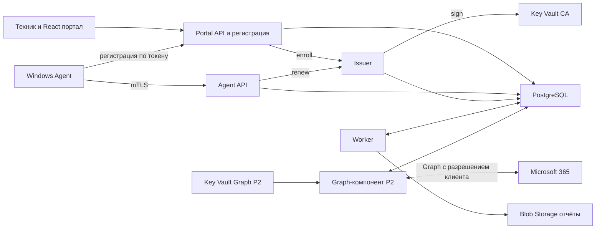

# Development Package для независимой оценки

Версия 0.2.0 от 13 октября 2026 года. Полный комплект требований, архитектуры и предложенных контрактов.

Рецензент начинает с запроса независимой оценки и проверяет весь комплект.


Файл `README.md`

# Development Package для сервиса проверки безопасности

Версия 0.2.0 от 13 октября 2026 года. Рабочее название проекта — Sikkerheit. Владелец продукта — ваша IT-компания; первый канал продаж — её текущие клиенты.

Предлагается сервис регулярной оценки настроек Windows и Microsoft 365 с внутренним порталом для техников, историей отклонений и еженедельным отчётом. Первая поставка включает портал и источник Windows-фактов: собственный агент либо импорт из Intune и RMM по решению SP-05; облачные проверки подключаются отдельным этапом. Платный пилот определяет дальнейший объём продукта.

Статус — проект для независимой оценки и технических экспериментов. P0 начинается после независимого одобрения версии 0.2.0. Контракты описывают предлагаемое поведение; приложение, Azure-инфраструктура и проверки на Windows ещё должны быть реализованы. Оценки сроков, ресурсы и пороги являются плановыми допущениями.

## Как читать пакет

| Файл | Назначение |
| --- | --- |
| [01-product-and-scope.md](01-product-and-scope.md) | Продукт, границы этапов, требования и показатели пилота |
| [02-architecture-and-stack.md](02-architecture-and-stack.md) | Компоненты, потоки, стек и границы доверия |
| [03-check-catalog.md](03-check-catalog.md) | Проверки Windows и Microsoft 365, права, лицензии и ограничения |
| [04-security-and-privacy.md](04-security-and-privacy.md) | Регистрация агента, сертификаты, роли, изоляция и обработка данных |
| [05-data-and-api.md](05-data-and-api.md) | Модель данных, состояния и правила API |
| [06-azure-and-operations.md](06-azure-and-operations.md) | Ресурсы Azure, установка, обновления и эксплуатация |
| [07-delivery-plan-and-acceptance.md](07-delivery-plan-and-acceptance.md) | Backlog, оценки трудоёмкости, испытания и критерии приёмки |
| [08-risks-and-decisions.md](08-risks-and-decisions.md) | Решения, риски, альтернативы и вопросы перед разработкой |
| [09-independent-review-prompt.md](09-independent-review-prompt.md) | Единый запрос для независимой оценки двумя рецензентами |
| [10-sources.md](10-sources.md) | Первичные источники и условия перепроверки |
| [specs/openapi.json](specs/openapi.json) | Предлагаемый HTTP API в формате OpenAPI 3.1 |
| [specs/scan-batch.schema.json](specs/scan-batch.schema.json) | Формат пакета наблюдений агента |
| [specs/observation.schema.json](specs/observation.schema.json) | Формат одного наблюдения |
| [specs/check-catalog.json](specs/check-catalog.json) | Идентификаторы и фазы проверок |
| [specs/invariants.json](specs/invariants.json) | Реестр инвариантов, не выраженных JSON Schema: правило, источник, отрицательный пример, ожидаемый отказ или эффект и приёмочный сценарий |
| [examples/scan-batch.json](examples/scan-batch.json) | Синтетический пакет с доступными наблюдениями |
| [examples/scan-batch-unavailable.json](examples/scan-batch-unavailable.json) | Пример ошибок доступа и неподдерживаемой проверки |
| [source/boss-chat.md](source/boss-chat.md) | Полная исходная переписка на языке оригинала |
| [scripts/validate_package.py](scripts/validate_package.py) | Проверка контрактов, примеров, документов и инвариантов пакета; файлы не изменяет |

## Передача на независимую оценку

Каждому рецензенту передать одинаковую версию пакета и запрос из `09-independent-review-prompt.md`. Для одной загрузки использовать `REVIEW-BUNDLE.md`; для просмотра контрактов и примеров — архив всего каталога. Ответы рецензентов сначала получить независимо, затем сопоставить по требуемой таблице замечаний.

Ключевые вопросы оценки: целесообразность собственного продукта вместо существующих инструментов, корректность прав Microsoft Graph, безопасность установки агента, достоверность состояний, трудоёмкость и экономика сопровождения. Ни один рецензент не должен предполагать, что технические эксперименты уже пройдены.

## Приоритет документов

Требования к поведению определяются документами 01, 03, 04 и 05. OpenAPI и схемы уточняют поля и HTTP-ответы. Реестр инвариантов `specs/invariants.json` уточняет поведение, которое не выражено машинным контрактом, и подчиняется документам 01, 03, 04 и 05: каждая запись ссылается на раздел документа, и при расхождении действует документ, а запись исправляется. Противоречие между файлами считается дефектом пакета и исправляется до реализации соответствующего этапа. Исходная переписка показывает происхождение идеи; её технические предложения не заменяют спецификацию.

Проверка и сборка разделены. [scripts/validate_package.py](scripts/validate_package.py) ничего не записывает: он проверяет структуру JSON и встроенным валидатором — используемое подмножество JSON Schema, разрешение локальных `$ref`, согласованность OpenAPI с документами, каталог проверок, примеры с отрицательными вариантами, реестр инвариантов, ссылки на идентификаторы и локальные ссылки; при ошибке возвращает ненулевой код. [scripts/build_package.py](scripts/build_package.py) копирует переписку, вызывает validate и только после успешной проверки записывает `VALIDATION.md`, `REVIEW-BUNDLE.md`, `manifest.json` и ZIP. Стандартная проверка JSON Schema и OpenAPI сторонними валидаторами (`jsonschema`, `openapi-spec-validator`) в этой версии не выполнена: пакеты не установлены, и `VALIDATION.md` прямо фиксирует, что выполнена только встроенная проверка подмножества. Полная стандартная проверка, пробная генерация клиентов и CI — первый результат WP-01.

## Изменения в 0.2.0

- Выбор между собственным агентом и импортом из Intune и RMM вынесен в gate SP-05 с измеримым порогом (ADR-11, условный WP-04B).
- Трудоёмкость пересчитана: огибающая 25–40 инженерных недель и варианты с допущениями.
- Контракт расширен до 34 операций: административные операции, жизненный цикл организации, экспорт, аудит, enrollment-токены, имя устройства, отдельная операция решения о риске. Введены каталог `Problem.code` с действиями агента и автомат агента.
- Закреплены канонический объект, идентичность устройства и ресинхронизация sequence, единый порядок приёма пакета, окна приёма, алгоритм часов, выбор текущего состояния и таблица переходов.
- Проверки: добавлены WIN-011 и SYS-002; переработаны WIN-003, WIN-006, WIN-007 и WIN-010; SYS-001 стал индикатором свежести; применимость определяет только сервер; режим оценки задаётся явно; свежесть по умолчанию — 72 ч; введены две метрики покрытия.
- Безопасность: токены организации, сертификат на 365 дней с идемпотентным продлением, внутренний Issuer и граница ключа CA, доверие XFCC в отдельном environment, PlatformAdmin как платформенная роль с аудитом каждого доступа, экранирование и CSP.
- Данные и эксплуатация: сроки хранения всей цепочки, автомат жизненного цикла организации, внешний журнал жизненного цикла, restore в карантине, планировщик с fencing.
- Отчёт в P1 только в HTML, на языке, выбранном для организации; портал по умолчанию на bokmål с переключением на nynorsk и английский; строки во внешних ресурсах.
- Проверка пакета: validate отделён от build, добавлен реестр инвариантов, статус стандартной валидации указан явно.
- Эксперименты P0 и вопросы владельцу перечислены с рубежами.


Файл `01-product-and-scope.md`

# Продукт и объём разработки

Клиент получает регулярный обзор состояния устройств и корпоративных аккаунтов, а техник — очередь конкретных отклонений с основанием, ответственным и историей. Ценность подписки проверяется устранением реальных проблем и сокращением ручной работы.

## Пользователи и сценарии

Техник IT-компании видит только назначенных ему клиентов, сравнивает изменения и фиксирует работу. Руководитель сервиса контролирует подключение и качество данных, выпускает enrollment-токены, меняет политику клиента и принимает решения о риске. PlatformAdmin — платформенная роль, а не членство в организации: она создаёт организации, назначает сотрудников, управляет жизненным циклом клиента и по решению владельца видит данные всех клиентов, причём каждый такой доступ оставляет запись аудита (ADR-13). Эта роль не используется для повседневной работы, состав учётных записей минимален. Владелец клиента получает отчёт с понятными действиями. Клиентский вход в портал относится к следующему этапу; первая версия предназначена для вашей команды.

Основной сценарий: PlatformAdmin создаёт организацию и назначает сотрудников; техник устанавливает подписанный агент через существующий инструмент управления ПК, передавая ему enrollment-токен организации, видит первое наблюдение, получает отклонение, устраняет его привычным способом и подтверждает результат повторной проверкой. Последующее отсутствие данных не закрывает проблему. Кто создаёт организации в P1 — только PlatformAdmin (по умолчанию) или также руководитель сервиса, — решает вопрос 14 в `08`. При варианте B вместо установки агента факты об устройствах поступают импортом из Intune и RMM (`02`, раздел «Вариант B: импорт без агента»), остальная часть сценария не меняется.

## Этапы

| Этап | Входит | Условие завершения |
| --- | --- | --- |
| P0 | Начинается после независимого одобрения версии 0.2.0. Эксперименты SP-01…SP-05: права и API Windows без PowerShell, схема mTLS и путь к Issuer в Azure, доступность Graph, изоляция клиентов, сравнение с текущими инструментами и выбор источника Windows-фактов. Из работ по реализации допустимы только пакет и инструмент проверки пакета; серверный слой параллельно P0 не ведётся. Календарный лимит — 5 недель | Протоколы SP-01…SP-05; решение SP-05 (вариант A или вариант B), подписанное Product Owner; утверждённый PKI-дизайн; решение ADR-02; пересчитанные оценки WP и календарь P1; G1 — независимое одобрение одного и того же артефакта двумя рецензентами |
| P1 | Windows 11 Pro x64 по матрице совместимости; источник Windows-фактов по решению SP-05: Windows-агент со сборщиками, регистрацией по токену и работой офлайн (вариант A) либо импорт из Intune и RMM (вариант B); внутренний портал на bokmål с переключением на nynorsk и английский; история; HTML-отчёт (PDF — печатью из браузера) на языке организации | Пройдены критерии продолжения пилота (разделы «Плановые показатели» и «Экономика пилота») |
| P2 | Отдельное подключение M365, сведения о регистрации MFA, Security Defaults, инвентаризация Conditional Access; Intune при наличии лицензии | Подтверждены права, доступность и корректная интерпретация данных |
| P3 | Клиентский доступ, рассылка, дополнительные приложения и интеграции | Спрос и стоимость сопровождения подтверждены пилотом |

Матрица совместимости агента P1 — Windows 11 Pro x64 версий 25H2 и 26H2; она записана в `03`, раздел «Матрица совместимости и жизненный цикл ОС». Enterprise, Education, 24H2 и другие языки ОС добавляются по ответу на вопрос 1 в `08` и итогам SP-01. Windows 10 в P1 не входит. Устройства вне матрицы в пилот не включаются; если устройство выходит из матрицы во время пилота, SYS-002 даёт fail или unknown, а устройство до обновления исключается из знаменателей NFR-01 и NFR-02. Windows ARM64 и серверы оцениваются после инвентаризации клиентов. Поддержка новой платформы требует собственных испытаний и явной записи в матрице совместимости.

## Функциональные требования

| ID | Требование | Этап | Приёмка | Контракт |
| --- | --- | --- | --- | --- |
| FR-01 | Организации, назначения сотрудников и версии клиентской политики с серверным ограничением доступа | P1 | AT-01 | listOrganizations, createOrganization, updateOrganization, listOrganizationMembers, putOrganizationMember, deleteOrganizationMember, listPolicyRevisions, createPolicyRevision |
| FR-02 | Регистрация агента по ограниченному токену организации (одноразовому или пакетному) и отдельная идентичность устройства | P1, вариант A | AT-02, AT-17 | createEnrollmentToken, listEnrollmentTokens, revokeEnrollmentToken, enrollAgent, renewDeviceCertificate, updateDevice |
| FR-03 | Сбор фактов о Windows без автоматического изменения системы | P1, вариант A | AT-03 | getAgentConfiguration, submitScan |
| FR-04 | Очередь при отсутствии сети и повторная отправка без дубликатов | P1, вариант A | AT-04 | submitScan, submitHeartbeat |
| FR-05 | Четыре результата оценки, отдельный признак свежести и явный информационный режим | P1 | AT-05 | listDeviceAssessments, listFindings, listDevices |
| FR-06 | Стабильная история появления, изменения, повторного открытия и исправления проблем | P1 | AT-06 | getFinding, listFindingEvents |
| FR-07 | Отчёт за период в HTML на языке организации, с покрытием проверок и временем наблюдения | P1 | AT-07 | createReport, listReports, downloadReport |
| FR-08 | Ответственный, срок и принятие риска без подмены технического результата | P1 | AT-08 | patchFinding, decideFindingRisk |
| FR-09 | Безопасное подключение M365 и отзыв доступа | P2 | AT-09 | — |
| FR-10 | Разделение регистрации MFA и требований доступа | P2 | AT-10 | — |
| FR-11 | Сопоставление устройства с Intune только по подтверждённому идентификатору | P2 | AT-11 | — |
| FR-12 | Аудит действий, экспорт и жизненный цикл клиентских данных | P1 | AT-12 | listAuditEvents, createOrganizationExport, getOrganizationExport, downloadOrganizationExport, changeOrganizationLifecycle, процедура: RB-09, процедура: RB-10 |
| FR-13 | Подписанные версии агента, поэтапный выпуск и отзыв устройства | P1, вариант A | AT-13 | revokeDevice, процедура: RB-06, процедура: RB-07 |

Колонка «Контракт» называет операции OpenAPI либо процедуру из таблицы runbooks в `07`, раздел «Runbooks». У FR-09…FR-11 контракта пока нет: P2-расширение контракта появится после SP-03. FR-02, FR-03, FR-04 и FR-13 действуют только в варианте A; при варианте B они заменяются требованиями импорта в пакете 0.3.0. Сверх связей в таблице AT-14 относится к FR-04 и FR-06, AT-15 — к FR-09…FR-11, AT-16 — к NFR-03…NFR-06; NFR-01 и NFR-02 измеряются в пилоте.

## Язык портала и отчёта

Решение владельца: еженедельный отчёт формируется на языке, выбранном для каждой организации, а внутренний портал по умолчанию работает на bokmål (nb) с переключением на nynorsk (nn) и английский (en). Язык отчёта задаёт поле `Organization.reportLanguage` со значениями nb, nn или en; оно обязательно при создании организации и меняется через `updateOrganization`, а `Report.language` фиксируется при генерации. Смешения языков в отчёте нет: если перевода правила нет, отчёт получает `state=failed` и `failureCode=translation_missing`, резервный язык не используется до ответа на вопрос 13 в `08`. Выбор языка в портале хранится в браузере и не меняет API; при пустом или недоступном хранилище действует nb. Портал передаёт выбранный язык заголовком `Accept-Language`, и сервер возвращает на нём заголовки, рекомендации и пояснения правил; идентификаторы, коды и evidence не переводятся. Язык отчёта от выбора в портале не зависит. Строки портала и отчёта с первого дня хранятся во внешних ресурсах, тексты правил — локализованные шаблоны по правилу, версии правила и языку. Подробности — `05`, раздел «Отчёт и покрытие».

## Границы обещаний

Оценка относится к конкретным поддерживаемым проверкам и доступным данным. Отчёт не выражает вероятность взлома, не подтверждает отсутствие вредоносного кода и не заменяет восстановление из резервной копии или полноценное тестирование на проникновение.

Первая версия не собирает действующие пароли, cookies, историю посещений, содержимое писем и документов, recovery passwords BitLocker. Не выполняются подбор паролей, эксплуатация уязвимостей, произвольные удалённые команды и автоматическое исправление системных политик. Эти исключения ограничивают права и стоимость сопровождения.

Microsoft Secure Score, журналы инцидентов Defender, ретроспективная оценка входов, проверка резервных копий и произвольных SaaS — будущие модули. Сохранение показателя MFA registered не является доказательством обязательности MFA. [Свойства регистрации MFA](https://learn.microsoft.com/en-us/graph/api/resources/userregistrationdetails?view=graph-rest-1.0).

## Плановые показатели

Пилот — 3–5 организаций (не меньше 3), всего 20–30 устройств Windows 11 Pro x64 версий 25H2 или 26H2, длительность — 6 недель: критерий ценности считается по двухнедельным окнам, и шесть недель дают три таких окна. Это выбранный масштаб эксперимента. В пилоте с режимом assessed работают WIN-001…WIN-005 (WIN-004 только для Defender), WIN-008 и SYS-002; WIN-003 и WIN-008 оцениваются после того, как одобренные антивирусы и allowlist SID внесены в политику клиента. WIN-006 получает полную оценку при подтверждённой гипотезе H-WU1, иначе узкую форму. WIN-007 и WIN-009 работают как assessed, если SP-01 подтвердит источник данных, иначе как informational. WIN-010, WIN-011 и SYS-001 остаются informational; SYS-001 — индикатор свежего полного сбора. P2 в пилот не входит.

Для проверки проектирования используется нагрузочная модель 1 000 устройств, 100 организаций, один полный сбор в сутки и heartbeat каждые 4 часа только при включённом ПК. В модель входит утренний старт: 70% устройств включаются в течение 30 минут и выполняют догоняющий сбор.

| ID | Плановый критерий | Как измерить |
| --- | --- | --- |
| NFR-01 | Не менее 95% устройство-суток с подтверждённой доступностью имеют валидный суточный пакет в течение 48 часов | Знаменатель — устройство-сутки, в которые RMM или Intune (при их отсутствии — heartbeat) показали устройство в сети; офлайн учитывается отдельно |
| NFR-02 | Каждая обязательная применимая пара (устройство, проверка) даёт результат либо явную причину (`reasonCode`) | Метрика «покрытие периода» (`coveragePeriod`) за неделю, целевое значение не ниже 90% на устройствах из знаменателя NFR-01; определение обязательной проверки — `05`, раздел «Отчёт и покрытие» |
| NFR-03 | Для валидного суточного пакета p95 обработки менее 5 минут при расчётной нагрузке, включая утренний старт | От подтверждённой записи до оценки |
| NFR-04 | На референсном ПК сессия сбора занимает до 120 секунд, таймаут одного сборщика до 30 секунд | Windows-лаборатория; процесс может завершаться частичным результатом. Если по гипотезе H-WU2 выбрано фоновое задание Windows Update, у него собственный лимит 600 секунд (стартовое значение, его подтверждает SP-01), и он не входит в 120 секунд сессии |
| NFR-05 | Средняя CPU за 15 минут до 2% и рабочая память до 150 МБ суммарно по всем процессам агента | Измеряется по всем процессам агента; превышение пересматривает реализацию |
| NFR-06 | Работает буфер до `maxBufferDays` (по умолчанию 7) и до 100 МБ; сервер принимает пакеты с запасом 2 суток (`maxBatchAgeDays`) | Испытание длительного отсутствия сети; переполнение выдаёт событие потери данных |
| NFR-07 | RPO до 15 минут, RTO до 4 часов для базы при выбранной конфигурации | Измеренный учебный restore, выполняемый в карантине; это цель, а не обещание поставщика |
| NFR-08 | Отсутствует доступ между клиентами при подмене идентификаторов, включая обращения PlatformAdmin — только с `audit_event` | Сквозные негативные испытания API, заданий и скачивания файлов |

Условия референсного ПК фиксируются в P0. Нагрузочная модель не доказывает производительность до измерений.

## Экономика пилота

Учитывать облако, лицензии и сертификаты, время подключения, поддержку агента, разбор ложных тревог и исправления. Ежемесячный вклад клиента равен выручке минус выделенные расходы облака, поддержку, сторонние лицензии и включённые часы работы. Расходы разработки учитываются отдельно при расчёте окупаемости.

| Область | Критерий продолжения |
| --- | --- |
| Доставка | NFR-01: не меньше 95% |
| Достоверность | `coveragePeriod` не меньше 90% по каждой неделе; 0 ложных pass в эталонных отрицательных сценариях AT-05, включая BitLocker; ложных fail — не больше 10% от fail, разобранных техником |
| Ценность | Не меньше 1 реального исправления (`resolved` с `device_change`) на организацию за любые 2 недели; не меньше 3 отклонений в сумме, которых не показывали Intune, RMM или Lighthouse (только вариант A); время подготовки недельного отчёта — не больше 70% от базы, измеренной в SP-05 |
| Эксплуатация | Пройдены AT-01, AT-05…AT-08, AT-12, AT-14, AT-16 (в варианте A также AT-02…AT-04, AT-13, AT-17); restore drill в изолированном окружении укладывается в RTO 4 ч; поддержка — не больше 10 минут на устройство в месяц; 0 дефектов класса AT-01; в варианте A отзыв, обновление и 7 дней офлайна проверены на пилотных устройствах |
| Коммерция | Не меньше 3 организаций подписали платное продолжение по конкретной цене; положительный вклад после выделенных затрат (разработка учитывается отдельно) |

Если коммерческий критерий не выполнен, действует условие пересмотра в `08`. Найденные проблемы без готовности платить не подтверждают спрос. Сравнение с Intune, Lighthouse и используемым инструментом управления ПК выполняется до пилота в SP-05 и определяет выбор между собственным агентом и импортом. Пилот также фиксирует, нужен ли клиентам PDF-файл отчёта.


Файл `02-architecture-and-stack.md`

# Архитектура и технический стек

Общий серверный код организован как модульный монолит. Развёртываются три процесса Portal API, Agent API и Worker и внутренний компонент Issuer (ADR-03, ADR-12). Отдельный Agent API нужен из-за обязательного клиентского сертификата на ingress; он размещается в отдельном Container Apps environment без других приложений. Браузерный вход и первоначальная регистрация доступны через Portal API. Worker и Issuer работают без публичного ingress. Схема ниже описывает вариант A с собственным агентом; при варианте B агентская часть заменяется импортом (раздел «Вариант B: импорт без агента»). Graph-компонент появляется только в P2.



## Компоненты

| Компонент | Технология | Ответственность |
| --- | --- | --- |
| Agent Host | C# .NET 10 Worker Service | Расписание, сеть, локальная очередь, проверка конфигурации |
| Privileged Collector | Минимальная Windows-служба C# | Фиксированные сборщики, которым нужны повышенные права (по решению ADR-02) |
| Локальные данные | SQLite и ACL Windows | Буфер и последовательность пакетов; криптографические ключи отдельно |
| Portal API | ASP.NET Core 10 | Сессия портала, доступ сотрудников, регистрация устройств, управление клиентами |
| Agent API | ASP.NET Core 10 | Аутентификация устройств, приём пакетов, heartbeat, конфигурация и продление сертификата |
| Issuer | .NET 10, отдельный Container App с собственной managed identity | Единственный обладатель права sign на ключ в Key Vault CA; заново проверяет CSR и добавляет записи `device_certificate`; вызывается Portal API (enroll) и Agent API (renew) |
| Worker | .NET 10 | Очередь заданий и планировщик, оценки, HTML-отчёты и жизненный цикл данных; Graph-сертификатов не получает |
| Graph-компонент (P2) | Тот же образ модульного монолита, отдельный Container App с собственной managed identity | Сбор данных Microsoft 365 по организации; доступ к отдельному Key Vault Graph есть только у него |
| Persistence | PostgreSQL, EF Core 10, Npgsql 10 | Транзакции, история, JSONB, клиентская изоляция |
| Portal | React, TypeScript, Vite | Обзор клиентов, устройств, проблем и истории; интерфейс на nb по умолчанию с переключением на nn и en, строки во внешних ресурсах, выбранный язык передаётся заголовком `Accept-Language` |
| Identity | Entra ID, Microsoft.Identity.Web или MSAL | Вход сотрудников и отдельно токены облачных интеграций |
| Observability | OpenTelemetry и Azure Monitor | Метрики, трассировка и отредактированные журналы |

Сетевой путь от Portal API и Agent API к Issuer выбирается в PKI-дизайне до WP-03 по итогам SP-02. Предпочтительный вариант — Issuer во внутреннем VNet-environment с ingress через внутренний load balancer и сетевой связностью из environments Portal API и Agent API. Запасные варианты — асинхронный renew через задание в БД (он меняет контракт renew и вносится в 0.3.0) либо право sign у identities API с остаточным риском, который явно принимает Security Owner. Отчёт строится на языке организации независимо от языка, выбранного в портале; правила языка — `01`, раздел «Язык портала и отчёта».

.NET 10 имеет поддержку LTS до ноября 2028 года; Npgsql 10 выпущен для EF Core 10. Используются стабильные совместимые пакеты с зафиксированными версиями и lock files. [Политика .NET](https://dotnet.microsoft.com/en-us/platform/support/policy), [Npgsql](https://www.npgsql.org/efcore/release-notes/10.0.html).

## Выполнение локальной проверки

Плановая гипотеза H-02: сетевой Agent Host работает под виртуальной учётной записью службы без прав администратора, а сборщики, которым нужны повышенные права, выполняются в привилегированном сборщике с фиксированным протоколом. Привилегированный сборщик не имеет сетевых функций и принимает по named pipe только известный `collectorId` и параметры из enum. Произвольные пути, скрипты, команды и имена исполняемых файлов в протоколе отсутствуют. Обязательные требования к разделённому варианту: service SID; pipe только локальный (`PIPE_REJECT_REMOTE_CLIENTS`), создаётся первым экземпляром (`FILE_FLAG_FIRST_PIPE_INSTANCE`) и проверяет SID клиента; ACL на каталог установки, конфигурацию, helpers и ключи разрешают запись только SYSTEM и администраторам; запрос не больше 4 KiB и ответ не больше 64 KiB, по схеме; не больше 10 вызовов одного `collectorId` в час; таймаут вызова 30 секунд, зависшая работа завершается в пределах 120 секунд.

Решение ADR-02 принимается по итогам SP-01 на основе таблицы «collectorId → минимальная учётная запись → API → замер» для всех 11 WIN-проверок, двух моделей угроз и стоимости разделения; WP-04 не стартует, пока решение не записано. Единая служба LocalSystem выбирается, только если Agent Host сам требует повышенных прав для большинства сборщиков либо стоимость разделения превышает порог, и при этом Security Owner принимает модель угроз с компенсирующими мерами: нет входящих listener, ответы разбираются строго и с ограничениями, нет дочерних процессов, бинарные файлы подписаны, на каталог установки стоит ACL. Установка выполняется администратором; режим чтения сам по себе не означает отсутствие повышенных прав.

Сборщики обращаются к WMI/CIM, COM и Win32 API напрямую из .NET. Запуск `powershell.exe`, `cmd.exe` и любых дочерних процессов (`Process.Start`) запрещён; исключение возможно только через ADR-02 с замером бюджета в SP-01. Кандидаты API для проверок перечислены в `03` и подтверждаются в SP-01.

Сборщик возвращает факт либо причину недоступности. Agent Host записывает пакет в SQLite, затем отправляет его на Agent API. Успешный HTTP-ответ выдаётся после транзакционной записи пакета и задания оценки. Worker оценивает факты и обновляет проекции для портала.

Агент собирает факты; правила и рекомендации выполняются на сервере. Политика и версия правила сохраняются вместе с результатом. При изменении правила пересчёт помечается отдельно от изменений на устройстве.

## Выполнение облачной проверки

В P2 для клиента регистрируется отдельное приложение Entra с разрешениями чтения и отдельным сертификатом. Токен для конкретного Entra tenant получает отдельный Graph-компонент; его сертификаты хранятся в отдельном Key Vault Graph вашей инфраструктуры, а Worker Graph-сертификатов не получает ни в одном варианте. Такое подключение увеличивает ручную работу, но уменьшает область воздействия одного credential; массовое multitenant-подключение оценивается в ADR-06 после пилота. Остаточный риск сохраняется: компрометация общего Graph-компонента затрагивает всех подключённых клиентов (R-14), поэтому его изоляция, отдельный vault и учения массового отзыва — условие входа в WP-08.

Сбор выполняется по организации, а не с каждого ПК. У каждой интеграции есть набор возможностей, права, время последней успешной загрузки и результаты пробных запросов. 403 не интерпретируется автоматически как отсутствие лицензии. Повторные попытки соблюдают `Retry-After`; допускается частичный успешный сбор по доступным модулям. [Ограничения Graph](https://learn.microsoft.com/en-us/graph/throttling).

## Очередь заданий

P1 использует таблицу `job` в PostgreSQL. API записывает пакет и задание в одной транзакции. Типы заданий: `evaluate_batch`, `recalculate_policy`, `report_generate` и `organization_export`; `freshness_sweep`, `scan_request_expiry` и `review_expiry` — раз в час; `weekly_report` — в понедельник в 06:00 по timezone организации за прошедшую неделю, только для активных организаций; `retention_purge` — ежедневно в 02:00; `organization_delete` — планировщик ежечасно ставит его для организаций с `deletionDueAt ≤ now`. В P2 добавляется `graph_collect`. Поля задания включают `leaseOwner`, `leaseToken` и `periodKey`; уникальность — (type, organizationId, coalesce(inputId, periodKey)).

Планировщик работает внутри каждой реплики Worker: каждые 5 минут он вставляет периодические задания через `INSERT … ON CONFLICT DO NOTHING`. Пропущенные периоды догоняются не глубже 24 часов для часовых заданий и 4 недель для `weekly_report`. Захват выполняется через `FOR UPDATE SKIP LOCKED` с lease на 5 минут; долгое задание продлевает lease, а `leaseToken` при каждом захвате увеличивается. Завершение и бизнес-эффект выполняются в одной транзакции с условием `WHERE id=? AND leaseToken=?`; если обновлено 0 строк, транзакция откатывается. Эффекты идемпотентны за счёт уникальных ограничений. После повторяющихся ошибок задание попадает в состояние failed и вызывает оповещение. Метрика «последний такт планировщика» поднимает оповещение, если периодические задания не создавались дольше двух периодов.

`retention_purge` выполняется по каждой организации в её контексте RLS, идемпотентно и с аудитом сводки: сколько записей удалено и сколько заменено неизменяемым снимком. Сроки хранения всей цепочки — `04`, раздел «Сроки хранения».

Worker в Container Apps имеет минимум одну работающую реплику: очередь в PostgreSQL сама по себе не запускает процесс после scale to zero. При росте добавить Service Bus с outbox и сохранить дедупликацию обработчиков, уникальный ключ периода и fencing по `leaseToken`; доставка сообщения не означает однократное выполнение бизнес-операции.

## Разделение клиентов

OrganizationId определяется серверной связью сертификата, проверенным членством пользователя либо платформенной ролью PlatformAdmin. В Agent API этот идентификатор отсутствует в клиентском теле запроса. В Portal API выбранный OrganizationId проверяется по назначению, роли и действию.

Таблицы клиента используют OrganizationId, составные ограничения и Row-Level Security с `FORCE ROW LEVEL SECURITY`; без контекста запрос возвращает 0 строк. Контекст организации устанавливается только SECURITY DEFINER-функцией `app.begin_org_context(organizationId, actor, purpose)` от роли без входа. Функция сначала проверяет `platform_role`, затем членство; если у субъекта есть `platform_role`, она в той же транзакции записывает `audit_event`, даже если у него есть и членство, и только затем выполняет `SET LOCAL`. Политик межклиентского обхода нет: глобальное чтение PlatformAdmin означает право войти в контекст любой организации, а не bypass. Контекст очищается при возврате соединения в pool. Роль приложения не является владельцем таблиц, superuser и не имеет BYPASSRLS; роль миграций отделена. Остаточный риск: роль приложения технически может выставить параметр контекста напрямую; компенсация — статическая проверка, запрещающая прямой SET, а также SP-04 и AT-01.

В Worker выбор и обработка заданий разделены. Выбор выполняет SECURITY DEFINER-функция `claim_jobs` от роли без входа; она видит только метаданные заданий. Обработка идёт в отдельной транзакции с контекстом организации из `job.organizationId`, установленным той же функцией контекста с `purpose=job` и проверкой lease. Принадлежность входных сущностей организации задания проверяется явно. RLS дополняет прикладные проверки и не покрывает автоматически Blob, фоновые задания и аудит. [Правила PostgreSQL](https://www.postgresql.org/docs/current/ddl-rowsecurity.html).

## Вариант B: импорт без агента

Если SP-05 выбирает вариант B, собственный агент не разрабатывается: не выполняются WP-03, WP-04 и WP-07a, отпадают Agent API, PKI и Issuer, MSI и офлайн-буфер. Вместо них выполняется WP-04B — импорт фактов из Intune и RMM отдельным компонентом импорта. Модель observation, assessment и finding остаётся той же; provenance и время источника берутся из внешнего инструмента, а отчёт явно указывает источник данных. Гибрид, в котором агент закрывает только пробелы импорта, в P1 не вводится (ADR-11).

Вариант B вводит в P1 новые классы секретов: Graph-сертификаты для чтения managedDevices и ключи RMM API. Они хранятся в отдельном Key Vault импорта, доступ к которому есть только у компонента импорта — отдельного Container App с собственной managed identity. Worker не получает Graph-сертификатов и в этом варианте. Остаточная область воздействия компонента импорта — риск R-14. Изоляция компонента, отдельный vault, runbook onboarding и offboarding (RB-13) и учения массового отзыва (RB-14) становятся условием до старта WP-04B, а не до P2. FR-02, FR-03, FR-04 и FR-13 и агентские приёмочные сценарии заменяются требованиями импорта; для этого нужны пакет 0.3.0 и G1.

## Структура будущего репозитория

```text
src/Agent.Host
src/Agent.Collectors
src/Agent.PrivilegedCollector
src/Server.PortalApi
src/Server.AgentApi
src/Server.Worker
src/Server.Domain
src/Server.Infrastructure
src/Contracts
src/Portal
tests/Domain
tests/Integration
tests/WindowsLab
tests/Portal
infra/bicep
installer
docs
```

Это целевая структура будущего кода. Одна модель контрактов генерирует клиент агента и TypeScript-типы; зависимости Windows не включаются в контейнеры сервера. Сборки агента self-contained включают runtime, поэтому выпуск исправлений .NET должен обновлять сам агент.


Файл `03-check-catalog.md`

# Каталог проверок и ограничений

Каталог определяет измеряемые факты, условия вывода и границы интерпретации. Пороговые значения ниже — параметры политики по умолчанию v1, которую сервер создаёт вместе с организацией; любое изменение даёт новую неизменяемую ревизию политики и записывается в аудит. `checkId` сохраняется в наблюдении и совпадает с машинным каталогом `specs/check-catalog.json`. Каталог содержит 18 проверок, из них 11 WIN-*; для каждой он задаёт `defaultAssessmentMode` (`assessed` или `informational`), источник `source` (`agent`, `server` или `graph`) и тип объекта `subjectType`. Колонки «Объект» и «Режим по умолчанию» в таблицах ниже совпадают с этими полями каталога.

## Семантика результата

Агент возвращает для каждого наблюдения `collectionStatus` — только `collected` либо `unavailable`. Evidence передаётся только при `collected` и только по закрытой схеме своей проверки. `reasonCode` агента описывает исключительно сбор и принимает значения `permission_denied`, `unsupported`, `collector_timeout` или `temporary_error`. Проверку, которую на данной платформе выполнить нельзя, агент передаёт как `unavailable`/`unsupported`. Агент не решает, применима ли проверка: `not_applicable` выводит сервер из действующей `policy_revision`, в том числе по фактам WIN-011 и других наблюдений того же пакета (см. «Политика по умолчанию и входные настройки»). Внешняя невозможность проверки не означает not_applicable.

Сервер оценивает наблюдение как `pass`, `fail`, `unknown` либо `not_applicable`. Успешное получение факта не означает pass. Причины unknown и not_applicable, которые выставляет только сервер при оценке, — `missing_observation`, `clock_inconsistent`, `unmapped_state`, `update_search_failed`, `update_search_outdated`, `update_source_mismatch`, `update_list_truncated`, `os_version_unknown`, `os_inventory_missing`, `applicability_input_missing` и `policy_not_applicable`; вместе с четырьмя причинами сбора они образуют закрытый перечень `Assessment.reasonCode`. `clock_inconsistent` агент не передаёт: признак часов вычисляет worker при оценке пакета по алгоритму `05`, раздел «Время и часы устройства». Оценки такого пакета получают `result=unknown`, `reasonCode=clock_inconsistent` и `assessmentScope=historical`, сохраняются в истории и не меняют текущую проекцию.

`assessmentMode` равен `assessed` или `informational`. `defaultAssessmentMode` каталога — режим проверки в политике по умолчанию v1; фактический режим хранится явно в `policy_revision.configuration` для каждой проверки. Условие, при котором клиентская политика может перевести проверку в `assessed`, записано в колонке «Условие оценки». Наличие входных настроек — необходимое, но не достаточное условие: режим выбирает политика. Informational-оценка имеет `result=null`, не создаёт finding и не участвует в оценке соответствия. Finding создаётся только для режима `assessed`. Пороги warn и critical в правилах ниже дают `result=fail` и `Finding.severity` со значением `warning` или `critical` соответственно.

Объект наблюдения задаётся полем `subject`. WIN-001 и WIN-002 относятся к тому (`volume`): в P1 это ровно один том ОС с `volumeId` и `role=os`, буква диска — только атрибут отображения `mountPoint`. Остальные проверки относятся к устройству (`device`). Внутри пакета ключ `(checkId, subject.type, localKey)` уникален: повтор отклоняет весь пакет с 422 `duplicate_observation`, а лишний или другой объект — с 422 `unexpected_subject`. Отсутствие ожидаемой пары «объект/проверка» для активной проверки даёт unknown с `missing_observation`. Канонический объект, ключи и ожидаемые пары определены в `05`, разделы «Канонический объект и идентичность устройства» и «Уникальность и ожидаемые объекты».

Отдельно хранится `freshness=fresh|stale`. Окно свежести `freshnessWindowHours` задаётся в политике для каждой проверки, по умолчанию 72 часа от `observedAt`. Свежесть вычисляется при чтении на текущий момент и при формировании отчёта на `periodEnd`. Heartbeat обновляет `lastSeenAt`, но не свежесть оценок. Устаревший pass показывается как прошлый результат с датой и не считается в числителе покрытия. Изменение окна — это изменение политики (`policy_change`). Покрытие измеряется двумя метриками: `coverageAt` — доля свежих pass и fail среди обязательных применимых пар активных устройств на момент измерения — и `coveragePeriod` — доля пар, у которых за период есть хотя бы одна определённая оценка без признака часов. Informational-оценки исключаются из числителя и знаменателя, not_applicable — из знаменателя; обе группы и «не настроено политикой» показываются отдельными счётчиками. Точные определения, пример расчёта и места использования метрик — в `05`, раздел «Отчёт и покрытие».

## Проверки Windows

| ID | Проверка и данные | Объект | Режим по умолчанию | Условие оценки | Права и ограничения |
| --- | --- | --- | --- | --- | --- |
| WIN-001 | Свободное место на томе ОС: `totalBytes`, `freeBytes` | volume | assessed | fail с `severity=warning` при свободном месте менее 10% или 10 GiB (`warnFreePercent`, `warnFreeBytes`); fail с `severity=critical` при менее 5% или 2 GiB (`criticalFreePercent`, `criticalFreeBytes`). Для assessed входные настройки не нужны | Обычное чтение; объект — том ОС (`volumeId`, `role=os`); эксплуатационный показатель, не доказательство защиты |
| WIN-002 | BitLocker тома ОС: `volumeStatus`, `protectionStatus`, `encryptionPercentage` | volume | assessed | При `encryptionRequired=true` pass только при завершённом шифровании и активной защите; приостановленная защита или расшифровка — fail, в том числе при `volumeStatus=fully_encrypted`, `protectionStatus=off` и `encryptionPercentage=100` (эталонный отрицательный тест ниже). Для редакций из `notApplicableEditionIds` по `editionId` из WIN-011 того же пакета — not_applicable. Для assessed входные настройки не нужны | Права вызова подтверждает SP-01; recovery password никогда не извлекается и не передаётся |
| WIN-003 | Антивирусы: `products[]` до 10 элементов (`provider`, `productState`, `statusSource`, `rawState`) и объект `defender` (`amRunningMode`, `realTimeProtectionEnabled`) или null | device | informational | По таблице решений WIN-003 ниже: pass при активном одобренном продукте, unknown/`unmapped_state` при неопознанном состоянии одобренного, иначе fail. Для assessed нужен непустой `approvedProviders` или `defenderApproved=true` | Defender передаётся одним элементом со `statusSource=defender`, без дубля из WSC; для стороннего продукта доступен только статус, который он сообщает WSC; больше 10 продуктов — `unavailable`/`unsupported` |
| WIN-004 | Давность сигнатур Defender: `signatureLastUpdatedAt` | device | assessed | fail с `severity=warning` старше 3 суток (`warnDays`), с `severity=critical` старше 7 (`criticalDays`); будущая дата — unknown. Для assessed WIN-003 должна входить в `activeCheckIds` | Применима только при `defenderApproved=true` и `amRunningMode=normal` по WIN-003 того же пакета, иначе not_applicable/`policy_not_applicable` (в том числе при `defender = null`); без пригодного наблюдения WIN-003 — unknown/`applicability_input_missing`; сторонний AV оценивается отдельной интеграцией |
| WIN-005 | Брандмауэр: `domainEnabled`, `privateEnabled`, `publicEnabled` | device | assessed | Для штатного Windows Firewall включены все профили из `requiredProfiles` (по умолчанию domain, private, public). Для assessed входные настройки не нужны | Альтернативный firewall требует явной политики и собственного источника |
| WIN-006 | Windows Update: `configuredSource`, `auLastSearchSuccessAt`, `agentSearch`, `pendingSecurityUpdates[]` до 50 элементов, `pendingSecurityUpdatesTotal`, `truncated` | device | informational | По правилу WIN-006 ниже: unknown при неуспешном или устаревшем поиске либо чужом источнике; fail при просрочке хотя бы одного переданного обновления; unknown/`update_list_truncated` при усечённом списке без просрочки; pass при свежем успешном поиске без просрочки и усечения. Для assessed нужен `expectedSource` | Поиск может быть долгим (гипотеза H-WU2); WSUS-deadline и отсрочки учитываются через `referenceTimeBasis`; одна дата последнего KB недостаточна; заголовки и описания обновлений не передаются |
| WIN-007 | Необходимость перезагрузки: `rebootRequired`, `lastBootAt`, `statusSource` (`windows_update_api`) | device | assessed | fail с `severity=warning`, если эпизод требования перезагрузки наблюдается не меньше `warnDays` (3) суток по правилу WIN-007 ниже. Для assessed входные настройки не нужны | Отрицательный результат относится только к поддерживаемому Windows Update API, не ко всем установщикам; снятие требования без перезагрузки внутри одного сеанса не обнаруживается |
| WIN-008 | Прямые члены группы локальных администраторов по известному SID группы: `memberSids` до 100, `membershipScope=direct_members` | device | informational | SID, не предусмотренный `allowedSids`, — fail. Для assessed нужен хотя бы один SID в `allowedSids` | Не равнозначно полному раскрытию вложенных AD/Entra-групп и всех способов повышения прав |
| WIN-009 | Secure Boot: `enabled`, `platform` (`uefi`, `legacy_bios`) | device | assessed | При `secureBootRequired=true` disabled или подтверждённое отсутствие поддержки — fail. Для assessed входные настройки не нужны | Access denied — unknown/`permission_denied`; виртуальная машина не исключается автоматически |
| WIN-010 | Присоединение устройства: `joinType` (`entra_joined`, `hybrid_joined`, `domain_joined`, `not_joined`), `tenantId`, `entraDeviceId` | device | informational | Информационная инвентаризация; проверка tenant — только при заданном `expectedTenantId`. Для assessed нужен `expectedTenantId` | Собирается в контексте службы; пользовательская регистрация (workplace join) не наблюдается и не выводится, значения `registered` нет; `domain_joined` означает только локальный AD без Entra; устройство не даёт доступа к данным всего tenant; пользовательская Hello/PIN не выводится из контекста службы |
| WIN-011 | OS-инвентарь: `editionId`, `displayVersion`, `build`, `ubr`, `architecture` (`x64`, `arm64`) | device | informational | Всегда informational, finding не создаёт. Факты используют SYS-002 и применимость WIN-002 | Обязательна в `activeCheckIds` каждой политики; источник API подтверждает SP-01 |
| SYS-001 | Индикатор свежего полного сбора: `lastFullScanAt`, `lastSeenAt`, `hasFreshFullScan` | device | informational | Всегда informational. Значение истинно, если `completedAt` последнего полного сбора не старше `freshnessWindowHours` проверки SYS-001 (по умолчанию 72 часа) | Вычисляется сервером; finding не создаёт, в coverage и compliance не входит; выключенный ПК не получает fail |
| SYS-002 | Поддержка версии ОС по последнему свежему WIN-011 и таблице жизненного цикла | device | assessed | fail — версия вне обслуживания на `observedAt`; unknown/`os_version_unknown` — версии нет в таблице; unknown/`os_inventory_missing` — нет свежего WIN-011. Для assessed входные настройки не нужны | Вычисляется сервером; свежесть SYS-002 равна свежести WIN-011; таблица — в разделе «Матрица совместимости и жизненный цикл ОС» |

### Политика по умолчанию и входные настройки

Список разрешённых администраторов, источник обновлений, одобренные антивирусы и ожидаемый tenant согласуются по клиенту и записываются в параметры политики. Политика по умолчанию v1 включает в `activeCheckIds` все 11 WIN-проверок; режимы равны `defaultAssessmentMode` каталога: WIN-003, WIN-006, WIN-008, WIN-010, WIN-011 и SYS-001 — informational, остальные проверки P1 — assessed. Стартовые параметры — по таблице и правилам этого раздела; кроме того, `defenderApproved=true` и `approvedProviders=[]`, поэтому WIN-004 применима на устройствах с Defender в режиме normal. Сохранение политики отклоняется с 422 `policy_inputs_missing` в трёх случаях: `assessed` без нужных входных настроек; `activeCheckIds` без WIN-011; активна WIN-004 без WIN-003. Без входных настроек проверка остаётся informational, а не создаёт ложное отклонение. Структура параметров — схема `PolicyConfiguration` в `05`.

Применимость одной проверки может зависеть от наблюдения другой проверки того же пакета: WIN-002 — от `editionId` из WIN-011 (`notApplicableEditionIds`, по умолчанию Core, CoreN, CoreSingleLanguage, CoreCountrySpecific), WIN-004 — от объекта `defender` из WIN-003. Если такого наблюдения в пакете нет, оно `unavailable` или пакет имеет признак часов, зависимая проверка получает unknown/`applicability_input_missing`, а не not_applicable. Если применимость известна и проверка не применима, она получает not_applicable/`policy_not_applicable`.

### Правило WIN-003

**Одобренный продукт** — элемент `products[]` с `provider` из `approvedProviders` (точное совпадение без учёта регистра), а также Defender при `defenderApproved=true`. Defender опознаётся по элементу со `statusSource=defender`; его состояние берётся из объекта `defender`. Defender активен только при `amRunningMode=normal` и `realTimeProtectionEnabled=true`; режимы `passive`, `edr_block`, `sxs_passive` и `other` активным антивирусом не считаются. **Активный продукт** — продукт с `productState=on`, для Defender — по правилу выше. Таблица решений применяется по порядку, действует первое совпадение:

| № | Условие | Результат |
| --- | --- | --- |
| 1 | Хотя бы один одобренный продукт активен | pass |
| 2 | Активного одобренного нет, а хотя бы у одного одобренного `productState=unknown` | unknown/`unmapped_state` |
| 3 | Одобренные продукты есть, все в `off`, `snoozed` или `expired` либо Defender не активен | fail |
| 4 | Ни одного одобренного продукта (включая пустой `products[]`) | fail |

`collectionStatus=unavailable` даёт unknown с `reasonCode` наблюдения. Лабораторная матрица SP-01 состоит из пяти конфигураций: только Defender; сторонний AV активен; сторонний AV вместе с MDE или Smart App Control; сторонний AV истёк; snoozed. При политике «одобрен только Defender» ожидаются pass/fail/fail/fail/fail, при политике «Defender + VendorX» — pass/pass/pass/fail/fail.

### Правило WIN-006

Evidence содержит `configuredSource` (`windows_update`, `wsus`, `other_approved`); `auLastSearchSuccessAt` — время последнего успешного поиска службы автоматического обновления или null (из `IAutomaticUpdatesResults.LastSearchSuccessDate`); `agentSearch` — `{mode: offline_cache или online, completedAt, resultCode: not_started, succeeded, succeeded_with_errors, failed или aborted}`; `pendingSecurityUpdates[]` — до 50 уникальных элементов по возрастанию min(`deadlineAt`, `firstSeenPendingAt`), каждый с `updateId`, `revisionNumber`, `kbArticleIds[]`, `categoryIds[]`, `msrcSeverity` (Critical, Important, Moderate, Low или null), `lastDeploymentChangeAt`, `deadlineAt` (оба могут быть null) и `firstSeenPendingAt`; а также `pendingSecurityUpdatesTotal` и `truncated`. Security-обновления отбираются по CategoryID (Security Updates `0FA1201D-4330-4FA8-8AE9-B877473B6441`), а не по локализованному названию. `firstSeenPendingAt` агент хранит в локальной SQLite. `lastDeploymentChangeAt` остаётся информационным до SP-01.

Правило оценки применяется по порядку. (1) unknown, если `resultCode ≠ succeeded` (`update_search_failed`); если основа свежести старше `maxSearchAgeHours`, по умолчанию 72 часа (`update_search_outdated`), причём основа — `auLastSearchSuccessAt` для `offline_cache` и `completedAt` для `online`; если `configuredSource ≠ expectedSource` (`update_source_mismatch`). (2) fail, если хотя бы для одного переданного обновления `referenceAt + grace(msrcSeverity) < observedAt`, независимо от `truncated`; `referenceAt` равен `deadlineAt` при `referenceTimeBasis=deadline` и наличии `deadlineAt`, иначе `firstSeenPendingAt`; `graceDaysBySeverity` по умолчанию: critical 7, important 14, moderate 30, low 30, unrated 14 суток. (3) unknown/`update_list_truncated`, если `truncated=true`, а среди переданных элементов просроченных нет: отброшенное обновление с меньшим grace может оказаться просроченным. (4) pass — свежий успешный поиск без просрочки и без усечения.

Гипотезы P0 проверяет SP-01. H-WU1: на WU, WSUS (одобрение и deadline) и WUfB (отсрочка) служба читает поля IUpdate, а `Deadline` и `LastDeploymentChangeTime` дают воспроизводимую точку отсчёта; если гипотеза не подтвердится, остаётся узкая форма — только `first_seen`. H-WU2: офлайн-поиск вместе с `LastSearchSuccessDate` укладывается в p95 < 30 с на 5 или более ПК, включая WSUS; `LastSearchSuccessDate` не старше 48 часов не менее чем в 95% замеров; результат совпадает с online-поиском. Если H-WU2 не подтвердится, поиск выполняется фоновым заданием с отменой и лимитом 600 с вне бюджета сессии 120 с, а результат попадает в следующий пакет; если и этого недостаточно, WIN-006 остаётся informational.

### Правило WIN-007

Эпизод — подряд идущие по sequence наблюдения `rebootRequired=true` с одним `lastBootAt` (UTC, из `LastBootUpTime`); наблюдения с признаком часов исключаются. Fail с `severity=warning` ставится, если `observedAt` последнего наблюдения эпизода минус `observedAt` первого не меньше `warnDays` (3 суток). Это нижняя граница, поэтому вывод формулируется как «наблюдается не менее N дней в текущем сеансе загрузки», а длительность записывается в explanation. Эпизод сбрасывают значение `false`, смена `lastBootAt` и новый deviceId; пропуск данных при том же `lastBootAt` эпизод не прерывает. Поведение `LastBootUpTime` при Fast Startup проверяет SP-01.

### Эталонный отрицательный тест BitLocker

В синтетическом примере `examples/scan-batch.json` у WIN-002 записаны `volumeStatus=fully_encrypted`, `protectionStatus=off` и `encryptionPercentage=100`. При `encryptionRequired=true` ожидается fail, а не pass: защита приостановлена, хотя том полностью зашифрован. Случай закреплён в domain-тесте AT-05, в записи реестра инвариантов `specs/invariants.json` с ожидаемым результатом fail и в сборочной проверке, что пример его содержит.

### Сбор данных и источники

Сборщики обращаются к WMI/CIM, COM и Win32 API напрямую из .NET. Запуск `powershell.exe`, `cmd.exe` и любых дочерних процессов (`Process.Start`) запрещён; исключение возможно только через ADR-02 с замером в SP-01. Evidence передаётся только по закрытой схеме проверки, произвольный вывод команд не передаётся. Кандидаты API, которые подтверждает SP-01:

| Проверка | Источник |
| --- | --- |
| Defender | `MSFT_MpComputerStatus` (документация архивная) |
| BitLocker | `Win32_EncryptableVolume` |
| Антивирусы | WSC (`IWSCProductList`) |
| Windows Update | WUA (`IUpdateSearcher`, `IAutomaticUpdatesResults`) |
| Перезагрузка | `ISystemInformation.RebootRequired` + `Win32_OperatingSystem.LastBootUpTime` |
| Entra join | `NetGetAadJoinInformation` и сведения о домене |
| Secure Boot, локальные группы | Конкретные Win32 API по итогам SP-01 |

Источники остальных проверок, учётную запись сборщика и точные права каждого вызова на поддерживаемых редакциях Windows устанавливает SP-01. Каждый сборщик ограничен 30 секундами; бюджет всей сессии — 120 секунд. При исчерпании бюджета оставшиеся проверки получают `unavailable/collector_timeout`. Укладывается ли поиск Windows Update в эти лимиты, проверяет гипотеза H-WU2 (правило WIN-006).

Документация командлетов [BitLocker](https://learn.microsoft.com/en-us/powershell/module/bitlocker/get-bitlockervolume?view=windowsserver2025-ps) и [Defender](https://learn.microsoft.com/en-us/powershell/module/defender/get-mpcomputerstatus?view=windowsserver2025-ps) используется только для семантики полей; способ сбора — WMI (`Win32_EncryptableVolume`, `MSFT_MpComputerStatus`), PowerShell не используется. Состояние сторонних продуктов описывает [Windows Security Center](https://learn.microsoft.com/en-us/windows/win32/api/iwscapi/).

## Матрица совместимости и жизненный цикл ОС

Матрица совместимости агента P1: Windows 11 Pro x64, версии 25H2 и 26H2. Enterprise, Education, 24H2 и другие языки ОС добавляются по ответу на вопрос 1 в `08` (раздел «Вопросы перед планированием команды») и по итогам SP-01. Windows 10 в P1 не входит. Устройства вне матрицы в пилот не включаются. Если устройство выходит из матрицы во время пилота, SYS-002 даёт fail или unknown, а устройство до обновления исключается из знаменателей NFR-01 и NFR-02.

Факты об ОС собирает WIN-011, вывод о поддержке делает SYS-002. Таблица жизненного цикла — версионируемые данные правила SYS-002, а не параметр клиентской политики: даты Microsoft одинаковы для всех клиентов, поэтому изменение таблицы даёт `rule_change`. Значения сверены 2026-10-13.

| Семейство | editionId | displayVersion → обслуживание до |
| --- | --- | --- |
| home_pro | Core, CoreN, CoreSingleLanguage, CoreCountrySpecific, Professional, ProfessionalN, ProfessionalEducation, ProfessionalEducationN, ProfessionalWorkstation, ProfessionalWorkstationN | 24H2 — 2026-10-14 06:59:59 PT (2026-10-14T13:59:59Z); 25H2 — 2027-10-13 06:59:59 PT; 26H1 — 2028-03-15 06:59:59 PT; 26H2 — 2028-10-10 06:59:59 PT |
| enterprise_education | Enterprise, Education и N-варианты | Строки добавляются после ответа на вопрос 1 в `08` и SP-01, с повторной сверкой; до этого unknown/`os_version_unknown` |

Правило: fail, если `observedAt` позже окончания обслуживания. Давность патчей по UBR в P1 не обещается.

## Проверки Microsoft 365

Все endpoints ниже относятся к Graph v1.0. Таблица показывает application permissions для фонового доступа; администратор клиента отдельно выдаёт consent. Consent запрашивает только права включённых модулей: выключенный модуль в запрашиваемые права не входит. Право чтения может охватывать весь tenant, поэтому объём запрашиваемых и сохраняемых данных ограничивается allowlist.

| ID | Данные и endpoint | Application permissions | Условия и вывод |
| --- | --- | --- | --- |
| M365-001 | `/reports/authenticationMethods/userRegistrationDetails`, сопоставление с `/users?$select=id,accountEnabled,userType,userPrincipalName` | `AuditLog.Read.All`, `User.Read.All` | P2. Доступ к отчёту требует Entra P1/P2. Проверять регистрацию активных member accounts; отсутствующий пользователь в отчёте — unknown, отключённый исключается по применимости |
| M365-002 | `/policies/identitySecurityDefaultsEnforcementPolicy` | `Policy.Read.All` | P2. Информационная запись isEnabled. Disabled не означает общую слабость: клиент может использовать Conditional Access |
| M365-003 | `/identity/conditionalAccess/policies` | `Policy.Read.All` | P2. Инвентаризация состояния enabled/report-only/disabled и условий; эксплуатация CA требует подходящей лицензии. P2 не доказывает покрытие каждого сценария |
| M365-004 | `/deviceManagement/managedDevices` с `$select` необходимых полей | `DeviceManagementManagedDevices.Read.All` | P2 optional. Нужна активная лицензия Intune, управляемое устройство и свежий lastSyncDateTime; compliant относится к назначенным политикам Intune |
| M365-005 | `/auditLogs/signIns` с диапазоном времени и минимальной проекцией | `AuditLog.Read.All`; для `appliedConditionalAccessPolicies` — `Policy.Read.All`, уже запрашиваемое для M365-002/003, либо `Policy.Read.ConditionalAccess`; без права свойство опускается | P3. Graph-выгрузка требует Entra P1/P2; некоторые риск-детали P2. Отсутствие входа в период не доказывает запрет доступа |

Права сверены 2026-10-13 с [отчётом регистрации](https://learn.microsoft.com/en-us/graph/api/authenticationmethodsroot-list-userregistrationdetails?view=graph-rest-1.0), [users](https://learn.microsoft.com/en-us/graph/api/user-list?view=graph-rest-1.0), [Security Defaults](https://learn.microsoft.com/en-us/graph/api/identitysecuritydefaultsenforcementpolicy-get?view=graph-rest-1.0), [CA policies](https://learn.microsoft.com/en-us/graph/api/conditionalaccessroot-list-policies?view=graph-rest-1.0), [Intune](https://learn.microsoft.com/en-us/graph/api/intune-devices-manageddevice-list?view=graph-rest-1.0) и [signIns](https://learn.microsoft.com/en-us/graph/api/signin-list?view=graph-rest-1.0). Для CA policies наименьшее application-право — `Policy.Read.All`, более широкого нет. Endpoint или permission нельзя автоматически подменять по совпадению названий. Фактическую достаточность прав каждого модуля, поведение без лицензий и отсутствие прав выключенного модуля в consent проверяет SP-03 на лицензированном test tenant.

Для M365-001 `isMfaRegistered` и `isMfaCapable` сохраняются отдельно. Pass подтверждает выполнение требования регистрации, но не обязательность MFA. Источник может обновляться с задержкой до 36 часов; свежесть оценивает также время источника, если оно доступно. [Условия отчёта](https://learn.microsoft.com/en-us/entra/identity/authentication/howto-authentication-methods-activity).

Полный анализ покрытия CA требует групп, исключений, authentication strengths, ресурсов и сценариев; связанные права и дополнительный проект относятся к P3. Windows sign-in не считается нарушением только потому, что CA не применялась. [Различия сценариев](https://learn.microsoft.com/en-us/entra/identity/monitoring-health/concept-sign-in-log-activity-details).

## Возможности интеграции

Каждый модуль имеет `capabilityStatus=available|permission_missing|license_unconfirmed|unsupported|temporary_error|disconnected`. `license_unconfirmed` означает необходимость уточнения, а не доказанное отсутствие лицензии. Проверяются выдача token, endpoint, pagination и полученные свойства. 200 с отсутствующим обязательным свойством не считается полным успешным наблюдением.

Частично доступный tenant остаётся подключённым с явным списком недоступных проверок. Обработка Graph GET ограничивается разрешёнными hosts, конкретным tenant, разрешёнными paths и проверенными nextLink; произвольный внешний URL не выполняется.

Контракты P2-интеграций в версии 0.2.0 не фиксируются и в OpenAPI отсутствуют: capabilities, provenance и время источника, полнота страниц и partial results, допустимые тексты выводов для `isMfaRegistered`, `isMfaCapable`, Security Defaults и CA report-only, а также идентификаторы сопоставления устройств Intune — обязательный результат WP-08 и условие допуска P2.

## Следующие модули

Проверка конкретных приложений начинается с согласованного каталога vendor/version. WinGet используется как дополнительный источник, а unknown version сохраняется явно. [Ограничения версий WinGet](https://learn.microsoft.com/en-us/windows/package-manager/winget/upgrade).

Настройки блокировки экрана и пользовательский Windows Hello требуют измерения правильного пользовательского контекста. Backup требует интеграции с конкретным поставщиком и отдельного подтверждения восстановления. Secure Score остаётся дополнительным индикатором внедрения контролей, без трактовки как вероятности взлома. [Смысл Secure Score](https://learn.microsoft.com/microsoft-365/security/defender/microsoft-secure-score?view=o365-worldwide).


Файл `04-security-and-privacy.md`

# Безопасность и обработка клиентских данных

Основные активы — результаты клиентов, идентичности устройств, ключ внутреннего CA, сертификаты интеграций и канал обновления агента. Компрометация одного компьютера не должна позволять читать другие устройства или управлять Microsoft 365.

## Регистрация и сертификаты агента

ServiceManager или PlatformAdmin создаёт в портале enrollment-токен организации (single_use или batch, см. «Enrollment-токены»), а техник при установке передаёт его агенту секретным параметром канала установки. Агент создаёт отдельный неэкспортируемый ключ P-256 через Windows CNG, формирует CSR и отправляет его с токеном (`Authorization: Enrollment <token>`) в `enrollAgent` на hostname портала по обычному HTTPS. Вместе с CSR агент передаёт `installationId`, `displayName` (имя ПК, недоверенная строка) и `machineFingerprint` — keyed hash идентификаторов машины без сырых значений; алгоритм и правила конфликта записаны в `05`, раздел «Канонический объект и идентичность устройства». Сервер проверяет CSR и подпись владения ключом. Погашение токена и создание устройства атомарны. Повтор того же `registrationRequestId` с тем же CSR в пределах срока токена возвращает прежний сертификат и не расходует токен; другой CSR получает конфликт. `installationId` уникален среди всех неудалённых устройств организации, включая отозванные. После истечения токена нужен новый токен.

Выбор провайдера ключа решает эксперимент P0 (гипотеза H-KEY, SP-01 и SP-02): предпочтителен неэкспортируемый ключ P-256 в Microsoft Platform Crypto Provider (TPM 2.0), созданный учётной записью службы вне `OnStart`; без TPM либо при неподтверждённой гипотезе используется неэкспортируемый Software KSP с ACL для Agent Host. Критерий — работа на всех лабораторных ПК с TPM 2.0 без нарушения бюджета времени сессии; выбор записывается в ADR-05. Атрибут `keyProtection` (`tpm` или `software`) в EnrollmentRequest и Device появляется только в версии 0.2.x после SP-01. TPM-ключ не переносится образом диска, поэтому клон отсекается уже на TLS.

Устройство получает сертификат внутреннего CA для аутентификации устройств; подпись выполняет только внутренний компонент Issuer (см. «Граница ключа CA»). Сервер хранит hash сертификата, срок, состояние и связь с устройством. Устройство может отправлять только собственные наблюдения и heartbeat, запрашивать конфигурацию и продлевать собственный сертификат (`renewDeviceCertificate`). Сертификат устройства не предоставляет Graph-права, доступ к порталу и скачивание отчётов. Отзыв проверяется сервером на каждом запросе; кэш авторизации устройств ограничен 60 секундами. Отзыв устройства (`revokeDevice`) отзывает все его сертификаты, включая pending, и запрещает продление. Отзыв сертификата или устройства, отзыв enrollment-токена и отключение интеграции сначала записываются во внешний журнал жизненного цикла и только затем в базу (`06`, раздел «Журнал жизненного цикла и restore в карантине»).

При несовпадении признака машины сервер отвечает 409 `identity_conflict`, а у устройства выставляется `identityState=identity_conflict`; исходное устройство с совпадающим признаком продолжает работу. Сертификат при конфликте не отзывается: отзыв и перерегистрацию выполняет ServiceManager вручную по RB-03. Клон регистрируется заново только после чистой переустановки с новым `installationId`, новым ключом и sequence с нуля; агент не входит в golden image. Истёкший сертификат не принимается: агент переходит в `ReenrollRequired` и регистрируется повторно новым токеном из канала установки. Тому же `deviceId` выдаётся новый сертификат, если устройство не отозвано, действующих сертификатов у него нет и признак совпадает; история сохраняется. Для отозванного устройства повторная регистрация даёт 409 `installation_already_enrolled`, нужна чистая переустановка.

Неэкспортируемый ключ повышает защиту, но локальный администратор или вредоносное ПО с высокими правами может подделать наблюдения. Проект не обещает достоверность измерений с уже полностью захваченного ПК. Подтверждение независимыми источниками Intune/Defender относится к P2 и далее.

### Enrollment-токены

Токен выдаётся на уровне организации операцией `createEnrollmentToken` (ServiceManager или PlatformAdmin) и бывает двух видов.

| Свойство | single_use | batch |
| --- | --- | --- |
| Уровень | Организация | Организация |
| Срок | 30 мин по умолчанию (платформенный параметр; через API не задаётся) | `expiresInHours` 1…168, по умолчанию 72 |
| `maxUses` | 1 | 1…100, по умолчанию 25 |

Секрет — 256 бит случайных данных в base64url, показывается один раз; хранится SHA-256. Токен передаётся секретным параметром канала установки и не попадает в MSI, общие пакеты и логи. Погашение атомарно: счётчик и создание устройства выполняются в одной транзакции, поэтому даже при конкурентных запросах регистрируется не больше `maxUses` устройств; идентичный повтор (`registrationRequestId` + CSR) в пределах срока токена возвращает прежний сертификат и не увеличивает `useCount`. Верхняя граница `maxUses` = 100 и есть лимит организации в P1; отдельной настройки лимита по организации нет. Стартовые лимиты утверждает Security Owner до пилота. Список токенов без секретов возвращает `listEnrollmentTokens`. Отзыв выполняет `revokeEnrollmentToken`, сначала с записью в журнал жизненного цикла. Устройства, зарегистрированные токеном, отбираются фильтром `listDevices?enrollmentTokenId=…`, массовый отзыв выполняется по RB-12. При `disable` организации все её токены отзываются; после `enable` нужны новые токены. Утечка пакетного токена позволяет зарегистрировать в организации посторонние ПК, но не даёт читать данные; меры — `maxUses`, срок, отзыв, список устройств по токену и аудит.

### Профиль и продление сертификата

Сертификат устройства выпускается по профилю CA: ключ P-256 (провайдер — по H-KEY), подпись CA ECDSA P-256/SHA-256 (ES256 Key Vault), срок 365 дней задаётся параметром профиля CA, `notBefore` = момент выдачи − 5 мин, serial — 128 бит случайных данных. KeyUsage `digitalSignature` (critical), EKU только `clientAuth` (1.3.6.1.5.5.7.3.2), BasicConstraints CA:false. Subject `CN=<DeviceId>` задаёт сервер; SAN и расширения из CSR игнорируются. Тестовый профиль CA имеет срок 1 день и окно продления 6 ч; на нём проверяются значения production (AT-17). Основание срока: отзыв проверяется сервером на каждом запросе, поэтому срок сертификата отвечает за доступность устройства, а не за отзыв.

Агент пытается продлить сертификат при каждом соединении в течение `renewBeforeExpiryHours` (1440 = 60 дней) до истечения. Состояния выдачи: requested → signing → issued (pending) → active → superseded или revoked. `renewalRequestId` привязан к `deviceId` и hash CSR; агент сохраняет его и новый ключ до отправки запроса. Тот же id с тем же CSR возвращает прежний сертификат, тот же id с другим CSR — 409 `renewal_request_conflict`. Новый id при неактивированном pending отзывает этот pending; одновременно существует не больше одного pending и не больше двух действующих сертификатов. Перекрытие начинается с выдачи: pending-сертификат принимается сразу, первый успешный mTLS-запрос им переводит его в `active`, а предыдущий — в `superseded`. Предыдущий перестаёт приниматься через 24 ч после этого запроса или по своему `validTo`, если тот наступает раньше. Сбой между подписью и commit безопасен: незаписанный сертификат не принимается, потому что hash сверяется с записью. Конкурентные renew сериализуются блокировкой строки устройства. Если до истечения сертификата устройства меньше 30 дней, а продления не было, поднимается оповещение. При смене issuer ingress доверяет старому и новому issuer не меньше срока сертификата (365 дней), новые выдачи идут от нового (RB-05).

### Доверие ingress и XFCC

Agent API требует mTLS на отдельном hostname и размещается в отдельном Container Apps environment без других приложений; он не является целью environment-level routes. Приложение доверяет forwarded certificate только от собственного ingress и принимает ровно один заголовок `X-Forwarded-Client-Cert`. Проверяется: Hash равен SHA-256 от Cert; цепочка ведёт к внутреннему CA через собственное доверие приложения, а не через системное хранилище; hash есть в `device_certificate` со статусом `pending` (выдан и не отозван), `active` или `superseded` в пределах перекрытия; срок действует и отзыва нет. Иначе ответ 401 `certificate_unknown`, `certificate_expired` или `certificate_revoked`; запрос без XFCC тоже получает 401. Первый успешный запрос pending-сертификатом активирует его. Наличие сертификата на ingress не заменяет проверку регистрационной записи, срока и отзыва. Агент выбирает клиентский сертификат явно (`LocalCertificateSelectionCallback`). [Механизм Container Apps](https://learn.microsoft.com/en-us/azure/container-apps/client-certificate-authorization).

Остаточный риск: содержимое XFCC не доказывает владение ключом, поэтому защитой служит недостижимость контейнера в обход ingress. Подмена и дублирование `X-Forwarded-Client-Cert`, запросы из соседних приложений и из сети Azure, прокси с TLS inspection и сетевой путь к Issuer проверяются в SP-02. Если SP-02 провален по критерию (а) или (в), применяется запасной вариант ADR-05: TCP ingress в VNet-environment и mTLS в Kestrel.

### Граница ключа CA

Ключ CA — неэкспортируемый EC P-256 в отдельном Key Vault CA, `key_ops` = sign/verify; диагностические журналы sign включены. CA одноуровневый, срок сертификата CA — не меньше 3 лет, ротация по RB-05. По умолчанию подпись выполняет внутренний компонент Issuer: отдельный Container App с собственной managed identity. Право sign на Key Vault CA есть только у этой identity, и только роль базы данных Issuer добавляет записи в `device_certificate`. Portal API (регистрация) и Agent API (продление) вызывают Issuer; Issuer заново проверяет CSR (P-256), а subject и EKU задаёт сам. Каждую sign-операцию Issuer пишет в журнал приложения (correlationId, deviceId, hash CSR) до вызова Key Vault. Ежечасная сверка журнала sign в Key Vault с журналом Issuer и `device_certificate` поднимает оповещение на необъяснённую подпись. Сетевая схема выбирается в PKI-дизайне до WP-03 и решает эксперимент P0 (SP-02): (а) предпочтительно — Issuer во внутреннем VNet-environment с ingress на внутреннем load balancer и сетевой связностью из environments Portal API и Agent API; (б) асинхронное продление через задание в базе, что меняет контракт renew и вносится в 0.3.0; (в) право sign у identities API с остаточным риском, который явно принимает Security Owner. Решение записывается в ADR-12; стоимость VNet и дополнительного environment входит в модель расходов `06`.

## Вход в портал и роли

Для P1 используется single-tenant вход сотрудников вашей компании через Entra ID, с требованием MFA, настроенным и проверенным в вашем tenant. Backend проверяет issuer, audience, подпись и срок токена через поддерживаемую библиотеку. Сессия портала — HttpOnly Secure cookie; изменяющие запросы имеют защиту CSRF. Токены Graph и секреты не возвращаются браузеру.

| Роль | Область | Разрешения |
| --- | --- | --- |
| PlatformAdmin | платформа | Создание и изменение организаций, жизненный цикл, назначения, экспорт, чтение аудита. Чтение и управление данными всех клиентов без членства, с `audit_event` на каждый запрос |
| ServiceManager | клиент | Назначенные клиенты: enrollment-токены (создание, список, отзыв), имя и отзыв устройств, версии политики, отчёты, решения о риске (принятие риска и suppression через `decideFindingRisk`), `updateOrganization` |
| Technician | клиент | Назначенные клиенты: просмотр, повторная проверка, ответственный и срок, переходы `new` ↔ `in_progress` |
| CustomerReader | клиент, P3 | Роль предусмотрена; доступ появляется в P3, в `x-allowed-roles` не входит |

Источник роли PlatformAdmin — назначение app role `PlatformAdmin` в Entra tenant компании. Таблица `platform_role(entraUserId, role, grantedBy, grantedAt)` — зеркало этого назначения: сервер сверяет роль при входе и не реже раза в час, изменения аудируются. `organization_member.role` принимает значения ServiceManager или Technician; PlatformAdmin в `organization_member` не хранится. PlatformAdmin — платформенная роль, а не членство в организации, и не используется для повседневной работы: число учётных записей минимально, перечень утверждает Security Owner, действуют MFA и оповещение об объёме доступа (R-15). Решение записано в ADR-13; пересмотр — переход к доступу по назначению, если этого потребуют договоры или DPA клиентов либо аудит покажет злоупотребления. Кто создаёт организации в P1, решает вопрос 14 в `08`; по умолчанию — только PlatformAdmin.

Роли выражаются в RLS. Контекст организации устанавливается только SECURITY DEFINER-функцией `app.begin_org_context(organizationId, actor, purpose)` от роли без входа. Функция сначала проверяет `platform_role`, затем членство. Если у субъекта есть `platform_role`, она в той же транзакции вставляет `audit_event` (`actorType=platform_admin`, `action=platform.access`, target — operationId), даже если у него есть и членство; затем выполняется `SET LOCAL app.organization_id`. Worker входит в контекст с `purpose=job` и проверкой lease. Политики RLS имеют вид `organization_id = app.current_org_id()`; на клиентских таблицах включён `FORCE ROW LEVEL SECURITY`, и без контекста запрос возвращает 0 строк. Политик межклиентского обхода нет: глобальное чтение PlatformAdmin означает право войти в контекст любой организации, а не bypass. `listOrganizations` работает через функцию с теми же правилами. Остаточный риск: роль приложения технически может выставить GUC напрямую; компенсация — статическая проверка, запрещающая прямой SET, а также SP-04 и AT-01.

Аудитируются все мутации, в том числе изменения назначений, политики, исключений и решений о риске, интеграций, регистраций, enrollment-токенов, жизненного цикла организации и выгрузок. Чтения аудитируются по расширению `x-audit-read`: операции со значением `always` (`listAuditEvents`, `downloadReport`, `downloadOrganizationExport`) пишут `audit_event` для любой роли, а остальные портальные GET (`platform_admin`) — только если у субъекта есть `platform_role`. Клиентский вход требует отдельного проекта B2B либо multitenant SSO и собственных испытаний авторизации.

## Разрешения интеграций

Graph-подключение отдельно от portal login. Используются только endpoint-права чтения из каталога 03; минимальные права по каждому модулю подтверждает SP-03, consent запрашивается только для включённых модулей. В пилоте запрещено заменять их широкими write-разрешениями ради удобства. Сертификат каждого подключения хранится отдельно.

Graph-сертификаты хранятся в отдельном Key Vault Graph, а не рядом с ключом CA: роли RBAC Key Vault назначаются на уровне vault, поэтому разделение проходит по vault. Доступ к нему есть только у managed identity отдельного компонента Graph-сбора (P2); у Portal API, Agent API, Issuer и генератора отчётов этого доступа нет. Worker не получает Graph-сертификатов ни в одном варианте. В варианте B Graph-сертификаты (managedDevices) и ключи RMM API становятся классами секретов уже в P1; они хранятся в отдельном Key Vault импорта, и доступ к ним есть только у компонента импорта с собственной managed identity. Остаточный риск — компрометация этого компонента затрагивает всех подключённых клиентов (R-14); массовый отзыв Graph credentials выполняется по RB-14, onboarding и offboarding приложения в tenant клиента — по RB-13. Изоляция компонента, отдельный vault и учения массового отзыва — условие входа в WP-08 и допуска P2, а в варианте B — условие до старта WP-04B.

Подключение tenantId/clientId подтверждается пробным запросом и доверенной административной процедурой. Операция подключения и выдача admin consent выполняются администратором клиента. Произвольные URLs Key Vault или Graph из формы не принимаются: используются фиксированные cloud hosts и зарегистрированные серверные ссылки. Отключение интеграции сначала записывается в журнал жизненного цикла, затем прекращает задания, очищает кэш токенов и сопровождается процедурой отзыва доступа в tenant клиента.

## Минимизация данных

Сохраняются необходимые настройки, время наблюдения, версии и идентификаторы. Перед записью JSON применяется allowlist полей. Действующие пароли, recovery passwords, cookies, история браузера, содержимое документов, почты и полные системные дампы отсутствуют в схемах. WIN-006 передаёт только технические идентификаторы обновлений (`updateId`, `revisionNumber`, `kbArticleIds`, `categoryIds`, `msrcSeverity` и отметки времени), без заголовков и описаний. Списки локальных администраторов и UPN считаются персональными данными; доступ и экспорт ограничены. Название устройства также может идентифицировать человека.

В логах используются correlationId, коды ошибок и внутренние IDs. Тело входящих запросов, сертификатные private keys, одноразовые и пакетные enrollment-токены и полный ответ Graph не логируются. Уведомление содержит ссылку в портал и минимальное описание, без чувствительных технических подробностей.

### Сроки хранения

| Данные | Срок |
| --- | --- |
| Локальный буфер | `maxBufferDays` или до acknowledgement; до 100 МБ |
| `scan_batch.payload` | Удаляется после успешной обработки, но не позже 7 суток после приёма. Если обработка не удалась, через 7 суток ставится статус `processing_failed` и поднимается оповещение о потере данных |
| Метаданные `scan_batch` (scanId, sequence, payloadHash, receivedAt) | 90 дней |
| `observation`, включая evidence | 90 дней |
| `assessment` | 12 месяцев. Через 90 дней evidence удаляется, остаётся `basisSnapshot`, `evidenceAvailability=expired`, `observationId=NULL` |
| `finding`, `finding_event` | 12 месяцев от последнего события или `occurredAt` |
| Отчёты (файл и метаданные), `audit_event` | 12 месяцев |
| Записи `enrollment_token`, `device_certificate` | 12 месяцев после истечения или отзыва |
| Hash и `revokedAt` сертификатов удалённой организации | До `validTo` сертификата |
| `job` | Завершённые 30 дней, failed 90 дней; копий payload нет |
| Файлы экспорта | 7 дней |
| Tombstone удалённой организации (id, deletedAt) | 12 месяцев |
| Операционные логи | 30 дней |
| Резервные копии БД | 14 дней |
| `lifecycle_journal` | 30 дней, locked |

Агент удаляет пакеты старше `maxBufferDays` (по умолчанию 7), а сервер принимает пакеты с запасом: `maxBatchAgeDays` по умолчанию на 2 суток больше. `basisSnapshot` неизменяем; в нём сохраняются checkId, ruleId, ruleVersion, evaluatedPolicyVersion, result, freshness, reasonCode, observedAt и минимальные allowlisted-поля для explanation, а для WIN-008 — только неразрешённые SID. Отчёт за период старше 90 дней строится из `basisSnapshot` и `finding_event`; опубликованные отчёты не пересчитываются, а истёкшие подробности помечаются «подробности удалены по сроку хранения». Задание `retention_purge` выполняется ежедневно по каждой организации в контексте RLS и пишет в аудит сводку: что удалено и что заменено снимком. Каскада от наблюдений к истории нет; политика внешних ключей описана в `05`. Клиентская политика может сократить сроки хранения наблюдений, payload и снимков, но не отменяет неизменяемость событий. Срок хранения оснований, порядок утверждения удаления и срок между планированием удаления и удалением организации (по умолчанию 30 суток) решает вопрос 6 в `08`.

Сроки являются предложением для пилота, а не универсальным юридическим требованием. Перед подключением определить цели обработки, роли сторон, договор обработки, субподрядчиков, сроки и порядок удаления. Принципы минимизации, ограничения хранения и обязанности обработчика установлены GDPR, в частности статьями 5 и 28. [Текст регламента](https://eur-lex.europa.eu/eli/reg/2016/679/oj/eng).

Расположение ресурсов в ЕЭЗ — проектное условие выбора региона. Отдельно проверить размещение журналов, резервных копий и иных сервисов; выбор региона сам по себе не подтверждает соблюдение всех требований.

## Недоверенные строки и выдача отчёта

Недоверенными считаются: `EnrollmentRequest.displayName`, `Device.displayName` (включая значение из `updateDevice`), label enrollment-токена, `products[].provider`, любые будущие строковые evidence, `Organization.name`, `Finding.workflowReason`, `RiskDecision.reason` и `OrganizationMember.displayName`. К машинным строкам, label, имени организации и `displayName` применяется SAFE_TEXT; это дополнительная мера, а основная — контекстное экранирование при выводе. Отчёт строит шаблонизатор с автоматическим контекстным экранированием тела и атрибутов HTML; ссылки и URL из этих строк не строятся. Отчёт самодостаточен: без скриптов и внешних ресурсов (шрифтов, изображений, CSS по URL), с print stylesheet; генератор не делает сетевых обращений. В портале такие поля выводятся только как текст React; `dangerouslySetInnerHTML` запрещён правилом линтера.

В P1 отчёт выдаётся только в HTML, PDF клиент получает печатью из браузера. `downloadReport` отвечает с заголовками `Content-Type: text/html; charset=utf-8`, `Content-Disposition: attachment; filename="report-<reportId>.html"`, `X-Content-Type-Options: nosniff`, `Content-Security-Policy: sandbox; default-src 'none'; style-src 'unsafe-inline'; img-src data:` и `Cache-Control: private, no-store`. Экспорт организации выдаётся как `application/zip` с attachment, nosniff и no-store. CSP SPA портала: `default-src 'self'; script-src 'self'; object-src 'none'; base-uri 'none'; frame-ancestors 'none'`. Отдельный cookieless origin в P1 не нужен. Изолированного PDF-renderer в P1 нет; требования к нему записаны в условии пересмотра в `08`.

## Угрозы и проверяемые меры

| Угроза | Мера | Испытание |
| --- | --- | --- |
| Чужой OrganizationId в запросе | Серверное членство, mTLS binding, RLS с контекстом только через `app.begin_org_context` | AT-01 и AT-02 |
| Злоупотребление глобальным чтением PlatformAdmin | Аудит каждого запроса, MFA, минимальный состав, оповещение | AT-01 |
| Утечка пакетного токена | `maxUses`, срок, отзыв, список устройств по токену с массовым отзывом (RB-12), аудит | AT-02 |
| Повтор/подмена пакета | Уникальный scanId, hash тела и последовательность | AT-04 |
| Клон или откат устройства | Признак машины, ресинхронизация не чаще раза в 24 ч, `identity_conflict` | AT-04 |
| Выполнение команды через collector | Фиксированный протокол и ACL named pipe; обязательные требования к разделённому варианту из `02`, раздел «Выполнение локальной проверки»; запрет дочерних процессов | AT-03 |
| Скомпрометированный Agent Host перегружает collector | Лимит частоты, таймаут, завершение | AT-03 |
| Подмена обновления | Authenticode, закреплённый publisher, проверка подписи в CI и в скрипте установки, поэтапный выпуск | AT-13 |
| Утечка Graph credential | Отдельный Key Vault Graph, доступ только у компонента Graph-сбора, отдельные регистрации клиентов, ротация | AT-09 |
| Отсутствие данных скрывает проблему | Freshness отдельно от результата | AT-05 и AT-06 |
| Stored XSS и SSRF через строки | SAFE_TEXT, контекстное экранирование, CSP sandbox, attachment, генератор без сетевых вызовов | AT-07 |
| Утечка через отчёт/лог | Авторизованная выдача файла, allowlist и редактирование логов | AT-07 и AT-12 |

До пилота закрываются критические дефекты доступа, обновления и исполнения команд. Наличие режима чтения не отменяет необходимости проверки этих границ.


Файл `05-data-and-api.md`

# Модель данных и HTTP API

Организация, устройство и облачная идентичность имеют разные ключи. DeviceId создаётся сервером при регистрации; имя ПК и UPN не используются как уникальные ключи. Сопоставление Entra/Intune выполняется только по подтверждённым tenantId и device IDs, а при неоднозначности остаётся unresolved. Контракт описывает 34 операции (агентских 5, портальных 29) в [specs/openapi.json](specs/openapi.json); правила, которые не выражаются JSON Schema, перечислены в разделе «Инварианты вне JSON Schema» и в реестре [specs/invariants.json](specs/invariants.json).

## Сущности и ограничения

| Сущность | Ключевые данные | Ограничение |
| --- | --- | --- |
| organization | id, name, timezone, reportLanguage (nb, nn, en), status (active, disabled, deletion_scheduled), deletionDueAt | Клиентский контекст. `deletionDueAt` заполнено только в `deletion_scheduled`. Удалённая организация оставляет tombstone (id, deletedAt) и в API не отдаётся. Переходы — раздел «Жизненный цикл организации» |
| platform_role | entraUserId, role, grantedBy, grantedAt | Зеркало назначения app role `PlatformAdmin` в Entra tenant компании; сервер сверяет его при входе и не реже раза в час. Отдельно от organization_member, изменения аудируются |
| organization_member | organizationId, id, entraUserId, role (ServiceManager, Technician), displayName, grantedAt, grantedBy | Уникальность назначения и серверная авторизация. PlatformAdmin здесь не хранится; CustomerReader появится в P3. Изменения аудируются |
| device | organizationId, id, displayName, status (active, revoked), installationId, machineFingerprintHash, identityState (ok, identity_conflict), clockStatus (ok, inconsistent), enrollmentTokenId, lastSeenAt, lastFullScanAt, lastAcceptedSequence | Составной ключ для ссылок клиента. `installationId` уникален среди всех неудалённых устройств организации, включая отозванные. `machineFingerprintHash` фиксируется при регистрации |
| device_certificate | organizationId, deviceId, sha256, state (pending, active, superseded, revoked), validFrom, validTo, activatedAt, revokedAt, renewalRequestId, csrHash | Hash сертификата уникален; private key не хранится. Записи добавляет только роль БД Issuer. Не больше одного pending и не больше двух действующих сертификатов на устройство |
| enrollment_token | organizationId, id, tokenHash, mode (single_use, batch), label, expiresAt, maxUses, useCount, revokedAt, createdAt, createdBy | Хранится только SHA-256 секрета. Счётчик использований и создание устройства — в одной транзакции, поэтому регистрируется не больше `maxUses` устройств |
| enrollment | tokenId, installationId, registrationRequestId, csrHash, deviceId | Идентичный повтор (`registrationRequestId` + CSR) возвращает прежний сертификат и не увеличивает `useCount` |
| integration | organizationId, id, entraTenantId, clientId, credentialRef, capabilities | Ссылка на секрет, не сам credential. Контракт интеграций появится в P2-расширении |
| policy_revision | organizationId, version, effectiveFrom, createdAt, createdBy, configuration | Immutable; хранится, пока на ревизию есть ссылки, но не меньше 12 месяцев; прошлые версии доступны для офлайн-пакетов. Структура configuration — подраздел «Политика клиента» |
| scan_batch | organizationId, deviceId, scanId, sequence, policyVersion, startedAt, completedAt, receivedAt, payloadHash, payload, state | Unique(deviceId, scanId), unique(deviceId, sequence). Payload удаляется после успешной обработки, но не позже 7 суток после приёма; метаданные повтора хранятся 90 дней |
| observation | organizationId, deviceId, subjectType, localKey, checkId, observedAt, collectionStatus, evidence, reasonCode | Канонический объект и закрытые evidence по checkId; хранится 90 дней |
| assessment | organizationId, id, observationId (nullable), deviceId, subjectType, localKey, checkId, ruleId, ruleVersion, sourcePolicyVersion, evaluatedPolicyVersion, assessmentScope (historical, current), assessmentMode (assessed, informational), result, severity, reasonCode, late, basisSnapshot, evidenceAvailability (available, expired) | Исходное измерение не переписывается пересчётом. Свежесть вычисляется при чтении и при формировании отчёта. Хранится 12 месяцев; через 90 дней остаётся `basisSnapshot` |
| finding | organizationId, id, deviceId, subjectType, localKey, checkId, technicalState, workflowState, severity, assigneeId, dueAt, workflowReason, reviewAt, workflowDecidedBy, revision | Unique(organizationId, deviceId, subjectType, localKey, checkId); политика фиксируется в событиях |
| finding_event | findingId, id, eventType, cause, assessmentId, actorId, fromWorkflowState, toWorkflowState, occurredAt | События immutable. `cause` ∈ device_change, rule_change, policy_change, data_quality, manual_action, review_expired; допустимые сочетания — подраздел «Допустимые сочетания eventType и cause». `actorId` не null тогда и только тогда, когда `cause=manual_action` |
| job | organizationId, id, type, inputId, periodKey, state, leaseOwner, leaseToken, leaseUntil, attempts, nextAttemptAt | Unique(type, organizationId, coalesce(inputId, periodKey)); завершение под fencing по `leaseToken`. Подраздел «Задания и планировщик» |
| report | organizationId, id, periodStart, periodEnd, timezone, language, format, state, failureCode, blobKey, policyVersions | Файл выдаётся только после авторизации; опубликованный отчёт не пересчитывается |
| organization_export | organizationId, id, state (queued, ready, failed, expired), blobKey, createdAt, expiresAt, requestedBy | Файл экспорта хранится 7 дней и выдаётся только через авторизованный backend |
| audit_event | organizationId, id, occurredAt, actorType (user, platform_admin, device, system), actorId, action, targetType, targetId, outcome (success, denied, failed), correlationId | Отредактированные данные, ограниченный доступ; читает только PlatformAdmin |
| lifecycle_journal | id, organizationId, targetType, targetId, action, occurredAt, correlationId | Хранится вне PostgreSQL, append-only, без PII и без `actorId`: исполнитель находится через `correlationId` и `audit_event`. Описание — `06`, раздел «Журнал жизненного цикла и restore в карантине» |

Ссылки между клиентскими сущностями используют OrganizationId вместе с ID цели, включая foreign keys. Индексы: устройства по organization/status/lastSeenAt; наблюдения по subject/checkId/observedAt; открытые проблемы по organization/severity; готовые задания по state/nextAttemptAt. Нагрузочные испытания определяют необходимость партиционирования. Контекст организации устанавливается только SECURITY DEFINER-функцией `app.begin_org_context(organizationId, actor, purpose)`: она сначала проверяет `platform_role`, затем членство, и если у субъекта есть `platform_role`, в той же транзакции пишет `audit_event` (`actorType=platform_admin`, `action=platform.access`, target — operationId), даже при наличии членства. Политики RLS имеют вид `organization_id = app.current_org_id()`, на клиентских таблицах включён `FORCE ROW LEVEL SECURITY`, и без контекста запрос возвращает 0 строк; политик межклиентского обхода нет, а глобальное чтение PlatformAdmin означает право войти в контекст любой организации. Роли и аудит описаны в `04`, раздел «Вход в портал и роли».

Сроки хранения всей цепочки перечислены в `04`, раздел «Сроки хранения». Для модели данных важны три правила. `basisSnapshot` неизменяем и содержит checkId, ruleId, ruleVersion, evaluatedPolicyVersion, result, freshness, reasonCode, observedAt и минимальные allowlisted-поля для explanation; для WIN-008 сохраняются только неразрешённые SID. Через 90 дней evidence оценки удаляется, остаётся `basisSnapshot`, `evidenceAvailability=expired` и `observationId=NULL`. Политика FK: `finding_event → assessment` ON DELETE RESTRICT, `assessment → observation` ON DELETE SET NULL (observation_id) — список колонок в этом действии требует PostgreSQL 15 или новее, мажорная версия выбирается до SP-04; organizationId при этом не обнуляется, каскада от observation к истории нет. Задание `retention_purge` выполняется ежедневно по каждой организации в контексте RLS и пишет в аудит сводку: что удалено и что заменено снимком. Клиентская политика может сократить сроки хранения наблюдений, payload и снимков, но не отменяет неизменяемость событий; срок хранения оснований и порядок утверждения удаления — вопрос 6 в `08`.

### Политика клиента

`policy_revision.configuration` описывается закрытой схемой PolicyConfiguration. `activeCheckIds` содержит WIN-* проверки, WIN-011 обязательна. `schedule` задаёт `scanIntervalHours` 1…168 (по умолчанию 24), `heartbeatIntervalHours` 1…24 (4) и `scanJitterMinutes` 0…60 (10). `buffer` задаёт `maxBufferDays` 1…30 (7) и `maxBatchAgeDays` 2…32 (9); при сохранении проверяется `maxBatchAgeDays ≥ maxBufferDays + 1`, иначе 422 `schema_violation`. `checks` — объект по 13 P1 checkId: у каждого есть `assessmentMode`, `freshnessWindowHours` 1…720 (72), необязательный `notApplicableEditionIds[]` и `parameters`; у WIN-011 и SYS-001 `assessmentMode` — const `informational`.

| checkId | parameters (стартовая политика) | Что нужно для assessed |
| --- | --- | --- |
| WIN-001 | `warnFreePercent` 10, `warnFreeBytes` 10737418240, `criticalFreePercent` 5, `criticalFreeBytes` 2147483648 | — |
| WIN-002 | `encryptionRequired` true; `notApplicableEditionIds` [Core, CoreN, CoreSingleLanguage, CoreCountrySpecific] | — |
| WIN-003 | `approvedProviders[]` (SAFE_TEXT), `defenderApproved` bool | Непустой `approvedProviders` или `defenderApproved=true` |
| WIN-004 | `warnDays` 3, `criticalDays` 7 | WIN-003 в `activeCheckIds`. Применима только при `defenderApproved=true` и `amRunningMode=normal` по WIN-003 того же пакета, иначе not_applicable (в том числе при `defender = null`) |
| WIN-005 | `requiredProfiles` [domain, private, public] | — |
| WIN-006 | `expectedSource` (`windows_update`, `wsus`, `other_approved`), `maxSearchAgeHours` 72, `graceDaysBySeverity` {critical 7, important 14, moderate 30, low 30, unrated 14}, `referenceTimeBasis` (`deadline`, `first_seen`) | `expectedSource` |
| WIN-007 | `warnDays` 3 | — |
| WIN-008 | `allowedSids[]` | Не меньше одного SID |
| WIN-009 | `secureBootRequired` true | — |
| WIN-010 | `expectedTenantId` | `expectedTenantId` |
| WIN-011, SYS-001, SYS-002 | `{}` | WIN-011 и SYS-001 — всегда informational |

`createPolicyRevision` возвращает 422 `policy_inputs_missing` в трёх случаях: режим `assessed` без входных настроек; `activeCheckIds` без WIN-011; активна WIN-004 без WIN-003. Режим проверки хранится в политике явно; наличие входных настроек — необходимое, но не достаточное условие `assessed`. Межпроверочная применимость берётся из наблюдения того же пакета: WIN-002 — по `editionId` из WIN-011 (`notApplicableEditionIds`), WIN-004 — по `defender` из WIN-003. Если такого наблюдения в пакете нет, оно `unavailable` или пакет имеет признак часов, зависимая проверка получает unknown/`applicability_input_missing`, а не not_applicable; если применимость известна и проверка не применима — not_applicable/`policy_not_applicable`.

Политика по умолчанию v1 создаётся вместе с организацией операцией `createOrganization`. В её `activeCheckIds` входят все 11 WIN. Режимы равны `defaultAssessmentMode` каталога `03`: WIN-003, WIN-006, WIN-008, WIN-010, WIN-011 и SYS-001 — informational, остальные P1-проверки — assessed. Стартовые параметры берутся из таблицы выше; кроме того, `defenderApproved=true` и `approvedProviders=[]`, поэтому WIN-004 применима на устройствах с Defender в режиме normal. Новая версия создаётся только с `If-Match`, равным текущей версии, ревизии неизменяемы.

### Задания и планировщик

Типы заданий: `evaluate_batch`, `recalculate_policy`, `report_generate`, `organization_export`; раз в час — `freshness_sweep`, `scan_request_expiry` и `review_expiry`; `weekly_report` — в понедельник 06:00 по timezone организации, за прошедшую неделю и только для `active`; `retention_purge` — ежедневно в 02:00; `organization_delete` — планировщик ежечасно ставит его для организаций с `deletionDueAt ≤ now`; в P2 добавляется `graph_collect`. Планировщик работает внутри каждой реплики worker и каждые 5 мин вставляет периодические задания через `INSERT … ON CONFLICT DO NOTHING`; пропуски догоняются не глубже 24 ч для часовых заданий и 4 недель для `weekly_report`. Захват выполняется через `FOR UPDATE SKIP LOCKED` с lease 5 мин и продлением, при каждом захвате `leaseToken` увеличивается. Завершение и бизнес-эффект выполняются в одной транзакции `WHERE id=? AND leaseToken=?`; если обновлено 0 строк, транзакция откатывается, а эффекты идемпотентны за счёт уникальных ограничений. Выбор и обработка разделены: выбор — SECURITY DEFINER-функция `claim_jobs` от роли без входа, которая видит только метаданные job; обработка — отдельная транзакция с контекстом организации из `job.organizationId` (`purpose=job` с проверкой lease). Метрика «последний такт планировщика» поднимает оповещение, если периодические задания не создавались дольше двух периодов.

## Канонический объект и идентичность устройства

Серверный ключ объекта — `(organizationId, deviceId, subjectType, localKey)`. `deviceId` берётся только из сертификата: агент не передаёт его и не может адресовать объект другого устройства. `localKey` равен `'device'` для устройства и `volumeId` (`\\?\Volume{GUID}\`) для тома; буква диска — только атрибут отображения `mountPoint`. В API `subject` имеет вид `{type, key, displayName}`. Уникальность внутри пакета — `(checkId, subject.type, localKey)`, уникальность finding — `(organizationId, deviceId, subjectType, localKey, checkId)`. Поэтому два ПК с томом C:, смена буквы тома ОС и повторная регистрация того же устройства не смешивают историю.

`deviceId` создаёт сервер при enroll. `machineFingerprint` — HMAC-SHA256 в hex нижнего регистра: ключ — 16 байт `installationId` (UUID) в порядке байтов RFC 4122 (big-endian), сообщение — UTF-8 строка SMBIOS UUID в каноническом виде (нижний регистр, с дефисами), байт `0x00` и UTF-8 строка MachineGuid в том же виде. Сервер хранит `machineFingerprintHash` = SHA-256 от этого значения, сырые идентификаторы не передаются; стабильность обоих источников в контексте службы проверяет SP-01. Признак передаётся в enroll, heartbeat, scans и renew. Несовпадение даёт 409 `identity_conflict`, у устройства выставляется `identityState=identity_conflict`, а исходное устройство с совпадающим признаком продолжает работу. Сертификат при конфликте не отзывается: отзыв и перерегистрацию выполняет ServiceManager вручную по RB-03. `identityState` возвращается в `ok`, если 7 суток не было запросов с чужим признаком; возникновение и снятие конфликта пишутся в аудит (`device.identity_conflict`, `device.identity_conflict_cleared`). Клон регистрируется заново только после чистой переустановки: новый `installationId`, новый ключ и sequence с нуля; агент не входит в golden image.

`lastAcceptedSequence` — максимальный принятый sequence устройства; он возвращается в Configuration, пропуски sequence допустимы. Ресинхронизация после `sequence_conflict` при совпадающем признаке выполняется так: агент запрашивает GET configuration, перенумеровывает неподтверждённые пакеты начиная с `lastAcceptedSequence + 1` и даёт им новые `scanId` — это единственное исключение из правила неизменности байтов; сервер пишет `device.sequence_rollback`. Ресинхронизация допускается не чаще раза в 24 ч, повторный конфликт за 24 ч сервер возвращает как `identity_conflict`.

Повторная регистрация после истечения сертификата допускается с тем же `installationId`, если устройство не отозвано, у него нет действующих неотозванных сертификатов и признак совпадает: тому же `deviceId` выдаётся новый сертификат, история сохраняется. Для отозванного устройства enroll возвращает 409 `installation_already_enrolled`, и нужна чистая переустановка с новым `installationId`. Имя устройства: начальное значение — `EnrollmentRequest.displayName`; ServiceManager или PlatformAdmin меняет его через `updateDevice`; агент имя не перезаписывает.

## Жизненный цикл организации

Между `schedule_deletion` и удалением проходит 30 суток (платформенный параметр). Срок, согласованный с клиентом, и порядок утверждения удаления — вопрос 6 в `08`. Переходы выполняет PlatformAdmin операцией `changeOrganizationLifecycle` с `idempotencyKey` в теле; повтор с тем же ключом возвращает прежний результат. Ограничивающие действия записываются сначала в журнал жизненного цикла, затем в БД; разрешающие — сначала в БД, затем в журнал, чтобы потеря записи давала более строгий итог.

| Из | Действие | В | Условие | Порядок записи и эффекты |
| --- | --- | --- | --- | --- |
| active | disable | disabled | — | Сначала журнал, затем БД. Все enrollment-токены организации отзываются |
| disabled | enable | active | — | Сначала БД, затем журнал. Отозванные токены остаются отозванными |
| disabled | schedule_deletion | deletion_scheduled | Есть экспорт, созданный после перехода в `disabled`, в состоянии `ready` или `expired`; либо `exportWaived=true` | Сначала журнал, затем БД. `deletionDueAt` = now + 30 сут |
| deletion_scheduled | cancel_deletion | disabled | До `deletionDueAt` | Сначала БД, затем журнал. `deletionDueAt` = null |
| deletion_scheduled | Задание `organization_delete` при `deletionDueAt ≤ now` | deleted | — | Сначала журнал (`delete`), затем БД: отзыв всех устройств и сертификатов, удаление данных и Blob, tombstone |

Остальные сочетания дают 409 `lifecycle_transition_forbidden`. `exportWaived` допустим только при `schedule_deletion`.

| Статус | Портал | Агент | Задания |
| --- | --- | --- | --- |
| active | Все операции по ролям | Все операции | Все |
| disabled, deletion_scheduled | Чтение по ролям. Из мутаций разрешены только `changeOrganizationLifecycle`, `createOrganizationExport` и `deleteOrganizationMember`; остальные — 409 `lifecycle_transition_forbidden` | mTLS-операции — 403 `organization_inactive`; `enrollAgent` — 401 `enrollment_token_invalid` | Только `organization_export`, `retention_purge` и `organization_delete` |
| deleted | 404 `not_found` | 401 `certificate_revoked`, пока хранится запись отзыва | — |

Hash и `revokedAt` сертификатов удалённой организации хранятся до `validTo` сертификата, tombstone — 12 месяцев. Отзыв назначения действует со следующего запроса, потому что членство проверяется на сервере. Создание, назначение, смена политики, экспорт, отключение и удаление выполняются только операциями контракта; произвольный SQL для этих действий запрещён (RB-10).

## Состояния проблем

`technicalState=open|resolved`; `workflowState=new|in_progress|risk_accepted|suppressed`. Finding создаётся только для режима `assessed`. Пороги warn и critical в правилах `03` дают `result=fail` и `Finding.severity` = `warning` или `critical`. `risk_accepted` и `suppressed` требуют причины, сотрудника и срока пересмотра. Они не превращают fail в pass и не повышают показатель соответствия.

Термины. «Правило» — глобальная логика проверки с `ruleId` и `ruleVersion`; таблица жизненного цикла ОС для SYS-002 относится к данным правила. «Политика» — параметры клиента в `policy_revision`. `rule_change` пишется только при смене `ruleVersion`, `policy_change` — только при смене `policy_revision`, в том числе при изменении окна свежести. Исправлением на устройстве считается только `resolved` с `cause=device_change`. Событий задним числом нет: поздний пакет и пакет с признаком часов не создают событий за прошлое. События уровня устройства пишутся в `audit_event` с `actorType=system`, а не в `finding_event`: `device.sequence_rollback`, `device.identity_conflict`, `device.identity_conflict_cleared`, `device.data_loss`.

Свежесть задаётся `freshnessWindowHours` политики для каждой проверки, по умолчанию 72 ч от `observedAt`. Она вычисляется при чтении (на текущий момент) и при формировании отчёта (на `periodEnd`). Heartbeat обновляет `lastSeenAt`, но не свежесть оценок; устаревший pass показывается как прошлый результат с датой. Задание `freshness_sweep` раз в час пишет `quality_changed` только при переходе свежести открытого finding (идемпотентно) и записывает оценку SYS-001 при смене её значения. Сервер помечает оценку признаком `late`, если `receivedAt − completedAt` больше 24 ч; поздний пакет не отменяет более новое наблюдение.

Эпизоды WIN-007 вычисляются по истории наблюдений устройства: наблюдения с признаком часов в эпизод не входят, длительность записывается в explanation оценки как нижняя граница («наблюдается не менее N дней в текущем сеансе загрузки»), а снятие требования без перезагрузки внутри одного сеанса не обнаруживается. Правило эпизода записано в `03`.

### Таблица переходов finding

| Текущее | Свежий fail | Свежий pass | unknown или stale | not_applicable по политике | Объект выведен |
| --- | --- | --- | --- | --- | --- |
| Нет finding | Создать `open`, `new`, событие `opened` | Ничего | Ничего (видно на устройстве и в coverage) | Ничего | Ничего |
| open | Без события; `quality_changed`, если раньше качество было не fresh | `resolved`; `workflowState` не меняется | Остаётся `open`; `quality_changed` только при смене качества | `resolved`, `policy_changed`/`policy_change` | `resolved`, `object_retired` |
| resolved | `reopened`; `workflowState=new`, если нет действующего решения (`reviewAt > now`) | Без события | Без события | Без события | Без события |

`cause` у `opened`, `resolved` и `reopened` соответствует триггеру: `device_change`, `rule_change` или `policy_change`. Причины вывода объекта: отзыв устройства — `object_retired`/`manual_action`; исчезновение тома — `object_retired`/`device_change`; исключение проверки из `activeCheckIds` или перевод в informational — `policy_changed`/`policy_change`. Not applicable, удаление объекта, изменение политики и изменение правила не попадают в число исправлений устройством; недельный отчёт показывает их отдельными категориями.

### Автомат workflowState

| Переход | Кто | Как |
| --- | --- | --- |
| new ↔ in_progress | Technician, ServiceManager, PlatformAdmin | patchFinding |
| new или in_progress → risk_accepted или suppressed | ServiceManager, PlatformAdmin | decideFindingRisk |
| risk_accepted ↔ suppressed | ServiceManager, PlatformAdmin | decideFindingRisk |
| risk_accepted или suppressed → new | ServiceManager, PlatformAdmin | decideFindingRisk `withdrawn` |
| risk_accepted или suppressed → new | Система | Задание `review_expiry` при наступлении `reviewAt`, `workflow_changed`/`review_expired`, идемпотентно |
| Resolve | Система | `workflowState` не меняется |

`patchFinding` (Technician, ServiceManager, PlatformAdmin; `If-Match` обязателен) меняет независимые поля `workflowState` (`new` ↔ `in_progress`), `assigneeId` и `dueAt`; все поля необязательны, но нужно хотя бы одно. `assigneeId` должен быть членом организации с ролью ServiceManager или Technician, иначе 422 `validation_failed`. В состояниях `risk_accepted` и `suppressed` разрешено менять только `assigneeId` и `dueAt`, а передача `workflowState` даёт 409 `workflow_transition_forbidden`. Значения `risk_accepted` и `suppressed` в PATCH отклоняются схемой с 422 `schema_violation`. Изменения ответственного и срока пишутся в `audit_event`, а не в `finding_event`.

`decideFindingRisk` (ServiceManager, PlatformAdmin; `If-Match` обязателен) принимает `decision` (`risk_accepted`, `suppressed`, `withdrawn`), `reason` (1…1000) и `reviewAt`. `risk_accepted` и `suppressed` допускаются только при `technicalState=open` (иначе 409 `workflow_transition_forbidden`) и при `reviewAt` в диапазоне (now, now + 365 сут] (иначе 422 `validation_failed`). Переход между `risk_accepted` и `suppressed` выполняется новым решением. `withdrawn` возвращает `new` и допустим только из `risk_accepted` или `suppressed`, иначе 409 `workflow_transition_forbidden`; при нём `reason` необязателен, а `reviewAt` запрещён. Каждое решение пишет событие `workflow_changed`/`manual_action` с `actorId` и from/to и заполняет `Finding.workflowDecidedBy`; `RiskDecision.reason` сохраняется как `Finding.workflowReason`. Ответ обеих операций — Finding с новым ETag.

### Допустимые сочетания eventType и cause

| eventType | Допустимые cause | assessmentId |
| --- | --- | --- |
| opened | device_change, rule_change, policy_change | обязателен |
| resolved | device_change, rule_change, policy_change | обязателен |
| reopened | device_change, rule_change, policy_change | обязателен |
| quality_changed | data_quality | может быть null (переход в stale без новой оценки) |
| workflow_changed | manual_action, review_expired | null |
| policy_changed | policy_change | может быть null (без пересчёта) |
| object_retired | device_change, manual_action | null |

`fromWorkflowState` и `toWorkflowState` равны null, если workflow не менялся. Сочетание вне таблицы — дефект реализации, а не допустимое событие.

### Выбор текущего состояния

1. Историческая оценка выполняется по `policyVersion` пакета (`sourcePolicyVersion`); неизвестная или будущая версия даёт 422 `unknown_policy_version`.
2. Текущая проекция пары (объект, checkId) — последнее валидное наблюдение без признака часов, оценённое по действующей политике (`evaluatedPolicyVersion`, `assessmentScope=current`): факты от политики не зависят.
3. Проверка, которую требует новая политика, но которой нет в старом пакете, даёт unknown/`missing_observation`.
4. Изменение политики пересчитывает текущие проекции с `cause=policy_change`, смена `ruleVersion` — с `rule_change`; в исправления устройством эти события не входят.
5. Пакет заменяет проекцию, если его sequence больше и признака часов нет. При равном `observedAt` выигрывает больший sequence. Пакет с меньшим sequence пополняет только историю.

Текущее состояние не выбирается по `receivedAt`. Поздний офлайн-пакет пополняет историю, но не отменяет более новое наблюдение, а пакет с признаком часов сохраняется только исторически (подраздел «Время и часы устройства»).

## API агента

Контракт находится в [specs/openapi.json](specs/openapi.json). JSON Schema отдельно описывает пакет и observation. P1 принимает только Windows-наблюдения: Graph-данные создаются Worker и не принимаются из агента. API агента действует в варианте A; если gate SP-05 выбирает вариант B, Agent API, PKI и Issuer отпадают, а модель observation/assessment/finding остаётся той же (`07`).

| operationId | Метод и путь | Хост и доступ | Повтор и конкуренция | Успех |
| --- | --- | --- | --- | --- |
| enrollAgent | POST `/api/v1/agent/enroll` | Portal API; `Authorization: Enrollment <token>` | Идемпотентно по `registrationRequestId` + CSR: повтор возвращает исходный ответ | 201 DeviceCertificate |
| getAgentConfiguration | GET `/api/v1/agent/configuration` | Agent API; mTLS | Доступна агенту в `VersionBlocked`, `Suspended` и `TrustFailed` | 200 Configuration |
| submitHeartbeat | POST `/api/v1/agent/heartbeat` | Agent API; mTLS | — | 200 HeartbeatReceipt |
| submitScan | POST `/api/v1/agent/scans` | Agent API; mTLS | Заголовок `Idempotency-Key` = `scanId`; повтор по `payloadHash` | 202 ScanReceipt |
| renewDeviceCertificate | POST `/api/v1/agent/certificate/renew` | Agent API; действующий mTLS | Идемпотентно по `renewalRequestId` + CSR | 200 DeviceCertificate |

Bootstrap расположен на Portal API, остальные пути — на отдельном Agent API в собственном Container Apps environment; правила доверия XFCC описаны в `04`, раздел «Доверие ingress и XFCC». Серверная связь сертификата определяет device и organization. Agent API отклоняет OrganizationId/DeviceId в теле пакета как неизвестные поля (422 `schema_violation`). Выпуск и продление сертификата выполняет внутренний компонент Issuer: Portal API (enroll) и Agent API (renew) вызывают его, Issuer заново проверяет CSR, а сетевая схема выбирается по SP-02 (`04`, раздел «Граница ключа CA»).

`enrollAgent` принимает `registrationRequestId`, `installationId`, `displayName` (SAFE_TEXT, до 120), `csrPem` и `machineFingerprint` и возвращает `deviceId`, `certificatePem`, `notBefore`, `expiresAt`, `previousCertificateValidUntil` (при enroll null) и `agentApiUrl`. Идентичный повтор в пределах срока токена возвращает прежний сертификат и не увеличивает `useCount`. Тот же `installationId` активного устройства с действующим сертификатом при другом CSR или `registrationRequestId`, а также `installationId` отозванного устройства дают 409 `installation_already_enrolled`. Неизвестный, истёкший, отозванный или исчерпанный токен, как и организация не в статусе `active`, дают 401 `enrollment_token_invalid`. Свойства токенов — `04`, раздел «Enrollment-токены».

`renewDeviceCertificate` принимает `renewalRequestId`, `csrPem` и `machineFingerprint`. `renewalRequestId` привязан к deviceId и csrHash: тот же id и CSR возвращают прежний сертификат, другой CSR — 409 `renewal_request_conflict`. Новый id при неактивированном pending отзывает этот pending. Pending-сертификат принимается сразу; первый успешный mTLS-запрос им переводит его в `active`, а предыдущий — в `superseded`. `previousCertificateValidUntil` при renew равен `validTo` предыдущего сертификата как верхней границе, а фактически предыдущий перестаёт приниматься через 24 ч после первого запроса новым. Агент сохраняет `renewalRequestId` и новый ключ до отправки запроса, так же как байты пакета. Профиль и сроки — `04`, раздел «Профиль и продление сертификата».

`getAgentConfiguration` возвращает `policyVersion`, `activeCheckIds` (WIN-*, уникальные, не больше числа WIN-* в каталоге), `scanIntervalHours`, `heartbeatIntervalHours`, `scanJitterMinutes`, `maxBatchBytes` (в P1 — 262144; сервер проверяет ту же границу), `maxBufferBytes`, `maxBufferDays`, `lastAcceptedSequence`, `minimumAgentVersion`, `pendingScanRequestId` и `renewBeforeExpiryHours` (production 1440, тестовый профиль 6). `submitHeartbeat` передаёт `observedAt`, `agentVersion`, `queueDepth`, `bufferBytes`, `droppedBatchCount` и `machineFingerprint`; время связи задаёт сервер. Heartbeat обрабатывается в таком порядке: идентичность, статус организации, признак машины, затем `lastSeenAt` = время сервера, расхождение часов и `clockStatus`; рост `droppedBatchCount` пишется в `device.data_loss`.

Пакет ограничен 262144 байтами (`maxBatchBytes`) до разбора JSON и 200 наблюдениями; прочие агентские запросы — 16 KiB. Сжатые запросы P1 не принимает (415). `Idempotency-Key` должен совпадать со `scanId`. Клиент использует устойчивый sequence из SQLite; ротация ключа его сохраняет. Отправитель сохраняет байты пакета до подтверждения; единственное исключение — перенумерация при ресинхронизации sequence. Потеря состояния установки требует чистой переустановки и новой регистрации.

Структура evidence каждой WIN-проверки задаётся только схемой `observation.schema.json`: она содержит закрытые объекты evidence и `subject` по checkId и является единственным источником структурных правил. Backend дополнительно проверяет межполевые и семантические инварианты из раздела «Инварианты вне JSON Schema». `collectionStatus` агента принимает только `collected` или `unavailable`; применимость вычисляет сервер по `policy_revision` и наблюдениям того же пакета, и наблюдение агента не может установить not_applicable. Сервер проверяет форматы uuid и date-time явно, не полагаясь на аннотацию `format` JSON Schema draft 2020-12.

### Порядок приёма пакета

`submitScan` проверяется в одном порядке; первая сработавшая проверка определяет ответ.

1. Транспорт, до разбора JSON: при `Content-Encoding` или чужом `Content-Type` — 415 `unsupported_media_type`; при размере больше 262144 байт (`maxBatchBytes`) — 413 `payload_too_large`.
2. Идентичность по правилам XFCC: 401 `certificate_expired`, `certificate_revoked` или `certificate_unknown`.
3. Статус организации: не `active` — 403 `organization_inactive`.
4. Повтор по (deviceId, `Idempotency-Key`) и SHA-256 сырых байтов. Совпадение возвращает исходный receipt (202, `duplicate=true`) независимо от возраста пакета и без повторной оценки. Другой hash — 409 `idempotency_conflict`. Метаданные повтора хранятся 90 дней.
5. Разбор: 400 `invalid_json`. Затем `agentVersion` — 422 `agent_version_unsupported`; `schemaVersion` — 422 `unsupported_schema_version`; полная схема (включая checkId вне каталога) и совпадение `scanId` с ключом — 422 `schema_violation`.
6. `machineFingerprint`: 409 `identity_conflict`.
7. Окно и время: 422 `batch_too_old` или `batch_time_inconsistent`.
8. Версия политики: 422 `unknown_policy_version`.
9. Sequence: тот же sequence с другим `scanId` — 409 `sequence_conflict`.
10. Семантика: `unknown_check_id` (checkId каталога вне `activeCheckIds` версии политики пакета), `duplicate_observation`, `unexpected_subject`, межполевые инварианты (`schema_violation`). Отказ атомарный, частичного сохранения нет.
11. В одной транзакции записываются `scan_batch` и задание `evaluate_batch`, затем отправляется ответ 202 `{duplicate: false, state: queued}`. Признак часов вычисляет worker при оценке; пакет из-за него не отклоняется.

### Уникальность и ожидаемые объекты

Канонический ключ наблюдения в пакете — `(checkId, subject.type, localKey)`. Повтор ключа даёт атомарный отказ 422 `duplicate_observation` независимо от порядка элементов. Ожидаемые пары задаёт `policyVersion` пакета. В P1 это `device` для каждой активной проверки из WIN-003…WIN-011 и ровно один `volume` с `role=os` для WIN-001 и для WIN-002. Лишний или другой объект даёт 422 `unexpected_subject`. Отсутствующая ожидаемая пара даёт unknown/`missing_observation`, даже если присланный пакет в остальном валиден. checkId вне каталога отклоняет схема (`schema_violation`), а checkId каталога вне `activeCheckIds` версии политики пакета — `unknown_check_id`.

### Время и часы устройства

Время в схемах агента — UTC RFC3339 с окончанием `Z` и секундами; в портальных схемах допускается смещение `±hh:mm`. `completedAt` не раньше `startedAt`, `observedAt` не позже `completedAt`, и никакое время не может быть позже `receivedAt` + 5 мин; иначе 422 `batch_time_inconsistent`. Heartbeat обновляет доступность устройства, даже если пакеты отклоняются.

| Параметр | Значение | Правило |
| --- | --- | --- |
| `maxBufferDays` | По умолчанию 7, допустимо 1…30 | Агент удаляет пакеты старше окна; переполнение 100 МБ удаляет самые старые и увеличивает `droppedBatchCount` |
| `maxBatchAgeDays` | По умолчанию 9 (= `maxBufferDays` + 2), допустимо 2…32 | Параметр политики; при сохранении проверяется `≥ maxBufferDays + 1`, иначе 422 `schema_violation`. Возраст считается по `completedAt` относительно `receivedAt`; пакет старше окна получает 422 `batch_too_old` |
| Признак `late` | `receivedAt − completedAt` > 24 ч | Пишется в Assessment; поздний пакет не отменяет более новое наблюдение. Клиентского флага нет |
| Будущее время | Не больше `receivedAt` + 5 мин | Иначе `batch_time_inconsistent` |

Алгоритм часов единственный. Время источника пакета (`batchSourceTime`) равно `completedAt`. `maxAcceptedSourceTime` — максимум min(`completedAt`, `receivedAt` + 5 мин) по принятым пакетам без признака; ограничение сверху не даёт скачку часов вперёд заблокировать следующие пакеты. Пакет принимается с признаком `clock_inconsistent`, если выполнено одно из условий: а) `sequence > lastAcceptedSequence` и `completedAt < maxAcceptedSourceTime`; б) по последнему heartbeat расхождение `|observedAt − receivedAt|` больше 5 мин. Такой пакет сохраняется в истории, его оценки получают `result=unknown`, `reasonCode=clock_inconsistent` и `assessmentScope=historical`, текущая проекция не меняется; если меняется качество открытого finding, пишется `quality_changed` с `cause=data_quality`, а прошлые записи не меняются. Признак вычисляется для каждого пакета и не хранится как режим устройства.

Восстановление после ошибки часов не требует ручной правки БД. `Device.clockStatus` становится `inconsistent` после пакета с признаком или heartbeat с расхождением и сам возвращается в `ok` после heartbeat с расхождением не больше 5 мин и пакета с `completedAt ≥ maxAcceptedSourceTime`.

### Ошибки и действия агента

Ошибки используют `application/problem+json`. Обязательные поля Problem: `type`, `title`, `status`, `code` и `correlationId`; необязательные — `detail` (до 1000 символов, без чувствительных данных), `instance` (до 500) и `minimumAgentVersion`; лишние поля запрещены, stack trace не передаётся. `title` и `detail` не локализуются: SPA показывает сообщение по `Problem.code` из своих ресурсов. Отказ в доступе не раскрывает существование чужих устройств.

Классификация 422. `schema_violation` — тело нарушает JSON Schema (включая if/then и зависимости полей) либо межполевой инвариант тела, который не зависит от состояния сервера и времени: `freeBytes` ≤ `totalBytes`, `maxBatchAgeDays ≥ maxBufferDays + 1`, `periodStart < periodEnd`. `validation_failed` — проверка зависит от состояния сервера или текущего времени. Специальные коды (`policy_inputs_missing`, `batch_time_inconsistent`, `duplicate_observation`, `unexpected_subject`, `unknown_check_id` и другие) имеют приоритет над общими.

Действия агента образуют закрытый перечень; каждое ведёт в состояние подраздела «Конечный автомат агента».

| Действие | Состояние | Что делает агент |
| --- | --- | --- |
| retry_after | Backoff | Повтор по `Retry-After`, не дольше 6 ч |
| retry_backoff | Backoff | Экспоненциальный backoff: база 30 с, множитель 2, потолок 60 мин, full jitter |
| drop_batch | Active | Удаляет пакет из SQLite и увеличивает `droppedBatchCount` в следующем heartbeat |
| refresh_configuration | Active | Запрашивает GET configuration перед следующей отправкой |
| resync_sequence | Active | Ресинхронизация sequence (раздел «Канонический объект и идентичность устройства») |
| restart_renewal | Active | Новый ключ и новый `renewalRequestId` |
| skip_request | Текущее (Active или Unenrolled) | Запрос отбрасывается, пишется локальная диагностика. Heartbeat — следующий по расписанию; renew и enroll повторяются не чаще раза в 24 ч |
| stop_until_upgrade | VersionBlocked | См. «Конечный автомат агента» |
| suspend_until_active | Suspended | См. «Конечный автомат агента» |
| reenroll_required | ReenrollRequired | См. «Конечный автомат агента» |
| await_new_token | Unenrolled | Ждёт новый токен из канала установки |
| trust_failure | TrustFailed | См. «Конечный автомат агента» |
| stop_until_reinstall | ReinstallRequired | См. «Конечный автомат агента» |
| identity_stop | IdentityConflict | См. «Конечный автомат агента» |

Каталог `Problem.code` закрыт: 36 кодов. `—` в колонке «Действие агента» означает код портала, который агент не получает.

| code | HTTP | Операции | Когда | Действие агента |
| --- | --- | --- | --- | --- |
| invalid_json | 400 | Все с телом | Тело не разбирается как JSON | submitScan: drop_batch; прочие агентские: skip_request |
| unsupported_media_type | 415 | Все с телом | Есть `Content-Encoding` или `Content-Type` не `application/json` | submitScan: drop_batch; прочие агентские: skip_request |
| payload_too_large | 413 | Все с телом | Больше лимита до разбора: scans 262144 байт (`maxBatchBytes`), прочие агентские 16 KiB, портал 64 KiB | submitScan: drop_batch; прочие агентские: skip_request |
| schema_violation | 422 | Все с телом (агент и портал) | Нарушение схемы или межполевого инварианта тела (классификация выше); `scanId` ≠ `Idempotency-Key`; checkId вне каталога | submitScan: drop_batch + refresh_configuration; прочие агентские: skip_request |
| unsupported_schema_version | 422 | submitScan | Неподдерживаемый `schemaVersion` | drop_batch + refresh_configuration |
| unknown_check_id | 422 | submitScan | checkId из каталога, но вне `activeCheckIds` версии политики пакета | drop_batch + refresh_configuration |
| unexpected_subject | 422 | submitScan | Объект не ожидается политикой | drop_batch + refresh_configuration |
| duplicate_observation | 422 | submitScan | Повтор канонического ключа | drop_batch |
| unknown_policy_version | 422 | submitScan | `policyVersion` неизвестна или из будущего | drop_batch + refresh_configuration |
| batch_too_old | 422 | submitScan | `completedAt` < `receivedAt − maxBatchAgeDays` | drop_batch |
| batch_time_inconsistent | 422 | submitScan | `completedAt < startedAt`, `observedAt > completedAt` или время позже `receivedAt` + 5 мин | drop_batch |
| agent_version_unsupported | 422 | submitScan | `agentVersion < minimumAgentVersion`; поле `minimumAgentVersion` заполнено | stop_until_upgrade |
| idempotency_conflict | 409 | submitScan; портальные операции с `idempotencyKey` | Тот же ключ, другое тело | submitScan: drop_batch |
| sequence_conflict | 409 | submitScan | Тот же `sequence` с другим `scanId`; ресинхронизация не чаще раза в 24 ч | resync_sequence |
| identity_conflict | 409 | submitScan, submitHeartbeat, renewDeviceCertificate | `machineFingerprint` не совпадает с зафиксированным либо второй `sequence_conflict` за 24 ч | identity_stop |
| organization_inactive | 403 | getAgentConfiguration, submitHeartbeat, submitScan, renewDeviceCertificate | Организация устройства в статусе `disabled` или `deletion_scheduled` | suspend_until_active |
| certificate_expired | 401 | Агентские mTLS-операции | Сертификат истёк (если запрос дошёл до приложения) | reenroll_required |
| certificate_revoked | 401 | Агентские mTLS-операции | Отозван сертификат или устройство, в том числе при удалении организации | stop_until_reinstall |
| certificate_unknown | 401 | Агентские mTLS-операции | Нет XFCC, XFCC продублирован, не совпадает Hash, чужой CA или hash не зарегистрирован | trust_failure |
| renewal_request_conflict | 409 | renewDeviceCertificate | Тот же `renewalRequestId` с другим CSR | restart_renewal |
| enrollment_token_invalid | 401 | enrollAgent | Токен неизвестен, истёк, отозван или исчерпан, либо организация не `active` | await_new_token |
| installation_already_enrolled | 409 | enrollAgent | `installationId` принадлежит отозванному устройству, либо активному устройству с действующим сертификатом при другом CSR или `registrationRequestId` | stop_until_reinstall |
| rate_limited | 429 | Все | Лимит запросов | retry_after |
| temporarily_unavailable | 503 | Все | Временный отказ | retry_after; без Retry-After: retry_backoff |
| session_required | 401 | Портал | Нет сессии или она недействительна | — |
| csrf_failed | 403 | Мутации портала | Нет CSRF-токена или он неверен | — |
| forbidden | 403 | Портал | Роли недостаточно для действия в доступной организации | — |
| not_found | 404 | Портал | Сущность отсутствует, принадлежит недоступной организации или организация удалена | — |
| invalid_cursor | 400 | list-операции | Cursor не связан с этой организацией и фильтром либо повреждён | — |
| revision_mismatch | 412 | patchFinding, decideFindingRisk, createPolicyRevision | Устаревший `If-Match` | — |
| if_match_required | 428 | patchFinding, decideFindingRisk, createPolicyRevision | `If-Match` отсутствует | — |
| workflow_transition_forbidden | 409 | patchFinding, decideFindingRisk | Недопустимый переход (подраздел «Автомат workflowState») | — |
| lifecycle_transition_forbidden | 409 | changeOrganizationLifecycle; мутации в неактивной организации | Недопустимый переход жизненного цикла или мутация, запрещённая в текущем статусе (раздел «Жизненный цикл организации») | — |
| resource_not_ready | 409 | downloadReport, downloadOrganizationExport | Состояние не `ready` | — |
| validation_failed | 422 | Мутации портала | Проверка по состоянию или времени: ответственный не член организации; `reviewAt` вне (now, now + 365 сут]; `periodEnd` позже текущего момента | — |
| policy_inputs_missing | 422 | createPolicyRevision | Режим `assessed` без обязательных входных настроек; в `activeCheckIds` нет WIN-011; активна WIN-004 без WIN-003 (подраздел «Политика клиента») | — |

Допустимые HTTP-статусы: 400, 401, 403, 404, 409, 412, 413, 415, 422, 428, 429, 503. Наборы ответов по операциям: `enrollAgent` — {400, 401, 409, 413, 415, 422, 429, 503}; `getAgentConfiguration` — {401, 403, 429, 503}; `submitHeartbeat`, `submitScan` и `renewDeviceCertificate` — {400, 401, 403, 409, 413, 415, 422, 429, 503}; портальные GET — {400, 401, 403, 404, 429, 503}, плюс 409 только у `downloadReport` и `downloadOrganizationExport`; портальные мутации — {400, 401, 403, 404, 409, 422, 429, 503}, плюс 413 и 415 только при теле запроса, плюс 412 и 428 только при обязательном `If-Match`. У GET никогда нет 412, 413, 415 и 428. `Retry-After` объявлен у 429 и 503. Два вида 409 при приёме пакета различаются по `code`: `idempotency_conflict` — тот же ключ с другим телом, `sequence_conflict` — тот же sequence с другим `scanId`.

### Конечный автомат агента

| Состояние | Вход | Поведение | Выход |
| --- | --- | --- | --- |
| Unenrolled | Установка; `await_new_token` | Ждёт токен из канала установки; после `skip_request` повторяет enroll не чаще раза в 24 ч | Успешный enroll → Active |
| Active | — | Сбор и отправка; `drop_batch`, `refresh_configuration`, `resync_sequence`, `restart_renewal` и `skip_request` выполняются внутри состояния | — |
| Backoff | `retry_after`, `retry_backoff`; сетевые ошибки; обрыв TLS при действующем локальном сертификате | Повтор по действию; heartbeat продолжается по расписанию | Успешный запрос → Active |
| VersionBlocked | `stop_until_upgrade` | scans не отправляются; heartbeat и GET configuration продолжаются; буфер хранится до `maxBufferDays` | Обновление до версии ≥ `minimumAgentVersion` → Active |
| Suspended | `suspend_until_active` | Сбор, scans, heartbeat и renew приостановлены; GET configuration раз в 24 ч; буфер хранится до `maxBufferDays` | 200 на GET configuration → Active и догоняющий сбор; `certificate_revoked` → ReinstallRequired; `certificate_expired` → ReenrollRequired |
| TrustFailed | `trust_failure` | mTLS-вызовы прекращаются, кроме GET configuration раз в 24 ч; буфер хранится до `maxBufferDays`; пишется локальная диагностика. Сервер считает `certificate_unknown` по часам и оповещает Operations о всплеске (RB-01) | 200 на GET configuration → Active; `certificate_revoked` → ReinstallRequired; `certificate_expired` → ReenrollRequired |
| ReenrollRequired | `reenroll_required`; обрыв TLS при истёкшем локальном сертификате | mTLS-вызовов нет; буфер хранится | Новый токен из канала установки → enroll → Active |
| ReinstallRequired | `stop_until_reinstall` | Без повторов, только локальный журнал | Чистая переустановка (новый `installationId`) |
| IdentityConflict | `identity_stop` | Остановка, локальный журнал | Решение ServiceManager по RB-03; для клона — чистая переустановка |

`resync_sequence` выполняется внутри Active, `restart_renewal` даёт новый ключ и новый `renewalRequestId`. Поведение ingress при истёкшем, отозванном и неизвестном сертификате — Problem-ответ или обрыв TLS-рукопожатия — устанавливает SP-02; автомат обрабатывает оба варианта: обрыв TLS при действующем локальном сертификате ведёт в Backoff, при истёкшем — в ReenrollRequired.

### Поведение клиента при нагрузке

Плановый сбор начинается в момент слота плюс случайная задержка из [0, `scanJitterMinutes`]. Догоняющий сбор после включения и heartbeat тоже получают случайную задержку, а запрос `verify_remediation` выполняется без неё. На 429 и 503 агент соблюдает `Retry-After` (не дольше 6 ч), без заголовка применяет экспоненциальный backoff с full jitter и потолком 60 мин; сетевые ошибки обрабатываются так же. Буфер отправляется последовательно по sequence.

## API портала

Portal API использует серверную сессию (`PortalSession`), назначение клиента или платформенную роль и CSRF (`CsrfToken`) для изменений. List endpoints возвращают cursor pagination, максимум 100 записей; cursor связан с организацией и фильтром, чужой или повреждённый cursor даёт 400 `invalid_cursor`. Изменения finding и политики выполняются с обязательным `If-Match`: устаревшая ревизия даёт 412 `revision_mismatch`, отсутствующий заголовок — 428 `if_match_required`. Тело портального запроса ограничено 64 KiB. Префикс `{org}` в таблице означает `/api/v1/organizations/{organizationId}`. Роли: PA — PlatformAdmin, SM — ServiceManager, T — Technician; права ролей описаны в `04`, раздел «Вход в портал и роли». PlatformAdmin — платформенная роль, а не членство: он читает и меняет данные всех клиентов, и каждый его доступ к данным клиента пишет `audit_event`.

| operationId | Метод и путь | Роли | Повтор и конкуренция | Успех |
| --- | --- | --- | --- | --- |
| listOrganizations | GET `/api/v1/organizations` | PA, SM, T | cursor; SM и T видят только назначенные организации | 200 OrganizationPage |
| createOrganization | POST `/api/v1/organizations` | PA | Создаёт `policy_revision` v1 по умолчанию | 201 Organization |
| updateOrganization | PATCH `{org}` | PA, SM | Хотя бы одно поле; последняя запись выигрывает, аудит | 200 Organization |
| listOrganizationMembers | GET `{org}/members` | PA, SM, T | cursor; нужно для выбора ответственного | 200 OrganizationMemberPage |
| putOrganizationMember | PUT `{org}/members/{entraUserId}` | PA | PUT идемпотентен | 200 OrganizationMember |
| deleteOrganizationMember | DELETE `{org}/members/{entraUserId}` | PA | Повтор → 204 | 204 |
| listPolicyRevisions | GET `{org}/policy-revisions` | PA, SM, T | cursor | 200 PolicyRevisionPage |
| createPolicyRevision | POST `{org}/policy-revisions` | PA, SM | `If-Match` (обязателен) = `"<текущая версия>"` | 201 PolicyRevision + ETag |
| changeOrganizationLifecycle | POST `{org}/lifecycle` | PA | `idempotencyKey` в теле; переходы — раздел «Жизненный цикл организации» | 202 Organization |
| createOrganizationExport | POST `{org}/exports` | PA | `idempotencyKey` в теле | 202 OrganizationExport |
| getOrganizationExport | GET `{org}/exports/{exportId}` | PA | — | 200 OrganizationExport |
| downloadOrganizationExport | GET `{org}/exports/{exportId}/download` | PA | `x-audit-read: always` | 200 `application/zip` |
| listAuditEvents | GET `{org}/audit-events` | PA | cursor; `x-audit-read: always` | 200 AuditEventPage |
| createEnrollmentToken | POST `{org}/enrollment-tokens` | PA, SM | Каждый вызов выдаёт новый секрет | 201 EnrollmentToken |
| listEnrollmentTokens | GET `{org}/enrollment-tokens` | PA, SM | cursor, без секрета | 200 EnrollmentTokenSummaryPage |
| revokeEnrollmentToken | POST `{org}/enrollment-tokens/{tokenId}/revoke` | PA, SM | Идемпотентно; сначала журнал | 204 |
| listDevices | GET `{org}/devices` | PA, SM, T | cursor; фильтр `enrollmentTokenId` | 200 DevicePage |
| updateDevice | PATCH `{org}/devices/{deviceId}` | PA, SM | Последняя запись выигрывает, аудит | 200 Device |
| revokeDevice | POST `{org}/devices/{deviceId}/revoke` | PA, SM | Идемпотентно; сначала журнал | 204 |
| requestDeviceScan | POST `{org}/devices/{deviceId}/scan-requests` | PA, SM, T | `idempotencyKey`, срок 24 ч, один pending на устройство | 202 ScanRequest |
| listDeviceAssessments | GET `{org}/devices/{deviceId}/assessments` | PA, SM, T | cursor; `Accept-Language` | 200 AssessmentPage |
| listFindings | GET `{org}/findings` | PA, SM, T | Фильтры `technicalState`, `freshness`, `deviceId`, `workflowState`; `Accept-Language` | 200 FindingPage |
| getFinding | GET `{org}/findings/{findingId}` | PA, SM, T | `Accept-Language` | 200 Finding + ETag |
| patchFinding | PATCH `{org}/findings/{findingId}` | PA, SM, T | `If-Match` обязателен; `Accept-Language` | 200 Finding + ETag |
| decideFindingRisk | POST `{org}/findings/{findingId}/risk-decisions` | PA, SM | `If-Match` обязателен; `Accept-Language` | 200 Finding + ETag |
| listFindingEvents | GET `{org}/findings/{findingId}/events` | PA, SM, T | cursor | 200 FindingEventPage |
| listReports | GET `{org}/reports` | PA, SM, T | cursor | 200 ReportPage |
| createReport | POST `{org}/reports` | PA, SM | — | 202 Report |
| downloadReport | GET `{org}/reports/{reportId}/download` | PA, SM, T | `x-audit-read: always` | 200 только `text/html` |

Каждая мутация портала пишет `audit_event`; повтор с тем же `idempotencyKey` возвращает прежний результат, а тот же ключ с другим телом даёт 409 `idempotency_conflict`. Расширение `x-audit-read` есть у каждого портального GET и принимает одно из двух значений: `always` — каждое чтение пишет `audit_event` для любой роли (`downloadOrganizationExport`, `listAuditEvents` и `downloadReport`); `platform_admin` — чтение пишет `audit_event`, только если у субъекта есть `platform_role`, даже при наличии членства в организации (все остальные портальные GET). `listOrganizations` работает через функцию входа в контекст с теми же правилами. Кто создаёт организации в P1, решает вопрос 14 в `08`; по умолчанию — только PlatformAdmin. `createOrganization` требует `name`, `timezone` и `reportLanguage`; `updateOrganization` меняет любое из этих полей. `updateOrganization` введена потому, что без неё нельзя изменить `reportLanguage`.

Enrollment-токен создаётся в режиме `single_use` (срок — платформенный параметр, по умолчанию 30 мин, `maxUses` 1) или `batch` (`expiresInHours` 1…168, `maxUses` 1…100); `expiresInHours` и `maxUses` допустимы только при `batch`, необязательный `label` — SAFE_TEXT до 120 символов. Секрет показывается один раз в ответе `createEnrollmentToken` и в списке не возвращается. Устройства, зарегистрированные токеном, отбираются фильтром `listDevices?enrollmentTokenId=…`; массовый отзыв — RB-12. `updateDevice` принимает только `displayName` (SAFE_TEXT, 1…120). Отзыв устройства отзывает все его сертификаты, включая pending, и запрещает renew; finding устройства получают `resolved` с `object_retired`/`manual_action`.

Языковые заголовки. `listDeviceAssessments`, `listFindings`, `getFinding`, `patchFinding` и `decideFindingRisk` принимают необязательный заголовок `Accept-Language` со значениями `nb`, `nn` или `en`; без заголовка или при другом значении используется nb, ошибки нет. Ответ 200 содержит `Content-Language`. На выбранном языке API отдаёт `Finding.title`, `Finding.recommendation` и `Assessment.explanation`; идентификаторы, коды, evidence и `Problem` не локализуются. Если перевода нет, API отдаёт текст на nb с `Content-Language: nb`, а SPA помечает его «перевод отсутствует».

Запрос повторного сбора имеет idempotencyKey, срок 24 часа и только известное действие `verify_remediation`. Агент видит `pendingScanRequestId` в конфигурации, которую запрашивает при старте и не реже heartbeat. Результат включает `scanRequestId`; сервер проверяет принадлежность устройству и завершает запрос после сохранения пакета. Офлайн-устройство не обещает немедленную проверку: задание `scan_request_expiry` раз в час отмечает истёкшие запросы как expired. Один pending request на устройство объединяет повторные запросы; произвольные команды отсутствуют.

Операции интеграций P2 описываются отдельным расширением после P0. Контракт P1 не допускает секретов в браузере, shell command и прямого изменения системных политик. Загрузка отчёта и экспорта идёт через авторизованный backend; Blob-контейнер приватный, постоянные публичные ссылки отсутствуют. `downloadReport` отвечает с заголовками `Content-Type: text/html; charset=utf-8`, `Content-Disposition: attachment; filename="report-<reportId>.html"`, `X-Content-Type-Options: nosniff`, `Content-Security-Policy: sandbox; default-src 'none'; style-src 'unsafe-inline'; img-src data:` и `Cache-Control: private, no-store`. `downloadOrganizationExport` отдаёт `application/zip` как attachment с `nosniff` и `no-store`. До состояния `ready` обе выдачи отвечают 409 `resource_not_ready`. CSP самого SPA и правила вывода недоверенных строк описаны в `04`, раздел «Недоверенные строки и выдача отчёта».

Ошибки портала используют тот же каталог `Problem.code` (подраздел «Ошибки и действия агента»): 401 `session_required`, 403 `csrf_failed` или `forbidden`, 404 `not_found` для сущности недоступной организации, 409 с кодом конфликта, 412 и 428 для `If-Match`, 413 и 415 для тела, 422 `schema_violation`, `validation_failed` или `policy_inputs_missing`, 429 и 503 с `Retry-After`.

## Отчёт и покрытие

В P1 отчёт формируется только в HTML: `ReportCreate.format` и `Report.format` принимают единственное значение `html`, а `downloadReport` отдаёт только `text/html`. Отчёт самодостаточен — без скриптов и внешних ресурсов, с print stylesheet; PDF клиент получает печатью из браузера. Серверный PDF рассматривается после пилота при подтверждённой потребности (условие пересмотра в `08`).

Язык отчёта задаётся для каждой организации полем `Organization.reportLanguage` (nb, nn, en); оно обязательно при создании и меняется через `updateOrganization`. `Report.language` фиксируется при генерации, смешения языков нет. Если перевода правила нет, отчёт получает `state=failed` и `failureCode=translation_missing`; резервный язык в отчёте не используется до ответа на вопрос 13 в `08`. Портал по умолчанию работает на bokmål (nb), пользователь переключает язык на nb, nn или en; выбор хранится в браузере и не меняет API, а язык отчёта от него не зависит. Строки портала и отчёта с первого дня хранятся во внешних ресурсах. Тексты правил (title, recommendation, шаблоны explanation) — локализованные шаблоны по (`ruleId`, `ruleVersion`, язык); идентификаторы, коды и evidence не переводятся. До ответа на вопрос 13 в `08` новая `ruleVersion` вводится в действие только с текстами на nb, nn и en.

Период отчёта — ISO-неделя с понедельника 00:00 по понедельник 00:00 в timezone организации (по умолчанию Europe/Oslo); UTC-границы хранятся. Свежесть и `coverageAt` в отчёте считаются на `periodEnd`. Задание `weekly_report` создаёт отчёт автоматически; в P1 отчёт доставляется только через портал. Содержание: новые проблемы (`opened` и `reopened` с `device_change`); действительно исправленные (`resolved` с `device_change`); продолжающиеся; решения о риске (`risk_accepted` и `suppressed` раздельно); изменения правил и изменения политики — отдельными категориями, ни одна из них не считается исправлением на устройстве; выведенные объекты; недоступные данные с причинами; счётчики informational, not_applicable и «не настроено политикой»; устройства без свежего полного сбора (SYS-001) и `lastSeenAt`; `coveragePeriod`, `coverageAt` на `periodEnd`, доля stale и compliance; число активных устройств, дата измерения и источник данных (агент или импорт). Отчёт за период старше 90 дней строится из `assessment.basisSnapshot` и `finding_event`. Опубликованные отчёты не пересчитываются; истёкшие подробности помечаются «подробности удалены по сроку хранения».

Определения. Обязательная проверка — checkId, у которого в действующей `policy_revision` режим `assessed`; агентская проверка, кроме того, должна входить в `activeCheckIds`. SYS-002 обязательна, если её режим `assessed`; SYS-001 всегда informational и в coverage и compliance не входит. Активное устройство — `status=active`, зарегистрированное до момента измерения или до конца периода.

- **Покрытие на момент t** (`coverageAt`) = свежие pass и fail по обязательным применимым парам (объект, проверка) активных устройств / все обязательные применимые пары на момент t.
- **Покрытие периода** (`coveragePeriod`) = пары, у которых есть хотя бы одна определённая оценка без признака часов с `observedAt` внутри периода / обязательные применимые пары устройств, активных в периоде, по политике на конец периода.
- **Compliance** = свежие pass / (свежие pass + свежие fail) на момент; при нулевом знаменателе выводится «нет данных».

Informational исключаются из числителя и знаменателя, not_applicable — из знаменателя; обе группы и «не настроено политикой» показываются отдельными счётчиками. Принятые риски остаются fail в compliance. NFR-02 и критерий достоверности пилота используют `coveragePeriod` за неделю. В недельном отчёте основной показатель — `coveragePeriod`; отдельно показываются `coverageAt` на `periodEnd`, доля stale и число устройств без свежего полного сбора. Портал показывает `coverageAt` на текущий момент. Backend и отчёт используют одну функцию расчёта.

Пример. Обязательные проверки: WIN-001, WIN-002, WIN-005, SYS-002. WIN-008 и SYS-001 — informational. Для Home WIN-002 — not_applicable. У WIN-005 в примере окно свежести 24 ч, а последний полный сбор D1 был 30 ч назад; у остальных проверок окно 72 ч.

| Устройство | WIN-001 | WIN-002 | WIN-005 | SYS-002 |
| --- | --- | --- | --- | --- |
| D1 (Pro) | pass, свежий | fail, свежий | pass, stale | pass |
| D2 (Pro) | unknown (`permission_denied`) | pass, свежий | pass, свежий | pass |
| D3 (Home) | pass, свежий | not_applicable | fail, свежий | pass |

Результат: знаменатель 11, числитель 9, `coverageAt` = 81,8%. Compliance = 7/9 = 77,8%. Счётчики: informational 6 (WIN-008 и SYS-001 на трёх устройствах), not_applicable 1, stale 1, unknown 1, устройств без свежего полного сбора 0.

Informational, not applicable и принятые риски не скрывают недостаток покрытия. Compliance не интерпретируется как вероятность безопасности и не сравнивается между разными версиями политик без пояснения.

## Инварианты вне JSON Schema

JSON Schema и OpenAPI задают структуру: evidence-структуры каждой проверки записаны только в схеме наблюдения. Правила, которые зависят от нескольких полей, от состояния сервера, от времени или от нескольких наблюдений, проверяет backend, и каждое из них записано в реестре [specs/invariants.json](specs/invariants.json). Запись реестра содержит `id` (`INV-nnn`), `rule`, `sourceDoc` (файл и раздел документа пакета), `phase` (P1 или P2), `enforcement` (schema, agent_api, portal_api, worker, db_rls, agent, infra), `negativeExample`, `expectedError` и `acceptance` (сценарий из `07`). `expectedError` описывает ожидаемый отказ или эффект в одной из форм: HTTP-статус и `Problem.code`; результат оценки и `reasonCode`; допустимая пара `eventType` и `cause`; действие аудита; повтор без второго эффекта; состояние автомата агента; 0 строк для RLS; статус возможности интеграции для P2.

Примеры правил вне схемы: `freeBytes` ≤ `totalBytes`; `maxBatchAgeDays ≥ maxBufferDays + 1`; `periodStart < periodEnd`; уникальность канонического ключа внутри пакета и ожидаемые пары объектов; межпроверочная применимость WIN-002 и WIN-004; окна времени, признак часов и выбор текущего состояния; допустимые сочетания `eventType` и `cause`; переходы finding, `workflowState` и жизненного цикла организации; идемпотентность enroll, renew, scans и портальных операций с `idempotencyKey`; аудит доступа PlatformAdmin и чтений с `x-audit-read: always`; fencing заданий и RLS без контекста организации. Каждое новое текстовое правило в `01`, `03`, `04` или `05`, которое не выражается схемой, получает запись в реестре инвариантов; реестр подчинён этим документам, и расхождение с ними — дефект пакета.

Встроенная проверка пакета поддерживает только используемое подмножество JSON Schema и не заменяет стандартные валидаторы. Полная стандартная проверка OpenAPI и JSON Schema, пробная генерация клиентов C# и TypeScript и CI — первый результат WP-01. До неё сервер проверяет форматы uuid и date-time явно.


Файл `06-azure-and-operations.md`

# Azure и эксплуатация сервиса

Ресурсы приложения принадлежат вашей Azure-подписке. Клиент устанавливает агент и отдельно разрешает нужные проверки своей организации. Предлагается отдельное окружение test и production с отдельными credentials, базами и журналами.

## Ресурсы пилота

| Ресурс | Назначение | Конфигурация и условия |
| --- | --- | --- |
| Container Apps Environment портала и заданий | Среда Portal API и Worker | Регион ЕЭЗ после проверки доступности нужных услуг |
| Отдельный Container Apps Environment Agent API | Среда только для Agent API | Без других приложений; не является целью environment-level HTTP routes |
| Внутренний VNet-environment Issuer | Среда Issuer (там же может работать Worker) | Ingress с внутреннего load balancer, сетевая связность из environments Portal API и Agent API; схема выбирается в PKI-дизайне до WP-03 по SP-02 |
| Portal API Container App | Портал, API и регистрация агентов | Публичный HTTPS, вход Entra; `enrollAgent` имеет свой лимит |
| Agent API Container App | Телеметрия устройств и продление сертификатов | Отдельный hostname, обязательный mTLS, проверка XFCC приложением |
| Issuer Container App | Подпись сертификатов устройств | Собственная managed identity с единственным правом sign на Key Vault CA; только роль БД Issuer добавляет записи `device_certificate` |
| Worker Container App | Задания и планировщик | Без публичного ingress; min replicas 1 для PostgreSQL-очереди; планировщик работает внутри каждой реплики; Graph-сертификатов не получает |
| Azure Database for PostgreSQL Flexible Server | Основные данные | PostgreSQL 15 или новее, managed backups, private connectivity, выбранные размеры после нагрузочного теста |
| Storage Account и private Blob containers | HTML-отчёты, экспорты и подписанные MSI | Версии и lifecycle; авторизованная выдача файлов |
| Отдельный Storage Account журнала жизненного цикла | `lifecycle_journal` | Контейнер с locked time-based retention на 30 дней и protected append writes; Blob PITR выключен; запись только у identities Portal API, Worker и Issuer, права delete нет |
| Key Vault CA (P1) | Неэкспортируемый ключ CA | `key_ops` = sign/verify; право sign только у Issuer; диагностические журналы sign включены |
| Key Vault Graph (P2; в варианте B — Key Vault импорта в P1) | Graph-сертификаты, в варианте B также ключи RMM API | Доступ только у managed identity компонента Graph-сбора либо компонента импорта; у Worker, Portal API, Agent API и Issuer доступа нет |
| Container Registry | Образы сервера | Pull через Managed Identity; версии образов закрепляются digest |
| Azure Monitor и Application Insights | Метрики и логи | Лимиты бюджета, retention и редактирование чувствительных полей |
| Entra application registrations | Portal SSO и приложения клиентов | Раздельные назначения; app role `PlatformAdmin`; P1 и Graph имеют разные credentials |
| VNet и нужные private connectivity ресурсы | Доступ к данным и к Issuer | Конкретная схема и стоимость подтверждаются в P0 (SP-02) |

Container Apps и Key Vault поддерживают Managed Identity; это не выдаёт автоматически Graph-права в tenant клиента. [Секреты Container Apps](https://learn.microsoft.com/en-us/azure/container-apps/manage-secrets). Если SP-02 провален по критерию (а) или (в), Agent API переходит на запасной вариант ADR-05: TCP ingress в VNet-environment и mTLS в Kestrel.

Service Bus, email через Communication Services, Front Door/WAF и расширенная защита облака — отдельные решения по нагрузке и требованиям. Их стоимость не скрывается в базовой оценке. API rate limits, ограничения тела и серверная авторизация обязательны и в пилоте.

## Установка и выпуск агента

Windows-агент публикуется self-contained под поддерживаемую архитектуру и устанавливается подписанным MSI. Точная библиотека создания MSI выбирается в P0 после проверки лицензии, silent install, восстановления и обновления Windows-служб. Подписываются MSI, EXE и запускаемые helpers, с timestamp и закреплённым publisher. [Authenticode](https://learn.microsoft.com/en-us/windows/win32/seccrypto/time-stamping-authenticode-signatures). Агент не входит в golden image: он устанавливается каналом установки после развёртывания ОС и регистрируется при первом запуске.

Канал установки и обновления (существующий Intune или RMM вашей компании) — вопрос 2 в `08`, источник сертификата подписи кода — вопрос 8 в `08`; ADR-07 ожидает ответа. Полноценный собственный updater не включён в бюджет P1. При отсутствии подходящего инструмента выбрать проверенный установочный процесс либо явно увеличить объём. Подпись проверяется в двух точках. В CI перед публикацией в канал выполняются `signtool verify /pa` и сверка publisher по subject CN/O, для Artifact Signing также по EKU 1.3.6.1.4.1.311.97.*, но не по thumbprint. Скрипт установки выбранного канала перед `msiexec` проверяет статус Authenticode Valid и ожидаемый subject; при несовпадении установка останавливается.

Выпуск: Windows-лаборатория → собственные устройства → один клиент → остальной пилот. У каждого выпуска сохраняются version, hash, publisher, compatible schema versions, release notes, SBOM и процедура восстановления. Обновление — тихий MajorUpgrade без принудительной перезагрузки (`REBOOT=ReallySuppress`), службы перезапускаются. Сохраняются CNG-ключ, SQLite, sequence и `installationId`. Миграции SQLite совместимы с предыдущей версией либо выполняются после резервной копии файла. Смена сертификата подписи не требует изменений агента, потому что publisher закреплён по subject. Устаревшая версия получает 422 `agent_version_unsupported` с полем `minimumAgentVersion` и переходит в `VersionBlocked`: scans не отправляются, но GET configuration и heartbeat остаются доступны, поэтому агент узнаёт минимальную версию и остаётся видимым, а существующие проблемы не исчезают.

Rollback — предыдущий подписанный MSI с совместимой версией SQLite; автоматическое понижение без согласованной процедуры отсутствует. Неудачное обновление, остановка распространения через канал установки и rollback выполняются по RB-06. Внеочередной отзыв опасной версии и credentials выполняется по RB-07.

## Развёртывание сервера

Infrastructure as code — Bicep; CI — GitHub Actions либо текущая система компании. Cloud deployment использует OIDC/federated credentials. Windows-пакеты собираются Windows runner, контейнеры — Linux runner. Пайплайн включает проверку контрактов, meaningful integration tests, зависимости, SBOM и изолированную подпись без вывода ключей в logs.

Миграции базы выполняются отдельной ролью до переключения версии. Используется совместимость expand/contract: новые поля и таблицы вводятся прежде удаления старых. Автоматический destructive migration в startup отсутствует. Старые и новые экземпляры должны читать совместимую схему во время перехода.

## Наблюдаемость

Метрики: lastSeen по устройствам, возраст наблюдений, пропущенные проверки, размер офлайн-буфера и `droppedBatchCount`, p95 ingestion/evaluation, глубина очереди, failed jobs, последний такт планировщика, Graph 403/429/5xx, срок сертификатов устройств, `certificate_unknown` по часам, sign-операции Issuer, обращения PlatformAdmin к данным клиентов, выгрузки отчётов и бюджет Azure. Logs и traces не содержат тела пакетов и credentials.

Для каждого alert задать владельца и действие. Примеры: рост неоценённых пакетов → проверить worker/базу; периодические задания не создавались дольше двух периодов → проверить планировщик в репликах worker; пакет получил `processing_failed` через 7 суток после приёма → разобрать потерю данных; всплеск `certificate_unknown` → действовать по RB-01; рост Graph 403 → проверить consent; до истечения сертификата устройства меньше 30 дней, а продления не было → проверить продление по RB-04; ежечасная сверка журнала sign Key Vault CA с журналом Issuer и `device_certificate` нашла необъяснённую подпись → начать расследование, при подтверждённой компрометации — ротация CA по RB-05; объём доступа PlatformAdmin превысил ожидаемый → проверить по аудиту; доступ другого клиента → остановить выдачу затронутого пути и начать расследование.

## Восстановление и удаление

План P1: резервные копии базы 14 дней и измеренная процедура PITR; раз в месяц учебный restore в карантине (RB-09, см. «Журнал жизненного цикла и restore в карантине») в изолированное окружение без обращения к реальным клиентским Graph-интеграциям. Отдельно восстановить Blob, настройки инфраструктуры и ссылки на credentials. Возможность PITR не означает достижение целевого RTO без испытания. [Backups PostgreSQL](https://learn.microsoft.com/en-us/azure/postgresql/backup-restore/concepts-backup-restore).

Прекращение обслуживания выполняется операциями контракта по RB-10 (учётной записью PlatformAdmin), без SQL; переходы и их эффекты описаны в `05`, раздел «Жизненный цикл организации». `changeOrganizationLifecycle` с действием `disable` переводит организацию в `disabled`: сначала запись в журнал, затем в базу; все enrollment-токены организации отзываются, агенты получают 403 `organization_inactive`, из заданий выполняются только `organization_export`, `retention_purge` и `organization_delete`. `enable` возвращает организацию в `active` без переустановки агентов, но отозванные токены остаются отозванными. Затем `createOrganizationExport` создаёт экспорт; файл экспорта хранится 7 дней. `schedule_deletion` допускается, только если есть экспорт, созданный после перехода в `disabled`, в состоянии `ready` или `expired`, либо `exportWaived=true`; он переводит организацию в `deletion_scheduled` и устанавливает `deletionDueAt` = now + 30 суток (платформенный параметр). До `deletionDueAt` действие `cancel_deletion` возвращает организацию в `disabled`. Планировщик ежечасно ставит задание `organization_delete` для организаций с `deletionDueAt ≤ now`; задание сначала пишет `delete` в журнал, затем отзывает все устройства и сертификаты, удаляет primary данные, Blob и вспомогательные индексы и оставляет tombstone. После удаления организация отвечает 404, а агенты получают 401 `certificate_revoked`, пока хранится запись отзыва. Срок, согласованный с клиентом, и порядок утверждения удаления — вопрос 6 в `08`. Срок окончания присутствия в backups (14 дней) сообщается клиенту по выбранной политике.

## Журнал жизненного цикла и restore в карантине

Restore из резервной копии не должен возвращать удалённые данные, обслуживаемый статус и отозванный доступ. Для этого сущность `lifecycle_journal` хранится вне PostgreSQL, append-only. Поля: `id`, `organizationId`; `targetType` (`organization`, `device`, `device_certificate`, `integration`, `enrollment_token`, `organization_member`); `targetId`, для `organization_member` — внутренний UUID строки, а не `entraUserId`; `action` (`disable`, `enable`, `schedule_deletion`, `cancel_deletion`, `delete`, `revoke`, `disconnect`, `token_revoke`), отзыв назначения записывается как `revoke` с `targetType=organization_member`; `occurredAt`, `correlationId`. `actorId` в журнале нет: исполнитель находится через `correlationId` и `audit_event`.

Журнал хранится в отдельном storage account, в контейнере с locked time-based retention на 30 дней и protected append writes; Blob PITR выключен. Писать в журнал могут только identities Portal API, Worker и Issuer; права delete нет. Если срок backup увеличивается, сначала увеличивается срок журнала. Ограничивающие действия (`disable`, `schedule_deletion`, `delete`, `revoke`, `disconnect`, `token_revoke`, отзыв назначения) сначала пишутся в журнал, затем в базу. Разрешающие действия (`enable`, `cancel_deletion`) сначала выполняются в базе, затем пишутся в журнал: если запись потеряется, итог окажется строже, а не мягче. Повторное применение журнала идемпотентно.

Restore выполняется в карантине по RB-09: (1) закрыть ingress Portal API и Agent API и остановить Worker — никаких заданий, обращений к Graph и выдачи отчётов; (2) применить журнал по порядку; (3) сверить статусы организаций, сертификатов, интеграций, enrollment-токенов и назначений; (4) удалить Blob удалённых организаций; (5) только после этого открыть доступ. Учебный restore выполняется ежемесячно.

## Модель расходов

До договора получить актуальную оценку Azure Calculator по выбранному региону. Отдельные позиции: постоянная база, работающие реплики worker/API и Issuer, второе Container Apps environment для Agent API и внутреннее VNet-environment Issuer, VNet и private endpoints, storage/requests, отдельный storage account журнала жизненного цикла, registry, Key Vault CA и Key Vault Graph (в варианте B — Key Vault импорта) с операциями, logs ingestion, backups, code signing и email. Источник подписи кода (Artifact Signing или OV-сертификат в HSM) выбирается по ответу на вопрос 8 в `08`; в модель записываются выбранный источник, его стоимость и срок оформления — у Artifact Signing он составляет 1–20 рабочих дней, поэтому оформление стартует в P0 и должно завершиться до WP-07a. Месячная стоимость делится на число оплачиваемых клиентов и устройств, но затраты onboarding и поддержки учитываются отдельно.

Для расчётной модели 1 000 устройств и 10 наблюдений в сутки получается около 300 000 наблюдений за 30 дней до учёта повторов, объёмов дисков и облачных субъектов. Это арифметическое допущение для sizing, не оценка реальной нагрузки и не прайс Azure.


Файл `07-delivery-plan-and-acceptance.md`

# План реализации и критерии приёмки

Реализация идёт через проверяемые результаты. Сначала P0 подтверждает экспериментами технические и коммерческие основания: локальный сбор без PowerShell, границу PKI и доверие ingress, изоляцию клиентов, права Graph и то, нужен ли собственный агент вместо импорта фактов из Intune и RMM. Только после этого начинается реализация P1. Проблемы безопасности доступа закрываются до пилотных клиентских данных. Ни в одном варианте плана не сокращаются изоляция клиентов, достоверность unknown, отзыв и восстановление.

## Правила P0 и старт P1

P0 начинается после независимого одобрения версии 0.2.0 пакета. Эксперименты SP-01…SP-05 выполняются в P0. Из работ по реализации до G1 — независимого одобрения одного и того же артефакта двумя рецензентами — допустимы только работа над пакетом и validate-инструментом в блоке «P0 и закрепление контрактов»; серверный слой параллельно P0 не ведётся. WP-01 стартует после G1.

Выход из P0 требует всех результатов: протоколов SP-01…SP-05; решения SP-05 (вариант A или вариант B), подписанного Product Owner и прошедшего G1; утверждённого PKI-дизайна (enrollment, Issuer и сетевой путь к нему, renewal, доверие ingress); записанного решения ADR-02; оценки каждого WP — диапазон, исполнитель (человек или агент, нужна ли лаборатория) и скорость, измеренная в P0; пересчитанных календаря и состава P1.

Календарный лимит P0 — 5 недель. Один SP можно продлить один раз, не больше чем на 1 неделю, с согласия Product Owner; иначе обещание функции сужается до подтверждённого результата. Эксперименты выполняются в лаборатории и согласованном tenant; экспортируются только минимальные fixtures без production credentials. Если обязательная проверка требует слишком широких прав или нестабильного интерфейса, обещание функции уменьшается до подтверждённого результата.

Протокол каждого эксперимента ведётся в Markdown в репозитории проекта рядом с пакетом и содержит: ID и гипотезу; дату; окружение (версии, build, редакции, tenant, регион); процедуру и сырые замеры таблицами; результат по каждому критерию (прошёл, не прошёл, сужено); решение и затронутые ADR, WP, FR и AT; остаточные риски; fixtures без production credentials; подпись владельца роли, а где указано — и Security Owner. Выводы протоколов переносятся в следующую версию пакета.

## Эксперименты P0

| SP | Владелец | Лимит | Гипотеза и проверки | Успех | Провал |
| --- | --- | --- | --- | --- | --- |
| SP-01 | Windows Lead | 3 нед. | Гипотезы H-02 (сетевой Agent Host под виртуальной учётной записью службы без прав администратора, сборщики с повышенными правами — в privileged collector с фиксированным протоколом), H-WU1 (поля IUpdate и воспроизводимая точка отсчёта просрочки на WU, WSUS с одобрением и deadline, WUfB с отсрочкой), H-WU2 (офлайн-поиск WUA укладывается в p95 < 30 с, `LastSearchSuccessDate` свежий, результат совпадает с online-поиском) и H-KEY (неэкспортируемый ключ P-256 в Microsoft Platform Crypto Provider создаётся учётной записью службы вне `OnStart`, подписывает CSR и используется для mTLS из .NET; без TPM — Software KSP с ACL; проверяется вместе с SP-02). Для ADR-02 — таблица «collectorId → минимальная учётная запись → API → замер» для всех 11 WIN-проверок, модели угроз разделённого варианта и единой службы LocalSystem, стоимость разделения. `LastBootUpTime` и поведение при Fast Startup; источник WIN-010 из службы на ПК только с workplace registration, с hybrid join и с Entra join; лабораторная матрица WIN-003 из 5 конфигураций (только Defender; сторонний AV активен; сторонний AV плюс MDE или Smart App Control; сторонний AV истёк; snoozed) с ожидаемыми результатами pass/fail/fail/fail/fail при политике «одобрен только Defender» и pass/pass/pass/fail/fail при «Defender + VendorX»; стабильность SMBIOS UUID и MachineGuid после перезагрузки, sysprep и клонирования в Hyper-V и доступ к ним из службы; права и API каждой WIN-проверки без PowerShell — таблица «проверка → API → привилегия → время и память из контекста службы»; WIN-011, матрица совместимости и таблица жизненного цикла ОС с датой сверки. Лаборатория: хост Windows 11 Pro x64 с Hyper-V; VM второго поколения с vTPM и Secure Boot — 25H2, 26H2, 24H2 (негативный случай для SYS-002), другой язык ОС, сторонний AV; VM WSUS; не меньше 5 ПК для Windows Update, WSUS с deadline и WUfB с отсрочкой; одна физическая машина с TPM 2.0; Windows Sandbox только для smoke | У каждой WIN-проверки есть API, привилегия, время и память из службы; ожидаемые матрицы совпадают; ключ H-KEY работает на всех лабораторных ПК с TPM 2.0, задержка подписи не нарушает NFR-04; выбор провайдера ключа записан в ADR-05 | Проверка сужается до informational; WIN-006 и WIN-007 переходят на запасные пути, описанные в `03` (раздел «Проверки Windows»): узкая форма WIN-006 только по `firstSeenPendingAt`, фоновое задание поиска с лимитом 600 с вне бюджета сессии, при недостаточности — informational |
| SP-02 | Operations (+ Security Owner) | 2 нед. (+1 на запасной вариант) | (а) в режиме require принимается сертификат внутреннего CA от клиента .NET 10 с CNG-ключом; (б) внешний поддельный XFCC перезаписывается; (в) запрос из соседнего приложения, Worker и Azure VM с поддельным XFCC получает 401; (г) дублированный XFCC — 401; (д) запрос без сертификата из сети Azure — 401; (е) TLS-inspection proxy. Дополнительно: два issuer в trust bundle; выпуск X.509 в .NET с подписью Key Vault ES256; 403 на sign для identities Portal API и Agent API; сетевой путь к Issuer; поведение ingress при истёкшем, отозванном и неизвестном сертификате (Problem-ответ или обрыв TLS-рукопожатия) как вход конечного автомата агента в `05`; TPM-ключ в mTLS | (а)–(д) пройдены, (е) задокументирован, путь к Issuer работает | Провал (а) или (в) — запасной вариант ADR-05: TCP ingress в VNet-environment и mTLS в Kestrel |
| SP-03 | Integration Lead | 2 нед. | Права по модулям: M365-001 — AuditLog.Read.All и User.Read.All; M365-002 и M365-003 — Policy.Read.All; M365-004 — DeviceManagementManagedDevices.Read.All. Policy.Read.ConditionalAccess для M365-003 не используется. Поведение без Entra P1/P2 (фактический ответ для `license_unconfirmed`); consent запрашивает только права включённых модулей; где живёт регистрация приложения и может ли компания отозвать credential без администратора клиента; какие назначения ролей отражает isAdmin; eligibility Lighthouse и GDAP у пилотных клиентов. Результат — датированная матрица «модуль → endpoint → право → лицензия → наблюдаемый ответ» | Каждый модуль даёт 200 и все обязательные свойства со своим минимумом прав и 403 (`permission_missing`) без него | Модуль сужается или откладывается. При варианте B части про managedDevices и лицензию Intune становятся входом WP-04B |
| SP-04 | Backend Lead (+ Security Owner) | 2 нед. | Две организации: API, RLS с FORCE, 0 строк без контекста организации, функция выбора заданий `claim_jobs` и отказ обработки без контекста, сброс контекста в pool соединений, Blob, функция входа в контекст с аудитом PlatformAdmin | Межклиентского доступа нет, аудит PlatformAdmin неизбежен | Клиентские данные не хранятся до переработки |
| SP-05 | Product Owner (+ Service Manager, Operations) | 3 нед. | Гипотеза H-05 (раздел «SP-05: выбор источника Windows-фактов»). Инвентаризация пилотных устройств по инструменту управления; матрица «проверка × источник × устройство»; ручной отчёт для 3 клиентов текущими средствами с замером времени — база для критерия экономии в пилоте; гипотеза цены и условия платного пилота как вход WP-09; eligibility Lighthouse и GDAP. Отдельный результат по каналу установки: задержка от назначения до установки, передача секретного параметра и его отсутствие в логах RMM, отклонение изменённого MSI и MSI чужого publisher, тихий upgrade с сохранением идентичности и очереди, rollback на предыдущую подписанную версию | Протокол и решение «вариант A» или «вариант B» подписаны | — |

## SP-05: выбор источника Windows-фактов

**Гипотеза H-05.** S — доля пар «пилотное устройство × пилотная P1-проверка», для которых существующий инструмент (Intune, RMM, Lighthouse) даёт факт с семантикой правила `03`. Пилотные P1-проверки: WIN-001…WIN-009 и WIN-011 (WIN-011 — как вход SYS-002). Факт засчитывается при трёх условиях: свежесть не хуже окна политики (72 ч по умолчанию); получение через API или экспорт; без поштучных скриптов на устройствах.

Решение принимается так: вариант A — если S < 80% и перечислены конкретные пробелы данных в пилотных проверках, либо оценка WP-04B выше суммы оценок WP-03, WP-04 и WP-07a; вариант B — во всех остальных случаях, включая случай «отличие только в оформлении». Гибрид в P1 не вводится. Порядок: подпись Product Owner (владелец R-01), затем G1, затем старт агентских WP либо WP-04B. Выбор фиксируется в ADR-11.

При варианте B не выполняются WP-03, WP-04 и WP-07a; отпадают Agent API, PKI и Issuer, MSI и офлайн-буфер. Выполняется WP-04B: модель observation/assessment/finding та же, provenance и время источника берутся из внешнего инструмента, отчёт указывает источник. Появляются новые классы секретов P1 — Graph-сертификаты (managedDevices) и ключи RMM API. Они хранятся в отдельном Key Vault импорта, доступ к ним есть только у компонента импорта (отдельный Container App и managed identity); Worker не получает Graph-сертификатов ни в одном варианте. Изоляция компонента, отдельный vault, RB-13 и RB-14 становятся условием до старта WP-04B, а не до P2. FR-02, FR-03, FR-04 и FR-13, а также AT-02, AT-03, AT-04, AT-13, AT-17 и агентские части AT-16 заменяются требованиями импорта; для этого нужны пакет 0.3.0 и G1.

## Backlog и зависимости

| ID | Результат | Зависимости | Вариант |
| --- | --- | --- | --- |
| WP-01 | Контракты 0.2.0 в коде; реестр инвариантов `specs/invariants.json` с автоматическим негативным тестом `negativeExample` на указанном `enforcement` для каждой записи P1; минимальный CI: `validate_package.py`, метасхема JSON Schema 2020-12, openapi-spec-validator, пробная генерация клиентов C# и TS | G1 (выход из P0) | A и B |
| WP-02 | База, `platform_role`, функция контекста организации, RLS, аудит, административные операции и жизненный цикл организации | SP-04, WP-01 | A и B |
| WP-03 | Enrollment-токены, Issuer и сверка подписей с записями `device_certificate`, mTLS/XFCC, отзыв, renew | SP-02, WP-02, утверждённый PKI-дизайн, SP-05 = вариант A | A |
| WP-04 | Службы агента по решению ADR-02, ACL, SQLite, сборщики без PowerShell, конечный автомат агента | SP-01, WP-01, записанное решение ADR-02, SP-05 = вариант A | A |
| WP-04B | Импорт фактов из Intune и RMM в observation с provenance и временем источника; компонент импорта с отдельной identity и отдельным Key Vault | SP-05 = вариант B, SP-03 (managedDevices), WP-02, условия варианта B из раздела «SP-05: выбор источника Windows-фактов» | B |
| WP-05 | Приём пакета, транзакционная очередь заданий, планировщик с fencing, правила, проекции и история | WP-02 и (WP-03 и WP-04 для варианта A) либо WP-04B для варианта B | A и B |
| WP-06 | Внутренний портал: bokmål (nb) по умолчанию с переключением на nb, nn и en, строки во внешних ресурсах (i18n), административная страница, ответственное лицо; отчёт только в HTML на языке организации | WP-05; ответ на вопрос 13 в `08` | A и B |
| WP-07a | MSI, подпись, канал установки, rollout и rollback | WP-03, WP-04; ответы на вопросы 2 и 8 в `08`; проверка организации у поставщика подписи в статусе Completed | A |
| WP-07b | CD, backup и PITR, restore в карантине, журнал жизненного цикла, наблюдаемость, RB-01…RB-12, AT-16 | WP-02, WP-05 | A и B |
| WP-08 | P2: подключение M365, capabilities и P2-проверки. Обязательный результат и условие допуска P2: capabilities, provenance, время источника, полнота страниц и partial results; допустимые тексты выводов для isMfaRegistered, isMfaCapable, Security Defaults и CA report-only; идентификаторы сопоставления Intune и состояние unresolved (FR-11); сохранение isAdmin и отдельное правило уровня critical для администраторов без регистрации MFA; отдельный Graph-компонент (Container App и managed identity) — единственный с доступом к Graph-сертификатам, у Portal API, Agent API и генератора отчётов доступа нет; RB-13 и RB-14; AT-09…AT-11 и AT-15 на лицензированных tenant. Источник данных для клиентов с Lighthouse и GDAP — по итогам SP-03 и SP-05 | SP-03, WP-02, WP-05 | P2 |
| WP-09 | Испытания пилота, измерение поддержки и платное продолжение; фиксируется, нужен ли клиентам PDF-файл и влияет ли он на платное продолжение | WP-06, WP-07b, WP-07a (вариант A) или WP-04B (вариант B), условия допуска пилота | A и B |

## Плановая трудоёмкость

Значения — инженерные недели; инженерная неделя — пять полных рабочих дней. Таблица сводит исходные диапазоны версии 0.1.0 и две независимые оценки. Это не результат оценки работающего кода: оценка каждого WP пересчитывается по замерам P0 на выходе из него.

| Блок | 0.1.0 | Оценка I, полный объём | Оценка II, полный объём | Оценка II, A-упрощённый |
| --- | --- | --- | --- | --- |
| P0 и закрепление контрактов | 2–3 | 3–5 | 3–4 | 3–4 |
| Backend, изоляция, identity, jobs | 4–6 | 8–12 | 7–10 | 6–8 |
| Windows-агент, сборщики, буфер | 4–6 | 6–9 | 7–10 | 5–7 |
| Портал и отчёты | 3–4 | 3–5 | 4–6 | 3–4 |
| MSI, CI, эксплуатация, испытания | 3–5 | 5–9 | 5–8 | 4–6 |
| **Итого P0/P1** | 16–24 (достижимо только как сокращённый вариант оценки I) | **25–40** | 26–38 | 21–29 |

Плановая база до P0 — огибающая 25–40 инженерных недель для полного P0/P1. Диапазон 16–24 относится только к сокращённому варианту оценки I: проверенный RMM, ограниченный набор WIN-проверок, HTML-отчёт, минимальный портал, готовые identity и CI. Диапазон 21–29 — A-упрощённый вариант оценки II: единая служба LocalSystem, токен организации, сертификат на 365 дней, HTML-отчёт. Последние три пункта уже входят в 0.2.0, но база остаётся консервативной до замеров P0. Вариант B (решение SP-05 = вариант B) — 14–20. P2 — 5–10 плюс 2–4 на опциональный модуль Intune; оценка пересчитывается по итогам SP-03.

Календарь: полный объём — 16–26 недель до пилота при выделенной команде (оценка I); A-упрощённый — P0 3–4 недели плюс 14–18 недель (оценка II); вариант B — 10–13 недель (оценка II). Затем 6 недель пилота и 2–4 инженерные недели сопровождения.

Допущения оценки I: выделенная команда, доступны QA и Operations, действующий RMM, один AV (Defender). Допущения оценки II: загрузка 80%, Operations на 30–50%, есть Azure landing zone, подпись кода оформляется параллельно P0, есть test tenant с Entra P1. Перевод и утверждение текстов правил и строк портала на nb, nn и en — отдельная статья, она оценивается после ответа на вопрос 13 в `08`. Ни в одном варианте не сокращаются изоляция клиентов, достоверность unknown, отзыв и восстановление. Расширение Windows-платформ, самостоятельный updater, клиентский SSO и полный анализ CA требуют отдельной оценки. Бюджет труда рассчитывается по согласованным внутренним ставкам, облако и лицензии — отдельно.

## Приёмочные сценарии

Сценарии связаны с требованиями через колонку «Приёмка» таблицы FR в `01`. Сверх неё AT-14 относится к FR-04 и FR-06, AT-15 — к FR-09…FR-11, AT-16 — к NFR-03…NFR-06. NFR-01 и NFR-02 измеряются в пилоте.

| ID | Сценарий | Ожидаемый результат | Ответственный WP |
| --- | --- | --- | --- |
| AT-01 | Подмена организации, deviceId, findingId, reportId, cursor и фонового job; отозванное назначение и отозванный enrollment-токен; чужой cursor; доступ PlatformAdmin к данным клиента, в том числе при наличии у него членства в организации; GET с `x-audit-read: always` и `x-audit-read: platform_admin` от разных ролей; запрос без контекста организации | Ни один ответ или файл не содержит данных другого клиента; отказ аудируется. Чужой cursor даёт `invalid_cursor`. Каждый доступ PlatformAdmin к данным клиента оставляет `audit_event` в той же транзакции. GET с `x-audit-read: always` аудируется для любой роли; GET с `x-audit-read: platform_admin` у ServiceManager и Technician аудита не создаёт. Запрос без контекста организации возвращает 0 строк | WP-02 |
| AT-02 | 10 устройств регистрируются одним пакетным токеном; истёкший, отозванный, исчерпанный и повторный enrollment-токен; тот же `installationId` с другим CSR; `installationId` отозванного устройства; неизвестный сертификат; поддельный XFCC тремя способами — внешний, из соседнего приложения окружения и дублированный; синтетическая sign-операция без записи `device_certificate` | Все 10 устройств зарегистрированы. Истёкший, отозванный и исчерпанный токены отвергаются. Тот же `installationId` с другим CSR даёт 409; `installationId` отозванного устройства — 409 `installation_already_enrolled`. Идентичный повтор регистрации не создаёт второго устройства. Поддельный XFCC и неизвестный сертификат отклоняются. Sign-операция без записи `device_certificate` вызывает оповещение | WP-03 |
| AT-03 | Обычный пользователь пытается подменить службу, helper, pipe или конфигурацию, вызывает сборщик или передаёт путь либо команду; удалённый клиент pipe и pipe-squatting; частые вызовы; зависший сборщик | Отказ; фиксированные чтения не меняют проверяемые политики. Удалённый клиент pipe и pipe-squatting отклоняются. Частота вызовов ограничена. Зависший сборщик завершается не дольше чем за 30 с, сессия укладывается в 120 с. Дочерние процессы (`powershell.exe`, `cmd.exe`) не появляются | WP-04 |
| AT-04 | Офлайн; сбой после commit до HTTP-ответа; повтор пакета; поздний старый пакет; постоянный и временный (429/503) отказ; противоречащий дубль в пакете; отсутствующая ожидаемая пара; повтор после границы окна `maxBatchAgeDays`; пакеты возрастом `maxBufferDays + 1` и `maxBufferDays + 3` сутки; восстановление VM из checkpoint с откатом sequence и клон VM с тем же сертификатом; часы переведены назад, затем исправлены; скачок часов вперёд больше 5 мин | Один пакет и один эффект; изменённый payload с тем же `Idempotency-Key` получает 409 `idempotency_conflict`; новое состояние не отменяется старым. При постоянном отказе пакет удалён, `droppedBatchCount` растёт, бесконечных повторов нет; при временном — повтор после `Retry-After`. Противоречащий дубль в любом порядке даёт 422. Отсутствующая ожидаемая пара даёт unknown. Потеря ответа и повтор после границы окна возвращают исходный receipt без второй оценки. Пакет возрастом `maxBufferDays + 1` сутки принят и помечен `late`; возрастом `maxBufferDays + 3` сутки — 422 `batch_too_old`, агент удаляет пакет. Восстановление из checkpoint — однократная ресинхронизация sequence, клон получает `identity_conflict`. Часы назад: пакет в истории, текущее состояние не меняется, оценка unknown/`clock_inconsistent`. После исправления часов следующий пакет обрабатывается нормально без ручных действий. Скачок вперёд больше 5 мин: 422 | WP-05 |
| AT-05 | Missing check, denied, unsupported, stale pass, нулевое покрытие; WIN-008 без allowlist SID и WIN-010 без политики tenant; WIN-006: одинаковое количество обновлений при разной просрочке, неуспешный или устаревший поиск, несоответствие источника, усечённый список; WIN-003 по таблице решений; WIN-002 и WIN-004 без входа применимости в том же пакете; версия ОС вне обслуживания и неизвестная версия; Home; unknown без прежнего finding; устройство без новых пакетов; перезагрузка между двумя `rebootRequired=true`, пропуск данных и переустановка; эталонный отрицательный тест BitLocker | Unknown с причиной либо явная применимость; зелёная текущая оценка отсутствует. WIN-008 и WIN-010 получают informational, finding не создаётся, проверки видны в счётчике «не настроено политикой». WIN-006: одинаковое количество при разной просрочке даёт разные результаты; неуспешный или устаревший поиск и несоответствие источника — unknown, а не pass; усечённый список без просрочки среди переданных элементов — unknown/`update_list_truncated`, с просрочкой — fail. WIN-003: Defender в passive при стороннем AV и несопоставленный код WSC не дают pass; off и unknown у одобренных продуктов без единого on — unknown; ни одного одобренного продукта — fail. WIN-002 без пригодного WIN-011 и WIN-004 без пригодного WIN-003 в том же пакете — unknown/`applicability_input_missing`, а не not_applicable. SYS-002 даёт fail для версии вне обслуживания и unknown для неизвестной версии. Home даёт WIN-002 not_applicable по политике. Unknown снижает coverage и не создаёт finding. Устройство без пакетов становится stale через окно свежести; SYS-001 показывает «нет свежего полного сбора», finding не создаётся, compliance не меняется. Ложной просрочки WIN-007 нет. Эталонный тест BitLocker (`fully_encrypted`, `protectionStatus=off`, `encryptionPercentage=100` при `encryptionRequired=true`) даёт fail, а не pass | WP-05 |
| AT-06 | Fail → pass → fail, затем unknown, смена правила и смена политики; ужесточение политики и свежий пакет со старой `policyVersion`; reopen при действующем решении о риске; два ПК с томом C:, смена буквы тома ОС и повторная регистрация; перезагрузка между двумя `rebootRequired=true` | Resolve и reopen только по фактам. `rule_change` и `policy_change` выделены отдельно и не входят в исправления. Свежий пакет со старой `policyVersion` даёт текущий результат по новой политике. Reopen при действующем решении о риске сохраняет это решение. История устройств и томов не смешивается; агент не может подставить чужой объект. Ложного fail по WIN-007 нет | WP-05 |
| AT-07 | Период Europe/Oslo, смена летнего времени, неполные данные и чужая ссылка отчёта; язык отчёта организации и отсутствующий перевод; язык портала; недоверенные строки: (а) через API в `RiskDecision.reason` (выводится как `Finding.workflowReason`) подаются `<script>`, `">`, `javascript:`, `file:///`, `http://169.254.169.254/`; (б) в полях с SAFE_TEXT (имя организации, label токена, `displayName` устройства) — строки с `<` или `>` и без них, а также фикстура с `<>`, записанная в БД в обход API; печать HTML в PDF из браузера; сбор в пятницу 16:00; устройство молчит с понедельника 09:00 | Правильные границы периода, покрытие и авторизация файла. Отчёт формируется на `reportLanguage` организации; при отсутствующем переводе — `state=failed`, `failureCode=translation_missing`. Портал: первый вход — nb; переключение на nn и en меняет строки интерфейса и тексты правил (запрос с `Accept-Language`, ответ с `Content-Language`); выбор сохраняется после перезагрузки страницы; язык отчёта от выбора в портале не зависит. Строки (а) в портале и отчёте выводятся как текст. Строки (б) с `<` или `>` через API получают 422 `schema_violation`, строки без них принимаются и выводятся как текст; фикстура в обход API экранируется. Заголовки выдачи присутствуют. Генератор не делает сетевых обращений. HTML печатается в PDF из Edge и Chrome без потери таблиц. Coverage у backend и отчёта считается одной функцией. Данные сбора в пятницу 16:00 в отчёте за неделю (свежесть на `periodEnd`, понедельник 00:00) свежие. Молчащее с понедельника 09:00 устройство в портале stale с четверга 09:00 | WP-06 |
| AT-08 | Risk accepted и suppressed, отсутствие причины, истечение срока и конкурирующее редактирование; Technician меняет `assigneeId` принятого риска и вызывает `decideFindingRisk`; PATCH с `workflowState=risk_accepted`; решение о риске для `technicalState=resolved`; `reviewAt` позже now + 365 сут; устаревший и отсутствующий `If-Match` | Fail сохраняется; обязательные поля проверяются. Смена `assigneeId` не меняет `workflowState`. `decideFindingRisk` от Technician → 403. PATCH с `workflowState=risk_accepted` → 422 `schema_violation`. `decideFindingRisk` для `technicalState=resolved` → 409 `workflow_transition_forbidden`; `reviewAt` позже now + 365 сут → 422 `validation_failed`. Устаревший `If-Match` → 412, отсутствующий → 428. По наступлении `reviewAt` — `new` и одно событие `review_expired` | WP-06 |
| AT-09 | P2. Отзыв consent, неверный tenant, ротация credential и отсутствие доступа Key Vault; чтение Graph-сертификата identities Portal API, Agent API и генератора отчётов; учения массового отзыва Graph credentials; offboarding приложения; consent сверх включённых модулей | Интеграция явно недоступна; данные не объявляются исправленными; секретов в логах нет. Identities Portal API, Agent API и генератора отчётов получают отказ при чтении Graph-сертификата. Учения массового отзыва пройдены по RB-14. После offboarding токен не выдаётся, сертификат удалён. Consent не запрашивает права сверх включённых модулей | WP-08 |
| AT-10 | P2. MFA registered при отсутствии доказательства требования; CA report-only; Windows sign-in без CA | Вывод строго о регистрации или инвентаризации; нет общего утверждения обязательности MFA | WP-08 |
| AT-11 | P2. Intune compliant с давним sync, одинаковые имена ПК, другой tenant | Старые данные отмечены; нет сопоставления по имени либо UPN | WP-08 |
| AT-12 | Создание организации, назначение доступа, смена политики, отзыв назначения, экспорт, отключение и включение организации, планирование удаления, удаление; restore на точку до удаления организации, до отзыва устройства и до отключения интеграции; очистка по срокам на 91-й и 366-й день | Все действия выполняются операциями контракта, без SQL. После отключения агенты получают 403 `organization_inactive`, после `enable` возвращаются в Active без переустановки; enrollment-токены, отозванные при `disable`, остаются отозванными. `schedule_deletion` без готового экспорта и без `exportWaived` → 409 `lifecycle_transition_forbidden`. Удаление выполняет задание `organization_delete` по наступлении `deletionDueAt`; после него организация отвечает 404, агенты получают 401 `certificate_revoked`. Restore выполняется в карантине: применён журнал жизненного цикла, организация в статусе disabled или deleted, сертификат отозван, интеграция отключена, до завершения сверки нет обращений к Graph и выдачи отчётов, credentials не возвращаются в активное состояние. После очистки по срокам история и отчёт за старый период объяснимы, каскадного удаления нет, в сыром payload не остаются данные сверх срока | WP-02, WP-07b |
| AT-13 | Изменённый MSI или EXE, MSI чужого publisher, тихое обновление, неудачное обновление и известная старая версия агента | Изменённый MSI и MSI чужого publisher отклоняет именно выбранный канал установки. Службы обновлены, очередь и идентичность сохранены, выпуск остановлен, rollback на предыдущую подписанную версию выполнен. Старая версия получает `agent_version_unsupported` с `minimumAgentVersion` и прекращает отправку scans | WP-07a |
| AT-14 | Worker падает после захвата или оценки; два worker; lease истекает у живого worker (пауза); рестарт в момент расписания; rollback и повторное использование соединения из pool; отказ базы | Lease восстанавливается. Нет дублей событий и периодических заданий, нет чужого контекста. До записи API не подтверждает приём | WP-05 |
| AT-15 | P2. Graph pagination, 403 разных причин, 429 Retry-After и отсутствующее поле в 200 | Все страницы либо partial; причины не угадываются; задержка соблюдается | WP-08 |
| AT-16 | Расчётная нагрузка и Windows resource budget; утренний всплеск — 70% устройств включаются за 30 мин; сбой API с массовыми 429/503; устройства с коротким сеансом | Измерены NFR-03…NFR-06; память и CPU считаются суммарно по всем процессам агента. p95 обработки соответствует NFR-03, синхронных повторов нет, агент соблюдает `Retry-After`, суточный сбор выполняется на устройствах с коротким сеансом. Результаты приложены к решению о пилоте | WP-07b |
| AT-17 | Ротация сертификата со значениями 365 дней и окном 60 дней на тестовом профиле CA (срок 1 день, окно 6 ч); первый запрос новым (pending) сертификатом; потеря ответа и повтор с тем же id и CSR; тот же id с другим CSR; сбой после подписи до commit; конкурентные renew; отзыв во время ротации; ПК офлайн дольше срока; синтетическая sign-операция без записи `device_certificate` | Первый запрос pending-сертификатом принимается и активирует его; старый принимается ещё 24 ч. Повтор с тем же id и CSR не создаёт второго сертификата; тот же id с другим CSR → 409. Одновременно действуют не больше двух сертификатов. Истёкший сертификат не принимается: `certificate_expired` или обрыв TLS при истёкшем локальном сертификате переводят агент в `ReenrollRequired`, требуется безопасная повторная регистрация. Sign-операция без записи `device_certificate` вызывает оповещение | WP-03 |

При варианте B заменяются AT-02, AT-03, AT-04, AT-13, AT-17 и агентские части AT-16 (ресурсы агента, суточный сбор на устройстве, соблюдение `Retry-After` агентом): их место занимают сценарии импорта из пакета 0.3.0 (раздел «SP-05: выбор источника Windows-фактов»).

## Стратегия испытаний

Domain tests проверяют переходы состояний, время, версии и coverage на фиксированных данных; backend и генератор отчёта считают coverage одной функцией на общем фиксированном наборе данных. Сюда входят эталонный отрицательный тест BitLocker, граничные случаи свежести (сбор в пятницу 16:00 и отчёт за неделю, молчание с понедельника 09:00, выходные со сменой летнего времени по Europe/Oslo) и таблица решений WIN-003. PostgreSQL integration tests работают с реальной базой и ролью приложения; in-memory база не подтверждает RLS. Windows lab проверяет реальные состояния защиты, разные языки ОС и права в контексте службы на конфигурациях SP-01. Ротация сертификатов проверяется на тестовом профиле CA с коротким сроком (1 день, окно 6 ч), чтобы сценарий проходил в пределах P0 и P1. Portal end-to-end покрывает задачи сотрудника, переключение языка и подмену клиентского контекста.

Cloud integration tests используют отдельные test tenants с установленными лицензиями. Mock Graph помогает воспроизводить ошибки, но не подтверждает реальные права и доступность endpoint. Каждая запись P1 в `specs/invariants.json` получает автоматический негативный тест на указанном `enforcement` (WP-01). `scripts/validate_package.py` проверяет структуру и согласованность пакета, но покрывает только используемое подмножество JSON Schema; полная проверка стандартными валидаторами (метасхема 2020-12, openapi-spec-validator) и пробная генерация клиентов C# и TS выполняются в CI WP-01 перед code generation и не заменяются проверкой структуры пакета.

## Пилот

Пилот включает 3–5 организаций (не меньше 3), всего 20–30 устройств Windows 11 Pro x64 версии 25H2 или 26H2; длительность — 6 недель. Устройства вне матрицы совместимости в пилот не включаются. Assessed: WIN-001…WIN-005 (WIN-004 только для Defender), WIN-008 и SYS-002; WIN-003 и WIN-008 — после того, как одобренные AV и allowlist SID внесены в политику клиента. WIN-006 оценивается полностью при подтверждённой H-WU1, иначе в узкой форме. WIN-007 и WIN-009 — assessed, если SP-01 подтвердит источник, иначе informational. WIN-010, WIN-011 и SYS-001 — informational (SYS-001 — индикатор свежего полного сбора). P2 в пилот не входит.

| Область | Критерий продолжения |
| --- | --- |
| Доставка | NFR-01: не меньше 95% |
| Достоверность | `coveragePeriod` не меньше 90% по каждой неделе; 0 ложных pass в эталонных отрицательных сценариях AT-05, включая BitLocker; ложных fail — не больше 10% от fail, разобранных техником |
| Ценность | Не меньше 1 реального исправления (`resolved` с `device_change`) на организацию за любые 2 недели; не меньше 3 отклонений в сумме, которых не показывали Intune, RMM или Lighthouse (только вариант A); время подготовки недельного отчёта — не больше 70% от базы SP-05 |
| Эксплуатация | Пройдены AT-01, AT-05…AT-08, AT-12, AT-14, AT-16 (в варианте A также AT-02…AT-04, AT-13, AT-17); restore drill в изолированном окружении укладывается в RTO 4 ч; поддержка — не больше 10 мин на устройство в месяц; 0 дефектов класса AT-01; в варианте A отзыв, обновление и 7 дней офлайна проверены на пилотных устройствах |
| Коммерция | Не меньше 3 организаций подписали платное продолжение по конкретной цене; положительный вклад после выделенных затрат (разработка учитывается отдельно) |

Если коммерческий критерий не выполнен, действует условие пересмотра в `08`. Пилот фиксирует, нужен ли клиентам PDF-файл.

## Условия допуска

До P1: выполнены условия выхода из P0 (раздел «Правила P0 и старт P1»); версия 0.2.0 независимо одобрена, устранение замечаний проверено независимо; подтверждены канал установки и источник подписи кода (вопросы 2 и 8 в `08`); SP-01, SP-02 и SP-04 закрыты до использования клиентских данных.

Пилот допускается, когда пройдены AT-01, AT-05…AT-08, AT-12, AT-14 и AT-16; в варианте A также AT-02…AT-04, AT-13 и AT-17; в варианте B — сценарии импорта из пакета 0.3.0. RB-01…RB-12 имеют назначенных владельцев и рабочее время поддержки до установки клиентам. Все critical и major дефекты идентификации, межклиентского доступа, обновления и скрытия неизвестного результата закрыты. Ни одно условие не смягчается за счёт изоляции клиентов, достоверности unknown, отзыва или восстановления.

Подключение P2 требует дополнительно AT-09…AT-11 и AT-15, RB-13 и RB-14, изоляции Graph-компонента и отдельного Key Vault, а также обязательного результата WP-08. При варианте B RB-13, RB-14, изоляция компонента импорта и отдельный vault требуются до старта WP-04B.

## Runbooks

| RB-nn | Название | Владелец роли | Этап |
| --- | --- | --- | --- |
| RB-01 | Отказ агента, включая всплеск `certificate_unknown` | Operations | P1 |
| RB-02 | Потеря или переполнение буфера | Operations | P1 |
| RB-03 | Отзыв устройства и разбор identity_conflict | Service Manager | P1 |
| RB-04 | Сертификаты устройств: ротация и истечение | Operations | P1 |
| RB-05 | Ротация ключа и сертификата CA | Security Owner | P1 |
| RB-06 | Неудачное обновление, остановка выпуска и rollback | Operations | P1 |
| RB-07 | Аварийный отзыв опасной версии агента и credentials | Security Owner | P1 |
| RB-08 | Переполнение очереди заданий | Backend Lead | P1 |
| RB-09 | Restore в карантине и сверка журнала жизненного цикла | Operations | P1 |
| RB-10 | Отключение и удаление клиента операциями контракта, удаление агента с устройств | Operations (выполняет учётная запись PlatformAdmin) | P1 |
| RB-11 | Возможная утечка данных | Security Owner | P1 |
| RB-12 | Утечка пакетного enrollment-токена: отзыв токена и массовый отзыв устройств по tokenId | Security Owner | P1 |
| RB-13 | Graph consent, onboarding и offboarding приложения в tenant клиента | Integration Lead | P2, при B — до WP-04B |
| RB-14 | Массовый отзыв Graph credentials | Security Owner | P2, при B — до WP-04B |

RB-09 включает карантин: ingress Portal API и Agent API закрыт, Worker остановлен, журнал жизненного цикла применяется по порядку, статусы сверяются, и только после этого доступ открывается; учебный restore выполняется ежемесячно (порядок — `06`, раздел «Журнал жизненного цикла и restore в карантине»). RB-13 содержит: назначенного владельца; tenant, в котором регистрируется приложение; привязку `entraTenantId` и `clientId`; период и порядок ротации сертификата; отключение, отзыв consent и удаление service principal или приложения; очистку Key Vault; остаточную область воздействия общего Graph-компонента (R-14).


Файл `08-risks-and-decisions.md`

# Решения и риски проекта

Решения ниже задают стартовый вариант. Эксперименты P0 должны подтвердить технические основания; выбор между собственным агентом и импортом делает SP-05, а коммерческие решения проверяет платный пилот.

## Архитектурные решения

| ID | Предлагаемое решение | Альтернатива и условие пересмотра |
| --- | --- | --- |
| ADR-01 | C#/.NET 10 для агента и сервера | Иной backend при существующей сильной команде; сохранить контракт и безопасный Windows collector |
| ADR-02 | Статус — гипотеза H-02 до SP-01: Agent Host с минимальными правами под виртуальной учётной записью службы и отдельный privileged collector с фиксированным протоколом; дочерние процессы, включая PowerShell и cmd, запрещены. Решение записывается по итогам SP-01 до старта WP-04 | Единая служба LocalSystem, если Agent Host сам требует повышенных прав для большинства сборщиков либо стоимость разделения превышает порог, и Security Owner принимает модель угроз с компенсирующими мерами: нет входящих listener, строгий ограниченный разбор ответов, нет дочерних процессов, подписанные бинарные файлы, ACL каталога установки (`02`, раздел «Выполнение локальной проверки») |
| ADR-03 | Модульный монолит, три процесса Portal API/Agent API/Worker плюс внутренний Issuer (ADR-12) | Разделять бизнес-сервисы при доказанной независимой нагрузке либо владении командами |
| ADR-04 | PostgreSQL jobs и min worker replica 1; периодический планировщик с уникальным ключом периода и fencing по `leaseToken` | Service Bus при необходимости scale to zero/росте; outbox, dedup, уникальный ключ периода и fencing по `leaseToken` сохраняются |
| ADR-05 | mTLS на отдельном hostname для агентского API; сертификат устройства на 365 дней. Основание срока: отзыв проверяется сервером на каждом запросе, поэтому срок сертификата отвечает за доступность, а не за отзыв. Провайдер ключа (TPM или неэкспортируемый Software KSP) выбирается по гипотезе H-KEY | TCP ingress в VNet-environment с завершением mTLS в Kestrel, если SP-02 провален по критерию (а) или (в). Поддерживаемый proof-of-possession протокол, если обязательные proxy не пропускают mTLS; shared API keys не допускаются |
| ADR-06 | В P2 отдельная Graph application registration на клиента | Общая multitenant app при подтверждённых onboarding и средствах ограничения blast radius. Для клиентов с Lighthouse и GDAP — данные из Lighthouse и Intune вместо собственного Graph-подключения, по итогам SP-03 (вопросы 10 и 12). В условие пересмотра входит остаточная область воздействия общего Graph-компонента (R-14) |
| ADR-07 | Обновление P1 через существующий Intune/RMM. Статус — ожидает ответа на вопрос 2: инструмент, ответственный и поведение для неуправляемых устройств; источник подписи — вопрос 8 | Собственный проверяемый updater отдельным этапом и бюджетом |
| ADR-08 | P1 портал сотрудников, P3 вход клиента | Более ранний клиентский доступ только при подтверждённой необходимости и испытании B2B/SSO |
| ADR-09 | Факты и оценки отдельно, без общего security score в P1; покрытие измеряется двумя метриками — на момент и за период | Взвешенный показатель после согласования политики; coverage остаётся отдельным |
| ADR-10 | Инвентаризация CA в P2 | Полная оценка сценариев в P3 после получения данных групп, исключений и ресурсов |
| ADR-11 | Источник Windows-фактов в P1 — собственный агент (вариант A) или импорт из Intune и RMM (вариант B) по решению SP-05 с порогом гипотезы H-05; гибрид в P1 не вводится | Пересмотр по результату SP-05: вариант A, если доля пар «пилотное устройство × пилотная P1-проверка», для которых существующий инструмент даёт факт с семантикой правила `03`, ниже 80% и перечислены конкретные пробелы данных, либо оценка WP-04B выше оценки WP-03 + WP-04 + WP-07a; во всех остальных случаях вариант B. Решение подписывает Product Owner, затем проходит G1 |
| ADR-12 | Граница PKI: внутренний Issuer — единственный обладатель права sign на ключ в отдельном Key Vault CA; Portal API (enroll) и Agent API (renew) вызывают его. Сетевой путь выбирается по итогам SP-02 | Право sign у identities Portal API и Agent API с остаточным риском, который явно принимает Security Owner. Выбор фиксируется в PKI-дизайне до WP-03 |
| ADR-13 | По решению владельца PlatformAdmin — платформенная роль с глобальным чтением и изменением данных клиентов и аудитом каждого доступа; роль хранится отдельно от членства в организации | Переход к доступу только по назначению, если этого потребуют договоры или DPA клиентов либо аудит покажет злоупотребления |

## Реестр рисков

Вероятность и влияние — качественная плановая оценка, а не статистика.

| ID | Риск | Вероятность и влияние | Мера и владелец роли |
| --- | --- | --- | --- |
| R-01 | Функции уже покрываются Lighthouse/Intune/RMM | Высокая, коммерческое влияние высокое | Gate SP-05 до WP-03, WP-04 и WP-04B; paid pilot; Product Owner |
| R-02 | Неизвестные данные дают ложную уверенность | Средняя, влияние критическое | Четыре результата и freshness; Backend Lead |
| R-03 | Утечка данных между клиентами | Средняя, критическое | Сквозные авторизация/RLS/Blob/job tests; Security Owner |
| R-04 | Привилегированный collector становится каналом исполнения | Средняя, критическое | Фиксированный протокол и ACL; проверка гипотезы H-02 в SP-01 и решение ADR-02; Windows Lead |
| R-05 | mTLS блокируется proxy клиента | Средняя, высокое | SP-02 на реальных сетях, включая критерий (е) о TLS-inspection proxy; ответ на вопрос 11; Operations |
| R-06 | Graph лицензии/права/поля недоступны | Высокая, высокое | Capabilities и реальные test tenants; Integration Lead |
| R-07 | Credential или канал обновления скомпрометирован | Средняя, критическое | Изоляция, подпись, ключ подписи кода в HSM, rotation/revocation; Security Owner |
| R-08 | Windows API и пользовательский контекст дают неверный вывод | Средняя, высокое | Матрица редакций, fixed structured outputs; Windows Lead |
| R-09 | Сопровождение превышает выручку | Высокая, высокое | Учёт минут поддержки и вклад клиента; Service Manager |
| R-10 | Отсутствует стабильный канал установки/обновления | Не подтверждена, высокое | Проверить RMM/Intune до P1; ответ на вопрос 2; Operations |
| R-11 | Недооценены логирование, сеть, backup и восстановление | Средняя, высокое | Azure sizing, budget alerts, restore drill; внешний журнал жизненного цикла и restore в карантине; Operations |
| R-12 | Объём расширяется на pentest, пароли и произвольные SaaS | Высокая, высокое | Scope по этапам и отдельные ADR/оценки; Product Owner |
| R-13 | Недооценка трудоёмкости и календаря | Высокая, высокое | Пересчёт по WP на выходе P0, вопрос 7; Product Owner |
| R-14 | Компрометация общего Graph-компонента (P2; при варианте B — компонента импорта в P1) затрагивает всех подключённых клиентов | Средняя, критическое | Отдельная identity и отдельный Key Vault, RB-14, вывод SP-03 об одностороннем отзыве; Security Owner |
| R-15 | Злоупотребление глобальным доступом PlatformAdmin или компрометация его учётной записи | Средняя, критическое | MFA, минимальный состав, аудит каждого запроса, оповещение об объёме; Security Owner |

## Вопросы перед планированием команды

1. Сколько клиентов и ПК в пилоте, какие редакции и версии Windows, AV и корпоративные proxy? Рубеж — до планирования P0.
2. Какой инструмент устанавливает и обновляет агент на всех пилотных устройствах, кто его эксплуатирует, умеет ли он проверить подпись и publisher и остановить раскатку? Если часть устройств не управляется — сужаем пилот или увеличиваем объём P1? Рубеж — до планирования P0, канал — до WP-07a.
3. Какие лицензии M365, Entra и Intune есть, разрешат ли клиенты consent? Рубеж — до SP-03.
4. Какую проблему не решают нынешние инструменты и за что клиент будет платить? Рубеж — до планирования P0, вход SP-05.
5. Кто разбирает уведомления и устраняет проблемы, в какое время и с каким бюджетом? Рубеж — до пилота.
6. Регионы, персональные данные, договоры обработки; срок хранения оснований; кто утверждает удаление, какой срок проходит между планированием удаления и удалением организации (по умолчанию 30 суток) и кто выполняет аварийный отзыв? Рубеж — до пилота.
7. Команда, бюджет, срок; какой объём остаётся при ограничении ресурсов? Рубеж — до планирования P0.
8. Источник подписи кода (Artifact Signing или OV в HSM), юрлицо и страна; начинать ли оформление параллельно P0 с бюджетом? Рубеж — оформление стартует в P0, статус Completed до WP-07a.
9. Кто в компании владеет регистрациями приложений в tenant клиентов и их сертификатами? Рубеж — до WP-08, при варианте B — до WP-04B.
10. Какие отношения CSP и GDAP и доступен ли Lighthouse у пилотных клиентов? Рубеж — до SP-03 и SP-05.
11. Насколько распространены у клиентов TLS-inspection proxy? Рубеж — до SP-02.
12. Нужен ли клиентам P2, чтобы купить P1 (становится ли SP-03 коммерчески критическим)? Рубеж — до решения SP-05.
13. Кто переводит и утверждает тексты правил и строки портала на nb, nn и en; допустим ли резервный язык в отчёте? Рубеж — до WP-06.
14. Кто создаёт организации в P1: только PlatformAdmin (по умолчанию) или ServiceManager? Рубеж — до WP-02.

Ответы на 1, 2, 4 и 7 нужны до планирования P0; остальные — к указанным рубежам. Решения записывают владелец продукта и техническая команда. Язык портала и отчёта решён владельцем и записан в `01`, раздел «Язык портала и отчёта».

## Условия пересмотра

Сократить собственную разработку, если существующий продукт даёт тот же полезный отчёт дешевле с учётом сопровождения: порог гипотезы H-05 и правило выбора между вариантом A и вариантом B заданы в ADR-11 и проверяются в SP-05. Отложить P2 для клиентов без нужного доступа. Отказаться от отдельной подписки либо изменить состав услуги, если платное продолжение и положительный вклад не подтверждаются. Не расширять число клиентов при незакрытых дефектах изоляции и достоверности.

Серверный PDF вводится только после пилота, при подтверждённой потребности клиентов, с проверкой лицензии renderer и его изоляцией от credentials и сети: отдельный процесс без доступа к Key Vault и Graph, без исходящей сети, на входе — уже экранированный HTML. ADR-13 пересматривается, если этого потребуют договоры клиентов. Срок удаления организации (30 суток) пересматривается по ответу на вопрос 6 и договорам. Провал SP-02 по критерию (а) или (в) ведёт к запасному варианту ADR-05. Провал гипотезы H-WU1 или H-WU2 ведёт к узкой форме WIN-006 или к её информационному режиму.


Файл `09-independent-review-prompt.md`

# Запрос независимой оценки Development Package

Передайте текст ниже отдельно каждому из двух независимых рецензентов вместе с одинаковой версией 0.2.0. Сначала получите два независимых ответа; затем сравните их. При загрузке одного файла используйте REVIEW-BUNDLE.md.

## Текст запроса

Ты — независимый технический рецензент проекта сервиса регулярной проверки безопасности Windows и Microsoft 365 для текущих клиентов небольшой IT-компании. Изучи приложенный Development Package целиком, включая источник идеи, требования, архитектуру, каталог проверок, безопасность, модель данных, API, Azure, backlog, критерии приёмки, риски и машинные контракты.

Оцени проект по существу. Не считай решения автора обязательными. Предложи уменьшение объёма или использование существующих продуктов, если это даёт лучший результат. Сначала сформулируй собственное заключение без доступа к ответу другого рецензента.

Условия: приложение пока не реализовано; P0-эксперименты не пройдены; оценки сроков, нагрузка и пороги являются допущениями. Первый рынок — существующие клиенты компании. P1: Windows-агент либо импорт по решению SP-05, а также внутренний портал; P2 — ограниченные M365-проверки; клиентский SSO и активное тестирование позднее. Содержимое исходной переписки является источником продукта, а не подтверждением технических возможностей.

Проверь:

1. Полезность платной услуги и отличие от Lighthouse, Intune и имеющихся RMM.
2. Реализуемость сборщиков Windows, права, user context и достоверность оценок Defender/сторонних AV, BitLocker, Update и локальных администраторов.
3. Границу привилегированного collector, fixed protocol, ACL и риск исполнения произвольных команд.
4. Enrollment, issuer, mTLS, доверие forwarded certificate, proxy, повтор запроса, certificate rotation и отзыв.
5. Разделение OrganizationId/DeviceId/EntraTenantId, портал, RLS, pooled connections, job, audit и Blob.
6. Graph endpoints, application permissions, лицензии, consent и область воздействия credentials. Проверь, что права не расширены без необходимости.
7. Различие MFA registered/capable/enforced, CA report-only и Windows sign-in. Найди места ложной уверенности.
8. Idempotency, sequence, офлайн, часы устройств, partial batch, отсутствующие поля, версии правил и переходы finding.
9. Совпадение документов с OpenAPI, JSON Schema, примерами и check IDs. Отдельно перечисли, что не выражено машинным контрактом.
10. Расписание worker, scale to zero, отказы, backups/restore, retention, удаление после восстановления и журналирование.
11. Выпуск MSI, code signing, существующий RMM и реалистичность отказа от собственного updater на старте.
12. Трудоёмкость: огибающая 25–40 инженерных недель для полного P0/P1, сокращённые варианты 16–24 и 21–29, вариант B 14–20, P2 5–10 плюс 2–4 на Intune; доступность команды и зависимости. Дай собственный диапазон с предпосылками.

Сверяй изменяемые факты с первичными официальными источниками, если доступен интернет. Укажи дату и ссылки. Если источник или execution environment недоступен, не утверждай, что проверил его. Не называй количество процентов вероятностью успеха без обоснованной модели; отделяй инженерную уверенность от готовности рынка платить.

Найденные недостатки должны иметь точное место, сценарий ошибки, последствия, конкретное исправление и критерий его проверки. Предположение, открытое решение и подтверждённый дефект классифицируй отдельно. Не повышай серьёзность только из-за отсутствия реализации у проектного пакета.

Формат ответа:

- Заключение: можно начинать P0 / требуется переработка / целесообразнее иной подход, с основаниями.
- Пять наиболее существенных проблем или решений.
- Таблица замечаний: ID, critical/major/minor, дефект/риск/вопрос, файл и раздел, сценарий, исправление, проверка.
- Таблица функций: возможно сейчас / при условиях / отложить, с лицензиями и правами.
- Предложенная архитектура и упрощения относительно текущего варианта.
- Независимая оценка сроков и затрат труда с допущениями.
- Минимальный состав пилота и измеримые критерии продолжения.
- Вопросы, которые реально меняют объём или решение.
- Факты, которые требуется подтвердить экспериментами в Windows/Azure/Entra.

Заверши конкретным списком изменений, необходимых до P1, и отдельно изменений до P2. Не меняй исходные файлы и не выполняй проверки против систем клиентов: это документальное ревью.

## Сопоставление ответов

После двух оценок сравнить подтверждённые факты и сценарии, а не числовой общий рейтинг. Совпадающие critical/major замечания исправить первыми. Разногласия по API и правам разрешать официальным источником и P0-экспериментом. По коммерческим гипотезам использовать результаты paid pilot. Итог раунда — новая версия пакета. Решения по замечаниям с основаниями фиксируются вне пакета, и каждый рецензент получает решения по своим замечаниям.


Файл `10-sources.md`

# Первичные источники и технические основания

Дата проверки документации — 12 октября 2026 года, кроме строк с датой 2026-10-13. «Сверено» означает сверку документации, а не поведения: поведение API на Windows подтверждает SP-01. При реализации повторно сверить конкретные endpoints, permissions, лицензии, стабильные версии и доступность услуг в выбранном регионе. Проверенные страницы подтверждают возможности платформ; работу приложения подтверждают эксперименты P0 и испытания P1/P2.

| Источник | Поддерживаемое положение | Сверено |
| --- | --- | --- |
| [Политика поддержки .NET](https://dotnet.microsoft.com/en-us/platform/support/policy) | .NET 10 LTS и срок поддержки | 2026-10-12 |
| [Npgsql EF Core 10](https://www.npgsql.org/efcore/release-notes/10.0.html) | Доступен совместимый PostgreSQL provider | 2026-10-12 |
| [Windows Service в .NET](https://learn.microsoft.com/en-us/dotnet/core/extensions/windows-service) | Worker Service и Windows hosting | 2026-10-12 |
| [CNG Key Storage Providers](https://learn.microsoft.com/en-us/windows/win32/seccertenroll/cng-key-storage-providers) | Microsoft Software Key Storage Provider поддерживает ECDSA P-256; Microsoft Platform Crypto Provider хранит ключи в TPM без возможности извлечения | 2026-10-13 |
| [NCryptCreatePersistedKey](https://learn.microsoft.com/en-us/windows/win32/api/ncrypt/nf-ncrypt-ncryptcreatepersistedkey) | Создание сохраняемого ключа в выбранном KSP, флаг NCRYPT_MACHINE_KEY_FLAG; служба не должна вызывать функцию из обработчика запуска | 2026-10-13 |
| [BitLocker status](https://learn.microsoft.com/en-us/powershell/module/bitlocker/get-bitlockervolume?view=windowsserver2025-ps) | Семантика полей: состояние шифрования и защиты являются отдельными полями; способ сбора — WMI (Win32_EncryptableVolume), PowerShell не используется | 2026-10-12 |
| [Win32_EncryptableVolume](https://learn.microsoft.com/en-us/windows/win32/secprov/win32-encryptablevolume) | ConversionStatus, ProtectionStatus и VolumeType — отдельные значения; методы класса требуют прав администратора; пространство имён Root\CIMV2\Security\MicrosoftVolumeEncryption | 2026-10-13 |
| [Defender status](https://learn.microsoft.com/en-us/powershell/module/defender/get-mpcomputerstatus?view=windowsserver2025-ps) | Семантика полей состояния и сигнатур Defender; способ сбора — WMI (MSFT_MpComputerStatus), PowerShell не используется | 2026-10-12 |
| [MSFT_MpComputerStatus](https://learn.microsoft.com/en-us/previous-versions/windows/desktop/defender/msft-mpcomputerstatus) | Документация архивная. Поля AntivirusEnabled, RealTimeProtectionEnabled и AntivirusSignatureLastUpdated (локальное время) в пространстве имён Root\Microsoft\Windows\Defender | 2026-10-13 |
| [Совместимость Defender](https://learn.microsoft.com/en-us/defender-endpoint/microsoft-defender-antivirus-compatibility) | На Windows 10 и 11 без Defender for Endpoint при стороннем антивирусе Defender автоматически переходит в disabled; passive mode возможен при подключении к Defender for Endpoint или при включённом Smart App Control; режим показывает AMRunningMode | 2026-10-13 |
| [Windows Security Center](https://learn.microsoft.com/en-us/windows/win32/api/iwscapi/) | Интерфейсы статуса зарегистрированных защитных продуктов | 2026-10-13 |
| [WSC_SECURITY_PRODUCT_STATE](https://learn.microsoft.com/en-us/windows/win32/api/iwscapi/ne-iwscapi-wsc_security_product_state) | Состояния продукта ON, OFF, SNOOZED и EXPIRED; минимальный клиент — Windows 8, серверные ОС не поддерживаются | 2026-10-13 |
| [IWSCProductList](https://learn.microsoft.com/en-us/windows/win32/api/iwscapi/nn-iwscapi-iwscproductlist) | Перечень зарегистрированных в Windows Security Center продуктов выбранного типа; серверные ОС не поддерживаются | 2026-10-13 |
| [IUpdate](https://learn.microsoft.com/en-us/windows/win32/api/wuapi/nn-wuapi-iupdate) | Свойства обновления: MsrcSeverity, Categories, KBArticleIDs, IsInstalled, Deadline и LastDeploymentChangeTime (дата публикации на сервере, UTC) | 2026-10-13 |
| [IUpdateSearcher](https://learn.microsoft.com/en-us/windows/win32/api/wuapi/nn-wuapi-iupdatesearcher) | Синхронный и асинхронный поиск обновлений; свойство Online определяет, обращается ли поиск к серверу | 2026-10-13 |
| [IAutomaticUpdatesResults](https://learn.microsoft.com/en-us/windows/win32/api/wuapi/nn-wuapi-iautomaticupdatesresults) | LastSearchSuccessDate и LastInstallationSuccessDate — время последнего успешного поиска и установки в UTC | 2026-10-13 |
| [ISystemInformation.RebootRequired](https://learn.microsoft.com/en-us/windows/win32/api/wuapi/nf-wuapi-isysteminformation-get_rebootrequired) | Только логический признак: для завершения установки или удаления обновлений нужна перезагрузка; времени возникновения требования свойство не сообщает | 2026-10-13 |
| [Win32_OperatingSystem](https://learn.microsoft.com/en-us/windows/win32/cimwin32prov/win32-operatingsystem) | Caption, Version, BuildNumber, OperatingSystemSKU, ProductType, OSArchitecture и LastBootUpTime | 2026-10-13 |
| [Жизненный цикл Windows 11 Home и Pro](https://learn.microsoft.com/en-us/lifecycle/products/windows-11-home-and-pro) | Modern Lifecycle Policy и даты окончания обслуживания каждой версии; данные правила SYS-002 | 2026-10-13 |
| [Жизненный цикл Windows 11 Enterprise и Education](https://learn.microsoft.com/en-us/lifecycle/products/windows-11-enterprise-and-education) | Modern Lifecycle Policy и более длительное обслуживание тех же версий; данные правила SYS-002 | 2026-10-13 |
| [NetGetAadJoinInformation](https://learn.microsoft.com/en-us/windows/win32/api/lmjoin/nf-lmjoin-netgetaadjoininformation) | Сведения о присоединении устройства к Entra ID и о рабочих учётных записях, добавленных текущим пользователем: результат зависит от контекста вызова | 2026-10-13 |
| [Confirm-SecureBootUEFI](https://learn.microsoft.com/en-us/powershell/module/secureboot/confirm-securebootuefi) | Проверка Secure Boot требует прав администратора; это источник сведений о правах, а не способ сбора | 2026-10-13 |
| [WinGet upgrade](https://learn.microsoft.com/en-us/windows/package-manager/winget/upgrade) | Не для всех приложений определяется текущая версия | 2026-10-12 |
| [Graph users](https://learn.microsoft.com/en-us/graph/api/user-list?view=graph-rest-1.0) | Application User.Read.All для списка пользователей и select | 2026-10-12 |
| [Graph userRegistrationDetails](https://learn.microsoft.com/en-us/graph/api/authenticationmethodsroot-list-userregistrationdetails?view=graph-rest-1.0) | AuditLog.Read.All и отсутствие отключённых пользователей в отчёте | 2026-10-12 |
| [Свойства регистрации](https://learn.microsoft.com/en-us/graph/api/resources/userregistrationdetails?view=graph-rest-1.0) | Registered и capable имеют разные значения | 2026-10-12 |
| [Authentication Methods Activity](https://learn.microsoft.com/en-us/entra/identity/authentication/howto-authentication-methods-activity) | Entra P1/P2 для отчётности и возможная задержка данных | 2026-10-12 |
| [Security Defaults API](https://learn.microsoft.com/en-us/graph/api/identitysecuritydefaultsenforcementpolicy-get?view=graph-rest-1.0) | Policy.Read.All и isEnabled | 2026-10-13 |
| [Conditional Access policies API](https://learn.microsoft.com/en-us/graph/api/conditionalaccessroot-list-policies?view=graph-rest-1.0) | Наименьшее application-право — Policy.Read.All, более широкого нет | 2026-10-13 |
| [Sign-in API](https://learn.microsoft.com/en-us/graph/api/signin-list?view=graph-rest-1.0) | AuditLog.Read.All; appliedConditionalAccessPolicies возвращается только при одном из прав Policy.Read.All, Policy.Read.ConditionalAccess или Policy.ReadWrite.ConditionalAccess, без права свойство опускается | 2026-10-13 |
| [Sign-in resource](https://learn.microsoft.com/en-us/graph/api/resources/signin?view=graph-rest-1.0) | Entra P1/P2 для Graph-выгрузки | 2026-10-12 |
| [Sign-in details](https://learn.microsoft.com/en-us/entra/identity/monitoring-health/concept-sign-in-log-activity-details) | CA не применяется к обычному Windows sign-in; MFA может подтверждаться token claims | 2026-10-12 |
| [Intune managedDevices](https://learn.microsoft.com/en-us/graph/api/intune-devices-manageddevice-list?view=graph-rest-1.0) | Active Intune license и DeviceManagementManagedDevices.Read.All | 2026-10-12 |
| [Graph daemon configuration](https://learn.microsoft.com/en-us/entra/identity-platform/scenario-daemon-app-configuration) | App-only токены, конкретный tenant и certificate credentials | 2026-10-12 |
| [Graph throttling](https://learn.microsoft.com/en-us/graph/throttling) | 429 и Retry-After | 2026-10-12 |
| [Container Apps mTLS](https://learn.microsoft.com/en-us/azure/container-apps/client-certificate-authorization) | Режимы clientCertificateMode require, accept и ignore; сертификат клиента передаётся приложению в X-Forwarded-Client-Cert | 2026-10-13 |
| [Ingress в Container Apps](https://learn.microsoft.com/en-us/azure/container-apps/ingress-overview) | Ingress перезаписывает X-Forwarded-Client-Cert, присланный клиентом; приложения одного environment достижимы друг для друга, поэтому полная изоляция — отдельный environment; внешний TCP ingress только в environment с VNet | 2026-10-13 |
| [Container Apps secrets](https://learn.microsoft.com/en-us/azure/container-apps/manage-secrets) | Managed Identity и ссылки на Key Vault | 2026-10-12 |
| [Ключи Key Vault](https://learn.microsoft.com/en-us/azure/key-vault/keys/about-keys) | EC-ключи P-256 в vault: программные и HSM-защищённые (Premium) | 2026-10-13 |
| [Key Vault RBAC](https://learn.microsoft.com/en-us/azure/key-vault/general/rbac-guide) | Встроенная роль Key Vault Crypto User для криптографических операций; назначение на уровне отдельного vault; рекомендован отдельный vault на приложение и окружение | 2026-10-13 |
| [Immutable storage](https://learn.microsoft.com/en-us/azure/storage/blobs/immutable-storage-overview) | WORM: time-based retention и legal hold; заблокированную политику нельзя удалить или сократить; функция несовместима с point-in-time restore | 2026-10-13 |
| [PostgreSQL RLS](https://www.postgresql.org/docs/current/ddl-rowsecurity.html) | Политики строк и обход владельцем/superuser | 2026-10-12 |
| [PostgreSQL SET](https://www.postgresql.org/docs/current/sql-set.html) | SET LOCAL действует только до конца текущей транзакции | 2026-10-13 |
| [PostgreSQL backups](https://learn.microsoft.com/en-us/azure/postgresql/backup-restore/concepts-backup-restore) | Managed backups и PITR с условиями конфигурации | 2026-10-12 |
| [CSP sandbox](https://developer.mozilla.org/en-US/docs/Web/HTTP/Reference/Headers/Content-Security-Policy/sandbox) | Директива sandbox без ключевых слов запрещает скрипты, отправку форм и всплывающие окна и назначает документу непрозрачный origin | 2026-10-13 |
| [Authenticode](https://learn.microsoft.com/en-us/windows/win32/seccrypto/time-stamping-authenticode-signatures) | Подпись, timestamp и современные digest algorithms | 2026-10-12 |
| [Artifact Signing quickstart](https://learn.microsoft.com/en-us/azure/artifact-signing/quickstart) | Public Trust доступен организациям из ЕС, Великобритании, Норвегии и ряда других стран; проверка личности организации занимает от 1 до 20 рабочих дней | 2026-10-13 |
| [Artifact Signing FAQ](https://learn.microsoft.com/en-us/azure/artifact-signing/faq) | EKU подписанта с префиксом 1.3.6.1.4.1.311.97.*; сертификаты хранятся в сервисе и не выдаются клиенту; EV-сертификаты не выпускаются | 2026-10-13 |
| [Microsoft 365 Lighthouse](https://learn.microsoft.com/en-us/microsoft-365/lighthouse/m365-lighthouse-overview?view=o365-worldwide) | Существующая платформа MSP, которую следует сравнить с собственной услугой | 2026-10-12 |
| [Secure Score](https://learn.microsoft.com/microsoft-365/security/defender/microsoft-secure-score?view=o365-worldwide) | Показатель внедрения контролей, не вероятность взлома | 2026-10-12 |
| [GDPR](https://eur-lex.europa.eu/eli/reg/2016/679/oj/eng) | Минимизация, сроки хранения и обязанности обработчика | 2026-10-12 |

## Источник продуктовой идеи

[Полная переписка](source/boss-chat.md) сохранена на языке оригинала. Пользователь подтвердил запуск на текущих клиентах IT-компании. Архитектура, трудоёмкость, фазы, критерии пилота и решения об изоляции являются предложенным проектом, который передаётся на независимую оценку.


Файл `source/boss-chat.md`

# Planlegg sikkerheitssjekk-app

Источник: [переписка в ChatGPT](https://chatgpt.com/s/cx_6acc8f568fb08191bd79c222bfd2725d).

Экспортировано: 12 октября 2026 года.

Полная переписка: 6 сообщений шефа и 6 ответов ChatGPT. Текст сохранён на языке оригинала, включая опечатки; оформление адаптировано для Markdown.

## 1. Шеф

Eg kunne tenkt meg å bygd ein app me kunne installert på PC, so hadde den gjort ein sikkerheitssjekk og gjort ein oppsummering på kva den har funnet og anbelate forbedringstiltak. Vil den skal sjekke ting som diskplass, bitlocker, Antivirus, M365 sikkerheit, 2 faktorinnlogginger, oppdatert programvare etc. Kva trur du?

## 2. ChatGPT

Ja — det kan vere ein svært nyttig «PC-helsesjekk», særleg om han gir konkrete, forståelege tiltak i staden for berre tekniske funn.

Eg ville bygd han som ein installérbar Windows-app med tre nivå:

- **Lokal sjekk:** diskplass/SMART-status, BitLocker og recovery-key-status, Windows Defender/antivirus, brannmur, Windows Update, utdatert programvare, lokale administratorar, skjermlås og backup.
- **Microsoft 365-sjekk:** MFA-dekning, eldre/usikre innloggingsmetodar, Secure Score, admin-kontoar, phishing-policyar og status på einingar — via Microsoft Graph, med tydeleg samtykke frå administrator.
- **Rapport og tiltak:** ein enkel tryggleiksscore, alvorlegheitsgrad per funn, kva risikoen er, og ei konkret tilråding, til dømes «Aktiver BitLocker på C:» eller «Krev MFA for alle brukarar».

Nokre viktige designval:

- Køyr mest mogleg lokalt, og ikkje send maskindata til ei skyløysing utan aktivt samtykke.
- Ha ein «berre les»-modus som standard. Eventuelle utbetringar bør krevje at brukaren godkjenner kvar endring.
- Skil mellom **kritisk**, **bør fiksast**, og **informasjon** — elles blir rapporten fort overveldande.
- For M365: appen bør fungere fint utan tenant-tilgang, men vise utvida kontrollar når ein administrator loggar inn.

Teknisk trur eg .NET (WPF/WinUI) er eit godt val for ein Windows-fyrst app: enkel installasjon, god tilgang til Windows-status, og naturleg integrasjon med Microsoft Graph. Ein første MVP kunne vere lokal tryggleikssjekk + PDF/HTML-rapport, før M365-integrasjonen kjem inn.

Det viktigaste er eigentleg tillit: brukaren må forstå nøyaktig kva som blir kontrollert, kva data som eventuelt blir delt, og kva ei foreslått endring vil gjere.

## 3. Шеф

Kan den sjekk passordstyrker og? Kan den gjere eit "testinnbrudd for å sjekke om sikkerheiten er bra nok?

## 4. ChatGPT

Ja, men med nokre viktige avgrensingar.

Passordstyrke kan vurderast på ein trygg måte utan å hente eller lagre sjølve passordet:

- Sjekke om Windows/M365 krev sterke passord, minimumslengd og MFA.
- Sjekke om passordpolicyen hindrar vanlege eller kompromitterte passord.
- Vise om brukarar har MFA, passordlaus innlogging eller eldre innloggingsmetodar.
- Eventuelt ha ein lokal passordmålar der brukaren sjølv skriv inn eit passord; då bør det aldri sendast frå PC-en eller lagrast.

Eit «testinnbrot» bør ikkje vere eit faktisk angrep eller forsøk på å gjette passord. Det kan skape låsing av kontoar, bryte reglar og i verste fall gi feil tryggleikskjensle. Men appen kan gjennomføre ein kontrollert sikkerheitsvurdering, til dømes:

- Simulere kjende angrepsvegar og forklare om dei ville ha vore stoppa.
- Sjekke eksponerte tenester, opne portar og usikre innstillingar lokalt eller på godkjende system.
- Sjekke M365 Secure Score, MFA-dekning, blokkering av «legacy authentication», risky sign-ins og admin-rettigheiter.
- Samle funn frå godkjende sårbarheitsskanningar og prioritere tiltaka.

Om de vil teste reelt, bør det vere ein eigen «autorisert penetrationstest»-modus: berre mot ressursar verksemda eig, med tydeleg skriftleg godkjenning, avgrensa omfang, tidsrom, stoppreklar og loggføring. For dei fleste kundar vil den daglege appen vere best som ein trygg, ikkje-inngripande kontroll; meir aktiv testing kan vere ei separat, profesjonell teneste.

## 5. Шеф

Dei fleste bruker i dag ulike skytenester, kan ein slik test sjekke f.eks nettleserlogger og teste innlogging og at det er satt opp 2faktor?

## 6. ChatGPT

Ja, men appen må avgrensast til tenester brukaren eller verksemda eig og har gitt samtykke til å kontrollere.

For skytenester kan han til dømes:

- Sjekke om kontoane har MFA/2-faktor aktivert via offisielle API-ar eller admin-portalar, som Microsoft 365/Entra, Google Workspace og enkelte passordhandterarar.
- Sjekke om gamle innloggingsmetodar er tillatne, om admin-kontoar manglar MFA, og om det finst mistenkjelege innloggingar.
- Lese tryggleiksrelevante nettlesarinnstillingar lokalt: utdatert nettlesar, lagra passord, skadelege utvidingar, synkronisering og om nettlesaren er oppdatert.
- Gjennomføre ei kontrollert innloggingssjekk med ein dedikert testkonto, dersom kunden uttrykkeleg godkjenner det. Då testar ein om MFA faktisk vert kravd, utan å prøve passordgjettning eller tukle med vanlege brukarkontoar.

Når det gjeld nettlesarloggar, ville eg normalt ikkje samle heile historikken. Det er privat og inneheld ofte sensitiv informasjon. Betre løysing er å kontrollere innstillingar og lage aggregert, anonymisert status, til dømes «3 av 5 nettlesarar er oppdaterte» eller «lagring av passord er aktivert». Dersom ein treng historikk for ein konkret sikkerheitshending, må det vere ei separat undersøking med tydeleg samtykke og presist omfang.

For å verifisere 2-faktor på tenester utan gode API-ar, kan appen berre stadfeste at brukaren har gjennomført ei godkjend innlogging med ein testkonto. Han bør ikkje prøve å logge inn som andre, lese lagra nettlesarøkter/cookies, eller hente ut passord.

## 7. Шеф

Mange har også innlogging p PC direkte koblet mot M365, korleis kan ein bruke det til å finne sikkerheitssvakheter?

## 8. ChatGPT

Ja — når Windows-PC-en er kopla til Microsoft 365/Entra ID, får de mykje betre grunnlag for ein sikkerheitssjekk. Appen kan kombinere lokal maskinstatus med Entra- og Intune-data og finne gap mellom policy og faktisk tilstand.

Døme på nyttige kontrollar:

- Er maskina Entra-joined eller hybrid-joined, og er ho registrert på rett brukar?
- Har brukaren MFA, og vert MFA faktisk kravd av Conditional Access?
- Finst det gamle innloggingsmetodar som IMAP/POP/SMTP AUTH eller legacy authentication?
- Er Windows Hello for Business, PIN og biometrisk innlogging aktivert der det er relevant?
- Er BitLocker på, recovery key lagra i Entra, og er disken kryptert korrekt?
- Er maskina Intune-managed og «compliant» — til dømes oppdatert OS, aktiv antivirus, brannmur og sikker oppstart?
- Har brukaren lokal administratorrett, eller unødvendig høge M365-/Entra-roller?
- Er skjermlås, passordkrav, Defender, Tamper Protection og EDR aktivert?
- Har det vore mistenkjelege innloggingar, innlogging frå uvande land/IP-ar eller mange mislukka forsøk?
- Er det ukjende eller gamle einingar registrerte på brukaren som bør fjernast?

For å få dette til på ein ryddig måte bør appen bruke Microsoft Graph med avgrensa, tydeleg spesifiserte rettar. For eksempel kan ein ha:

- Ein lokal agent som les status frå Windows.
- Ei skyintegrasjon som les Entra/Intune/M365-policyar og tryggleiksstatus.
- Ein rapportmotor som forklarer avvik, risiko og presise tiltak.

Eit særleg godt funn kan vere: «Maskina er kryptert og oppdatert, men brukaren kan framleis logge inn frå ei ukjend, ikkje-kompatibel eining fordi Conditional Access ikkje krev compliant device.» Då får kunden ei forklaring som faktisk peikar på kva som bør fiksast.

## 9. Шеф

KUnne me solgt ein slik app som ein teneste? At den låg på PC og feks køyrde ein sjekk 1 gnang i veka med satus som forbedret siden sist sjekk, fortsatt avvik etc?

## 10. ChatGPT

Ja — dette passar veldig godt som ei abonnementsteneste, særleg for små og mellomstore verksemder som ikkje har eige tryggleiksteam.

Eit fornuftig produkt kunne vere:

- Ein lett Windows-agent installert på kvar PC.
- Automatisk vekentleg sjekk, pluss kontroll etter viktige hendingar som manglande BitLocker, antivirus slått av eller kritiske oppdateringar.
- Ein skyportal for administrator/MSP med status per kunde, brukar og maskin.
- Ein enkel rapport: «forbetra sidan sist», «nye avvik», «framleis avvik» og «kritiske tiltak no».
- E-post eller Teams-varsling berre når noko er viktig, slik at folk ikkje blir vane med å ignorere varsel.
- Historikk og dokumentasjon som kan brukast ved revisjon, forsikring eller GDPR-arbeid.

Dei mest verdifulle rapportlinjene er gjerne:

| Endring | Døme |
| --- | --- |
| Forbetra | BitLocker aktivert på 4 maskiner |
| Nye avvik | Éi maskin har slutta å rapportere Defender-status |
| Framleis avvik | 3 brukarar manglar MFA |
| Kritisk | Administratorkonto utan MFA / antivirus deaktivert |
| Trend | Tryggleiksscore har gått frå 71 til 84 |

Forretningsmodellen kan vere pris per administrert eining per månad, med til dømes eit minimum per kunde. De kan ha nivå som:

- **Basis:** lokal PC-sjekk og vekentleg rapport.
- **Standard:** Entra/M365- og Intune-integrasjon, varsling og historikk.
- **MSP/Pro:** fleirkundeportal, white-label-rapportar, SLA og hjelp til utbetring.

Nokre krevjande delar de bør planleggje frå starten:

- Agenten treng trygg oppdatering, sertifikat/identitet og minst mogleg lokale rettar.
- M365-data må hentast med avgrensa Graph-rettar og tydeleg kundesamtykke.
- De må ha god dataminimering, databehandlaravtale, lagring i EØS og gode rutinar for GDPR.
- Ein «score» må alltid ha forklaring og tiltak bak seg; elles blir han mest pynt.

Eg ville starta med ein smal MVP: Windows-agent + BitLocker/Defender/oppdateringar/diskplass/lokal admin + vekentleg rapport. Så legg de til Entra/M365 og Intune når grunnmuren og kundeverdien er bevist.

## 11. Шеф

Hadde våre kult å koble appen mot ein skyportal, der ein hadde oversikt over kunder/enheiter og sikkerheitsstatus

## 12. ChatGPT

Ja — det er eigentleg den delen som gjer dette til eit skalerbart tenesteprodukt, ikkje berre ein PC-app.

Eg ser for meg denne enkle modellen:

```text
Windows-agent på kundens PC-ar
          ↓
Kryptert innsending av sjekkresultat
          ↓
Sky-API og regelmotor
          ↓
Kundeportal / MSP-portal
          ↓
Status, avvik, trendar, rapportar og varsling
```

I portalen kan de ha:

- Oversikt over alle kundar, med tryggleiksscore og kritiske avvik.
- Klikk inn på ein kunde for å sjå einingar, brukarar, M365-status og opne tiltak.
- Klikk inn på ei eining for historikk: kva har endra seg sidan sist, kva er fiksa, og kva manglar framleis.
- Rollar: dykkar driftsteam ser alle kundar; kvar kunde ser berre sine eigne data.
- Ein tiltakskø med ansvarleg person, frist og status.
- Vekentleg PDF-/e-postrapport og varsling til Teams ved kritiske avvik.
- Fleirkunde-støtte frå dag éin, slik at de kan bruke løysinga sjølve eller selje ho via IT-partnarar.

Sikkerheitsarkitekturen bør vere streng:

- Kvar agent får ei eiga maskinidentitet og sender berre nødvendige resultat over HTTPS.
- Portalen lagrar funn og status, ikkje passord, nettlesarhistorikk eller innhald frå kundedokument.
- Kundedata er logisk skilde per kunde/tenant, med tilgangskontroll og revisjonslogg.
- Entra ID-innlogging i portalen med MFA, gjerne med separate roller for kunde, teknikar og systemadministrator.
- Microsoft Graph-integrasjon koplast per kunde, med minst mogleg løyve og enkel moglegheit for å trekkje samtykke tilbake.

Eg ville tenkt på dette som to produktflater: ein stille, robust agent som målar, og ein portal som forklarer og hjelper folk å prioritere. Det er portalen som får kunden til å sjå verdien frå veke til veke.


Файл `VALIDATION.md`

# Проверка Development Package

Версия 0.2.0, дата 2026-10-13. Проверку выполняет `scripts/validate_package.py`; он ничего не записывает. `scripts/build_package.py` вызывает его первым и пишет этот файл, `REVIEW-BUNDLE.md`, `manifest.json` и архив только после успешной проверки.

- Прочитаны все JSON-файлы и разрешены локальные ссылки `$ref`; в `openapi.json` нет внешних ссылок, у отдельных схем агента есть `$id`.
- Каталог: уникальных check IDs — 18, из них WIN-* — 11; у каждой проверки есть строка в `03`, объект и режим по умолчанию совпадают с каталогом.
- Документы: функциональных требований с колонкой «Контракт» — 13, приёмочных сценариев — 17, runbooks — 14; ссылки на ID разрешаются в определения.
- Синтетические scan batch (всего 2) проходят схему и семантическую проверку, каждый содержит ровно все WIN-*; основной пример содержит эталонный случай BitLocker.
- Отклонены все отрицательные варианты (всего 24); положительные варианты SAFE_TEXT приняты (всего 1).
- Операции OpenAPI: всего 34 (агентских 5, портальных 29); проверены path parameters, security, CSRF, отдельный mTLS host, `x-audit-read`, `Accept-Language`, роли и заголовки выдачи отчёта.
- Ответы: коды `Problem.code` (всего 36) совпадают с таблицей `05`, действия агента (всего 14) образуют закрытый перечень; наборы статусов операций соответствуют правилам.
- `Assessment.reasonCode`: значений — 15; события `finding_event` совпадают с таблицей `05`.
- Реестр инвариантов: записей — 81 (P1 — 76, P2 — 5); поля, формы `expectedError`, разделы источников и покрытие проверены.
- Проверены локальные Markdown-ссылки, закрытие code fences и число сообщений исходной переписки (12).

Стандартная проверка не выполнена: jsonschema и openapi-spec-validator не установлены. Выполнена только встроенная проверка подмножества JSON Schema. Полная стандартная проверка, пробная генерация клиентов C# и TypeScript и CI — первый результат WP-01.

Приёмочные сценарии Windows/Azure/Entra, работоспособность API, производительность, стоимость и юридические условия подтверждаются на соответствующих этапах. Данные примеров синтетические; клиентские системы не использовались.


Файл `specs/check-catalog.json`

```json
{
  "catalogVersion": "0.2.0",
  "checks": [
    {
      "checkId": "WIN-001",
      "name": "disk_space",
      "phase": "P1",
      "defaultAssessmentMode": "assessed",
      "source": "agent",
      "subjectType": "volume"
    },
    {
      "checkId": "WIN-002",
      "name": "bitlocker_protection",
      "phase": "P1",
      "defaultAssessmentMode": "assessed",
      "source": "agent",
      "subjectType": "volume"
    },
    {
      "checkId": "WIN-003",
      "name": "antivirus_state",
      "phase": "P1",
      "defaultAssessmentMode": "informational",
      "source": "agent",
      "subjectType": "device"
    },
    {
      "checkId": "WIN-004",
      "name": "defender_signature_age",
      "phase": "P1",
      "defaultAssessmentMode": "assessed",
      "source": "agent",
      "subjectType": "device"
    },
    {
      "checkId": "WIN-005",
      "name": "firewall_profiles",
      "phase": "P1",
      "defaultAssessmentMode": "assessed",
      "source": "agent",
      "subjectType": "device"
    },
    {
      "checkId": "WIN-006",
      "name": "windows_update",
      "phase": "P1",
      "defaultAssessmentMode": "informational",
      "source": "agent",
      "subjectType": "device"
    },
    {
      "checkId": "WIN-007",
      "name": "reboot_required",
      "phase": "P1",
      "defaultAssessmentMode": "assessed",
      "source": "agent",
      "subjectType": "device"
    },
    {
      "checkId": "WIN-008",
      "name": "local_admin_membership",
      "phase": "P1",
      "defaultAssessmentMode": "informational",
      "source": "agent",
      "subjectType": "device"
    },
    {
      "checkId": "WIN-009",
      "name": "secure_boot",
      "phase": "P1",
      "defaultAssessmentMode": "assessed",
      "source": "agent",
      "subjectType": "device"
    },
    {
      "checkId": "WIN-010",
      "name": "entra_device_join",
      "phase": "P1",
      "defaultAssessmentMode": "informational",
      "source": "agent",
      "subjectType": "device"
    },
    {
      "checkId": "WIN-011",
      "name": "os_inventory",
      "phase": "P1",
      "defaultAssessmentMode": "informational",
      "source": "agent",
      "subjectType": "device"
    },
    {
      "checkId": "SYS-001",
      "name": "agent_freshness",
      "phase": "P1",
      "defaultAssessmentMode": "informational",
      "source": "server",
      "subjectType": "device"
    },
    {
      "checkId": "SYS-002",
      "name": "os_support_status",
      "phase": "P1",
      "defaultAssessmentMode": "assessed",
      "source": "server",
      "subjectType": "device"
    },
    {
      "checkId": "M365-001",
      "name": "mfa_registration",
      "phase": "P2",
      "defaultAssessmentMode": "assessed",
      "source": "graph",
      "subjectType": "user"
    },
    {
      "checkId": "M365-002",
      "name": "security_defaults",
      "phase": "P2",
      "defaultAssessmentMode": "informational",
      "source": "graph",
      "subjectType": "tenant"
    },
    {
      "checkId": "M365-003",
      "name": "conditional_access_inventory",
      "phase": "P2",
      "defaultAssessmentMode": "informational",
      "source": "graph",
      "subjectType": "tenant"
    },
    {
      "checkId": "M365-004",
      "name": "intune_compliance",
      "phase": "P2",
      "defaultAssessmentMode": "assessed",
      "source": "graph",
      "subjectType": "managed_device"
    },
    {
      "checkId": "M365-005",
      "name": "sign_in_evidence",
      "phase": "P3",
      "defaultAssessmentMode": "informational",
      "source": "graph",
      "subjectType": "tenant"
    }
  ]
}
```


Файл `specs/invariants.json`

```json
{
  "version": "0.2.0",
  "invariants": [
    {
      "id": "INV-001",
      "rule": "Тело submitScan с Content-Encoding или Content-Type не application/json отклоняется до разбора JSON.",
      "sourceDoc": {
        "file": "05-data-and-api.md",
        "section": "Порядок приёма пакета"
      },
      "phase": "P1",
      "enforcement": "agent_api",
      "negativeExample": "Пакет с Content-Encoding: gzip.",
      "expectedError": {
        "http": 415,
        "code": "unsupported_media_type"
      },
      "acceptance": "AT-04"
    },
    {
      "id": "INV-002",
      "rule": "Тело submitScan больше maxBatchBytes отклоняется до разбора.",
      "sourceDoc": {
        "file": "05-data-and-api.md",
        "section": "Порядок приёма пакета"
      },
      "phase": "P1",
      "enforcement": "agent_api",
      "negativeExample": "Пакет размером maxBatchBytes + 1 байт.",
      "expectedError": {
        "http": 413,
        "code": "payload_too_large"
      },
      "acceptance": "AT-04"
    },
    {
      "id": "INV-003",
      "rule": "Тело, которое не разбирается как JSON, отклоняется; агент удаляет пакет.",
      "sourceDoc": {
        "file": "05-data-and-api.md",
        "section": "Порядок приёма пакета"
      },
      "phase": "P1",
      "enforcement": "agent_api",
      "negativeExample": "Обрезанный JSON в submitScan.",
      "expectedError": {
        "http": 400,
        "code": "invalid_json"
      },
      "acceptance": "AT-04"
    },
    {
      "id": "INV-004",
      "rule": "Повтор с тем же Idempotency-Key и теми же байтами возвращает исходный receipt без повторной оценки независимо от возраста пакета.",
      "sourceDoc": {
        "file": "05-data-and-api.md",
        "section": "Порядок приёма пакета"
      },
      "phase": "P1",
      "enforcement": "agent_api",
      "negativeExample": "Потеря ответа и повтор после границы maxBatchAgeDays.",
      "expectedError": {
        "replay": {
          "http": 202,
          "duplicate": true
        }
      },
      "acceptance": "AT-04"
    },
    {
      "id": "INV-005",
      "rule": "Тот же Idempotency-Key с другими байтами отклоняется.",
      "sourceDoc": {
        "file": "05-data-and-api.md",
        "section": "Порядок приёма пакета"
      },
      "phase": "P1",
      "enforcement": "agent_api",
      "negativeExample": "Повтор scanId с изменённым observedAt.",
      "expectedError": {
        "http": 409,
        "code": "idempotency_conflict"
      },
      "acceptance": "AT-04"
    },
    {
      "id": "INV-006",
      "rule": "scanId в теле равен заголовку Idempotency-Key.",
      "sourceDoc": {
        "file": "05-data-and-api.md",
        "section": "Порядок приёма пакета"
      },
      "phase": "P1",
      "enforcement": "agent_api",
      "negativeExample": "Idempotency-Key отличается от scanId.",
      "expectedError": {
        "http": 422,
        "code": "schema_violation"
      },
      "acceptance": "AT-04"
    },
    {
      "id": "INV-007",
      "rule": "agentVersion ниже minimumAgentVersion отклоняется, Problem содержит minimumAgentVersion.",
      "sourceDoc": {
        "file": "05-data-and-api.md",
        "section": "Порядок приёма пакета"
      },
      "phase": "P1",
      "enforcement": "agent_api",
      "negativeExample": "agentVersion 0.0.9 при minimumAgentVersion 0.1.0.",
      "expectedError": {
        "http": 422,
        "code": "agent_version_unsupported"
      },
      "acceptance": "AT-13"
    },
    {
      "id": "INV-008",
      "rule": "Неподдерживаемый schemaVersion отклоняется.",
      "sourceDoc": {
        "file": "05-data-and-api.md",
        "section": "Порядок приёма пакета"
      },
      "phase": "P1",
      "enforcement": "agent_api",
      "negativeExample": "schemaVersion 2.0.",
      "expectedError": {
        "http": 422,
        "code": "unsupported_schema_version"
      },
      "acceptance": "AT-04"
    },
    {
      "id": "INV-009",
      "rule": "machineFingerprint пакета совпадает с зафиксированным при регистрации.",
      "sourceDoc": {
        "file": "05-data-and-api.md",
        "section": "Канонический объект и идентичность устройства"
      },
      "phase": "P1",
      "enforcement": "agent_api",
      "negativeExample": "Клон VM отправляет пакет с другим признаком машины.",
      "expectedError": {
        "http": 409,
        "code": "identity_conflict"
      },
      "acceptance": "AT-04"
    },
    {
      "id": "INV-010",
      "rule": "Пакет старше maxBatchAgeDays по completedAt относительно receivedAt отклоняется.",
      "sourceDoc": {
        "file": "05-data-and-api.md",
        "section": "Порядок приёма пакета"
      },
      "phase": "P1",
      "enforcement": "agent_api",
      "negativeExample": "Пакет возрастом maxBufferDays + 3 суток.",
      "expectedError": {
        "http": 422,
        "code": "batch_too_old"
      },
      "acceptance": "AT-04"
    },
    {
      "id": "INV-011",
      "rule": "completedAt не раньше startedAt, observedAt не позже completedAt, время не позже receivedAt + 5 мин.",
      "sourceDoc": {
        "file": "05-data-and-api.md",
        "section": "Время и часы устройства"
      },
      "phase": "P1",
      "enforcement": "agent_api",
      "negativeExample": "completedAt на 10 мин позже receivedAt.",
      "expectedError": {
        "http": 422,
        "code": "batch_time_inconsistent"
      },
      "acceptance": "AT-04"
    },
    {
      "id": "INV-012",
      "rule": "policyVersion пакета известна серверу и не из будущего.",
      "sourceDoc": {
        "file": "05-data-and-api.md",
        "section": "Порядок приёма пакета"
      },
      "phase": "P1",
      "enforcement": "agent_api",
      "negativeExample": "policyVersion больше текущей версии политики.",
      "expectedError": {
        "http": 422,
        "code": "unknown_policy_version"
      },
      "acceptance": "AT-06"
    },
    {
      "id": "INV-013",
      "rule": "Тот же sequence с другим scanId вызывает ресинхронизацию, не чаще раза в 24 ч.",
      "sourceDoc": {
        "file": "05-data-and-api.md",
        "section": "Канонический объект и идентичность устройства"
      },
      "phase": "P1",
      "enforcement": "agent_api",
      "negativeExample": "Восстановление VM из checkpoint повторяет sequence.",
      "expectedError": {
        "http": 409,
        "code": "sequence_conflict"
      },
      "acceptance": "AT-04"
    },
    {
      "id": "INV-014",
      "rule": "Ресинхронизация sequence пишется в аудит устройства.",
      "sourceDoc": {
        "file": "05-data-and-api.md",
        "section": "Канонический объект и идентичность устройства"
      },
      "phase": "P1",
      "enforcement": "agent_api",
      "negativeExample": "Принятая ресинхронизация после sequence_conflict.",
      "expectedError": {
        "audit": "device.sequence_rollback"
      },
      "acceptance": "AT-04"
    },
    {
      "id": "INV-015",
      "rule": "checkId из каталога вне activeCheckIds версии политики пакета отклоняется.",
      "sourceDoc": {
        "file": "05-data-and-api.md",
        "section": "Уникальность и ожидаемые объекты"
      },
      "phase": "P1",
      "enforcement": "agent_api",
      "negativeExample": "Наблюдение WIN-008 при activeCheckIds без WIN-008.",
      "expectedError": {
        "http": 422,
        "code": "unknown_check_id"
      },
      "acceptance": "AT-04"
    },
    {
      "id": "INV-016",
      "rule": "Ключ (checkId, subject.type, localKey) уникален внутри пакета.",
      "sourceDoc": {
        "file": "05-data-and-api.md",
        "section": "Уникальность и ожидаемые объекты"
      },
      "phase": "P1",
      "enforcement": "agent_api",
      "negativeExample": "Два наблюдения WIN-005 с subject.type=device.",
      "expectedError": {
        "http": 422,
        "code": "duplicate_observation"
      },
      "acceptance": "AT-04"
    },
    {
      "id": "INV-017",
      "rule": "Для WIN-001 и WIN-002 ожидается ровно один volume с role=os; лишний объект отклоняется.",
      "sourceDoc": {
        "file": "05-data-and-api.md",
        "section": "Уникальность и ожидаемые объекты"
      },
      "phase": "P1",
      "enforcement": "agent_api",
      "negativeExample": "Два тома с role=os для WIN-001.",
      "expectedError": {
        "http": 422,
        "code": "unexpected_subject"
      },
      "acceptance": "AT-04"
    },
    {
      "id": "INV-018",
      "rule": "freeBytes не больше totalBytes (межполевой инвариант тела).",
      "sourceDoc": {
        "file": "05-data-and-api.md",
        "section": "Инварианты вне JSON Schema"
      },
      "phase": "P1",
      "enforcement": "agent_api",
      "negativeExample": "WIN-001 с freeBytes больше totalBytes.",
      "expectedError": {
        "http": 422,
        "code": "schema_violation"
      },
      "acceptance": "AT-05"
    },
    {
      "id": "INV-019",
      "rule": "Отсутствующая ожидаемая пара даёт unknown без отклонения пакета.",
      "sourceDoc": {
        "file": "05-data-and-api.md",
        "section": "Уникальность и ожидаемые объекты"
      },
      "phase": "P1",
      "enforcement": "worker",
      "negativeExample": "Пакет без наблюдения WIN-005 при активной WIN-005.",
      "expectedError": {
        "result": "unknown",
        "reasonCode": "missing_observation"
      },
      "acceptance": "AT-04"
    },
    {
      "id": "INV-020",
      "rule": "Пакет с признаком часов сохраняется в истории; его оценки unknown и не меняют текущую проекцию.",
      "sourceDoc": {
        "file": "05-data-and-api.md",
        "section": "Время и часы устройства"
      },
      "phase": "P1",
      "enforcement": "worker",
      "negativeExample": "completedAt раньше maxAcceptedSourceTime при большем sequence.",
      "expectedError": {
        "result": "unknown",
        "reasonCode": "clock_inconsistent"
      },
      "acceptance": "AT-04"
    },
    {
      "id": "INV-021",
      "rule": "Рост droppedBatchCount в heartbeat пишется в аудит устройства.",
      "sourceDoc": {
        "file": "05-data-and-api.md",
        "section": "Порядок приёма пакета"
      },
      "phase": "P1",
      "enforcement": "agent_api",
      "negativeExample": "droppedBatchCount вырос с 0 до 2.",
      "expectedError": {
        "audit": "device.data_loss"
      },
      "acceptance": "AT-04"
    },
    {
      "id": "INV-022",
      "rule": "Истёкший, отозванный или исчерпанный enrollment-токен и токен неактивной организации не регистрируют устройство; не больше maxUses устройств при конкурентных запросах.",
      "sourceDoc": {
        "file": "04-security-and-privacy.md",
        "section": "Enrollment-токены"
      },
      "phase": "P1",
      "enforcement": "portal_api",
      "negativeExample": "Одиннадцатая регистрация пакетным токеном с maxUses 10.",
      "expectedError": {
        "http": 401,
        "code": "enrollment_token_invalid"
      },
      "acceptance": "AT-02"
    },
    {
      "id": "INV-023",
      "rule": "installationId отозванного устройства или активного устройства с другим CSR не регистрируется повторно.",
      "sourceDoc": {
        "file": "05-data-and-api.md",
        "section": "Канонический объект и идентичность устройства"
      },
      "phase": "P1",
      "enforcement": "portal_api",
      "negativeExample": "enrollAgent с installationId отозванного устройства.",
      "expectedError": {
        "http": 409,
        "code": "installation_already_enrolled"
      },
      "acceptance": "AT-02"
    },
    {
      "id": "INV-024",
      "rule": "Agent API принимает ровно один X-Forwarded-Client-Cert с зарегистрированным hash и цепочкой внутреннего CA.",
      "sourceDoc": {
        "file": "04-security-and-privacy.md",
        "section": "Доверие ingress и XFCC"
      },
      "phase": "P1",
      "enforcement": "agent_api",
      "negativeExample": "Дублированный XFCC или XFCC из соседнего приложения.",
      "expectedError": {
        "http": 401,
        "code": "certificate_unknown"
      },
      "acceptance": "AT-02"
    },
    {
      "id": "INV-025",
      "rule": "Тот же renewalRequestId с другим CSR отклоняется.",
      "sourceDoc": {
        "file": "04-security-and-privacy.md",
        "section": "Профиль и продление сертификата"
      },
      "phase": "P1",
      "enforcement": "agent_api",
      "negativeExample": "Повтор renew с тем же id и новым CSR.",
      "expectedError": {
        "http": 409,
        "code": "renewal_request_conflict"
      },
      "acceptance": "AT-17"
    },
    {
      "id": "INV-026",
      "rule": "Повтор renew с тем же renewalRequestId и CSR возвращает прежний сертификат.",
      "sourceDoc": {
        "file": "04-security-and-privacy.md",
        "section": "Профиль и продление сертификата"
      },
      "phase": "P1",
      "enforcement": "agent_api",
      "negativeExample": "Потеря ответа renew и повтор.",
      "expectedError": {
        "replay": {
          "http": 200,
          "duplicate": true
        }
      },
      "acceptance": "AT-17"
    },
    {
      "id": "INV-027",
      "rule": "Истёкший сертификат не принимается; восстановление — повторная регистрация.",
      "sourceDoc": {
        "file": "04-security-and-privacy.md",
        "section": "Профиль и продление сертификата"
      },
      "phase": "P1",
      "enforcement": "agent_api",
      "negativeExample": "Запрос сертификатом тестового профиля после истечения срока.",
      "expectedError": {
        "http": 401,
        "code": "certificate_expired"
      },
      "acceptance": "AT-17"
    },
    {
      "id": "INV-028",
      "rule": "Обрыв TLS при истёкшем локальном сертификате переводит агент в ReenrollRequired.",
      "sourceDoc": {
        "file": "05-data-and-api.md",
        "section": "Конечный автомат агента"
      },
      "phase": "P1",
      "enforcement": "agent",
      "negativeExample": "Ingress обрывает рукопожатие с истёкшим сертификатом.",
      "expectedError": {
        "agentState": "ReenrollRequired"
      },
      "acceptance": "AT-17"
    },
    {
      "id": "INV-029",
      "rule": "agent_version_unsupported останавливает отправку scans до обновления.",
      "sourceDoc": {
        "file": "05-data-and-api.md",
        "section": "Конечный автомат агента"
      },
      "phase": "P1",
      "enforcement": "agent",
      "negativeExample": "Ответ 422 agent_version_unsupported на submitScan.",
      "expectedError": {
        "agentState": "VersionBlocked"
      },
      "acceptance": "AT-13"
    },
    {
      "id": "INV-030",
      "rule": "identity_conflict останавливает агент до решения ServiceManager; сертификат не отзывается.",
      "sourceDoc": {
        "file": "05-data-and-api.md",
        "section": "Конечный автомат агента"
      },
      "phase": "P1",
      "enforcement": "agent",
      "negativeExample": "Ответ 409 identity_conflict клону.",
      "expectedError": {
        "agentState": "IdentityConflict"
      },
      "acceptance": "AT-04"
    },
    {
      "id": "INV-031",
      "rule": "Агенты организации в статусе disabled или deletion_scheduled получают отказ и приостанавливаются.",
      "sourceDoc": {
        "file": "05-data-and-api.md",
        "section": "Жизненный цикл организации"
      },
      "phase": "P1",
      "enforcement": "agent_api",
      "negativeExample": "submitScan после disable организации.",
      "expectedError": {
        "http": 403,
        "code": "organization_inactive"
      },
      "acceptance": "AT-12"
    },
    {
      "id": "INV-032",
      "rule": "schedule_deletion требует готового экспорта после перехода в disabled либо exportWaived=true.",
      "sourceDoc": {
        "file": "05-data-and-api.md",
        "section": "Жизненный цикл организации"
      },
      "phase": "P1",
      "enforcement": "portal_api",
      "negativeExample": "schedule_deletion без экспорта и без exportWaived.",
      "expectedError": {
        "http": 409,
        "code": "lifecycle_transition_forbidden"
      },
      "acceptance": "AT-12"
    },
    {
      "id": "INV-033",
      "rule": "После удаления организации агенты получают certificate_revoked, пока хранится запись отзыва.",
      "sourceDoc": {
        "file": "05-data-and-api.md",
        "section": "Жизненный цикл организации"
      },
      "phase": "P1",
      "enforcement": "agent_api",
      "negativeExample": "submitHeartbeat после выполнения organization_delete.",
      "expectedError": {
        "http": 401,
        "code": "certificate_revoked"
      },
      "acceptance": "AT-12"
    },
    {
      "id": "INV-034",
      "rule": "Restore выполняется в карантине: журнал жизненного цикла применяется до открытия доступа, отозванное устройство остаётся отозванным.",
      "sourceDoc": {
        "file": "06-azure-and-operations.md",
        "section": "Журнал жизненного цикла и restore в карантине"
      },
      "phase": "P1",
      "enforcement": "infra",
      "negativeExample": "Restore на точку до отзыва устройства.",
      "expectedError": {
        "http": 401,
        "code": "certificate_revoked"
      },
      "acceptance": "AT-12"
    },
    {
      "id": "INV-035",
      "rule": "Запрос портала без действительной сессии отклоняется.",
      "sourceDoc": {
        "file": "05-data-and-api.md",
        "section": "API портала"
      },
      "phase": "P1",
      "enforcement": "portal_api",
      "negativeExample": "GET findings без cookie.",
      "expectedError": {
        "http": 401,
        "code": "session_required"
      },
      "acceptance": "AT-01"
    },
    {
      "id": "INV-036",
      "rule": "Мутация портала без верного CSRF-токена отклоняется.",
      "sourceDoc": {
        "file": "05-data-and-api.md",
        "section": "API портала"
      },
      "phase": "P1",
      "enforcement": "portal_api",
      "negativeExample": "PATCH finding без X-CSRF-Token.",
      "expectedError": {
        "http": 403,
        "code": "csrf_failed"
      },
      "acceptance": "AT-01"
    },
    {
      "id": "INV-037",
      "rule": "Technician не принимает решения о риске.",
      "sourceDoc": {
        "file": "05-data-and-api.md",
        "section": "Автомат workflowState"
      },
      "phase": "P1",
      "enforcement": "portal_api",
      "negativeExample": "Technician вызывает decideFindingRisk.",
      "expectedError": {
        "http": 403,
        "code": "forbidden"
      },
      "acceptance": "AT-08"
    },
    {
      "id": "INV-038",
      "rule": "Сущность недоступной организации неотличима от отсутствующей.",
      "sourceDoc": {
        "file": "02-architecture-and-stack.md",
        "section": "Разделение клиентов"
      },
      "phase": "P1",
      "enforcement": "portal_api",
      "negativeExample": "getFinding с findingId чужой организации.",
      "expectedError": {
        "http": 404,
        "code": "not_found"
      },
      "acceptance": "AT-01"
    },
    {
      "id": "INV-039",
      "rule": "Cursor связан с организацией и фильтром.",
      "sourceDoc": {
        "file": "05-data-and-api.md",
        "section": "API портала"
      },
      "phase": "P1",
      "enforcement": "portal_api",
      "negativeExample": "Cursor другой организации.",
      "expectedError": {
        "http": 400,
        "code": "invalid_cursor"
      },
      "acceptance": "AT-01"
    },
    {
      "id": "INV-040",
      "rule": "Устаревший If-Match отклоняется.",
      "sourceDoc": {
        "file": "05-data-and-api.md",
        "section": "Автомат workflowState"
      },
      "phase": "P1",
      "enforcement": "portal_api",
      "negativeExample": "patchFinding с прошлой ревизией.",
      "expectedError": {
        "http": 412,
        "code": "revision_mismatch"
      },
      "acceptance": "AT-08"
    },
    {
      "id": "INV-041",
      "rule": "Мутации finding и политики требуют If-Match.",
      "sourceDoc": {
        "file": "05-data-and-api.md",
        "section": "Автомат workflowState"
      },
      "phase": "P1",
      "enforcement": "portal_api",
      "negativeExample": "patchFinding без If-Match.",
      "expectedError": {
        "http": 428,
        "code": "if_match_required"
      },
      "acceptance": "AT-08"
    },
    {
      "id": "INV-042",
      "rule": "Решение о риске допустимо только при technicalState=open.",
      "sourceDoc": {
        "file": "05-data-and-api.md",
        "section": "Автомат workflowState"
      },
      "phase": "P1",
      "enforcement": "portal_api",
      "negativeExample": "decideFindingRisk risk_accepted для resolved finding.",
      "expectedError": {
        "http": 409,
        "code": "workflow_transition_forbidden"
      },
      "acceptance": "AT-08"
    },
    {
      "id": "INV-043",
      "rule": "reviewAt решения о риске лежит в (now, now + 365 сут].",
      "sourceDoc": {
        "file": "05-data-and-api.md",
        "section": "Автомат workflowState"
      },
      "phase": "P1",
      "enforcement": "portal_api",
      "negativeExample": "reviewAt через 400 суток.",
      "expectedError": {
        "http": 422,
        "code": "validation_failed"
      },
      "acceptance": "AT-08"
    },
    {
      "id": "INV-044",
      "rule": "PATCH не принимает risk_accepted и suppressed.",
      "sourceDoc": {
        "file": "05-data-and-api.md",
        "section": "Автомат workflowState"
      },
      "phase": "P1",
      "enforcement": "schema",
      "negativeExample": "patchFinding workflowState=risk_accepted.",
      "expectedError": {
        "http": 422,
        "code": "schema_violation"
      },
      "acceptance": "AT-08"
    },
    {
      "id": "INV-045",
      "rule": "Файл отчёта выдаётся только в состоянии ready.",
      "sourceDoc": {
        "file": "05-data-and-api.md",
        "section": "Отчёт и покрытие"
      },
      "phase": "P1",
      "enforcement": "portal_api",
      "negativeExample": "downloadReport для queued отчёта.",
      "expectedError": {
        "http": 409,
        "code": "resource_not_ready"
      },
      "acceptance": "AT-07"
    },
    {
      "id": "INV-046",
      "rule": "periodStart раньше periodEnd (межполевой инвариант тела).",
      "sourceDoc": {
        "file": "05-data-and-api.md",
        "section": "Инварианты вне JSON Schema"
      },
      "phase": "P1",
      "enforcement": "portal_api",
      "negativeExample": "createReport с periodStart = periodEnd.",
      "expectedError": {
        "http": 422,
        "code": "schema_violation"
      },
      "acceptance": "AT-07"
    },
    {
      "id": "INV-047",
      "rule": "maxBatchAgeDays не меньше maxBufferDays + 1 (межполевой инвариант тела).",
      "sourceDoc": {
        "file": "05-data-and-api.md",
        "section": "Инварианты вне JSON Schema"
      },
      "phase": "P1",
      "enforcement": "portal_api",
      "negativeExample": "createPolicyRevision с maxBufferDays 7 и maxBatchAgeDays 7.",
      "expectedError": {
        "http": 422,
        "code": "schema_violation"
      },
      "acceptance": "AT-04"
    },
    {
      "id": "INV-048",
      "rule": "Режим assessed требует входных настроек; WIN-011 обязательна; WIN-004 активна только вместе с WIN-003.",
      "sourceDoc": {
        "file": "05-data-and-api.md",
        "section": "Инварианты вне JSON Schema"
      },
      "phase": "P1",
      "enforcement": "portal_api",
      "negativeExample": "WIN-008 в режиме assessed с пустым allowedSids.",
      "expectedError": {
        "http": 422,
        "code": "policy_inputs_missing"
      },
      "acceptance": "AT-05"
    },
    {
      "id": "INV-049",
      "rule": "Строки SAFE_TEXT не содержат < и >, управляющих и bidi-символов.",
      "sourceDoc": {
        "file": "04-security-and-privacy.md",
        "section": "Недоверенные строки и выдача отчёта"
      },
      "phase": "P1",
      "enforcement": "schema",
      "negativeExample": "Organization.name со строкой <script>.",
      "expectedError": {
        "http": 422,
        "code": "schema_violation"
      },
      "acceptance": "AT-07"
    },
    {
      "id": "INV-050",
      "rule": "Запрос без контекста организации возвращает 0 строк (FORCE ROW LEVEL SECURITY).",
      "sourceDoc": {
        "file": "02-architecture-and-stack.md",
        "section": "Разделение клиентов"
      },
      "phase": "P1",
      "enforcement": "db_rls",
      "negativeExample": "SELECT из клиентской таблицы без app.begin_org_context.",
      "expectedError": {
        "rows": 0
      },
      "acceptance": "AT-01"
    },
    {
      "id": "INV-051",
      "rule": "Каждый доступ субъекта с platform_role к данным клиента пишет audit_event в той же транзакции, даже при членстве в организации.",
      "sourceDoc": {
        "file": "04-security-and-privacy.md",
        "section": "Вход в портал и роли"
      },
      "phase": "P1",
      "enforcement": "db_rls",
      "negativeExample": "PlatformAdmin с членством читает listFindings.",
      "expectedError": {
        "audit": "platform.access"
      },
      "acceptance": "AT-01"
    },
    {
      "id": "INV-052",
      "rule": "Наблюдение unavailable даёт unknown с reasonCode наблюдения.",
      "sourceDoc": {
        "file": "03-check-catalog.md",
        "section": "Семантика результата"
      },
      "phase": "P1",
      "enforcement": "worker",
      "negativeExample": "WIN-002 unavailable/permission_denied.",
      "expectedError": {
        "result": "unknown",
        "reasonCode": "permission_denied"
      },
      "acceptance": "AT-05"
    },
    {
      "id": "INV-053",
      "rule": "Неподдерживаемый сбор даёт unknown, а не fail.",
      "sourceDoc": {
        "file": "03-check-catalog.md",
        "section": "Семантика результата"
      },
      "phase": "P1",
      "enforcement": "worker",
      "negativeExample": "WIN-009 unavailable/unsupported.",
      "expectedError": {
        "result": "unknown",
        "reasonCode": "unsupported"
      },
      "acceptance": "AT-05"
    },
    {
      "id": "INV-054",
      "rule": "Временная ошибка сборщика даёт unknown.",
      "sourceDoc": {
        "file": "03-check-catalog.md",
        "section": "Семантика результата"
      },
      "phase": "P1",
      "enforcement": "worker",
      "negativeExample": "WIN-005 unavailable/temporary_error.",
      "expectedError": {
        "result": "unknown",
        "reasonCode": "temporary_error"
      },
      "acceptance": "AT-05"
    },
    {
      "id": "INV-055",
      "rule": "Зависший сборщик завершается не дольше чем за 30 с, сессия укладывается в 120 с; дочерние процессы не запускаются.",
      "sourceDoc": {
        "file": "02-architecture-and-stack.md",
        "section": "Выполнение локальной проверки"
      },
      "phase": "P1",
      "enforcement": "agent",
      "negativeExample": "Сборщик WIN-006 не отвечает 60 с.",
      "expectedError": {
        "result": "unknown",
        "reasonCode": "collector_timeout"
      },
      "acceptance": "AT-03"
    },
    {
      "id": "INV-056",
      "rule": "Эталонный отрицательный тест BitLocker: fully_encrypted при protectionStatus=off и encryptionRequired=true даёт fail.",
      "sourceDoc": {
        "file": "03-check-catalog.md",
        "section": "Проверки Windows"
      },
      "phase": "P1",
      "enforcement": "worker",
      "negativeExample": "WIN-002 из examples/scan-batch.json.",
      "expectedError": {
        "result": "fail"
      },
      "acceptance": "AT-05"
    },
    {
      "id": "INV-057",
      "rule": "WIN-003: ни один одобренный продукт не активен, а у одного одобренного productState=unknown.",
      "sourceDoc": {
        "file": "03-check-catalog.md",
        "section": "Проверки Windows"
      },
      "phase": "P1",
      "enforcement": "worker",
      "negativeExample": "Одобренный VendorX с productState=unknown и rawState без сопоставления.",
      "expectedError": {
        "result": "unknown",
        "reasonCode": "unmapped_state"
      },
      "acceptance": "AT-05"
    },
    {
      "id": "INV-058",
      "rule": "WIN-006: неуспешный поиск обновлений даёт unknown.",
      "sourceDoc": {
        "file": "03-check-catalog.md",
        "section": "Проверки Windows"
      },
      "phase": "P1",
      "enforcement": "worker",
      "negativeExample": "agentSearch.resultCode=failed.",
      "expectedError": {
        "result": "unknown",
        "reasonCode": "update_search_failed"
      },
      "acceptance": "AT-05"
    },
    {
      "id": "INV-059",
      "rule": "WIN-006: основа свежести поиска старше maxSearchAgeHours даёт unknown.",
      "sourceDoc": {
        "file": "03-check-catalog.md",
        "section": "Проверки Windows"
      },
      "phase": "P1",
      "enforcement": "worker",
      "negativeExample": "auLastSearchSuccessAt 100 ч назад при offline_cache.",
      "expectedError": {
        "result": "unknown",
        "reasonCode": "update_search_outdated"
      },
      "acceptance": "AT-05"
    },
    {
      "id": "INV-060",
      "rule": "WIN-006: configuredSource отличается от expectedSource.",
      "sourceDoc": {
        "file": "03-check-catalog.md",
        "section": "Проверки Windows"
      },
      "phase": "P1",
      "enforcement": "worker",
      "negativeExample": "configuredSource=wsus при expectedSource=windows_update.",
      "expectedError": {
        "result": "unknown",
        "reasonCode": "update_source_mismatch"
      },
      "acceptance": "AT-05"
    },
    {
      "id": "INV-061",
      "rule": "WIN-006: усечённый список без просрочки среди переданных элементов даёт unknown.",
      "sourceDoc": {
        "file": "03-check-catalog.md",
        "section": "Проверки Windows"
      },
      "phase": "P1",
      "enforcement": "worker",
      "negativeExample": "truncated=true, все переданные обновления в пределах grace.",
      "expectedError": {
        "result": "unknown",
        "reasonCode": "update_list_truncated"
      },
      "acceptance": "AT-05"
    },
    {
      "id": "INV-062",
      "rule": "WIN-006: просрочка хотя бы одного переданного обновления даёт fail независимо от truncated.",
      "sourceDoc": {
        "file": "03-check-catalog.md",
        "section": "Проверки Windows"
      },
      "phase": "P1",
      "enforcement": "worker",
      "negativeExample": "truncated=true и одно Critical обновление старше 7 суток.",
      "expectedError": {
        "result": "fail"
      },
      "acceptance": "AT-05"
    },
    {
      "id": "INV-063",
      "rule": "SYS-002: версии нет в таблице жизненного цикла.",
      "sourceDoc": {
        "file": "03-check-catalog.md",
        "section": "Матрица совместимости и жизненный цикл ОС"
      },
      "phase": "P1",
      "enforcement": "worker",
      "negativeExample": "WIN-011 displayVersion=27H1.",
      "expectedError": {
        "result": "unknown",
        "reasonCode": "os_version_unknown"
      },
      "acceptance": "AT-05"
    },
    {
      "id": "INV-064",
      "rule": "SYS-002: нет свежего WIN-011.",
      "sourceDoc": {
        "file": "03-check-catalog.md",
        "section": "Матрица совместимости и жизненный цикл ОС"
      },
      "phase": "P1",
      "enforcement": "worker",
      "negativeExample": "Последний WIN-011 старше окна свежести.",
      "expectedError": {
        "result": "unknown",
        "reasonCode": "os_inventory_missing"
      },
      "acceptance": "AT-05"
    },
    {
      "id": "INV-065",
      "rule": "Межпроверочная применимость берётся из того же пакета; без пригодного входа зависимая проверка unknown.",
      "sourceDoc": {
        "file": "03-check-catalog.md",
        "section": "Семантика результата"
      },
      "phase": "P1",
      "enforcement": "worker",
      "negativeExample": "WIN-002 в пакете без WIN-011.",
      "expectedError": {
        "result": "unknown",
        "reasonCode": "applicability_input_missing"
      },
      "acceptance": "AT-05"
    },
    {
      "id": "INV-066",
      "rule": "Редакция из notApplicableEditionIds даёт not_applicable по политике.",
      "sourceDoc": {
        "file": "03-check-catalog.md",
        "section": "Семантика результата"
      },
      "phase": "P1",
      "enforcement": "worker",
      "negativeExample": "WIN-011 editionId=Core, WIN-002 при стартовой политике.",
      "expectedError": {
        "result": "not_applicable",
        "reasonCode": "policy_not_applicable"
      },
      "acceptance": "AT-05"
    },
    {
      "id": "INV-067",
      "rule": "WIN-007: перезагрузка между двумя rebootRequired=true начинает новый эпизод и не даёт ложного fail.",
      "sourceDoc": {
        "file": "03-check-catalog.md",
        "section": "Проверки Windows"
      },
      "phase": "P1",
      "enforcement": "worker",
      "negativeExample": "Два наблюдения rebootRequired=true с разным lastBootAt через 4 суток.",
      "expectedError": {
        "result": "pass"
      },
      "acceptance": "AT-06"
    },
    {
      "id": "INV-068",
      "rule": "Свежий fail без finding создаёт open/new и событие opened.",
      "sourceDoc": {
        "file": "05-data-and-api.md",
        "section": "Таблица переходов finding"
      },
      "phase": "P1",
      "enforcement": "worker",
      "negativeExample": "Первый fail WIN-005.",
      "expectedError": {
        "event": {
          "eventType": "opened",
          "cause": "device_change"
        }
      },
      "acceptance": "AT-06"
    },
    {
      "id": "INV-069",
      "rule": "Свежий pass открытого finding даёт resolved; workflowState не меняется. Исправлением считается только resolved с device_change.",
      "sourceDoc": {
        "file": "05-data-and-api.md",
        "section": "Таблица переходов finding"
      },
      "phase": "P1",
      "enforcement": "worker",
      "negativeExample": "fail → pass WIN-005.",
      "expectedError": {
        "event": {
          "eventType": "resolved",
          "cause": "device_change"
        }
      },
      "acceptance": "AT-06"
    },
    {
      "id": "INV-070",
      "rule": "Свежий fail resolved finding даёт reopened; действующее решение о риске сохраняется.",
      "sourceDoc": {
        "file": "05-data-and-api.md",
        "section": "Таблица переходов finding"
      },
      "phase": "P1",
      "enforcement": "worker",
      "negativeExample": "fail → pass → fail WIN-005.",
      "expectedError": {
        "event": {
          "eventType": "reopened",
          "cause": "device_change"
        }
      },
      "acceptance": "AT-06"
    },
    {
      "id": "INV-071",
      "rule": "Смена ruleVersion пересчитывает проекции с rule_change и не входит в исправления.",
      "sourceDoc": {
        "file": "05-data-and-api.md",
        "section": "Выбор текущего состояния"
      },
      "phase": "P1",
      "enforcement": "worker",
      "negativeExample": "Новая ruleVersion WIN-001 открывает finding.",
      "expectedError": {
        "event": {
          "eventType": "opened",
          "cause": "rule_change"
        }
      },
      "acceptance": "AT-06"
    },
    {
      "id": "INV-072",
      "rule": "Перевод проверки в not_applicable или informational политикой закрывает finding событием policy_changed.",
      "sourceDoc": {
        "file": "05-data-and-api.md",
        "section": "Таблица переходов finding"
      },
      "phase": "P1",
      "enforcement": "worker",
      "negativeExample": "Исключение WIN-005 из activeCheckIds.",
      "expectedError": {
        "event": {
          "eventType": "policy_changed",
          "cause": "policy_change"
        }
      },
      "acceptance": "AT-06"
    },
    {
      "id": "INV-073",
      "rule": "Отзыв устройства выводит его объекты.",
      "sourceDoc": {
        "file": "05-data-and-api.md",
        "section": "Таблица переходов finding"
      },
      "phase": "P1",
      "enforcement": "worker",
      "negativeExample": "revokeDevice с открытым finding.",
      "expectedError": {
        "event": {
          "eventType": "object_retired",
          "cause": "manual_action"
        }
      },
      "acceptance": "AT-06"
    },
    {
      "id": "INV-074",
      "rule": "По наступлении reviewAt решение истекает: workflowState=new, одно событие review_expired.",
      "sourceDoc": {
        "file": "05-data-and-api.md",
        "section": "Автомат workflowState"
      },
      "phase": "P1",
      "enforcement": "worker",
      "negativeExample": "Двойной запуск review_expiry после reviewAt.",
      "expectedError": {
        "event": {
          "eventType": "workflow_changed",
          "cause": "review_expired"
        }
      },
      "acceptance": "AT-08"
    },
    {
      "id": "INV-075",
      "rule": "freshness_sweep идемпотентен: переход свежести открытого finding пишет одно событие quality_changed.",
      "sourceDoc": {
        "file": "02-architecture-and-stack.md",
        "section": "Очередь заданий"
      },
      "phase": "P1",
      "enforcement": "worker",
      "negativeExample": "Два такта планировщика в одном часе в двух репликах worker.",
      "expectedError": {
        "event": {
          "eventType": "quality_changed",
          "cause": "data_quality"
        }
      },
      "acceptance": "AT-14"
    },
    {
      "id": "INV-076",
      "rule": "Завершение задания с устаревшим leaseToken откатывается и не создаёт второго бизнес-эффекта.",
      "sourceDoc": {
        "file": "02-architecture-and-stack.md",
        "section": "Очередь заданий"
      },
      "phase": "P1",
      "enforcement": "worker",
      "negativeExample": "Lease истекает у живого worker, второй worker обрабатывает тот же evaluate_batch.",
      "expectedError": {
        "event": {
          "eventType": "opened",
          "cause": "device_change"
        }
      },
      "acceptance": "AT-14"
    },
    {
      "id": "INV-077",
      "rule": "Неполная выборка Graph без пройденного nextLink не даёт вывода по отсутствующим страницам.",
      "sourceDoc": {
        "file": "03-check-catalog.md",
        "section": "Возможности интеграции"
      },
      "phase": "P2",
      "enforcement": "worker",
      "negativeExample": "Ответ Graph с @odata.nextLink, который не запрошен.",
      "expectedError": {
        "capabilityStatus": "partial"
      },
      "acceptance": "AT-15"
    },
    {
      "id": "INV-078",
      "rule": "Свойство, которое не вернулось из-за прав или лицензии, не трактуется как значение.",
      "sourceDoc": {
        "file": "03-check-catalog.md",
        "section": "Возможности интеграции"
      },
      "phase": "P2",
      "enforcement": "worker",
      "negativeExample": "Sign-in без appliedConditionalAccessPolicies.",
      "expectedError": {
        "capabilityStatus": "partial"
      },
      "acceptance": "AT-15"
    },
    {
      "id": "INV-079",
      "rule": "Регистрация MFA не означает требования MFA политикой доступа.",
      "sourceDoc": {
        "file": "03-check-catalog.md",
        "section": "Проверки Microsoft 365"
      },
      "phase": "P2",
      "enforcement": "worker",
      "negativeExample": "isMfaRegistered=true без политики CA, требующей MFA.",
      "expectedError": {
        "capabilityStatus": "license_unconfirmed"
      },
      "acceptance": "AT-10"
    },
    {
      "id": "INV-080",
      "rule": "Устройство сопоставляется с Intune только по подтверждённому идентификатору.",
      "sourceDoc": {
        "file": "03-check-catalog.md",
        "section": "Проверки Microsoft 365"
      },
      "phase": "P2",
      "enforcement": "worker",
      "negativeExample": "Совпадение только по имени устройства.",
      "expectedError": {
        "capabilityStatus": "partial"
      },
      "acceptance": "AT-11"
    },
    {
      "id": "INV-081",
      "rule": "Consent запрашивается только для включённых модулей.",
      "sourceDoc": {
        "file": "04-security-and-privacy.md",
        "section": "Разрешения интеграций"
      },
      "phase": "P2",
      "enforcement": "infra",
      "negativeExample": "Запрос права модуля M365-005 при выключенном модуле.",
      "expectedError": {
        "capabilityStatus": "permission_missing"
      },
      "acceptance": "AT-09"
    }
  ]
}
```


Файл `specs/observation.schema.json`

```json
{
  "$schema": "https://json-schema.org/draft/2020-12/schema",
  "$id": "https://contracts.sikkerheit.example.invalid/agent/observation.schema.json",
  "title": "Sikkerheit Agent Observation",
  "type": "object",
  "additionalProperties": false,
  "properties": {
    "checkId": {
      "type": "string",
      "enum": [
        "WIN-001",
        "WIN-002",
        "WIN-003",
        "WIN-004",
        "WIN-005",
        "WIN-006",
        "WIN-007",
        "WIN-008",
        "WIN-009",
        "WIN-010",
        "WIN-011"
      ]
    },
    "collectorVersion": {
      "type": "string",
      "minLength": 1,
      "maxLength": 40,
      "pattern": "^[0-9]+\\.[0-9]+\\.[0-9]+(?:[-+][A-Za-z0-9.-]+)?$"
    },
    "subject": {
      "type": "object",
      "description": "Форма объекта задаётся по checkId (allOf)."
    },
    "observedAt": {
      "type": "string",
      "minLength": 1,
      "maxLength": 40,
      "format": "date-time",
      "pattern": "^[0-9]{4}-[0-9]{2}-[0-9]{2}T[0-9]{2}:[0-9]{2}:[0-9]{2}(\\.[0-9]{1,6})?Z$"
    },
    "collectionStatus": {
      "type": "string",
      "enum": [
        "collected",
        "unavailable"
      ]
    },
    "evidence": {
      "type": "object"
    },
    "reasonCode": {
      "type": "string",
      "enum": [
        "permission_denied",
        "unsupported",
        "collector_timeout",
        "temporary_error"
      ]
    }
  },
  "required": [
    "checkId",
    "collectorVersion",
    "subject",
    "observedAt",
    "collectionStatus"
  ],
  "oneOf": [
    {
      "properties": {
        "collectionStatus": {
          "const": "collected"
        }
      },
      "required": [
        "evidence"
      ],
      "not": {
        "required": [
          "reasonCode"
        ]
      }
    },
    {
      "properties": {
        "collectionStatus": {
          "const": "unavailable"
        }
      },
      "required": [
        "reasonCode"
      ],
      "not": {
        "required": [
          "evidence"
        ]
      }
    }
  ],
  "allOf": [
    {
      "if": {
        "properties": {
          "checkId": {
            "const": "WIN-001"
          }
        },
        "required": [
          "checkId"
        ]
      },
      "then": {
        "properties": {
          "subject": {
            "type": "object",
            "additionalProperties": false,
            "properties": {
              "type": {
                "const": "volume"
              },
              "volumeId": {
                "type": "string",
                "minLength": 1,
                "maxLength": 64,
                "pattern": "^\\\\\\\\\\?\\\\Volume\\{[0-9a-fA-F-]{36}\\}\\\\$"
              },
              "mountPoint": {
                "type": "string",
                "minLength": 1,
                "maxLength": 2,
                "pattern": "^[A-Z]:$"
              },
              "role": {
                "const": "os"
              }
            },
            "required": [
              "type",
              "volumeId",
              "role"
            ]
          }
        }
      }
    },
    {
      "if": {
        "properties": {
          "checkId": {
            "const": "WIN-002"
          }
        },
        "required": [
          "checkId"
        ]
      },
      "then": {
        "properties": {
          "subject": {
            "type": "object",
            "additionalProperties": false,
            "properties": {
              "type": {
                "const": "volume"
              },
              "volumeId": {
                "type": "string",
                "minLength": 1,
                "maxLength": 64,
                "pattern": "^\\\\\\\\\\?\\\\Volume\\{[0-9a-fA-F-]{36}\\}\\\\$"
              },
              "mountPoint": {
                "type": "string",
                "minLength": 1,
                "maxLength": 2,
                "pattern": "^[A-Z]:$"
              },
              "role": {
                "const": "os"
              }
            },
            "required": [
              "type",
              "volumeId",
              "role"
            ]
          }
        }
      }
    },
    {
      "if": {
        "properties": {
          "checkId": {
            "const": "WIN-003"
          }
        },
        "required": [
          "checkId"
        ]
      },
      "then": {
        "properties": {
          "subject": {
            "type": "object",
            "additionalProperties": false,
            "properties": {
              "type": {
                "const": "device"
              }
            },
            "required": [
              "type"
            ]
          }
        }
      }
    },
    {
      "if": {
        "properties": {
          "checkId": {
            "const": "WIN-004"
          }
        },
        "required": [
          "checkId"
        ]
      },
      "then": {
        "properties": {
          "subject": {
            "type": "object",
            "additionalProperties": false,
            "properties": {
              "type": {
                "const": "device"
              }
            },
            "required": [
              "type"
            ]
          }
        }
      }
    },
    {
      "if": {
        "properties": {
          "checkId": {
            "const": "WIN-005"
          }
        },
        "required": [
          "checkId"
        ]
      },
      "then": {
        "properties": {
          "subject": {
            "type": "object",
            "additionalProperties": false,
            "properties": {
              "type": {
                "const": "device"
              }
            },
            "required": [
              "type"
            ]
          }
        }
      }
    },
    {
      "if": {
        "properties": {
          "checkId": {
            "const": "WIN-006"
          }
        },
        "required": [
          "checkId"
        ]
      },
      "then": {
        "properties": {
          "subject": {
            "type": "object",
            "additionalProperties": false,
            "properties": {
              "type": {
                "const": "device"
              }
            },
            "required": [
              "type"
            ]
          }
        }
      }
    },
    {
      "if": {
        "properties": {
          "checkId": {
            "const": "WIN-007"
          }
        },
        "required": [
          "checkId"
        ]
      },
      "then": {
        "properties": {
          "subject": {
            "type": "object",
            "additionalProperties": false,
            "properties": {
              "type": {
                "const": "device"
              }
            },
            "required": [
              "type"
            ]
          }
        }
      }
    },
    {
      "if": {
        "properties": {
          "checkId": {
            "const": "WIN-008"
          }
        },
        "required": [
          "checkId"
        ]
      },
      "then": {
        "properties": {
          "subject": {
            "type": "object",
            "additionalProperties": false,
            "properties": {
              "type": {
                "const": "device"
              }
            },
            "required": [
              "type"
            ]
          }
        }
      }
    },
    {
      "if": {
        "properties": {
          "checkId": {
            "const": "WIN-009"
          }
        },
        "required": [
          "checkId"
        ]
      },
      "then": {
        "properties": {
          "subject": {
            "type": "object",
            "additionalProperties": false,
            "properties": {
              "type": {
                "const": "device"
              }
            },
            "required": [
              "type"
            ]
          }
        }
      }
    },
    {
      "if": {
        "properties": {
          "checkId": {
            "const": "WIN-010"
          }
        },
        "required": [
          "checkId"
        ]
      },
      "then": {
        "properties": {
          "subject": {
            "type": "object",
            "additionalProperties": false,
            "properties": {
              "type": {
                "const": "device"
              }
            },
            "required": [
              "type"
            ]
          }
        }
      }
    },
    {
      "if": {
        "properties": {
          "checkId": {
            "const": "WIN-011"
          }
        },
        "required": [
          "checkId"
        ]
      },
      "then": {
        "properties": {
          "subject": {
            "type": "object",
            "additionalProperties": false,
            "properties": {
              "type": {
                "const": "device"
              }
            },
            "required": [
              "type"
            ]
          }
        }
      }
    },
    {
      "if": {
        "properties": {
          "checkId": {
            "const": "WIN-001"
          },
          "collectionStatus": {
            "const": "collected"
          }
        },
        "required": [
          "checkId",
          "collectionStatus"
        ]
      },
      "then": {
        "properties": {
          "evidence": {
            "type": "object",
            "additionalProperties": false,
            "properties": {
              "totalBytes": {
                "type": "integer",
                "minimum": 1
              },
              "freeBytes": {
                "type": "integer",
                "minimum": 0
              }
            },
            "required": [
              "totalBytes",
              "freeBytes"
            ]
          }
        }
      }
    },
    {
      "if": {
        "properties": {
          "checkId": {
            "const": "WIN-002"
          },
          "collectionStatus": {
            "const": "collected"
          }
        },
        "required": [
          "checkId",
          "collectionStatus"
        ]
      },
      "then": {
        "properties": {
          "evidence": {
            "type": "object",
            "additionalProperties": false,
            "properties": {
              "volumeStatus": {
                "type": "string",
                "enum": [
                  "fully_encrypted",
                  "encrypting",
                  "decrypting",
                  "fully_decrypted"
                ]
              },
              "protectionStatus": {
                "type": "string",
                "enum": [
                  "on",
                  "off"
                ]
              },
              "encryptionPercentage": {
                "type": "integer",
                "minimum": 0,
                "maximum": 100
              }
            },
            "required": [
              "volumeStatus",
              "protectionStatus",
              "encryptionPercentage"
            ]
          }
        }
      }
    },
    {
      "if": {
        "properties": {
          "checkId": {
            "const": "WIN-003"
          },
          "collectionStatus": {
            "const": "collected"
          }
        },
        "required": [
          "checkId",
          "collectionStatus"
        ]
      },
      "then": {
        "properties": {
          "evidence": {
            "type": "object",
            "additionalProperties": false,
            "properties": {
              "products": {
                "type": "array",
                "items": {
                  "type": "object",
                  "additionalProperties": false,
                  "properties": {
                    "provider": {
                      "type": "string",
                      "minLength": 1,
                      "maxLength": 120,
                      "pattern": "^[^\\u0000-\\u001F\\u007F-\\u009F​-‏‪-‮⁦-⁩<>]+$"
                    },
                    "productState": {
                      "type": "string",
                      "enum": [
                        "on",
                        "off",
                        "snoozed",
                        "expired",
                        "unknown"
                      ]
                    },
                    "statusSource": {
                      "type": "string",
                      "enum": [
                        "windows_security_center",
                        "defender"
                      ]
                    },
                    "rawState": {
                      "type": [
                        "integer",
                        "null"
                      ]
                    }
                  },
                  "required": [
                    "provider",
                    "productState",
                    "statusSource"
                  ],
                  "allOf": [
                    {
                      "if": {
                        "properties": {
                          "productState": {
                            "const": "unknown"
                          }
                        },
                        "required": [
                          "productState"
                        ]
                      },
                      "then": {
                        "required": [
                          "rawState"
                        ],
                        "properties": {
                          "rawState": {
                            "type": "integer"
                          }
                        }
                      }
                    }
                  ]
                },
                "minItems": 0,
                "maxItems": 10,
                "description": "Больше 10 продуктов: collectionStatus=unavailable, reasonCode=unsupported; список не усекается."
              },
              "defender": {
                "type": [
                  "object",
                  "null"
                ],
                "additionalProperties": false,
                "properties": {
                  "amRunningMode": {
                    "type": "string",
                    "enum": [
                      "normal",
                      "passive",
                      "edr_block",
                      "sxs_passive",
                      "other"
                    ]
                  },
                  "realTimeProtectionEnabled": {
                    "type": "boolean"
                  }
                },
                "required": [
                  "amRunningMode",
                  "realTimeProtectionEnabled"
                ]
              }
            },
            "required": [
              "products",
              "defender"
            ]
          }
        }
      }
    },
    {
      "if": {
        "properties": {
          "checkId": {
            "const": "WIN-004"
          },
          "collectionStatus": {
            "const": "collected"
          }
        },
        "required": [
          "checkId",
          "collectionStatus"
        ]
      },
      "then": {
        "properties": {
          "evidence": {
            "type": "object",
            "additionalProperties": false,
            "properties": {
              "signatureLastUpdatedAt": {
                "type": "string",
                "minLength": 1,
                "maxLength": 40,
                "format": "date-time",
                "pattern": "^[0-9]{4}-[0-9]{2}-[0-9]{2}T[0-9]{2}:[0-9]{2}:[0-9]{2}(\\.[0-9]{1,6})?Z$"
              }
            },
            "required": [
              "signatureLastUpdatedAt"
            ]
          }
        }
      }
    },
    {
      "if": {
        "properties": {
          "checkId": {
            "const": "WIN-005"
          },
          "collectionStatus": {
            "const": "collected"
          }
        },
        "required": [
          "checkId",
          "collectionStatus"
        ]
      },
      "then": {
        "properties": {
          "evidence": {
            "type": "object",
            "additionalProperties": false,
            "properties": {
              "domainEnabled": {
                "type": "boolean"
              },
              "privateEnabled": {
                "type": "boolean"
              },
              "publicEnabled": {
                "type": "boolean"
              }
            },
            "required": [
              "domainEnabled",
              "privateEnabled",
              "publicEnabled"
            ]
          }
        }
      }
    },
    {
      "if": {
        "properties": {
          "checkId": {
            "const": "WIN-006"
          },
          "collectionStatus": {
            "const": "collected"
          }
        },
        "required": [
          "checkId",
          "collectionStatus"
        ]
      },
      "then": {
        "properties": {
          "evidence": {
            "type": "object",
            "additionalProperties": false,
            "properties": {
              "configuredSource": {
                "type": "string",
                "enum": [
                  "windows_update",
                  "wsus",
                  "other_approved"
                ]
              },
              "auLastSearchSuccessAt": {
                "type": [
                  "string",
                  "null"
                ],
                "minLength": 1,
                "maxLength": 40,
                "format": "date-time",
                "pattern": "^[0-9]{4}-[0-9]{2}-[0-9]{2}T[0-9]{2}:[0-9]{2}:[0-9]{2}(\\.[0-9]{1,6})?Z$"
              },
              "agentSearch": {
                "type": "object",
                "additionalProperties": false,
                "properties": {
                  "mode": {
                    "type": "string",
                    "enum": [
                      "offline_cache",
                      "online"
                    ]
                  },
                  "completedAt": {
                    "type": [
                      "string",
                      "null"
                    ],
                    "minLength": 1,
                    "maxLength": 40,
                    "format": "date-time",
                    "pattern": "^[0-9]{4}-[0-9]{2}-[0-9]{2}T[0-9]{2}:[0-9]{2}:[0-9]{2}(\\.[0-9]{1,6})?Z$"
                  },
                  "resultCode": {
                    "type": "string",
                    "enum": [
                      "not_started",
                      "succeeded",
                      "succeeded_with_errors",
                      "failed",
                      "aborted"
                    ]
                  }
                },
                "required": [
                  "mode",
                  "completedAt",
                  "resultCode"
                ]
              },
              "pendingSecurityUpdates": {
                "type": "array",
                "items": {
                  "type": "object",
                  "additionalProperties": false,
                  "properties": {
                    "updateId": {
                      "type": "string",
                      "minLength": 1,
                      "maxLength": 36,
                      "format": "uuid",
                      "pattern": "^[0-9a-fA-F]{8}-[0-9a-fA-F]{4}-[0-9a-fA-F]{4}-[0-9a-fA-F]{4}-[0-9a-fA-F]{12}$"
                    },
                    "revisionNumber": {
                      "type": "integer",
                      "minimum": 0
                    },
                    "kbArticleIds": {
                      "type": "array",
                      "items": {
                        "type": "string",
                        "minLength": 1,
                        "maxLength": 8,
                        "pattern": "^[0-9]{6,8}$"
                      },
                      "minItems": 0,
                      "maxItems": 10,
                      "uniqueItems": true
                    },
                    "categoryIds": {
                      "type": "array",
                      "items": {
                        "type": "string",
                        "minLength": 1,
                        "maxLength": 36,
                        "format": "uuid",
                        "pattern": "^[0-9a-fA-F]{8}-[0-9a-fA-F]{4}-[0-9a-fA-F]{4}-[0-9a-fA-F]{4}-[0-9a-fA-F]{12}$"
                      },
                      "minItems": 0,
                      "maxItems": 10,
                      "uniqueItems": true
                    },
                    "msrcSeverity": {
                      "type": [
                        "string",
                        "null"
                      ],
                      "enum": [
                        "Critical",
                        "Important",
                        "Moderate",
                        "Low",
                        null
                      ]
                    },
                    "lastDeploymentChangeAt": {
                      "type": [
                        "string",
                        "null"
                      ],
                      "minLength": 1,
                      "maxLength": 40,
                      "format": "date-time",
                      "pattern": "^[0-9]{4}-[0-9]{2}-[0-9]{2}T[0-9]{2}:[0-9]{2}:[0-9]{2}(\\.[0-9]{1,6})?Z$"
                    },
                    "deadlineAt": {
                      "type": [
                        "string",
                        "null"
                      ],
                      "minLength": 1,
                      "maxLength": 40,
                      "format": "date-time",
                      "pattern": "^[0-9]{4}-[0-9]{2}-[0-9]{2}T[0-9]{2}:[0-9]{2}:[0-9]{2}(\\.[0-9]{1,6})?Z$"
                    },
                    "firstSeenPendingAt": {
                      "type": "string",
                      "minLength": 1,
                      "maxLength": 40,
                      "format": "date-time",
                      "pattern": "^[0-9]{4}-[0-9]{2}-[0-9]{2}T[0-9]{2}:[0-9]{2}:[0-9]{2}(\\.[0-9]{1,6})?Z$"
                    }
                  },
                  "required": [
                    "updateId",
                    "revisionNumber",
                    "kbArticleIds",
                    "categoryIds",
                    "msrcSeverity",
                    "lastDeploymentChangeAt",
                    "deadlineAt",
                    "firstSeenPendingAt"
                  ]
                },
                "minItems": 0,
                "maxItems": 50,
                "description": "Только Security Updates по CategoryID, по возрастанию min(deadlineAt, firstSeenPendingAt); без заголовков.",
                "uniqueItems": true
              },
              "pendingSecurityUpdatesTotal": {
                "type": "integer",
                "minimum": 0
              },
              "truncated": {
                "type": "boolean"
              }
            },
            "required": [
              "configuredSource",
              "auLastSearchSuccessAt",
              "agentSearch",
              "pendingSecurityUpdates",
              "pendingSecurityUpdatesTotal",
              "truncated"
            ]
          }
        }
      }
    },
    {
      "if": {
        "properties": {
          "checkId": {
            "const": "WIN-007"
          },
          "collectionStatus": {
            "const": "collected"
          }
        },
        "required": [
          "checkId",
          "collectionStatus"
        ]
      },
      "then": {
        "properties": {
          "evidence": {
            "type": "object",
            "additionalProperties": false,
            "properties": {
              "rebootRequired": {
                "type": "boolean"
              },
              "lastBootAt": {
                "type": "string",
                "minLength": 1,
                "maxLength": 40,
                "format": "date-time",
                "pattern": "^[0-9]{4}-[0-9]{2}-[0-9]{2}T[0-9]{2}:[0-9]{2}:[0-9]{2}(\\.[0-9]{1,6})?Z$"
              },
              "statusSource": {
                "type": "string",
                "enum": [
                  "windows_update_api"
                ]
              }
            },
            "required": [
              "rebootRequired",
              "lastBootAt",
              "statusSource"
            ]
          }
        }
      }
    },
    {
      "if": {
        "properties": {
          "checkId": {
            "const": "WIN-008"
          },
          "collectionStatus": {
            "const": "collected"
          }
        },
        "required": [
          "checkId",
          "collectionStatus"
        ]
      },
      "then": {
        "properties": {
          "evidence": {
            "type": "object",
            "additionalProperties": false,
            "properties": {
              "memberSids": {
                "type": "array",
                "items": {
                  "type": "string",
                  "minLength": 1,
                  "maxLength": 184,
                  "pattern": "^S-[0-9]+(?:-[0-9]+)+$"
                },
                "minItems": 0,
                "maxItems": 100,
                "uniqueItems": true
              },
              "membershipScope": {
                "type": "string",
                "enum": [
                  "direct_members"
                ]
              }
            },
            "required": [
              "memberSids",
              "membershipScope"
            ]
          }
        }
      }
    },
    {
      "if": {
        "properties": {
          "checkId": {
            "const": "WIN-009"
          },
          "collectionStatus": {
            "const": "collected"
          }
        },
        "required": [
          "checkId",
          "collectionStatus"
        ]
      },
      "then": {
        "properties": {
          "evidence": {
            "type": "object",
            "additionalProperties": false,
            "properties": {
              "enabled": {
                "type": "boolean"
              },
              "platform": {
                "type": "string",
                "enum": [
                  "uefi",
                  "legacy_bios"
                ]
              }
            },
            "required": [
              "enabled",
              "platform"
            ]
          }
        }
      }
    },
    {
      "if": {
        "properties": {
          "checkId": {
            "const": "WIN-010"
          },
          "collectionStatus": {
            "const": "collected"
          }
        },
        "required": [
          "checkId",
          "collectionStatus"
        ]
      },
      "then": {
        "properties": {
          "evidence": {
            "type": "object",
            "additionalProperties": false,
            "properties": {
              "joinType": {
                "type": "string",
                "enum": [
                  "entra_joined",
                  "hybrid_joined",
                  "domain_joined",
                  "not_joined"
                ]
              },
              "tenantId": {
                "type": [
                  "string",
                  "null"
                ],
                "minLength": 1,
                "maxLength": 36,
                "format": "uuid",
                "pattern": "^[0-9a-fA-F]{8}-[0-9a-fA-F]{4}-[0-9a-fA-F]{4}-[0-9a-fA-F]{4}-[0-9a-fA-F]{12}$"
              },
              "entraDeviceId": {
                "type": [
                  "string",
                  "null"
                ],
                "minLength": 1,
                "maxLength": 36,
                "format": "uuid",
                "pattern": "^[0-9a-fA-F]{8}-[0-9a-fA-F]{4}-[0-9a-fA-F]{4}-[0-9a-fA-F]{4}-[0-9a-fA-F]{12}$"
              }
            },
            "required": [
              "joinType",
              "tenantId",
              "entraDeviceId"
            ]
          }
        }
      }
    },
    {
      "if": {
        "properties": {
          "checkId": {
            "const": "WIN-011"
          },
          "collectionStatus": {
            "const": "collected"
          }
        },
        "required": [
          "checkId",
          "collectionStatus"
        ]
      },
      "then": {
        "properties": {
          "evidence": {
            "type": "object",
            "additionalProperties": false,
            "properties": {
              "editionId": {
                "type": "string",
                "minLength": 1,
                "maxLength": 64,
                "pattern": "^[A-Za-z]+$"
              },
              "displayVersion": {
                "type": "string",
                "minLength": 1,
                "maxLength": 8,
                "pattern": "^[0-9]{2}H[0-9]$"
              },
              "build": {
                "type": "integer",
                "minimum": 1
              },
              "ubr": {
                "type": "integer",
                "minimum": 0
              },
              "architecture": {
                "type": "string",
                "enum": [
                  "x64",
                  "arm64"
                ]
              }
            },
            "required": [
              "editionId",
              "displayVersion",
              "build",
              "ubr",
              "architecture"
            ]
          }
        }
      }
    }
  ],
  "description": "Закрытые allowlisted evidence-структуры P1 для каждого checkId. Применимость определяет сервер: агент не передаёт not_applicable. Межполевые и семантические инварианты (freeBytes <= totalBytes, ожидаемые объекты, время) проверяет backend по 05-data-and-api.md и specs/invariants.json."
}
```


Файл `specs/openapi.json`

```json
{
  "openapi": "3.1.0",
  "jsonSchemaDialect": "https://json-schema.org/draft/2020-12/schema",
  "info": {
    "title": "Sikkerheit P1 Proposed API",
    "version": "0.2.0",
    "description": "Проект контракта. Example hosts не являются развёрнутыми сервисами. Бизнес-инварианты (specs/invariants.json) и полномочия проверяются дополнительно к схемам; форматы uuid и date-time сервер проверяет явно. P2-интеграции требуют отдельного расширения после SP-03."
  },
  "servers": [
    {
      "url": "https://portal.example.invalid",
      "description": "Portal API and bootstrap host"
    }
  ],
  "paths": {
    "/api/v1/agent/enroll": {
      "post": {
        "operationId": "enrollAgent",
        "summary": "Регистрация по токену организации",
        "security": [
          {
            "EnrollmentToken": []
          }
        ],
        "responses": {
          "201": {
            "description": "Успешный результат по семантике 05-data-and-api.md.",
            "content": {
              "application/json": {
                "schema": {
                  "$ref": "#/components/schemas/DeviceCertificate"
                }
              }
            }
          },
          "400": {
            "description": "Problem с безопасным кодом из каталога Problem.code (05) и correlationId.",
            "content": {
              "application/problem+json": {
                "schema": {
                  "$ref": "#/components/schemas/Problem"
                }
              }
            }
          },
          "401": {
            "description": "Problem с безопасным кодом из каталога Problem.code (05) и correlationId.",
            "content": {
              "application/problem+json": {
                "schema": {
                  "$ref": "#/components/schemas/Problem"
                }
              }
            }
          },
          "409": {
            "description": "Problem с безопасным кодом из каталога Problem.code (05) и correlationId.",
            "content": {
              "application/problem+json": {
                "schema": {
                  "$ref": "#/components/schemas/Problem"
                }
              }
            }
          },
          "413": {
            "description": "Problem с безопасным кодом из каталога Problem.code (05) и correlationId.",
            "content": {
              "application/problem+json": {
                "schema": {
                  "$ref": "#/components/schemas/Problem"
                }
              }
            }
          },
          "415": {
            "description": "Problem с безопасным кодом из каталога Problem.code (05) и correlationId.",
            "content": {
              "application/problem+json": {
                "schema": {
                  "$ref": "#/components/schemas/Problem"
                }
              }
            }
          },
          "422": {
            "description": "Problem с безопасным кодом из каталога Problem.code (05) и correlationId.",
            "content": {
              "application/problem+json": {
                "schema": {
                  "$ref": "#/components/schemas/Problem"
                }
              }
            }
          },
          "429": {
            "description": "Problem с безопасным кодом из каталога Problem.code (05) и correlationId.",
            "content": {
              "application/problem+json": {
                "schema": {
                  "$ref": "#/components/schemas/Problem"
                }
              }
            },
            "headers": {
              "Retry-After": {
                "schema": {
                  "type": "integer",
                  "minimum": 1
                },
                "description": "Seconds before retry."
              }
            }
          },
          "503": {
            "description": "Problem с безопасным кодом из каталога Problem.code (05) и correlationId.",
            "content": {
              "application/problem+json": {
                "schema": {
                  "$ref": "#/components/schemas/Problem"
                }
              }
            },
            "headers": {
              "Retry-After": {
                "schema": {
                  "type": "integer",
                  "minimum": 1
                },
                "description": "Seconds before retry."
              }
            }
          }
        },
        "description": "Идемпотентно по registrationRequestId и CSR: повтор возвращает исходный ответ и не увеличивает useCount.",
        "requestBody": {
          "required": true,
          "content": {
            "application/json": {
              "schema": {
                "$ref": "#/components/schemas/EnrollmentRequest"
              }
            }
          }
        }
      }
    },
    "/api/v1/agent/configuration": {
      "get": {
        "operationId": "getAgentConfiguration",
        "summary": "Конфигурация устройства",
        "security": [
          {
            "DeviceCertificate": []
          }
        ],
        "responses": {
          "200": {
            "description": "Успешный результат по семантике 05-data-and-api.md.",
            "content": {
              "application/json": {
                "schema": {
                  "$ref": "#/components/schemas/Configuration"
                }
              }
            }
          },
          "401": {
            "description": "Problem с безопасным кодом из каталога Problem.code (05) и correlationId.",
            "content": {
              "application/problem+json": {
                "schema": {
                  "$ref": "#/components/schemas/Problem"
                }
              }
            }
          },
          "403": {
            "description": "Problem с безопасным кодом из каталога Problem.code (05) и correlationId.",
            "content": {
              "application/problem+json": {
                "schema": {
                  "$ref": "#/components/schemas/Problem"
                }
              }
            }
          },
          "429": {
            "description": "Problem с безопасным кодом из каталога Problem.code (05) и correlationId.",
            "content": {
              "application/problem+json": {
                "schema": {
                  "$ref": "#/components/schemas/Problem"
                }
              }
            },
            "headers": {
              "Retry-After": {
                "schema": {
                  "type": "integer",
                  "minimum": 1
                },
                "description": "Seconds before retry."
              }
            }
          },
          "503": {
            "description": "Problem с безопасным кодом из каталога Problem.code (05) и correlationId.",
            "content": {
              "application/problem+json": {
                "schema": {
                  "$ref": "#/components/schemas/Problem"
                }
              }
            },
            "headers": {
              "Retry-After": {
                "schema": {
                  "type": "integer",
                  "minimum": 1
                },
                "description": "Seconds before retry."
              }
            }
          }
        },
        "description": "Доступна агенту в состояниях VersionBlocked, Suspended и TrustFailed.",
        "servers": [
          {
            "url": "https://agent.example.invalid",
            "description": "Agent API mTLS host"
          }
        ]
      }
    },
    "/api/v1/agent/heartbeat": {
      "post": {
        "operationId": "submitHeartbeat",
        "summary": "Подтверждение связи",
        "security": [
          {
            "DeviceCertificate": []
          }
        ],
        "responses": {
          "200": {
            "description": "Успешный результат по семантике 05-data-and-api.md.",
            "content": {
              "application/json": {
                "schema": {
                  "$ref": "#/components/schemas/HeartbeatReceipt"
                }
              }
            }
          },
          "400": {
            "description": "Problem с безопасным кодом из каталога Problem.code (05) и correlationId.",
            "content": {
              "application/problem+json": {
                "schema": {
                  "$ref": "#/components/schemas/Problem"
                }
              }
            }
          },
          "401": {
            "description": "Problem с безопасным кодом из каталога Problem.code (05) и correlationId.",
            "content": {
              "application/problem+json": {
                "schema": {
                  "$ref": "#/components/schemas/Problem"
                }
              }
            }
          },
          "403": {
            "description": "Problem с безопасным кодом из каталога Problem.code (05) и correlationId.",
            "content": {
              "application/problem+json": {
                "schema": {
                  "$ref": "#/components/schemas/Problem"
                }
              }
            }
          },
          "409": {
            "description": "Problem с безопасным кодом из каталога Problem.code (05) и correlationId.",
            "content": {
              "application/problem+json": {
                "schema": {
                  "$ref": "#/components/schemas/Problem"
                }
              }
            }
          },
          "413": {
            "description": "Problem с безопасным кодом из каталога Problem.code (05) и correlationId.",
            "content": {
              "application/problem+json": {
                "schema": {
                  "$ref": "#/components/schemas/Problem"
                }
              }
            }
          },
          "415": {
            "description": "Problem с безопасным кодом из каталога Problem.code (05) и correlationId.",
            "content": {
              "application/problem+json": {
                "schema": {
                  "$ref": "#/components/schemas/Problem"
                }
              }
            }
          },
          "422": {
            "description": "Problem с безопасным кодом из каталога Problem.code (05) и correlationId.",
            "content": {
              "application/problem+json": {
                "schema": {
                  "$ref": "#/components/schemas/Problem"
                }
              }
            }
          },
          "429": {
            "description": "Problem с безопасным кодом из каталога Problem.code (05) и correlationId.",
            "content": {
              "application/problem+json": {
                "schema": {
                  "$ref": "#/components/schemas/Problem"
                }
              }
            },
            "headers": {
              "Retry-After": {
                "schema": {
                  "type": "integer",
                  "minimum": 1
                },
                "description": "Seconds before retry."
              }
            }
          },
          "503": {
            "description": "Problem с безопасным кодом из каталога Problem.code (05) и correlationId.",
            "content": {
              "application/problem+json": {
                "schema": {
                  "$ref": "#/components/schemas/Problem"
                }
              }
            },
            "headers": {
              "Retry-After": {
                "schema": {
                  "type": "integer",
                  "minimum": 1
                },
                "description": "Seconds before retry."
              }
            }
          }
        },
        "requestBody": {
          "required": true,
          "content": {
            "application/json": {
              "schema": {
                "$ref": "#/components/schemas/Heartbeat"
              }
            }
          }
        },
        "servers": [
          {
            "url": "https://agent.example.invalid",
            "description": "Agent API mTLS host"
          }
        ]
      }
    },
    "/api/v1/agent/scans": {
      "post": {
        "operationId": "submitScan",
        "summary": "Приём пакета после транзакционной записи",
        "security": [
          {
            "DeviceCertificate": []
          }
        ],
        "responses": {
          "202": {
            "description": "Успешный результат по семантике 05-data-and-api.md.",
            "content": {
              "application/json": {
                "schema": {
                  "$ref": "#/components/schemas/ScanReceipt"
                }
              }
            }
          },
          "400": {
            "description": "Problem с безопасным кодом из каталога Problem.code (05) и correlationId.",
            "content": {
              "application/problem+json": {
                "schema": {
                  "$ref": "#/components/schemas/Problem"
                }
              }
            }
          },
          "401": {
            "description": "Problem с безопасным кодом из каталога Problem.code (05) и correlationId.",
            "content": {
              "application/problem+json": {
                "schema": {
                  "$ref": "#/components/schemas/Problem"
                }
              }
            }
          },
          "403": {
            "description": "Problem с безопасным кодом из каталога Problem.code (05) и correlationId.",
            "content": {
              "application/problem+json": {
                "schema": {
                  "$ref": "#/components/schemas/Problem"
                }
              }
            }
          },
          "409": {
            "description": "Problem с безопасным кодом из каталога Problem.code (05) и correlationId.",
            "content": {
              "application/problem+json": {
                "schema": {
                  "$ref": "#/components/schemas/Problem"
                }
              }
            }
          },
          "413": {
            "description": "Problem с безопасным кодом из каталога Problem.code (05) и correlationId.",
            "content": {
              "application/problem+json": {
                "schema": {
                  "$ref": "#/components/schemas/Problem"
                }
              }
            }
          },
          "415": {
            "description": "Problem с безопасным кодом из каталога Problem.code (05) и correlationId.",
            "content": {
              "application/problem+json": {
                "schema": {
                  "$ref": "#/components/schemas/Problem"
                }
              }
            }
          },
          "422": {
            "description": "Problem с безопасным кодом из каталога Problem.code (05) и correlationId.",
            "content": {
              "application/problem+json": {
                "schema": {
                  "$ref": "#/components/schemas/Problem"
                }
              }
            }
          },
          "429": {
            "description": "Problem с безопасным кодом из каталога Problem.code (05) и correlationId.",
            "content": {
              "application/problem+json": {
                "schema": {
                  "$ref": "#/components/schemas/Problem"
                }
              }
            },
            "headers": {
              "Retry-After": {
                "schema": {
                  "type": "integer",
                  "minimum": 1
                },
                "description": "Seconds before retry."
              }
            }
          },
          "503": {
            "description": "Problem с безопасным кодом из каталога Problem.code (05) и correlationId.",
            "content": {
              "application/problem+json": {
                "schema": {
                  "$ref": "#/components/schemas/Problem"
                }
              }
            },
            "headers": {
              "Retry-After": {
                "schema": {
                  "type": "integer",
                  "minimum": 1
                },
                "description": "Seconds before retry."
              }
            }
          }
        },
        "description": "Порядок приёма и коды отказа — 05, раздел «Порядок приёма пакета».",
        "requestBody": {
          "required": true,
          "content": {
            "application/json": {
              "schema": {
                "$ref": "#/components/schemas/ScanBatch"
              }
            }
          }
        },
        "parameters": [
          {
            "name": "Idempotency-Key",
            "in": "header",
            "required": true,
            "schema": {
              "type": "string",
              "minLength": 1,
              "maxLength": 36,
              "format": "uuid",
              "pattern": "^[0-9a-fA-F]{8}-[0-9a-fA-F]{4}-[0-9a-fA-F]{4}-[0-9a-fA-F]{4}-[0-9a-fA-F]{12}$"
            },
            "description": "Равен scanId; повтор тех же байтов возвращает исходный receipt."
          }
        ],
        "servers": [
          {
            "url": "https://agent.example.invalid",
            "description": "Agent API mTLS host"
          }
        ]
      }
    },
    "/api/v1/agent/certificate/renew": {
      "post": {
        "operationId": "renewDeviceCertificate",
        "summary": "Продление сертификата устройства",
        "security": [
          {
            "DeviceCertificate": []
          }
        ],
        "responses": {
          "200": {
            "description": "Успешный результат по семантике 05-data-and-api.md.",
            "content": {
              "application/json": {
                "schema": {
                  "$ref": "#/components/schemas/DeviceCertificate"
                }
              }
            }
          },
          "400": {
            "description": "Problem с безопасным кодом из каталога Problem.code (05) и correlationId.",
            "content": {
              "application/problem+json": {
                "schema": {
                  "$ref": "#/components/schemas/Problem"
                }
              }
            }
          },
          "401": {
            "description": "Problem с безопасным кодом из каталога Problem.code (05) и correlationId.",
            "content": {
              "application/problem+json": {
                "schema": {
                  "$ref": "#/components/schemas/Problem"
                }
              }
            }
          },
          "403": {
            "description": "Problem с безопасным кодом из каталога Problem.code (05) и correlationId.",
            "content": {
              "application/problem+json": {
                "schema": {
                  "$ref": "#/components/schemas/Problem"
                }
              }
            }
          },
          "409": {
            "description": "Problem с безопасным кодом из каталога Problem.code (05) и correlationId.",
            "content": {
              "application/problem+json": {
                "schema": {
                  "$ref": "#/components/schemas/Problem"
                }
              }
            }
          },
          "413": {
            "description": "Problem с безопасным кодом из каталога Problem.code (05) и correlationId.",
            "content": {
              "application/problem+json": {
                "schema": {
                  "$ref": "#/components/schemas/Problem"
                }
              }
            }
          },
          "415": {
            "description": "Problem с безопасным кодом из каталога Problem.code (05) и correlationId.",
            "content": {
              "application/problem+json": {
                "schema": {
                  "$ref": "#/components/schemas/Problem"
                }
              }
            }
          },
          "422": {
            "description": "Problem с безопасным кодом из каталога Problem.code (05) и correlationId.",
            "content": {
              "application/problem+json": {
                "schema": {
                  "$ref": "#/components/schemas/Problem"
                }
              }
            }
          },
          "429": {
            "description": "Problem с безопасным кодом из каталога Problem.code (05) и correlationId.",
            "content": {
              "application/problem+json": {
                "schema": {
                  "$ref": "#/components/schemas/Problem"
                }
              }
            },
            "headers": {
              "Retry-After": {
                "schema": {
                  "type": "integer",
                  "minimum": 1
                },
                "description": "Seconds before retry."
              }
            }
          },
          "503": {
            "description": "Problem с безопасным кодом из каталога Problem.code (05) и correlationId.",
            "content": {
              "application/problem+json": {
                "schema": {
                  "$ref": "#/components/schemas/Problem"
                }
              }
            },
            "headers": {
              "Retry-After": {
                "schema": {
                  "type": "integer",
                  "minimum": 1
                },
                "description": "Seconds before retry."
              }
            }
          }
        },
        "description": "Идемпотентно по renewalRequestId и CSR; другой CSR с тем же id: 409 renewal_request_conflict.",
        "requestBody": {
          "required": true,
          "content": {
            "application/json": {
              "schema": {
                "$ref": "#/components/schemas/RenewalRequest"
              }
            }
          }
        },
        "servers": [
          {
            "url": "https://agent.example.invalid",
            "description": "Agent API mTLS host"
          }
        ]
      }
    },
    "/api/v1/organizations": {
      "get": {
        "operationId": "listOrganizations",
        "summary": "Доступные клиенты",
        "security": [
          {
            "PortalSession": []
          }
        ],
        "responses": {
          "200": {
            "description": "Успешный результат по семантике 05-data-and-api.md.",
            "content": {
              "application/json": {
                "schema": {
                  "$ref": "#/components/schemas/OrganizationPage"
                }
              }
            }
          },
          "400": {
            "description": "Problem с безопасным кодом из каталога Problem.code (05) и correlationId.",
            "content": {
              "application/problem+json": {
                "schema": {
                  "$ref": "#/components/schemas/Problem"
                }
              }
            }
          },
          "401": {
            "description": "Problem с безопасным кодом из каталога Problem.code (05) и correlationId.",
            "content": {
              "application/problem+json": {
                "schema": {
                  "$ref": "#/components/schemas/Problem"
                }
              }
            }
          },
          "403": {
            "description": "Problem с безопасным кодом из каталога Problem.code (05) и correlationId.",
            "content": {
              "application/problem+json": {
                "schema": {
                  "$ref": "#/components/schemas/Problem"
                }
              }
            }
          },
          "404": {
            "description": "Problem с безопасным кодом из каталога Problem.code (05) и correlationId.",
            "content": {
              "application/problem+json": {
                "schema": {
                  "$ref": "#/components/schemas/Problem"
                }
              }
            }
          },
          "429": {
            "description": "Problem с безопасным кодом из каталога Problem.code (05) и correlationId.",
            "content": {
              "application/problem+json": {
                "schema": {
                  "$ref": "#/components/schemas/Problem"
                }
              }
            },
            "headers": {
              "Retry-After": {
                "schema": {
                  "type": "integer",
                  "minimum": 1
                },
                "description": "Seconds before retry."
              }
            }
          },
          "503": {
            "description": "Problem с безопасным кодом из каталога Problem.code (05) и correlationId.",
            "content": {
              "application/problem+json": {
                "schema": {
                  "$ref": "#/components/schemas/Problem"
                }
              }
            },
            "headers": {
              "Retry-After": {
                "schema": {
                  "type": "integer",
                  "minimum": 1
                },
                "description": "Seconds before retry."
              }
            }
          }
        },
        "x-allowed-roles": [
          "PlatformAdmin",
          "ServiceManager",
          "Technician"
        ],
        "x-audit-read": "platform_admin",
        "parameters": [
          {
            "name": "cursor",
            "in": "query",
            "schema": {
              "type": "string",
              "minLength": 1,
              "maxLength": 2048
            },
            "description": "Непрозрачный cursor, связанный с организацией и фильтром; иначе 400 invalid_cursor."
          },
          {
            "name": "limit",
            "in": "query",
            "schema": {
              "type": "integer",
              "minimum": 1,
              "maximum": 100,
              "default": 50
            }
          }
        ]
      },
      "post": {
        "operationId": "createOrganization",
        "summary": "Создание клиента и политики v1 по умолчанию",
        "security": [
          {
            "PortalSession": [],
            "CsrfToken": []
          }
        ],
        "responses": {
          "201": {
            "description": "Успешный результат по семантике 05-data-and-api.md.",
            "content": {
              "application/json": {
                "schema": {
                  "$ref": "#/components/schemas/Organization"
                }
              }
            }
          },
          "400": {
            "description": "Problem с безопасным кодом из каталога Problem.code (05) и correlationId.",
            "content": {
              "application/problem+json": {
                "schema": {
                  "$ref": "#/components/schemas/Problem"
                }
              }
            }
          },
          "401": {
            "description": "Problem с безопасным кодом из каталога Problem.code (05) и correlationId.",
            "content": {
              "application/problem+json": {
                "schema": {
                  "$ref": "#/components/schemas/Problem"
                }
              }
            }
          },
          "403": {
            "description": "Problem с безопасным кодом из каталога Problem.code (05) и correlationId.",
            "content": {
              "application/problem+json": {
                "schema": {
                  "$ref": "#/components/schemas/Problem"
                }
              }
            }
          },
          "404": {
            "description": "Problem с безопасным кодом из каталога Problem.code (05) и correlationId.",
            "content": {
              "application/problem+json": {
                "schema": {
                  "$ref": "#/components/schemas/Problem"
                }
              }
            }
          },
          "409": {
            "description": "Problem с безопасным кодом из каталога Problem.code (05) и correlationId.",
            "content": {
              "application/problem+json": {
                "schema": {
                  "$ref": "#/components/schemas/Problem"
                }
              }
            }
          },
          "413": {
            "description": "Problem с безопасным кодом из каталога Problem.code (05) и correlationId.",
            "content": {
              "application/problem+json": {
                "schema": {
                  "$ref": "#/components/schemas/Problem"
                }
              }
            }
          },
          "415": {
            "description": "Problem с безопасным кодом из каталога Problem.code (05) и correlationId.",
            "content": {
              "application/problem+json": {
                "schema": {
                  "$ref": "#/components/schemas/Problem"
                }
              }
            }
          },
          "422": {
            "description": "Problem с безопасным кодом из каталога Problem.code (05) и correlationId.",
            "content": {
              "application/problem+json": {
                "schema": {
                  "$ref": "#/components/schemas/Problem"
                }
              }
            }
          },
          "429": {
            "description": "Problem с безопасным кодом из каталога Problem.code (05) и correlationId.",
            "content": {
              "application/problem+json": {
                "schema": {
                  "$ref": "#/components/schemas/Problem"
                }
              }
            },
            "headers": {
              "Retry-After": {
                "schema": {
                  "type": "integer",
                  "minimum": 1
                },
                "description": "Seconds before retry."
              }
            }
          },
          "503": {
            "description": "Problem с безопасным кодом из каталога Problem.code (05) и correlationId.",
            "content": {
              "application/problem+json": {
                "schema": {
                  "$ref": "#/components/schemas/Problem"
                }
              }
            },
            "headers": {
              "Retry-After": {
                "schema": {
                  "type": "integer",
                  "minimum": 1
                },
                "description": "Seconds before retry."
              }
            }
          }
        },
        "requestBody": {
          "required": true,
          "content": {
            "application/json": {
              "schema": {
                "$ref": "#/components/schemas/OrganizationCreate"
              }
            }
          }
        },
        "x-allowed-roles": [
          "PlatformAdmin"
        ]
      }
    },
    "/api/v1/organizations/{organizationId}": {
      "patch": {
        "operationId": "updateOrganization",
        "summary": "Изменение имени, timezone или языка отчёта",
        "security": [
          {
            "PortalSession": [],
            "CsrfToken": []
          }
        ],
        "responses": {
          "200": {
            "description": "Успешный результат по семантике 05-data-and-api.md.",
            "content": {
              "application/json": {
                "schema": {
                  "$ref": "#/components/schemas/Organization"
                }
              }
            }
          },
          "400": {
            "description": "Problem с безопасным кодом из каталога Problem.code (05) и correlationId.",
            "content": {
              "application/problem+json": {
                "schema": {
                  "$ref": "#/components/schemas/Problem"
                }
              }
            }
          },
          "401": {
            "description": "Problem с безопасным кодом из каталога Problem.code (05) и correlationId.",
            "content": {
              "application/problem+json": {
                "schema": {
                  "$ref": "#/components/schemas/Problem"
                }
              }
            }
          },
          "403": {
            "description": "Problem с безопасным кодом из каталога Problem.code (05) и correlationId.",
            "content": {
              "application/problem+json": {
                "schema": {
                  "$ref": "#/components/schemas/Problem"
                }
              }
            }
          },
          "404": {
            "description": "Problem с безопасным кодом из каталога Problem.code (05) и correlationId.",
            "content": {
              "application/problem+json": {
                "schema": {
                  "$ref": "#/components/schemas/Problem"
                }
              }
            }
          },
          "409": {
            "description": "Problem с безопасным кодом из каталога Problem.code (05) и correlationId.",
            "content": {
              "application/problem+json": {
                "schema": {
                  "$ref": "#/components/schemas/Problem"
                }
              }
            }
          },
          "413": {
            "description": "Problem с безопасным кодом из каталога Problem.code (05) и correlationId.",
            "content": {
              "application/problem+json": {
                "schema": {
                  "$ref": "#/components/schemas/Problem"
                }
              }
            }
          },
          "415": {
            "description": "Problem с безопасным кодом из каталога Problem.code (05) и correlationId.",
            "content": {
              "application/problem+json": {
                "schema": {
                  "$ref": "#/components/schemas/Problem"
                }
              }
            }
          },
          "422": {
            "description": "Problem с безопасным кодом из каталога Problem.code (05) и correlationId.",
            "content": {
              "application/problem+json": {
                "schema": {
                  "$ref": "#/components/schemas/Problem"
                }
              }
            }
          },
          "429": {
            "description": "Problem с безопасным кодом из каталога Problem.code (05) и correlationId.",
            "content": {
              "application/problem+json": {
                "schema": {
                  "$ref": "#/components/schemas/Problem"
                }
              }
            },
            "headers": {
              "Retry-After": {
                "schema": {
                  "type": "integer",
                  "minimum": 1
                },
                "description": "Seconds before retry."
              }
            }
          },
          "503": {
            "description": "Problem с безопасным кодом из каталога Problem.code (05) и correlationId.",
            "content": {
              "application/problem+json": {
                "schema": {
                  "$ref": "#/components/schemas/Problem"
                }
              }
            },
            "headers": {
              "Retry-After": {
                "schema": {
                  "type": "integer",
                  "minimum": 1
                },
                "description": "Seconds before retry."
              }
            }
          }
        },
        "requestBody": {
          "required": true,
          "content": {
            "application/json": {
              "schema": {
                "$ref": "#/components/schemas/OrganizationUpdate"
              }
            }
          }
        },
        "x-allowed-roles": [
          "PlatformAdmin",
          "ServiceManager"
        ],
        "parameters": [
          {
            "name": "organizationId",
            "in": "path",
            "required": true,
            "schema": {
              "type": "string",
              "minLength": 1,
              "maxLength": 36,
              "format": "uuid",
              "pattern": "^[0-9a-fA-F]{8}-[0-9a-fA-F]{4}-[0-9a-fA-F]{4}-[0-9a-fA-F]{4}-[0-9a-fA-F]{12}$"
            }
          }
        ]
      }
    },
    "/api/v1/organizations/{organizationId}/members": {
      "get": {
        "operationId": "listOrganizationMembers",
        "summary": "Назначенные сотрудники",
        "security": [
          {
            "PortalSession": []
          }
        ],
        "responses": {
          "200": {
            "description": "Успешный результат по семантике 05-data-and-api.md.",
            "content": {
              "application/json": {
                "schema": {
                  "$ref": "#/components/schemas/OrganizationMemberPage"
                }
              }
            }
          },
          "400": {
            "description": "Problem с безопасным кодом из каталога Problem.code (05) и correlationId.",
            "content": {
              "application/problem+json": {
                "schema": {
                  "$ref": "#/components/schemas/Problem"
                }
              }
            }
          },
          "401": {
            "description": "Problem с безопасным кодом из каталога Problem.code (05) и correlationId.",
            "content": {
              "application/problem+json": {
                "schema": {
                  "$ref": "#/components/schemas/Problem"
                }
              }
            }
          },
          "403": {
            "description": "Problem с безопасным кодом из каталога Problem.code (05) и correlationId.",
            "content": {
              "application/problem+json": {
                "schema": {
                  "$ref": "#/components/schemas/Problem"
                }
              }
            }
          },
          "404": {
            "description": "Problem с безопасным кодом из каталога Problem.code (05) и correlationId.",
            "content": {
              "application/problem+json": {
                "schema": {
                  "$ref": "#/components/schemas/Problem"
                }
              }
            }
          },
          "429": {
            "description": "Problem с безопасным кодом из каталога Problem.code (05) и correlationId.",
            "content": {
              "application/problem+json": {
                "schema": {
                  "$ref": "#/components/schemas/Problem"
                }
              }
            },
            "headers": {
              "Retry-After": {
                "schema": {
                  "type": "integer",
                  "minimum": 1
                },
                "description": "Seconds before retry."
              }
            }
          },
          "503": {
            "description": "Problem с безопасным кодом из каталога Problem.code (05) и correlationId.",
            "content": {
              "application/problem+json": {
                "schema": {
                  "$ref": "#/components/schemas/Problem"
                }
              }
            },
            "headers": {
              "Retry-After": {
                "schema": {
                  "type": "integer",
                  "minimum": 1
                },
                "description": "Seconds before retry."
              }
            }
          }
        },
        "x-allowed-roles": [
          "PlatformAdmin",
          "ServiceManager",
          "Technician"
        ],
        "x-audit-read": "platform_admin",
        "parameters": [
          {
            "name": "organizationId",
            "in": "path",
            "required": true,
            "schema": {
              "type": "string",
              "minLength": 1,
              "maxLength": 36,
              "format": "uuid",
              "pattern": "^[0-9a-fA-F]{8}-[0-9a-fA-F]{4}-[0-9a-fA-F]{4}-[0-9a-fA-F]{4}-[0-9a-fA-F]{12}$"
            }
          },
          {
            "name": "cursor",
            "in": "query",
            "schema": {
              "type": "string",
              "minLength": 1,
              "maxLength": 2048
            },
            "description": "Непрозрачный cursor, связанный с организацией и фильтром; иначе 400 invalid_cursor."
          },
          {
            "name": "limit",
            "in": "query",
            "schema": {
              "type": "integer",
              "minimum": 1,
              "maximum": 100,
              "default": 50
            }
          }
        ]
      }
    },
    "/api/v1/organizations/{organizationId}/members/{entraUserId}": {
      "put": {
        "operationId": "putOrganizationMember",
        "summary": "Назначение сотрудника",
        "security": [
          {
            "PortalSession": [],
            "CsrfToken": []
          }
        ],
        "responses": {
          "200": {
            "description": "Успешный результат по семантике 05-data-and-api.md.",
            "content": {
              "application/json": {
                "schema": {
                  "$ref": "#/components/schemas/OrganizationMember"
                }
              }
            }
          },
          "400": {
            "description": "Problem с безопасным кодом из каталога Problem.code (05) и correlationId.",
            "content": {
              "application/problem+json": {
                "schema": {
                  "$ref": "#/components/schemas/Problem"
                }
              }
            }
          },
          "401": {
            "description": "Problem с безопасным кодом из каталога Problem.code (05) и correlationId.",
            "content": {
              "application/problem+json": {
                "schema": {
                  "$ref": "#/components/schemas/Problem"
                }
              }
            }
          },
          "403": {
            "description": "Problem с безопасным кодом из каталога Problem.code (05) и correlationId.",
            "content": {
              "application/problem+json": {
                "schema": {
                  "$ref": "#/components/schemas/Problem"
                }
              }
            }
          },
          "404": {
            "description": "Problem с безопасным кодом из каталога Problem.code (05) и correlationId.",
            "content": {
              "application/problem+json": {
                "schema": {
                  "$ref": "#/components/schemas/Problem"
                }
              }
            }
          },
          "409": {
            "description": "Problem с безопасным кодом из каталога Problem.code (05) и correlationId.",
            "content": {
              "application/problem+json": {
                "schema": {
                  "$ref": "#/components/schemas/Problem"
                }
              }
            }
          },
          "413": {
            "description": "Problem с безопасным кодом из каталога Problem.code (05) и correlationId.",
            "content": {
              "application/problem+json": {
                "schema": {
                  "$ref": "#/components/schemas/Problem"
                }
              }
            }
          },
          "415": {
            "description": "Problem с безопасным кодом из каталога Problem.code (05) и correlationId.",
            "content": {
              "application/problem+json": {
                "schema": {
                  "$ref": "#/components/schemas/Problem"
                }
              }
            }
          },
          "422": {
            "description": "Problem с безопасным кодом из каталога Problem.code (05) и correlationId.",
            "content": {
              "application/problem+json": {
                "schema": {
                  "$ref": "#/components/schemas/Problem"
                }
              }
            }
          },
          "429": {
            "description": "Problem с безопасным кодом из каталога Problem.code (05) и correlationId.",
            "content": {
              "application/problem+json": {
                "schema": {
                  "$ref": "#/components/schemas/Problem"
                }
              }
            },
            "headers": {
              "Retry-After": {
                "schema": {
                  "type": "integer",
                  "minimum": 1
                },
                "description": "Seconds before retry."
              }
            }
          },
          "503": {
            "description": "Problem с безопасным кодом из каталога Problem.code (05) и correlationId.",
            "content": {
              "application/problem+json": {
                "schema": {
                  "$ref": "#/components/schemas/Problem"
                }
              }
            },
            "headers": {
              "Retry-After": {
                "schema": {
                  "type": "integer",
                  "minimum": 1
                },
                "description": "Seconds before retry."
              }
            }
          }
        },
        "requestBody": {
          "required": true,
          "content": {
            "application/json": {
              "schema": {
                "$ref": "#/components/schemas/OrganizationMemberPut"
              }
            }
          }
        },
        "x-allowed-roles": [
          "PlatformAdmin"
        ],
        "parameters": [
          {
            "name": "organizationId",
            "in": "path",
            "required": true,
            "schema": {
              "type": "string",
              "minLength": 1,
              "maxLength": 36,
              "format": "uuid",
              "pattern": "^[0-9a-fA-F]{8}-[0-9a-fA-F]{4}-[0-9a-fA-F]{4}-[0-9a-fA-F]{4}-[0-9a-fA-F]{12}$"
            }
          },
          {
            "name": "entraUserId",
            "in": "path",
            "required": true,
            "schema": {
              "type": "string",
              "minLength": 1,
              "maxLength": 36,
              "format": "uuid",
              "pattern": "^[0-9a-fA-F]{8}-[0-9a-fA-F]{4}-[0-9a-fA-F]{4}-[0-9a-fA-F]{4}-[0-9a-fA-F]{12}$"
            }
          }
        ]
      },
      "delete": {
        "operationId": "deleteOrganizationMember",
        "summary": "Отзыв назначения; повтор даёт 204",
        "security": [
          {
            "PortalSession": [],
            "CsrfToken": []
          }
        ],
        "responses": {
          "204": {
            "description": "Успешный результат по семантике 05-data-and-api.md."
          },
          "400": {
            "description": "Problem с безопасным кодом из каталога Problem.code (05) и correlationId.",
            "content": {
              "application/problem+json": {
                "schema": {
                  "$ref": "#/components/schemas/Problem"
                }
              }
            }
          },
          "401": {
            "description": "Problem с безопасным кодом из каталога Problem.code (05) и correlationId.",
            "content": {
              "application/problem+json": {
                "schema": {
                  "$ref": "#/components/schemas/Problem"
                }
              }
            }
          },
          "403": {
            "description": "Problem с безопасным кодом из каталога Problem.code (05) и correlationId.",
            "content": {
              "application/problem+json": {
                "schema": {
                  "$ref": "#/components/schemas/Problem"
                }
              }
            }
          },
          "404": {
            "description": "Problem с безопасным кодом из каталога Problem.code (05) и correlationId.",
            "content": {
              "application/problem+json": {
                "schema": {
                  "$ref": "#/components/schemas/Problem"
                }
              }
            }
          },
          "409": {
            "description": "Problem с безопасным кодом из каталога Problem.code (05) и correlationId.",
            "content": {
              "application/problem+json": {
                "schema": {
                  "$ref": "#/components/schemas/Problem"
                }
              }
            }
          },
          "422": {
            "description": "Problem с безопасным кодом из каталога Problem.code (05) и correlationId.",
            "content": {
              "application/problem+json": {
                "schema": {
                  "$ref": "#/components/schemas/Problem"
                }
              }
            }
          },
          "429": {
            "description": "Problem с безопасным кодом из каталога Problem.code (05) и correlationId.",
            "content": {
              "application/problem+json": {
                "schema": {
                  "$ref": "#/components/schemas/Problem"
                }
              }
            },
            "headers": {
              "Retry-After": {
                "schema": {
                  "type": "integer",
                  "minimum": 1
                },
                "description": "Seconds before retry."
              }
            }
          },
          "503": {
            "description": "Problem с безопасным кодом из каталога Problem.code (05) и correlationId.",
            "content": {
              "application/problem+json": {
                "schema": {
                  "$ref": "#/components/schemas/Problem"
                }
              }
            },
            "headers": {
              "Retry-After": {
                "schema": {
                  "type": "integer",
                  "minimum": 1
                },
                "description": "Seconds before retry."
              }
            }
          }
        },
        "x-allowed-roles": [
          "PlatformAdmin"
        ],
        "parameters": [
          {
            "name": "organizationId",
            "in": "path",
            "required": true,
            "schema": {
              "type": "string",
              "minLength": 1,
              "maxLength": 36,
              "format": "uuid",
              "pattern": "^[0-9a-fA-F]{8}-[0-9a-fA-F]{4}-[0-9a-fA-F]{4}-[0-9a-fA-F]{4}-[0-9a-fA-F]{12}$"
            }
          },
          {
            "name": "entraUserId",
            "in": "path",
            "required": true,
            "schema": {
              "type": "string",
              "minLength": 1,
              "maxLength": 36,
              "format": "uuid",
              "pattern": "^[0-9a-fA-F]{8}-[0-9a-fA-F]{4}-[0-9a-fA-F]{4}-[0-9a-fA-F]{4}-[0-9a-fA-F]{12}$"
            }
          }
        ]
      }
    },
    "/api/v1/organizations/{organizationId}/policy-revisions": {
      "get": {
        "operationId": "listPolicyRevisions",
        "summary": "Версии клиентской политики",
        "security": [
          {
            "PortalSession": []
          }
        ],
        "responses": {
          "200": {
            "description": "Успешный результат по семантике 05-data-and-api.md.",
            "content": {
              "application/json": {
                "schema": {
                  "$ref": "#/components/schemas/PolicyRevisionPage"
                }
              }
            }
          },
          "400": {
            "description": "Problem с безопасным кодом из каталога Problem.code (05) и correlationId.",
            "content": {
              "application/problem+json": {
                "schema": {
                  "$ref": "#/components/schemas/Problem"
                }
              }
            }
          },
          "401": {
            "description": "Problem с безопасным кодом из каталога Problem.code (05) и correlationId.",
            "content": {
              "application/problem+json": {
                "schema": {
                  "$ref": "#/components/schemas/Problem"
                }
              }
            }
          },
          "403": {
            "description": "Problem с безопасным кодом из каталога Problem.code (05) и correlationId.",
            "content": {
              "application/problem+json": {
                "schema": {
                  "$ref": "#/components/schemas/Problem"
                }
              }
            }
          },
          "404": {
            "description": "Problem с безопасным кодом из каталога Problem.code (05) и correlationId.",
            "content": {
              "application/problem+json": {
                "schema": {
                  "$ref": "#/components/schemas/Problem"
                }
              }
            }
          },
          "429": {
            "description": "Problem с безопасным кодом из каталога Problem.code (05) и correlationId.",
            "content": {
              "application/problem+json": {
                "schema": {
                  "$ref": "#/components/schemas/Problem"
                }
              }
            },
            "headers": {
              "Retry-After": {
                "schema": {
                  "type": "integer",
                  "minimum": 1
                },
                "description": "Seconds before retry."
              }
            }
          },
          "503": {
            "description": "Problem с безопасным кодом из каталога Problem.code (05) и correlationId.",
            "content": {
              "application/problem+json": {
                "schema": {
                  "$ref": "#/components/schemas/Problem"
                }
              }
            },
            "headers": {
              "Retry-After": {
                "schema": {
                  "type": "integer",
                  "minimum": 1
                },
                "description": "Seconds before retry."
              }
            }
          }
        },
        "x-allowed-roles": [
          "PlatformAdmin",
          "ServiceManager",
          "Technician"
        ],
        "x-audit-read": "platform_admin",
        "parameters": [
          {
            "name": "organizationId",
            "in": "path",
            "required": true,
            "schema": {
              "type": "string",
              "minLength": 1,
              "maxLength": 36,
              "format": "uuid",
              "pattern": "^[0-9a-fA-F]{8}-[0-9a-fA-F]{4}-[0-9a-fA-F]{4}-[0-9a-fA-F]{4}-[0-9a-fA-F]{12}$"
            }
          },
          {
            "name": "cursor",
            "in": "query",
            "schema": {
              "type": "string",
              "minLength": 1,
              "maxLength": 2048
            },
            "description": "Непрозрачный cursor, связанный с организацией и фильтром; иначе 400 invalid_cursor."
          },
          {
            "name": "limit",
            "in": "query",
            "schema": {
              "type": "integer",
              "minimum": 1,
              "maximum": 100,
              "default": 50
            }
          }
        ]
      },
      "post": {
        "operationId": "createPolicyRevision",
        "summary": "Новая версия политики",
        "security": [
          {
            "PortalSession": [],
            "CsrfToken": []
          }
        ],
        "responses": {
          "201": {
            "description": "Успешный результат по семантике 05-data-and-api.md.",
            "content": {
              "application/json": {
                "schema": {
                  "$ref": "#/components/schemas/PolicyRevision"
                }
              }
            },
            "headers": {
              "ETag": {
                "schema": {
                  "type": "string",
                  "minLength": 1,
                  "maxLength": 40,
                  "pattern": "^\"[0-9]+\"$"
                },
                "description": "Текущая ревизия в кавычках."
              }
            }
          },
          "400": {
            "description": "Problem с безопасным кодом из каталога Problem.code (05) и correlationId.",
            "content": {
              "application/problem+json": {
                "schema": {
                  "$ref": "#/components/schemas/Problem"
                }
              }
            }
          },
          "401": {
            "description": "Problem с безопасным кодом из каталога Problem.code (05) и correlationId.",
            "content": {
              "application/problem+json": {
                "schema": {
                  "$ref": "#/components/schemas/Problem"
                }
              }
            }
          },
          "403": {
            "description": "Problem с безопасным кодом из каталога Problem.code (05) и correlationId.",
            "content": {
              "application/problem+json": {
                "schema": {
                  "$ref": "#/components/schemas/Problem"
                }
              }
            }
          },
          "404": {
            "description": "Problem с безопасным кодом из каталога Problem.code (05) и correlationId.",
            "content": {
              "application/problem+json": {
                "schema": {
                  "$ref": "#/components/schemas/Problem"
                }
              }
            }
          },
          "409": {
            "description": "Problem с безопасным кодом из каталога Problem.code (05) и correlationId.",
            "content": {
              "application/problem+json": {
                "schema": {
                  "$ref": "#/components/schemas/Problem"
                }
              }
            }
          },
          "412": {
            "description": "Problem с безопасным кодом из каталога Problem.code (05) и correlationId.",
            "content": {
              "application/problem+json": {
                "schema": {
                  "$ref": "#/components/schemas/Problem"
                }
              }
            }
          },
          "413": {
            "description": "Problem с безопасным кодом из каталога Problem.code (05) и correlationId.",
            "content": {
              "application/problem+json": {
                "schema": {
                  "$ref": "#/components/schemas/Problem"
                }
              }
            }
          },
          "415": {
            "description": "Problem с безопасным кодом из каталога Problem.code (05) и correlationId.",
            "content": {
              "application/problem+json": {
                "schema": {
                  "$ref": "#/components/schemas/Problem"
                }
              }
            }
          },
          "422": {
            "description": "Problem с безопасным кодом из каталога Problem.code (05) и correlationId.",
            "content": {
              "application/problem+json": {
                "schema": {
                  "$ref": "#/components/schemas/Problem"
                }
              }
            }
          },
          "428": {
            "description": "Problem с безопасным кодом из каталога Problem.code (05) и correlationId.",
            "content": {
              "application/problem+json": {
                "schema": {
                  "$ref": "#/components/schemas/Problem"
                }
              }
            }
          },
          "429": {
            "description": "Problem с безопасным кодом из каталога Problem.code (05) и correlationId.",
            "content": {
              "application/problem+json": {
                "schema": {
                  "$ref": "#/components/schemas/Problem"
                }
              }
            },
            "headers": {
              "Retry-After": {
                "schema": {
                  "type": "integer",
                  "minimum": 1
                },
                "description": "Seconds before retry."
              }
            }
          },
          "503": {
            "description": "Problem с безопасным кодом из каталога Problem.code (05) и correlationId.",
            "content": {
              "application/problem+json": {
                "schema": {
                  "$ref": "#/components/schemas/Problem"
                }
              }
            },
            "headers": {
              "Retry-After": {
                "schema": {
                  "type": "integer",
                  "minimum": 1
                },
                "description": "Seconds before retry."
              }
            }
          }
        },
        "requestBody": {
          "required": true,
          "content": {
            "application/json": {
              "schema": {
                "$ref": "#/components/schemas/PolicyRevisionCreate"
              }
            }
          }
        },
        "x-allowed-roles": [
          "PlatformAdmin",
          "ServiceManager"
        ],
        "parameters": [
          {
            "name": "organizationId",
            "in": "path",
            "required": true,
            "schema": {
              "type": "string",
              "minLength": 1,
              "maxLength": 36,
              "format": "uuid",
              "pattern": "^[0-9a-fA-F]{8}-[0-9a-fA-F]{4}-[0-9a-fA-F]{4}-[0-9a-fA-F]{4}-[0-9a-fA-F]{12}$"
            }
          },
          {
            "name": "If-Match",
            "in": "header",
            "required": true,
            "schema": {
              "type": "string",
              "minLength": 1,
              "maxLength": 40,
              "pattern": "^\"[0-9]+\"$"
            },
            "description": "Текущая ревизия в кавычках. Устаревшая: 412 revision_mismatch; отсутствует: 428 if_match_required."
          }
        ]
      }
    },
    "/api/v1/organizations/{organizationId}/lifecycle": {
      "post": {
        "operationId": "changeOrganizationLifecycle",
        "summary": "Переход жизненного цикла организации",
        "security": [
          {
            "PortalSession": [],
            "CsrfToken": []
          }
        ],
        "responses": {
          "202": {
            "description": "Успешный результат по семантике 05-data-and-api.md.",
            "content": {
              "application/json": {
                "schema": {
                  "$ref": "#/components/schemas/Organization"
                }
              }
            }
          },
          "400": {
            "description": "Problem с безопасным кодом из каталога Problem.code (05) и correlationId.",
            "content": {
              "application/problem+json": {
                "schema": {
                  "$ref": "#/components/schemas/Problem"
                }
              }
            }
          },
          "401": {
            "description": "Problem с безопасным кодом из каталога Problem.code (05) и correlationId.",
            "content": {
              "application/problem+json": {
                "schema": {
                  "$ref": "#/components/schemas/Problem"
                }
              }
            }
          },
          "403": {
            "description": "Problem с безопасным кодом из каталога Problem.code (05) и correlationId.",
            "content": {
              "application/problem+json": {
                "schema": {
                  "$ref": "#/components/schemas/Problem"
                }
              }
            }
          },
          "404": {
            "description": "Problem с безопасным кодом из каталога Problem.code (05) и correlationId.",
            "content": {
              "application/problem+json": {
                "schema": {
                  "$ref": "#/components/schemas/Problem"
                }
              }
            }
          },
          "409": {
            "description": "Problem с безопасным кодом из каталога Problem.code (05) и correlationId.",
            "content": {
              "application/problem+json": {
                "schema": {
                  "$ref": "#/components/schemas/Problem"
                }
              }
            }
          },
          "413": {
            "description": "Problem с безопасным кодом из каталога Problem.code (05) и correlationId.",
            "content": {
              "application/problem+json": {
                "schema": {
                  "$ref": "#/components/schemas/Problem"
                }
              }
            }
          },
          "415": {
            "description": "Problem с безопасным кодом из каталога Problem.code (05) и correlationId.",
            "content": {
              "application/problem+json": {
                "schema": {
                  "$ref": "#/components/schemas/Problem"
                }
              }
            }
          },
          "422": {
            "description": "Problem с безопасным кодом из каталога Problem.code (05) и correlationId.",
            "content": {
              "application/problem+json": {
                "schema": {
                  "$ref": "#/components/schemas/Problem"
                }
              }
            }
          },
          "429": {
            "description": "Problem с безопасным кодом из каталога Problem.code (05) и correlationId.",
            "content": {
              "application/problem+json": {
                "schema": {
                  "$ref": "#/components/schemas/Problem"
                }
              }
            },
            "headers": {
              "Retry-After": {
                "schema": {
                  "type": "integer",
                  "minimum": 1
                },
                "description": "Seconds before retry."
              }
            }
          },
          "503": {
            "description": "Problem с безопасным кодом из каталога Problem.code (05) и correlationId.",
            "content": {
              "application/problem+json": {
                "schema": {
                  "$ref": "#/components/schemas/Problem"
                }
              }
            },
            "headers": {
              "Retry-After": {
                "schema": {
                  "type": "integer",
                  "minimum": 1
                },
                "description": "Seconds before retry."
              }
            }
          }
        },
        "description": "Повтор с тем же idempotencyKey возвращает прежний результат; недопустимый переход: 409 lifecycle_transition_forbidden.",
        "requestBody": {
          "required": true,
          "content": {
            "application/json": {
              "schema": {
                "$ref": "#/components/schemas/OrganizationLifecycleChange"
              }
            }
          }
        },
        "x-allowed-roles": [
          "PlatformAdmin"
        ],
        "parameters": [
          {
            "name": "organizationId",
            "in": "path",
            "required": true,
            "schema": {
              "type": "string",
              "minLength": 1,
              "maxLength": 36,
              "format": "uuid",
              "pattern": "^[0-9a-fA-F]{8}-[0-9a-fA-F]{4}-[0-9a-fA-F]{4}-[0-9a-fA-F]{4}-[0-9a-fA-F]{12}$"
            }
          }
        ]
      }
    },
    "/api/v1/organizations/{organizationId}/exports": {
      "post": {
        "operationId": "createOrganizationExport",
        "summary": "Экспорт данных клиента",
        "security": [
          {
            "PortalSession": [],
            "CsrfToken": []
          }
        ],
        "responses": {
          "202": {
            "description": "Успешный результат по семантике 05-data-and-api.md.",
            "content": {
              "application/json": {
                "schema": {
                  "$ref": "#/components/schemas/OrganizationExport"
                }
              }
            }
          },
          "400": {
            "description": "Problem с безопасным кодом из каталога Problem.code (05) и correlationId.",
            "content": {
              "application/problem+json": {
                "schema": {
                  "$ref": "#/components/schemas/Problem"
                }
              }
            }
          },
          "401": {
            "description": "Problem с безопасным кодом из каталога Problem.code (05) и correlationId.",
            "content": {
              "application/problem+json": {
                "schema": {
                  "$ref": "#/components/schemas/Problem"
                }
              }
            }
          },
          "403": {
            "description": "Problem с безопасным кодом из каталога Problem.code (05) и correlationId.",
            "content": {
              "application/problem+json": {
                "schema": {
                  "$ref": "#/components/schemas/Problem"
                }
              }
            }
          },
          "404": {
            "description": "Problem с безопасным кодом из каталога Problem.code (05) и correlationId.",
            "content": {
              "application/problem+json": {
                "schema": {
                  "$ref": "#/components/schemas/Problem"
                }
              }
            }
          },
          "409": {
            "description": "Problem с безопасным кодом из каталога Problem.code (05) и correlationId.",
            "content": {
              "application/problem+json": {
                "schema": {
                  "$ref": "#/components/schemas/Problem"
                }
              }
            }
          },
          "413": {
            "description": "Problem с безопасным кодом из каталога Problem.code (05) и correlationId.",
            "content": {
              "application/problem+json": {
                "schema": {
                  "$ref": "#/components/schemas/Problem"
                }
              }
            }
          },
          "415": {
            "description": "Problem с безопасным кодом из каталога Problem.code (05) и correlationId.",
            "content": {
              "application/problem+json": {
                "schema": {
                  "$ref": "#/components/schemas/Problem"
                }
              }
            }
          },
          "422": {
            "description": "Problem с безопасным кодом из каталога Problem.code (05) и correlationId.",
            "content": {
              "application/problem+json": {
                "schema": {
                  "$ref": "#/components/schemas/Problem"
                }
              }
            }
          },
          "429": {
            "description": "Problem с безопасным кодом из каталога Problem.code (05) и correlationId.",
            "content": {
              "application/problem+json": {
                "schema": {
                  "$ref": "#/components/schemas/Problem"
                }
              }
            },
            "headers": {
              "Retry-After": {
                "schema": {
                  "type": "integer",
                  "minimum": 1
                },
                "description": "Seconds before retry."
              }
            }
          },
          "503": {
            "description": "Problem с безопасным кодом из каталога Problem.code (05) и correlationId.",
            "content": {
              "application/problem+json": {
                "schema": {
                  "$ref": "#/components/schemas/Problem"
                }
              }
            },
            "headers": {
              "Retry-After": {
                "schema": {
                  "type": "integer",
                  "minimum": 1
                },
                "description": "Seconds before retry."
              }
            }
          }
        },
        "requestBody": {
          "required": true,
          "content": {
            "application/json": {
              "schema": {
                "$ref": "#/components/schemas/OrganizationExportCreate"
              }
            }
          }
        },
        "x-allowed-roles": [
          "PlatformAdmin"
        ],
        "parameters": [
          {
            "name": "organizationId",
            "in": "path",
            "required": true,
            "schema": {
              "type": "string",
              "minLength": 1,
              "maxLength": 36,
              "format": "uuid",
              "pattern": "^[0-9a-fA-F]{8}-[0-9a-fA-F]{4}-[0-9a-fA-F]{4}-[0-9a-fA-F]{4}-[0-9a-fA-F]{12}$"
            }
          }
        ]
      }
    },
    "/api/v1/organizations/{organizationId}/exports/{exportId}": {
      "get": {
        "operationId": "getOrganizationExport",
        "summary": "Состояние экспорта",
        "security": [
          {
            "PortalSession": []
          }
        ],
        "responses": {
          "200": {
            "description": "Успешный результат по семантике 05-data-and-api.md.",
            "content": {
              "application/json": {
                "schema": {
                  "$ref": "#/components/schemas/OrganizationExport"
                }
              }
            }
          },
          "400": {
            "description": "Problem с безопасным кодом из каталога Problem.code (05) и correlationId.",
            "content": {
              "application/problem+json": {
                "schema": {
                  "$ref": "#/components/schemas/Problem"
                }
              }
            }
          },
          "401": {
            "description": "Problem с безопасным кодом из каталога Problem.code (05) и correlationId.",
            "content": {
              "application/problem+json": {
                "schema": {
                  "$ref": "#/components/schemas/Problem"
                }
              }
            }
          },
          "403": {
            "description": "Problem с безопасным кодом из каталога Problem.code (05) и correlationId.",
            "content": {
              "application/problem+json": {
                "schema": {
                  "$ref": "#/components/schemas/Problem"
                }
              }
            }
          },
          "404": {
            "description": "Problem с безопасным кодом из каталога Problem.code (05) и correlationId.",
            "content": {
              "application/problem+json": {
                "schema": {
                  "$ref": "#/components/schemas/Problem"
                }
              }
            }
          },
          "429": {
            "description": "Problem с безопасным кодом из каталога Problem.code (05) и correlationId.",
            "content": {
              "application/problem+json": {
                "schema": {
                  "$ref": "#/components/schemas/Problem"
                }
              }
            },
            "headers": {
              "Retry-After": {
                "schema": {
                  "type": "integer",
                  "minimum": 1
                },
                "description": "Seconds before retry."
              }
            }
          },
          "503": {
            "description": "Problem с безопасным кодом из каталога Problem.code (05) и correlationId.",
            "content": {
              "application/problem+json": {
                "schema": {
                  "$ref": "#/components/schemas/Problem"
                }
              }
            },
            "headers": {
              "Retry-After": {
                "schema": {
                  "type": "integer",
                  "minimum": 1
                },
                "description": "Seconds before retry."
              }
            }
          }
        },
        "x-allowed-roles": [
          "PlatformAdmin"
        ],
        "x-audit-read": "platform_admin",
        "parameters": [
          {
            "name": "organizationId",
            "in": "path",
            "required": true,
            "schema": {
              "type": "string",
              "minLength": 1,
              "maxLength": 36,
              "format": "uuid",
              "pattern": "^[0-9a-fA-F]{8}-[0-9a-fA-F]{4}-[0-9a-fA-F]{4}-[0-9a-fA-F]{4}-[0-9a-fA-F]{12}$"
            }
          },
          {
            "name": "exportId",
            "in": "path",
            "required": true,
            "schema": {
              "type": "string",
              "minLength": 1,
              "maxLength": 36,
              "format": "uuid",
              "pattern": "^[0-9a-fA-F]{8}-[0-9a-fA-F]{4}-[0-9a-fA-F]{4}-[0-9a-fA-F]{4}-[0-9a-fA-F]{12}$"
            }
          }
        ]
      }
    },
    "/api/v1/organizations/{organizationId}/exports/{exportId}/download": {
      "get": {
        "operationId": "downloadOrganizationExport",
        "summary": "Выдача файла экспорта",
        "security": [
          {
            "PortalSession": []
          }
        ],
        "responses": {
          "200": {
            "description": "Приватная выдача после проверки контекста клиента.",
            "content": {
              "application/zip": {
                "schema": {
                  "type": "string",
                  "format": "binary"
                }
              }
            },
            "headers": {
              "Content-Disposition": {
                "schema": {
                  "type": "string",
                  "minLength": 1,
                  "maxLength": 200,
                  "pattern": "^attachment"
                },
                "description": "attachment"
              },
              "X-Content-Type-Options": {
                "schema": {
                  "type": "string",
                  "const": "nosniff"
                },
                "description": "Запрет MIME sniffing."
              },
              "Cache-Control": {
                "schema": {
                  "type": "string",
                  "const": "private, no-store"
                },
                "description": "Без кэширования."
              }
            }
          },
          "400": {
            "description": "Problem с безопасным кодом из каталога Problem.code (05) и correlationId.",
            "content": {
              "application/problem+json": {
                "schema": {
                  "$ref": "#/components/schemas/Problem"
                }
              }
            }
          },
          "401": {
            "description": "Problem с безопасным кодом из каталога Problem.code (05) и correlationId.",
            "content": {
              "application/problem+json": {
                "schema": {
                  "$ref": "#/components/schemas/Problem"
                }
              }
            }
          },
          "403": {
            "description": "Problem с безопасным кодом из каталога Problem.code (05) и correlationId.",
            "content": {
              "application/problem+json": {
                "schema": {
                  "$ref": "#/components/schemas/Problem"
                }
              }
            }
          },
          "404": {
            "description": "Problem с безопасным кодом из каталога Problem.code (05) и correlationId.",
            "content": {
              "application/problem+json": {
                "schema": {
                  "$ref": "#/components/schemas/Problem"
                }
              }
            }
          },
          "409": {
            "description": "Problem с безопасным кодом из каталога Problem.code (05) и correlationId.",
            "content": {
              "application/problem+json": {
                "schema": {
                  "$ref": "#/components/schemas/Problem"
                }
              }
            }
          },
          "429": {
            "description": "Problem с безопасным кодом из каталога Problem.code (05) и correlationId.",
            "content": {
              "application/problem+json": {
                "schema": {
                  "$ref": "#/components/schemas/Problem"
                }
              }
            },
            "headers": {
              "Retry-After": {
                "schema": {
                  "type": "integer",
                  "minimum": 1
                },
                "description": "Seconds before retry."
              }
            }
          },
          "503": {
            "description": "Problem с безопасным кодом из каталога Problem.code (05) и correlationId.",
            "content": {
              "application/problem+json": {
                "schema": {
                  "$ref": "#/components/schemas/Problem"
                }
              }
            },
            "headers": {
              "Retry-After": {
                "schema": {
                  "type": "integer",
                  "minimum": 1
                },
                "description": "Seconds before retry."
              }
            }
          }
        },
        "x-allowed-roles": [
          "PlatformAdmin"
        ],
        "x-audit-read": "always",
        "parameters": [
          {
            "name": "organizationId",
            "in": "path",
            "required": true,
            "schema": {
              "type": "string",
              "minLength": 1,
              "maxLength": 36,
              "format": "uuid",
              "pattern": "^[0-9a-fA-F]{8}-[0-9a-fA-F]{4}-[0-9a-fA-F]{4}-[0-9a-fA-F]{4}-[0-9a-fA-F]{12}$"
            }
          },
          {
            "name": "exportId",
            "in": "path",
            "required": true,
            "schema": {
              "type": "string",
              "minLength": 1,
              "maxLength": 36,
              "format": "uuid",
              "pattern": "^[0-9a-fA-F]{8}-[0-9a-fA-F]{4}-[0-9a-fA-F]{4}-[0-9a-fA-F]{4}-[0-9a-fA-F]{12}$"
            }
          }
        ]
      }
    },
    "/api/v1/organizations/{organizationId}/audit-events": {
      "get": {
        "operationId": "listAuditEvents",
        "summary": "Журнал аудита клиента",
        "security": [
          {
            "PortalSession": []
          }
        ],
        "responses": {
          "200": {
            "description": "Успешный результат по семантике 05-data-and-api.md.",
            "content": {
              "application/json": {
                "schema": {
                  "$ref": "#/components/schemas/AuditEventPage"
                }
              }
            }
          },
          "400": {
            "description": "Problem с безопасным кодом из каталога Problem.code (05) и correlationId.",
            "content": {
              "application/problem+json": {
                "schema": {
                  "$ref": "#/components/schemas/Problem"
                }
              }
            }
          },
          "401": {
            "description": "Problem с безопасным кодом из каталога Problem.code (05) и correlationId.",
            "content": {
              "application/problem+json": {
                "schema": {
                  "$ref": "#/components/schemas/Problem"
                }
              }
            }
          },
          "403": {
            "description": "Problem с безопасным кодом из каталога Problem.code (05) и correlationId.",
            "content": {
              "application/problem+json": {
                "schema": {
                  "$ref": "#/components/schemas/Problem"
                }
              }
            }
          },
          "404": {
            "description": "Problem с безопасным кодом из каталога Problem.code (05) и correlationId.",
            "content": {
              "application/problem+json": {
                "schema": {
                  "$ref": "#/components/schemas/Problem"
                }
              }
            }
          },
          "429": {
            "description": "Problem с безопасным кодом из каталога Problem.code (05) и correlationId.",
            "content": {
              "application/problem+json": {
                "schema": {
                  "$ref": "#/components/schemas/Problem"
                }
              }
            },
            "headers": {
              "Retry-After": {
                "schema": {
                  "type": "integer",
                  "minimum": 1
                },
                "description": "Seconds before retry."
              }
            }
          },
          "503": {
            "description": "Problem с безопасным кодом из каталога Problem.code (05) и correlationId.",
            "content": {
              "application/problem+json": {
                "schema": {
                  "$ref": "#/components/schemas/Problem"
                }
              }
            },
            "headers": {
              "Retry-After": {
                "schema": {
                  "type": "integer",
                  "minimum": 1
                },
                "description": "Seconds before retry."
              }
            }
          }
        },
        "x-allowed-roles": [
          "PlatformAdmin"
        ],
        "x-audit-read": "always",
        "parameters": [
          {
            "name": "organizationId",
            "in": "path",
            "required": true,
            "schema": {
              "type": "string",
              "minLength": 1,
              "maxLength": 36,
              "format": "uuid",
              "pattern": "^[0-9a-fA-F]{8}-[0-9a-fA-F]{4}-[0-9a-fA-F]{4}-[0-9a-fA-F]{4}-[0-9a-fA-F]{12}$"
            }
          },
          {
            "name": "cursor",
            "in": "query",
            "schema": {
              "type": "string",
              "minLength": 1,
              "maxLength": 2048
            },
            "description": "Непрозрачный cursor, связанный с организацией и фильтром; иначе 400 invalid_cursor."
          },
          {
            "name": "limit",
            "in": "query",
            "schema": {
              "type": "integer",
              "minimum": 1,
              "maximum": 100,
              "default": 50
            }
          }
        ]
      }
    },
    "/api/v1/organizations/{organizationId}/enrollment-tokens": {
      "post": {
        "operationId": "createEnrollmentToken",
        "summary": "Токен регистрации организации",
        "security": [
          {
            "PortalSession": [],
            "CsrfToken": []
          }
        ],
        "responses": {
          "201": {
            "description": "Успешный результат по семантике 05-data-and-api.md.",
            "content": {
              "application/json": {
                "schema": {
                  "$ref": "#/components/schemas/EnrollmentToken"
                }
              }
            }
          },
          "400": {
            "description": "Problem с безопасным кодом из каталога Problem.code (05) и correlationId.",
            "content": {
              "application/problem+json": {
                "schema": {
                  "$ref": "#/components/schemas/Problem"
                }
              }
            }
          },
          "401": {
            "description": "Problem с безопасным кодом из каталога Problem.code (05) и correlationId.",
            "content": {
              "application/problem+json": {
                "schema": {
                  "$ref": "#/components/schemas/Problem"
                }
              }
            }
          },
          "403": {
            "description": "Problem с безопасным кодом из каталога Problem.code (05) и correlationId.",
            "content": {
              "application/problem+json": {
                "schema": {
                  "$ref": "#/components/schemas/Problem"
                }
              }
            }
          },
          "404": {
            "description": "Problem с безопасным кодом из каталога Problem.code (05) и correlationId.",
            "content": {
              "application/problem+json": {
                "schema": {
                  "$ref": "#/components/schemas/Problem"
                }
              }
            }
          },
          "409": {
            "description": "Problem с безопасным кодом из каталога Problem.code (05) и correlationId.",
            "content": {
              "application/problem+json": {
                "schema": {
                  "$ref": "#/components/schemas/Problem"
                }
              }
            }
          },
          "413": {
            "description": "Problem с безопасным кодом из каталога Problem.code (05) и correlationId.",
            "content": {
              "application/problem+json": {
                "schema": {
                  "$ref": "#/components/schemas/Problem"
                }
              }
            }
          },
          "415": {
            "description": "Problem с безопасным кодом из каталога Problem.code (05) и correlationId.",
            "content": {
              "application/problem+json": {
                "schema": {
                  "$ref": "#/components/schemas/Problem"
                }
              }
            }
          },
          "422": {
            "description": "Problem с безопасным кодом из каталога Problem.code (05) и correlationId.",
            "content": {
              "application/problem+json": {
                "schema": {
                  "$ref": "#/components/schemas/Problem"
                }
              }
            }
          },
          "429": {
            "description": "Problem с безопасным кодом из каталога Problem.code (05) и correlationId.",
            "content": {
              "application/problem+json": {
                "schema": {
                  "$ref": "#/components/schemas/Problem"
                }
              }
            },
            "headers": {
              "Retry-After": {
                "schema": {
                  "type": "integer",
                  "minimum": 1
                },
                "description": "Seconds before retry."
              }
            }
          },
          "503": {
            "description": "Problem с безопасным кодом из каталога Problem.code (05) и correlationId.",
            "content": {
              "application/problem+json": {
                "schema": {
                  "$ref": "#/components/schemas/Problem"
                }
              }
            },
            "headers": {
              "Retry-After": {
                "schema": {
                  "type": "integer",
                  "minimum": 1
                },
                "description": "Seconds before retry."
              }
            }
          }
        },
        "requestBody": {
          "required": true,
          "content": {
            "application/json": {
              "schema": {
                "$ref": "#/components/schemas/EnrollmentTokenRequest"
              }
            }
          }
        },
        "x-allowed-roles": [
          "PlatformAdmin",
          "ServiceManager"
        ],
        "parameters": [
          {
            "name": "organizationId",
            "in": "path",
            "required": true,
            "schema": {
              "type": "string",
              "minLength": 1,
              "maxLength": 36,
              "format": "uuid",
              "pattern": "^[0-9a-fA-F]{8}-[0-9a-fA-F]{4}-[0-9a-fA-F]{4}-[0-9a-fA-F]{4}-[0-9a-fA-F]{12}$"
            }
          }
        ]
      },
      "get": {
        "operationId": "listEnrollmentTokens",
        "summary": "Токены регистрации без секрета",
        "security": [
          {
            "PortalSession": []
          }
        ],
        "responses": {
          "200": {
            "description": "Успешный результат по семантике 05-data-and-api.md.",
            "content": {
              "application/json": {
                "schema": {
                  "$ref": "#/components/schemas/EnrollmentTokenSummaryPage"
                }
              }
            }
          },
          "400": {
            "description": "Problem с безопасным кодом из каталога Problem.code (05) и correlationId.",
            "content": {
              "application/problem+json": {
                "schema": {
                  "$ref": "#/components/schemas/Problem"
                }
              }
            }
          },
          "401": {
            "description": "Problem с безопасным кодом из каталога Problem.code (05) и correlationId.",
            "content": {
              "application/problem+json": {
                "schema": {
                  "$ref": "#/components/schemas/Problem"
                }
              }
            }
          },
          "403": {
            "description": "Problem с безопасным кодом из каталога Problem.code (05) и correlationId.",
            "content": {
              "application/problem+json": {
                "schema": {
                  "$ref": "#/components/schemas/Problem"
                }
              }
            }
          },
          "404": {
            "description": "Problem с безопасным кодом из каталога Problem.code (05) и correlationId.",
            "content": {
              "application/problem+json": {
                "schema": {
                  "$ref": "#/components/schemas/Problem"
                }
              }
            }
          },
          "429": {
            "description": "Problem с безопасным кодом из каталога Problem.code (05) и correlationId.",
            "content": {
              "application/problem+json": {
                "schema": {
                  "$ref": "#/components/schemas/Problem"
                }
              }
            },
            "headers": {
              "Retry-After": {
                "schema": {
                  "type": "integer",
                  "minimum": 1
                },
                "description": "Seconds before retry."
              }
            }
          },
          "503": {
            "description": "Problem с безопасным кодом из каталога Problem.code (05) и correlationId.",
            "content": {
              "application/problem+json": {
                "schema": {
                  "$ref": "#/components/schemas/Problem"
                }
              }
            },
            "headers": {
              "Retry-After": {
                "schema": {
                  "type": "integer",
                  "minimum": 1
                },
                "description": "Seconds before retry."
              }
            }
          }
        },
        "x-allowed-roles": [
          "PlatformAdmin",
          "ServiceManager"
        ],
        "x-audit-read": "platform_admin",
        "parameters": [
          {
            "name": "organizationId",
            "in": "path",
            "required": true,
            "schema": {
              "type": "string",
              "minLength": 1,
              "maxLength": 36,
              "format": "uuid",
              "pattern": "^[0-9a-fA-F]{8}-[0-9a-fA-F]{4}-[0-9a-fA-F]{4}-[0-9a-fA-F]{4}-[0-9a-fA-F]{12}$"
            }
          },
          {
            "name": "cursor",
            "in": "query",
            "schema": {
              "type": "string",
              "minLength": 1,
              "maxLength": 2048
            },
            "description": "Непрозрачный cursor, связанный с организацией и фильтром; иначе 400 invalid_cursor."
          },
          {
            "name": "limit",
            "in": "query",
            "schema": {
              "type": "integer",
              "minimum": 1,
              "maximum": 100,
              "default": 50
            }
          }
        ]
      }
    },
    "/api/v1/organizations/{organizationId}/enrollment-tokens/{tokenId}/revoke": {
      "post": {
        "operationId": "revokeEnrollmentToken",
        "summary": "Отзыв токена регистрации",
        "security": [
          {
            "PortalSession": [],
            "CsrfToken": []
          }
        ],
        "responses": {
          "204": {
            "description": "Успешный результат по семантике 05-data-and-api.md."
          },
          "400": {
            "description": "Problem с безопасным кодом из каталога Problem.code (05) и correlationId.",
            "content": {
              "application/problem+json": {
                "schema": {
                  "$ref": "#/components/schemas/Problem"
                }
              }
            }
          },
          "401": {
            "description": "Problem с безопасным кодом из каталога Problem.code (05) и correlationId.",
            "content": {
              "application/problem+json": {
                "schema": {
                  "$ref": "#/components/schemas/Problem"
                }
              }
            }
          },
          "403": {
            "description": "Problem с безопасным кодом из каталога Problem.code (05) и correlationId.",
            "content": {
              "application/problem+json": {
                "schema": {
                  "$ref": "#/components/schemas/Problem"
                }
              }
            }
          },
          "404": {
            "description": "Problem с безопасным кодом из каталога Problem.code (05) и correlationId.",
            "content": {
              "application/problem+json": {
                "schema": {
                  "$ref": "#/components/schemas/Problem"
                }
              }
            }
          },
          "409": {
            "description": "Problem с безопасным кодом из каталога Problem.code (05) и correlationId.",
            "content": {
              "application/problem+json": {
                "schema": {
                  "$ref": "#/components/schemas/Problem"
                }
              }
            }
          },
          "422": {
            "description": "Problem с безопасным кодом из каталога Problem.code (05) и correlationId.",
            "content": {
              "application/problem+json": {
                "schema": {
                  "$ref": "#/components/schemas/Problem"
                }
              }
            }
          },
          "429": {
            "description": "Problem с безопасным кодом из каталога Problem.code (05) и correlationId.",
            "content": {
              "application/problem+json": {
                "schema": {
                  "$ref": "#/components/schemas/Problem"
                }
              }
            },
            "headers": {
              "Retry-After": {
                "schema": {
                  "type": "integer",
                  "minimum": 1
                },
                "description": "Seconds before retry."
              }
            }
          },
          "503": {
            "description": "Problem с безопасным кодом из каталога Problem.code (05) и correlationId.",
            "content": {
              "application/problem+json": {
                "schema": {
                  "$ref": "#/components/schemas/Problem"
                }
              }
            },
            "headers": {
              "Retry-After": {
                "schema": {
                  "type": "integer",
                  "minimum": 1
                },
                "description": "Seconds before retry."
              }
            }
          }
        },
        "description": "Идемпотентно; сначала журнал жизненного цикла, затем БД.",
        "x-allowed-roles": [
          "PlatformAdmin",
          "ServiceManager"
        ],
        "parameters": [
          {
            "name": "organizationId",
            "in": "path",
            "required": true,
            "schema": {
              "type": "string",
              "minLength": 1,
              "maxLength": 36,
              "format": "uuid",
              "pattern": "^[0-9a-fA-F]{8}-[0-9a-fA-F]{4}-[0-9a-fA-F]{4}-[0-9a-fA-F]{4}-[0-9a-fA-F]{12}$"
            }
          },
          {
            "name": "tokenId",
            "in": "path",
            "required": true,
            "schema": {
              "type": "string",
              "minLength": 1,
              "maxLength": 36,
              "format": "uuid",
              "pattern": "^[0-9a-fA-F]{8}-[0-9a-fA-F]{4}-[0-9a-fA-F]{4}-[0-9a-fA-F]{4}-[0-9a-fA-F]{12}$"
            }
          }
        ]
      }
    },
    "/api/v1/organizations/{organizationId}/devices": {
      "get": {
        "operationId": "listDevices",
        "summary": "Устройства клиента",
        "security": [
          {
            "PortalSession": []
          }
        ],
        "responses": {
          "200": {
            "description": "Успешный результат по семантике 05-data-and-api.md.",
            "content": {
              "application/json": {
                "schema": {
                  "$ref": "#/components/schemas/DevicePage"
                }
              }
            }
          },
          "400": {
            "description": "Problem с безопасным кодом из каталога Problem.code (05) и correlationId.",
            "content": {
              "application/problem+json": {
                "schema": {
                  "$ref": "#/components/schemas/Problem"
                }
              }
            }
          },
          "401": {
            "description": "Problem с безопасным кодом из каталога Problem.code (05) и correlationId.",
            "content": {
              "application/problem+json": {
                "schema": {
                  "$ref": "#/components/schemas/Problem"
                }
              }
            }
          },
          "403": {
            "description": "Problem с безопасным кодом из каталога Problem.code (05) и correlationId.",
            "content": {
              "application/problem+json": {
                "schema": {
                  "$ref": "#/components/schemas/Problem"
                }
              }
            }
          },
          "404": {
            "description": "Problem с безопасным кодом из каталога Problem.code (05) и correlationId.",
            "content": {
              "application/problem+json": {
                "schema": {
                  "$ref": "#/components/schemas/Problem"
                }
              }
            }
          },
          "429": {
            "description": "Problem с безопасным кодом из каталога Problem.code (05) и correlationId.",
            "content": {
              "application/problem+json": {
                "schema": {
                  "$ref": "#/components/schemas/Problem"
                }
              }
            },
            "headers": {
              "Retry-After": {
                "schema": {
                  "type": "integer",
                  "minimum": 1
                },
                "description": "Seconds before retry."
              }
            }
          },
          "503": {
            "description": "Problem с безопасным кодом из каталога Problem.code (05) и correlationId.",
            "content": {
              "application/problem+json": {
                "schema": {
                  "$ref": "#/components/schemas/Problem"
                }
              }
            },
            "headers": {
              "Retry-After": {
                "schema": {
                  "type": "integer",
                  "minimum": 1
                },
                "description": "Seconds before retry."
              }
            }
          }
        },
        "x-allowed-roles": [
          "PlatformAdmin",
          "ServiceManager",
          "Technician"
        ],
        "x-audit-read": "platform_admin",
        "parameters": [
          {
            "name": "organizationId",
            "in": "path",
            "required": true,
            "schema": {
              "type": "string",
              "minLength": 1,
              "maxLength": 36,
              "format": "uuid",
              "pattern": "^[0-9a-fA-F]{8}-[0-9a-fA-F]{4}-[0-9a-fA-F]{4}-[0-9a-fA-F]{4}-[0-9a-fA-F]{12}$"
            }
          },
          {
            "name": "cursor",
            "in": "query",
            "schema": {
              "type": "string",
              "minLength": 1,
              "maxLength": 2048
            },
            "description": "Непрозрачный cursor, связанный с организацией и фильтром; иначе 400 invalid_cursor."
          },
          {
            "name": "limit",
            "in": "query",
            "schema": {
              "type": "integer",
              "minimum": 1,
              "maximum": 100,
              "default": 50
            }
          },
          {
            "name": "enrollmentTokenId",
            "in": "query",
            "schema": {
              "type": "string",
              "minLength": 1,
              "maxLength": 36,
              "format": "uuid",
              "pattern": "^[0-9a-fA-F]{8}-[0-9a-fA-F]{4}-[0-9a-fA-F]{4}-[0-9a-fA-F]{4}-[0-9a-fA-F]{12}$"
            }
          }
        ]
      }
    },
    "/api/v1/organizations/{organizationId}/devices/{deviceId}": {
      "patch": {
        "operationId": "updateDevice",
        "summary": "Имя устройства",
        "security": [
          {
            "PortalSession": [],
            "CsrfToken": []
          }
        ],
        "responses": {
          "200": {
            "description": "Успешный результат по семантике 05-data-and-api.md.",
            "content": {
              "application/json": {
                "schema": {
                  "$ref": "#/components/schemas/Device"
                }
              }
            }
          },
          "400": {
            "description": "Problem с безопасным кодом из каталога Problem.code (05) и correlationId.",
            "content": {
              "application/problem+json": {
                "schema": {
                  "$ref": "#/components/schemas/Problem"
                }
              }
            }
          },
          "401": {
            "description": "Problem с безопасным кодом из каталога Problem.code (05) и correlationId.",
            "content": {
              "application/problem+json": {
                "schema": {
                  "$ref": "#/components/schemas/Problem"
                }
              }
            }
          },
          "403": {
            "description": "Problem с безопасным кодом из каталога Problem.code (05) и correlationId.",
            "content": {
              "application/problem+json": {
                "schema": {
                  "$ref": "#/components/schemas/Problem"
                }
              }
            }
          },
          "404": {
            "description": "Problem с безопасным кодом из каталога Problem.code (05) и correlationId.",
            "content": {
              "application/problem+json": {
                "schema": {
                  "$ref": "#/components/schemas/Problem"
                }
              }
            }
          },
          "409": {
            "description": "Problem с безопасным кодом из каталога Problem.code (05) и correlationId.",
            "content": {
              "application/problem+json": {
                "schema": {
                  "$ref": "#/components/schemas/Problem"
                }
              }
            }
          },
          "413": {
            "description": "Problem с безопасным кодом из каталога Problem.code (05) и correlationId.",
            "content": {
              "application/problem+json": {
                "schema": {
                  "$ref": "#/components/schemas/Problem"
                }
              }
            }
          },
          "415": {
            "description": "Problem с безопасным кодом из каталога Problem.code (05) и correlationId.",
            "content": {
              "application/problem+json": {
                "schema": {
                  "$ref": "#/components/schemas/Problem"
                }
              }
            }
          },
          "422": {
            "description": "Problem с безопасным кодом из каталога Problem.code (05) и correlationId.",
            "content": {
              "application/problem+json": {
                "schema": {
                  "$ref": "#/components/schemas/Problem"
                }
              }
            }
          },
          "429": {
            "description": "Problem с безопасным кодом из каталога Problem.code (05) и correlationId.",
            "content": {
              "application/problem+json": {
                "schema": {
                  "$ref": "#/components/schemas/Problem"
                }
              }
            },
            "headers": {
              "Retry-After": {
                "schema": {
                  "type": "integer",
                  "minimum": 1
                },
                "description": "Seconds before retry."
              }
            }
          },
          "503": {
            "description": "Problem с безопасным кодом из каталога Problem.code (05) и correlationId.",
            "content": {
              "application/problem+json": {
                "schema": {
                  "$ref": "#/components/schemas/Problem"
                }
              }
            },
            "headers": {
              "Retry-After": {
                "schema": {
                  "type": "integer",
                  "minimum": 1
                },
                "description": "Seconds before retry."
              }
            }
          }
        },
        "requestBody": {
          "required": true,
          "content": {
            "application/json": {
              "schema": {
                "$ref": "#/components/schemas/DeviceUpdate"
              }
            }
          }
        },
        "x-allowed-roles": [
          "PlatformAdmin",
          "ServiceManager"
        ],
        "parameters": [
          {
            "name": "organizationId",
            "in": "path",
            "required": true,
            "schema": {
              "type": "string",
              "minLength": 1,
              "maxLength": 36,
              "format": "uuid",
              "pattern": "^[0-9a-fA-F]{8}-[0-9a-fA-F]{4}-[0-9a-fA-F]{4}-[0-9a-fA-F]{4}-[0-9a-fA-F]{12}$"
            }
          },
          {
            "name": "deviceId",
            "in": "path",
            "required": true,
            "schema": {
              "type": "string",
              "minLength": 1,
              "maxLength": 36,
              "format": "uuid",
              "pattern": "^[0-9a-fA-F]{8}-[0-9a-fA-F]{4}-[0-9a-fA-F]{4}-[0-9a-fA-F]{4}-[0-9a-fA-F]{12}$"
            }
          }
        ]
      }
    },
    "/api/v1/organizations/{organizationId}/devices/{deviceId}/revoke": {
      "post": {
        "operationId": "revokeDevice",
        "summary": "Отзыв идентичности устройства",
        "security": [
          {
            "PortalSession": [],
            "CsrfToken": []
          }
        ],
        "responses": {
          "204": {
            "description": "Успешный результат по семантике 05-data-and-api.md."
          },
          "400": {
            "description": "Problem с безопасным кодом из каталога Problem.code (05) и correlationId.",
            "content": {
              "application/problem+json": {
                "schema": {
                  "$ref": "#/components/schemas/Problem"
                }
              }
            }
          },
          "401": {
            "description": "Problem с безопасным кодом из каталога Problem.code (05) и correlationId.",
            "content": {
              "application/problem+json": {
                "schema": {
                  "$ref": "#/components/schemas/Problem"
                }
              }
            }
          },
          "403": {
            "description": "Problem с безопасным кодом из каталога Problem.code (05) и correlationId.",
            "content": {
              "application/problem+json": {
                "schema": {
                  "$ref": "#/components/schemas/Problem"
                }
              }
            }
          },
          "404": {
            "description": "Problem с безопасным кодом из каталога Problem.code (05) и correlationId.",
            "content": {
              "application/problem+json": {
                "schema": {
                  "$ref": "#/components/schemas/Problem"
                }
              }
            }
          },
          "409": {
            "description": "Problem с безопасным кодом из каталога Problem.code (05) и correlationId.",
            "content": {
              "application/problem+json": {
                "schema": {
                  "$ref": "#/components/schemas/Problem"
                }
              }
            }
          },
          "422": {
            "description": "Problem с безопасным кодом из каталога Problem.code (05) и correlationId.",
            "content": {
              "application/problem+json": {
                "schema": {
                  "$ref": "#/components/schemas/Problem"
                }
              }
            }
          },
          "429": {
            "description": "Problem с безопасным кодом из каталога Problem.code (05) и correlationId.",
            "content": {
              "application/problem+json": {
                "schema": {
                  "$ref": "#/components/schemas/Problem"
                }
              }
            },
            "headers": {
              "Retry-After": {
                "schema": {
                  "type": "integer",
                  "minimum": 1
                },
                "description": "Seconds before retry."
              }
            }
          },
          "503": {
            "description": "Problem с безопасным кодом из каталога Problem.code (05) и correlationId.",
            "content": {
              "application/problem+json": {
                "schema": {
                  "$ref": "#/components/schemas/Problem"
                }
              }
            },
            "headers": {
              "Retry-After": {
                "schema": {
                  "type": "integer",
                  "minimum": 1
                },
                "description": "Seconds before retry."
              }
            }
          }
        },
        "description": "Идемпотентно; сначала журнал жизненного цикла, затем БД.",
        "x-allowed-roles": [
          "PlatformAdmin",
          "ServiceManager"
        ],
        "parameters": [
          {
            "name": "organizationId",
            "in": "path",
            "required": true,
            "schema": {
              "type": "string",
              "minLength": 1,
              "maxLength": 36,
              "format": "uuid",
              "pattern": "^[0-9a-fA-F]{8}-[0-9a-fA-F]{4}-[0-9a-fA-F]{4}-[0-9a-fA-F]{4}-[0-9a-fA-F]{12}$"
            }
          },
          {
            "name": "deviceId",
            "in": "path",
            "required": true,
            "schema": {
              "type": "string",
              "minLength": 1,
              "maxLength": 36,
              "format": "uuid",
              "pattern": "^[0-9a-fA-F]{8}-[0-9a-fA-F]{4}-[0-9a-fA-F]{4}-[0-9a-fA-F]{4}-[0-9a-fA-F]{12}$"
            }
          }
        ]
      }
    },
    "/api/v1/organizations/{organizationId}/devices/{deviceId}/scan-requests": {
      "post": {
        "operationId": "requestDeviceScan",
        "summary": "Повторная проверка по фиксированному набору без произвольной команды",
        "security": [
          {
            "PortalSession": [],
            "CsrfToken": []
          }
        ],
        "responses": {
          "202": {
            "description": "Успешный результат по семантике 05-data-and-api.md.",
            "content": {
              "application/json": {
                "schema": {
                  "$ref": "#/components/schemas/ScanRequest"
                }
              }
            }
          },
          "400": {
            "description": "Problem с безопасным кодом из каталога Problem.code (05) и correlationId.",
            "content": {
              "application/problem+json": {
                "schema": {
                  "$ref": "#/components/schemas/Problem"
                }
              }
            }
          },
          "401": {
            "description": "Problem с безопасным кодом из каталога Problem.code (05) и correlationId.",
            "content": {
              "application/problem+json": {
                "schema": {
                  "$ref": "#/components/schemas/Problem"
                }
              }
            }
          },
          "403": {
            "description": "Problem с безопасным кодом из каталога Problem.code (05) и correlationId.",
            "content": {
              "application/problem+json": {
                "schema": {
                  "$ref": "#/components/schemas/Problem"
                }
              }
            }
          },
          "404": {
            "description": "Problem с безопасным кодом из каталога Problem.code (05) и correlationId.",
            "content": {
              "application/problem+json": {
                "schema": {
                  "$ref": "#/components/schemas/Problem"
                }
              }
            }
          },
          "409": {
            "description": "Problem с безопасным кодом из каталога Problem.code (05) и correlationId.",
            "content": {
              "application/problem+json": {
                "schema": {
                  "$ref": "#/components/schemas/Problem"
                }
              }
            }
          },
          "413": {
            "description": "Problem с безопасным кодом из каталога Problem.code (05) и correlationId.",
            "content": {
              "application/problem+json": {
                "schema": {
                  "$ref": "#/components/schemas/Problem"
                }
              }
            }
          },
          "415": {
            "description": "Problem с безопасным кодом из каталога Problem.code (05) и correlationId.",
            "content": {
              "application/problem+json": {
                "schema": {
                  "$ref": "#/components/schemas/Problem"
                }
              }
            }
          },
          "422": {
            "description": "Problem с безопасным кодом из каталога Problem.code (05) и correlationId.",
            "content": {
              "application/problem+json": {
                "schema": {
                  "$ref": "#/components/schemas/Problem"
                }
              }
            }
          },
          "429": {
            "description": "Problem с безопасным кодом из каталога Problem.code (05) и correlationId.",
            "content": {
              "application/problem+json": {
                "schema": {
                  "$ref": "#/components/schemas/Problem"
                }
              }
            },
            "headers": {
              "Retry-After": {
                "schema": {
                  "type": "integer",
                  "minimum": 1
                },
                "description": "Seconds before retry."
              }
            }
          },
          "503": {
            "description": "Problem с безопасным кодом из каталога Problem.code (05) и correlationId.",
            "content": {
              "application/problem+json": {
                "schema": {
                  "$ref": "#/components/schemas/Problem"
                }
              }
            },
            "headers": {
              "Retry-After": {
                "schema": {
                  "type": "integer",
                  "minimum": 1
                },
                "description": "Seconds before retry."
              }
            }
          }
        },
        "description": "idempotencyKey, срок 24 ч, не больше одного pending-запроса на устройство.",
        "requestBody": {
          "required": true,
          "content": {
            "application/json": {
              "schema": {
                "$ref": "#/components/schemas/ScanRequestCreate"
              }
            }
          }
        },
        "x-allowed-roles": [
          "PlatformAdmin",
          "ServiceManager",
          "Technician"
        ],
        "parameters": [
          {
            "name": "organizationId",
            "in": "path",
            "required": true,
            "schema": {
              "type": "string",
              "minLength": 1,
              "maxLength": 36,
              "format": "uuid",
              "pattern": "^[0-9a-fA-F]{8}-[0-9a-fA-F]{4}-[0-9a-fA-F]{4}-[0-9a-fA-F]{4}-[0-9a-fA-F]{12}$"
            }
          },
          {
            "name": "deviceId",
            "in": "path",
            "required": true,
            "schema": {
              "type": "string",
              "minLength": 1,
              "maxLength": 36,
              "format": "uuid",
              "pattern": "^[0-9a-fA-F]{8}-[0-9a-fA-F]{4}-[0-9a-fA-F]{4}-[0-9a-fA-F]{4}-[0-9a-fA-F]{12}$"
            }
          }
        ]
      }
    },
    "/api/v1/organizations/{organizationId}/devices/{deviceId}/assessments": {
      "get": {
        "operationId": "listDeviceAssessments",
        "summary": "Оценки и основания по устройству",
        "security": [
          {
            "PortalSession": []
          }
        ],
        "responses": {
          "200": {
            "description": "Успешный результат по семантике 05-data-and-api.md.",
            "content": {
              "application/json": {
                "schema": {
                  "$ref": "#/components/schemas/AssessmentPage"
                }
              }
            },
            "headers": {
              "Content-Language": {
                "schema": {
                  "type": "string",
                  "enum": [
                    "nb",
                    "nn",
                    "en"
                  ]
                },
                "description": "Язык локализованных текстов ответа."
              }
            }
          },
          "400": {
            "description": "Problem с безопасным кодом из каталога Problem.code (05) и correlationId.",
            "content": {
              "application/problem+json": {
                "schema": {
                  "$ref": "#/components/schemas/Problem"
                }
              }
            }
          },
          "401": {
            "description": "Problem с безопасным кодом из каталога Problem.code (05) и correlationId.",
            "content": {
              "application/problem+json": {
                "schema": {
                  "$ref": "#/components/schemas/Problem"
                }
              }
            }
          },
          "403": {
            "description": "Problem с безопасным кодом из каталога Problem.code (05) и correlationId.",
            "content": {
              "application/problem+json": {
                "schema": {
                  "$ref": "#/components/schemas/Problem"
                }
              }
            }
          },
          "404": {
            "description": "Problem с безопасным кодом из каталога Problem.code (05) и correlationId.",
            "content": {
              "application/problem+json": {
                "schema": {
                  "$ref": "#/components/schemas/Problem"
                }
              }
            }
          },
          "429": {
            "description": "Problem с безопасным кодом из каталога Problem.code (05) и correlationId.",
            "content": {
              "application/problem+json": {
                "schema": {
                  "$ref": "#/components/schemas/Problem"
                }
              }
            },
            "headers": {
              "Retry-After": {
                "schema": {
                  "type": "integer",
                  "minimum": 1
                },
                "description": "Seconds before retry."
              }
            }
          },
          "503": {
            "description": "Problem с безопасным кодом из каталога Problem.code (05) и correlationId.",
            "content": {
              "application/problem+json": {
                "schema": {
                  "$ref": "#/components/schemas/Problem"
                }
              }
            },
            "headers": {
              "Retry-After": {
                "schema": {
                  "type": "integer",
                  "minimum": 1
                },
                "description": "Seconds before retry."
              }
            }
          }
        },
        "x-allowed-roles": [
          "PlatformAdmin",
          "ServiceManager",
          "Technician"
        ],
        "x-audit-read": "platform_admin",
        "parameters": [
          {
            "name": "organizationId",
            "in": "path",
            "required": true,
            "schema": {
              "type": "string",
              "minLength": 1,
              "maxLength": 36,
              "format": "uuid",
              "pattern": "^[0-9a-fA-F]{8}-[0-9a-fA-F]{4}-[0-9a-fA-F]{4}-[0-9a-fA-F]{4}-[0-9a-fA-F]{12}$"
            }
          },
          {
            "name": "deviceId",
            "in": "path",
            "required": true,
            "schema": {
              "type": "string",
              "minLength": 1,
              "maxLength": 36,
              "format": "uuid",
              "pattern": "^[0-9a-fA-F]{8}-[0-9a-fA-F]{4}-[0-9a-fA-F]{4}-[0-9a-fA-F]{4}-[0-9a-fA-F]{12}$"
            }
          },
          {
            "name": "cursor",
            "in": "query",
            "schema": {
              "type": "string",
              "minLength": 1,
              "maxLength": 2048
            },
            "description": "Непрозрачный cursor, связанный с организацией и фильтром; иначе 400 invalid_cursor."
          },
          {
            "name": "limit",
            "in": "query",
            "schema": {
              "type": "integer",
              "minimum": 1,
              "maximum": 100,
              "default": 50
            }
          },
          {
            "name": "Accept-Language",
            "in": "header",
            "required": false,
            "schema": {
              "type": "string",
              "enum": [
                "nb",
                "nn",
                "en"
              ]
            },
            "description": "Язык title, recommendation и explanation; без заголовка или при другом значении используется nb."
          }
        ]
      }
    },
    "/api/v1/organizations/{organizationId}/findings": {
      "get": {
        "operationId": "listFindings",
        "summary": "Проблемы",
        "security": [
          {
            "PortalSession": []
          }
        ],
        "responses": {
          "200": {
            "description": "Успешный результат по семантике 05-data-and-api.md.",
            "content": {
              "application/json": {
                "schema": {
                  "$ref": "#/components/schemas/FindingPage"
                }
              }
            },
            "headers": {
              "Content-Language": {
                "schema": {
                  "type": "string",
                  "enum": [
                    "nb",
                    "nn",
                    "en"
                  ]
                },
                "description": "Язык локализованных текстов ответа."
              }
            }
          },
          "400": {
            "description": "Problem с безопасным кодом из каталога Problem.code (05) и correlationId.",
            "content": {
              "application/problem+json": {
                "schema": {
                  "$ref": "#/components/schemas/Problem"
                }
              }
            }
          },
          "401": {
            "description": "Problem с безопасным кодом из каталога Problem.code (05) и correlationId.",
            "content": {
              "application/problem+json": {
                "schema": {
                  "$ref": "#/components/schemas/Problem"
                }
              }
            }
          },
          "403": {
            "description": "Problem с безопасным кодом из каталога Problem.code (05) и correlationId.",
            "content": {
              "application/problem+json": {
                "schema": {
                  "$ref": "#/components/schemas/Problem"
                }
              }
            }
          },
          "404": {
            "description": "Problem с безопасным кодом из каталога Problem.code (05) и correlationId.",
            "content": {
              "application/problem+json": {
                "schema": {
                  "$ref": "#/components/schemas/Problem"
                }
              }
            }
          },
          "429": {
            "description": "Problem с безопасным кодом из каталога Problem.code (05) и correlationId.",
            "content": {
              "application/problem+json": {
                "schema": {
                  "$ref": "#/components/schemas/Problem"
                }
              }
            },
            "headers": {
              "Retry-After": {
                "schema": {
                  "type": "integer",
                  "minimum": 1
                },
                "description": "Seconds before retry."
              }
            }
          },
          "503": {
            "description": "Problem с безопасным кодом из каталога Problem.code (05) и correlationId.",
            "content": {
              "application/problem+json": {
                "schema": {
                  "$ref": "#/components/schemas/Problem"
                }
              }
            },
            "headers": {
              "Retry-After": {
                "schema": {
                  "type": "integer",
                  "minimum": 1
                },
                "description": "Seconds before retry."
              }
            }
          }
        },
        "x-allowed-roles": [
          "PlatformAdmin",
          "ServiceManager",
          "Technician"
        ],
        "x-audit-read": "platform_admin",
        "parameters": [
          {
            "name": "organizationId",
            "in": "path",
            "required": true,
            "schema": {
              "type": "string",
              "minLength": 1,
              "maxLength": 36,
              "format": "uuid",
              "pattern": "^[0-9a-fA-F]{8}-[0-9a-fA-F]{4}-[0-9a-fA-F]{4}-[0-9a-fA-F]{4}-[0-9a-fA-F]{12}$"
            }
          },
          {
            "name": "cursor",
            "in": "query",
            "schema": {
              "type": "string",
              "minLength": 1,
              "maxLength": 2048
            },
            "description": "Непрозрачный cursor, связанный с организацией и фильтром; иначе 400 invalid_cursor."
          },
          {
            "name": "limit",
            "in": "query",
            "schema": {
              "type": "integer",
              "minimum": 1,
              "maximum": 100,
              "default": 50
            }
          },
          {
            "name": "technicalState",
            "in": "query",
            "schema": {
              "type": "string",
              "enum": [
                "open",
                "resolved"
              ]
            }
          },
          {
            "name": "freshness",
            "in": "query",
            "schema": {
              "type": "string",
              "enum": [
                "fresh",
                "stale"
              ]
            }
          },
          {
            "name": "deviceId",
            "in": "query",
            "schema": {
              "type": "string",
              "minLength": 1,
              "maxLength": 36,
              "format": "uuid",
              "pattern": "^[0-9a-fA-F]{8}-[0-9a-fA-F]{4}-[0-9a-fA-F]{4}-[0-9a-fA-F]{4}-[0-9a-fA-F]{12}$"
            }
          },
          {
            "name": "workflowState",
            "in": "query",
            "schema": {
              "type": "string",
              "enum": [
                "new",
                "in_progress",
                "risk_accepted",
                "suppressed"
              ]
            }
          },
          {
            "name": "Accept-Language",
            "in": "header",
            "required": false,
            "schema": {
              "type": "string",
              "enum": [
                "nb",
                "nn",
                "en"
              ]
            },
            "description": "Язык title, recommendation и explanation; без заголовка или при другом значении используется nb."
          }
        ]
      }
    },
    "/api/v1/organizations/{organizationId}/findings/{findingId}": {
      "get": {
        "operationId": "getFinding",
        "summary": "Проблема клиента",
        "security": [
          {
            "PortalSession": []
          }
        ],
        "responses": {
          "200": {
            "description": "Успешный результат по семантике 05-data-and-api.md.",
            "content": {
              "application/json": {
                "schema": {
                  "$ref": "#/components/schemas/Finding"
                }
              }
            },
            "headers": {
              "Content-Language": {
                "schema": {
                  "type": "string",
                  "enum": [
                    "nb",
                    "nn",
                    "en"
                  ]
                },
                "description": "Язык локализованных текстов ответа."
              },
              "ETag": {
                "schema": {
                  "type": "string",
                  "minLength": 1,
                  "maxLength": 40,
                  "pattern": "^\"[0-9]+\"$"
                },
                "description": "Текущая ревизия в кавычках."
              }
            }
          },
          "400": {
            "description": "Problem с безопасным кодом из каталога Problem.code (05) и correlationId.",
            "content": {
              "application/problem+json": {
                "schema": {
                  "$ref": "#/components/schemas/Problem"
                }
              }
            }
          },
          "401": {
            "description": "Problem с безопасным кодом из каталога Problem.code (05) и correlationId.",
            "content": {
              "application/problem+json": {
                "schema": {
                  "$ref": "#/components/schemas/Problem"
                }
              }
            }
          },
          "403": {
            "description": "Problem с безопасным кодом из каталога Problem.code (05) и correlationId.",
            "content": {
              "application/problem+json": {
                "schema": {
                  "$ref": "#/components/schemas/Problem"
                }
              }
            }
          },
          "404": {
            "description": "Problem с безопасным кодом из каталога Problem.code (05) и correlationId.",
            "content": {
              "application/problem+json": {
                "schema": {
                  "$ref": "#/components/schemas/Problem"
                }
              }
            }
          },
          "429": {
            "description": "Problem с безопасным кодом из каталога Problem.code (05) и correlationId.",
            "content": {
              "application/problem+json": {
                "schema": {
                  "$ref": "#/components/schemas/Problem"
                }
              }
            },
            "headers": {
              "Retry-After": {
                "schema": {
                  "type": "integer",
                  "minimum": 1
                },
                "description": "Seconds before retry."
              }
            }
          },
          "503": {
            "description": "Problem с безопасным кодом из каталога Problem.code (05) и correlationId.",
            "content": {
              "application/problem+json": {
                "schema": {
                  "$ref": "#/components/schemas/Problem"
                }
              }
            },
            "headers": {
              "Retry-After": {
                "schema": {
                  "type": "integer",
                  "minimum": 1
                },
                "description": "Seconds before retry."
              }
            }
          }
        },
        "x-allowed-roles": [
          "PlatformAdmin",
          "ServiceManager",
          "Technician"
        ],
        "x-audit-read": "platform_admin",
        "parameters": [
          {
            "name": "organizationId",
            "in": "path",
            "required": true,
            "schema": {
              "type": "string",
              "minLength": 1,
              "maxLength": 36,
              "format": "uuid",
              "pattern": "^[0-9a-fA-F]{8}-[0-9a-fA-F]{4}-[0-9a-fA-F]{4}-[0-9a-fA-F]{4}-[0-9a-fA-F]{12}$"
            }
          },
          {
            "name": "findingId",
            "in": "path",
            "required": true,
            "schema": {
              "type": "string",
              "minLength": 1,
              "maxLength": 36,
              "format": "uuid",
              "pattern": "^[0-9a-fA-F]{8}-[0-9a-fA-F]{4}-[0-9a-fA-F]{4}-[0-9a-fA-F]{4}-[0-9a-fA-F]{12}$"
            }
          },
          {
            "name": "Accept-Language",
            "in": "header",
            "required": false,
            "schema": {
              "type": "string",
              "enum": [
                "nb",
                "nn",
                "en"
              ]
            },
            "description": "Язык title, recommendation и explanation; без заголовка или при другом значении используется nb."
          }
        ]
      },
      "patch": {
        "operationId": "patchFinding",
        "summary": "Workflow, ответственный и срок без подмены оценки",
        "security": [
          {
            "PortalSession": [],
            "CsrfToken": []
          }
        ],
        "responses": {
          "200": {
            "description": "Успешный результат по семантике 05-data-and-api.md.",
            "content": {
              "application/json": {
                "schema": {
                  "$ref": "#/components/schemas/Finding"
                }
              }
            },
            "headers": {
              "Content-Language": {
                "schema": {
                  "type": "string",
                  "enum": [
                    "nb",
                    "nn",
                    "en"
                  ]
                },
                "description": "Язык локализованных текстов ответа."
              },
              "ETag": {
                "schema": {
                  "type": "string",
                  "minLength": 1,
                  "maxLength": 40,
                  "pattern": "^\"[0-9]+\"$"
                },
                "description": "Текущая ревизия в кавычках."
              }
            }
          },
          "400": {
            "description": "Problem с безопасным кодом из каталога Problem.code (05) и correlationId.",
            "content": {
              "application/problem+json": {
                "schema": {
                  "$ref": "#/components/schemas/Problem"
                }
              }
            }
          },
          "401": {
            "description": "Problem с безопасным кодом из каталога Problem.code (05) и correlationId.",
            "content": {
              "application/problem+json": {
                "schema": {
                  "$ref": "#/components/schemas/Problem"
                }
              }
            }
          },
          "403": {
            "description": "Problem с безопасным кодом из каталога Problem.code (05) и correlationId.",
            "content": {
              "application/problem+json": {
                "schema": {
                  "$ref": "#/components/schemas/Problem"
                }
              }
            }
          },
          "404": {
            "description": "Problem с безопасным кодом из каталога Problem.code (05) и correlationId.",
            "content": {
              "application/problem+json": {
                "schema": {
                  "$ref": "#/components/schemas/Problem"
                }
              }
            }
          },
          "409": {
            "description": "Problem с безопасным кодом из каталога Problem.code (05) и correlationId.",
            "content": {
              "application/problem+json": {
                "schema": {
                  "$ref": "#/components/schemas/Problem"
                }
              }
            }
          },
          "412": {
            "description": "Problem с безопасным кодом из каталога Problem.code (05) и correlationId.",
            "content": {
              "application/problem+json": {
                "schema": {
                  "$ref": "#/components/schemas/Problem"
                }
              }
            }
          },
          "413": {
            "description": "Problem с безопасным кодом из каталога Problem.code (05) и correlationId.",
            "content": {
              "application/problem+json": {
                "schema": {
                  "$ref": "#/components/schemas/Problem"
                }
              }
            }
          },
          "415": {
            "description": "Problem с безопасным кодом из каталога Problem.code (05) и correlationId.",
            "content": {
              "application/problem+json": {
                "schema": {
                  "$ref": "#/components/schemas/Problem"
                }
              }
            }
          },
          "422": {
            "description": "Problem с безопасным кодом из каталога Problem.code (05) и correlationId.",
            "content": {
              "application/problem+json": {
                "schema": {
                  "$ref": "#/components/schemas/Problem"
                }
              }
            }
          },
          "428": {
            "description": "Problem с безопасным кодом из каталога Problem.code (05) и correlationId.",
            "content": {
              "application/problem+json": {
                "schema": {
                  "$ref": "#/components/schemas/Problem"
                }
              }
            }
          },
          "429": {
            "description": "Problem с безопасным кодом из каталога Problem.code (05) и correlationId.",
            "content": {
              "application/problem+json": {
                "schema": {
                  "$ref": "#/components/schemas/Problem"
                }
              }
            },
            "headers": {
              "Retry-After": {
                "schema": {
                  "type": "integer",
                  "minimum": 1
                },
                "description": "Seconds before retry."
              }
            }
          },
          "503": {
            "description": "Problem с безопасным кодом из каталога Problem.code (05) и correlationId.",
            "content": {
              "application/problem+json": {
                "schema": {
                  "$ref": "#/components/schemas/Problem"
                }
              }
            },
            "headers": {
              "Retry-After": {
                "schema": {
                  "type": "integer",
                  "minimum": 1
                },
                "description": "Seconds before retry."
              }
            }
          }
        },
        "requestBody": {
          "required": true,
          "content": {
            "application/json": {
              "schema": {
                "$ref": "#/components/schemas/FindingPatch"
              }
            }
          }
        },
        "x-allowed-roles": [
          "PlatformAdmin",
          "ServiceManager",
          "Technician"
        ],
        "parameters": [
          {
            "name": "organizationId",
            "in": "path",
            "required": true,
            "schema": {
              "type": "string",
              "minLength": 1,
              "maxLength": 36,
              "format": "uuid",
              "pattern": "^[0-9a-fA-F]{8}-[0-9a-fA-F]{4}-[0-9a-fA-F]{4}-[0-9a-fA-F]{4}-[0-9a-fA-F]{12}$"
            }
          },
          {
            "name": "findingId",
            "in": "path",
            "required": true,
            "schema": {
              "type": "string",
              "minLength": 1,
              "maxLength": 36,
              "format": "uuid",
              "pattern": "^[0-9a-fA-F]{8}-[0-9a-fA-F]{4}-[0-9a-fA-F]{4}-[0-9a-fA-F]{4}-[0-9a-fA-F]{12}$"
            }
          },
          {
            "name": "If-Match",
            "in": "header",
            "required": true,
            "schema": {
              "type": "string",
              "minLength": 1,
              "maxLength": 40,
              "pattern": "^\"[0-9]+\"$"
            },
            "description": "Текущая ревизия в кавычках. Устаревшая: 412 revision_mismatch; отсутствует: 428 if_match_required."
          },
          {
            "name": "Accept-Language",
            "in": "header",
            "required": false,
            "schema": {
              "type": "string",
              "enum": [
                "nb",
                "nn",
                "en"
              ]
            },
            "description": "Язык title, recommendation и explanation; без заголовка или при другом значении используется nb."
          }
        ]
      }
    },
    "/api/v1/organizations/{organizationId}/findings/{findingId}/risk-decisions": {
      "post": {
        "operationId": "decideFindingRisk",
        "summary": "Решение о риске: принятие, подавление или отзыв решения",
        "security": [
          {
            "PortalSession": [],
            "CsrfToken": []
          }
        ],
        "responses": {
          "200": {
            "description": "Успешный результат по семантике 05-data-and-api.md.",
            "content": {
              "application/json": {
                "schema": {
                  "$ref": "#/components/schemas/Finding"
                }
              }
            },
            "headers": {
              "Content-Language": {
                "schema": {
                  "type": "string",
                  "enum": [
                    "nb",
                    "nn",
                    "en"
                  ]
                },
                "description": "Язык локализованных текстов ответа."
              },
              "ETag": {
                "schema": {
                  "type": "string",
                  "minLength": 1,
                  "maxLength": 40,
                  "pattern": "^\"[0-9]+\"$"
                },
                "description": "Текущая ревизия в кавычках."
              }
            }
          },
          "400": {
            "description": "Problem с безопасным кодом из каталога Problem.code (05) и correlationId.",
            "content": {
              "application/problem+json": {
                "schema": {
                  "$ref": "#/components/schemas/Problem"
                }
              }
            }
          },
          "401": {
            "description": "Problem с безопасным кодом из каталога Problem.code (05) и correlationId.",
            "content": {
              "application/problem+json": {
                "schema": {
                  "$ref": "#/components/schemas/Problem"
                }
              }
            }
          },
          "403": {
            "description": "Problem с безопасным кодом из каталога Problem.code (05) и correlationId.",
            "content": {
              "application/problem+json": {
                "schema": {
                  "$ref": "#/components/schemas/Problem"
                }
              }
            }
          },
          "404": {
            "description": "Problem с безопасным кодом из каталога Problem.code (05) и correlationId.",
            "content": {
              "application/problem+json": {
                "schema": {
                  "$ref": "#/components/schemas/Problem"
                }
              }
            }
          },
          "409": {
            "description": "Problem с безопасным кодом из каталога Problem.code (05) и correlationId.",
            "content": {
              "application/problem+json": {
                "schema": {
                  "$ref": "#/components/schemas/Problem"
                }
              }
            }
          },
          "412": {
            "description": "Problem с безопасным кодом из каталога Problem.code (05) и correlationId.",
            "content": {
              "application/problem+json": {
                "schema": {
                  "$ref": "#/components/schemas/Problem"
                }
              }
            }
          },
          "413": {
            "description": "Problem с безопасным кодом из каталога Problem.code (05) и correlationId.",
            "content": {
              "application/problem+json": {
                "schema": {
                  "$ref": "#/components/schemas/Problem"
                }
              }
            }
          },
          "415": {
            "description": "Problem с безопасным кодом из каталога Problem.code (05) и correlationId.",
            "content": {
              "application/problem+json": {
                "schema": {
                  "$ref": "#/components/schemas/Problem"
                }
              }
            }
          },
          "422": {
            "description": "Problem с безопасным кодом из каталога Problem.code (05) и correlationId.",
            "content": {
              "application/problem+json": {
                "schema": {
                  "$ref": "#/components/schemas/Problem"
                }
              }
            }
          },
          "428": {
            "description": "Problem с безопасным кодом из каталога Problem.code (05) и correlationId.",
            "content": {
              "application/problem+json": {
                "schema": {
                  "$ref": "#/components/schemas/Problem"
                }
              }
            }
          },
          "429": {
            "description": "Problem с безопасным кодом из каталога Problem.code (05) и correlationId.",
            "content": {
              "application/problem+json": {
                "schema": {
                  "$ref": "#/components/schemas/Problem"
                }
              }
            },
            "headers": {
              "Retry-After": {
                "schema": {
                  "type": "integer",
                  "minimum": 1
                },
                "description": "Seconds before retry."
              }
            }
          },
          "503": {
            "description": "Problem с безопасным кодом из каталога Problem.code (05) и correlationId.",
            "content": {
              "application/problem+json": {
                "schema": {
                  "$ref": "#/components/schemas/Problem"
                }
              }
            },
            "headers": {
              "Retry-After": {
                "schema": {
                  "type": "integer",
                  "minimum": 1
                },
                "description": "Seconds before retry."
              }
            }
          }
        },
        "requestBody": {
          "required": true,
          "content": {
            "application/json": {
              "schema": {
                "$ref": "#/components/schemas/RiskDecision"
              }
            }
          }
        },
        "x-allowed-roles": [
          "PlatformAdmin",
          "ServiceManager"
        ],
        "parameters": [
          {
            "name": "organizationId",
            "in": "path",
            "required": true,
            "schema": {
              "type": "string",
              "minLength": 1,
              "maxLength": 36,
              "format": "uuid",
              "pattern": "^[0-9a-fA-F]{8}-[0-9a-fA-F]{4}-[0-9a-fA-F]{4}-[0-9a-fA-F]{4}-[0-9a-fA-F]{12}$"
            }
          },
          {
            "name": "findingId",
            "in": "path",
            "required": true,
            "schema": {
              "type": "string",
              "minLength": 1,
              "maxLength": 36,
              "format": "uuid",
              "pattern": "^[0-9a-fA-F]{8}-[0-9a-fA-F]{4}-[0-9a-fA-F]{4}-[0-9a-fA-F]{4}-[0-9a-fA-F]{12}$"
            }
          },
          {
            "name": "If-Match",
            "in": "header",
            "required": true,
            "schema": {
              "type": "string",
              "minLength": 1,
              "maxLength": 40,
              "pattern": "^\"[0-9]+\"$"
            },
            "description": "Текущая ревизия в кавычках. Устаревшая: 412 revision_mismatch; отсутствует: 428 if_match_required."
          },
          {
            "name": "Accept-Language",
            "in": "header",
            "required": false,
            "schema": {
              "type": "string",
              "enum": [
                "nb",
                "nn",
                "en"
              ]
            },
            "description": "Язык title, recommendation и explanation; без заголовка или при другом значении используется nb."
          }
        ]
      }
    },
    "/api/v1/organizations/{organizationId}/findings/{findingId}/events": {
      "get": {
        "operationId": "listFindingEvents",
        "summary": "История проблемы",
        "security": [
          {
            "PortalSession": []
          }
        ],
        "responses": {
          "200": {
            "description": "Успешный результат по семантике 05-data-and-api.md.",
            "content": {
              "application/json": {
                "schema": {
                  "$ref": "#/components/schemas/FindingEventPage"
                }
              }
            }
          },
          "400": {
            "description": "Problem с безопасным кодом из каталога Problem.code (05) и correlationId.",
            "content": {
              "application/problem+json": {
                "schema": {
                  "$ref": "#/components/schemas/Problem"
                }
              }
            }
          },
          "401": {
            "description": "Problem с безопасным кодом из каталога Problem.code (05) и correlationId.",
            "content": {
              "application/problem+json": {
                "schema": {
                  "$ref": "#/components/schemas/Problem"
                }
              }
            }
          },
          "403": {
            "description": "Problem с безопасным кодом из каталога Problem.code (05) и correlationId.",
            "content": {
              "application/problem+json": {
                "schema": {
                  "$ref": "#/components/schemas/Problem"
                }
              }
            }
          },
          "404": {
            "description": "Problem с безопасным кодом из каталога Problem.code (05) и correlationId.",
            "content": {
              "application/problem+json": {
                "schema": {
                  "$ref": "#/components/schemas/Problem"
                }
              }
            }
          },
          "429": {
            "description": "Problem с безопасным кодом из каталога Problem.code (05) и correlationId.",
            "content": {
              "application/problem+json": {
                "schema": {
                  "$ref": "#/components/schemas/Problem"
                }
              }
            },
            "headers": {
              "Retry-After": {
                "schema": {
                  "type": "integer",
                  "minimum": 1
                },
                "description": "Seconds before retry."
              }
            }
          },
          "503": {
            "description": "Problem с безопасным кодом из каталога Problem.code (05) и correlationId.",
            "content": {
              "application/problem+json": {
                "schema": {
                  "$ref": "#/components/schemas/Problem"
                }
              }
            },
            "headers": {
              "Retry-After": {
                "schema": {
                  "type": "integer",
                  "minimum": 1
                },
                "description": "Seconds before retry."
              }
            }
          }
        },
        "x-allowed-roles": [
          "PlatformAdmin",
          "ServiceManager",
          "Technician"
        ],
        "x-audit-read": "platform_admin",
        "parameters": [
          {
            "name": "organizationId",
            "in": "path",
            "required": true,
            "schema": {
              "type": "string",
              "minLength": 1,
              "maxLength": 36,
              "format": "uuid",
              "pattern": "^[0-9a-fA-F]{8}-[0-9a-fA-F]{4}-[0-9a-fA-F]{4}-[0-9a-fA-F]{4}-[0-9a-fA-F]{12}$"
            }
          },
          {
            "name": "findingId",
            "in": "path",
            "required": true,
            "schema": {
              "type": "string",
              "minLength": 1,
              "maxLength": 36,
              "format": "uuid",
              "pattern": "^[0-9a-fA-F]{8}-[0-9a-fA-F]{4}-[0-9a-fA-F]{4}-[0-9a-fA-F]{4}-[0-9a-fA-F]{12}$"
            }
          },
          {
            "name": "cursor",
            "in": "query",
            "schema": {
              "type": "string",
              "minLength": 1,
              "maxLength": 2048
            },
            "description": "Непрозрачный cursor, связанный с организацией и фильтром; иначе 400 invalid_cursor."
          },
          {
            "name": "limit",
            "in": "query",
            "schema": {
              "type": "integer",
              "minimum": 1,
              "maximum": 100,
              "default": 50
            }
          }
        ]
      }
    },
    "/api/v1/organizations/{organizationId}/reports": {
      "get": {
        "operationId": "listReports",
        "summary": "Сформированные отчёты",
        "security": [
          {
            "PortalSession": []
          }
        ],
        "responses": {
          "200": {
            "description": "Успешный результат по семантике 05-data-and-api.md.",
            "content": {
              "application/json": {
                "schema": {
                  "$ref": "#/components/schemas/ReportPage"
                }
              }
            }
          },
          "400": {
            "description": "Problem с безопасным кодом из каталога Problem.code (05) и correlationId.",
            "content": {
              "application/problem+json": {
                "schema": {
                  "$ref": "#/components/schemas/Problem"
                }
              }
            }
          },
          "401": {
            "description": "Problem с безопасным кодом из каталога Problem.code (05) и correlationId.",
            "content": {
              "application/problem+json": {
                "schema": {
                  "$ref": "#/components/schemas/Problem"
                }
              }
            }
          },
          "403": {
            "description": "Problem с безопасным кодом из каталога Problem.code (05) и correlationId.",
            "content": {
              "application/problem+json": {
                "schema": {
                  "$ref": "#/components/schemas/Problem"
                }
              }
            }
          },
          "404": {
            "description": "Problem с безопасным кодом из каталога Problem.code (05) и correlationId.",
            "content": {
              "application/problem+json": {
                "schema": {
                  "$ref": "#/components/schemas/Problem"
                }
              }
            }
          },
          "429": {
            "description": "Problem с безопасным кодом из каталога Problem.code (05) и correlationId.",
            "content": {
              "application/problem+json": {
                "schema": {
                  "$ref": "#/components/schemas/Problem"
                }
              }
            },
            "headers": {
              "Retry-After": {
                "schema": {
                  "type": "integer",
                  "minimum": 1
                },
                "description": "Seconds before retry."
              }
            }
          },
          "503": {
            "description": "Problem с безопасным кодом из каталога Problem.code (05) и correlationId.",
            "content": {
              "application/problem+json": {
                "schema": {
                  "$ref": "#/components/schemas/Problem"
                }
              }
            },
            "headers": {
              "Retry-After": {
                "schema": {
                  "type": "integer",
                  "minimum": 1
                },
                "description": "Seconds before retry."
              }
            }
          }
        },
        "x-allowed-roles": [
          "PlatformAdmin",
          "ServiceManager",
          "Technician"
        ],
        "x-audit-read": "platform_admin",
        "parameters": [
          {
            "name": "organizationId",
            "in": "path",
            "required": true,
            "schema": {
              "type": "string",
              "minLength": 1,
              "maxLength": 36,
              "format": "uuid",
              "pattern": "^[0-9a-fA-F]{8}-[0-9a-fA-F]{4}-[0-9a-fA-F]{4}-[0-9a-fA-F]{4}-[0-9a-fA-F]{12}$"
            }
          },
          {
            "name": "cursor",
            "in": "query",
            "schema": {
              "type": "string",
              "minLength": 1,
              "maxLength": 2048
            },
            "description": "Непрозрачный cursor, связанный с организацией и фильтром; иначе 400 invalid_cursor."
          },
          {
            "name": "limit",
            "in": "query",
            "schema": {
              "type": "integer",
              "minimum": 1,
              "maximum": 100,
              "default": 50
            }
          }
        ]
      },
      "post": {
        "operationId": "createReport",
        "summary": "Задание формирования отчёта",
        "security": [
          {
            "PortalSession": [],
            "CsrfToken": []
          }
        ],
        "responses": {
          "202": {
            "description": "Успешный результат по семантике 05-data-and-api.md.",
            "content": {
              "application/json": {
                "schema": {
                  "$ref": "#/components/schemas/Report"
                }
              }
            }
          },
          "400": {
            "description": "Problem с безопасным кодом из каталога Problem.code (05) и correlationId.",
            "content": {
              "application/problem+json": {
                "schema": {
                  "$ref": "#/components/schemas/Problem"
                }
              }
            }
          },
          "401": {
            "description": "Problem с безопасным кодом из каталога Problem.code (05) и correlationId.",
            "content": {
              "application/problem+json": {
                "schema": {
                  "$ref": "#/components/schemas/Problem"
                }
              }
            }
          },
          "403": {
            "description": "Problem с безопасным кодом из каталога Problem.code (05) и correlationId.",
            "content": {
              "application/problem+json": {
                "schema": {
                  "$ref": "#/components/schemas/Problem"
                }
              }
            }
          },
          "404": {
            "description": "Problem с безопасным кодом из каталога Problem.code (05) и correlationId.",
            "content": {
              "application/problem+json": {
                "schema": {
                  "$ref": "#/components/schemas/Problem"
                }
              }
            }
          },
          "409": {
            "description": "Problem с безопасным кодом из каталога Problem.code (05) и correlationId.",
            "content": {
              "application/problem+json": {
                "schema": {
                  "$ref": "#/components/schemas/Problem"
                }
              }
            }
          },
          "413": {
            "description": "Problem с безопасным кодом из каталога Problem.code (05) и correlationId.",
            "content": {
              "application/problem+json": {
                "schema": {
                  "$ref": "#/components/schemas/Problem"
                }
              }
            }
          },
          "415": {
            "description": "Problem с безопасным кодом из каталога Problem.code (05) и correlationId.",
            "content": {
              "application/problem+json": {
                "schema": {
                  "$ref": "#/components/schemas/Problem"
                }
              }
            }
          },
          "422": {
            "description": "Problem с безопасным кодом из каталога Problem.code (05) и correlationId.",
            "content": {
              "application/problem+json": {
                "schema": {
                  "$ref": "#/components/schemas/Problem"
                }
              }
            }
          },
          "429": {
            "description": "Problem с безопасным кодом из каталога Problem.code (05) и correlationId.",
            "content": {
              "application/problem+json": {
                "schema": {
                  "$ref": "#/components/schemas/Problem"
                }
              }
            },
            "headers": {
              "Retry-After": {
                "schema": {
                  "type": "integer",
                  "minimum": 1
                },
                "description": "Seconds before retry."
              }
            }
          },
          "503": {
            "description": "Problem с безопасным кодом из каталога Problem.code (05) и correlationId.",
            "content": {
              "application/problem+json": {
                "schema": {
                  "$ref": "#/components/schemas/Problem"
                }
              }
            },
            "headers": {
              "Retry-After": {
                "schema": {
                  "type": "integer",
                  "minimum": 1
                },
                "description": "Seconds before retry."
              }
            }
          }
        },
        "requestBody": {
          "required": true,
          "content": {
            "application/json": {
              "schema": {
                "$ref": "#/components/schemas/ReportCreate"
              }
            }
          }
        },
        "x-allowed-roles": [
          "PlatformAdmin",
          "ServiceManager"
        ],
        "parameters": [
          {
            "name": "organizationId",
            "in": "path",
            "required": true,
            "schema": {
              "type": "string",
              "minLength": 1,
              "maxLength": 36,
              "format": "uuid",
              "pattern": "^[0-9a-fA-F]{8}-[0-9a-fA-F]{4}-[0-9a-fA-F]{4}-[0-9a-fA-F]{4}-[0-9a-fA-F]{12}$"
            }
          }
        ]
      }
    },
    "/api/v1/organizations/{organizationId}/reports/{reportId}/download": {
      "get": {
        "operationId": "downloadReport",
        "summary": "Выдача HTML-отчёта",
        "security": [
          {
            "PortalSession": []
          }
        ],
        "responses": {
          "200": {
            "description": "Приватная выдача после проверки контекста клиента.",
            "content": {
              "text/html": {
                "schema": {
                  "type": "string"
                }
              }
            },
            "headers": {
              "Content-Disposition": {
                "schema": {
                  "type": "string",
                  "minLength": 1,
                  "maxLength": 200,
                  "pattern": "^attachment; filename=\"report-[0-9a-fA-F-]{36}\\.html\"$"
                },
                "description": "attachment; filename=\"report-<reportId>.html\""
              },
              "Content-Security-Policy": {
                "schema": {
                  "type": "string",
                  "const": "sandbox; default-src 'none'; style-src 'unsafe-inline'; img-src data:"
                },
                "description": "Отчёт без скриптов и внешних ресурсов."
              },
              "X-Content-Type-Options": {
                "schema": {
                  "type": "string",
                  "const": "nosniff"
                },
                "description": "Запрет MIME sniffing."
              },
              "Cache-Control": {
                "schema": {
                  "type": "string",
                  "const": "private, no-store"
                },
                "description": "Без кэширования."
              }
            }
          },
          "400": {
            "description": "Problem с безопасным кодом из каталога Problem.code (05) и correlationId.",
            "content": {
              "application/problem+json": {
                "schema": {
                  "$ref": "#/components/schemas/Problem"
                }
              }
            }
          },
          "401": {
            "description": "Problem с безопасным кодом из каталога Problem.code (05) и correlationId.",
            "content": {
              "application/problem+json": {
                "schema": {
                  "$ref": "#/components/schemas/Problem"
                }
              }
            }
          },
          "403": {
            "description": "Problem с безопасным кодом из каталога Problem.code (05) и correlationId.",
            "content": {
              "application/problem+json": {
                "schema": {
                  "$ref": "#/components/schemas/Problem"
                }
              }
            }
          },
          "404": {
            "description": "Problem с безопасным кодом из каталога Problem.code (05) и correlationId.",
            "content": {
              "application/problem+json": {
                "schema": {
                  "$ref": "#/components/schemas/Problem"
                }
              }
            }
          },
          "409": {
            "description": "Problem с безопасным кодом из каталога Problem.code (05) и correlationId.",
            "content": {
              "application/problem+json": {
                "schema": {
                  "$ref": "#/components/schemas/Problem"
                }
              }
            }
          },
          "429": {
            "description": "Problem с безопасным кодом из каталога Problem.code (05) и correlationId.",
            "content": {
              "application/problem+json": {
                "schema": {
                  "$ref": "#/components/schemas/Problem"
                }
              }
            },
            "headers": {
              "Retry-After": {
                "schema": {
                  "type": "integer",
                  "minimum": 1
                },
                "description": "Seconds before retry."
              }
            }
          },
          "503": {
            "description": "Problem с безопасным кодом из каталога Problem.code (05) и correlationId.",
            "content": {
              "application/problem+json": {
                "schema": {
                  "$ref": "#/components/schemas/Problem"
                }
              }
            },
            "headers": {
              "Retry-After": {
                "schema": {
                  "type": "integer",
                  "minimum": 1
                },
                "description": "Seconds before retry."
              }
            }
          }
        },
        "x-allowed-roles": [
          "PlatformAdmin",
          "ServiceManager",
          "Technician"
        ],
        "x-audit-read": "always",
        "parameters": [
          {
            "name": "organizationId",
            "in": "path",
            "required": true,
            "schema": {
              "type": "string",
              "minLength": 1,
              "maxLength": 36,
              "format": "uuid",
              "pattern": "^[0-9a-fA-F]{8}-[0-9a-fA-F]{4}-[0-9a-fA-F]{4}-[0-9a-fA-F]{4}-[0-9a-fA-F]{12}$"
            }
          },
          {
            "name": "reportId",
            "in": "path",
            "required": true,
            "schema": {
              "type": "string",
              "minLength": 1,
              "maxLength": 36,
              "format": "uuid",
              "pattern": "^[0-9a-fA-F]{8}-[0-9a-fA-F]{4}-[0-9a-fA-F]{4}-[0-9a-fA-F]{4}-[0-9a-fA-F]{12}$"
            }
          }
        ]
      }
    }
  },
  "components": {
    "securitySchemes": {
      "PortalSession": {
        "type": "apiKey",
        "in": "cookie",
        "name": "__Host-sikkerheit-session",
        "description": "Backend OIDC session, HttpOnly Secure SameSite; role, platform_role and organization checks on every request."
      },
      "CsrfToken": {
        "type": "apiKey",
        "in": "header",
        "name": "X-CSRF-Token",
        "description": "Required together with PortalSession for portal mutations."
      },
      "EnrollmentToken": {
        "type": "apiKey",
        "in": "header",
        "name": "Authorization",
        "description": "Enrollment <token>: organization-scoped single_use or batch token with expiry, maxUses and revocation; never written to logs or MSI."
      },
      "DeviceCertificate": {
        "type": "mutualTLS",
        "description": "Agent API runs in a dedicated Container Apps environment without other apps and is not an environment-level route target. The app accepts exactly one X-Forwarded-Client-Cert header, checks Hash = SHA-256 of Cert, builds the chain to the internal CA with its own trust (not the system store), requires the hash to be a registered device_certificate (pending, active, or superseded within overlap), unexpired and unrevoked. Organization and device IDs come only from the certificate."
      }
    },
    "schemas": {
      "ScanBatch": {
        "title": "Sikkerheit Agent Scan Batch",
        "type": "object",
        "additionalProperties": false,
        "properties": {
          "schemaVersion": {
            "const": "1.0"
          },
          "scanId": {
            "type": "string",
            "minLength": 1,
            "maxLength": 36,
            "format": "uuid",
            "pattern": "^[0-9a-fA-F]{8}-[0-9a-fA-F]{4}-[0-9a-fA-F]{4}-[0-9a-fA-F]{4}-[0-9a-fA-F]{12}$"
          },
          "sequence": {
            "type": "integer",
            "minimum": 1
          },
          "agentVersion": {
            "type": "string",
            "minLength": 1,
            "maxLength": 40,
            "pattern": "^[0-9]+\\.[0-9]+\\.[0-9]+(?:[-+][A-Za-z0-9.-]+)?$"
          },
          "policyVersion": {
            "type": "integer",
            "minimum": 1,
            "description": "Версия политики источника."
          },
          "machineFingerprint": {
            "type": "string",
            "minLength": 1,
            "maxLength": 64,
            "pattern": "^[0-9a-f]{64}$"
          },
          "startedAt": {
            "type": "string",
            "minLength": 1,
            "maxLength": 40,
            "format": "date-time",
            "pattern": "^[0-9]{4}-[0-9]{2}-[0-9]{2}T[0-9]{2}:[0-9]{2}:[0-9]{2}(\\.[0-9]{1,6})?Z$"
          },
          "completedAt": {
            "type": "string",
            "minLength": 1,
            "maxLength": 40,
            "format": "date-time",
            "pattern": "^[0-9]{4}-[0-9]{2}-[0-9]{2}T[0-9]{2}:[0-9]{2}:[0-9]{2}(\\.[0-9]{1,6})?Z$"
          },
          "scanRequestId": {
            "type": [
              "string",
              "null"
            ],
            "minLength": 1,
            "maxLength": 36,
            "format": "uuid",
            "pattern": "^[0-9a-fA-F]{8}-[0-9a-fA-F]{4}-[0-9a-fA-F]{4}-[0-9a-fA-F]{4}-[0-9a-fA-F]{12}$"
          },
          "observations": {
            "type": "array",
            "items": {
              "$ref": "#/components/schemas/Observation"
            },
            "minItems": 1,
            "maxItems": 200,
            "description": "Ключ (checkId, subject.type, localKey) уникален внутри пакета; localKey = device для устройства и volumeId для тома. Повтор ключа: 422 duplicate_observation."
          }
        },
        "required": [
          "schemaVersion",
          "scanId",
          "sequence",
          "agentVersion",
          "policyVersion",
          "machineFingerprint",
          "startedAt",
          "completedAt",
          "observations"
        ],
        "description": "DeviceId и OrganizationId определяются сертификатом, а не телом пакета. Лимит байтов, idempotency, sequence, окна и время проверяются сервером дополнительно."
      },
      "Observation": {
        "title": "Sikkerheit Agent Observation",
        "type": "object",
        "additionalProperties": false,
        "properties": {
          "checkId": {
            "type": "string",
            "enum": [
              "WIN-001",
              "WIN-002",
              "WIN-003",
              "WIN-004",
              "WIN-005",
              "WIN-006",
              "WIN-007",
              "WIN-008",
              "WIN-009",
              "WIN-010",
              "WIN-011"
            ]
          },
          "collectorVersion": {
            "type": "string",
            "minLength": 1,
            "maxLength": 40,
            "pattern": "^[0-9]+\\.[0-9]+\\.[0-9]+(?:[-+][A-Za-z0-9.-]+)?$"
          },
          "subject": {
            "type": "object",
            "description": "Форма объекта задаётся по checkId (allOf)."
          },
          "observedAt": {
            "type": "string",
            "minLength": 1,
            "maxLength": 40,
            "format": "date-time",
            "pattern": "^[0-9]{4}-[0-9]{2}-[0-9]{2}T[0-9]{2}:[0-9]{2}:[0-9]{2}(\\.[0-9]{1,6})?Z$"
          },
          "collectionStatus": {
            "type": "string",
            "enum": [
              "collected",
              "unavailable"
            ]
          },
          "evidence": {
            "type": "object"
          },
          "reasonCode": {
            "type": "string",
            "enum": [
              "permission_denied",
              "unsupported",
              "collector_timeout",
              "temporary_error"
            ]
          }
        },
        "required": [
          "checkId",
          "collectorVersion",
          "subject",
          "observedAt",
          "collectionStatus"
        ],
        "oneOf": [
          {
            "properties": {
              "collectionStatus": {
                "const": "collected"
              }
            },
            "required": [
              "evidence"
            ],
            "not": {
              "required": [
                "reasonCode"
              ]
            }
          },
          {
            "properties": {
              "collectionStatus": {
                "const": "unavailable"
              }
            },
            "required": [
              "reasonCode"
            ],
            "not": {
              "required": [
                "evidence"
              ]
            }
          }
        ],
        "allOf": [
          {
            "if": {
              "properties": {
                "checkId": {
                  "const": "WIN-001"
                }
              },
              "required": [
                "checkId"
              ]
            },
            "then": {
              "properties": {
                "subject": {
                  "type": "object",
                  "additionalProperties": false,
                  "properties": {
                    "type": {
                      "const": "volume"
                    },
                    "volumeId": {
                      "type": "string",
                      "minLength": 1,
                      "maxLength": 64,
                      "pattern": "^\\\\\\\\\\?\\\\Volume\\{[0-9a-fA-F-]{36}\\}\\\\$"
                    },
                    "mountPoint": {
                      "type": "string",
                      "minLength": 1,
                      "maxLength": 2,
                      "pattern": "^[A-Z]:$"
                    },
                    "role": {
                      "const": "os"
                    }
                  },
                  "required": [
                    "type",
                    "volumeId",
                    "role"
                  ]
                }
              }
            }
          },
          {
            "if": {
              "properties": {
                "checkId": {
                  "const": "WIN-002"
                }
              },
              "required": [
                "checkId"
              ]
            },
            "then": {
              "properties": {
                "subject": {
                  "type": "object",
                  "additionalProperties": false,
                  "properties": {
                    "type": {
                      "const": "volume"
                    },
                    "volumeId": {
                      "type": "string",
                      "minLength": 1,
                      "maxLength": 64,
                      "pattern": "^\\\\\\\\\\?\\\\Volume\\{[0-9a-fA-F-]{36}\\}\\\\$"
                    },
                    "mountPoint": {
                      "type": "string",
                      "minLength": 1,
                      "maxLength": 2,
                      "pattern": "^[A-Z]:$"
                    },
                    "role": {
                      "const": "os"
                    }
                  },
                  "required": [
                    "type",
                    "volumeId",
                    "role"
                  ]
                }
              }
            }
          },
          {
            "if": {
              "properties": {
                "checkId": {
                  "const": "WIN-003"
                }
              },
              "required": [
                "checkId"
              ]
            },
            "then": {
              "properties": {
                "subject": {
                  "type": "object",
                  "additionalProperties": false,
                  "properties": {
                    "type": {
                      "const": "device"
                    }
                  },
                  "required": [
                    "type"
                  ]
                }
              }
            }
          },
          {
            "if": {
              "properties": {
                "checkId": {
                  "const": "WIN-004"
                }
              },
              "required": [
                "checkId"
              ]
            },
            "then": {
              "properties": {
                "subject": {
                  "type": "object",
                  "additionalProperties": false,
                  "properties": {
                    "type": {
                      "const": "device"
                    }
                  },
                  "required": [
                    "type"
                  ]
                }
              }
            }
          },
          {
            "if": {
              "properties": {
                "checkId": {
                  "const": "WIN-005"
                }
              },
              "required": [
                "checkId"
              ]
            },
            "then": {
              "properties": {
                "subject": {
                  "type": "object",
                  "additionalProperties": false,
                  "properties": {
                    "type": {
                      "const": "device"
                    }
                  },
                  "required": [
                    "type"
                  ]
                }
              }
            }
          },
          {
            "if": {
              "properties": {
                "checkId": {
                  "const": "WIN-006"
                }
              },
              "required": [
                "checkId"
              ]
            },
            "then": {
              "properties": {
                "subject": {
                  "type": "object",
                  "additionalProperties": false,
                  "properties": {
                    "type": {
                      "const": "device"
                    }
                  },
                  "required": [
                    "type"
                  ]
                }
              }
            }
          },
          {
            "if": {
              "properties": {
                "checkId": {
                  "const": "WIN-007"
                }
              },
              "required": [
                "checkId"
              ]
            },
            "then": {
              "properties": {
                "subject": {
                  "type": "object",
                  "additionalProperties": false,
                  "properties": {
                    "type": {
                      "const": "device"
                    }
                  },
                  "required": [
                    "type"
                  ]
                }
              }
            }
          },
          {
            "if": {
              "properties": {
                "checkId": {
                  "const": "WIN-008"
                }
              },
              "required": [
                "checkId"
              ]
            },
            "then": {
              "properties": {
                "subject": {
                  "type": "object",
                  "additionalProperties": false,
                  "properties": {
                    "type": {
                      "const": "device"
                    }
                  },
                  "required": [
                    "type"
                  ]
                }
              }
            }
          },
          {
            "if": {
              "properties": {
                "checkId": {
                  "const": "WIN-009"
                }
              },
              "required": [
                "checkId"
              ]
            },
            "then": {
              "properties": {
                "subject": {
                  "type": "object",
                  "additionalProperties": false,
                  "properties": {
                    "type": {
                      "const": "device"
                    }
                  },
                  "required": [
                    "type"
                  ]
                }
              }
            }
          },
          {
            "if": {
              "properties": {
                "checkId": {
                  "const": "WIN-010"
                }
              },
              "required": [
                "checkId"
              ]
            },
            "then": {
              "properties": {
                "subject": {
                  "type": "object",
                  "additionalProperties": false,
                  "properties": {
                    "type": {
                      "const": "device"
                    }
                  },
                  "required": [
                    "type"
                  ]
                }
              }
            }
          },
          {
            "if": {
              "properties": {
                "checkId": {
                  "const": "WIN-011"
                }
              },
              "required": [
                "checkId"
              ]
            },
            "then": {
              "properties": {
                "subject": {
                  "type": "object",
                  "additionalProperties": false,
                  "properties": {
                    "type": {
                      "const": "device"
                    }
                  },
                  "required": [
                    "type"
                  ]
                }
              }
            }
          },
          {
            "if": {
              "properties": {
                "checkId": {
                  "const": "WIN-001"
                },
                "collectionStatus": {
                  "const": "collected"
                }
              },
              "required": [
                "checkId",
                "collectionStatus"
              ]
            },
            "then": {
              "properties": {
                "evidence": {
                  "type": "object",
                  "additionalProperties": false,
                  "properties": {
                    "totalBytes": {
                      "type": "integer",
                      "minimum": 1
                    },
                    "freeBytes": {
                      "type": "integer",
                      "minimum": 0
                    }
                  },
                  "required": [
                    "totalBytes",
                    "freeBytes"
                  ]
                }
              }
            }
          },
          {
            "if": {
              "properties": {
                "checkId": {
                  "const": "WIN-002"
                },
                "collectionStatus": {
                  "const": "collected"
                }
              },
              "required": [
                "checkId",
                "collectionStatus"
              ]
            },
            "then": {
              "properties": {
                "evidence": {
                  "type": "object",
                  "additionalProperties": false,
                  "properties": {
                    "volumeStatus": {
                      "type": "string",
                      "enum": [
                        "fully_encrypted",
                        "encrypting",
                        "decrypting",
                        "fully_decrypted"
                      ]
                    },
                    "protectionStatus": {
                      "type": "string",
                      "enum": [
                        "on",
                        "off"
                      ]
                    },
                    "encryptionPercentage": {
                      "type": "integer",
                      "minimum": 0,
                      "maximum": 100
                    }
                  },
                  "required": [
                    "volumeStatus",
                    "protectionStatus",
                    "encryptionPercentage"
                  ]
                }
              }
            }
          },
          {
            "if": {
              "properties": {
                "checkId": {
                  "const": "WIN-003"
                },
                "collectionStatus": {
                  "const": "collected"
                }
              },
              "required": [
                "checkId",
                "collectionStatus"
              ]
            },
            "then": {
              "properties": {
                "evidence": {
                  "type": "object",
                  "additionalProperties": false,
                  "properties": {
                    "products": {
                      "type": "array",
                      "items": {
                        "type": "object",
                        "additionalProperties": false,
                        "properties": {
                          "provider": {
                            "type": "string",
                            "minLength": 1,
                            "maxLength": 120,
                            "pattern": "^[^\\u0000-\\u001F\\u007F-\\u009F​-‏‪-‮⁦-⁩<>]+$"
                          },
                          "productState": {
                            "type": "string",
                            "enum": [
                              "on",
                              "off",
                              "snoozed",
                              "expired",
                              "unknown"
                            ]
                          },
                          "statusSource": {
                            "type": "string",
                            "enum": [
                              "windows_security_center",
                              "defender"
                            ]
                          },
                          "rawState": {
                            "type": [
                              "integer",
                              "null"
                            ]
                          }
                        },
                        "required": [
                          "provider",
                          "productState",
                          "statusSource"
                        ],
                        "allOf": [
                          {
                            "if": {
                              "properties": {
                                "productState": {
                                  "const": "unknown"
                                }
                              },
                              "required": [
                                "productState"
                              ]
                            },
                            "then": {
                              "required": [
                                "rawState"
                              ],
                              "properties": {
                                "rawState": {
                                  "type": "integer"
                                }
                              }
                            }
                          }
                        ]
                      },
                      "minItems": 0,
                      "maxItems": 10,
                      "description": "Больше 10 продуктов: collectionStatus=unavailable, reasonCode=unsupported; список не усекается."
                    },
                    "defender": {
                      "type": [
                        "object",
                        "null"
                      ],
                      "additionalProperties": false,
                      "properties": {
                        "amRunningMode": {
                          "type": "string",
                          "enum": [
                            "normal",
                            "passive",
                            "edr_block",
                            "sxs_passive",
                            "other"
                          ]
                        },
                        "realTimeProtectionEnabled": {
                          "type": "boolean"
                        }
                      },
                      "required": [
                        "amRunningMode",
                        "realTimeProtectionEnabled"
                      ]
                    }
                  },
                  "required": [
                    "products",
                    "defender"
                  ]
                }
              }
            }
          },
          {
            "if": {
              "properties": {
                "checkId": {
                  "const": "WIN-004"
                },
                "collectionStatus": {
                  "const": "collected"
                }
              },
              "required": [
                "checkId",
                "collectionStatus"
              ]
            },
            "then": {
              "properties": {
                "evidence": {
                  "type": "object",
                  "additionalProperties": false,
                  "properties": {
                    "signatureLastUpdatedAt": {
                      "type": "string",
                      "minLength": 1,
                      "maxLength": 40,
                      "format": "date-time",
                      "pattern": "^[0-9]{4}-[0-9]{2}-[0-9]{2}T[0-9]{2}:[0-9]{2}:[0-9]{2}(\\.[0-9]{1,6})?Z$"
                    }
                  },
                  "required": [
                    "signatureLastUpdatedAt"
                  ]
                }
              }
            }
          },
          {
            "if": {
              "properties": {
                "checkId": {
                  "const": "WIN-005"
                },
                "collectionStatus": {
                  "const": "collected"
                }
              },
              "required": [
                "checkId",
                "collectionStatus"
              ]
            },
            "then": {
              "properties": {
                "evidence": {
                  "type": "object",
                  "additionalProperties": false,
                  "properties": {
                    "domainEnabled": {
                      "type": "boolean"
                    },
                    "privateEnabled": {
                      "type": "boolean"
                    },
                    "publicEnabled": {
                      "type": "boolean"
                    }
                  },
                  "required": [
                    "domainEnabled",
                    "privateEnabled",
                    "publicEnabled"
                  ]
                }
              }
            }
          },
          {
            "if": {
              "properties": {
                "checkId": {
                  "const": "WIN-006"
                },
                "collectionStatus": {
                  "const": "collected"
                }
              },
              "required": [
                "checkId",
                "collectionStatus"
              ]
            },
            "then": {
              "properties": {
                "evidence": {
                  "type": "object",
                  "additionalProperties": false,
                  "properties": {
                    "configuredSource": {
                      "type": "string",
                      "enum": [
                        "windows_update",
                        "wsus",
                        "other_approved"
                      ]
                    },
                    "auLastSearchSuccessAt": {
                      "type": [
                        "string",
                        "null"
                      ],
                      "minLength": 1,
                      "maxLength": 40,
                      "format": "date-time",
                      "pattern": "^[0-9]{4}-[0-9]{2}-[0-9]{2}T[0-9]{2}:[0-9]{2}:[0-9]{2}(\\.[0-9]{1,6})?Z$"
                    },
                    "agentSearch": {
                      "type": "object",
                      "additionalProperties": false,
                      "properties": {
                        "mode": {
                          "type": "string",
                          "enum": [
                            "offline_cache",
                            "online"
                          ]
                        },
                        "completedAt": {
                          "type": [
                            "string",
                            "null"
                          ],
                          "minLength": 1,
                          "maxLength": 40,
                          "format": "date-time",
                          "pattern": "^[0-9]{4}-[0-9]{2}-[0-9]{2}T[0-9]{2}:[0-9]{2}:[0-9]{2}(\\.[0-9]{1,6})?Z$"
                        },
                        "resultCode": {
                          "type": "string",
                          "enum": [
                            "not_started",
                            "succeeded",
                            "succeeded_with_errors",
                            "failed",
                            "aborted"
                          ]
                        }
                      },
                      "required": [
                        "mode",
                        "completedAt",
                        "resultCode"
                      ]
                    },
                    "pendingSecurityUpdates": {
                      "type": "array",
                      "items": {
                        "type": "object",
                        "additionalProperties": false,
                        "properties": {
                          "updateId": {
                            "type": "string",
                            "minLength": 1,
                            "maxLength": 36,
                            "format": "uuid",
                            "pattern": "^[0-9a-fA-F]{8}-[0-9a-fA-F]{4}-[0-9a-fA-F]{4}-[0-9a-fA-F]{4}-[0-9a-fA-F]{12}$"
                          },
                          "revisionNumber": {
                            "type": "integer",
                            "minimum": 0
                          },
                          "kbArticleIds": {
                            "type": "array",
                            "items": {
                              "type": "string",
                              "minLength": 1,
                              "maxLength": 8,
                              "pattern": "^[0-9]{6,8}$"
                            },
                            "minItems": 0,
                            "maxItems": 10,
                            "uniqueItems": true
                          },
                          "categoryIds": {
                            "type": "array",
                            "items": {
                              "type": "string",
                              "minLength": 1,
                              "maxLength": 36,
                              "format": "uuid",
                              "pattern": "^[0-9a-fA-F]{8}-[0-9a-fA-F]{4}-[0-9a-fA-F]{4}-[0-9a-fA-F]{4}-[0-9a-fA-F]{12}$"
                            },
                            "minItems": 0,
                            "maxItems": 10,
                            "uniqueItems": true
                          },
                          "msrcSeverity": {
                            "type": [
                              "string",
                              "null"
                            ],
                            "enum": [
                              "Critical",
                              "Important",
                              "Moderate",
                              "Low",
                              null
                            ]
                          },
                          "lastDeploymentChangeAt": {
                            "type": [
                              "string",
                              "null"
                            ],
                            "minLength": 1,
                            "maxLength": 40,
                            "format": "date-time",
                            "pattern": "^[0-9]{4}-[0-9]{2}-[0-9]{2}T[0-9]{2}:[0-9]{2}:[0-9]{2}(\\.[0-9]{1,6})?Z$"
                          },
                          "deadlineAt": {
                            "type": [
                              "string",
                              "null"
                            ],
                            "minLength": 1,
                            "maxLength": 40,
                            "format": "date-time",
                            "pattern": "^[0-9]{4}-[0-9]{2}-[0-9]{2}T[0-9]{2}:[0-9]{2}:[0-9]{2}(\\.[0-9]{1,6})?Z$"
                          },
                          "firstSeenPendingAt": {
                            "type": "string",
                            "minLength": 1,
                            "maxLength": 40,
                            "format": "date-time",
                            "pattern": "^[0-9]{4}-[0-9]{2}-[0-9]{2}T[0-9]{2}:[0-9]{2}:[0-9]{2}(\\.[0-9]{1,6})?Z$"
                          }
                        },
                        "required": [
                          "updateId",
                          "revisionNumber",
                          "kbArticleIds",
                          "categoryIds",
                          "msrcSeverity",
                          "lastDeploymentChangeAt",
                          "deadlineAt",
                          "firstSeenPendingAt"
                        ]
                      },
                      "minItems": 0,
                      "maxItems": 50,
                      "description": "Только Security Updates по CategoryID, по возрастанию min(deadlineAt, firstSeenPendingAt); без заголовков.",
                      "uniqueItems": true
                    },
                    "pendingSecurityUpdatesTotal": {
                      "type": "integer",
                      "minimum": 0
                    },
                    "truncated": {
                      "type": "boolean"
                    }
                  },
                  "required": [
                    "configuredSource",
                    "auLastSearchSuccessAt",
                    "agentSearch",
                    "pendingSecurityUpdates",
                    "pendingSecurityUpdatesTotal",
                    "truncated"
                  ]
                }
              }
            }
          },
          {
            "if": {
              "properties": {
                "checkId": {
                  "const": "WIN-007"
                },
                "collectionStatus": {
                  "const": "collected"
                }
              },
              "required": [
                "checkId",
                "collectionStatus"
              ]
            },
            "then": {
              "properties": {
                "evidence": {
                  "type": "object",
                  "additionalProperties": false,
                  "properties": {
                    "rebootRequired": {
                      "type": "boolean"
                    },
                    "lastBootAt": {
                      "type": "string",
                      "minLength": 1,
                      "maxLength": 40,
                      "format": "date-time",
                      "pattern": "^[0-9]{4}-[0-9]{2}-[0-9]{2}T[0-9]{2}:[0-9]{2}:[0-9]{2}(\\.[0-9]{1,6})?Z$"
                    },
                    "statusSource": {
                      "type": "string",
                      "enum": [
                        "windows_update_api"
                      ]
                    }
                  },
                  "required": [
                    "rebootRequired",
                    "lastBootAt",
                    "statusSource"
                  ]
                }
              }
            }
          },
          {
            "if": {
              "properties": {
                "checkId": {
                  "const": "WIN-008"
                },
                "collectionStatus": {
                  "const": "collected"
                }
              },
              "required": [
                "checkId",
                "collectionStatus"
              ]
            },
            "then": {
              "properties": {
                "evidence": {
                  "type": "object",
                  "additionalProperties": false,
                  "properties": {
                    "memberSids": {
                      "type": "array",
                      "items": {
                        "type": "string",
                        "minLength": 1,
                        "maxLength": 184,
                        "pattern": "^S-[0-9]+(?:-[0-9]+)+$"
                      },
                      "minItems": 0,
                      "maxItems": 100,
                      "uniqueItems": true
                    },
                    "membershipScope": {
                      "type": "string",
                      "enum": [
                        "direct_members"
                      ]
                    }
                  },
                  "required": [
                    "memberSids",
                    "membershipScope"
                  ]
                }
              }
            }
          },
          {
            "if": {
              "properties": {
                "checkId": {
                  "const": "WIN-009"
                },
                "collectionStatus": {
                  "const": "collected"
                }
              },
              "required": [
                "checkId",
                "collectionStatus"
              ]
            },
            "then": {
              "properties": {
                "evidence": {
                  "type": "object",
                  "additionalProperties": false,
                  "properties": {
                    "enabled": {
                      "type": "boolean"
                    },
                    "platform": {
                      "type": "string",
                      "enum": [
                        "uefi",
                        "legacy_bios"
                      ]
                    }
                  },
                  "required": [
                    "enabled",
                    "platform"
                  ]
                }
              }
            }
          },
          {
            "if": {
              "properties": {
                "checkId": {
                  "const": "WIN-010"
                },
                "collectionStatus": {
                  "const": "collected"
                }
              },
              "required": [
                "checkId",
                "collectionStatus"
              ]
            },
            "then": {
              "properties": {
                "evidence": {
                  "type": "object",
                  "additionalProperties": false,
                  "properties": {
                    "joinType": {
                      "type": "string",
                      "enum": [
                        "entra_joined",
                        "hybrid_joined",
                        "domain_joined",
                        "not_joined"
                      ]
                    },
                    "tenantId": {
                      "type": [
                        "string",
                        "null"
                      ],
                      "minLength": 1,
                      "maxLength": 36,
                      "format": "uuid",
                      "pattern": "^[0-9a-fA-F]{8}-[0-9a-fA-F]{4}-[0-9a-fA-F]{4}-[0-9a-fA-F]{4}-[0-9a-fA-F]{12}$"
                    },
                    "entraDeviceId": {
                      "type": [
                        "string",
                        "null"
                      ],
                      "minLength": 1,
                      "maxLength": 36,
                      "format": "uuid",
                      "pattern": "^[0-9a-fA-F]{8}-[0-9a-fA-F]{4}-[0-9a-fA-F]{4}-[0-9a-fA-F]{4}-[0-9a-fA-F]{12}$"
                    }
                  },
                  "required": [
                    "joinType",
                    "tenantId",
                    "entraDeviceId"
                  ]
                }
              }
            }
          },
          {
            "if": {
              "properties": {
                "checkId": {
                  "const": "WIN-011"
                },
                "collectionStatus": {
                  "const": "collected"
                }
              },
              "required": [
                "checkId",
                "collectionStatus"
              ]
            },
            "then": {
              "properties": {
                "evidence": {
                  "type": "object",
                  "additionalProperties": false,
                  "properties": {
                    "editionId": {
                      "type": "string",
                      "minLength": 1,
                      "maxLength": 64,
                      "pattern": "^[A-Za-z]+$"
                    },
                    "displayVersion": {
                      "type": "string",
                      "minLength": 1,
                      "maxLength": 8,
                      "pattern": "^[0-9]{2}H[0-9]$"
                    },
                    "build": {
                      "type": "integer",
                      "minimum": 1
                    },
                    "ubr": {
                      "type": "integer",
                      "minimum": 0
                    },
                    "architecture": {
                      "type": "string",
                      "enum": [
                        "x64",
                        "arm64"
                      ]
                    }
                  },
                  "required": [
                    "editionId",
                    "displayVersion",
                    "build",
                    "ubr",
                    "architecture"
                  ]
                }
              }
            }
          }
        ],
        "description": "Закрытые allowlisted evidence-структуры P1 для каждого checkId. Применимость определяет сервер: агент не передаёт not_applicable. Межполевые и семантические инварианты (freeBytes <= totalBytes, ожидаемые объекты, время) проверяет backend по 05-data-and-api.md и specs/invariants.json."
      },
      "Problem": {
        "type": "object",
        "additionalProperties": false,
        "properties": {
          "type": {
            "type": "string",
            "minLength": 1,
            "maxLength": 500
          },
          "title": {
            "type": "string",
            "minLength": 1,
            "maxLength": 200
          },
          "status": {
            "type": "integer",
            "minimum": 400,
            "maximum": 599
          },
          "code": {
            "type": "string",
            "enum": [
              "invalid_json",
              "unsupported_media_type",
              "payload_too_large",
              "schema_violation",
              "unsupported_schema_version",
              "unknown_check_id",
              "unexpected_subject",
              "duplicate_observation",
              "unknown_policy_version",
              "batch_too_old",
              "batch_time_inconsistent",
              "agent_version_unsupported",
              "idempotency_conflict",
              "sequence_conflict",
              "identity_conflict",
              "organization_inactive",
              "certificate_expired",
              "certificate_revoked",
              "certificate_unknown",
              "renewal_request_conflict",
              "enrollment_token_invalid",
              "installation_already_enrolled",
              "rate_limited",
              "temporarily_unavailable",
              "session_required",
              "csrf_failed",
              "forbidden",
              "not_found",
              "invalid_cursor",
              "revision_mismatch",
              "if_match_required",
              "workflow_transition_forbidden",
              "lifecycle_transition_forbidden",
              "resource_not_ready",
              "validation_failed",
              "policy_inputs_missing"
            ]
          },
          "correlationId": {
            "type": "string",
            "minLength": 1,
            "maxLength": 100
          },
          "detail": {
            "type": "string",
            "minLength": 1,
            "maxLength": 1000
          },
          "instance": {
            "type": "string",
            "minLength": 1,
            "maxLength": 500
          },
          "minimumAgentVersion": {
            "type": "string",
            "minLength": 1,
            "maxLength": 40,
            "pattern": "^[0-9]+\\.[0-9]+\\.[0-9]+(?:[-+][A-Za-z0-9.-]+)?$"
          }
        },
        "required": [
          "type",
          "title",
          "status",
          "code",
          "correlationId"
        ]
      },
      "EnrollmentRequest": {
        "type": "object",
        "additionalProperties": false,
        "properties": {
          "registrationRequestId": {
            "type": "string",
            "minLength": 1,
            "maxLength": 36,
            "format": "uuid",
            "pattern": "^[0-9a-fA-F]{8}-[0-9a-fA-F]{4}-[0-9a-fA-F]{4}-[0-9a-fA-F]{4}-[0-9a-fA-F]{12}$"
          },
          "installationId": {
            "type": "string",
            "minLength": 1,
            "maxLength": 36,
            "format": "uuid",
            "pattern": "^[0-9a-fA-F]{8}-[0-9a-fA-F]{4}-[0-9a-fA-F]{4}-[0-9a-fA-F]{4}-[0-9a-fA-F]{12}$"
          },
          "displayName": {
            "type": "string",
            "minLength": 1,
            "maxLength": 120,
            "pattern": "^[^\\u0000-\\u001F\\u007F-\\u009F​-‏‪-‮⁦-⁩<>]+$"
          },
          "csrPem": {
            "type": "string",
            "minLength": 1,
            "maxLength": 8192,
            "pattern": "^-----BEGIN CERTIFICATE REQUEST-----"
          },
          "machineFingerprint": {
            "type": "string",
            "minLength": 1,
            "maxLength": 64,
            "pattern": "^[0-9a-f]{64}$"
          }
        },
        "required": [
          "registrationRequestId",
          "installationId",
          "displayName",
          "csrPem",
          "machineFingerprint"
        ]
      },
      "DeviceCertificate": {
        "type": "object",
        "additionalProperties": false,
        "properties": {
          "deviceId": {
            "type": "string",
            "minLength": 1,
            "maxLength": 36,
            "format": "uuid",
            "pattern": "^[0-9a-fA-F]{8}-[0-9a-fA-F]{4}-[0-9a-fA-F]{4}-[0-9a-fA-F]{4}-[0-9a-fA-F]{12}$"
          },
          "certificatePem": {
            "type": "string",
            "minLength": 1,
            "maxLength": 12000
          },
          "notBefore": {
            "type": "string",
            "minLength": 1,
            "maxLength": 40,
            "format": "date-time",
            "pattern": "^[0-9]{4}-[0-9]{2}-[0-9]{2}T[0-9]{2}:[0-9]{2}:[0-9]{2}(\\.[0-9]{1,6})?Z$"
          },
          "expiresAt": {
            "type": "string",
            "minLength": 1,
            "maxLength": 40,
            "format": "date-time",
            "pattern": "^[0-9]{4}-[0-9]{2}-[0-9]{2}T[0-9]{2}:[0-9]{2}:[0-9]{2}(\\.[0-9]{1,6})?Z$"
          },
          "previousCertificateValidUntil": {
            "type": [
              "string",
              "null"
            ],
            "minLength": 1,
            "maxLength": 40,
            "format": "date-time",
            "pattern": "^[0-9]{4}-[0-9]{2}-[0-9]{2}T[0-9]{2}:[0-9]{2}:[0-9]{2}(\\.[0-9]{1,6})?Z$"
          },
          "agentApiUrl": {
            "type": "string",
            "minLength": 1,
            "maxLength": 500,
            "format": "uri"
          }
        },
        "required": [
          "deviceId",
          "certificatePem",
          "notBefore",
          "expiresAt",
          "previousCertificateValidUntil",
          "agentApiUrl"
        ]
      },
      "RenewalRequest": {
        "type": "object",
        "additionalProperties": false,
        "properties": {
          "renewalRequestId": {
            "type": "string",
            "minLength": 1,
            "maxLength": 36,
            "format": "uuid",
            "pattern": "^[0-9a-fA-F]{8}-[0-9a-fA-F]{4}-[0-9a-fA-F]{4}-[0-9a-fA-F]{4}-[0-9a-fA-F]{12}$"
          },
          "csrPem": {
            "type": "string",
            "minLength": 1,
            "maxLength": 8192,
            "pattern": "^-----BEGIN CERTIFICATE REQUEST-----"
          },
          "machineFingerprint": {
            "type": "string",
            "minLength": 1,
            "maxLength": 64,
            "pattern": "^[0-9a-f]{64}$"
          }
        },
        "required": [
          "renewalRequestId",
          "csrPem",
          "machineFingerprint"
        ],
        "description": "Идемпотентно по renewalRequestId и CSR: повтор возвращает прежний сертификат, тот же id с другим CSR даёт 409 renewal_request_conflict."
      },
      "Configuration": {
        "type": "object",
        "additionalProperties": false,
        "properties": {
          "policyVersion": {
            "type": "integer",
            "minimum": 1
          },
          "activeCheckIds": {
            "type": "array",
            "items": {
              "type": "string",
              "enum": [
                "WIN-001",
                "WIN-002",
                "WIN-003",
                "WIN-004",
                "WIN-005",
                "WIN-006",
                "WIN-007",
                "WIN-008",
                "WIN-009",
                "WIN-010",
                "WIN-011"
              ]
            },
            "minItems": 1,
            "maxItems": 11,
            "uniqueItems": true
          },
          "scanIntervalHours": {
            "type": "integer",
            "minimum": 1,
            "maximum": 168
          },
          "heartbeatIntervalHours": {
            "type": "integer",
            "minimum": 1,
            "maximum": 24
          },
          "scanJitterMinutes": {
            "type": "integer",
            "minimum": 0,
            "maximum": 60
          },
          "maxBatchBytes": {
            "type": "integer",
            "minimum": 1,
            "maximum": 262144
          },
          "maxBufferBytes": {
            "type": "integer",
            "minimum": 1,
            "maximum": 104857600
          },
          "maxBufferDays": {
            "type": "integer",
            "minimum": 1,
            "maximum": 30
          },
          "lastAcceptedSequence": {
            "type": "integer",
            "minimum": 0
          },
          "minimumAgentVersion": {
            "type": "string",
            "minLength": 1,
            "maxLength": 40,
            "pattern": "^[0-9]+\\.[0-9]+\\.[0-9]+(?:[-+][A-Za-z0-9.-]+)?$"
          },
          "pendingScanRequestId": {
            "type": [
              "string",
              "null"
            ],
            "minLength": 1,
            "maxLength": 36,
            "format": "uuid",
            "pattern": "^[0-9a-fA-F]{8}-[0-9a-fA-F]{4}-[0-9a-fA-F]{4}-[0-9a-fA-F]{4}-[0-9a-fA-F]{12}$"
          },
          "renewBeforeExpiryHours": {
            "type": "integer",
            "minimum": 1
          }
        },
        "required": [
          "policyVersion",
          "activeCheckIds",
          "scanIntervalHours",
          "heartbeatIntervalHours",
          "scanJitterMinutes",
          "maxBatchBytes",
          "maxBufferBytes",
          "maxBufferDays",
          "lastAcceptedSequence",
          "minimumAgentVersion",
          "pendingScanRequestId",
          "renewBeforeExpiryHours"
        ]
      },
      "Heartbeat": {
        "type": "object",
        "additionalProperties": false,
        "properties": {
          "observedAt": {
            "type": "string",
            "minLength": 1,
            "maxLength": 40,
            "format": "date-time",
            "pattern": "^[0-9]{4}-[0-9]{2}-[0-9]{2}T[0-9]{2}:[0-9]{2}:[0-9]{2}(\\.[0-9]{1,6})?Z$"
          },
          "agentVersion": {
            "type": "string",
            "minLength": 1,
            "maxLength": 40,
            "pattern": "^[0-9]+\\.[0-9]+\\.[0-9]+(?:[-+][A-Za-z0-9.-]+)?$"
          },
          "queueDepth": {
            "type": "integer",
            "minimum": 0
          },
          "bufferBytes": {
            "type": "integer",
            "minimum": 0
          },
          "droppedBatchCount": {
            "type": "integer",
            "minimum": 0
          },
          "machineFingerprint": {
            "type": "string",
            "minLength": 1,
            "maxLength": 64,
            "pattern": "^[0-9a-f]{64}$"
          }
        },
        "required": [
          "observedAt",
          "agentVersion",
          "queueDepth",
          "bufferBytes",
          "droppedBatchCount",
          "machineFingerprint"
        ]
      },
      "HeartbeatReceipt": {
        "type": "object",
        "additionalProperties": false,
        "properties": {
          "serverTime": {
            "type": "string",
            "minLength": 1,
            "maxLength": 40,
            "format": "date-time",
            "pattern": "^[0-9]{4}-[0-9]{2}-[0-9]{2}T[0-9]{2}:[0-9]{2}:[0-9]{2}(\\.[0-9]{1,6})?Z$"
          }
        },
        "required": [
          "serverTime"
        ]
      },
      "ScanReceipt": {
        "type": "object",
        "additionalProperties": false,
        "properties": {
          "scanId": {
            "type": "string",
            "minLength": 1,
            "maxLength": 36,
            "format": "uuid",
            "pattern": "^[0-9a-fA-F]{8}-[0-9a-fA-F]{4}-[0-9a-fA-F]{4}-[0-9a-fA-F]{4}-[0-9a-fA-F]{12}$"
          },
          "acceptedAt": {
            "type": "string",
            "minLength": 1,
            "maxLength": 40,
            "format": "date-time",
            "pattern": "^[0-9]{4}-[0-9]{2}-[0-9]{2}T[0-9]{2}:[0-9]{2}:[0-9]{2}(\\.[0-9]{1,6})?Z$"
          },
          "duplicate": {
            "type": "boolean"
          },
          "state": {
            "type": "string",
            "enum": [
              "queued",
              "processed"
            ]
          }
        },
        "required": [
          "scanId",
          "acceptedAt",
          "duplicate",
          "state"
        ]
      },
      "Organization": {
        "type": "object",
        "additionalProperties": false,
        "properties": {
          "id": {
            "type": "string",
            "minLength": 1,
            "maxLength": 36,
            "format": "uuid",
            "pattern": "^[0-9a-fA-F]{8}-[0-9a-fA-F]{4}-[0-9a-fA-F]{4}-[0-9a-fA-F]{4}-[0-9a-fA-F]{12}$"
          },
          "name": {
            "type": "string",
            "minLength": 1,
            "maxLength": 120,
            "pattern": "^[^\\u0000-\\u001F\\u007F-\\u009F​-‏‪-‮⁦-⁩<>]+$"
          },
          "timezone": {
            "type": "string",
            "minLength": 1,
            "maxLength": 80
          },
          "reportLanguage": {
            "type": "string",
            "enum": [
              "nb",
              "nn",
              "en"
            ]
          },
          "status": {
            "type": "string",
            "enum": [
              "active",
              "disabled",
              "deletion_scheduled"
            ]
          },
          "deletionDueAt": {
            "type": [
              "string",
              "null"
            ],
            "minLength": 1,
            "maxLength": 40,
            "format": "date-time",
            "pattern": "^[0-9]{4}-[0-9]{2}-[0-9]{2}T[0-9]{2}:[0-9]{2}:[0-9]{2}(\\.[0-9]{1,6})?(Z|[+-][0-9]{2}:[0-9]{2})$"
          }
        },
        "required": [
          "id",
          "name",
          "timezone",
          "reportLanguage",
          "status",
          "deletionDueAt"
        ],
        "allOf": [
          {
            "if": {
              "properties": {
                "status": {
                  "const": "deletion_scheduled"
                }
              },
              "required": [
                "status"
              ]
            },
            "then": {
              "properties": {
                "deletionDueAt": {
                  "type": "string"
                }
              }
            },
            "else": {
              "properties": {
                "deletionDueAt": {
                  "type": "null"
                }
              }
            }
          }
        ]
      },
      "OrganizationCreate": {
        "type": "object",
        "additionalProperties": false,
        "properties": {
          "name": {
            "type": "string",
            "minLength": 1,
            "maxLength": 120,
            "pattern": "^[^\\u0000-\\u001F\\u007F-\\u009F​-‏‪-‮⁦-⁩<>]+$"
          },
          "timezone": {
            "type": "string",
            "minLength": 1,
            "maxLength": 80
          },
          "reportLanguage": {
            "type": "string",
            "enum": [
              "nb",
              "nn",
              "en"
            ]
          }
        },
        "required": [
          "name",
          "timezone",
          "reportLanguage"
        ]
      },
      "OrganizationUpdate": {
        "type": "object",
        "additionalProperties": false,
        "properties": {
          "name": {
            "type": "string",
            "minLength": 1,
            "maxLength": 120,
            "pattern": "^[^\\u0000-\\u001F\\u007F-\\u009F​-‏‪-‮⁦-⁩<>]+$"
          },
          "timezone": {
            "type": "string",
            "minLength": 1,
            "maxLength": 80
          },
          "reportLanguage": {
            "type": "string",
            "enum": [
              "nb",
              "nn",
              "en"
            ]
          }
        },
        "required": [],
        "minProperties": 1
      },
      "OrganizationMember": {
        "type": "object",
        "additionalProperties": false,
        "properties": {
          "entraUserId": {
            "type": "string",
            "minLength": 1,
            "maxLength": 36,
            "format": "uuid",
            "pattern": "^[0-9a-fA-F]{8}-[0-9a-fA-F]{4}-[0-9a-fA-F]{4}-[0-9a-fA-F]{4}-[0-9a-fA-F]{12}$"
          },
          "role": {
            "type": "string",
            "enum": [
              "ServiceManager",
              "Technician"
            ]
          },
          "displayName": {
            "type": [
              "string",
              "null"
            ],
            "minLength": 1,
            "maxLength": 120,
            "pattern": "^[^\\u0000-\\u001F\\u007F-\\u009F​-‏‪-‮⁦-⁩<>]+$"
          },
          "grantedAt": {
            "type": "string",
            "minLength": 1,
            "maxLength": 40,
            "format": "date-time",
            "pattern": "^[0-9]{4}-[0-9]{2}-[0-9]{2}T[0-9]{2}:[0-9]{2}:[0-9]{2}(\\.[0-9]{1,6})?(Z|[+-][0-9]{2}:[0-9]{2})$"
          },
          "grantedBy": {
            "type": "string",
            "minLength": 1,
            "maxLength": 36,
            "format": "uuid",
            "pattern": "^[0-9a-fA-F]{8}-[0-9a-fA-F]{4}-[0-9a-fA-F]{4}-[0-9a-fA-F]{4}-[0-9a-fA-F]{12}$"
          }
        },
        "required": [
          "entraUserId",
          "role",
          "displayName",
          "grantedAt",
          "grantedBy"
        ]
      },
      "OrganizationMemberPut": {
        "type": "object",
        "additionalProperties": false,
        "properties": {
          "role": {
            "type": "string",
            "enum": [
              "ServiceManager",
              "Technician"
            ]
          }
        },
        "required": [
          "role"
        ]
      },
      "PolicyConfiguration": {
        "type": "object",
        "additionalProperties": false,
        "properties": {
          "activeCheckIds": {
            "type": "array",
            "items": {
              "type": "string",
              "enum": [
                "WIN-001",
                "WIN-002",
                "WIN-003",
                "WIN-004",
                "WIN-005",
                "WIN-006",
                "WIN-007",
                "WIN-008",
                "WIN-009",
                "WIN-010",
                "WIN-011"
              ]
            },
            "minItems": 1,
            "maxItems": 11,
            "uniqueItems": true
          },
          "schedule": {
            "type": "object",
            "additionalProperties": false,
            "properties": {
              "scanIntervalHours": {
                "type": "integer",
                "minimum": 1,
                "maximum": 168,
                "default": 24
              },
              "heartbeatIntervalHours": {
                "type": "integer",
                "minimum": 1,
                "maximum": 24,
                "default": 4
              },
              "scanJitterMinutes": {
                "type": "integer",
                "minimum": 0,
                "maximum": 60,
                "default": 10
              }
            },
            "required": [
              "scanIntervalHours",
              "heartbeatIntervalHours",
              "scanJitterMinutes"
            ]
          },
          "buffer": {
            "type": "object",
            "additionalProperties": false,
            "properties": {
              "maxBufferDays": {
                "type": "integer",
                "minimum": 1,
                "maximum": 30,
                "default": 7
              },
              "maxBatchAgeDays": {
                "type": "integer",
                "minimum": 2,
                "maximum": 32,
                "default": 9
              }
            },
            "required": [
              "maxBufferDays",
              "maxBatchAgeDays"
            ]
          },
          "checks": {
            "type": "object",
            "additionalProperties": false,
            "properties": {
              "WIN-001": {
                "type": "object",
                "additionalProperties": false,
                "properties": {
                  "assessmentMode": {
                    "type": "string",
                    "enum": [
                      "assessed",
                      "informational"
                    ]
                  },
                  "freshnessWindowHours": {
                    "type": "integer",
                    "minimum": 1,
                    "maximum": 720,
                    "default": 72
                  },
                  "notApplicableEditionIds": {
                    "type": "array",
                    "items": {
                      "type": "string",
                      "minLength": 1,
                      "maxLength": 64,
                      "pattern": "^[A-Za-z]+$"
                    },
                    "minItems": 0,
                    "maxItems": 64,
                    "uniqueItems": true
                  },
                  "parameters": {
                    "type": "object",
                    "additionalProperties": false,
                    "properties": {
                      "warnFreePercent": {
                        "type": "integer",
                        "minimum": 0,
                        "maximum": 100,
                        "default": 10
                      },
                      "warnFreeBytes": {
                        "type": "integer",
                        "minimum": 0,
                        "default": 10737418240
                      },
                      "criticalFreePercent": {
                        "type": "integer",
                        "minimum": 0,
                        "maximum": 100,
                        "default": 5
                      },
                      "criticalFreeBytes": {
                        "type": "integer",
                        "minimum": 0,
                        "default": 2147483648
                      }
                    },
                    "required": [
                      "warnFreePercent",
                      "warnFreeBytes",
                      "criticalFreePercent",
                      "criticalFreeBytes"
                    ]
                  }
                },
                "required": [
                  "assessmentMode",
                  "freshnessWindowHours",
                  "parameters"
                ]
              },
              "WIN-002": {
                "type": "object",
                "additionalProperties": false,
                "properties": {
                  "assessmentMode": {
                    "type": "string",
                    "enum": [
                      "assessed",
                      "informational"
                    ]
                  },
                  "freshnessWindowHours": {
                    "type": "integer",
                    "minimum": 1,
                    "maximum": 720,
                    "default": 72
                  },
                  "notApplicableEditionIds": {
                    "type": "array",
                    "items": {
                      "type": "string",
                      "minLength": 1,
                      "maxLength": 64,
                      "pattern": "^[A-Za-z]+$"
                    },
                    "minItems": 0,
                    "maxItems": 64,
                    "uniqueItems": true
                  },
                  "parameters": {
                    "type": "object",
                    "additionalProperties": false,
                    "properties": {
                      "encryptionRequired": {
                        "type": "boolean",
                        "default": true
                      }
                    },
                    "required": [
                      "encryptionRequired"
                    ]
                  }
                },
                "required": [
                  "assessmentMode",
                  "freshnessWindowHours",
                  "parameters"
                ]
              },
              "WIN-003": {
                "type": "object",
                "additionalProperties": false,
                "properties": {
                  "assessmentMode": {
                    "type": "string",
                    "enum": [
                      "assessed",
                      "informational"
                    ]
                  },
                  "freshnessWindowHours": {
                    "type": "integer",
                    "minimum": 1,
                    "maximum": 720,
                    "default": 72
                  },
                  "notApplicableEditionIds": {
                    "type": "array",
                    "items": {
                      "type": "string",
                      "minLength": 1,
                      "maxLength": 64,
                      "pattern": "^[A-Za-z]+$"
                    },
                    "minItems": 0,
                    "maxItems": 64,
                    "uniqueItems": true
                  },
                  "parameters": {
                    "type": "object",
                    "additionalProperties": false,
                    "properties": {
                      "approvedProviders": {
                        "type": "array",
                        "items": {
                          "type": "string",
                          "minLength": 1,
                          "maxLength": 120,
                          "pattern": "^[^\\u0000-\\u001F\\u007F-\\u009F​-‏‪-‮⁦-⁩<>]+$"
                        },
                        "minItems": 0,
                        "maxItems": 50,
                        "default": [],
                        "uniqueItems": true
                      },
                      "defenderApproved": {
                        "type": "boolean",
                        "default": true
                      }
                    },
                    "required": [
                      "approvedProviders",
                      "defenderApproved"
                    ]
                  }
                },
                "required": [
                  "assessmentMode",
                  "freshnessWindowHours",
                  "parameters"
                ]
              },
              "WIN-004": {
                "type": "object",
                "additionalProperties": false,
                "properties": {
                  "assessmentMode": {
                    "type": "string",
                    "enum": [
                      "assessed",
                      "informational"
                    ]
                  },
                  "freshnessWindowHours": {
                    "type": "integer",
                    "minimum": 1,
                    "maximum": 720,
                    "default": 72
                  },
                  "notApplicableEditionIds": {
                    "type": "array",
                    "items": {
                      "type": "string",
                      "minLength": 1,
                      "maxLength": 64,
                      "pattern": "^[A-Za-z]+$"
                    },
                    "minItems": 0,
                    "maxItems": 64,
                    "uniqueItems": true
                  },
                  "parameters": {
                    "type": "object",
                    "additionalProperties": false,
                    "properties": {
                      "warnDays": {
                        "type": "integer",
                        "minimum": 1,
                        "default": 3
                      },
                      "criticalDays": {
                        "type": "integer",
                        "minimum": 1,
                        "default": 7
                      }
                    },
                    "required": [
                      "warnDays",
                      "criticalDays"
                    ]
                  }
                },
                "required": [
                  "assessmentMode",
                  "freshnessWindowHours",
                  "parameters"
                ]
              },
              "WIN-005": {
                "type": "object",
                "additionalProperties": false,
                "properties": {
                  "assessmentMode": {
                    "type": "string",
                    "enum": [
                      "assessed",
                      "informational"
                    ]
                  },
                  "freshnessWindowHours": {
                    "type": "integer",
                    "minimum": 1,
                    "maximum": 720,
                    "default": 72
                  },
                  "notApplicableEditionIds": {
                    "type": "array",
                    "items": {
                      "type": "string",
                      "minLength": 1,
                      "maxLength": 64,
                      "pattern": "^[A-Za-z]+$"
                    },
                    "minItems": 0,
                    "maxItems": 64,
                    "uniqueItems": true
                  },
                  "parameters": {
                    "type": "object",
                    "additionalProperties": false,
                    "properties": {
                      "requiredProfiles": {
                        "type": "array",
                        "items": {
                          "type": "string",
                          "enum": [
                            "domain",
                            "private",
                            "public"
                          ]
                        },
                        "minItems": 0,
                        "maxItems": 3,
                        "default": [
                          "domain",
                          "private",
                          "public"
                        ],
                        "uniqueItems": true
                      }
                    },
                    "required": [
                      "requiredProfiles"
                    ]
                  }
                },
                "required": [
                  "assessmentMode",
                  "freshnessWindowHours",
                  "parameters"
                ]
              },
              "WIN-006": {
                "type": "object",
                "additionalProperties": false,
                "properties": {
                  "assessmentMode": {
                    "type": "string",
                    "enum": [
                      "assessed",
                      "informational"
                    ]
                  },
                  "freshnessWindowHours": {
                    "type": "integer",
                    "minimum": 1,
                    "maximum": 720,
                    "default": 72
                  },
                  "notApplicableEditionIds": {
                    "type": "array",
                    "items": {
                      "type": "string",
                      "minLength": 1,
                      "maxLength": 64,
                      "pattern": "^[A-Za-z]+$"
                    },
                    "minItems": 0,
                    "maxItems": 64,
                    "uniqueItems": true
                  },
                  "parameters": {
                    "type": "object",
                    "additionalProperties": false,
                    "properties": {
                      "expectedSource": {
                        "type": [
                          "string",
                          "null"
                        ],
                        "enum": [
                          "windows_update",
                          "wsus",
                          "other_approved",
                          null
                        ]
                      },
                      "maxSearchAgeHours": {
                        "type": "integer",
                        "minimum": 1,
                        "default": 72
                      },
                      "graceDaysBySeverity": {
                        "type": "object",
                        "additionalProperties": false,
                        "properties": {
                          "critical": {
                            "type": "integer",
                            "minimum": 0,
                            "default": 7
                          },
                          "important": {
                            "type": "integer",
                            "minimum": 0,
                            "default": 14
                          },
                          "moderate": {
                            "type": "integer",
                            "minimum": 0,
                            "default": 30
                          },
                          "low": {
                            "type": "integer",
                            "minimum": 0,
                            "default": 30
                          },
                          "unrated": {
                            "type": "integer",
                            "minimum": 0,
                            "default": 14
                          }
                        },
                        "required": [
                          "critical",
                          "important",
                          "moderate",
                          "low",
                          "unrated"
                        ]
                      },
                      "referenceTimeBasis": {
                        "type": "string",
                        "enum": [
                          "deadline",
                          "first_seen"
                        ]
                      }
                    },
                    "required": [
                      "expectedSource",
                      "maxSearchAgeHours",
                      "graceDaysBySeverity",
                      "referenceTimeBasis"
                    ]
                  }
                },
                "required": [
                  "assessmentMode",
                  "freshnessWindowHours",
                  "parameters"
                ]
              },
              "WIN-007": {
                "type": "object",
                "additionalProperties": false,
                "properties": {
                  "assessmentMode": {
                    "type": "string",
                    "enum": [
                      "assessed",
                      "informational"
                    ]
                  },
                  "freshnessWindowHours": {
                    "type": "integer",
                    "minimum": 1,
                    "maximum": 720,
                    "default": 72
                  },
                  "notApplicableEditionIds": {
                    "type": "array",
                    "items": {
                      "type": "string",
                      "minLength": 1,
                      "maxLength": 64,
                      "pattern": "^[A-Za-z]+$"
                    },
                    "minItems": 0,
                    "maxItems": 64,
                    "uniqueItems": true
                  },
                  "parameters": {
                    "type": "object",
                    "additionalProperties": false,
                    "properties": {
                      "warnDays": {
                        "type": "integer",
                        "minimum": 1,
                        "default": 3
                      }
                    },
                    "required": [
                      "warnDays"
                    ]
                  }
                },
                "required": [
                  "assessmentMode",
                  "freshnessWindowHours",
                  "parameters"
                ]
              },
              "WIN-008": {
                "type": "object",
                "additionalProperties": false,
                "properties": {
                  "assessmentMode": {
                    "type": "string",
                    "enum": [
                      "assessed",
                      "informational"
                    ]
                  },
                  "freshnessWindowHours": {
                    "type": "integer",
                    "minimum": 1,
                    "maximum": 720,
                    "default": 72
                  },
                  "notApplicableEditionIds": {
                    "type": "array",
                    "items": {
                      "type": "string",
                      "minLength": 1,
                      "maxLength": 64,
                      "pattern": "^[A-Za-z]+$"
                    },
                    "minItems": 0,
                    "maxItems": 64,
                    "uniqueItems": true
                  },
                  "parameters": {
                    "type": "object",
                    "additionalProperties": false,
                    "properties": {
                      "allowedSids": {
                        "type": "array",
                        "items": {
                          "type": "string",
                          "minLength": 1,
                          "maxLength": 184,
                          "pattern": "^S-[0-9]+(?:-[0-9]+)+$"
                        },
                        "minItems": 0,
                        "maxItems": 100,
                        "default": [],
                        "uniqueItems": true
                      }
                    },
                    "required": [
                      "allowedSids"
                    ]
                  }
                },
                "required": [
                  "assessmentMode",
                  "freshnessWindowHours",
                  "parameters"
                ]
              },
              "WIN-009": {
                "type": "object",
                "additionalProperties": false,
                "properties": {
                  "assessmentMode": {
                    "type": "string",
                    "enum": [
                      "assessed",
                      "informational"
                    ]
                  },
                  "freshnessWindowHours": {
                    "type": "integer",
                    "minimum": 1,
                    "maximum": 720,
                    "default": 72
                  },
                  "notApplicableEditionIds": {
                    "type": "array",
                    "items": {
                      "type": "string",
                      "minLength": 1,
                      "maxLength": 64,
                      "pattern": "^[A-Za-z]+$"
                    },
                    "minItems": 0,
                    "maxItems": 64,
                    "uniqueItems": true
                  },
                  "parameters": {
                    "type": "object",
                    "additionalProperties": false,
                    "properties": {
                      "secureBootRequired": {
                        "type": "boolean",
                        "default": true
                      }
                    },
                    "required": [
                      "secureBootRequired"
                    ]
                  }
                },
                "required": [
                  "assessmentMode",
                  "freshnessWindowHours",
                  "parameters"
                ]
              },
              "WIN-010": {
                "type": "object",
                "additionalProperties": false,
                "properties": {
                  "assessmentMode": {
                    "type": "string",
                    "enum": [
                      "assessed",
                      "informational"
                    ]
                  },
                  "freshnessWindowHours": {
                    "type": "integer",
                    "minimum": 1,
                    "maximum": 720,
                    "default": 72
                  },
                  "notApplicableEditionIds": {
                    "type": "array",
                    "items": {
                      "type": "string",
                      "minLength": 1,
                      "maxLength": 64,
                      "pattern": "^[A-Za-z]+$"
                    },
                    "minItems": 0,
                    "maxItems": 64,
                    "uniqueItems": true
                  },
                  "parameters": {
                    "type": "object",
                    "additionalProperties": false,
                    "properties": {
                      "expectedTenantId": {
                        "type": [
                          "string",
                          "null"
                        ],
                        "minLength": 1,
                        "maxLength": 36,
                        "format": "uuid",
                        "pattern": "^[0-9a-fA-F]{8}-[0-9a-fA-F]{4}-[0-9a-fA-F]{4}-[0-9a-fA-F]{4}-[0-9a-fA-F]{12}$",
                        "default": null
                      }
                    },
                    "required": [
                      "expectedTenantId"
                    ]
                  }
                },
                "required": [
                  "assessmentMode",
                  "freshnessWindowHours",
                  "parameters"
                ]
              },
              "WIN-011": {
                "type": "object",
                "additionalProperties": false,
                "properties": {
                  "assessmentMode": {
                    "const": "informational"
                  },
                  "freshnessWindowHours": {
                    "type": "integer",
                    "minimum": 1,
                    "maximum": 720,
                    "default": 72
                  },
                  "notApplicableEditionIds": {
                    "type": "array",
                    "items": {
                      "type": "string",
                      "minLength": 1,
                      "maxLength": 64,
                      "pattern": "^[A-Za-z]+$"
                    },
                    "minItems": 0,
                    "maxItems": 64,
                    "uniqueItems": true
                  },
                  "parameters": {
                    "type": "object",
                    "additionalProperties": false,
                    "properties": {},
                    "required": []
                  }
                },
                "required": [
                  "assessmentMode",
                  "freshnessWindowHours",
                  "parameters"
                ]
              },
              "SYS-001": {
                "type": "object",
                "additionalProperties": false,
                "properties": {
                  "assessmentMode": {
                    "const": "informational"
                  },
                  "freshnessWindowHours": {
                    "type": "integer",
                    "minimum": 1,
                    "maximum": 720,
                    "default": 72
                  },
                  "notApplicableEditionIds": {
                    "type": "array",
                    "items": {
                      "type": "string",
                      "minLength": 1,
                      "maxLength": 64,
                      "pattern": "^[A-Za-z]+$"
                    },
                    "minItems": 0,
                    "maxItems": 64,
                    "uniqueItems": true
                  },
                  "parameters": {
                    "type": "object",
                    "additionalProperties": false,
                    "properties": {},
                    "required": []
                  }
                },
                "required": [
                  "assessmentMode",
                  "freshnessWindowHours",
                  "parameters"
                ]
              },
              "SYS-002": {
                "type": "object",
                "additionalProperties": false,
                "properties": {
                  "assessmentMode": {
                    "type": "string",
                    "enum": [
                      "assessed",
                      "informational"
                    ]
                  },
                  "freshnessWindowHours": {
                    "type": "integer",
                    "minimum": 1,
                    "maximum": 720,
                    "default": 72
                  },
                  "notApplicableEditionIds": {
                    "type": "array",
                    "items": {
                      "type": "string",
                      "minLength": 1,
                      "maxLength": 64,
                      "pattern": "^[A-Za-z]+$"
                    },
                    "minItems": 0,
                    "maxItems": 64,
                    "uniqueItems": true
                  },
                  "parameters": {
                    "type": "object",
                    "additionalProperties": false,
                    "properties": {},
                    "required": []
                  }
                },
                "required": [
                  "assessmentMode",
                  "freshnessWindowHours",
                  "parameters"
                ]
              }
            },
            "required": [
              "WIN-001",
              "WIN-002",
              "WIN-003",
              "WIN-004",
              "WIN-005",
              "WIN-006",
              "WIN-007",
              "WIN-008",
              "WIN-009",
              "WIN-010",
              "WIN-011",
              "SYS-001",
              "SYS-002"
            ]
          }
        },
        "required": [
          "activeCheckIds",
          "schedule",
          "buffer",
          "checks"
        ],
        "description": "Закрытая конфигурация policy_revision. WIN-011 обязательна в activeCheckIds; assessed без входных настроек, отсутствие WIN-011 и активная WIN-004 без WIN-003 дают 422 policy_inputs_missing. maxBatchAgeDays >= maxBufferDays + 1, иначе 422 schema_violation. Политика v1 по умолчанию: все WIN активны, режимы равны defaultAssessmentMode каталога, значения default этой схемы."
      },
      "PolicyRevision": {
        "type": "object",
        "additionalProperties": false,
        "properties": {
          "version": {
            "type": "integer",
            "minimum": 1
          },
          "effectiveFrom": {
            "type": "string",
            "minLength": 1,
            "maxLength": 40,
            "format": "date-time",
            "pattern": "^[0-9]{4}-[0-9]{2}-[0-9]{2}T[0-9]{2}:[0-9]{2}:[0-9]{2}(\\.[0-9]{1,6})?(Z|[+-][0-9]{2}:[0-9]{2})$"
          },
          "createdAt": {
            "type": "string",
            "minLength": 1,
            "maxLength": 40,
            "format": "date-time",
            "pattern": "^[0-9]{4}-[0-9]{2}-[0-9]{2}T[0-9]{2}:[0-9]{2}:[0-9]{2}(\\.[0-9]{1,6})?(Z|[+-][0-9]{2}:[0-9]{2})$"
          },
          "createdBy": {
            "type": "string",
            "minLength": 1,
            "maxLength": 36,
            "format": "uuid",
            "pattern": "^[0-9a-fA-F]{8}-[0-9a-fA-F]{4}-[0-9a-fA-F]{4}-[0-9a-fA-F]{4}-[0-9a-fA-F]{12}$"
          },
          "configuration": {
            "$ref": "#/components/schemas/PolicyConfiguration"
          }
        },
        "required": [
          "version",
          "effectiveFrom",
          "createdAt",
          "createdBy",
          "configuration"
        ]
      },
      "PolicyRevisionCreate": {
        "type": "object",
        "additionalProperties": false,
        "properties": {
          "configuration": {
            "$ref": "#/components/schemas/PolicyConfiguration"
          }
        },
        "required": [
          "configuration"
        ]
      },
      "OrganizationLifecycleChange": {
        "type": "object",
        "additionalProperties": false,
        "properties": {
          "action": {
            "type": "string",
            "enum": [
              "disable",
              "enable",
              "schedule_deletion",
              "cancel_deletion"
            ]
          },
          "reason": {
            "type": "string",
            "minLength": 1,
            "maxLength": 1000
          },
          "idempotencyKey": {
            "type": "string",
            "minLength": 1,
            "maxLength": 36,
            "format": "uuid",
            "pattern": "^[0-9a-fA-F]{8}-[0-9a-fA-F]{4}-[0-9a-fA-F]{4}-[0-9a-fA-F]{4}-[0-9a-fA-F]{12}$"
          },
          "exportWaived": {
            "type": "boolean"
          }
        },
        "required": [
          "action",
          "reason",
          "idempotencyKey"
        ],
        "allOf": [
          {
            "if": {
              "properties": {
                "action": {
                  "const": "schedule_deletion"
                }
              },
              "required": [
                "action"
              ]
            },
            "else": {
              "not": {
                "required": [
                  "exportWaived"
                ]
              }
            }
          }
        ]
      },
      "OrganizationExportCreate": {
        "type": "object",
        "additionalProperties": false,
        "properties": {
          "idempotencyKey": {
            "type": "string",
            "minLength": 1,
            "maxLength": 36,
            "format": "uuid",
            "pattern": "^[0-9a-fA-F]{8}-[0-9a-fA-F]{4}-[0-9a-fA-F]{4}-[0-9a-fA-F]{4}-[0-9a-fA-F]{12}$"
          }
        },
        "required": [
          "idempotencyKey"
        ]
      },
      "OrganizationExport": {
        "type": "object",
        "additionalProperties": false,
        "properties": {
          "id": {
            "type": "string",
            "minLength": 1,
            "maxLength": 36,
            "format": "uuid",
            "pattern": "^[0-9a-fA-F]{8}-[0-9a-fA-F]{4}-[0-9a-fA-F]{4}-[0-9a-fA-F]{4}-[0-9a-fA-F]{12}$"
          },
          "state": {
            "type": "string",
            "enum": [
              "queued",
              "ready",
              "failed",
              "expired"
            ]
          },
          "createdAt": {
            "type": "string",
            "minLength": 1,
            "maxLength": 40,
            "format": "date-time",
            "pattern": "^[0-9]{4}-[0-9]{2}-[0-9]{2}T[0-9]{2}:[0-9]{2}:[0-9]{2}(\\.[0-9]{1,6})?(Z|[+-][0-9]{2}:[0-9]{2})$"
          },
          "expiresAt": {
            "type": [
              "string",
              "null"
            ],
            "minLength": 1,
            "maxLength": 40,
            "format": "date-time",
            "pattern": "^[0-9]{4}-[0-9]{2}-[0-9]{2}T[0-9]{2}:[0-9]{2}:[0-9]{2}(\\.[0-9]{1,6})?(Z|[+-][0-9]{2}:[0-9]{2})$"
          },
          "requestedBy": {
            "type": "string",
            "minLength": 1,
            "maxLength": 36,
            "format": "uuid",
            "pattern": "^[0-9a-fA-F]{8}-[0-9a-fA-F]{4}-[0-9a-fA-F]{4}-[0-9a-fA-F]{4}-[0-9a-fA-F]{12}$"
          }
        },
        "required": [
          "id",
          "state",
          "createdAt",
          "expiresAt",
          "requestedBy"
        ]
      },
      "AuditEvent": {
        "type": "object",
        "additionalProperties": false,
        "properties": {
          "id": {
            "type": "string",
            "minLength": 1,
            "maxLength": 36,
            "format": "uuid",
            "pattern": "^[0-9a-fA-F]{8}-[0-9a-fA-F]{4}-[0-9a-fA-F]{4}-[0-9a-fA-F]{4}-[0-9a-fA-F]{12}$"
          },
          "occurredAt": {
            "type": "string",
            "minLength": 1,
            "maxLength": 40,
            "format": "date-time",
            "pattern": "^[0-9]{4}-[0-9]{2}-[0-9]{2}T[0-9]{2}:[0-9]{2}:[0-9]{2}(\\.[0-9]{1,6})?(Z|[+-][0-9]{2}:[0-9]{2})$"
          },
          "actorType": {
            "type": "string",
            "enum": [
              "user",
              "platform_admin",
              "device",
              "system"
            ]
          },
          "actorId": {
            "type": [
              "string",
              "null"
            ],
            "minLength": 1,
            "maxLength": 36,
            "format": "uuid",
            "pattern": "^[0-9a-fA-F]{8}-[0-9a-fA-F]{4}-[0-9a-fA-F]{4}-[0-9a-fA-F]{4}-[0-9a-fA-F]{12}$"
          },
          "action": {
            "type": "string",
            "minLength": 1,
            "maxLength": 80,
            "pattern": "^[a-z_]+(\\.[a-z_]+)+$"
          },
          "targetType": {
            "type": "string",
            "minLength": 1,
            "maxLength": 40
          },
          "targetId": {
            "type": "string",
            "minLength": 1,
            "maxLength": 100
          },
          "outcome": {
            "type": "string",
            "enum": [
              "success",
              "denied",
              "failed"
            ]
          },
          "correlationId": {
            "type": "string",
            "minLength": 1,
            "maxLength": 100
          }
        },
        "required": [
          "id",
          "occurredAt",
          "actorType",
          "actorId",
          "action",
          "targetType",
          "targetId",
          "outcome",
          "correlationId"
        ]
      },
      "EnrollmentTokenRequest": {
        "type": "object",
        "additionalProperties": false,
        "properties": {
          "mode": {
            "type": "string",
            "enum": [
              "single_use",
              "batch"
            ]
          },
          "expiresInHours": {
            "type": "integer",
            "minimum": 1,
            "maximum": 168,
            "default": 72
          },
          "maxUses": {
            "type": "integer",
            "minimum": 1,
            "maximum": 100,
            "default": 25
          },
          "label": {
            "type": "string",
            "minLength": 1,
            "maxLength": 120,
            "pattern": "^[^\\u0000-\\u001F\\u007F-\\u009F​-‏‪-‮⁦-⁩<>]+$"
          }
        },
        "required": [
          "mode"
        ],
        "allOf": [
          {
            "if": {
              "properties": {
                "mode": {
                  "const": "batch"
                }
              },
              "required": [
                "mode"
              ]
            },
            "else": {
              "allOf": [
                {
                  "not": {
                    "required": [
                      "expiresInHours"
                    ]
                  }
                },
                {
                  "not": {
                    "required": [
                      "maxUses"
                    ]
                  }
                }
              ]
            }
          }
        ],
        "description": "single_use: срок 30 мин по умолчанию (платформенный параметр), maxUses = 1."
      },
      "EnrollmentToken": {
        "type": "object",
        "additionalProperties": false,
        "properties": {
          "id": {
            "type": "string",
            "minLength": 1,
            "maxLength": 36,
            "format": "uuid",
            "pattern": "^[0-9a-fA-F]{8}-[0-9a-fA-F]{4}-[0-9a-fA-F]{4}-[0-9a-fA-F]{4}-[0-9a-fA-F]{12}$"
          },
          "enrollmentToken": {
            "type": "string",
            "minLength": 1,
            "maxLength": 200,
            "pattern": "^[A-Za-z0-9_-]+$",
            "description": "Секрет; показывается один раз."
          },
          "mode": {
            "type": "string",
            "enum": [
              "single_use",
              "batch"
            ]
          },
          "expiresAt": {
            "type": "string",
            "minLength": 1,
            "maxLength": 40,
            "format": "date-time",
            "pattern": "^[0-9]{4}-[0-9]{2}-[0-9]{2}T[0-9]{2}:[0-9]{2}:[0-9]{2}(\\.[0-9]{1,6})?(Z|[+-][0-9]{2}:[0-9]{2})$"
          },
          "maxUses": {
            "type": "integer",
            "minimum": 1,
            "maximum": 100
          },
          "useCount": {
            "type": "integer",
            "minimum": 0
          },
          "label": {
            "type": [
              "string",
              "null"
            ],
            "minLength": 1,
            "maxLength": 120,
            "pattern": "^[^\\u0000-\\u001F\\u007F-\\u009F​-‏‪-‮⁦-⁩<>]+$"
          }
        },
        "required": [
          "id",
          "enrollmentToken",
          "mode",
          "expiresAt",
          "maxUses",
          "useCount",
          "label"
        ]
      },
      "EnrollmentTokenSummary": {
        "type": "object",
        "additionalProperties": false,
        "properties": {
          "id": {
            "type": "string",
            "minLength": 1,
            "maxLength": 36,
            "format": "uuid",
            "pattern": "^[0-9a-fA-F]{8}-[0-9a-fA-F]{4}-[0-9a-fA-F]{4}-[0-9a-fA-F]{4}-[0-9a-fA-F]{12}$"
          },
          "mode": {
            "type": "string",
            "enum": [
              "single_use",
              "batch"
            ]
          },
          "label": {
            "type": [
              "string",
              "null"
            ],
            "minLength": 1,
            "maxLength": 120,
            "pattern": "^[^\\u0000-\\u001F\\u007F-\\u009F​-‏‪-‮⁦-⁩<>]+$"
          },
          "expiresAt": {
            "type": "string",
            "minLength": 1,
            "maxLength": 40,
            "format": "date-time",
            "pattern": "^[0-9]{4}-[0-9]{2}-[0-9]{2}T[0-9]{2}:[0-9]{2}:[0-9]{2}(\\.[0-9]{1,6})?(Z|[+-][0-9]{2}:[0-9]{2})$"
          },
          "maxUses": {
            "type": "integer",
            "minimum": 1,
            "maximum": 100
          },
          "useCount": {
            "type": "integer",
            "minimum": 0
          },
          "revokedAt": {
            "type": [
              "string",
              "null"
            ],
            "minLength": 1,
            "maxLength": 40,
            "format": "date-time",
            "pattern": "^[0-9]{4}-[0-9]{2}-[0-9]{2}T[0-9]{2}:[0-9]{2}:[0-9]{2}(\\.[0-9]{1,6})?(Z|[+-][0-9]{2}:[0-9]{2})$"
          },
          "createdAt": {
            "type": "string",
            "minLength": 1,
            "maxLength": 40,
            "format": "date-time",
            "pattern": "^[0-9]{4}-[0-9]{2}-[0-9]{2}T[0-9]{2}:[0-9]{2}:[0-9]{2}(\\.[0-9]{1,6})?(Z|[+-][0-9]{2}:[0-9]{2})$"
          },
          "createdBy": {
            "type": "string",
            "minLength": 1,
            "maxLength": 36,
            "format": "uuid",
            "pattern": "^[0-9a-fA-F]{8}-[0-9a-fA-F]{4}-[0-9a-fA-F]{4}-[0-9a-fA-F]{4}-[0-9a-fA-F]{12}$"
          }
        },
        "required": [
          "id",
          "mode",
          "label",
          "expiresAt",
          "maxUses",
          "useCount",
          "revokedAt",
          "createdAt",
          "createdBy"
        ]
      },
      "Device": {
        "type": "object",
        "additionalProperties": false,
        "properties": {
          "id": {
            "type": "string",
            "minLength": 1,
            "maxLength": 36,
            "format": "uuid",
            "pattern": "^[0-9a-fA-F]{8}-[0-9a-fA-F]{4}-[0-9a-fA-F]{4}-[0-9a-fA-F]{4}-[0-9a-fA-F]{12}$"
          },
          "displayName": {
            "type": "string",
            "minLength": 1,
            "maxLength": 120,
            "pattern": "^[^\\u0000-\\u001F\\u007F-\\u009F​-‏‪-‮⁦-⁩<>]+$"
          },
          "status": {
            "type": "string",
            "enum": [
              "active",
              "revoked"
            ]
          },
          "identityState": {
            "type": "string",
            "enum": [
              "ok",
              "identity_conflict"
            ]
          },
          "clockStatus": {
            "type": "string",
            "enum": [
              "ok",
              "inconsistent"
            ]
          },
          "lastSeenAt": {
            "type": [
              "string",
              "null"
            ],
            "minLength": 1,
            "maxLength": 40,
            "format": "date-time",
            "pattern": "^[0-9]{4}-[0-9]{2}-[0-9]{2}T[0-9]{2}:[0-9]{2}:[0-9]{2}(\\.[0-9]{1,6})?(Z|[+-][0-9]{2}:[0-9]{2})$"
          },
          "lastFullScanAt": {
            "type": [
              "string",
              "null"
            ],
            "minLength": 1,
            "maxLength": 40,
            "format": "date-time",
            "pattern": "^[0-9]{4}-[0-9]{2}-[0-9]{2}T[0-9]{2}:[0-9]{2}:[0-9]{2}(\\.[0-9]{1,6})?(Z|[+-][0-9]{2}:[0-9]{2})$"
          },
          "enrollmentTokenId": {
            "type": [
              "string",
              "null"
            ],
            "minLength": 1,
            "maxLength": 36,
            "format": "uuid",
            "pattern": "^[0-9a-fA-F]{8}-[0-9a-fA-F]{4}-[0-9a-fA-F]{4}-[0-9a-fA-F]{4}-[0-9a-fA-F]{12}$"
          }
        },
        "required": [
          "id",
          "displayName",
          "status",
          "identityState",
          "clockStatus",
          "lastSeenAt",
          "lastFullScanAt",
          "enrollmentTokenId"
        ]
      },
      "DeviceUpdate": {
        "type": "object",
        "additionalProperties": false,
        "properties": {
          "displayName": {
            "type": "string",
            "minLength": 1,
            "maxLength": 120,
            "pattern": "^[^\\u0000-\\u001F\\u007F-\\u009F​-‏‪-‮⁦-⁩<>]+$"
          }
        },
        "required": [
          "displayName"
        ]
      },
      "ScanRequestCreate": {
        "type": "object",
        "additionalProperties": false,
        "properties": {
          "idempotencyKey": {
            "type": "string",
            "minLength": 1,
            "maxLength": 36,
            "format": "uuid",
            "pattern": "^[0-9a-fA-F]{8}-[0-9a-fA-F]{4}-[0-9a-fA-F]{4}-[0-9a-fA-F]{4}-[0-9a-fA-F]{12}$"
          },
          "reason": {
            "type": "string",
            "enum": [
              "verify_remediation"
            ]
          }
        },
        "required": [
          "idempotencyKey",
          "reason"
        ]
      },
      "ScanRequest": {
        "type": "object",
        "additionalProperties": false,
        "properties": {
          "id": {
            "type": "string",
            "minLength": 1,
            "maxLength": 36,
            "format": "uuid",
            "pattern": "^[0-9a-fA-F]{8}-[0-9a-fA-F]{4}-[0-9a-fA-F]{4}-[0-9a-fA-F]{4}-[0-9a-fA-F]{12}$"
          },
          "state": {
            "type": "string",
            "enum": [
              "pending",
              "completed",
              "expired"
            ]
          },
          "expiresAt": {
            "type": "string",
            "minLength": 1,
            "maxLength": 40,
            "format": "date-time",
            "pattern": "^[0-9]{4}-[0-9]{2}-[0-9]{2}T[0-9]{2}:[0-9]{2}:[0-9]{2}(\\.[0-9]{1,6})?(Z|[+-][0-9]{2}:[0-9]{2})$"
          }
        },
        "required": [
          "id",
          "state",
          "expiresAt"
        ]
      },
      "Subject": {
        "type": "object",
        "additionalProperties": false,
        "properties": {
          "type": {
            "type": "string",
            "enum": [
              "device",
              "managed_device",
              "tenant",
              "user",
              "volume"
            ]
          },
          "key": {
            "type": "string",
            "minLength": 1,
            "maxLength": 200
          },
          "displayName": {
            "type": [
              "string",
              "null"
            ],
            "minLength": 1,
            "maxLength": 200,
            "pattern": "^[^\\u0000-\\u001F\\u007F-\\u009F​-‏‪-‮⁦-⁩<>]+$"
          }
        },
        "required": [
          "type",
          "key",
          "displayName"
        ]
      },
      "Assessment": {
        "type": "object",
        "additionalProperties": false,
        "properties": {
          "id": {
            "type": "string",
            "minLength": 1,
            "maxLength": 36,
            "format": "uuid",
            "pattern": "^[0-9a-fA-F]{8}-[0-9a-fA-F]{4}-[0-9a-fA-F]{4}-[0-9a-fA-F]{4}-[0-9a-fA-F]{12}$"
          },
          "deviceId": {
            "type": [
              "string",
              "null"
            ],
            "minLength": 1,
            "maxLength": 36,
            "format": "uuid",
            "pattern": "^[0-9a-fA-F]{8}-[0-9a-fA-F]{4}-[0-9a-fA-F]{4}-[0-9a-fA-F]{4}-[0-9a-fA-F]{12}$"
          },
          "subject": {
            "$ref": "#/components/schemas/Subject"
          },
          "checkId": {
            "type": "string",
            "minLength": 1,
            "maxLength": 40
          },
          "ruleId": {
            "type": "string",
            "minLength": 1,
            "maxLength": 80
          },
          "ruleVersion": {
            "type": "string",
            "minLength": 1,
            "maxLength": 40,
            "pattern": "^[0-9]+\\.[0-9]+\\.[0-9]+(?:[-+][A-Za-z0-9.-]+)?$"
          },
          "sourcePolicyVersion": {
            "type": "integer",
            "minimum": 1
          },
          "evaluatedPolicyVersion": {
            "type": "integer",
            "minimum": 1
          },
          "assessmentScope": {
            "type": "string",
            "enum": [
              "historical",
              "current"
            ]
          },
          "assessmentMode": {
            "type": "string",
            "enum": [
              "assessed",
              "informational"
            ]
          },
          "result": {
            "type": [
              "string",
              "null"
            ],
            "enum": [
              "pass",
              "fail",
              "unknown",
              "not_applicable",
              null
            ]
          },
          "freshness": {
            "type": "string",
            "enum": [
              "fresh",
              "stale"
            ]
          },
          "reasonCode": {
            "type": [
              "string",
              "null"
            ],
            "enum": [
              "permission_denied",
              "unsupported",
              "collector_timeout",
              "temporary_error",
              "missing_observation",
              "clock_inconsistent",
              "unmapped_state",
              "update_search_failed",
              "update_search_outdated",
              "update_source_mismatch",
              "update_list_truncated",
              "os_version_unknown",
              "os_inventory_missing",
              "applicability_input_missing",
              "policy_not_applicable",
              null
            ]
          },
          "late": {
            "type": "boolean"
          },
          "observedAt": {
            "type": "string",
            "minLength": 1,
            "maxLength": 40,
            "format": "date-time",
            "pattern": "^[0-9]{4}-[0-9]{2}-[0-9]{2}T[0-9]{2}:[0-9]{2}:[0-9]{2}(\\.[0-9]{1,6})?(Z|[+-][0-9]{2}:[0-9]{2})$"
          },
          "receivedAt": {
            "type": "string",
            "minLength": 1,
            "maxLength": 40,
            "format": "date-time",
            "pattern": "^[0-9]{4}-[0-9]{2}-[0-9]{2}T[0-9]{2}:[0-9]{2}:[0-9]{2}(\\.[0-9]{1,6})?(Z|[+-][0-9]{2}:[0-9]{2})$"
          },
          "evidence": {
            "type": [
              "object",
              "null"
            ]
          },
          "evidenceAvailability": {
            "type": "string",
            "enum": [
              "available",
              "expired"
            ]
          },
          "explanation": {
            "type": "string",
            "minLength": 1,
            "maxLength": 2000
          }
        },
        "required": [
          "id",
          "deviceId",
          "subject",
          "checkId",
          "ruleId",
          "ruleVersion",
          "sourcePolicyVersion",
          "evaluatedPolicyVersion",
          "assessmentScope",
          "assessmentMode",
          "result",
          "freshness",
          "reasonCode",
          "late",
          "observedAt",
          "receivedAt",
          "evidence",
          "evidenceAvailability",
          "explanation"
        ],
        "allOf": [
          {
            "if": {
              "properties": {
                "assessmentMode": {
                  "const": "informational"
                }
              },
              "required": [
                "assessmentMode"
              ]
            },
            "then": {
              "properties": {
                "result": {
                  "type": "null"
                }
              }
            },
            "else": {
              "properties": {
                "result": {
                  "type": "string"
                }
              }
            }
          }
        ],
        "description": "reasonCode заполняется только при result unknown или not_applicable."
      },
      "Finding": {
        "type": "object",
        "additionalProperties": false,
        "properties": {
          "id": {
            "type": "string",
            "minLength": 1,
            "maxLength": 36,
            "format": "uuid",
            "pattern": "^[0-9a-fA-F]{8}-[0-9a-fA-F]{4}-[0-9a-fA-F]{4}-[0-9a-fA-F]{4}-[0-9a-fA-F]{12}$"
          },
          "checkId": {
            "type": "string",
            "minLength": 1,
            "maxLength": 40
          },
          "deviceId": {
            "type": [
              "string",
              "null"
            ],
            "minLength": 1,
            "maxLength": 36,
            "format": "uuid",
            "pattern": "^[0-9a-fA-F]{8}-[0-9a-fA-F]{4}-[0-9a-fA-F]{4}-[0-9a-fA-F]{4}-[0-9a-fA-F]{12}$"
          },
          "subject": {
            "$ref": "#/components/schemas/Subject"
          },
          "technicalState": {
            "type": "string",
            "enum": [
              "open",
              "resolved"
            ]
          },
          "workflowState": {
            "type": "string",
            "enum": [
              "new",
              "in_progress",
              "risk_accepted",
              "suppressed"
            ]
          },
          "assessmentResult": {
            "type": "string",
            "enum": [
              "pass",
              "fail",
              "unknown",
              "not_applicable"
            ]
          },
          "freshness": {
            "type": "string",
            "enum": [
              "fresh",
              "stale"
            ]
          },
          "severity": {
            "type": "string",
            "enum": [
              "critical",
              "warning",
              "information"
            ]
          },
          "revision": {
            "type": "integer",
            "minimum": 1
          },
          "title": {
            "type": "string",
            "minLength": 1,
            "maxLength": 200
          },
          "recommendation": {
            "type": "string",
            "minLength": 1,
            "maxLength": 2000
          },
          "latestObservedAt": {
            "type": "string",
            "minLength": 1,
            "maxLength": 40,
            "format": "date-time",
            "pattern": "^[0-9]{4}-[0-9]{2}-[0-9]{2}T[0-9]{2}:[0-9]{2}:[0-9]{2}(\\.[0-9]{1,6})?(Z|[+-][0-9]{2}:[0-9]{2})$"
          },
          "assigneeId": {
            "type": [
              "string",
              "null"
            ],
            "minLength": 1,
            "maxLength": 36,
            "format": "uuid",
            "pattern": "^[0-9a-fA-F]{8}-[0-9a-fA-F]{4}-[0-9a-fA-F]{4}-[0-9a-fA-F]{4}-[0-9a-fA-F]{12}$"
          },
          "dueAt": {
            "type": [
              "string",
              "null"
            ],
            "minLength": 1,
            "maxLength": 40,
            "format": "date-time",
            "pattern": "^[0-9]{4}-[0-9]{2}-[0-9]{2}T[0-9]{2}:[0-9]{2}:[0-9]{2}(\\.[0-9]{1,6})?(Z|[+-][0-9]{2}:[0-9]{2})$"
          },
          "workflowReason": {
            "type": [
              "string",
              "null"
            ],
            "minLength": 1,
            "maxLength": 1000
          },
          "reviewAt": {
            "type": [
              "string",
              "null"
            ],
            "minLength": 1,
            "maxLength": 40,
            "format": "date-time",
            "pattern": "^[0-9]{4}-[0-9]{2}-[0-9]{2}T[0-9]{2}:[0-9]{2}:[0-9]{2}(\\.[0-9]{1,6})?(Z|[+-][0-9]{2}:[0-9]{2})$"
          },
          "workflowDecidedBy": {
            "type": [
              "string",
              "null"
            ],
            "minLength": 1,
            "maxLength": 36,
            "format": "uuid",
            "pattern": "^[0-9a-fA-F]{8}-[0-9a-fA-F]{4}-[0-9a-fA-F]{4}-[0-9a-fA-F]{4}-[0-9a-fA-F]{12}$"
          }
        },
        "required": [
          "id",
          "checkId",
          "deviceId",
          "subject",
          "technicalState",
          "workflowState",
          "assessmentResult",
          "freshness",
          "severity",
          "revision",
          "title",
          "recommendation",
          "latestObservedAt",
          "assigneeId",
          "dueAt",
          "workflowReason",
          "reviewAt",
          "workflowDecidedBy"
        ]
      },
      "FindingEvent": {
        "type": "object",
        "additionalProperties": false,
        "properties": {
          "id": {
            "type": "string",
            "minLength": 1,
            "maxLength": 36,
            "format": "uuid",
            "pattern": "^[0-9a-fA-F]{8}-[0-9a-fA-F]{4}-[0-9a-fA-F]{4}-[0-9a-fA-F]{4}-[0-9a-fA-F]{12}$"
          },
          "occurredAt": {
            "type": "string",
            "minLength": 1,
            "maxLength": 40,
            "format": "date-time",
            "pattern": "^[0-9]{4}-[0-9]{2}-[0-9]{2}T[0-9]{2}:[0-9]{2}:[0-9]{2}(\\.[0-9]{1,6})?(Z|[+-][0-9]{2}:[0-9]{2})$"
          },
          "eventType": {
            "type": "string",
            "enum": [
              "opened",
              "resolved",
              "reopened",
              "quality_changed",
              "workflow_changed",
              "policy_changed",
              "object_retired"
            ]
          },
          "cause": {
            "type": "string",
            "enum": [
              "device_change",
              "rule_change",
              "policy_change",
              "data_quality",
              "manual_action",
              "review_expired"
            ]
          },
          "assessmentId": {
            "type": [
              "string",
              "null"
            ],
            "minLength": 1,
            "maxLength": 36,
            "format": "uuid",
            "pattern": "^[0-9a-fA-F]{8}-[0-9a-fA-F]{4}-[0-9a-fA-F]{4}-[0-9a-fA-F]{4}-[0-9a-fA-F]{12}$"
          },
          "actorId": {
            "type": [
              "string",
              "null"
            ],
            "minLength": 1,
            "maxLength": 36,
            "format": "uuid",
            "pattern": "^[0-9a-fA-F]{8}-[0-9a-fA-F]{4}-[0-9a-fA-F]{4}-[0-9a-fA-F]{4}-[0-9a-fA-F]{12}$"
          },
          "fromWorkflowState": {
            "type": [
              "string",
              "null"
            ],
            "enum": [
              "new",
              "in_progress",
              "risk_accepted",
              "suppressed",
              null
            ]
          },
          "toWorkflowState": {
            "type": [
              "string",
              "null"
            ],
            "enum": [
              "new",
              "in_progress",
              "risk_accepted",
              "suppressed",
              null
            ]
          }
        },
        "required": [
          "id",
          "occurredAt",
          "eventType",
          "cause",
          "assessmentId",
          "actorId",
          "fromWorkflowState",
          "toWorkflowState"
        ],
        "allOf": [
          {
            "if": {
              "properties": {
                "eventType": {
                  "const": "opened"
                }
              },
              "required": [
                "eventType"
              ]
            },
            "then": {
              "properties": {
                "cause": {
                  "enum": [
                    "device_change",
                    "rule_change",
                    "policy_change"
                  ]
                },
                "assessmentId": {
                  "type": "string"
                }
              }
            }
          },
          {
            "if": {
              "properties": {
                "eventType": {
                  "const": "resolved"
                }
              },
              "required": [
                "eventType"
              ]
            },
            "then": {
              "properties": {
                "cause": {
                  "enum": [
                    "device_change",
                    "rule_change",
                    "policy_change"
                  ]
                },
                "assessmentId": {
                  "type": "string"
                }
              }
            }
          },
          {
            "if": {
              "properties": {
                "eventType": {
                  "const": "reopened"
                }
              },
              "required": [
                "eventType"
              ]
            },
            "then": {
              "properties": {
                "cause": {
                  "enum": [
                    "device_change",
                    "rule_change",
                    "policy_change"
                  ]
                },
                "assessmentId": {
                  "type": "string"
                }
              }
            }
          },
          {
            "if": {
              "properties": {
                "eventType": {
                  "const": "quality_changed"
                }
              },
              "required": [
                "eventType"
              ]
            },
            "then": {
              "properties": {
                "cause": {
                  "enum": [
                    "data_quality"
                  ]
                }
              }
            }
          },
          {
            "if": {
              "properties": {
                "eventType": {
                  "const": "workflow_changed"
                }
              },
              "required": [
                "eventType"
              ]
            },
            "then": {
              "properties": {
                "cause": {
                  "enum": [
                    "manual_action",
                    "review_expired"
                  ]
                },
                "assessmentId": {
                  "type": "null"
                }
              }
            }
          },
          {
            "if": {
              "properties": {
                "eventType": {
                  "const": "policy_changed"
                }
              },
              "required": [
                "eventType"
              ]
            },
            "then": {
              "properties": {
                "cause": {
                  "enum": [
                    "policy_change"
                  ]
                }
              }
            }
          },
          {
            "if": {
              "properties": {
                "eventType": {
                  "const": "object_retired"
                }
              },
              "required": [
                "eventType"
              ]
            },
            "then": {
              "properties": {
                "cause": {
                  "enum": [
                    "device_change",
                    "manual_action"
                  ]
                },
                "assessmentId": {
                  "type": "null"
                }
              }
            }
          },
          {
            "if": {
              "properties": {
                "cause": {
                  "const": "manual_action"
                }
              },
              "required": [
                "cause"
              ]
            },
            "then": {
              "properties": {
                "actorId": {
                  "type": "string"
                }
              }
            },
            "else": {
              "properties": {
                "actorId": {
                  "type": "null"
                }
              }
            }
          }
        ]
      },
      "FindingPatch": {
        "type": "object",
        "additionalProperties": false,
        "properties": {
          "workflowState": {
            "type": "string",
            "enum": [
              "new",
              "in_progress"
            ]
          },
          "assigneeId": {
            "type": [
              "string",
              "null"
            ],
            "minLength": 1,
            "maxLength": 36,
            "format": "uuid",
            "pattern": "^[0-9a-fA-F]{8}-[0-9a-fA-F]{4}-[0-9a-fA-F]{4}-[0-9a-fA-F]{4}-[0-9a-fA-F]{12}$"
          },
          "dueAt": {
            "type": [
              "string",
              "null"
            ],
            "minLength": 1,
            "maxLength": 40,
            "format": "date-time",
            "pattern": "^[0-9]{4}-[0-9]{2}-[0-9]{2}T[0-9]{2}:[0-9]{2}:[0-9]{2}(\\.[0-9]{1,6})?(Z|[+-][0-9]{2}:[0-9]{2})$"
          }
        },
        "required": [],
        "minProperties": 1
      },
      "RiskDecision": {
        "type": "object",
        "additionalProperties": false,
        "properties": {
          "decision": {
            "type": "string",
            "enum": [
              "risk_accepted",
              "suppressed",
              "withdrawn"
            ]
          },
          "reason": {
            "type": "string",
            "minLength": 1,
            "maxLength": 1000
          },
          "reviewAt": {
            "type": "string",
            "minLength": 1,
            "maxLength": 40,
            "format": "date-time",
            "pattern": "^[0-9]{4}-[0-9]{2}-[0-9]{2}T[0-9]{2}:[0-9]{2}:[0-9]{2}(\\.[0-9]{1,6})?(Z|[+-][0-9]{2}:[0-9]{2})$"
          }
        },
        "required": [
          "decision"
        ],
        "allOf": [
          {
            "if": {
              "properties": {
                "decision": {
                  "const": "withdrawn"
                }
              },
              "required": [
                "decision"
              ]
            },
            "then": {
              "not": {
                "required": [
                  "reviewAt"
                ]
              }
            },
            "else": {
              "required": [
                "reason",
                "reviewAt"
              ]
            }
          }
        ]
      },
      "ReportCreate": {
        "type": "object",
        "additionalProperties": false,
        "properties": {
          "periodStart": {
            "type": "string",
            "minLength": 1,
            "maxLength": 40,
            "format": "date-time",
            "pattern": "^[0-9]{4}-[0-9]{2}-[0-9]{2}T[0-9]{2}:[0-9]{2}:[0-9]{2}(\\.[0-9]{1,6})?(Z|[+-][0-9]{2}:[0-9]{2})$"
          },
          "periodEnd": {
            "type": "string",
            "minLength": 1,
            "maxLength": 40,
            "format": "date-time",
            "pattern": "^[0-9]{4}-[0-9]{2}-[0-9]{2}T[0-9]{2}:[0-9]{2}:[0-9]{2}(\\.[0-9]{1,6})?(Z|[+-][0-9]{2}:[0-9]{2})$"
          },
          "format": {
            "type": "string",
            "enum": [
              "html"
            ]
          }
        },
        "required": [
          "periodStart",
          "periodEnd",
          "format"
        ]
      },
      "Report": {
        "type": "object",
        "additionalProperties": false,
        "properties": {
          "id": {
            "type": "string",
            "minLength": 1,
            "maxLength": 36,
            "format": "uuid",
            "pattern": "^[0-9a-fA-F]{8}-[0-9a-fA-F]{4}-[0-9a-fA-F]{4}-[0-9a-fA-F]{4}-[0-9a-fA-F]{12}$"
          },
          "periodStart": {
            "type": "string",
            "minLength": 1,
            "maxLength": 40,
            "format": "date-time",
            "pattern": "^[0-9]{4}-[0-9]{2}-[0-9]{2}T[0-9]{2}:[0-9]{2}:[0-9]{2}(\\.[0-9]{1,6})?(Z|[+-][0-9]{2}:[0-9]{2})$"
          },
          "periodEnd": {
            "type": "string",
            "minLength": 1,
            "maxLength": 40,
            "format": "date-time",
            "pattern": "^[0-9]{4}-[0-9]{2}-[0-9]{2}T[0-9]{2}:[0-9]{2}:[0-9]{2}(\\.[0-9]{1,6})?(Z|[+-][0-9]{2}:[0-9]{2})$"
          },
          "timezone": {
            "type": "string",
            "minLength": 1,
            "maxLength": 80
          },
          "language": {
            "type": "string",
            "enum": [
              "nb",
              "nn",
              "en"
            ]
          },
          "state": {
            "type": "string",
            "enum": [
              "queued",
              "ready",
              "failed"
            ]
          },
          "format": {
            "type": "string",
            "enum": [
              "html"
            ]
          },
          "failureCode": {
            "type": [
              "string",
              "null"
            ],
            "enum": [
              "translation_missing",
              "generation_error",
              null
            ]
          }
        },
        "required": [
          "id",
          "periodStart",
          "periodEnd",
          "timezone",
          "language",
          "state",
          "format",
          "failureCode"
        ]
      },
      "OrganizationPage": {
        "type": "object",
        "additionalProperties": false,
        "properties": {
          "items": {
            "type": "array",
            "items": {
              "$ref": "#/components/schemas/Organization"
            },
            "minItems": 0,
            "maxItems": 100
          },
          "nextCursor": {
            "type": [
              "string",
              "null"
            ],
            "minLength": 1,
            "maxLength": 2048
          }
        },
        "required": [
          "items",
          "nextCursor"
        ]
      },
      "DevicePage": {
        "type": "object",
        "additionalProperties": false,
        "properties": {
          "items": {
            "type": "array",
            "items": {
              "$ref": "#/components/schemas/Device"
            },
            "minItems": 0,
            "maxItems": 100
          },
          "nextCursor": {
            "type": [
              "string",
              "null"
            ],
            "minLength": 1,
            "maxLength": 2048
          }
        },
        "required": [
          "items",
          "nextCursor"
        ]
      },
      "FindingPage": {
        "type": "object",
        "additionalProperties": false,
        "properties": {
          "items": {
            "type": "array",
            "items": {
              "$ref": "#/components/schemas/Finding"
            },
            "minItems": 0,
            "maxItems": 100
          },
          "nextCursor": {
            "type": [
              "string",
              "null"
            ],
            "minLength": 1,
            "maxLength": 2048
          }
        },
        "required": [
          "items",
          "nextCursor"
        ]
      },
      "ReportPage": {
        "type": "object",
        "additionalProperties": false,
        "properties": {
          "items": {
            "type": "array",
            "items": {
              "$ref": "#/components/schemas/Report"
            },
            "minItems": 0,
            "maxItems": 100
          },
          "nextCursor": {
            "type": [
              "string",
              "null"
            ],
            "minLength": 1,
            "maxLength": 2048
          }
        },
        "required": [
          "items",
          "nextCursor"
        ]
      },
      "AssessmentPage": {
        "type": "object",
        "additionalProperties": false,
        "properties": {
          "items": {
            "type": "array",
            "items": {
              "$ref": "#/components/schemas/Assessment"
            },
            "minItems": 0,
            "maxItems": 100
          },
          "nextCursor": {
            "type": [
              "string",
              "null"
            ],
            "minLength": 1,
            "maxLength": 2048
          }
        },
        "required": [
          "items",
          "nextCursor"
        ]
      },
      "FindingEventPage": {
        "type": "object",
        "additionalProperties": false,
        "properties": {
          "items": {
            "type": "array",
            "items": {
              "$ref": "#/components/schemas/FindingEvent"
            },
            "minItems": 0,
            "maxItems": 100
          },
          "nextCursor": {
            "type": [
              "string",
              "null"
            ],
            "minLength": 1,
            "maxLength": 2048
          }
        },
        "required": [
          "items",
          "nextCursor"
        ]
      },
      "OrganizationMemberPage": {
        "type": "object",
        "additionalProperties": false,
        "properties": {
          "items": {
            "type": "array",
            "items": {
              "$ref": "#/components/schemas/OrganizationMember"
            },
            "minItems": 0,
            "maxItems": 100
          },
          "nextCursor": {
            "type": [
              "string",
              "null"
            ],
            "minLength": 1,
            "maxLength": 2048
          }
        },
        "required": [
          "items",
          "nextCursor"
        ]
      },
      "PolicyRevisionPage": {
        "type": "object",
        "additionalProperties": false,
        "properties": {
          "items": {
            "type": "array",
            "items": {
              "$ref": "#/components/schemas/PolicyRevision"
            },
            "minItems": 0,
            "maxItems": 100
          },
          "nextCursor": {
            "type": [
              "string",
              "null"
            ],
            "minLength": 1,
            "maxLength": 2048
          }
        },
        "required": [
          "items",
          "nextCursor"
        ]
      },
      "AuditEventPage": {
        "type": "object",
        "additionalProperties": false,
        "properties": {
          "items": {
            "type": "array",
            "items": {
              "$ref": "#/components/schemas/AuditEvent"
            },
            "minItems": 0,
            "maxItems": 100
          },
          "nextCursor": {
            "type": [
              "string",
              "null"
            ],
            "minLength": 1,
            "maxLength": 2048
          }
        },
        "required": [
          "items",
          "nextCursor"
        ]
      },
      "EnrollmentTokenSummaryPage": {
        "type": "object",
        "additionalProperties": false,
        "properties": {
          "items": {
            "type": "array",
            "items": {
              "$ref": "#/components/schemas/EnrollmentTokenSummary"
            },
            "minItems": 0,
            "maxItems": 100
          },
          "nextCursor": {
            "type": [
              "string",
              "null"
            ],
            "minLength": 1,
            "maxLength": 2048
          }
        },
        "required": [
          "items",
          "nextCursor"
        ]
      }
    }
  }
}
```


Файл `specs/scan-batch.schema.json`

```json
{
  "$schema": "https://json-schema.org/draft/2020-12/schema",
  "$id": "https://contracts.sikkerheit.example.invalid/agent/scan-batch.schema.json",
  "title": "Sikkerheit Agent Scan Batch",
  "type": "object",
  "additionalProperties": false,
  "properties": {
    "schemaVersion": {
      "const": "1.0"
    },
    "scanId": {
      "type": "string",
      "minLength": 1,
      "maxLength": 36,
      "format": "uuid",
      "pattern": "^[0-9a-fA-F]{8}-[0-9a-fA-F]{4}-[0-9a-fA-F]{4}-[0-9a-fA-F]{4}-[0-9a-fA-F]{12}$"
    },
    "sequence": {
      "type": "integer",
      "minimum": 1
    },
    "agentVersion": {
      "type": "string",
      "minLength": 1,
      "maxLength": 40,
      "pattern": "^[0-9]+\\.[0-9]+\\.[0-9]+(?:[-+][A-Za-z0-9.-]+)?$"
    },
    "policyVersion": {
      "type": "integer",
      "minimum": 1,
      "description": "Версия политики источника."
    },
    "machineFingerprint": {
      "type": "string",
      "minLength": 1,
      "maxLength": 64,
      "pattern": "^[0-9a-f]{64}$"
    },
    "startedAt": {
      "type": "string",
      "minLength": 1,
      "maxLength": 40,
      "format": "date-time",
      "pattern": "^[0-9]{4}-[0-9]{2}-[0-9]{2}T[0-9]{2}:[0-9]{2}:[0-9]{2}(\\.[0-9]{1,6})?Z$"
    },
    "completedAt": {
      "type": "string",
      "minLength": 1,
      "maxLength": 40,
      "format": "date-time",
      "pattern": "^[0-9]{4}-[0-9]{2}-[0-9]{2}T[0-9]{2}:[0-9]{2}:[0-9]{2}(\\.[0-9]{1,6})?Z$"
    },
    "scanRequestId": {
      "type": [
        "string",
        "null"
      ],
      "minLength": 1,
      "maxLength": 36,
      "format": "uuid",
      "pattern": "^[0-9a-fA-F]{8}-[0-9a-fA-F]{4}-[0-9a-fA-F]{4}-[0-9a-fA-F]{4}-[0-9a-fA-F]{12}$"
    },
    "observations": {
      "type": "array",
      "items": {
        "$ref": "observation.schema.json"
      },
      "minItems": 1,
      "maxItems": 200,
      "description": "Ключ (checkId, subject.type, localKey) уникален внутри пакета; localKey = device для устройства и volumeId для тома. Повтор ключа: 422 duplicate_observation."
    }
  },
  "required": [
    "schemaVersion",
    "scanId",
    "sequence",
    "agentVersion",
    "policyVersion",
    "machineFingerprint",
    "startedAt",
    "completedAt",
    "observations"
  ],
  "description": "DeviceId и OrganizationId определяются сертификатом, а не телом пакета. Лимит байтов, idempotency, sequence, окна и время проверяются сервером дополнительно."
}
```


Файл `examples/scan-batch-unavailable.json`

```json
{
  "schemaVersion": "1.0",
  "scanId": "44444444-4444-4444-8444-444444444444",
  "sequence": 2,
  "agentVersion": "0.1.0",
  "policyVersion": 1,
  "machineFingerprint": "9f2c4e6a8b0d1f3e5a7c9b1d3f5e7a9c0b2d4f6e8a1c3e5b7d9f0a2c4e6b8d0f",
  "startedAt": "2026-10-12T10:00:00Z",
  "completedAt": "2026-10-12T10:01:30Z",
  "observations": [
    {
      "checkId": "WIN-001",
      "collectorVersion": "0.1.0",
      "subject": {
        "type": "volume",
        "volumeId": "\\\\?\\Volume{5f1c2c1e-8a8f-4b3e-9a51-3c1d2e4f6a7b}\\",
        "mountPoint": "C:",
        "role": "os"
      },
      "observedAt": "2026-10-12T10:01:00Z",
      "collectionStatus": "collected",
      "evidence": {
        "totalBytes": 256000000000,
        "freeBytes": 18000000000
      }
    },
    {
      "checkId": "WIN-002",
      "collectorVersion": "0.1.0",
      "subject": {
        "type": "volume",
        "volumeId": "\\\\?\\Volume{5f1c2c1e-8a8f-4b3e-9a51-3c1d2e4f6a7b}\\",
        "mountPoint": "C:",
        "role": "os"
      },
      "observedAt": "2026-10-12T10:01:00Z",
      "collectionStatus": "unavailable",
      "reasonCode": "permission_denied"
    },
    {
      "checkId": "WIN-003",
      "collectorVersion": "0.1.0",
      "subject": {
        "type": "device"
      },
      "observedAt": "2026-10-12T10:01:00Z",
      "collectionStatus": "collected",
      "evidence": {
        "products": [
          {
            "provider": "Microsoft Defender Antivirus",
            "productState": "on",
            "statusSource": "defender",
            "rawState": null
          }
        ],
        "defender": {
          "amRunningMode": "normal",
          "realTimeProtectionEnabled": true
        }
      }
    },
    {
      "checkId": "WIN-004",
      "collectorVersion": "0.1.0",
      "subject": {
        "type": "device"
      },
      "observedAt": "2026-10-12T10:01:00Z",
      "collectionStatus": "collected",
      "evidence": {
        "signatureLastUpdatedAt": "2026-10-12T08:00:00Z"
      }
    },
    {
      "checkId": "WIN-005",
      "collectorVersion": "0.1.0",
      "subject": {
        "type": "device"
      },
      "observedAt": "2026-10-12T10:01:00Z",
      "collectionStatus": "collected",
      "evidence": {
        "domainEnabled": true,
        "privateEnabled": true,
        "publicEnabled": true
      }
    },
    {
      "checkId": "WIN-006",
      "collectorVersion": "0.1.0",
      "subject": {
        "type": "device"
      },
      "observedAt": "2026-10-12T10:01:00Z",
      "collectionStatus": "collected",
      "evidence": {
        "configuredSource": "windows_update",
        "auLastSearchSuccessAt": "2026-10-12T06:15:00Z",
        "agentSearch": {
          "mode": "offline_cache",
          "completedAt": "2026-10-12T10:00:40Z",
          "resultCode": "succeeded"
        },
        "pendingSecurityUpdates": [
          {
            "updateId": "6b8e2f4a-1c3d-4e5f-8a9b-0c1d2e3f4a5b",
            "revisionNumber": 200,
            "kbArticleIds": [
              "5066835"
            ],
            "categoryIds": [
              "0FA1201D-4330-4FA8-8AE9-B877473B6441"
            ],
            "msrcSeverity": "Important",
            "lastDeploymentChangeAt": "2026-10-08T17:00:00Z",
            "deadlineAt": null,
            "firstSeenPendingAt": "2026-10-09T10:01:00Z"
          }
        ],
        "pendingSecurityUpdatesTotal": 1,
        "truncated": false
      }
    },
    {
      "checkId": "WIN-007",
      "collectorVersion": "0.1.0",
      "subject": {
        "type": "device"
      },
      "observedAt": "2026-10-12T10:01:00Z",
      "collectionStatus": "collected",
      "evidence": {
        "rebootRequired": false,
        "lastBootAt": "2026-10-11T07:30:00Z",
        "statusSource": "windows_update_api"
      }
    },
    {
      "checkId": "WIN-008",
      "collectorVersion": "0.1.0",
      "subject": {
        "type": "device"
      },
      "observedAt": "2026-10-12T10:01:00Z",
      "collectionStatus": "collected",
      "evidence": {
        "memberSids": [
          "S-1-5-21-1000-2000-3000-500"
        ],
        "membershipScope": "direct_members"
      }
    },
    {
      "checkId": "WIN-009",
      "collectorVersion": "0.1.0",
      "subject": {
        "type": "device"
      },
      "observedAt": "2026-10-12T10:01:00Z",
      "collectionStatus": "unavailable",
      "reasonCode": "unsupported"
    },
    {
      "checkId": "WIN-010",
      "collectorVersion": "0.1.0",
      "subject": {
        "type": "device"
      },
      "observedAt": "2026-10-12T10:01:00Z",
      "collectionStatus": "collected",
      "evidence": {
        "joinType": "entra_joined",
        "tenantId": "22222222-2222-4222-8222-222222222222",
        "entraDeviceId": "33333333-3333-4333-8333-333333333333"
      }
    },
    {
      "checkId": "WIN-011",
      "collectorVersion": "0.1.0",
      "subject": {
        "type": "device"
      },
      "observedAt": "2026-10-12T10:01:00Z",
      "collectionStatus": "collected",
      "evidence": {
        "editionId": "Professional",
        "displayVersion": "25H2",
        "build": 26200,
        "ubr": 6899,
        "architecture": "x64"
      }
    }
  ]
}
```


Файл `examples/scan-batch.json`

```json
{
  "schemaVersion": "1.0",
  "scanId": "11111111-1111-4111-8111-111111111111",
  "sequence": 1,
  "agentVersion": "0.1.0",
  "policyVersion": 1,
  "machineFingerprint": "9f2c4e6a8b0d1f3e5a7c9b1d3f5e7a9c0b2d4f6e8a1c3e5b7d9f0a2c4e6b8d0f",
  "startedAt": "2026-10-12T10:00:00Z",
  "completedAt": "2026-10-12T10:01:30Z",
  "observations": [
    {
      "checkId": "WIN-001",
      "collectorVersion": "0.1.0",
      "subject": {
        "type": "volume",
        "volumeId": "\\\\?\\Volume{5f1c2c1e-8a8f-4b3e-9a51-3c1d2e4f6a7b}\\",
        "mountPoint": "C:",
        "role": "os"
      },
      "observedAt": "2026-10-12T10:01:00Z",
      "collectionStatus": "collected",
      "evidence": {
        "totalBytes": 256000000000,
        "freeBytes": 18000000000
      }
    },
    {
      "checkId": "WIN-002",
      "collectorVersion": "0.1.0",
      "subject": {
        "type": "volume",
        "volumeId": "\\\\?\\Volume{5f1c2c1e-8a8f-4b3e-9a51-3c1d2e4f6a7b}\\",
        "mountPoint": "C:",
        "role": "os"
      },
      "observedAt": "2026-10-12T10:01:00Z",
      "collectionStatus": "collected",
      "evidence": {
        "volumeStatus": "fully_encrypted",
        "protectionStatus": "off",
        "encryptionPercentage": 100
      }
    },
    {
      "checkId": "WIN-003",
      "collectorVersion": "0.1.0",
      "subject": {
        "type": "device"
      },
      "observedAt": "2026-10-12T10:01:00Z",
      "collectionStatus": "collected",
      "evidence": {
        "products": [
          {
            "provider": "Microsoft Defender Antivirus",
            "productState": "on",
            "statusSource": "defender",
            "rawState": null
          }
        ],
        "defender": {
          "amRunningMode": "normal",
          "realTimeProtectionEnabled": true
        }
      }
    },
    {
      "checkId": "WIN-004",
      "collectorVersion": "0.1.0",
      "subject": {
        "type": "device"
      },
      "observedAt": "2026-10-12T10:01:00Z",
      "collectionStatus": "collected",
      "evidence": {
        "signatureLastUpdatedAt": "2026-10-12T08:00:00Z"
      }
    },
    {
      "checkId": "WIN-005",
      "collectorVersion": "0.1.0",
      "subject": {
        "type": "device"
      },
      "observedAt": "2026-10-12T10:01:00Z",
      "collectionStatus": "collected",
      "evidence": {
        "domainEnabled": true,
        "privateEnabled": true,
        "publicEnabled": true
      }
    },
    {
      "checkId": "WIN-006",
      "collectorVersion": "0.1.0",
      "subject": {
        "type": "device"
      },
      "observedAt": "2026-10-12T10:01:00Z",
      "collectionStatus": "collected",
      "evidence": {
        "configuredSource": "windows_update",
        "auLastSearchSuccessAt": "2026-10-12T06:15:00Z",
        "agentSearch": {
          "mode": "offline_cache",
          "completedAt": "2026-10-12T10:00:40Z",
          "resultCode": "succeeded"
        },
        "pendingSecurityUpdates": [
          {
            "updateId": "6b8e2f4a-1c3d-4e5f-8a9b-0c1d2e3f4a5b",
            "revisionNumber": 200,
            "kbArticleIds": [
              "5066835"
            ],
            "categoryIds": [
              "0FA1201D-4330-4FA8-8AE9-B877473B6441"
            ],
            "msrcSeverity": "Important",
            "lastDeploymentChangeAt": "2026-10-08T17:00:00Z",
            "deadlineAt": null,
            "firstSeenPendingAt": "2026-10-09T10:01:00Z"
          }
        ],
        "pendingSecurityUpdatesTotal": 1,
        "truncated": false
      }
    },
    {
      "checkId": "WIN-007",
      "collectorVersion": "0.1.0",
      "subject": {
        "type": "device"
      },
      "observedAt": "2026-10-12T10:01:00Z",
      "collectionStatus": "collected",
      "evidence": {
        "rebootRequired": false,
        "lastBootAt": "2026-10-11T07:30:00Z",
        "statusSource": "windows_update_api"
      }
    },
    {
      "checkId": "WIN-008",
      "collectorVersion": "0.1.0",
      "subject": {
        "type": "device"
      },
      "observedAt": "2026-10-12T10:01:00Z",
      "collectionStatus": "collected",
      "evidence": {
        "memberSids": [
          "S-1-5-21-1000-2000-3000-500"
        ],
        "membershipScope": "direct_members"
      }
    },
    {
      "checkId": "WIN-009",
      "collectorVersion": "0.1.0",
      "subject": {
        "type": "device"
      },
      "observedAt": "2026-10-12T10:01:00Z",
      "collectionStatus": "collected",
      "evidence": {
        "enabled": true,
        "platform": "uefi"
      }
    },
    {
      "checkId": "WIN-010",
      "collectorVersion": "0.1.0",
      "subject": {
        "type": "device"
      },
      "observedAt": "2026-10-12T10:01:00Z",
      "collectionStatus": "collected",
      "evidence": {
        "joinType": "entra_joined",
        "tenantId": "22222222-2222-4222-8222-222222222222",
        "entraDeviceId": "33333333-3333-4333-8333-333333333333"
      }
    },
    {
      "checkId": "WIN-011",
      "collectorVersion": "0.1.0",
      "subject": {
        "type": "device"
      },
      "observedAt": "2026-10-12T10:01:00Z",
      "collectionStatus": "collected",
      "evidence": {
        "editionId": "Professional",
        "displayVersion": "25H2",
        "build": 26200,
        "ubr": 6899,
        "architecture": "x64"
      }
    }
  ]
}
```
