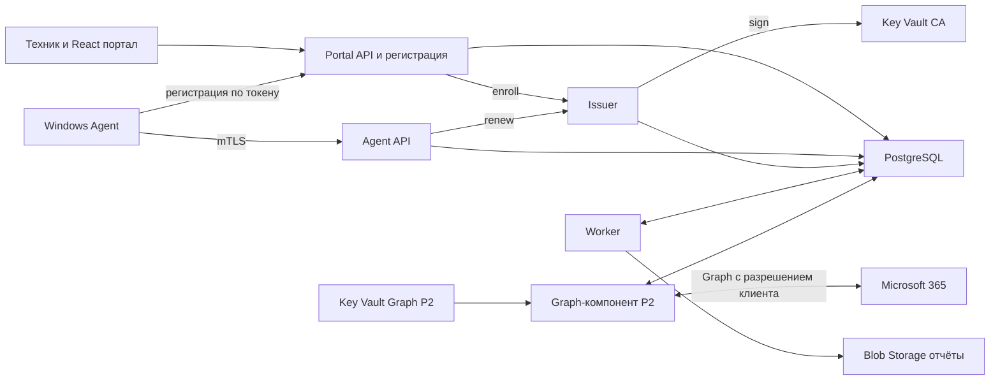

# Development Package для независимой оценки

Версия 0.2.0 от 13 октября 2026 года. Полный комплект требований, архитектуры и предложенных контрактов.

Рецензент начинает с запроса независимой оценки и проверяет весь комплект.


Файл `README.md`

# Development Package для сервиса проверки безопасности

Версия 0.2.0 от 13 октября 2026 года. Рабочее название проекта — Sikkerheit. Владелец продукта — ваша IT-компания; первый канал продаж — её текущие клиенты.

Предлагается сервис регулярной оценки настроек Windows и Microsoft 365 с внутренним порталом для техников, историей отклонений и еженедельным отчётом. Первая поставка включает портал и источник Windows-фактов: собственный агент либо импорт из Intune и RMM по решению SP-05; облачные проверки подключаются отдельным этапом. Платный пилот определяет дальнейший объём продукта.

Статус — проект для независимой оценки и технических экспериментов. P0 начинается после одобрения версии 0.2.0 обоими независимыми рецензентами архитектуры. Контракты описывают предлагаемое поведение; приложение, Azure-инфраструктура и проверки на Windows ещё должны быть реализованы. Оценки сроков, ресурсы и пороги являются плановыми допущениями.

## Как читать пакет

| Файл | Назначение |
| --- | --- |
| [01-product-and-scope.md](01-product-and-scope.md) | Продукт, границы этапов, требования и показатели пилота |
| [02-architecture-and-stack.md](02-architecture-and-stack.md) | Компоненты, потоки, стек и границы доверия |
| [03-check-catalog.md](03-check-catalog.md) | Проверки Windows и Microsoft 365, права, лицензии и ограничения |
| [04-security-and-privacy.md](04-security-and-privacy.md) | Регистрация агента, сертификаты, роли, изоляция и обработка данных |
| [05-data-and-api.md](05-data-and-api.md) | Модель данных, состояния и правила API |
| [06-azure-and-operations.md](06-azure-and-operations.md) | Ресурсы Azure, установка, обновления и эксплуатация |
| [07-delivery-plan-and-acceptance.md](07-delivery-plan-and-acceptance.md) | Backlog, оценки трудоёмкости, испытания и критерии приёмки |
| [08-risks-and-decisions.md](08-risks-and-decisions.md) | Решения, риски, альтернативы и вопросы перед разработкой |
| [09-independent-review-prompt.md](09-independent-review-prompt.md) | Единый запрос для независимой оценки двумя рецензентами |
| [10-sources.md](10-sources.md) | Первичные источники и условия перепроверки |
| [specs/openapi.json](specs/openapi.json) | Предлагаемый HTTP API в формате OpenAPI 3.1 |
| [specs/scan-batch.schema.json](specs/scan-batch.schema.json) | Формат пакета наблюдений агента |
| [specs/observation.schema.json](specs/observation.schema.json) | Формат одного наблюдения |
| [specs/check-catalog.json](specs/check-catalog.json) | Идентификаторы и фазы проверок |
| [specs/invariants.json](specs/invariants.json) | Реестр инвариантов, не выраженных JSON Schema: правило, источник, отрицательный пример, ожидаемый отказ или эффект и приёмочный сценарий |
| [examples/scan-batch.json](examples/scan-batch.json) | Синтетический пакет с доступными наблюдениями |
| [examples/scan-batch-unavailable.json](examples/scan-batch-unavailable.json) | Пример ошибок доступа и неподдерживаемой проверки |
| [source/boss-chat.md](source/boss-chat.md) | Полная исходная переписка на языке оригинала |
| [scripts/validate_package.py](scripts/validate_package.py) | Проверка контрактов, примеров, документов и инвариантов пакета; файлы не изменяет |

## Передача на независимую оценку

Каждому рецензенту передать одинаковую версию пакета и запрос из `09-independent-review-prompt.md`. Для одной загрузки использовать `REVIEW-BUNDLE.md`; для просмотра контрактов и примеров — архив всего каталога. Ответы рецензентов сначала получить независимо, затем сопоставить по требуемой таблице замечаний.

Ключевые вопросы оценки: целесообразность собственного продукта вместо существующих инструментов, корректность прав Microsoft Graph, безопасность установки агента, достоверность состояний, трудоёмкость и экономика сопровождения. Ни один рецензент не должен предполагать, что технические эксперименты уже пройдены.

## Приоритет документов

Требования к поведению определяются документами 01, 03, 04 и 05. OpenAPI и схемы уточняют поля и HTTP-ответы. Реестр инвариантов `specs/invariants.json` уточняет поведение, которое не выражено машинным контрактом, и подчиняется документам 01, 03, 04 и 05: каждая запись ссылается на раздел документа, и при расхождении действует документ, а запись исправляется. Противоречие между файлами считается дефектом пакета и исправляется до реализации соответствующего этапа. Исходная переписка показывает происхождение идеи; её технические предложения не заменяют спецификацию.

Проверка и сборка разделены. [scripts/validate_package.py](scripts/validate_package.py) ничего не записывает: он проверяет структуру JSON и встроенным валидатором — используемое подмножество JSON Schema, разрешение локальных `$ref`, согласованность OpenAPI с документами, каталог проверок, примеры с отрицательными вариантами, реестр инвариантов, ссылки на идентификаторы и локальные ссылки; при ошибке возвращает ненулевой код. [scripts/build_package.py](scripts/build_package.py) копирует переписку, вызывает validate и только после успешной проверки записывает `VALIDATION.md`, `REVIEW-BUNDLE.md`, `manifest.json` и ZIP. Стандартная проверка JSON Schema и OpenAPI сторонними валидаторами (`jsonschema`, `openapi-spec-validator`) в этой версии не выполнена: пакеты не установлены, и `VALIDATION.md` прямо фиксирует, что выполнена только встроенная проверка подмножества. Полная стандартная проверка, пробная генерация клиентов и CI — первый результат WP-01.

## Изменения в 0.2.0

- Выбор между собственным агентом и импортом из Intune и RMM вынесен в gate SP-05 с измеримым порогом (ADR-11, условный WP-04B).
- Трудоёмкость пересчитана по работам backlog для вариантов A и B, с календарной формулой и допущениями.
- Контракт расширен до 34 операций: административные операции, жизненный цикл организации, экспорт, аудит, enrollment-токены, имя устройства, отдельная операция решения о риске. Введены каталог `Problem.code` с действиями агента и автомат агента.
- Закреплены канонический объект, идентичность устройства и ресинхронизация sequence, единый порядок приёма пакета, окна приёма, алгоритм часов, выбор текущего состояния и таблица переходов.
- Проверки: добавлены WIN-011 и SYS-002; переработаны WIN-003, WIN-006, WIN-007 и WIN-010; SYS-001 стал индикатором свежести; применимость определяет только сервер; режим оценки задаётся явно; свежесть по умолчанию — 72 ч; введены две метрики покрытия.
- Безопасность: токены организации, сертификат на 365 дней с идемпотентным продлением, внутренний Issuer и граница ключа CA, доверие XFCC в отдельном environment, PlatformAdmin как платформенная роль с аудитом каждого доступа, экранирование и CSP.
- Данные и эксплуатация: сроки хранения всей цепочки, автомат жизненного цикла организации, внешний журнал жизненного цикла, restore в карантине, планировщик с fencing.
- Отчёт в P1 только в HTML, на языке, выбранном для организации; портал по умолчанию на bokmål с переключением на nynorsk и английский; строки во внешних ресурсах.
- Проверка пакета: validate отделён от build, добавлен реестр инвариантов, статус стандартной валидации указан явно.
- Эксперименты P0 и вопросы владельцу перечислены с рубежами.


Файл `01-product-and-scope.md`

# Продукт и объём разработки

Клиент получает регулярный обзор состояния устройств и корпоративных аккаунтов, а техник — очередь конкретных отклонений с основанием, ответственным и историей. Ценность подписки проверяется устранением реальных проблем и сокращением ручной работы.

## Пользователи и сценарии

Техник IT-компании видит только назначенных ему клиентов, сравнивает изменения и фиксирует работу. Руководитель сервиса контролирует подключение и качество данных, выпускает enrollment-токены, меняет политику клиента и принимает решения о риске. PlatformAdmin — платформенная роль, а не членство в организации: она создаёт организации, назначает сотрудников, управляет жизненным циклом клиента и по решению владельца видит данные всех клиентов, причём каждый такой доступ оставляет запись аудита (ADR-13). Эта роль не используется для повседневной работы, состав учётных записей минимален. Владелец клиента получает отчёт с понятными действиями. Клиентский вход в портал относится к следующему этапу; первая версия предназначена для вашей команды.

Основной сценарий: PlatformAdmin создаёт организацию и назначает сотрудников; техник устанавливает подписанный агент через существующий инструмент управления ПК, передавая ему enrollment-токен организации, видит первое наблюдение, получает отклонение, устраняет его привычным способом и подтверждает результат повторной проверкой. Последующее отсутствие данных не закрывает проблему. Кто создаёт организации в P1 — только PlatformAdmin (по умолчанию) или также руководитель сервиса, — решает вопрос 14 в `08`. При варианте B вместо установки агента факты об устройствах поступают импортом из Intune и RMM (`02`, раздел «Вариант B: импорт без агента»), остальная часть сценария не меняется.

## Этапы

| Этап | Входит | Условие завершения |
| --- | --- | --- |
| P0 | Начинается после одобрения версии 0.2.0 обоими независимыми рецензентами архитектуры. Эксперименты по разделу «План P0» в `07`: SP-01 — права и API Windows без PowerShell; SP-02 — схема mTLS и путь к Issuer в Azure; часть P0 SP-03 — доступ Graph к managedDevices и отзыв credential; SP-04 — изоляция клиентов; SP-05 — сравнение с текущими инструментами и выбор источника Windows-фактов. Права модулей M365 (часть P2 SP-03) проверяются до WP-08. Из работ по реализации допустимы только пакет и инструмент проверки пакета; серверный слой параллельно P0 не ведётся. Календарный лимит — 5 недель, ёмкость — 8 инженерных недель | Протоколы SP-01, SP-02, SP-04, SP-05 и части P0 SP-03 (или запись о её невыполнении по разделу «План P0» в `07`); фактические трудозатраты по плану P0; решение SP-05 (вариант A или вариант B), подписанное Product Owner; утверждённый PKI-дизайн; решение ADR-02; пересчитанные оценки WP P1 и календарь P1; G1 — независимое одобрение одного и того же артефакта двумя рецензентами |
| P1 | Windows 11 Pro x64 по матрице совместимости; источник Windows-фактов по решению SP-05: Windows-агент со сборщиками, регистрацией по токену и работой офлайн (вариант A) либо импорт из Intune и RMM (вариант B); внутренний портал на bokmål с переключением на nynorsk и английский; история; HTML-отчёт (PDF — печатью из браузера) на языке организации | Пройдены критерии продолжения пилота (разделы «Плановые показатели» и «Экономика пилота») |
| P2 | Отдельное подключение M365, сведения о регистрации MFA, Security Defaults, инвентаризация Conditional Access; Intune при наличии лицензии | Подтверждены права, доступность и корректная интерпретация данных |
| P3 | Клиентский доступ, рассылка, дополнительные приложения и интеграции | Спрос и стоимость сопровождения подтверждены пилотом |

Матрица совместимости агента P1 — Windows 11 Pro x64 версий 25H2 и 26H2; она записана в `03`, раздел «Матрица совместимости и жизненный цикл ОС». Enterprise, Education, 24H2 и другие языки ОС добавляются по ответу на вопрос 1 в `08` и итогам SP-01. Windows 10 в P1 не входит. Устройства вне матрицы в пилот не включаются; если во время пилота редакция, версия или архитектура устройства выходит из матрицы либо обслуживание версии заканчивается, SYS-002 даёт fail (unknown, если это определить нельзя), а устройство до обновления исключается из знаменателей NFR-01 и NFR-02. Windows ARM64 и серверы оцениваются после инвентаризации клиентов. Поддержка новой платформы требует собственных испытаний и явной записи в матрице совместимости.

## Функциональные требования

| ID | Требование | Этап | Приёмка | Контракт |
| --- | --- | --- | --- | --- |
| FR-01 | Организации, назначения сотрудников и версии клиентской политики с серверным ограничением доступа | P1 | AT-01 | listOrganizations, createOrganization, updateOrganization, listOrganizationMembers, putOrganizationMember, deleteOrganizationMember, listPolicyRevisions, createPolicyRevision |
| FR-02 | Регистрация агента по ограниченному токену организации (одноразовому или пакетному) и отдельная идентичность устройства | P1, вариант A | AT-02, AT-17 | createEnrollmentToken, listEnrollmentTokens, revokeEnrollmentToken, enrollAgent, renewDeviceCertificate, updateDevice |
| FR-03 | Сбор фактов о Windows без автоматического изменения системы | P1, вариант A | AT-03 | getAgentConfiguration, submitScan |
| FR-04 | Очередь при отсутствии сети и повторная отправка без дубликатов | P1, вариант A | AT-04 | submitScan, submitHeartbeat |
| FR-05 | Четыре результата оценки, отдельный признак свежести и явный информационный режим | P1 | AT-05 | listDeviceAssessments, listFindings, listDevices |
| FR-06 | Стабильная история появления, изменения, повторного открытия и исправления проблем | P1 | AT-05, AT-06 | getFinding, listFindingEvents, requestDeviceScan |
| FR-07 | Отчёт за период в HTML на языке организации, с покрытием проверок и временем наблюдения | P1 | AT-07 | createReport, listReports, downloadReport |
| FR-08 | Ответственный, срок и принятие риска без подмены технического результата | P1 | AT-08 | patchFinding, decideFindingRisk |
| FR-09 | Безопасное подключение M365 и отзыв доступа | P2 | AT-09 | — |
| FR-10 | Разделение регистрации MFA и требований доступа | P2 | AT-10 | — |
| FR-11 | Сопоставление устройства с Intune только по подтверждённому идентификатору | P2 | AT-11 | — |
| FR-12 | Аудит действий, экспорт и жизненный цикл клиентских данных | P1 | AT-12 | listAuditEvents, createOrganizationExport, getOrganizationExport, downloadOrganizationExport, changeOrganizationLifecycle, процедура: RB-09, процедура: RB-10 |
| FR-13 | Подписанные версии агента, поэтапный выпуск и отзыв устройства | P1, вариант A | AT-13 | revokeDevice, процедура: RB-06, процедура: RB-07 |

Колонка «Контракт» называет операции OpenAPI либо процедуру из таблицы runbooks в `07`, раздел «Runbooks». У FR-09…FR-11 контракта пока нет: P2-расширение контракта появится после части P2 SP-03. FR-02, FR-03, FR-04 и FR-13 действуют только в варианте A; повторная проверка устройства `requestDeviceScan` в FR-06 — тоже только в варианте A; при варианте B они заменяются требованиями импорта в пакете 0.3.0. Сверх связей в таблице AT-14 относится к FR-04 и FR-06, AT-15 — к FR-09…FR-11, AT-16 — к NFR-03…NFR-06; NFR-01 и NFR-02 измеряются в пилоте.

## Язык портала и отчёта

Решение владельца: еженедельный отчёт формируется на языке, выбранном для каждой организации, а внутренний портал по умолчанию работает на bokmål (nb) с переключением на nynorsk (nn) и английский (en). Язык отчёта задаёт поле `Organization.reportLanguage` со значениями nb, nn или en; оно обязательно при создании организации и меняется через `updateOrganization`, а `Report.language` фиксируется при генерации. Смешения языков в отчёте нет: если перевода правила нет, отчёт получает `state=failed` и `failureCode=translation_missing`, резервный язык не используется до ответа на вопрос 13 в `08`. Выбор языка в портале хранится в браузере и не меняет API; при пустом или недоступном хранилище действует nb. Портал передаёт выбранный язык заголовком `Accept-Language`, и сервер возвращает на нём заголовки, рекомендации и пояснения правил; идентификаторы, коды и evidence не переводятся. Язык отчёта от выбора в портале не зависит. Строки портала и отчёта с первого дня хранятся во внешних ресурсах, тексты правил — локализованные шаблоны по правилу, версии правила и языку. Подробности — `05`, раздел «Отчёт и покрытие».

## Границы обещаний

Оценка относится к конкретным поддерживаемым проверкам и доступным данным. Отчёт не выражает вероятность взлома, не подтверждает отсутствие вредоносного кода и не заменяет восстановление из резервной копии или полноценное тестирование на проникновение.

Первая версия не собирает действующие пароли, cookies, историю посещений, содержимое писем и документов, recovery passwords BitLocker. Не выполняются подбор паролей, эксплуатация уязвимостей, произвольные удалённые команды и автоматическое исправление системных политик. Эти исключения ограничивают права и стоимость сопровождения.

Microsoft Secure Score, журналы инцидентов Defender, ретроспективная оценка входов, проверка резервных копий и произвольных SaaS — будущие модули. Сохранение показателя MFA registered не является доказательством обязательности MFA. [Свойства регистрации MFA](https://learn.microsoft.com/en-us/graph/api/resources/userregistrationdetails?view=graph-rest-1.0).

## Плановые показатели

Пилот — 3–5 организаций (не меньше 3), всего 20–30 устройств Windows 11 Pro x64 версий 25H2 или 26H2, длительность — 6 недель: критерий ценности считается по двухнедельным окнам, и шесть недель дают три таких окна. Это выбранный масштаб эксперимента. В пилоте с режимом assessed работают WIN-001…WIN-005 (WIN-004 только для Defender), WIN-008 и SYS-002; WIN-003 и WIN-008 оцениваются после того, как одобренные антивирусы и allowlist SID внесены в политику клиента. WIN-006 получает полную оценку при подтверждённой гипотезе H-WU1, иначе узкую форму. WIN-007 и WIN-009 работают как assessed, если SP-01 подтвердит источник данных, иначе как informational. WIN-010, WIN-011 и SYS-001 остаются informational; SYS-001 — индикатор свежего полного сбора. P2 в пилот не входит.

Для проверки проектирования используется нагрузочная модель 1 000 устройств, 100 организаций, один полный сбор в сутки и heartbeat каждые 4 часа только при включённом ПК. В модель входит утренний старт: 70% устройств включаются в течение 30 минут и выполняют догоняющий сбор.

| ID | Плановый критерий | Как измерить |
| --- | --- | --- |
| NFR-01 | Не менее 95% устройство-суток с подтверждённой доступностью имеют валидный суточный пакет в течение 48 часов | Знаменатель — устройство-сутки, в которые RMM или Intune (при их отсутствии — heartbeat) показали устройство в сети; офлайн учитывается отдельно |
| NFR-02 | Каждая обязательная применимая пара (устройство, проверка) даёт результат либо явную причину (`reasonCode`) | Метрика «покрытие периода» (`coveragePeriod`) за неделю, целевое значение не ниже 90% на устройствах из знаменателя NFR-01; определение обязательной проверки — `05`, раздел «Отчёт и покрытие»; в числитель входят только определённые оценки (pass или fail), а unknown с `reasonCode` показывается с причиной, но покрытие не повышает |
| NFR-03 | Для валидного суточного пакета p95 обработки менее 5 минут при расчётной нагрузке, включая утренний старт | От подтверждённой записи до оценки |
| NFR-04 | На референсном ПК сессия сбора занимает до 120 секунд, таймаут одного сборщика до 30 секунд | Windows-лаборатория; процесс может завершаться частичным результатом. Если по гипотезе H-WU2 выбрано фоновое задание Windows Update, у него собственный лимит 600 секунд (стартовое значение, его подтверждает SP-01), и он не входит в 120 секунд сессии |
| NFR-05 | Средняя CPU за 15 минут до 2% и рабочая память до 150 МБ суммарно по всем процессам агента | Измеряется по всем процессам агента; превышение пересматривает реализацию |
| NFR-06 | Работает буфер до `maxBufferDays` (по умолчанию 7) и до 100 МБ; сервер принимает пакеты с запасом 2 суток (`maxBatchAgeDays`) | Испытание длительного отсутствия сети; переполнение выдаёт событие потери данных |
| NFR-07 | RPO до 15 минут, RTO до 4 часов для базы при выбранной конфигурации | Измеренный учебный restore, выполняемый в карантине; это цель, а не обещание поставщика |
| NFR-08 | Отсутствует доступ между клиентами при подмене идентификаторов, включая обращения PlatformAdmin — только с записью аудита (`audit_event` организации; для `listOrganizations` — `platform_audit_event`) | Сквозные негативные испытания API, заданий и скачивания файлов |

Условия референсного ПК фиксируются в P0. Нагрузочная модель не доказывает производительность до измерений.

## Экономика пилота

Учитывать облако, лицензии и сертификаты, время подключения, поддержку агента, разбор ложных тревог и исправления. Ежемесячный вклад клиента равен выручке минус выделенные расходы облака, поддержку, сторонние лицензии и включённые часы работы. Расходы разработки учитываются отдельно при расчёте окупаемости.

| Область | Критерий продолжения |
| --- | --- |
| Доставка | NFR-01: не меньше 95% |
| Достоверность | `coveragePeriod` не меньше 90% по каждой неделе; 0 ложных pass в эталонных отрицательных сценариях AT-05, включая BitLocker; ложных fail — не больше 10% от fail, разобранных техником |
| Ценность | Не меньше 1 реального исправления (`resolved` с `device_change`) на организацию за любые 2 недели; не меньше 3 отклонений в сумме, которых не показывали Intune, RMM или Lighthouse (только вариант A); время подготовки недельного отчёта — не больше 70% от базы, измеренной в SP-05 |
| Эксплуатация | Пройдены AT-01, AT-05…AT-08, AT-12, AT-14, AT-16 (в варианте A также AT-02…AT-04, AT-13, AT-17); restore drill в изолированном окружении укладывается в RTO 4 ч; поддержка — не больше 10 минут на устройство в месяц; 0 дефектов класса AT-01; в варианте A отзыв, обновление и 7 дней офлайна проверены на пилотных устройствах |
| Коммерция | Не меньше 3 организаций подписали платное продолжение по конкретной цене; положительный вклад после выделенных затрат (разработка учитывается отдельно) |

Если коммерческий критерий не выполнен, действует условие пересмотра в `08`. Найденные проблемы без готовности платить не подтверждают спрос. Сравнение с Intune, Lighthouse и используемым инструментом управления ПК выполняется до пилота в SP-05 и определяет выбор между собственным агентом и импортом. Пилот также фиксирует, нужен ли клиентам PDF-файл отчёта.


Файл `02-architecture-and-stack.md`

# Архитектура и технический стек

Общий серверный код организован как модульный монолит. Развёртываются три процесса Portal API, Agent API и Worker и внутренний компонент Issuer (ADR-03, ADR-12). Отдельный Agent API нужен из-за обязательного клиентского сертификата на ingress; он размещается в отдельном Container Apps environment без других приложений. Браузерный вход и первоначальная регистрация доступны через Portal API. Issuer и Worker работают без публичного ingress. Схема ниже описывает вариант A с собственным агентом; при варианте B агентская часть заменяется импортом (раздел «Вариант B: импорт без агента»). Graph-компонент появляется только в P2.



## Компоненты

| Компонент | Технология | Ответственность |
| --- | --- | --- |
| Agent Host | C# .NET 10 Worker Service | Расписание, сеть, локальная очередь, проверка конфигурации |
| Privileged Collector | Минимальная Windows-служба C# | Фиксированные сборщики, которым нужны повышенные права (по решению ADR-02) |
| Локальные данные | SQLite и ACL Windows | Буфер и последовательность пакетов; криптографические ключи отдельно |
| Portal API | ASP.NET Core 10 | Сессия портала, доступ сотрудников, регистрация устройств, управление клиентами |
| Agent API | ASP.NET Core 10 | Аутентификация устройств, приём пакетов, heartbeat, конфигурация и продление сертификата |
| Issuer | .NET 10, отдельный Container App с собственной managed identity | Единственный обладатель права sign на ключ в Key Vault CA; заново проверяет CSR и в собственной транзакции выпуска добавляет записи `device_certificate`, идемпотентно по `enrollmentId` или (`deviceId`, `renewalRequestId`); вызывается Portal API после commit регистрации (enroll) и Agent API (renew); границы транзакций — `04`, «Граница транзакций выдачи» |
| Worker | .NET 10 | Очередь заданий и планировщик, оценки, HTML-отчёты и жизненный цикл данных; Graph-сертификатов не получает |
| Graph-компонент (P2) | Тот же образ модульного монолита, отдельный Container App с собственной managed identity | Сбор данных Microsoft 365 по организации; доступ к отдельному Key Vault Graph есть только у него |
| Persistence | PostgreSQL, EF Core 10, Npgsql 10 | Транзакции, история, JSONB, клиентская изоляция |
| Portal | React, TypeScript, Vite | Обзор клиентов, устройств, проблем и истории; интерфейс на nb по умолчанию с переключением на nn и en, строки во внешних ресурсах, выбранный язык передаётся заголовком `Accept-Language` |
| Identity | Entra ID, Microsoft.Identity.Web или MSAL | Вход сотрудников и отдельно токены облачных интеграций |
| Observability | OpenTelemetry и Azure Monitor | Метрики, трассировка и отредактированные журналы |

Сетевой путь от Portal API и Agent API к Issuer выбирается в PKI-дизайне до WP-03 по итогам SP-02. Предпочтительный вариант — Issuer во внутреннем VNet-environment с ingress через внутренний load balancer и сетевой связностью из environments Portal API и Agent API. Запасные варианты — асинхронный renew через задание в БД (он меняет контракт renew и вносится в 0.3.0) либо право sign у identities API с остаточным риском, который явно принимает Security Owner. Отчёт строится на языке организации независимо от языка, выбранного в портале; правила языка — `01`, раздел «Язык портала и отчёта».

.NET 10 имеет поддержку LTS до ноября 2028 года; Npgsql 10 выпущен для EF Core 10. Используются стабильные совместимые пакеты с зафиксированными версиями и lock files. [Политика .NET](https://dotnet.microsoft.com/en-us/platform/support/policy), [Npgsql](https://www.npgsql.org/efcore/release-notes/10.0.html).

## Выполнение локальной проверки

Плановая гипотеза H-02: сетевой Agent Host работает под виртуальной учётной записью службы без прав администратора, а сборщики, которым нужны повышенные права, выполняются в привилегированном сборщике с фиксированным протоколом. Привилегированный сборщик не имеет сетевых функций и принимает по named pipe только известный `collectorId` и параметры из enum. Произвольные пути, скрипты, команды и имена исполняемых файлов в протоколе отсутствуют. Обязательные требования к разделённому варианту: service SID; pipe только локальный (`PIPE_REJECT_REMOTE_CLIENTS`), создаётся первым экземпляром (`FILE_FLAG_FIRST_PIPE_INSTANCE`) и проверяет SID клиента; ACL на каталог установки, конфигурацию, helpers и ключи разрешают запись только SYSTEM и администраторам; запрос не больше 4 KiB и ответ не больше 64 KiB, по схеме; не больше 10 вызовов одного `collectorId` в час; Agent Host ждёт результат вызова не дольше 30 секунд и по истечении записывает для наблюдения причину `collector_timeout`; зависшая привилегированная работа принудительно завершается не позже чем через 120 секунд после начала вызова.

Решение ADR-02 принимается по итогам SP-01 на основе таблицы «collectorId → минимальная учётная запись → API → замер» для всех 11 WIN-проверок, двух моделей угроз и стоимости разделения; WP-04 не стартует, пока решение не записано. Единая служба LocalSystem выбирается, только если Agent Host сам требует повышенных прав для большинства сборщиков либо стоимость разделения превышает порог — больше 2 инженерных недель или больше 25% оценки WP-04, — и при этом Security Owner принимает модель угроз с компенсирующими мерами: нет входящих listener, ответы разбираются строго и с ограничениями, нет дочерних процессов, бинарные файлы подписаны, на каталог установки стоит ACL. Установка выполняется администратором; режим чтения сам по себе не означает отсутствие повышенных прав.

Сборщики обращаются к WMI/CIM, COM и Win32 API напрямую из .NET. Запуск `powershell.exe`, `cmd.exe` и любых дочерних процессов (`Process.Start`) запрещён; исключение возможно только через ADR-02 с замером бюджета в SP-01. Кандидаты API для проверок перечислены в `03` и подтверждаются в SP-01.

Сборщик возвращает факт либо причину недоступности. Agent Host записывает пакет в SQLite, затем отправляет его на Agent API. Успешный HTTP-ответ выдаётся после транзакционной записи пакета и задания оценки. Worker оценивает факты и обновляет проекции для портала.

Агент собирает факты; правила и рекомендации выполняются на сервере. Политика и версия правила сохраняются вместе с результатом. При изменении правила пересчёт помечается отдельно от изменений на устройстве.

## Выполнение облачной проверки

В P2 для клиента регистрируется отдельное приложение Entra с разрешениями чтения и отдельным сертификатом. Токен для конкретного Entra tenant получает отдельный Graph-компонент; его сертификаты хранятся в отдельном Key Vault Graph вашей инфраструктуры, а Worker Graph-сертификатов не получает ни в одном варианте. Такое подключение увеличивает ручную работу, но уменьшает область воздействия одного credential; массовое multitenant-подключение оценивается в ADR-06 после пилота. Остаточный риск сохраняется: компрометация общего Graph-компонента затрагивает всех подключённых клиентов (R-14), поэтому его изоляция, отдельный vault и учения массового отзыва — условие входа в WP-08.

Сбор выполняется по организации, а не с каждого ПК. У каждой интеграции есть набор возможностей, права, время последней успешной загрузки и результаты пробных запросов. 403 не интерпретируется автоматически как отсутствие лицензии. Повторные попытки соблюдают `Retry-After`; допускается частичный успешный сбор по доступным модулям. [Ограничения Graph](https://learn.microsoft.com/en-us/graph/throttling).

## Очередь заданий

P1 использует таблицу `job` в PostgreSQL. API записывает пакет и задание в одной транзакции. Типы заданий: `evaluate_batch`, `recalculate_policy`, `report_generate` и `organization_export`; `freshness_sweep`, `scan_request_expiry` и `review_expiry` — раз в час; `weekly_report` — в понедельник в 06:00 по timezone организации за прошедшую неделю, только для активных организаций; `retention_purge` — ежедневно в 02:00; `platform_audit_purge` — ежедневно в 02:30, платформенное задание с `organizationId` = null и уникальностью по (`type`, `periodKey`); `organization_delete` — планировщик ежечасно ставит его для организаций с `deletionDueAt ≤ now`. `lifecycle_journal_append` ставит разрешающий переход жизненного цикла в своей транзакции; задание дописывает запись журнала жизненного цикла и выполняется при любом статусе организации. В P2 добавляется `graph_collect`. Поля задания включают `leaseOwner`, `leaseToken` и `periodKey`; уникальность — (type, organizationId, coalesce(inputId, periodKey)).

Планировщик работает внутри каждой реплики Worker: каждые 5 минут он вставляет периодические задания через `INSERT … ON CONFLICT DO NOTHING`. Пропущенные периоды догоняются не глубже 24 часов для часовых заданий и 4 недель для `weekly_report`. Захват выполняется через `FOR UPDATE SKIP LOCKED` с lease на 5 минут; долгое задание продлевает lease, а `leaseToken` при каждом захвате увеличивается. Завершение и бизнес-эффект выполняются в одной транзакции с условием `WHERE id=? AND leaseToken=?`; если обновлено 0 строк, транзакция откатывается. Эффекты идемпотентны за счёт уникальных ограничений. Пакеты одного устройства обрабатываются в порядке приёма: при приёме под блокировкой строки устройства пакет получает монотонный номер приёма `acceptOrder` (внутреннее поле, в API не выдаётся). `claim_jobs` захватывает задания как обычно, а транзакция `evaluate_batch` под блокировкой строки устройства проверяет очерёдность: если у устройства есть ранее принятый пакет, который ещё не обработан и не в терминальном отказе, задание откладывается через `nextAttemptAt` без эффектов и без увеличения `attempts`. Параллельно обрабатываются только разные устройства. Какие результаты не зависят от расписания Worker — `05`, «Задания и планировщик» и «Выбор текущего состояния». После повторяющихся ошибок задание попадает в состояние failed и вызывает оповещение; `evaluate_batch` — после 10 попыток или через 24 ч от первой попытки, что наступит раньше, а задание, которое откладывает следующие пакеты устройства дольше 1 ч, поднимает оповещение раньше. Метрика «последний такт планировщика» поднимает оповещение, если периодические задания не создавались дольше двух периодов.

`retention_purge` выполняется по каждой организации в её контексте RLS, идемпотентно и с аудитом сводки: сколько записей удалено и сколько заменено неизменяемым снимком. Сроки хранения всей цепочки — `04`, раздел «Сроки хранения».

`platform_audit_purge` без контекста организации удаляет строки `platform_audit_event` старше срока хранения аудита и строки `revoked_certificate` с `validTo` ≤ now. Право DELETE на эти таблицы есть только у роли базы этого задания; у роли для runbook — только SELECT.

Worker в Container Apps имеет минимум одну работающую реплику: очередь в PostgreSQL сама по себе не запускает процесс после scale to zero. При росте добавить Service Bus с outbox и сохранить дедупликацию обработчиков, уникальный ключ периода и fencing по `leaseToken`; доставка сообщения не означает однократное выполнение бизнес-операции.

## Разделение клиентов

OrganizationId определяется серверной связью сертификата, enrollment-токеном (в `enrollAgent`), проверенным членством пользователя либо платформенной ролью PlatformAdmin. В Agent API этот идентификатор отсутствует в клиентском теле запроса. В Portal API выбранный OrganizationId проверяется по назначению, роли и действию.

Таблицы клиента используют OrganizationId, составные ограничения и Row-Level Security с `FORCE ROW LEVEL SECURITY`; без контекста запрос возвращает 0 строк данных клиента. Контекст организации устанавливается только SECURITY DEFINER-функцией `app.begin_org_context` роли `app_ctx` без входа, в одной транзакции и в порядке: проверка полномочий или привязки (`purpose` — `portal`, `job`, `agent`, `enroll` или `restore`) → `SET LOCAL` → `audit_event` для субъекта с `platform_role` при `purpose=portal`, кроме `createOrganization` (в режиме `restore` аудит пишет команда восстановления) → данные; ответ портала отправляется после COMMIT. Политик межклиентского обхода данных клиента нет: глобальное чтение PlatformAdmin означает право войти в контекст любой организации, а не bypass. Межорганизационные чтения служебных данных — проверка полномочий и привязки, `listOrganizations`, выбор и планирование заданий, сверка подписей и метрика незавершённых выдач, перечень организаций и токенов для команды восстановления — допускаются только по закрытому перечню исключений; перечень, права функций и `search_path` описаны в `04`, подраздел «Контекст организации и аудит PlatformAdmin». Контекст очищается при возврате соединения в pool. Роли приложений не являются владельцами таблиц или superuser и не имеют BYPASSRLS; роль миграций отделена. Остаточный риск прямой установки параметра контекста и его компенсация описаны там же.

В Worker выбор и обработка заданий разделены. Выбор выполняет SECURITY DEFINER-функция `claim_jobs`, вставку периодических заданий — функция планировщика `app.schedule_jobs()`; обе принадлежат роли `app_jobs` без входа и видят только метаданные заданий и поля организации, нужные расписанию. Обработка идёт в отдельной транзакции с контекстом организации из `job.organizationId`, установленным `app.begin_org_context` с `purpose=job` и проверкой `leaseToken` и `leaseUntil`. Принадлежность входных сущностей организации задания проверяется явно. RLS дополняет прикладные проверки и не покрывает автоматически Blob, фоновые задания и аудит. [Правила PostgreSQL](https://www.postgresql.org/docs/current/ddl-rowsecurity.html).

## Вариант B: импорт без агента

Если SP-05 выбирает вариант B, собственный агент не разрабатывается: не выполняются WP-03, WP-04 и WP-07a, отпадают Agent API, PKI и Issuer, MSI и офлайн-буфер. Вместо них выполняется WP-04B — импорт фактов из Intune и RMM отдельным компонентом импорта. Модель observation, assessment и finding остаётся той же; provenance и время источника берутся из внешнего инструмента, а отчёт явно указывает источник данных. Гибрид, в котором агент закрывает только пробелы импорта, в P1 не вводится (ADR-11).

Вариант B вводит в P1 новые классы секретов: Graph-сертификаты для чтения managedDevices и ключи RMM API. Они хранятся в отдельном Key Vault импорта, доступ к которому есть только у компонента импорта — отдельного Container App с собственной managed identity. Worker не получает Graph-сертификатов и в этом варианте. Остаточная область воздействия компонента импорта — риск R-14. Изоляция компонента, отдельный vault, runbook onboarding и offboarding (RB-13) и учения массового отзыва (RB-14) становятся условием до старта WP-04B, а не до P2. FR-02, FR-03, FR-04 и FR-13 и агентские приёмочные сценарии заменяются требованиями импорта; для этого нужны пакет 0.3.0 и G1.

## Структура будущего репозитория

```text
src/Agent.Host
src/Agent.Collectors
src/Agent.PrivilegedCollector
src/Server.PortalApi
src/Server.AgentApi
src/Server.Worker
src/Server.Domain
src/Server.Infrastructure
src/Contracts
src/Portal
tests/Domain
tests/Integration
tests/WindowsLab
tests/Portal
infra/bicep
installer
docs
```

Это целевая структура будущего кода. Одна модель контрактов генерирует клиент агента и TypeScript-типы; зависимости Windows не включаются в контейнеры сервера. Сборки агента self-contained включают runtime, поэтому выпуск исправлений .NET должен обновлять сам агент.


Файл `03-check-catalog.md`

# Каталог проверок и ограничений

Каталог определяет измеряемые факты, условия вывода и границы интерпретации. Пороговые значения ниже — параметры политики по умолчанию v1, которую сервер создаёт вместе с организацией; любое изменение даёт новую неизменяемую ревизию политики и записывается в аудит. `checkId` сохраняется в наблюдении и совпадает с машинным каталогом `specs/check-catalog.json`. Каталог содержит 18 проверок, из них 11 WIN-*; для каждой он задаёт `defaultAssessmentMode` (`assessed` или `informational`), источник `source` (`agent`, `server` или `graph`) и тип объекта `subjectType`. Колонки «Объект» и «Режим по умолчанию» в таблицах ниже совпадают с этими полями каталога.

## Семантика результата

Агент возвращает для каждого наблюдения `collectionStatus` — только `collected` либо `unavailable`. Evidence передаётся только при `collected` и только по закрытой схеме своей проверки. `reasonCode` агента описывает исключительно сбор и принимает значения `permission_denied`, `unsupported`, `collector_timeout` или `temporary_error`. Проверку, которую на данной платформе выполнить нельзя, агент передаёт как `unavailable`/`unsupported`. Агент не решает, применима ли проверка: `not_applicable` выводит сервер из действующей `policy_revision`, в том числе по фактам WIN-011 и других наблюдений того же пакета (см. «Политика по умолчанию и входные настройки»). Внешняя невозможность проверки не означает not_applicable.

Сервер оценивает наблюдение как `pass`, `fail`, `unknown` либо `not_applicable`. Успешное получение факта не означает pass. Причины unknown и not_applicable, которые выставляет только сервер при оценке, — `missing_observation`, `clock_inconsistent`, `unmapped_state`, `update_search_failed`, `update_search_outdated`, `update_source_mismatch`, `update_list_truncated`, `update_age_unconfirmed`, `os_version_unknown`, `os_inventory_missing`, `applicability_input_missing`, `policy_not_applicable` и `evidence_time_invalid`; вместе с четырьмя причинами сбора они образуют закрытый перечень `Assessment.reasonCode` из 17 значений. `clock_inconsistent` агент не передаёт: признак часов вычисляет Agent API при приёме пакета по алгоритму `05`, раздел «Время и часы устройства», и сохраняет в `scan_batch`; worker применяет сохранённый признак. Признак часов действует на все оценки пакета: оценка в режиме `assessed` получает `result=unknown` и `reasonCode=clock_inconsistent`, в режиме `informational` — `result=null` и `reasonCode=clock_inconsistent`; все они получают `assessmentScope=historical`, сохраняются в истории и не меняют текущую проекцию.

При приёме с `receivedAt` сравниваются только `startedAt`, `completedAt` и `observations[].observedAt`. Метки времени внутри evidence при приёме не проверяются; правило для них задаёт проверка. Для WIN-004 `signatureLastUpdatedAt` позже `observedAt` этого наблюдения даёт unknown/`evidence_time_invalid`; для WIN-006 отношения времени в evidence задаёт шаг 2 раздела «Правило WIN-006», а `deadlineAt` в будущем ошибкой не считается. Из-за меток времени внутри evidence пакет не отклоняется.

`assessmentMode` равен `assessed` или `informational`. `defaultAssessmentMode` каталога — режим проверки в политике по умолчанию v1; фактический режим хранится явно в `policy_revision.configuration` для каждой проверки. Условие, при котором клиентская политика может перевести проверку в `assessed`, записано в колонке «Условие оценки». Наличие входных настроек — необходимое, но не достаточное условие: режим выбирает политика. Informational-оценка всегда имеет `result=null`, не создаёт finding и не участвует в оценке соответствия. Finding создаётся только для режима `assessed`. Оценка проверки определяется по порядку, действует первое совпадение: (1) признак часов пакета — unknown/`clock_inconsistent`; (2) применимость, если она зависит от другого наблюдения того же пакета (раздел «Политика по умолчанию и входные настройки»): вход отсутствует или `unavailable` — unknown/`applicability_input_missing`, применимость известна и проверка не применима — not_applicable/`policy_not_applicable`; (3) собственное наблюдение агентской проверки: отсутствует — unknown/`missing_observation`, `unavailable` — unknown с `reasonCode` наблюдения; (4) правило проверки. Порядок одинаков для обоих режимов; в режиме `informational` результат затем отображается по правилам переноса причин ниже. `reasonCode` допускается при `result` unknown или not_applicable, а также у informational-оценки с `result=null`, когда данных нет: причины недоступности наблюдения, `missing_observation`, `clock_inconsistent`, `applicability_input_missing`. В informational-оценку переносятся только причины недоступности наблюдения (коды сборщика), `missing_observation`, `applicability_input_missing` и `clock_inconsistent`: если правило ниже даёт unknown с такой причиной, в режиме `informational` оценка получает `result=null` с той же причиной. Остальные причины правил — `unmapped_state`, `update_search_failed`, `update_search_outdated`, `update_source_mismatch`, `update_list_truncated`, `update_age_unconfirmed`, `os_version_unknown`, `os_inventory_missing`, `evidence_time_invalid` и `policy_not_applicable` — informational-оценке не присваиваются: она получает `result=null` и `reasonCode=null`. `Finding.severity` принимает значения `critical` или `warning` и задана колонкой «Severity при fail» таблицы Windows: пороги warn и critical дают `result=fail` и severity `warning` или `critical` соответственно.

Объект наблюдения задаётся полем `subject`. WIN-001 и WIN-002 относятся к тому (`volume`): в P1 это ровно один том ОС с `volumeId` и `role=os`, буква диска — только атрибут отображения `mountPoint`. Остальные проверки относятся к устройству (`device`). Внутри пакета ключ `(checkId, subject.type, localKey)` уникален: повтор отклоняет весь пакет с 422 `duplicate_observation`, а лишний или другой объект — с 422 `unexpected_subject`. Отсутствие ожидаемой пары «объект/проверка» для активной проверки даёт unknown с `missing_observation`. Канонический объект, ключи и ожидаемые пары определены в `05`, разделы «Канонический объект и идентичность устройства» и «Уникальность и ожидаемые объекты».

Отдельно хранится `freshness=fresh|stale`. Окно свежести `freshnessWindowHours` задаётся в политике для каждой проверки, по умолчанию 72 часа от `observedAt`. Свежесть вычисляется при чтении на текущий момент и при формировании отчёта на `periodEnd`. Heartbeat обновляет `lastSeenAt`, но не свежесть оценок. Устаревший pass показывается как прошлый результат с датой и не считается в числителе `coverageAt`; в `coveragePeriod` pass, полученный в периоде, засчитывается и после устаревания. Изменение окна — это изменение политики (`policy_change`). Покрытие измеряется двумя метриками: `coverageAt` — доля свежих pass и fail среди обязательных применимых пар активных устройств на момент измерения — и `coveragePeriod` — доля пар, у которых за период есть хотя бы одна определённая оценка (`result` pass или fail; unknown, not_applicable, informational и оценки с признаком часов не засчитываются). Informational-оценки исключаются из числителя и знаменателя, not_applicable — из знаменателя; обе группы показываются отдельными счётчиками. «Не настроено политикой» — подмножество informational: пары в режиме informational из-за отсутствующих входных настроек политики (например, WIN-008 без `allowedSids`, WIN-010 без `expectedTenantId`); в отчёте оно показывается как часть informational. Точные определения, пример расчёта и места использования метрик — в `05`, раздел «Отчёт и покрытие».

## Проверки Windows

| ID | Проверка и данные | Объект | Режим по умолчанию | Условие оценки | Severity при fail | Права и ограничения |
| --- | --- | --- | --- | --- | --- | --- |
| WIN-001 | Свободное место на томе ОС: `totalBytes`, `freeBytes` | volume | assessed | fail с `severity=warning` при свободном месте менее 10% или 10 GiB (`warnFreePercent`, `warnFreeBytes`); fail с `severity=critical` при менее 5% или 2 GiB (`criticalFreePercent`, `criticalFreeBytes`). Для assessed входные настройки не нужны | по порогу | Обычное чтение; объект — том ОС (`volumeId`, `role=os`); эксплуатационный показатель, не доказательство защиты |
| WIN-002 | BitLocker тома ОС: `volumeStatus`, `protectionStatus`, `encryptionPercentage` | volume | assessed | При `encryptionRequired=true` pass только при завершённом шифровании и активной защите; приостановленная защита или расшифровка — fail, в том числе при `volumeStatus=fully_encrypted`, `protectionStatus=off` и `encryptionPercentage=100` (эталонный отрицательный тест ниже). Для редакций из `notApplicableEditionIds` по `editionId` из WIN-011 того же пакета — not_applicable. Для assessed входные настройки не нужны | critical | Права вызова подтверждает SP-01; recovery password никогда не извлекается и не передаётся |
| WIN-003 | Антивирусы: `products[]` до 10 элементов (`provider`, `productState`, `statusSource`, `rawState`) и объект `defender` (`amRunningMode`, `realTimeProtectionEnabled`) или null | device | informational | По таблице решений WIN-003 ниже: pass при активном одобренном продукте, unknown/`unmapped_state` при неопознанном состоянии одобренного, иначе fail. Для assessed нужен непустой `approvedProviders` или `defenderApproved=true` | critical | Defender передаётся одним элементом со `statusSource=defender`, без дубля из WSC; для стороннего продукта доступен только статус, который он сообщает WSC; больше 10 продуктов — `unavailable`/`unsupported` |
| WIN-004 | Давность сигнатур Defender: `signatureLastUpdatedAt` | device | assessed | fail с `severity=warning` старше 3 суток (`warnDays`), с `severity=critical` старше 7 (`criticalDays`); `signatureLastUpdatedAt` позже `observedAt` этого наблюдения — unknown/`evidence_time_invalid`. Для assessed WIN-003 должна входить в `activeCheckIds` | по порогу | Применима только при `defenderApproved=true` и `amRunningMode=normal` по WIN-003 того же пакета, иначе not_applicable/`policy_not_applicable` (в том числе при `defender = null`); без пригодного наблюдения WIN-003 — unknown/`applicability_input_missing`; сторонний AV оценивается отдельной интеграцией |
| WIN-005 | Брандмауэр: `domainEnabled`, `privateEnabled`, `publicEnabled` | device | assessed | Для штатного Windows Firewall включены все профили из `requiredProfiles` (по умолчанию domain, private, public). Для assessed входные настройки не нужны | critical | Альтернативный firewall требует явной политики и собственного источника |
| WIN-006 | Windows Update: `configuredSource`, `auLastSearchSuccessAt`, `agentSearch`, `pendingSecurityUpdates[]` до 50 элементов, `pendingSecurityUpdatesTotal`, `truncated` | device | informational | По правилу WIN-006 ниже: unknown при неуспешном поиске, нарушенных отношениях времени в evidence (`evidence_time_invalid`), отсутствующей или устаревшей основе свежести либо чужом источнике; fail при просрочке хотя бы одного переданного обновления; unknown/`update_list_truncated` при усечённом списке без просрочки; unknown/`update_age_unconfirmed`, если история устройства не исключает просрочку (в том числе в первых пакетах нового устройства); pass при свежем успешном поиске без просрочки, без усечения и с подтверждённым возрастом. Для assessed нужен `expectedSource` | warning | Поиск может быть долгим (гипотеза H-WU2); WSUS-deadline и отсрочки учитываются через `referenceTimeBasis`; одна дата последнего KB недостаточна; заголовки и описания обновлений не передаются |
| WIN-007 | Необходимость перезагрузки: `rebootRequired`, `lastBootAt`, `statusSource` (`windows_update_api`) | device | assessed | fail с `severity=warning`, если эпизод требования перезагрузки наблюдается не меньше `warnDays` (3) суток по правилу WIN-007 ниже. Для assessed входные настройки не нужны | по порогу | Отрицательный результат относится только к поддерживаемому Windows Update API, не ко всем установщикам; снятие требования без перезагрузки внутри одного сеанса не обнаруживается |
| WIN-008 | Прямые члены группы локальных администраторов по известному SID группы: `memberSids` до 100, `membershipScope=direct_members` | device | informational | SID, не предусмотренный `allowedSids`, — fail. Для assessed нужен хотя бы один SID в `allowedSids` | warning | Не равнозначно полному раскрытию вложенных AD/Entra-групп и всех способов повышения прав |
| WIN-009 | Secure Boot: `enabled`, `platform` (`uefi`, `legacy_bios`) | device | assessed | При `secureBootRequired=true` disabled или подтверждённое отсутствие поддержки — fail. Для assessed входные настройки не нужны | critical | Access denied — unknown/`permission_denied`; виртуальная машина не исключается автоматически |
| WIN-010 | Присоединение устройства: `joinType` (`entra_joined`, `hybrid_joined`, `domain_joined`, `not_joined`), `tenantId`, `entraDeviceId` | device | informational | Информационная инвентаризация; проверка tenant — только при заданном `expectedTenantId`. Для assessed нужен `expectedTenantId` | warning | Собирается в контексте службы; пользовательская регистрация (workplace join) не наблюдается и не выводится, значения `registered` нет; `domain_joined` означает только локальный AD без Entra; устройство не даёт доступа к данным всего tenant; пользовательская Hello/PIN не выводится из контекста службы |
| WIN-011 | OS-инвентарь: `editionId`, `displayVersion`, `build`, `ubr`, `architecture` (`x64`, `arm64`) | device | informational | Всегда informational, finding не создаёт. Факты используют SYS-002 и применимость WIN-002 | — | Обязательна в `activeCheckIds` каждой политики; источник API подтверждает SP-01 |
| SYS-001 | Индикатор свежего полного сбора: `lastFullScanAt`, `lastSeenAt`, `hasFreshFullScan` | device | informational | Всегда informational. Значение истинно, если `completedAt` последнего полного сбора не старше `freshnessWindowHours` проверки SYS-001 (по умолчанию 72 часа). Полный сбор — принятый пакет с наблюдением для каждой проверки из `activeCheckIds` своей `policyVersion` (любой `collectionStatus`, включая `unavailable`), без признака часов. Повторную проверку агент выполняет как полный сбор всех `activeCheckIds`; частичных пакетов агент не отправляет. `lastFullScanAt` обновляет только полный сбор, по максимуму `completedAt`; оценку SYS-001 пересчитывают рост `lastFullScanAt` и задание `freshness_sweep` (`05`, «Отчёт и покрытие») | — | Вычисляется сервером; finding не создаёт, в coverage и compliance не входит; выключенный ПК не получает fail |
| SYS-002 | ОС в матрице совместимости и на обслуживании: по последнему свежему WIN-011, матрице совместимости и таблице жизненного цикла | device | assessed | fail — редакция, версия или архитектура вне матрицы совместимости либо `observedAt` ≥ `servicingEndsAt` версии (исключающая граница, раздел «Матрица совместимости и жизненный цикл ОС»); unknown, если определить нельзя: `os_version_unknown` — только для версии из матрицы, которой нет в таблице жизненного цикла; `os_inventory_missing` — нет свежего WIN-011. Версия вне матрицы, в том числе отсутствующая в таблице, даёт fail, а не unknown. Для assessed входные настройки не нужны | critical | Вычисляется сервером; свежесть SYS-002 равна свежести WIN-011; таблица — в разделе «Матрица совместимости и жизненный цикл ОС» |

### Политика по умолчанию и входные настройки

Список разрешённых администраторов, источник обновлений, одобренные антивирусы и ожидаемый tenant согласуются по клиенту и записываются в параметры политики. Политика по умолчанию v1 включает в `activeCheckIds` все 11 WIN-проверок; режимы равны `defaultAssessmentMode` каталога: WIN-003, WIN-006, WIN-008, WIN-010, WIN-011 и SYS-001 — informational, остальные проверки P1 — assessed. Стартовые параметры — по таблице и правилам этого раздела; кроме того, `defenderApproved=true` и `approvedProviders=[]`, поэтому WIN-004 применима на устройствах с Defender в режиме normal; для WIN-006 `referenceTimeBasis=first_seen` и `expectedSource=null`; `notApplicableEditionIds=[]` у всех проверок, кроме WIN-002, у которой список равен [Core, CoreN, CoreSingleLanguage, CoreCountrySpecific]. Каждое обязательное поле политики имеет стартовое значение. Сохранение политики отклоняется с 422 `policy_inputs_missing` в трёх случаях: `assessed` без нужных входных настроек; `activeCheckIds` без WIN-011; активна WIN-004 без WIN-003. Без входных настроек проверка остаётся informational, а не создаёт ложное отклонение. Структура параметров — схема `PolicyConfiguration` в `05`.

Применимость одной проверки может зависеть от наблюдения другой проверки того же пакета: WIN-002 — от `editionId` из WIN-011 (`notApplicableEditionIds`, в политике v1 — Core, CoreN, CoreSingleLanguage, CoreCountrySpecific; у остальных проверок по умолчанию пустой список), WIN-004 — от объекта `defender` из WIN-003. Если такого наблюдения в пакете нет или оно `unavailable`, зависимая проверка получает unknown/`applicability_input_missing`, а не not_applicable. Это правило применяется, только если у пакета нет признака часов; при признаке часов все оценки пакета получают `clock_inconsistent`. Если применимость известна и проверка не применима, она получает not_applicable/`policy_not_applicable`.

### Правило WIN-003

**Одобренный продукт** — элемент `products[]` с `provider` из `approvedProviders` (точное совпадение без учёта регистра), а также Defender при `defenderApproved=true`. Defender опознаётся по элементу со `statusSource=defender`; его состояние берётся из объекта `defender`. Defender активен только при `amRunningMode=normal` и `realTimeProtectionEnabled=true`; режимы `passive`, `edr_block`, `sxs_passive`, `not_running` и `other` активным антивирусом не считаются. **Активный продукт** — продукт с `productState=on`, для Defender — по правилу выше. Таблица решений применяется по порядку, действует первое совпадение:

| № | Условие | Результат |
| --- | --- | --- |
| 1 | Хотя бы один одобренный продукт активен | pass |
| 2 | Активного одобренного нет, а хотя бы у одного одобренного `productState=unknown` | unknown/`unmapped_state` |
| 3 | Одобренные продукты есть, все в `off`, `snoozed` или `expired` либо Defender не активен | fail |
| 4 | Ни одного одобренного продукта (включая пустой `products[]`) | fail |

`collectionStatus=unavailable` даёт unknown с `reasonCode` наблюдения; в режиме `informational` — `result=null` с тем же `reasonCode`. Лабораторная матрица SP-01 состоит из пяти конфигураций: только Defender; сторонний AV активен; сторонний AV вместе с MDE или Smart App Control; сторонний AV истёк; snoozed. При политике «одобрен только Defender» ожидаются pass/fail/fail/fail/fail, при политике «Defender + VendorX» — pass/pass/pass/fail/fail.

### Правило WIN-006

Evidence содержит `configuredSource` (`windows_update`, `wsus`, `other_approved`); `auLastSearchSuccessAt` — время последнего успешного поиска службы автоматического обновления или null (из `IAutomaticUpdatesResults.LastSearchSuccessDate`); `agentSearch` — `{mode: offline_cache или online, completedAt, resultCode: not_started, succeeded, succeeded_with_errors, failed или aborted}`; `pendingSecurityUpdates[]` — до 50 уникальных элементов по возрастанию min(`deadlineAt`, `firstSeenPendingAt`), каждый с `updateId`, `revisionNumber`, `kbArticleIds[]`, `categoryIds[]`, `msrcSeverity` (Critical, Important, Moderate, Low или null), `lastDeploymentChangeAt`, `deadlineAt` (оба могут быть null) и `firstSeenPendingAt`; а также `pendingSecurityUpdatesTotal` и `truncated`. Security-обновления отбираются по CategoryID (Security Updates `0FA1201D-4330-4FA8-8AE9-B877473B6441`), а не по локализованному названию. Агент читает `LastSearchSuccessDate` до начала `agentSearch`, а `observedAt` фиксирует после завершения поиска. `firstSeenPendingAt` агент хранит в локальной SQLite по паре (`configuredSource`, `updateId`): это `observedAt` первого сбора этого источника, в котором обновление найдено; запись удаляется только после поиска с `resultCode=succeeded` того же `configuredSource`, в результате которого этого `updateId` нет, а значение позже `observedAt` текущего сбора агент заменяет этим `observedAt`. Поэтому в корректном evidence `agentSearch.completedAt` и каждый `firstSeenPendingAt` не позже `observedAt`, а при `offline_cache` `auLastSearchSuccessAt` не позже `agentSearch.completedAt`. При `resultCode=succeeded` поле `agentSearch.completedAt` не равно null (условие схемы). Длина `pendingSecurityUpdates[]` равна min(`pendingSecurityUpdatesTotal`, 50), а `truncated=true` тогда и только тогда, когда `pendingSecurityUpdatesTotal` больше 50 (межполевой инвариант тела). Нарушение любого из этих двух условий отклоняет пакет с 422 `schema_violation`. `lastDeploymentChangeAt` в P1 на результат не влияет.

История ожидания. Время поиска наблюдения — его основа свежести: `auLastSearchSuccessAt` при `agentSearch.mode=offline_cache` и `agentSearch.completedAt` при `online`. Пригодное наблюдение — наблюдение `collected` из пакета без признака часов, на котором не срабатывают шаги 1 и 2 правила ниже и время поиска которого не null; полное наблюдение — пригодное с `truncated=false`. История ведётся отдельно для каждого источника — `configuredSource` наблюдения: наблюдение источника X обновляет и закрывает эпизоды только источника X и задаёт `previousCompleteAt` только для X. Источник различается только категорией `configuredSource`: смена сервера WSUS или инструмента внутри `other_approved` новую историю не начинает. Пригодные наблюдения устройства и источника упорядочиваются по (время поиска, `observedAt`, sequence пакета), а не по порядку поступления пакетов. Эпизод ожидания обновления — наибольшая по этому порядку группа пригодных наблюдений одного источника, в которой первое и последнее наблюдения передают его `updateId`, а полных наблюдений без этого `updateId` нет; усечённое наблюдение без него эпизод не прерывает. Для наблюдения, передающего обновление, `firstSeenAt` — время поиска первого наблюдения его эпизода, `previousCompleteAt` — время поиска последнего полного наблюдения без этого `updateId`, стоящего перед эпизодом, либо null, если такого наблюдения нет. Оба значения зависят только от наблюдений, стоящих в порядке не позже оцениваемого; агент их не передаёт, история ведётся и в режиме `informational`. Начало открытого эпизода (после которого нет полного наблюдения того же источника без обновления) сервер хранит в записи `pending_update_episode` с ключом (`deviceId`, `source`, `updateId`) (`05`, «Сущности и ограничения») дольше срока хранения observation и пересчитывает при каждом принятом пригодном наблюдении: поздний пакет может сдвинуть `firstSeenAt` раньше, сдвинуть `previousCompleteAt` позже или разделить эпизод; если после закрытия эпизода наблюдений с обновлением нет, запись удаляется. Если наблюдение, определяющее значение, удалено по сроку хранения и значение не сохранено в записи, `firstSeenAt` — время поиска самого раннего известного наблюдения эпизода, а `previousCompleteAt` = null. Worker включает наблюдение в историю и оценивает его в одной транзакции `evaluate_batch` под блокировкой строки `device`. Изменение истории не пересчитывает сохранённые оценки, кроме переоценки текущей проекции по `05`, «Выбор текущего состояния», п. 5 — если поздний пакет изменил историю пары (`configuredSource` наблюдения текущей проекции, `updateId`); оценки, созданные позже, в том числе при пересчёте по `policy_change` и `rule_change`, используют историю на момент оценки. Новый `deviceId` начинает историю с нуля; потеря или откат локальной SQLite агента при том же `deviceId` её не меняет.

Оценка для `expectedSource` использует только историю этого источника; наблюдение другого источника даёт unknown/`update_source_mismatch` (шаг 4) и историю ожидаемого источника не меняет. Смена `expectedSource` политикой начинает оценку по истории нового источника; если она пуста, переданное обновление с точкой отсчёта `firstSeenRef` даёт unknown/`update_age_unconfirmed` по шагу 7, если раньше не сработал другой шаг. `firstSeenRef` переданного обновления = min(`firstSeenAt`, `firstSeenPendingAt`), где `firstSeenAt` берётся из истории источника наблюдения: агентское значение может сделать отсчёт только строже. `referenceAt` равен `deadlineAt` при `referenceTimeBasis=deadline` и наличии `deadlineAt`, иначе `firstSeenRef`. Правило применяется к наблюдению `collected` из пакета без признака часов по порядку; действует первое совпадение. Время в evidence сравнивается с `observedAt` этого наблюдения (при `offline_cache` также `auLastSearchSuccessAt` с `agentSearch.completedAt`), но не с `receivedAt`; `deadlineAt` и `lastDeploymentChangeAt` не проверяются.

| № | Условие | Результат |
| --- | --- | --- |
| 1 | `agentSearch.resultCode ≠ succeeded` | unknown/`update_search_failed` |
| 2 | Нарушено отношение времени: `agentSearch.completedAt` позже `observedAt`; при `offline_cache` непустой `auLastSearchSuccessAt` позже `agentSearch.completedAt`; `firstSeenPendingAt` хотя бы одного переданного обновления позже `observedAt` | unknown/`evidence_time_invalid` |
| 3 | Основы свежести нет (`auLastSearchSuccessAt=null` при `offline_cache`) либо `observedAt` − основа больше `maxSearchAgeHours` (по умолчанию 72 ч, допустимо 1…168); разность, равная `maxSearchAgeHours`, ещё свежая | unknown/`update_search_outdated` |
| 4 | `configuredSource ≠ expectedSource`; история ожидаемого источника при этом не меняется | unknown/`update_source_mismatch` |
| 5 | Хотя бы для одного переданного обновления `referenceAt` + grace(`msrcSeverity`) < `observedAt`, независимо от `truncated` и истории ожидания | fail |
| 6 | `truncated=true`, а просроченных среди переданных нет: отброшенное обновление с меньшим grace может оказаться просроченным | unknown/`update_list_truncated` |
| 7 | Хотя бы у одного переданного обновления точка отсчёта — `firstSeenRef` (основа `first_seen` либо `deadline` без `deadlineAt`), а `previousCompleteAt` истории источника `expectedSource` равен null или `previousCompleteAt` + grace(`msrcSeverity`) + `maxSearchAgeHours` < `observedAt`: история устройства по этому источнику не исключает просрочку | unknown/`update_age_unconfirmed` |
| 8 | Иначе: успешный поиск со свежей основой, согласованным временем и ожидаемым источником, без просрочки, усечения и неподтверждённого возраста | pass |

`graceDaysBySeverity` по умолчанию: critical 7, important 14, moderate 30, low 30, unrated 14 суток. Будущий `deadlineAt` ошибкой не считается и просрочки не даёт. Pass гарантирует, что ни одно переданное обновление не просрочено, а обновление с точкой отсчёта `firstSeenRef` не может ожидать установки дольше grace + `maxSearchAgeHours`; поэтому `maxSearchAgeHours` ограничен сверху 168 ч — временная граница до ответа на вопрос 15 в `08`. Первые пакеты нового устройства с давно ожидающим обновлением дают unknown/`update_age_unconfirmed` до установки и fail по шагу 5 по истечении grace от `firstSeenRef`. Explanation называет точку отсчёта и её источник, при `update_age_unconfirmed` — момент, после которого неустановленное обновление даст fail (поля `basisSnapshot` — `05`, «Сущности и ограничения»). В режиме `informational` результат — `result=null`, причины шагов 1–4, 6 и 7 не переносятся (`reasonCode=null`), см. «Семантика результата».

Гипотезы P0 проверяет SP-01. H-WU1: на WU, WSUS (одобрение и deadline) и WUfB (отсрочка) служба читает поля IUpdate, а `Deadline` даёт воспроизводимую точку отсчёта для `referenceTimeBasis=deadline`; если гипотеза не подтвердится, остаётся узкая форма — только основа `first_seen` с историей ожидания. Вне критерия H-WU1 протокол SP-01 фиксирует: (а) на ПК с давно ожидающим security-обновлением — `pendingSecurityUpdates`, `firstSeenPendingAt`, `LastSearchSuccessDate` и `LastDeploymentChangeTime` первых сборов как фикстуру AT-05; (б) не позже ли `LastDeploymentChangeTime` момента, когда обновление стало ожидающим на устройстве, на WU, WSUS и WUfB, в том числе при переиздании ревизии. `lastDeploymentChangeAt` может войти в оценку только в новой `ruleVersion` WIN-006 по ADR и только после подтверждения (б); неподтверждённое (б) лишь запрещает его использовать. H-WU2: офлайн-поиск вместе с `LastSearchSuccessDate` укладывается в p95 < 30 с на 5 или более ПК, включая WSUS; `LastSearchSuccessDate` не старше 48 часов не менее чем в 95% замеров (null — непрошедший замер); в каждом замере выполняются отношения времени шага 2 правила (в том числе `LastSearchSuccessDate` прочитан как UTC); результат совпадает с online-поиском. При нарушении отношений времени сборщик WIN-006 исправляется и замер повторяется; до успешного повтора WIN-006 остаётся informational. Если H-WU2 не подтвердится, поиск выполняется фоновым заданием с отменой и лимитом 600 с вне бюджета сессии 120 с, а результат попадает в следующий пакет; если и этого недостаточно, WIN-006 остаётся informational.

### Правило WIN-007

Эпизод — подряд идущие по sequence наблюдения `rebootRequired=true` с одним `lastBootAt` (UTC, из `LastBootUpTime`); наблюдения с признаком часов исключаются. Fail с `severity=warning` ставится, если `observedAt` последнего наблюдения эпизода минус `observedAt` первого не меньше `warnDays` (3 суток). Это нижняя граница, поэтому вывод формулируется как «наблюдается не менее N дней в текущем сеансе загрузки», а длительность записывается в explanation. Эпизод сбрасывают значение `false`, смена `lastBootAt` и новый deviceId; пропуск данных при том же `lastBootAt` эпизод не прерывает. Поздний пакет, изменивший эпизод, — значение `false` внутри эпизода разделяет его, значение `true` может удлинить его до `warnDays`, — вызывает новую оценку WIN-007 текущей проекции (`05`, «Выбор текущего состояния», п. 5). Поведение `LastBootUpTime` при Fast Startup проверяет SP-01. Запасной путь: если SP-01 не подтвердит источник эпизода, WIN-007 переводится в informational «требование перезагрузки обнаружено» без длительности.

### Эталонный отрицательный тест BitLocker

В синтетическом примере `examples/scan-batch.json` у WIN-002 записаны `volumeStatus=fully_encrypted`, `protectionStatus=off` и `encryptionPercentage=100`. При `encryptionRequired=true` ожидается fail, а не pass: защита приостановлена, хотя том полностью зашифрован. Случай закреплён в domain-тесте AT-05, в записи реестра инвариантов `specs/invariants.json` с ожидаемым результатом fail и в сборочной проверке, что пример его содержит.

### Сбор данных и источники

Сборщики обращаются к WMI/CIM, COM и Win32 API напрямую из .NET. Запуск `powershell.exe`, `cmd.exe` и любых дочерних процессов (`Process.Start`) запрещён; исключение возможно только через ADR-02 с замером в SP-01. Evidence передаётся только по закрытой схеме проверки, произвольный вывод команд не передаётся. Кандидаты API, которые подтверждает SP-01:

| Проверка | Источник |
| --- | --- |
| Defender | `MSFT_MpComputerStatus` (документация архивная) |
| BitLocker | `Win32_EncryptableVolume` |
| Антивирусы | WSC (`IWSCProductList`) |
| Windows Update | WUA (`IUpdateSearcher`, `IAutomaticUpdatesResults`) |
| Перезагрузка | `ISystemInformation.RebootRequired` + `Win32_OperatingSystem.LastBootUpTime` |
| Entra join | `NetGetAadJoinInformation` и сведения о домене |
| Secure Boot, локальные группы | Конкретные Win32 API по итогам SP-01 |

Источники остальных проверок, учётную запись сборщика и точные права каждого вызова на поддерживаемых редакциях Windows устанавливает SP-01. Каждый сборщик ограничен 30 секундами; бюджет всей сессии — 120 секунд. При исчерпании бюджета оставшиеся проверки получают `unavailable/collector_timeout`. Укладывается ли поиск Windows Update в эти лимиты, проверяет гипотеза H-WU2 (правило WIN-006).

Документация командлетов [BitLocker](https://learn.microsoft.com/en-us/powershell/module/bitlocker/get-bitlockervolume?view=windowsserver2025-ps) и [Defender](https://learn.microsoft.com/en-us/powershell/module/defender/get-mpcomputerstatus?view=windowsserver2025-ps) используется только для семантики полей; способ сбора — WMI (`Win32_EncryptableVolume`, `MSFT_MpComputerStatus`), PowerShell не используется. Состояние сторонних продуктов описывает [Windows Security Center](https://learn.microsoft.com/en-us/windows/win32/api/iwscapi/).

## Матрица совместимости и жизненный цикл ОС

Матрица совместимости агента P1: Windows 11 Pro x64, версии 25H2 и 26H2. Enterprise, Education, 24H2 и другие языки ОС добавляются по ответу на вопрос 1 в `08` (раздел «Вопросы перед планированием команды») и по итогам SP-01. Windows 10 в P1 не входит. Устройства вне матрицы в пилот не включаются. Если устройство выходит из матрицы во время пилота, SYS-002 даёт fail (редакция, версия или архитектура вне матрицы, в том числе версия, которой нет в таблице жизненного цикла) или unknown/`os_inventory_missing` (нет свежего WIN-011), а устройство до обновления исключается из знаменателей NFR-01 и NFR-02.

Факты об ОС собирает WIN-011, вывод о поддержке делает SYS-002. Таблица жизненного цикла — версионируемые данные правила SYS-002, а не параметр клиентской политики: даты Microsoft одинаковы для всех клиентов, поэтому изменение таблицы даёт `rule_change`. Значения сверены 2026-10-13.

Конвенция времени. «Последний день обслуживания» — календарная дата окончания обновлений (End of updates) редакций Home и Pro со страницы Windows 11 release information (`10`), в формате YYYY-MM-DD. `servicingEndsAt` — исключающая граница: начало следующего календарного дня в часовом поясе America/Los_Angeles, переведённое в UTC по смещению, которое действует в этот момент (−07:00 летом, −08:00 зимой). Данные правила и код хранят только `servicingEndsAt` как UTC-мгновение `YYYY-MM-DDTHH:MM:SSZ`; локальное время и подпись часового пояса не хранятся. Время со страницы Microsoft Lifecycle, подписанное PT, не используется.

| Семейство | editionId |
| --- | --- |
| home_pro | Core, CoreN, CoreSingleLanguage, CoreCountrySpecific, Professional, ProfessionalN, ProfessionalEducation, ProfessionalEducationN, ProfessionalWorkstation, ProfessionalWorkstationN |
| enterprise_education | Enterprise, Education и N-варианты. Строки обслуживания добавляются после ответа на вопрос 1 в `08` и SP-01, с повторной сверкой; до этого редакции вне матрицы и SYS-002 даёт fail |

| Семейство | displayVersion | Последний день обслуживания | servicingEndsAt |
| --- | --- | --- | --- |
| home_pro | 24H2 | 2026-10-13 | 2026-10-14T07:00:00Z |
| home_pro | 25H2 | 2027-10-12 | 2027-10-13T07:00:00Z |
| home_pro | 26H1 | 2028-03-14 | 2028-03-15T07:00:00Z |
| home_pro | 26H2 | 2028-10-10 | 2028-10-11T07:00:00Z |

Правило: fail, если редакция, версия или архитектура вне матрицы совместимости либо `observedAt` последнего свежего WIN-011 ≥ `servicingEndsAt` его версии; unknown/`os_version_unknown` — только для версии из матрицы, которой нет в таблице; unknown/`os_inventory_missing` — нет свежего WIN-011. Строки таблицы вне матрицы хранят даты обслуживания на случай её расширения. Давность патчей по UBR в P1 не обещается.

## Проверки Microsoft 365

Все endpoints ниже относятся к Graph v1.0. Таблица показывает application permissions для фонового доступа; администратор клиента отдельно выдаёт consent. Consent запрашивает только права включённых модулей: выключенный модуль в запрашиваемые права не входит. Право чтения может охватывать весь tenant, поэтому объём запрашиваемых и сохраняемых данных ограничивается allowlist.

| ID | Данные и endpoint | Application permissions | Условия и вывод |
| --- | --- | --- | --- |
| M365-001 | `/reports/authenticationMethods/userRegistrationDetails`, сопоставление с `/users?$select=id,accountEnabled,userType,userPrincipalName` | `AuditLog.Read.All`, `User.Read.All` | P2. Доступ к отчёту требует Entra P1/P2. Проверять регистрацию активных member accounts; отсутствующий пользователь в отчёте — unknown, отключённый исключается по применимости |
| M365-002 | `/policies/identitySecurityDefaultsEnforcementPolicy` | `Policy.Read.All` | P2. Информационная запись isEnabled. Disabled не означает общую слабость: клиент может использовать Conditional Access |
| M365-003 | `/identity/conditionalAccess/policies` | `Policy.Read.All` | P2. Инвентаризация состояния enabled/report-only/disabled и условий; эксплуатация CA требует подходящей лицензии. P2 не доказывает покрытие каждого сценария |
| M365-004 | `/deviceManagement/managedDevices` с `$select` необходимых полей | `DeviceManagementManagedDevices.Read.All` | P2 optional. Нужна активная лицензия Intune, управляемое устройство и свежий lastSyncDateTime; compliant относится к назначенным политикам Intune |
| M365-005 | `/auditLogs/signIns` с диапазоном времени и минимальной проекцией | `AuditLog.Read.All`; для `appliedConditionalAccessPolicies` — `Policy.Read.All`, уже запрашиваемое для M365-002/003, либо `Policy.Read.ConditionalAccess`; без права свойство опускается | P3. Graph-выгрузка требует Entra P1/P2; некоторые риск-детали P2. Отсутствие входа в период не доказывает запрет доступа |

Права сверены 2026-10-13 с [отчётом регистрации](https://learn.microsoft.com/en-us/graph/api/authenticationmethodsroot-list-userregistrationdetails?view=graph-rest-1.0), [users](https://learn.microsoft.com/en-us/graph/api/user-list?view=graph-rest-1.0), [Security Defaults](https://learn.microsoft.com/en-us/graph/api/identitysecuritydefaultsenforcementpolicy-get?view=graph-rest-1.0), [CA policies](https://learn.microsoft.com/en-us/graph/api/conditionalaccessroot-list-policies?view=graph-rest-1.0), [Intune](https://learn.microsoft.com/en-us/graph/api/intune-devices-manageddevice-list?view=graph-rest-1.0) и [signIns](https://learn.microsoft.com/en-us/graph/api/signin-list?view=graph-rest-1.0). Для CA policies наименьшее application-право — `Policy.Read.All`, более широкого нет. Endpoint или permission нельзя автоматически подменять по совпадению названий. Фактическую достаточность прав каждого модуля, поведение без лицензий и отсутствие прав выключенного модуля в consent проверяет SP-03 на лицензированном test tenant.

Для M365-001 `isMfaRegistered` и `isMfaCapable` сохраняются отдельно. Pass подтверждает выполнение требования регистрации, но не обязательность MFA. Источник может обновляться с задержкой до 36 часов; свежесть оценивает также время источника, если оно доступно. [Условия отчёта](https://learn.microsoft.com/en-us/entra/identity/authentication/howto-authentication-methods-activity).

Полный анализ покрытия CA требует групп, исключений, authentication strengths, ресурсов и сценариев; связанные права и дополнительный проект относятся к P3. Windows sign-in не считается нарушением только потому, что CA не применялась. [Различия сценариев](https://learn.microsoft.com/en-us/entra/identity/monitoring-health/concept-sign-in-log-activity-details).

## Возможности интеграции

Каждый модуль имеет `capabilityStatus=available|permission_missing|license_unconfirmed|partial|unsupported|temporary_error|disconnected`. `partial` означает, что результат получен не полностью: не все страницы или не все обязательные свойства. `license_unconfirmed` означает необходимость уточнения, а не доказанное отсутствие лицензии. Проверяются выдача token, endpoint, pagination и полученные свойства. 200 с отсутствующим обязательным свойством не считается полным успешным наблюдением.

Частично доступный tenant остаётся подключённым с явным списком недоступных проверок. Обработка Graph GET ограничивается разрешёнными hosts, конкретным tenant, разрешёнными paths и проверенными nextLink; произвольный внешний URL не выполняется.

Контракты P2-интеграций в версии 0.2.0 не фиксируются и в OpenAPI отсутствуют: capabilities, provenance и время источника, полнота страниц и partial results, допустимые тексты выводов для `isMfaRegistered`, `isMfaCapable`, Security Defaults и CA report-only, а также идентификаторы сопоставления устройств Intune — обязательный результат WP-08 и условие допуска P2.

## Следующие модули

Проверка конкретных приложений начинается с согласованного каталога vendor/version. WinGet используется как дополнительный источник, а unknown version сохраняется явно. [Ограничения версий WinGet](https://learn.microsoft.com/en-us/windows/package-manager/winget/upgrade).

Настройки блокировки экрана и пользовательский Windows Hello требуют измерения правильного пользовательского контекста. Backup требует интеграции с конкретным поставщиком и отдельного подтверждения восстановления. Secure Score остаётся дополнительным индикатором внедрения контролей, без трактовки как вероятности взлома. [Смысл Secure Score](https://learn.microsoft.com/microsoft-365/security/defender/microsoft-secure-score?view=o365-worldwide).


Файл `04-security-and-privacy.md`

# Безопасность и обработка клиентских данных

Основные активы — результаты клиентов, идентичности устройств, ключ внутреннего CA, сертификаты интеграций и канал обновления агента. Компрометация одного компьютера не должна позволять читать другие устройства или управлять Microsoft 365.

## Регистрация и сертификаты агента

ServiceManager или PlatformAdmin создаёт в портале enrollment-токен организации (single_use или batch, см. «Enrollment-токены»), а техник при установке передаёт его агенту секретным параметром канала установки. Агент создаёт отдельный неэкспортируемый ключ P-256 через Windows CNG, формирует CSR и отправляет его с токеном (`Authorization: Enrollment <token>`) в `enrollAgent` на hostname портала по обычному HTTPS. Вместе с CSR агент передаёт `installationId`, `displayName` (имя ПК, недоверенная строка) и `machineFingerprint` — keyed hash идентификаторов машины без сырых значений; алгоритм и правила конфликта записаны в `05`, раздел «Канонический объект и идентичность устройства». Сервер проверяет CSR и подпись владения ключом. Погашение токена, запись `enrollment` и создание устройства (при новом `installationId`) атомарны в транзакции регистрации Portal API. Сертификат новому или существующему устройству выпускает Issuer в отдельной транзакции выпуска, идемпотентно по записи `enrollment` (см. «Граница транзакций выдачи»). Агент сохраняет `registrationRequestId` и новый ключ до отправки запроса, так же как `renewalRequestId` при продлении. Идентичный повтор — тот же токен, `registrationRequestId`, CSR и `installationId` — в течение 7 суток от записи `enrollment` возвращает прежний ответ независимо от срока, отзыва и исчерпания токена, если устройство записи не отозвано и её сертификат действующий (`05`, «API агента», шаг 2), и не расходует токен. Тот же `registrationRequestId` с другим токеном, CSR или `installationId` получает 409 `idempotency_conflict`. Когда агент повторяет попытку, а когда начинает новую, — `05`, раздел «API агента». `installationId` уникален среди всех неудалённых устройств организации, включая отозванные. Для новой регистрации после истечения токена нужен новый токен.

Выбор провайдера ключа решает эксперимент P0 (гипотеза H-KEY, SP-01 и SP-02): предпочтителен неэкспортируемый ключ P-256 в Microsoft Platform Crypto Provider (TPM 2.0), созданный учётной записью службы вне `OnStart`; без TPM либо при неподтверждённой гипотезе используется неэкспортируемый Software KSP с ACL для Agent Host. Критерий — работа на всех лабораторных ПК с TPM 2.0 без нарушения бюджета времени сессии; выбор записывается в ADR-05. Атрибут `keyProtection` (`tpm` или `software`) в EnrollmentRequest и Device появляется только в версии 0.2.x после SP-01. TPM-ключ не переносится образом диска, поэтому клон отсекается уже на TLS.

Устройство получает сертификат внутреннего CA для аутентификации устройств; подпись выполняет только внутренний компонент Issuer (см. «Граница ключа CA»). Сервер хранит hash сертификата, сам публичный сертификат (для идемпотентного повтора), срок, состояние и связь с устройством. Устройство может отправлять только собственные наблюдения и heartbeat, запрашивать конфигурацию и продлевать собственный сертификат (`renewDeviceCertificate`). Сертификат устройства не предоставляет Graph-права, доступ к порталу и скачивание отчётов. Состояние, срок и отзыв сертификата сервер проверяет по БД на каждом запросе при входе в контекст организации (`purpose=agent`), без кэша авторизации; поэтому отзыв, вытеснение `pending` и конец перекрытия действуют со следующего запроса. Отзыв устройства (`revokeDevice`, Portal API под блокировкой строки устройства) отзывает все его сертификаты, включая pending, и запрещает продление. Отзыв устройства и отключение интеграции сначала записываются во внешний журнал жизненного цикла и только затем в базу. Ограничивающая запись, для которой commit не выполнен, окончательна: переход завершается повтором операции, а у `device` и `integration` разрешающих переходов нет (`06`, раздел «Журнал жизненного цикла и restore в карантине»). Отзывы и погашения enrollment-токенов, а также переходы `device_certificate` при новом выпуске (вытеснение неактивированного `pending`, конец перекрытия) и при активации (переход в `superseded`) в журнал не пишутся; после restore карантин отзывает все токены восстановленной базы и все неактивированные `pending`, а перекрытия заканчивает в момент restore (`06`, раздел «Журнал жизненного цикла и restore в карантине»; «Граница транзакций выдачи»).

При несовпадении признака машины в heartbeat, scans или renew сервер отвечает 409 `identity_conflict` (действие агента `identity_stop`), а у устройства выставляется `identityState=identity_conflict`; исходное устройство с совпадающим признаком продолжает работу. Сертификат при конфликте не отзывается: отзыв и перерегистрацию выполняет ServiceManager вручную по RB-03. Регистрация `enrollAgent` с уже зарегистрированным `installationId` и несовпадающим признаком машины получает 409 `identity_conflict` с действием `identity_stop`, новое устройство не создаётся; `identityState` существующего устройства при этом не меняется (регистрация подтверждается только токеном, а не ключом устройства), отказ пишется в аудит `device.enroll_identity_conflict`. Клон регистрируется заново только после чистой переустановки с новым `installationId`, новым ключом и sequence с нуля; агент не входит в golden image. Истёкший сертификат не принимается: агент переходит в `ReenrollRequired` и регистрируется повторно новой попыткой с токеном из канала установки. Когда агент предъявляет по mTLS зарегистрированный сертификат своего устройства в состоянии `superseded` после окончания перекрытия, сервер отвечает 401 `certificate_expired` и в той же транзакции записывает `device.reenrollAllowedUntil` = now + 7 суток (аудит `device.reenroll_allowed`). Отозванный сертификат или отозванное устройство это поле не выставляют. `enrollAgent` выполняет проверки в едином порядке `05`, раздел «API агента»: сначала транспорт и лимит тела; (1) неизвестный токен или неактивная организация, затем проверка тела и CSR; (2) идемпотентный повтор — раньше проверки срока, отзыва и исчерпания токена; (3) истёкший, отозванный или исчерпанный токен; (4)–(8) новое устройство, отозванное устройство, признак машины, действующий `active` без окна `reenrollAllowedUntil` и выпуск тому же `deviceId`. Регистрация и выпуск сертификата — разные транзакции (см. «Граница транзакций выдачи»). При enroll `previousCertificateValidUntil` = null (см. «Профиль и продление сертификата»).

Неэкспортируемый ключ повышает защиту, но локальный администратор или вредоносное ПО с высокими правами может подделать наблюдения. Проект не обещает достоверность измерений с уже полностью захваченного ПК. Подтверждение независимыми источниками Intune/Defender относится к P2 и далее.

### Enrollment-токены

Токен выдаётся на уровне организации операцией `createEnrollmentToken` (ServiceManager или PlatformAdmin) и бывает двух видов.

| Свойство | single_use | batch |
| --- | --- | --- |
| Уровень | Организация | Организация |
| Срок | 30 мин по умолчанию (платформенный параметр; через API не задаётся) | `expiresInHours` 1…168, по умолчанию 72 |
| `maxUses` | 1 | 1…100, по умолчанию 25 |

Секрет — 256 бит случайных данных в base64url, показывается один раз; хранится SHA-256. Токен передаётся секретным параметром канала установки и не попадает в MSI, общие пакеты и логи. Погашение атомарно: `useCount` увеличивается условно (токен не истёк, не отозван и `useCount` < `maxUses`) в транзакции регистрации Portal API вместе с записью `enrollment` — и при создании устройства, и при повторной регистрации существующего. Поэтому даже при конкурентных запросах по токену создаётся не больше `maxUses` записей `enrollment`. Идентичный повтор (тот же токен, `registrationRequestId`, CSR и `installationId`) в течение 7 суток от записи `enrollment` возвращает прежний сертификат независимо от срока, отзыва и исчерпания токена и не увеличивает `useCount`. Значение 100 — предел `maxUses` одного токена; лимита числа устройств организации в P1 нет. Стартовые лимиты утверждает Security Owner до пилота. Список токенов без секретов возвращает `listEnrollmentTokens`. Отзыв выполняет `revokeEnrollmentToken`. Restore из backup откатывает `useCount`, погашения и отзывы токенов, поэтому карантин отзывает все неотозванные токены восстановленной базы, и для новых регистраций после restore нужны новые токены (`06`, раздел «Журнал жизненного цикла и restore в карантине»). Отзыв прекращает новые регистрации, но не отменяет записанные. Идентичный повтор такой регистрации в окне 7 суток возвращает её сертификат, а если сбой Issuer помешал его выпустить, — выпускает его. Поэтому при утечке токена зарегистрированные им устройства отзываются по RB-12. Устройства, зарегистрированные токеном, отбираются фильтром `listDevices?enrollmentTokenId=…`, массовый отзыв выполняется по RB-12. При `disable` организации все её токены отзываются. После `enable` для новых регистраций нужны новые токены, а идентичный повтор регистрации в окне 7 суток возвращает прежний ответ, если устройство записи не отозвано и её сертификат действующий: `disable` отзывает токены, но не устройства. Утечка пакетного токена позволяет зарегистрировать в организации посторонние ПК, но не даёт читать данные; меры — `maxUses`, срок, отзыв, список устройств по токену и аудит.

### Профиль и продление сертификата

Сертификат устройства выпускается по профилю CA: ключ P-256 (провайдер — по H-KEY), подпись CA ECDSA P-256/SHA-256 (ES256 Key Vault), срок 365 дней задаётся параметром профиля CA, `notBefore` = момент выдачи − 5 мин, serial — 128 бит случайных данных. KeyUsage `digitalSignature` (critical), EKU только `clientAuth` (1.3.6.1.5.5.7.3.2), BasicConstraints CA:false. Subject `CN=<DeviceId>` задаёт сервер; SAN и расширения из CSR игнорируются. Тестовый профиль CA имеет срок 1 день и окно продления 6 ч; на нём проверяются значения production (AT-17). Основание срока: отзыв проверяется сервером на каждом запросе, поэтому срок сертификата отвечает за доступность устройства, а не за отзыв.

Агент пытается продлить сертификат при каждом соединении в течение `renewBeforeExpiryHours` (1440 = 60 дней) до истечения. Состояния выдачи: requested → signing → issued (pending) → active → superseded или revoked. `renewalRequestId` привязан к `deviceId` и hash CSR; агент сохраняет его и новый ключ до отправки запроса. Тот же id с тем же CSR возвращает прежний сертификат, тот же id с другим CSR — 409 `renewal_request_conflict`; идемпотентный повтор, сертификат которого уже отозван, тоже получает 409 `renewal_request_conflict` (действие `restart_renewal`), а не отозванный сертификат. Новый id означает новый выпуск (правило ниже). Агент обращается к серверу самым новым сертификатом, который сервер ему выдал и не отверг: `pending` раньше `active`, `active` раньше `superseded`; `superseded` используется, только если других нет, и пока есть `active`, ротацию `superseded`-сертификатом агент не запрашивает. `certificate_expired` и `certificate_revoked` окончательны для сертификата: агент удаляет его и ключ. 401 `certificate_unknown` помечает сертификат отвергнутым только в пределах цепочки повторов этого запроса, и агент повторяет запрос следующим локальным сертификатом с неистёкшим `validTo` от новых к старым; следующий запрос, в том числе ежедневный GET configuration в состоянии `TrustFailed`, снова перебирает все неистёкшие локальные сертификаты. Прежний сертификат и его ключ агент хранит после активации нового до `validTo` прежнего. Полное правило — `05`, «Конечный автомат агента». Действующим называется сертификат, который сервер принимает по mTLS: `active` с `validTo` > now, `pending` с `validTo` > now или `superseded` с `overlapEndsAt` > now (в пределах перекрытия); отозванный сертификат действующим не бывает. Одновременно существует не больше одного `pending` и не больше двух действующих сертификатов. Перекрытие начинается с выдачи: pending-сертификат принимается сразу, первый успешный mTLS-запрос им переводит его в `active`, а предыдущий — в `superseded`. Предыдущий получает `overlapEndsAt` = min(момент этого запроса + 24 ч, свой `validTo`) и перестаёт приниматься в этот момент либо раньше — при следующем новом выпуске. Новый выпуск — выпуск сертификата по запросу, у которого сертификата ещё нет: renew с `renewalRequestId`, которого у устройства ещё не было, и выпуск по записи `enrollment` в случае (8) `enrollAgent`, с окном `reenrollAllowedUntil` и без. В транзакции выпуска под блокировкой строки устройства Issuer переводит неактивированный `pending` в `revoked` (аудит `device.pending_revoked`), у каждого `superseded` с `overlapEndsAt` > now устанавливает `overlapEndsAt` равным моменту выдачи и записывает новый сертификат как `pending`. Активация `pending` первым mTLS-запросом выполняется под той же блокировкой. Поэтому после нового выпуска действуют не больше чем `active` с `validTo` > now и новый `pending`, а после активации — новый `active` и один `superseded`. Идемпотентный повтор (тот же `renewalRequestId` или та же запись `enrollment` с тем же CSR) новым выпуском не является: он возвращает прежний сертификат и перекрытие не меняет. Если новый выпуск запросил `superseded`-сертификат, выпуск заканчивает и его перекрытие. При потере ответа повтор этим сертификатом получает 401 `certificate_expired`, и агент восстанавливается повторной регистрацией в окне `reenrollAllowedUntil`. Сервер не ограничивает renew оставшимся сроком сертификата: окно `renewBeforeExpiryHours` соблюдает агент, а новый выпуск во время перекрытия допустим и заканчивает его. Сертификат в состоянии `superseded` после окончания перекрытия (например, у ПК, восстановленного из образа старше ротации) получает 401 `certificate_expired`, агент переходит к действию `reenroll_required`. В той же транзакции сервер записывает `device.reenrollAllowedUntil` = now + 7 суток (аудит `device.reenroll_allowed`); отозванный сертификат или отозванное устройство это поле не выставляют. Окно выставляется по состоянию `superseded` независимо от `validTo`, если запрос дошёл до приложения. Если ingress обрывает TLS-рукопожатие из-за истёкшего сертификата, окно не открывается; при действующем `active` того же устройства регистрация получает 409 `installation_already_enrolled`, и нужна чистая переустановка с новым `installationId`. Какой из вариантов действует, устанавливает SP-02. Пока `reenrollAllowedUntil` > now, `enrollAgent` с тем же `installationId` и совпадающим признаком машины сохраняет `deviceId` и историю, хотя у устройства есть `active` сертификат с `validTo` > now. В транзакции регистрации Portal API `reenrollAllowedUntil` обнуляется, пишется аудит `device.reenroll_over_active` и поднимается оповещение ServiceManager. Затем Issuer выполняет новый выпуск по правилу выше; прежний `active` переходит в `superseded` при первом mTLS-запросе новым, `previousCertificateValidUntil` = null. Сертификат с наступившим `validTo` действующим не считается. Без заданного и неистёкшего `reenrollAllowedUntil` регистрация при `active` сертификате с `validTo` > now даёт 409 `installation_already_enrolled`; неактивированный `pending` регистрации не мешает и отзывается при новом выпуске; полный порядок проверок `enrollAgent` — `05`, раздел «API агента» (AT-17). Сбой между подписью и commit безопасен: незаписанный сертификат не принимается, потому что hash сверяется с записью, а повтор с тем же id выпускает сертификат заново. Конкурентные выпуски, активация `pending` и конец перекрытия сериализуются блокировкой строки устройства (порядок блокировок — `05`, раздел «Сущности и ограничения», строка `device`). Поэтому в любой момент у устройства не больше одного `pending` и не больше двух действующих сертификатов. Если до истечения сертификата устройства меньше 30 дней, а продления не было, поднимается оповещение. При смене issuer ingress доверяет старому и новому issuer не меньше срока сертификата (365 дней), новые выдачи идут от нового (RB-05).

### Доверие ingress и XFCC

Agent API требует mTLS на отдельном hostname и размещается в отдельном Container Apps environment без других приложений; он не является целью environment-level routes. Приложение доверяет forwarded certificate только от собственного ingress и принимает ровно один заголовок `X-Forwarded-Client-Cert`. Проверяется: Hash равен SHA-256 от Cert; цепочка ведёт к внутреннему CA через собственное доверие приложения, а не через системное хранилище. Затем Agent API входит в контекст функцией `app.begin_org_context` с `purpose=agent` (подраздел «Контекст организации и аудит PlatformAdmin»): организацию и устройство функция определяет сама по SHA-256 сертификата. Одним запросом, то есть по одному снимку данных, она ищет hash в `revoked_certificate` и в `device_certificate`; hash уникален во всех организациях. Строка `revoked_certificate` с `validTo` > now означает, что организация удалена. Найденная запись `device_certificate` определяет организацию и устройство; в контексте организации проверяется, что сертификат действующий (определение — «Профиль и продление сертификата»): `pending` или `active` с `validTo` > now либо `superseded` с `overlapEndsAt` > now, без отзыва; состояние читается из БД на каждом запросе, без кэша авторизации. Если во время запроса удаление организации завершилось и устройство в контексте не найдено, транзакция откатывается и вход в контекст повторяется. При `purpose=agent` функция не проверяет `platform_role` и членство и не пишет `platform.access`. Её роль-владелец читает `revoked_certificate` и столбцы `sha256`, `organizationId`, `deviceId` таблицы `device_certificate` по отдельной политике для этой роли, без BYPASSRLS. Ответы 401: `certificate_unknown` — нет или продублирован XFCC, не совпадает Hash, чужой CA или hash не найден ни в `device_certificate`, ни в `revoked_certificate`; `certificate_expired` — истёк срок либо сертификат `superseded` после окончания перекрытия; `certificate_revoked` — отозван сертификат или устройство либо hash найден в `revoked_certificate`. Первый успешный запрос pending-сертификатом активирует его. Наличие сертификата на ingress не заменяет проверку регистрационной записи, срока и отзыва. Агент выбирает клиентский сертификат явно (`LocalCertificateSelectionCallback`). [Механизм Container Apps](https://learn.microsoft.com/en-us/azure/container-apps/client-certificate-authorization).

Остаточный риск: содержимое XFCC не доказывает владение ключом, поэтому защитой служит недостижимость контейнера в обход ingress. Подмена и дублирование `X-Forwarded-Client-Cert`, запросы из соседних приложений и из сети Azure, прокси с TLS inspection и сетевой путь к Issuer проверяются в SP-02. Если SP-02 провален по критерию (а) или (в), применяется запасной вариант ADR-05: TCP ingress в VNet-environment и mTLS в Kestrel.

### Граница ключа CA

Ключ CA — неэкспортируемый EC P-256 в отдельном Key Vault CA, `key_ops` = sign/verify; диагностические журналы sign включены. CA одноуровневый, срок сертификата CA — не меньше 3 лет, ротация по RB-05. По умолчанию подпись выполняет внутренний компонент Issuer: отдельный Container App с собственной managed identity. Право sign на Key Vault CA есть только у этой identity, и только роль базы данных Issuer добавляет записи в `device_certificate` (транзакция выпуска — «Граница транзакций выдачи»). Portal API (регистрация) и Agent API (продление) вызывают Issuer; Issuer заново проверяет CSR (P-256), а subject и EKU задаёт сам. Каждую sign-операцию Issuer пишет в журнал приложения (correlationId, deviceId, hash CSR, `enrollmentId` или `renewalRequestId`) до вызова Key Vault. Ежечасная сверка журнала sign в Key Vault с журналом Issuer и `device_certificate` поднимает оповещения по правилам «Граница транзакций выдачи». Сетевая схема выбирается в PKI-дизайне до WP-03 и решает эксперимент P0 (SP-02): (а) предпочтительно — Issuer во внутреннем VNet-environment с ingress на внутреннем load balancer и сетевой связностью из environments Portal API и Agent API; (б) асинхронное продление через задание в базе, что меняет контракт renew и вносится в 0.3.0; (в) право sign у identities API с остаточным риском, который явно принимает Security Owner. Решение записывается в ADR-12; стоимость VNet и дополнительного environment входит в модель расходов `06`.

### Граница транзакций выдачи

Выдача сертификата проходит две локальные транзакции разных ролей БД; распределённой транзакции нет. Моментом выдачи считается время транзакции выпуска.

Транзакция регистрации (Portal API, только `enrollAgent`) начинается с `app.begin_org_context` (`purpose=enroll`), блокирует строку токена (`SELECT … FOR UPDATE`) до шага 1 и выполняет шаги 1–8 (`05`, «API агента»), для существующего устройства — также под блокировкой строки устройства. Она условно увеличивает `useCount`, создаёт запись `enrollment` с новым `enrollmentId`, в случае (4) создаёт устройство. В случае (8) с окном она обнуляет `reenrollAllowedUntil`, пишет аудит `device.reenroll_over_active` и поднимает оповещение. Commit выполняется до вызова Issuer; гарантия «не больше `maxUses` записей `enrollment`» держится только на этой транзакции. Нарушение unique(organizationId, registrationRequestId) откатывает транзакцию, и запрос оценивается заново с шага 2.

Транзакция выпуска (Issuer, роль БД Issuer) при enroll идёт после commit регистрации, при renew она единственная. Issuer получает SHA-256 токена (enroll) или клиентского сертификата (renew) для входа в контекст `app.begin_org_context`, а также `enrollmentId` либо `renewalRequestId` и CSR; `deviceId` при renew Issuer берёт из результата функции (`purpose=agent`), при enroll — из записи `enrollment`. Issuer заново проверяет CSR; при enroll SHA-256 от DER CSR сверяется с `enrollment.csrHash`. Затем Issuer блокирует строку устройства и проверяет, что устройство не отозвано; иначе отказ, и Portal API отвечает 409 `installation_already_enrolled`, Agent API — 401 `certificate_revoked`. Если у запроса уже есть сертификат (по `enrollmentId` либо по `deviceId` и `renewalRequestId` с тем же `csrHash`), Issuer возвращает его без подписи; тот же `renewalRequestId` с другим `csrHash` — отказ, Agent API отвечает 409 `renewal_request_conflict`. Иначе это новый выпуск («Профиль и продление сертификата»): в транзакции выпуска под блокировкой строки устройства Issuer отзывает неактивированный `pending` устройства (аудит `device.pending_revoked`) и заканчивает перекрытие `superseded`; до вызова Key Vault пишет запись журнала Issuer — в журнал приложения вне транзакции БД, поэтому запись переживает откат («Граница ключа CA»); затем подписывает в Key Vault, вставляет `device_certificate` в состоянии `pending` с `enrollmentId` либо `renewalRequestId`, `csrHash` и `certificatePem` и выполняет commit. У записи `enrollment` и у пары (`deviceId`, `renewalRequestId`) не больше одного сертификата, у устройства не больше одного `pending`; это обеспечивают уникальные индексы. При renew Agent API сам выполняет только переходы своей аутентификации (активация `pending`, запись `reenrollAllowedUntil` при `certificate_expired`) и запись `identityState` при `identity_conflict`; Issuer он вызывает после проверок mTLS, статуса организации и признака машины. В запасных вариантах ADR-12 без отдельного Issuer граница транзакций и ключи идемпотентности сохраняются.

Порядок блокировок и правило, что Agent API завершает свою транзакцию до вызова Issuer и не держит блокировку строки устройства во время вызова, — `05`, раздел «Сущности и ограничения», строка `device`.

Сбои. Сбой до commit регистрации ничего не записывает, повтор проходит шаги заново. При сбое между commit регистрации и commit выпуска (Issuer недоступен, сбой подписи или commit) Portal API отвечает 503 `temporarily_unavailable`; агент повторяет запрос с тем же `registrationRequestId`, шаг 2 находит запись, и Issuer выпускает недостающий сертификат без нового расхода токена. При renew агент повторяет тот же `renewalRequestId`. Подписанный, но не записанный сертификат не принимается, потому что hash сверяется с `device_certificate`; повтор подписывает заново. Отказ Issuer по CSR, уже проверенному вызывающей стороной, — дефект: ответ 422 `schema_violation` и оповещение Operations.

Ежечасная сверка журнала sign Key Vault CA, журнала Issuer и `device_certificate`: подпись без записи журнала Issuer — оповещение безопасности; запись журнала Issuer, у запроса которой (`enrollmentId` либо `deviceId` и `renewalRequestId`) через 24 ч после подписи нет записи `device_certificate`, — оповещение Operations. Лишняя подпись запроса, сертификат которого записан повтором, объяснена. Запись `enrollment` без сертификата старше 1 ч учитывается метрикой незавершённых выдач без оповещения: её закрывает повтор агента в окне 7 суток. Сверка и метрика читают записи разных организаций только по пункту 4 перечня исключений (подраздел «Контекст организации и аудит PlatformAdmin»). Владельцы и действия — `06`, «Наблюдаемость».

Переходы `device_certificate` выполняет только указанная роль БД; другая роль выполнить переход не может. Права на колонки этого не обеспечивают, потому что `state` меняют несколько ролей: нужна отдельная функция SECURITY DEFINER на каждый переход либо триггер, проверяющий роль и пару состояний; выбор фиксирует PKI-дизайн до WP-03.

| Переход | Когда | Владелец | Журнал жизненного цикла |
| --- | --- | --- | --- |
| Вставка `pending` | Новый выпуск при enroll и renew | Issuer, транзакция выпуска | Нет |
| `pending` → `revoked` | Новый выпуск для того же устройства | Issuer, транзакция выпуска; аудит `device.pending_revoked` | Нет |
| `pending` → `superseded` с `overlapEndsAt` = время restore | Restore в карантине — все неактивированные `pending` (`06`, RB-09) | Только Worker в режиме команды восстановления (`purpose=restore`); аудит `device.restore_pending_ended` | Нет |
| `overlapEndsAt` = момент выдачи у `superseded` с `overlapEndsAt` > now | Новый выпуск; restore в карантине — `overlapEndsAt` = время restore у всех `superseded` с `overlapEndsAt` позже него (`06`, RB-09) | Issuer, транзакция выпуска; Worker (команда восстановления, `purpose=restore`) при restore | Нет |
| `pending` → `active`; прежний `active` → `superseded` с `overlapEndsAt` = min(`validTo`, момент запроса + 24 ч) | Первый успешный mTLS-запрос новым сертификатом | Agent API, под блокировкой строки устройства | Нет |
| Любое неотозванное → `revoked` | `revokeDevice` | Portal API | `revoke` с `targetType=device` до записи в БД |
| Любое неотозванное → `revoked` | `organization_delete` | Worker | `delete` с `targetType=organization` до записи в БД |
| Любое неотозванное → `revoked` | Replay записей `revoke` устройства и `delete` организации по RB-09 | Worker (команда восстановления, `purpose=restore`) | Нет: применяется существующая запись |
| Удаление записей | `retention_purge`; `organization_delete` — в одной транзакции с переносом в `revoked_certificate` | Worker | Нет |

Переходы без записи в журнал затрагивают только отдельный ключ устройства. После restore их итог восстанавливает консервативное правило RB-09: команда восстановления переводит все неактивированные `pending` в `superseded` и заканчивает перекрытия в момент restore, независимо от того, что происходило после точки restore. Бывший `pending` получает 401 `certificate_expired`, сервер открывает окно `reenrollAllowedUntil`, и агент, у которого нет прежнего действующего сертификата, регистрируется повторно с сохранением `deviceId`. Сертификат, выпущенный после точки restore, серверу неизвестен (`certificate_unknown`). Сертификат, бывший `active` в точке restore, остаётся действительным: его отзыв заставил бы повторно регистрироваться каждое устройство, продлившее сертификат после точки restore, а от компрометации ключа защищает отзыв через журнал (`revoke`). Возврат в `active` ключа, вытесненного ротацией после точки restore, — принятый риск (`08`, R-16). Путь агента после restore — `06`, «Журнал жизненного цикла и restore в карантине».

## Вход в портал и роли

Для P1 используется single-tenant вход сотрудников вашей компании через Entra ID, с требованием MFA, настроенным и проверенным в вашем tenant. Backend проверяет issuer, audience, подпись и срок токена через поддерживаемую библиотеку. Сессия портала — HttpOnly Secure cookie; изменяющие запросы имеют защиту CSRF. Токены Graph и секреты не возвращаются браузеру.

| Роль | Область | Разрешения |
| --- | --- | --- |
| PlatformAdmin | платформа | Создание и изменение организаций, жизненный цикл, назначения, экспорт, чтение аудита. Чтение и управление данными всех клиентов без членства, с аудитом каждого запроса (`audit_event` организации, для `listOrganizations` — `platform_audit_event`) |
| ServiceManager | клиент | Назначенные клиенты: enrollment-токены (создание, список, отзыв), имя и отзыв устройств, версии политики, отчёты, решения о риске (принятие риска и suppression через `decideFindingRisk`), `updateOrganization` |
| Technician | клиент | Назначенные клиенты: просмотр, повторная проверка, ответственный и срок, переходы `new` ↔ `in_progress` |
| CustomerReader | клиент, P3 | Роль предусмотрена; доступ появляется в P3, в `x-allowed-roles` не входит |

Источник роли PlatformAdmin — назначение app role `PlatformAdmin` в Entra tenant компании. Таблица `platform_role(entraUserId, role, grantedBy, grantedAt)` — зеркало этого назначения: сервер сверяет роль при входе и не реже раза в час, изменения аудируются. События платформенного уровня — изменения `platform_role`, в том числе при сверке с Entra в карантине, создание организаций, переходы `changeOrganizationLifecycle` (`organization.lifecycle_change`), удаление организации заданием (`organization.deleted`), чтение `listOrganizations` субъектом с `platform_role` (`platform.access`), решения replay журнала жизненного цикла по организации (`lifecycle.replay_applied`) и отсрочка удаления после restore (`organization.deletion_deferred`) — пишутся в отдельную таблицу `platform_audit_event` без `organizationId` и без RLS. Переходы `changeOrganizationLifecycle` дополнительно пишутся в `audit_event` организации, чтобы основание (`details.reason`) было видно в `listAuditEvents`. Читать `platform_audit_event` могут только отдельная роль базы для runbook (только SELECT) и Log Analytics, куда записи аудита передаются без `details`; удалять строки старше срока может только роль задания `platform_audit_purge`; операции API для её чтения в P1 нет, срок хранения такой же, как у аудита. `audit_event` остаётся только клиентским: у каждой записи есть `organizationId`, таблица под RLS. Доступ PlatformAdmin к данным конкретной организации пишется в `audit_event` этой организации и виден в `listAuditEvents`. `organization_member.role` принимает значения ServiceManager или Technician; PlatformAdmin в `organization_member` не хранится. PlatformAdmin — платформенная роль, а не членство в организации, и не используется для повседневной работы: число учётных записей минимально, перечень утверждает Security Owner, действуют MFA и оповещение об объёме доступа (R-15). Решение записано в ADR-13; пересмотр — переход к доступу по назначению, если этого потребуют договоры или DPA клиентов либо аудит покажет злоупотребления. Кто создаёт организации в P1, решает вопрос 14 в `08`; по умолчанию — только PlatformAdmin.

Роли выражаются в RLS. Порядок входа в контекст организации (проверка полномочий → контекст → аудит PlatformAdmin → данные), назначения `purpose`, владелец функции, её права и `search_path`, исключения из вида политик и аудит `listOrganizations` описаны в подразделе «Контекст организации и аудит PlatformAdmin».

Аудитируются все мутации, в том числе изменения назначений, политики, исключений и решений о риске, интеграций, регистраций, enrollment-токенов, жизненного цикла организации и выгрузок. Чтения аудитируются по расширению `x-audit-read`: операции со значением `always` (`listAuditEvents`, `downloadReport`, `downloadOrganizationExport`) пишут `audit_event` для любой роли, а остальные портальные GET (`platform_admin`) — только если у субъекта есть `platform_role`: в `audit_event` организации из пути, а `listOrganizations` — одной записью `platform_audit_event` на запрос (подраздел «Контекст организации и аудит PlatformAdmin»). Клиентский вход требует отдельного проекта B2B либо multitenant SSO и собственных испытаний авторизации.

### Контекст организации и аудит PlatformAdmin

Политики RLS клиентских таблиц объявлены для PUBLIC (без `TO <роль>`) и имеют вид `organization_id = app.current_org_id()` для чтения (USING) и записи (WITH CHECK); у `organization` — `id = app.current_org_id()`. На клиентских таблицах включён `FORCE ROW LEVEL SECURITY`. `app.current_org_id()` — функция SECURITY INVOKER, STABLE, которая возвращает `nullif(current_setting('app.organization_id', true), '')::uuid`; поэтому без контекста — на новом соединении и на соединении, возвращённом в pool, — запрос возвращает 0 строк, а не ошибку приведения типа. Политик межклиентского обхода данных клиента нет: глобальное чтение PlatformAdmin означает право войти в контекст любой организации, а не bypass.

Контекст устанавливается только SECURITY DEFINER-функцией `app.begin_org_context(purpose, organization_id, subject, lease_token, operation_id, correlation_id)`. Её владелец — роль `app_ctx` без входа (NOLOGIN): она не владеет таблицами, не является superuser, не имеет BYPASSRLS, и роли приложений в неё не входят. Функция объявлена с `SET search_path = pg_catalog, pg_temp`, других SET-клауз не имеет, объекты в её теле указаны со схемой. Схемами `app` и `public` владеет роль миграций; права CREATE в них нет ни у ролей приложений, ни у `app_ctx`. EXECUTE отозван у PUBLIC и выдан ролям базы Portal API, Agent API, Issuer и Worker; функция отклоняет `purpose`, не разрешённый роли сессии (`session_user`) по таблице.

| purpose | Роль сессии | `organization_id` и `subject` | Проверка до установки контекста |
| --- | --- | --- | --- |
| portal | Portal API | Организация из пути; `entraUserId` проверенной сессии | Организация существует (tombstone не считается). Есть строка `platform_role` — режим PlatformAdmin, даже при членстве; иначе нужна строка `organization_member` этой организации, её `role` становится ролью запроса |
| job | Worker | `job.organizationId`; `job.id`, `lease_token` — `leaseToken` захвата | Строка `job` с этим id, организацией и `leaseToken`, `leaseUntil` > now |
| agent | Agent API, Issuer | null; SHA-256 клиентского сертификата после проверки Hash и цепочки XFCC | Строка `device_certificate` с этим hash либо строка `revoked_certificate` с `validTo` > now — одним запросом; организация и устройство берутся из `device_certificate` |
| enroll | Portal API, Issuer | null; SHA-256 секрета enrollment-токена | Строка `enrollment_token` с этим `tokenHash`; организация берётся из неё |
| restore | Worker, только в режиме команды восстановления | Организация из записи журнала жизненного цикла или из перечня функции `app.restore_inventory()` для шагов карантина (пункт 5 перечня исключений); `entraUserId` оператора | Организация существует (tombstone не считается); у `subject` есть строка `platform_role` после сверки с Entra (шаг 2 RB-09) |

Порядок внутри функции, в одной транзакции:

1. Если `app.current_org_id()` не null — отказ: в транзакции допускается контекст только одной организации.
2. Проверка по таблице. `createOrganization` выполняется с `purpose=portal` и новым id, который генерирует backend: функция требует `platform_role` (по умолчанию, вопрос 14 в `08`) и отсутствия организации с этим id.
3. `set_config('app.organization_id', organization_id, true)` — то же, что `SET LOCAL`; значение действует до конца транзакции.
4. Только в режиме PlatformAdmin, кроме `createOrganization`: вставка `audit_event` с `actorType=platform_admin`, `actorId` = `subject`, `action=platform.access`, `targetType=operation`, `targetId` = `operation_id`, `outcome=success` и `correlationId`. Вставка проходит общую политику WITH CHECK, потому что контекст уже установлен.
5. Возврат организации, режима и роли участника, при `purpose=agent` — также `deviceId`; backend авторизует операцию по `x-allowed-roles`.

Отказ на шагах 1–4 — исключение: транзакция прерывается, `SET LOCAL` откатывается вместе с ней. Backend вызывает функцию первым оператором транзакции запроса, задания или выпуска сертификата, без savepoint и без перехвата ошибки вокруг вызова; данные клиента читаются только после успешного возврата. Ответ портала отправляется только после успешного COMMIT. При возврате в pool соединение сбрасывается (`DISCARD ALL`). Отказ на шагах 1–2 (повторный контекст, полномочия или привязка) backend после отката пишет в журнал безопасности (операционные логи и Log Analytics): `purpose`, `operation_id`, `correlation_id`, организацию из запроса и, для `portal`, `entraUserId` — без данных клиента и без секрета или hash токена. В `audit_event` такой отказ не пишется: контекст не установлен. Портал отвечает на такой отказ 404 `not_found`; задание при отказе считает lease потерянным и прекращает обработку; команда восстановления останавливается, и доступ остаётся закрытым. Сбой вставки `audit_event` на шаге 4 или сбой COMMIT отказом в полномочиях не является: транзакция откатывается, портал отвечает 503 `temporarily_unavailable` без данных, поэтому выдать данные PlatformAdmin без записи аудита нельзя.

Для `agent` и `enroll` функция проверяет только привязку hash к организации. Срок, состояние и отзыв сертификата, свойства токена и статус организации проверяются в контексте до чтения прочих данных по правилам разделов «Доверие ingress и XFCC» и «Регистрация и сертификаты агента»; поэтому записи, которые эти правила делают в той же транзакции (активация pending, `reenrollAllowedUntil` при 401 `certificate_expired`, идемпотентный повтор `enrollAgent`), проходят WITH CHECK. Без привязки контекст не устанавливается: Agent API отвечает по правилам «Доверие ingress и XFCC», `enrollAgent` — 401 `enrollment_token_invalid`. Отказ функции при `purpose=agent` различает два случая: hash найден в `revoked_certificate` — Agent API отвечает 401 `certificate_revoked`; hash не найден — 401 `certificate_unknown`. Записи `device_certificate` вставляются только в транзакции с контекстом `agent` или `enroll`; если их вставляет Issuer, вызывающий API передаёт ему SHA-256 предъявленного сертификата или токена, и Issuer входит в контекст сам.

В режиме `restore` функция не пишет `platform.access`: аудит пишет сама команда восстановления — `lifecycle.replay_applied`, `organization.deletion_deferred`, `enrollment_token.revoked`, `device.restore_pending_ended` и `device.reenroll_allowed` с `actorType=platform_admin` и `actorId` = `subject`. Повторное применение записи `delete` пишет `lifecycle.replay_applied`, а не `organization.deleted`. Статическая проверка разрешает `purpose=restore` только в коде команды восстановления (`06`, «Журнал жизненного цикла и restore в карантине»).

Исключения из вида политик образуют закрытый перечень; тест сверяет с ним `pg_policies` и права на столбцы:

1. `app_ctx`: политики `FOR SELECT TO app_ctx USING (true)` и SELECT только столбцов `organization` (id, name, timezone, reportLanguage, status, deletionDueAt), `organization_member` (organizationId, entraUserId, role), `job` (id, organizationId, leaseToken, leaseUntil), `device_certificate` (sha256, organizationId, deviceId) и `enrollment_token` (tokenHash, organizationId), а также SELECT столбцов платформенной таблицы `revoked_certificate` (sha256, validTo). Вставку `audit_event` `app_ctx` выполняет под общей политикой.
2. `app_jobs` — роль без входа, владелец `claim_jobs` и функции планировщика `app.schedule_jobs()`: политики `TO app_jobs` на `job` (SELECT, INSERT периодических заданий, UPDATE столбцов состояния и lease) и SELECT столбцов `organization` (id, status, timezone, deletionDueAt).
3. `job`: политика `organization_id IS NOT DISTINCT FROM app.current_org_id()`, поэтому строки платформенных заданий (`organizationId` = null) видны только без контекста организации.
4. Сверка журнала подписи с `device_certificate` и метрика незавершённых выдач («Граница транзакций выдачи») читают записи функцией роли без входа с закрытым набором столбцов: `device_certificate` (sha256, enrollmentId, deviceId, renewalRequestId), `enrollment` (id, createdAt). Владельца фиксирует PKI-дизайн до WP-03.
5. Команда восстановления (роль базы Worker, только в режиме команды, шаги (4), (5) и (7) RB-09 в `06`) читает функцией `app.restore_inventory()` роли без входа закрытый набор столбцов: `organization` (id, status, deletionDueAt), включая tombstone удалённых организаций, `enrollment_token` (organizationId, revokedAt) и `device_certificate` (organizationId) — только для подсчёта строк удалённых организаций. Функция имеет тот же `search_path`, контекст организации не устанавливает и данных клиента не возвращает; EXECUTE на неё есть только у роли Worker, а статическая проверка разрешает вызов только в коде команды восстановления, как и `purpose=restore`. Изменения по найденным организациям команда выполняет в контексте `purpose=restore` каждой из них. Наличие hash сертификатов удалённых организаций в `revoked_certificate` на шаге (7) сверяет роль для runbook, у которой есть SELECT на эту таблицу.

Таблицы `platform_role`, `platform_audit_event` и `revoked_certificate` — платформенные, без RLS. `app_ctx` имеет SELECT на `platform_role` и INSERT в `platform_audit_event`. INSERT в `platform_audit_event` есть также у ролей базы Portal API (создание организаций, `changeOrganizationLifecycle`) и Worker (`organization.deleted` и записи команды восстановления); UPDATE этой таблицы нет ни у кого, DELETE — только у `platform_audit_purge`. Изменять `platform_role` при сверке с назначениями Entra в карантине может также команда восстановления с ролью базы Worker (шаг 2 RB-09). У `revoked_certificate` SELECT есть у `app_ctx`, у роли задания `platform_audit_purge` и у роли для runbook; DELETE — только у `platform_audit_purge`; INSERT выполняется только через функцию `app.retain_revoked_certificates()`, владелец которой — роль без входа, а EXECUTE на неё есть только у роли Worker.

`listOrganizations` — единственный портальный GET без `{organizationId}` — в контекст организации не входит. Строки возвращает функция `app.list_accessible_organizations(subject, after_id, page_limit, correlation_id)` того же владельца, с тем же `search_path`; EXECUTE есть только у роли Portal API. Функция сначала проверяет `platform_role`, затем членство, `app.organization_id` не устанавливает и возвращает только поля `Organization` неудалённых организаций: субъекту с `platform_role` — все, остальным — организации с его членством. Для субъекта с `platform_role`, даже при членстве, она до выдачи строк пишет ровно одну запись `platform_audit_event` на вызов, то есть на каждую страницу: `actorType=platform_admin`, `action=platform.access`, `targetType=operation`, `targetId=listOrganizations`; в `audit_event` организаций ничего не пишется. Запросы ServiceManager и Technician не аудитируются. Cursor связан с субъектом.

Остаточный риск: роль приложения технически может выставить `app.organization_id` напрямую или вызвать функцию с чужим `subject`. Компенсация — статическая проверка, запрещающая `SET` и `set_config` этого параметра вне функции, тест перечня исключений по `pg_policies` и правам на столбцы, SP-04 и AT-01.

## Разрешения интеграций

Graph-подключение отдельно от portal login. Используются только endpoint-права чтения из каталога 03; минимальные права по каждому модулю подтверждает SP-03, consent запрашивается только для включённых модулей. В пилоте запрещено заменять их широкими write-разрешениями ради удобства. Сертификат каждого подключения хранится отдельно.

Graph-сертификаты хранятся в отдельном Key Vault Graph, а не рядом с ключом CA: роли RBAC Key Vault назначаются на уровне vault, поэтому разделение проходит по vault. Доступ к нему есть только у managed identity отдельного компонента Graph-сбора (P2); у Portal API, Agent API, Issuer и генератора отчётов этого доступа нет. Worker не получает Graph-сертификатов ни в одном варианте. В варианте B Graph-сертификаты (managedDevices) и ключи RMM API становятся классами секретов уже в P1; они хранятся в отдельном Key Vault импорта, и доступ к ним есть только у компонента импорта с собственной managed identity. Остаточный риск — компрометация этого компонента затрагивает всех подключённых клиентов (R-14); массовый отзыв Graph credentials выполняется по RB-14, onboarding и offboarding приложения в tenant клиента — по RB-13. Изоляция компонента, отдельный vault и учения массового отзыва — условие входа в WP-08 и допуска P2, а в варианте B — условие до старта WP-04B.

Подключение tenantId/clientId подтверждается пробным запросом и доверенной административной процедурой. Операция подключения и выдача admin consent выполняются администратором клиента. Произвольные URLs Key Vault или Graph из формы не принимаются: используются фиксированные cloud hosts и зарегистрированные серверные ссылки. Отключение интеграции сначала записывается в журнал жизненного цикла, затем прекращает задания, очищает кэш токенов и сопровождается процедурой отзыва доступа в tenant клиента.

## Минимизация данных

Сохраняются необходимые настройки, время наблюдения, версии и идентификаторы. Перед записью JSON применяется allowlist полей. Действующие пароли, recovery passwords, cookies, история браузера, содержимое документов, почты и полные системные дампы отсутствуют в схемах. WIN-006 передаёт только технические идентификаторы обновлений (`updateId`, `revisionNumber`, `kbArticleIds`, `categoryIds`, `msrcSeverity` и отметки времени), без заголовков и описаний. Списки локальных администраторов и UPN считаются персональными данными; доступ и экспорт ограничены. Название устройства также может идентифицировать человека.

В логах используются correlationId, коды ошибок и внутренние IDs. Тело входящих запросов, сертификатные private keys, одноразовые и пакетные enrollment-токены и полный ответ Graph не логируются. Уведомление содержит ссылку в портал и минимальное описание, без чувствительных технических подробностей.

### Сроки хранения

| Данные | Срок |
| --- | --- |
| Локальный буфер | `maxBufferDays` или до acknowledgement; до 100 МБ |
| `scan_batch.payload` | Удаляется после успешной обработки, но не позже 7 суток после приёма. Если обработка не удалась, через 7 суток ставится статус `processing_failed` и поднимается оповещение о потере данных |
| Метаданные `scan_batch` (scanId, sequence, payloadHash, receivedAt, clockInconsistent, projectionEligible) | 90 дней |
| `observation`, включая evidence | 90 дней |
| `pending_update_episode` (updateId и время поиска) | До закрытия эпизода ожидания WIN-006 или до удаления `device`; удаляется раньше `device` |
| `assessment` | 12 месяцев от `evaluatedAt`, но не удаляется, пока на неё ссылается сохраняемое событие. Через 90 дней evidence удаляется, остаётся `basisSnapshot`, `evidenceAvailability=expired`, `observationId=NULL` |
| `finding_event` | 12 месяцев от `occurredAt`; пока finding открыт, его последнее событие `opened` или `reopened` по сроку не удаляется |
| `finding` | Удаляется, когда удалено его последнее событие и он в состоянии `resolved` |
| `device` | До удаления организации либо 12 месяцев после отзыва и последнего события |
| `organization_member` | До удаления членства; факт назначения хранится в аудите |
| `scan_request` | 90 суток от `createdAt` |
| Отчёты (файл и метаданные), `audit_event`, `platform_audit_event` | 12 месяцев |
| `policy_revision` | Не меньше 12 месяцев; не удаляется, пока на неё ссылаются сохраняемые записи |
| Записи `enrollment_token`, `device_certificate` | 12 месяцев после истечения или отзыва; удаляются раньше `device`, на который ссылаются |
| `enrollment` | 12 месяцев от `createdAt`; удаляется раньше `enrollment_token` и `device`, на которые ссылается |
| `revoked_certificate` (sha256, revokedAt и validTo сертификатов удалённой организации, без `organizationId` и `deviceId`) | До `validTo` сертификата; строки удаляет ежедневное задание `platform_audit_purge` |
| `job` | Завершённые 30 дней, failed 90 дней; копий payload нет |
| Файлы экспорта | 7 дней |
| Tombstone удалённой организации (id, deletedAt) | 12 месяцев |
| Операционные логи | 30 дней |
| Резервные копии БД | 14 дней |
| `lifecycle_journal` | Locked retention 30 суток; политика жизненного цикла хранилища удаляет записи старше 45 суток; у identities прав на удаление нет. Соотношение: срок backup (14 дней) < locked retention ≤ возраст удаления; при увеличении срока backup сначала увеличиваются оба срока журнала (`06`) |

Агент удаляет пакеты старше `maxBufferDays` (по умолчанию 7), а сервер принимает пакеты с запасом: `maxBatchAgeDays` по умолчанию на 2 суток больше. `basisSnapshot` неизменяем; в нём сохраняются checkId, ruleId, ruleVersion, evaluatedPolicyVersion, result, freshness, reasonCode, observedAt и минимальные allowlisted-поля для explanation, а для WIN-008 — только неразрешённые SID. Отчёт за период старше 90 дней строится из `basisSnapshot` и `finding_event`; опубликованные отчёты не пересчитываются, а истёкшие подробности помечаются «подробности удалены по сроку хранения». Задание `retention_purge` выполняется ежедневно по каждой организации в контексте RLS, удаляет данные в порядке `finding_event` → `assessment` → `finding` → `observation` → `pending_update_episode` → `scan_batch` → `scan_request` → `device_certificate` → `enrollment` → `enrollment_token` → `device` (`device.enrollmentTokenId` — ON DELETE SET NULL) и пишет в аудит сводку: что удалено и что заменено снимком. `policy_revision` не удаляется, пока на неё ссылаются сохраняемые записи. Каскада от наблюдений к истории нет; политика внешних ключей описана в `05`. Клиентская политика может сократить сроки хранения наблюдений, payload и снимков, но не отменяет неизменяемость событий. Срок хранения оснований, порядок утверждения удаления и срок между планированием удаления и удалением организации (по умолчанию 30 суток) решает вопрос 6 в `08`.

Сроки являются предложением для пилота, а не универсальным юридическим требованием. Перед подключением определить цели обработки, роли сторон, договор обработки, субподрядчиков, сроки и порядок удаления. Принципы минимизации, ограничения хранения и обязанности обработчика установлены GDPR, в частности статьями 5 и 28. [Текст регламента](https://eur-lex.europa.eu/eli/reg/2016/679/oj/eng).

Расположение ресурсов в ЕЭЗ — проектное условие выбора региона. Отдельно проверить размещение журналов, резервных копий и иных сервисов; выбор региона сам по себе не подтверждает соблюдение всех требований.

## Недоверенные строки и выдача отчёта

Недоверенными считаются: `EnrollmentRequest.displayName`, `Device.displayName` (включая значение из `updateDevice`), label enrollment-токена, `products[].provider`, любые будущие строковые evidence, `Organization.name`, `Finding.workflowReason`, `RiskDecision.reason`, `OrganizationMember.displayName` и `OrganizationLifecycleChange.reason` (обязательный свободный текст до 1000 символов; сохраняется без изменений в `details.reason` записей `organization.lifecycle_change`, выдаётся только PlatformAdmin через `listAuditEvents` как `AuditEvent.details.reason` и выводится только как текст React; в журнал жизненного цикла, операционные логи и Log Analytics не передаётся). К машинным строкам, label, имени организации и `displayName` применяется SAFE_TEXT; это дополнительная мера, а основная — контекстное экранирование при выводе. Отчёт строит шаблонизатор с автоматическим контекстным экранированием тела и атрибутов HTML; ссылки и URL из этих строк не строятся. Отчёт самодостаточен: без скриптов и внешних ресурсов (шрифтов, изображений, CSS по URL), с print stylesheet; генератор не делает сетевых обращений. В портале такие поля выводятся только как текст React; `dangerouslySetInnerHTML` запрещён правилом линтера.

В P1 отчёт выдаётся только в HTML, PDF клиент получает печатью из браузера. `downloadReport` отвечает с заголовками `Content-Type: text/html; charset=utf-8`, `Content-Disposition: attachment; filename="report-<reportId>.html"`, `X-Content-Type-Options: nosniff`, `Content-Security-Policy: sandbox; default-src 'none'; style-src 'unsafe-inline'; img-src data:` и `Cache-Control: private, no-store`. HTML отчёта дублирует эту политику элементом `<meta http-equiv="Content-Security-Policy">` с теми же директивами; директиву `sandbox` браузер из `<meta>` не применяет, поэтому основной мерой остаётся заголовок. Экспорт организации выдаётся как `application/zip` с attachment, nosniff и no-store. CSP SPA портала: `default-src 'self'; script-src 'self'; object-src 'none'; base-uri 'none'; frame-ancestors 'none'`. Отдельный cookieless origin в P1 не нужен. Изолированного PDF-renderer в P1 нет; требования к нему записаны в условии пересмотра в `08`.

## Угрозы и проверяемые меры

| Угроза | Мера | Испытание |
| --- | --- | --- |
| Чужой OrganizationId в запросе | Серверное членство, mTLS binding, RLS с контекстом только через `app.begin_org_context` | AT-01 и AT-02 |
| Злоупотребление глобальным чтением PlatformAdmin | Аудит каждого запроса, MFA, минимальный состав, оповещение | AT-01 |
| Повторная регистрация поверх действующего сертификата в окне `reenrollAllowedUntil` (например, клон VM из снимка старше ротации) | Окно открывается только после предъявления `superseded`-сертификата его ключом по mTLS и длится 7 суток; нужен действующий enrollment-токен и совпадающий признак машины; аудит `device.reenroll_over_active`, оповещение ServiceManager, ручной разбор и отзыв по RB-03 | AT-17 |
| Утечка пакетного токена | `maxUses`, срок, отзыв, список устройств по токену с массовым отзывом (RB-12), аудит | AT-02 |
| Повтор/подмена пакета | Уникальный scanId, hash тела и последовательность | AT-04 |
| Клон или откат устройства | Признак машины, ресинхронизация не чаще раза в 24 ч, `identity_conflict` | AT-04 |
| Выполнение команды через collector | Фиксированный протокол и ACL named pipe; обязательные требования к разделённому варианту из `02`, раздел «Выполнение локальной проверки»; запрет дочерних процессов | AT-03 |
| Скомпрометированный Agent Host перегружает collector | Лимит частоты, таймаут, завершение | AT-03 |
| Подмена обновления | Authenticode, закреплённый publisher, проверка подписи в CI и в скрипте установки, поэтапный выпуск | AT-13 |
| Утечка Graph credential | Отдельный Key Vault Graph, доступ только у компонента Graph-сбора, отдельные регистрации клиентов, ротация | AT-09 |
| Отсутствие данных скрывает проблему | Freshness отдельно от результата | AT-05 и AT-06 |
| Stored XSS и SSRF через строки | SAFE_TEXT, контекстное экранирование, CSP sandbox, attachment, генератор без сетевых вызовов | AT-07 |
| Утечка через отчёт/лог | Авторизованная выдача файла, allowlist и редактирование логов | AT-07 и AT-12 |

До пилота закрываются критические дефекты доступа, обновления и исполнения команд. Наличие режима чтения не отменяет необходимости проверки этих границ.


Файл `05-data-and-api.md`

# Модель данных и HTTP API

Организация, устройство и облачная идентичность имеют разные ключи. DeviceId создаётся сервером при регистрации; имя ПК и UPN не используются как уникальные ключи. Сопоставление Entra/Intune выполняется только по подтверждённым tenantId и device IDs, а при неоднозначности остаётся unresolved. Контракт описывает 34 операции (агентских 5, портальных 29) в [specs/openapi.json](specs/openapi.json); правила, которые не выражаются JSON Schema, перечислены в разделе «Инварианты вне JSON Schema» и в реестре [specs/invariants.json](specs/invariants.json).

## Сущности и ограничения

| Сущность | Ключевые данные | Ограничение |
| --- | --- | --- |
| organization | id, name, timezone, reportLanguage (nb, nn, en), status (active, disabled, deletion_scheduled), deletionDueAt, decisionVersion, journalPendingVersion | Клиентский контекст. `timezone` — идентификатор зоны IANA, обязателен при создании; неизвестная зона даёт 422 `validation_failed`; портал предлагает Europe/Oslo, но сервер значения по умолчанию не подставляет. `deletionDueAt` заполнено только в `deletion_scheduled`. Удалённая организация оставляет tombstone (id, deletedAt) и в API не отдаётся. Переходы — раздел «Жизненный цикл организации» |
| platform_role | entraUserId, role, grantedBy (nullable), grantedAt | Зеркало назначения app role `PlatformAdmin` в Entra tenant компании; сервер сверяет его при входе и не реже раза в час. Отдельно от organization_member, изменения пишутся в `platform_audit_event` |
| organization_member | organizationId, id, entraUserId, role (ServiceManager, Technician), displayName, grantedAt, grantedBy, decisionVersion, journalPendingVersion | Уникальность назначения и серверная авторизация. PlatformAdmin здесь не хранится; CustomerReader появится в P3. Изменения аудируются |
| device | organizationId, id, displayName, status (active, revoked), installationId, machineFingerprintHash, identityState (ok, identity_conflict), clockStatus (ok, inconsistent), enrollmentTokenId, lastSeenAt, lastFullScanAt, lastAcceptedSequence, maxAcceptedSourceTime (timestamp, nullable), heartbeatClockSkewExceeded (boolean), projectionSequence (integer, nullable), reenrollAllowedUntil (timestamp, nullable), decisionVersion | Составной ключ для ссылок клиента. `installationId` уникален среди всех неудалённых устройств организации, включая отозванные. `machineFingerprintHash` фиксируется при регистрации. `lastFullScanAt` — максимум `completedAt` полных сборов (раздел «Отчёт и покрытие», «Определения»). `lastAcceptedSequence`, `maxAcceptedSourceTime` и `heartbeatClockSkewExceeded` — входы алгоритма часов, `projectionSequence` — sequence пакета текущей проекции (подразделы «Время и часы устройства» и «Выбор текущего состояния»). `maxAcceptedSourceTime`, `heartbeatClockSkewExceeded` и `projectionSequence` внутренние и в API не выдаются; `projectionSequence` меняется только в `evaluate_batch`. `reenrollAllowedUntil` записывается при ответе 401 `certificate_expired` за `superseded`-сертификат после окончания перекрытия и обнуляется в транзакции регистрации Portal API при повторной регистрации в окне (раздел «Канонический объект и идентичность устройства»). Порядок блокировок един: строка `organization` (только переходы жизненного цикла организации и `organization_delete`), затем строка `organization_member` (только переходы назначения в журнале жизненного цикла; в цепочку устройства не входит), затем `enrollment_token` (транзакция регистрации `enrollAgent` и изменения токенов: `disable`, `revokeEnrollmentToken`, `organization_delete` и шаг (5) RB-09), затем `device` (`SELECT … FOR UPDATE`), затем строки `device_certificate`, `pending_update_episode`, `finding` и `job` этого устройства. Его соблюдают приём пакета, heartbeat, `evaluate_batch`, `recalculate_policy` (по одному устройству в транзакции), транзакции регистрации и выпуска сертификата, активация `pending`, `revokeDevice` и `organization_delete`. Agent API завершает свою транзакцию аутентификации commit до вызова Issuer и не держит блокировку `device` во время вызова |
| device_certificate | organizationId, deviceId, id, sha256, certificatePem, state (pending, active, superseded, revoked), validFrom, validTo, activatedAt, overlapEndsAt (timestamp, nullable), revokedAt, enrollmentId (nullable), renewalRequestId (nullable), csrHash | Unique(sha256), unique(enrollmentId), unique(deviceId, renewalRequestId); не больше одного pending на устройство (частичный уникальный индекс). CHECK: задано не больше одного из `enrollmentId` и `renewalRequestId`; при вставке Issuer задаёт ровно одно, а `enrollmentId` обнуляется при удалении записи `enrollment` по сроку. `certificatePem` — публичный сертификат для идемпотентного повтора; private key не хранится. `overlapEndsAt` задаётся при переходе в `superseded` как min(`validTo`, момент первого запроса преемником + 24 ч) и уменьшается до момента выдачи при новом выпуске (`04`, «Профиль и продление сертификата»); неактивированный `pending`, переведённый в `superseded` в карантине RB-09, получает `overlapEndsAt` = время restore, `activatedAt` у него остаётся null (`06`, «Журнал жизненного цикла и restore в карантине»). Записи добавляет только роль БД Issuer; владельцы переходов — `04`, «Граница транзакций выдачи». Не больше двух действующих сертификатов на устройство; действующий — принимаемый сервером: `pending` или `active` с `validTo` > now либо `superseded` с `overlapEndsAt` > now, без отзыва |
| enrollment_token | organizationId, id, tokenHash, mode (single_use, batch), label, expiresAt, maxUses, useCount, revokedAt, createdAt, createdBy | Хранится только SHA-256 секрета. `useCount` увеличивается условно в транзакции регистрации Portal API вместе с записью `enrollment` — и при создании устройства, и при повторной регистрации существующего, поэтому по токену создаётся не больше `maxUses` записей `enrollment` |
| enrollment | organizationId, id, tokenId, installationId, registrationRequestId, csrHash, deviceId, createdAt | Unique(organizationId, registrationRequestId). Создаётся в транзакции регистрации Portal API при каждой регистрации, в том числе повторной регистрации существующего устройства. Идентичный повтор (тот же токен, `registrationRequestId`, CSR и `installationId`) в течение 7 суток от `createdAt` возвращает прежний ответ независимо от срока, отзыва и исчерпания токена, если устройство записи не отозвано и её сертификат действующий, и не увеличивает `useCount` (раздел «API агента», шаг 2). У записи не больше одного сертификата (`device_certificate.enrollmentId`) |
| integration | organizationId, id, entraTenantId, clientId, credentialRef, capabilities, status (active, disconnected), decisionVersion | Ссылка на секрет, не сам credential. `status` = disconnected устанавливает ограничивающий переход `disconnect` журнала жизненного цикла (`06`). Контракт интеграций появится в P2-расширении |
| policy_revision | organizationId, version, effectiveFrom, createdAt, createdBy, configuration | Immutable; хранится, пока на ревизию есть ссылки, но не меньше 12 месяцев; прошлые версии доступны для офлайн-пакетов. Структура configuration — подраздел «Политика клиента» |
| scan_batch | organizationId, deviceId, scanId, sequence, acceptOrder, policyVersion, startedAt, completedAt, receivedAt, payloadHash, payload, clockInconsistent (boolean), projectionEligible (boolean), state | Unique(deviceId, scanId), unique(deviceId, sequence), unique(deviceId, acceptOrder). `acceptOrder` — монотонный номер приёма пакета устройства: присваивается на шаге 11 «Порядка приёма пакета» под блокировкой строки устройства, внутреннее поле, в API не выдаётся. Payload удаляется после успешной обработки, но не позже 7 суток после приёма; метаданные повтора хранятся 90 дней. `clockInconsistent` и `projectionEligible` вычисляются при приёме (подраздел «Время и часы устройства») и не меняются |
| observation | organizationId, deviceId, sequence, subjectType, localKey, checkId, observedAt, collectionStatus, evidence, reasonCode | `sequence` — sequence пакета наблюдения; внутреннее поле, в API не выдаётся. Канонический объект и закрытые evidence по checkId; хранится 90 дней |
| pending_update_episode | organizationId, deviceId, source, updateId, firstSeenAt, previousCompleteAt (nullable) | Unique(deviceId, source, updateId); FK (organizationId, deviceId) → device. `source` — `configuredSource` наблюдения WIN-006; история каждого источника ведётся отдельно. Начало открытого эпизода ожидания security-обновления WIN-006 (`03`, «Правило WIN-006»); значения вычисляет worker по пригодным наблюдениям, агент их не передаёт, через API они не выдаются; это производные данные, в экспорт организации они не входят. Запись удаляется при закрытии эпизода, а также `retention_purge` перед удалением `device`; срок хранения observation на неё не распространяется |
| assessment | organizationId, id, observationId (nullable), deviceId, subjectType, localKey, checkId, ruleId, ruleVersion, sourcePolicyVersion, evaluatedPolicyVersion, assessmentScope (historical, current), assessmentMode (assessed, informational), result, severity, reasonCode, late, evaluatedAt, basisSnapshot, evidenceAvailability (available, expired) | Исходное измерение не переписывается пересчётом. Свежесть вычисляется при чтении и при формировании отчёта. Хранится 12 месяцев от `evaluatedAt`, но не удаляется, пока на неё ссылается сохраняемое событие; через 90 дней остаётся `basisSnapshot` |
| finding | organizationId, id, deviceId, subjectType, localKey, checkId, technicalState, workflowState, severity, assigneeId, dueAt, workflowReason, reviewAt, workflowDecidedBy, revision | Unique(organizationId, deviceId, subjectType, localKey, checkId); политика фиксируется в событиях. `assigneeId` — `entraUserId` участника этой организации (подраздел «Автомат workflowState»); внешнего ключа на `organization_member` нет |
| finding_event | findingId, id, eventType, cause, assessmentId, actorId, fromWorkflowState, toWorkflowState, occurredAt | События immutable. `cause` ∈ device_change, rule_change, policy_change, applicability_change, data_quality, manual_action, review_expired; допустимые сочетания — подраздел «Допустимые сочетания eventType и cause». `actorId` не null тогда и только тогда, когда `cause=manual_action` |
| scan_request | organizationId, id, deviceId, requestedBy, createdAt, expiresAt, state (requested, delivered, completed, expired) | Запрос повторной проверки `requestDeviceScan`, только в варианте A; относится к устройству, а не к отдельной проблеме. Ключ `id` совпадает с `ScanRequest.id` в API; в конфигурации агента он передаётся как `pendingScanRequestId`, в пакете агента — как `scanRequestId`. Хранится 90 суток от `createdAt`. Правила — раздел «API портала» |
| job | organizationId, id, type, inputId, periodKey, acceptOrder (nullable), state, leaseOwner, leaseToken, leaseUntil, attempts, nextAttemptAt | Unique(type, organizationId, coalesce(inputId, periodKey)); `acceptOrder` заполняется только у `evaluate_batch` значением пакета и через API не выдаётся; у платформенного `platform_audit_purge` `organizationId` = null и уникальность по (`type`, `periodKey`); завершение под fencing по `leaseToken`. Подраздел «Задания и планировщик» |
| report | organizationId, id, periodStart, periodEnd, timezone, language, format, state, failureCode, blobKey, policyVersions | Файл выдаётся только после авторизации; опубликованный отчёт не пересчитывается |
| organization_export | organizationId, id, state (queued, ready, failed, expired), blobKey, createdAt, expiresAt, requestedBy | Файл экспорта хранится 7 дней и выдаётся только через авторизованный backend |
| audit_event | organizationId, id, occurredAt, actorType (user, platform_admin, device, system), actorId, action, targetType, targetId, outcome (success, denied, failed), correlationId, details (nullable) | Только клиентский аудит: `organizationId` обязателен, таблица под RLS; вставка проходит общую политику WITH CHECK, поэтому запись возможна только в контексте этой организации, в том числе запись `platform.access`, которую `app.begin_org_context` делает после установки контекста. `details` — закрытая структура, определённая для `action`; для остальных действий null: `organization.lifecycle_change` — `lifecycleAction`, `reason`, `exportWaived` (раздел «Жизненный цикл организации»); `finding.assignment_change` — `from` и `to` изменившихся полей `assigneeId` и `dueAt` (подраздел «Автомат workflowState»); `retention.purge_summary` — `deleted` (число удалённых строк по каждой сущности порядка `retention_purge`) и `snapshotted` (число оценок, у которых evidence заменён `basisSnapshot`). `details` хранится и удаляется вместе со своей записью. Отредактированные данные, ограниченный доступ; читает только PlatformAdmin через `listAuditEvents` (`AuditEvent.details`). Доступ PlatformAdmin к данным организации пишется в её `audit_event` и виден в `listAuditEvents` |
| platform_audit_event | id, occurredAt, actorType (user, platform_admin, system), actorId, action, targetType, targetId, outcome (success, denied, failed), correlationId, details (nullable) | Платформенный аудит без `organizationId` и без RLS: изменения `platform_role`, создание организаций, переходы `changeOrganizationLifecycle` (`organization.lifecycle_change`, копия записи `audit_event` организации), удаление организации заданием `organization_delete` (`organization.deleted`, `actorType=system`, `details` = null), чтение `listOrganizations` субъектом с `platform_role` (`platform.access`, `targetType=operation`, `targetId=listOrganizations`), решения replay журнала жизненного цикла по организации (`lifecycle.replay_applied`), отсрочка удаления после restore (`organization.deletion_deferred`) и изменения `platform_role` при сверке с Entra в карантине; у трёх последних действий `details` = null. Для `details` действуют те же правила, что у `audit_event`. Чтение — отдельная роль базы для runbook (только SELECT) и Log Analytics (записи передаются без `details`); операции API в P1 нет; срок хранения — как у `audit_event`, строки старше срока удаляет ежедневное задание `platform_audit_purge` в 02:30 (`organizationId` = null), а не `retention_purge` организации; право DELETE есть только у роли этого задания |
| revoked_certificate | sha256, revokedAt, validTo | Платформенная таблица отзыва сертификатов удалённых организаций: без `organizationId`, `deviceId`, внешних ключей и RLS, первичный ключ `sha256`. Строки вставляет только SECURITY DEFINER-функция `app.retain_revoked_certificates()`, владелец которой — роль без входа: в контексте удаляемой организации, в транзакции, удаляющей строки `device_certificate`, до их удаления она копирует сертификаты с `validTo` > now; повтор идемпотентен, без контекста организации функция завершается ошибкой. EXECUTE на неё есть только у роли Worker (задание `organization_delete` и команда восстановления). SELECT есть у роли-владельца функции входа в контекст, которая читает таблицу при `purpose=agent` (`04`, «Доверие ingress и XFCC»), у роли задания `platform_audit_purge` и у роли для runbook. Строки с `validTo` ≤ now не учитываются, их удаляет задание `platform_audit_purge`, единственное с правом DELETE |
| lifecycle_journal | id, organizationId, targetType (organization, device, organization_member, integration), targetId, targetVersion, action, resultState, deletionDueAt, occurredAt, correlationId | Хранится вне PostgreSQL; каждая запись — неизменяемый blob, который создаётся только при отсутствии имени, поэтому (`targetType`, `targetId`, `targetVersion`) уникальны. `targetVersion` берётся из глобальной последовательности `lifecycle_decision_seq` и равна `decisionVersion`, которую переход записывает в строку объекта (bigint, при создании 0); `journalPendingVersion` у организации и назначения — версия разрешающего решения, запись которого ещё не создана. Порядок решений по объекту задаёт `targetVersion`, а не `occurredAt` и не порядок добавления. Без PII, без `reason` и без `actorId`: исполнитель и основание находятся через `correlationId` в `audit_event` или, для переходов жизненного цикла организации, в `platform_audit_event`; если переход выполнен после точки восстановления базы, после restore его исполнитель и основание недоступны. Описание — `06`, раздел «Журнал жизненного цикла и restore в карантине» |

Сотрудник в модели и API идентифицируется `entraUserId` — object id пользователя в Entra tenant компании. Это значения `organization_member.grantedBy`, `policy_revision.createdBy`, `enrollment_token.createdBy`, `organization_export.requestedBy`, `scan_request.requestedBy`, `finding.assigneeId`, `finding.workflowDecidedBy`, `finding_event.actorId` и `actorId` записей аудита при `actorType` user или platform_admin; при `actorType=device` `actorId` — `deviceId`, при `system` — null. `platform_role.grantedBy` — `entraUserId` назначившего, если он известен из Entra, иначе null. Внутренний `organization_member.id` наружу не выдаётся: в аудите назначений `targetId` — `entraUserId`, а внутренний UUID служит только `targetId` журнала жизненного цикла (`06`).

Ссылки между клиентскими сущностями используют OrganizationId вместе с ID цели, включая foreign keys. Индексы: устройства по organization/status/lastSeenAt; наблюдения по subject/checkId/observedAt; открытые проблемы по organization/severity; готовые задания по state/nextAttemptAt. Нагрузочные испытания определяют необходимость партиционирования. Контекст организации устанавливается только функцией `app.begin_org_context` в порядке «проверка полномочий или привязки → контекст → аудит PlatformAdmin → данные»; без контекста запрос возвращает 0 строк данных клиента. Вид политик RLS, роль-владелец `app_ctx`, назначения `purpose` (`portal`, `job`, `agent`, `enroll`, `restore`) и закрытый перечень исключений описаны в `04`, подраздел «Контекст организации и аудит PlatformAdmin».

Сроки хранения всей цепочки перечислены в `04`, раздел «Сроки хранения». Для модели данных важны следующие правила. `basisSnapshot` неизменяем и содержит checkId, ruleId, ruleVersion, evaluatedPolicyVersion, result, freshness, reasonCode, observedAt и минимальные allowlisted-поля для explanation; для WIN-008 сохраняются только неразрешённые SID; для WIN-006 при fail и `update_age_unconfirmed` — `updateId` и `msrcSeverity` обновления с наименьшим `referenceAt` + grace среди определивших результат, `referenceAt` и его источник (`deadline`, `server_first_seen` или `agent_first_seen`, при равенстве — `server_first_seen`), а при `update_age_unconfirmed` также `previousCompleteAt` и момент `referenceAt` + grace, после которого неустановленное обновление даст fail. Через 90 дней evidence оценки удаляется, остаётся `basisSnapshot`, `evidenceAvailability=expired` и `observationId=NULL`. Сроки: `assessment` — 12 месяцев от `evaluatedAt`, `finding_event` — 12 месяцев от `occurredAt`, но пока finding открыт, его последнее событие `opened` или `reopened` по сроку не удаляется; `finding` удаляется, когда удалено его последнее событие и он в `resolved`. Политика FK: `device.enrollmentTokenId` ON DELETE SET NULL; `finding_event → assessment` ON DELETE RESTRICT, поэтому оценка, на которую ссылается сохраняемое событие, не удаляется до удаления этого события; `assessment → observation` ON DELETE SET NULL (observation_id) — список колонок в этом действии требует PostgreSQL 15 или новее, мажорная версия выбирается до SP-04; organizationId при этом не обнуляется, каскада от observation к истории нет. `device_certificate → enrollment` ON DELETE SET NULL (enrollment_id): запись `enrollment` хранится 12 месяцев от `createdAt` и может удаляться раньше записи своего сертификата. Задание `retention_purge` выполняется ежедневно по каждой организации в контексте RLS, удаляет в порядке `finding_event` → `assessment` → `finding` → `observation` → `pending_update_episode` → `scan_batch` → `scan_request` → `device_certificate` → `enrollment` → `enrollment_token` → `device` (`policy_revision` не удаляется, пока на неё ссылаются сохраняемые записи) и на каждый запуск пишет в `audit_event` организации одну запись `retention.purge_summary`: число удалённых строк по каждой сущности этого порядка и число оценок, у которых evidence заменён `basisSnapshot`. Клиентская политика может сократить сроки хранения наблюдений, payload и снимков, но не отменяет неизменяемость событий; срок хранения оснований и порядок утверждения удаления — вопрос 6 в `08`.

### Политика клиента

`policy_revision.configuration` описывается закрытой схемой PolicyConfiguration. `activeCheckIds` содержит WIN-* проверки, WIN-011 обязательна. `schedule` задаёт `scanIntervalHours` 1…168 (по умолчанию 24), `heartbeatIntervalHours` 1…24 (4) и `scanJitterMinutes` 0…60 (10). `buffer` задаёт `maxBufferDays` 1…30 (7) и `maxBatchAgeDays` 2…32 (9); при сохранении проверяется `maxBatchAgeDays ≥ maxBufferDays + 1`, иначе 422 `schema_violation`. `checks` — объект по 13 P1 checkId: у каждого есть `assessmentMode`, `freshnessWindowHours` 1…720 (72), необязательный `notApplicableEditionIds[]` (по умолчанию `[]`, у WIN-002 — `[Core, CoreN, CoreSingleLanguage, CoreCountrySpecific]`) и `parameters`; у WIN-011 и SYS-001 `assessmentMode` — const `informational`. Все обязательные поля PolicyConfiguration имеют значение default; таблица ниже показывает стартовые значения всех параметров.

| checkId | parameters (стартовая политика) | Что нужно для assessed |
| --- | --- | --- |
| WIN-001 | `warnFreePercent` 10, `warnFreeBytes` 10737418240, `criticalFreePercent` 5, `criticalFreeBytes` 2147483648 | — |
| WIN-002 | `encryptionRequired` true; `notApplicableEditionIds` [Core, CoreN, CoreSingleLanguage, CoreCountrySpecific] | — |
| WIN-003 | `approvedProviders` [] (элементы SAFE_TEXT), `defenderApproved` true | Непустой `approvedProviders` или `defenderApproved=true` |
| WIN-004 | `warnDays` 3, `criticalDays` 7 | WIN-003 в `activeCheckIds`. Применима только при `defenderApproved=true` и `amRunningMode=normal` по WIN-003 того же пакета, иначе not_applicable (в том числе при `defender = null`) |
| WIN-005 | `requiredProfiles` [domain, private, public] | — |
| WIN-006 | `expectedSource` null (допустимо `windows_update`, `wsus`, `other_approved`), `maxSearchAgeHours` 72, допустимо 1…168 (также допуск истории ожидания, `03`; верхняя граница временная до ответа на вопрос 15 в `08`), `graceDaysBySeverity` {critical 7, important 14, moderate 30, low 30, unrated 14}, `referenceTimeBasis` `first_seen` (допустимо `deadline`, `first_seen`) | `expectedSource` не null |
| WIN-007 | `warnDays` 3 | — |
| WIN-008 | `allowedSids` [] | Не меньше одного SID |
| WIN-009 | `secureBootRequired` true | — |
| WIN-010 | `expectedTenantId` null | `expectedTenantId` не null |
| WIN-011, SYS-001, SYS-002 | `{}` | WIN-011 и SYS-001 — всегда informational |

`createPolicyRevision` возвращает 422 `policy_inputs_missing` в трёх случаях: режим `assessed` без входных настроек; `activeCheckIds` без WIN-011; активна WIN-004 без WIN-003. Режим проверки хранится в политике явно; наличие входных настроек — необходимое, но не достаточное условие `assessed`. Межпроверочная применимость берётся из наблюдения того же пакета: WIN-002 — по `editionId` из WIN-011 (`notApplicableEditionIds`), WIN-004 — по `defender` из WIN-003. Если такого наблюдения в пакете нет или оно `unavailable`, зависимая проверка получает unknown/`applicability_input_missing` (в режиме informational — `result=null` с тем же `reasonCode`), а не not_applicable; если применимость известна и проверка не применима — not_applicable/`policy_not_applicable` (в режиме informational — `result=null`, `reasonCode=null`). Это правило применяется, только если у пакета нет признака часов: при признаке все оценки пакета получают `clock_inconsistent` (подраздел «Время и часы устройства»).

Политика по умолчанию v1 создаётся вместе с организацией операцией `createOrganization`. В её `activeCheckIds` входят все 11 WIN. Режимы равны `defaultAssessmentMode` каталога `03`: WIN-003, WIN-006, WIN-008, WIN-010, WIN-011 и SYS-001 — informational, остальные P1-проверки — assessed. Стартовые параметры берутся из таблицы выше, в том числе `defenderApproved=true` и `approvedProviders=[]`, поэтому WIN-004 применима на устройствах с Defender в режиме normal. Новая версия создаётся только с `If-Match`, равным текущей версии, ревизии неизменяемы.

### Задания и планировщик

Типы заданий: `evaluate_batch`, `recalculate_policy`, `report_generate`, `organization_export`; раз в час — `freshness_sweep`, `scan_request_expiry` и `review_expiry`; `weekly_report` — в понедельник 06:00 по timezone организации, за прошедшую неделю и только для `active`; `retention_purge` — ежедневно в 02:00; `platform_audit_purge` — ежедневно, платформенное задание с `organizationId` = null и уникальностью по (`type`, `periodKey`), удаляет строки `platform_audit_event` старше срока хранения аудита и строки `revoked_certificate` с `validTo` ≤ now; `organization_delete` — планировщик ежечасно ставит его для организаций с `deletionDueAt ≤ now`; `lifecycle_journal_append` — ставит разрешающий переход жизненного цикла в своей транзакции, выполняется при любом статусе организации (`06`, раздел «Журнал жизненного цикла и restore в карантине»); в P2 добавляется `graph_collect`. Планировщик работает внутри каждой реплики worker и каждые 5 мин вставляет периодические задания через `INSERT … ON CONFLICT DO NOTHING`; пропуски догоняются не глубже 24 ч для часовых заданий и 4 недель для `weekly_report`. Захват выполняется через `FOR UPDATE SKIP LOCKED` с lease 5 мин и продлением, при каждом захвате `leaseToken` увеличивается. Завершение и бизнес-эффект выполняются в одной транзакции `WHERE id=? AND leaseToken=?`; если обновлено 0 строк, транзакция откатывается, а эффекты идемпотентны за счёт уникальных ограничений. Выбор и обработка разделены: выбор — SECURITY DEFINER-функция `claim_jobs`, вставка периодических заданий — `app.schedule_jobs()`; обе принадлежат роли `app_jobs` без входа и видят только метаданные job и поля организации, нужные расписанию (`04`, подраздел «Контекст организации и аудит PlatformAdmin»); обработка — отдельная транзакция с контекстом организации из `job.organizationId` (`purpose=job` с проверкой `leaseToken` и `leaseUntil`); `platform_audit_purge` обрабатывается без контекста организации под собственной ролью базы, единственной с правом DELETE на `platform_audit_event` и `revoked_certificate`. Метрика «последний такт планировщика» поднимает оповещение, если периодические задания не создавались дольше двух периодов.

Пакеты одного устройства обрабатываются в порядке приёма. `claim_jobs` для `evaluate_batch` не меняется. Очерёдность проверяется в транзакции `evaluate_batch` под блокировкой строки устройства (порядок блокировок не меняется — раздел «Сущности и ограничения», строка `device`): если у устройства есть ранее принятый пакет (меньший `acceptOrder`), который ещё не обработан и не в терминальном отказе, задание откладывается через `nextAttemptAt` без эффектов и без увеличения `attempts`. Параллельно обрабатываются только разные устройства. Задание `evaluate_batch` переходит в `failed` после 10 попыток или через 24 ч от первой попытки, что наступит раньше, и поднимает оповещение; если задание откладывает следующие пакеты устройства дольше 1 ч, поднимается отдельное оповещение (`06`, «Наблюдаемость»). Терминальные отказы — задание в состоянии `failed` и пакет `processing_failed` — следующие пакеты не блокируют: оповещение о них уже поднято, а позднейшая обработка такого пакета подчиняется общему правилу п. 5 «Выбора текущего состояния»: при `sequence` не больше `projectionSequence` он обрабатывается как поздний пакет. Момент свежести для эффектов `evaluate_batch` (переходы finding, оценка SYS-002, переоценка по исключению п. 5 «Выбора текущего состояния») — `receivedAt` обрабатываемого пакета; `recalculate_policy` и `freshness_sweep` считают свежесть на момент выполнения задания.

Гарантия порядка: при одной ревизии политики и одной `ruleVersion` текущая проекция, `projectionSequence`, `technicalState`, эпизоды WIN-007, история ожидания WIN-006, `clockStatus` и `lastFullScanAt` определяются последовательностью принятых пакетов и не зависят от расписания Worker, повторов и восстановления заданий после истечения lease; события и `workflowState` могут различаться. Гарантия относится к обработке без терминальных отказов.

## Канонический объект и идентичность устройства

Серверный ключ объекта — `(organizationId, deviceId, subjectType, localKey)`. `deviceId` берётся только из сертификата: агент не передаёт его и не может адресовать объект другого устройства. `localKey` равен `'device'` для устройства и `volumeId` (`\\?\Volume{GUID}\`) для тома; буква диска — только атрибут отображения `mountPoint`. В API `subject` имеет вид `{type, key, displayName}`. Уникальность внутри пакета — `(checkId, subject.type, localKey)`, уникальность finding — `(organizationId, deviceId, subjectType, localKey, checkId)`. Поэтому два ПК с томом C:, смена буквы тома ОС и повторная регистрация того же устройства не смешивают историю.

`deviceId` создаёт сервер при enroll. `machineFingerprint` — HMAC-SHA256 в hex нижнего регистра: ключ — 16 байт `installationId` (UUID) в порядке байтов RFC 4122 (big-endian), сообщение — UTF-8 строка SMBIOS UUID в каноническом виде (нижний регистр, с дефисами), байт `0x00` и UTF-8 строка MachineGuid в том же виде. Сервер хранит `machineFingerprintHash` = SHA-256 от этого значения, сырые идентификаторы не передаются; стабильность обоих источников в контексте службы проверяет SP-01. Признак передаётся в enroll, heartbeat, scans и renew. Несовпадение даёт 409 `identity_conflict`. В heartbeat, scans и renew у устройства выставляется `identityState=identity_conflict`; отказ enroll с чужим признаком `identityState` не меняет (регистрацию подтверждает только токен) и пишется в аудит `device.enroll_identity_conflict`, а исходное устройство с совпадающим признаком продолжает работу. Сертификат при конфликте не отзывается: отзыв и перерегистрацию выполняет ServiceManager вручную по RB-03. `identityState` возвращается в `ok`, если 7 суток не было запросов с чужим признаком; возникновение и снятие конфликта пишутся в аудит (`device.identity_conflict`, `device.identity_conflict_cleared`). Клон регистрируется заново только после чистой переустановки: новый `installationId`, новый ключ и sequence с нуля; агент не входит в golden image.

`lastAcceptedSequence` — максимальный sequence пакетов устройства, принятых с ответом 202, включая пакеты с признаком часов. Он обновляется в транзакции шага 11 «Порядка приёма пакета» и возвращается в Configuration; пропуски sequence допустимы. Ресинхронизация после `sequence_conflict` при совпадающем признаке выполняется так: агент запрашивает GET configuration, перенумеровывает неподтверждённые пакеты начиная с `lastAcceptedSequence + 1` и даёт им новые `scanId` — это единственное исключение из правила неизменности байтов; сервер пишет `device.sequence_rollback`. Ресинхронизация допускается не чаще раза в 24 ч, повторный конфликт за 24 ч сервер возвращает как `identity_conflict`.

Повторная регистрация с тем же `installationId` сохраняет `deviceId` и историю, если устройство не отозвано, признак машины совпадает и выполнено одно из условий: у устройства нет `active` сертификата с `validTo` > now (например, сертификат истёк; неактивированный `pending` не учитывается) либо `device.reenrollAllowedUntil > now`. Право на повторную регистрацию при действующем сертификате сервер хранит явно. Когда агент предъявляет по mTLS зарегистрированный сертификат своего устройства в состоянии `superseded` после окончания перекрытия (например, восстановленный образ старше ротации), сервер отвечает 401 `certificate_expired` и в той же транзакции записывает `device.reenrollAllowedUntil = now + 7 суток` (аудит `device.reenroll_allowed`). Отозванный сертификат или отозванное устройство это поле не выставляют. Окно выставляется по состоянию `superseded` независимо от `validTo`, если запрос дошёл до приложения; при обрыве TLS на ingress оно не открывается (вариант устанавливает SP-02, `04`, «Профиль и продление сертификата»). При любой повторной регистрации `useCount` токена увеличивается и создаётся запись `enrollment` в транзакции регистрации Portal API, как при создании устройства, а сертификат Issuer выпускает новым выпуском: неактивированный `pending` отзывается (аудит `device.pending_revoked`), перекрытие прежних `superseded` заканчивается в момент выдачи (`04`, «Профиль и продление сертификата» и «Граница транзакций выдачи»). При `reenrollAllowedUntil > now` в транзакции регистрации `reenrollAllowedUntil` обнуляется, пишется аудит `device.reenroll_over_active` и поднимается оповещение ServiceManager; новый сертификат выдаётся как `pending`; прежний `active` переходит в `superseded` при первом mTLS-запросе новым; `previousCertificateValidUntil = null`. Если `installationId` уже зарегистрирован, а признак машины не совпадает, enroll возвращает 409 `identity_conflict` (действие агента `identity_stop`). Для отозванного устройства enroll возвращает 409 `installation_already_enrolled`, и нужна чистая переустановка с новым `installationId`; тот же код получает устройство с `active` сертификатом, у которого `validTo` > now, если `reenrollAllowedUntil` не задан или истёк. Порядок проверок `enrollAgent` — раздел «API агента». Имя устройства: начальное значение — `EnrollmentRequest.displayName`; ServiceManager или PlatformAdmin меняет его через `updateDevice`; агент имя не перезаписывает.

## Жизненный цикл организации

Между `schedule_deletion` и удалением проходит 30 суток (платформенный параметр). Срок, согласованный с клиентом, и порядок утверждения удаления — вопрос 6 в `08`. Переходы выполняет PlatformAdmin операцией `changeOrganizationLifecycle` с `idempotencyKey` в теле; повтор с тем же ключом возвращает прежний результат. Обязательное поле `reason` — свободный текст до 1000 символов, недоверенная строка. Выполненный переход в той же транзакции, что и смена статуса, пишет две записи с `action=organization.lifecycle_change`, `targetType=organization`, `targetId` = organizationId, одним `correlationId` и одинаковыми `details`: `lifecycleAction` (действие перехода), `reason` (без изменений) и `exportWaived` (true только при `schedule_deletion` с отказом от экспорта). Первая запись — в `audit_event` организации, её PlatformAdmin читает через `listAuditEvents`; вторая — в `platform_audit_event`, она сохраняется после удаления организации. Повтор с тем же `idempotencyKey` новых записей не создаёт. `reason` не пишется в журнал жизненного цикла, операционные логи и Log Analytics и в портале выводится только как текст. Переход выполняется под блокировкой строки организации и получает новую `decisionVersion` из глобальной последовательности. Ограничивающие действия записываются сначала в журнал жизненного цикла, затем в БД; разрешающие — сначала в БД, затем в журнал с той же версией, поэтому потеря или задержка записи даёт более строгий итог. Протокол, исходы сбоев и replay — `06`, раздел «Журнал жизненного цикла и restore в карантине».

| Из | Действие | В | Условие | Порядок записи и эффекты |
| --- | --- | --- | --- | --- |
| active | disable | disabled | — | Сначала журнал, затем БД. Все enrollment-токены организации отзываются |
| disabled | enable | active | — | Сначала БД, затем журнал. Отозванные токены остаются отозванными |
| disabled | schedule_deletion | deletion_scheduled | Есть экспорт, созданный после перехода в `disabled`, в состоянии `ready` или `expired`; либо `exportWaived=true` | Сначала журнал, затем БД. `deletionDueAt` = now + 30 сут |
| deletion_scheduled | cancel_deletion | disabled | До `deletionDueAt` | Сначала БД, затем журнал. `deletionDueAt` = null |
| deletion_scheduled | Задание `organization_delete` при `deletionDueAt ≤ now` | deleted | — | Сначала журнал (`delete`), затем БД: отзыв всех устройств и сертификатов, перенос сертификатов с `validTo` > now в `revoked_certificate` в одной транзакции с удалением строк `device_certificate`, удаление данных и Blob, tombstone |

Остальные сочетания дают 409 `lifecycle_transition_forbidden`. `exportWaived` допустим только при `schedule_deletion`.

| Статус | Портал | Агент | Задания |
| --- | --- | --- | --- |
| active | Все операции по ролям | Все операции | Все |
| disabled, deletion_scheduled | Чтение по ролям. Из мутаций разрешены только `changeOrganizationLifecycle`, `createOrganizationExport` и `deleteOrganizationMember`; остальные — 409 `lifecycle_transition_forbidden` | mTLS-операции — 403 `organization_inactive`; `enrollAgent` — 401 `enrollment_token_invalid` | Только `organization_export`, `retention_purge`, `organization_delete` и `lifecycle_journal_append` |
| deleted | 404 `not_found` | 401 `certificate_revoked` до `validTo` сертификата (`revoked_certificate`) | — |

Hash, `revokedAt` и `validTo` сертификатов удалённой организации хранятся в платформенной таблице `revoked_certificate` до `validTo` сертификата, tombstone — 12 месяцев. Отзыв назначения действует со следующего запроса, потому что членство проверяется на сервере. Создание, назначение, смена политики, экспорт, отключение и удаление выполняются только операциями контракта; произвольный SQL для этих действий запрещён (RB-10). Исключение — replay журнала жизненного цикла командой восстановления по RB-09 (`06`, раздел «Журнал жизненного цикла и restore в карантине»); он тоже выполняется без произвольного SQL. Задание `organization_delete` пишет в `platform_audit_event` запись `organization.deleted` (`actorType=system`, `targetType=organization`, `details` = null); повторное применение `delete` при replay пишет `lifecycle.replay_applied`, а не `organization.deleted`.

## Состояния проблем

`technicalState=open|resolved`; `workflowState=new|in_progress|risk_accepted|suppressed`. Finding создаётся только для режима `assessed`. Оценка в режиме `informational` всегда имеет `result=null` и finding не создаёт. В informational-оценку переносятся только причины, по которым данных нет: код недоступности наблюдения (код сборщика), `missing_observation`, `applicability_input_missing` и `clock_inconsistent` — `result=null` с той же причиной. Остальные причины правил (`unmapped_state`, `update_*`, `os_version_unknown`, `os_inventory_missing`, `evidence_time_invalid`, `policy_not_applicable`) informational-оценке не присваиваются: `result=null`, `reasonCode=null`. У assessed-оценки `reasonCode` допускается только при `result` unknown или not_applicable. Пороги warn и critical в правилах `03` дают `result=fail` и `Finding.severity` = `warning` или `critical`. `risk_accepted` означает, что риск реален и организация сознательно принимает его до `reviewAt`. `suppressed` означает, что срабатывание признано ложным или неприменимым для этой организации без изменения политики, до `reviewAt`. Оба решения требуют причины, сотрудника и срока пересмотра, права на них одинаковы. Они не превращают fail в pass и не повышают показатель соответствия. Очередь проблем по умолчанию — `technicalState=open&workflowState=new,in_progress`, то есть открытые проблемы без этих решений; фильтр `workflowState` принимает несколько значений через запятую и показывает в том числе решения о риске. Недельный отчёт показывает «принятые риски» и «подавленные срабатывания» раздельно.

Термины. «Правило» — глобальная логика проверки с `ruleId` и `ruleVersion`; таблица жизненного цикла ОС для SYS-002 относится к данным правила. «Политика» — параметры клиента в `policy_revision`. `rule_change` пишется только при смене `ruleVersion`, `policy_change` — только при смене `policy_revision`, в том числе при изменении окна свежести. `applicability_change` пишется только с eventType `resolved`, когда проверка стала not_applicable из-за фактов устройства в пакете (например, `editionId` из WIN-011 для WIN-002 или режим Defender для WIN-004) без смены `policy_revision`. Исправлением на устройстве считается только `resolved` с `cause=device_change`. Событий задним числом нет: поздний пакет и пакет с признаком часов не создают событий за прошлое. События уровня устройства пишутся в `audit_event`, а не в `finding_event`. С `actorType=system`: `device.sequence_rollback`, `device.identity_conflict`, `device.identity_conflict_cleared`, `device.data_loss`, `device.reenroll_allowed`, `device.reenroll_over_active`, `device.enroll_identity_conflict`, `device.pending_revoked`. Команда восстановления в карантине RB-09 пишет `device.restore_pending_ended` и `device.reenroll_allowed` с `actorType=platform_admin` и `actorId` оператора (`06`, «Журнал жизненного цикла и restore в карантине»).

Свежесть задаётся `freshnessWindowHours` политики для каждой проверки, по умолчанию 72 ч от `observedAt`. Она вычисляется при чтении (на текущий момент) и при формировании отчёта (на `periodEnd`). Heartbeat обновляет `lastSeenAt`, но не свежесть оценок; устаревший pass показывается как прошлый результат с датой. Задание `freshness_sweep` раз в час пишет `quality_changed` только при переходе свежести открытого finding (идемпотентно) и записывает оценку SYS-001 при смене её значения. Сервер помечает оценку признаком `late`, если `receivedAt − completedAt` больше 24 ч; поздний пакет не отменяет более новое наблюдение.

Эпизоды WIN-007 вычисляются по истории наблюдений устройства: наблюдения с признаком часов в эпизод не входят, длительность записывается в explanation оценки как нижняя граница («наблюдается не менее N дней в текущем сеансе загрузки»), а снятие требования без перезагрузки внутри одного сеанса не обнаруживается. Поздний пакет, изменивший эпизод WIN-007 текущей проекции, переоценивает её WIN-007 в той же транзакции (подраздел «Выбор текущего состояния», п. 5). Правило эпизода записано в `03`.

### Таблица переходов finding

| Текущее | Свежий fail | Свежий pass | unknown или stale | not_applicable после смены ревизии политики | not_applicable после смены фактов устройства | Объект выведен |
| --- | --- | --- | --- | --- | --- | --- |
| Нет finding | Создать `open`, `new`, событие `opened` | Ничего | Ничего (видно на устройстве и в coverage) | Ничего | Ничего | Ничего |
| open | Без события; `quality_changed`, если раньше качество было не fresh | `resolved`; `workflowState` не меняется | Остаётся `open`; `quality_changed` только при смене качества | `resolved`, `policy_changed`/`policy_change` | `resolved`, `resolved`/`applicability_change` | `resolved`, `object_retired` |
| resolved | `reopened`; `workflowState=new`, если нет действующего решения (`reviewAt > now`) | Без события | Без события | Без события | Без события | Без события |

Результат not_applicable (`reasonCode=policy_not_applicable`) вычисляется по политике и фактам устройства вместе: например, WIN-002 — по `notApplicableEditionIds` политики и `editionId` из WIN-011. Поэтому колонки таблицы различают не результат, а то, что изменилось. Для открытой проблемы причина события зависит от изменившегося входа: новая ревизия политики — `policy_changed`/`policy_change`; новые факты устройства в пакете без смены `policy_revision` — `resolved`/`applicability_change`.

`cause` у `opened`, `resolved` и `reopened` соответствует триггеру: `device_change`, `rule_change` или `policy_change`; у `resolved` из-за неприменимости по фактам устройства — `applicability_change`. Если такая проверка снова применима и даёт fail, пишется `reopened` с `device_change`. Причины вывода объекта: отзыв устройства — `object_retired`/`manual_action`; исчезновение тома — `object_retired`/`device_change`; исключение проверки из `activeCheckIds` или перевод в informational — `policy_changed`/`policy_change`. Not applicable (после смены ревизии политики и после смены фактов устройства), удаление объекта, изменение политики и изменение правила не попадают в число исправлений устройством; недельный отчёт показывает их отдельными категориями.

### Автомат workflowState

| Переход | Кто | Как |
| --- | --- | --- |
| new ↔ in_progress | Technician, ServiceManager, PlatformAdmin | patchFinding |
| new или in_progress → risk_accepted или suppressed | ServiceManager, PlatformAdmin | decideFindingRisk |
| risk_accepted ↔ suppressed | ServiceManager, PlatformAdmin | decideFindingRisk |
| risk_accepted или suppressed → new | ServiceManager, PlatformAdmin | decideFindingRisk `withdrawn` |
| risk_accepted или suppressed → new | Система | Задание `review_expiry` при наступлении `reviewAt`, `workflow_changed`/`review_expired`, идемпотентно |
| Resolve | Система | `workflowState` не меняется |

`patchFinding` (Technician, ServiceManager, PlatformAdmin; `If-Match` обязателен) меняет независимые поля `workflowState` (`new` ↔ `in_progress`), `assigneeId` и `dueAt`; все поля необязательны, но нужно хотя бы одно. `assigneeId` — `entraUserId` участника этой организации с ролью ServiceManager или Technician, то есть значение `OrganizationMember.entraUserId` из `listOrganizationMembers`; `null` снимает ответственного. Любое другое значение даёт 422 `validation_failed`, в том числе `organization_member.id` и `entraUserId` сотрудника без членства в этой организации (участника только другой организации или отозванного участника). Членство проверяется только при записи: после отзыва назначения `assigneeId` в finding сохраняется, пока его не заменят через `patchFinding`. В состояниях `risk_accepted` и `suppressed` разрешено менять только `assigneeId` и `dueAt`, а передача `workflowState` даёт 409 `workflow_transition_forbidden`. Значения `risk_accepted` и `suppressed` в PATCH отклоняются схемой с 422 `schema_violation`. Изменения ответственного и срока пишутся в `audit_event`, а не в `finding_event`: `action=finding.assignment_change`, `targetType=finding`, `targetId` = findingId, в `details` — `from` и `to` для каждого изменившегося поля из `assigneeId` и `dueAt`. Если ни одно из них не изменилось, запись не создаётся; смену `workflowState` фиксирует событие `workflow_changed`/`manual_action`.

`decideFindingRisk` (ServiceManager, PlatformAdmin; `If-Match` обязателен) принимает `decision` (`risk_accepted`, `suppressed`, `withdrawn`), `reason` (1…1000) и `reviewAt`. `risk_accepted` и `suppressed` допускаются только при `technicalState=open` (иначе 409 `workflow_transition_forbidden`) и при `reviewAt` в диапазоне (now, now + 365 сут] (иначе 422 `validation_failed`). Переход между `risk_accepted` и `suppressed` выполняется новым решением. `withdrawn` возвращает `new` и допустим только из `risk_accepted` или `suppressed`, иначе 409 `workflow_transition_forbidden`; при нём `reason` необязателен, а `reviewAt` запрещён. Каждое решение пишет событие `workflow_changed`/`manual_action` с `actorId` и from/to и заполняет `Finding.workflowDecidedBy`; `RiskDecision.reason` сохраняется как `Finding.workflowReason`. Ответ обеих операций — Finding с новым ETag.

### Допустимые сочетания eventType и cause

| eventType | Допустимые cause | assessmentId |
| --- | --- | --- |
| opened | device_change, rule_change, policy_change | обязателен |
| resolved | device_change, rule_change, policy_change, applicability_change | обязателен |
| reopened | device_change, rule_change, policy_change | обязателен |
| quality_changed | data_quality | может быть null (переход в stale без новой оценки) |
| workflow_changed | manual_action, review_expired | null |
| policy_changed | policy_change | может быть null (без пересчёта) |
| object_retired | device_change, manual_action | null |

`fromWorkflowState` и `toWorkflowState` равны null, если workflow не менялся. Сочетание вне таблицы — дефект реализации, а не допустимое событие.

### Выбор текущего состояния

1. Историческая оценка выполняется по `policyVersion` пакета (`sourcePolicyVersion`); неизвестная или будущая версия даёт 422 `unknown_policy_version`.
2. Текущая проекция пары (объект, checkId) — наблюдение пары из пакета устройства с `sequence` = `device.projectionSequence`, оценённое по действующей политике (`evaluatedPolicyVersion`, `assessmentScope=current`): факты от политики не зависят.
3. Проверка, которую требует новая политика, но которой нет в старом пакете, даёт unknown/`missing_observation`.
4. Изменение политики пересчитывает текущие проекции с `cause=policy_change`, смена `ruleVersion` — с `rule_change`; в исправления устройством эти события не входят. `recalculate_policy` обрабатывает устройства по одному. Каждое устройство пересчитывается в отдельной транзакции с проверкой `leaseToken` и под блокировкой строки устройства, по пакету `projectionSequence`; `projectionSequence` при этом не меняется, эффекты идемпотентны.
5. Пакет заменяет текущую проекцию устройства, только если у него `projectionEligible` и `sequence` больше `device.projectionSequence` (null — проекции ещё нет); тогда `projectionSequence` становится равным его `sequence`. Сравнение и замена выполняются в транзакции `evaluate_batch` под блокировкой строки устройства. Остальные пакеты пополняют только историю (`assessmentScope=historical`) и событий не создают: пакеты с признаком часов и поздние пакеты (`sequence` меньше `lastAcceptedSequence` при приёме или не больше `projectionSequence` при оценке). Исключение — история, от которой зависит оценка проверки текущей проекции: если поздний пакет изменил историю ожидания WIN-006 для пары (`configuredSource` наблюдения WIN-006 текущей проекции, `updateId`) — её `firstSeenAt` или `previousCompleteAt` — или эпизод WIN-007, эта проверка текущей проекции в той же транзакции оценивается заново (`assessmentScope=current`) с обычными эффектами на finding. Признак `late` на право менять проекцию не влияет. Поздний пакет обрабатывается в порядке приёма, как остальные; изменение, начатое и законченное между пакетами текущей проекции, в историю finding и в отчёт не попадает. Что не зависит от расписания Worker — подраздел «Задания и планировщик».

Текущее состояние не выбирается по `receivedAt`. Поздний пакет пополняет историю, но не отменяет более новое наблюдение, а пакет с признаком часов сохраняется только исторически (подраздел «Время и часы устройства»).

## API агента

Контракт находится в [specs/openapi.json](specs/openapi.json). JSON Schema отдельно описывает пакет и observation. P1 принимает только Windows-наблюдения. Graph-данные создаёт отдельный Graph-компонент (P2), при варианте B факты импорта создаёт компонент импорта; из агента они не принимаются, Worker Graph-сертификатов не получает. API агента действует в варианте A; если gate SP-05 выбирает вариант B, Agent API, PKI и Issuer отпадают, а модель observation/assessment/finding остаётся той же (`07`).

| operationId | Метод и путь | Хост и доступ | Повтор и конкуренция | Успех |
| --- | --- | --- | --- | --- |
| enrollAgent | POST `/api/v1/agent/enroll` | Portal API; `Authorization: Enrollment <token>` | Идемпотентно по `registrationRequestId` (тот же токен, CSR и `installationId`) в течение 7 суток от регистрации: повтор возвращает исходный ответ и при истёкшем, отозванном или исчерпанном токене, если устройство записи не отозвано и её сертификат действующий (шаг 2) | 201 DeviceCertificate |
| getAgentConfiguration | GET `/api/v1/agent/configuration` | Agent API; mTLS | Доступна агенту в `VersionBlocked`, `Suspended` и `TrustFailed` | 200 Configuration |
| submitHeartbeat | POST `/api/v1/agent/heartbeat` | Agent API; mTLS | — | 200 HeartbeatReceipt |
| submitScan | POST `/api/v1/agent/scans` | Agent API; mTLS | Заголовок `Idempotency-Key` = `scanId`; повтор по `payloadHash` | 202 ScanReceipt |
| renewDeviceCertificate | POST `/api/v1/agent/certificate/renew` | Agent API; действующий mTLS | Идемпотентно по `renewalRequestId` + CSR | 200 DeviceCertificate |

Bootstrap расположен на Portal API, остальные пути — на отдельном Agent API в собственном Container Apps environment; правила доверия XFCC описаны в `04`, раздел «Доверие ingress и XFCC». Серверная связь сертификата определяет device и organization: до входа в контекст её находит `app.begin_org_context` с `purpose=agent` по SHA-256 сертификата одним запросом по `device_certificate` и `revoked_certificate` (`04`, «Доверие ingress и XFCC»), остальные проверки XFCC выполняются в контексте (`04`, подраздел «Контекст организации и аудит PlatformAdmin»). Agent API отклоняет OrganizationId/DeviceId в теле пакета как неизвестные поля (422 `schema_violation`). Выпуск и продление сертификата выполняет внутренний компонент Issuer: Portal API (enroll, после commit транзакции регистрации) и Agent API (renew) вызывают его. Issuer заново проверяет CSR и выпускает идемпотентно по `enrollmentId` либо по (`deviceId`, `renewalRequestId`); при его недоступности ответ 503 `temporarily_unavailable` (`04`, «Граница транзакций выдачи»). Сетевая схема выбирается по SP-02 (`04`, раздел «Граница ключа CA»).

`enrollAgent` принимает `registrationRequestId`, `installationId`, `displayName` (SAFE_TEXT, до 120), `csrPem` и `machineFingerprint` и возвращает `deviceId`, `certificatePem`, `notBefore`, `expiresAt`, `previousCertificateValidUntil` (при enroll null, в том числе при повторной регистрации) и `agentApiUrl`. Этот порядок — единственный источник; `04`, описание операции и реестр инвариантов ссылаются на него. Первая сработавшая проверка определяет ответ. Сначала транспорт, до разбора JSON и до проверки токена: `Content-Encoding` или `Content-Type` не `application/json` — 415 `unsupported_media_type`; тело больше 16384 байт — 413 `payload_too_large` (по `Content-Length`, а без него — как только прочитанное тело превысит лимит).

1. Токен неизвестен (нет записи с таким SHA-256) либо организация токена не в статусе `active` — 401 `enrollment_token_invalid`. Затем тело: 400 `invalid_json`; 422 `schema_violation`, если тело нарушает схему EnrollmentRequest либо CSR не разбирается как PKCS#10, не содержит ключ P-256 или не проходит проверку подписи владения ключом. `csrHash` — SHA-256 от DER CSR.
2. В организации токена есть запись `enrollment` с этим `registrationRequestId`. Подпроверки по порядку: а) другой токен, CSR или `installationId` — 409 `idempotency_conflict`; б) с `createdAt` записи прошло 7 суток или больше (окно повтора истекло) — 401 `enrollment_token_invalid`; в) устройство записи отозвано — 409 `installation_already_enrolled`; г) сертификат записи есть, но не действующий (`04`, «Профиль и продление сертификата») — 401 `enrollment_token_invalid`; д) иначе это идемпотентный повтор: 201 с тем же `deviceId`, байт в байт тем же `certificatePem` записи, его `notBefore` и `expiresAt`, `previousCertificateValidUntil` = null и текущим `agentApiUrl`, независимо от срока, отзыва и исчерпания токена. Если сертификата записи ещё нет, его выпускает Issuer по `enrollmentId`. Повтор не увеличивает `useCount`, не создаёт запись `enrollment`, устройство и второй сертификат записи, не требует и не меняет `reenrollAllowedUntil`; шаги 3–8 не выполняются.
3. Токен истёк, отозван или исчерпан (`useCount` = `maxUses`) — 401 `enrollment_token_invalid`.
4. `installationId` не зарегистрирован — создаётся новое устройство.
5. Устройство с этим `installationId` отозвано — 409 `installation_already_enrolled`.
6. Признак машины не совпадает с зафиксированным для этого `installationId` — 409 `identity_conflict`; `identityState` существующего устройства не меняется, пишется аудит `device.enroll_identity_conflict`.
7. У устройства есть `active` сертификат с `validTo` > now (неактивированный `pending` не учитывается), а `reenrollAllowedUntil` не задан или истёк — 409 `installation_already_enrolled`.
8. Иначе тому же `deviceId` выдаётся новый сертификат, история сохраняется. С окном и без в транзакции регистрации Portal API увеличивается `useCount` токена и создаётся запись `enrollment`, как при создании устройства. Затем Issuer выполняет новый выпуск: неактивированный `pending` отзывается (аудит `device.pending_revoked`), перекрытие прежних `superseded` заканчивается в момент выдачи (`04`, «Профиль и продление сертификата»). Если в случае (8) `reenrollAllowedUntil` > now, в транзакции регистрации `reenrollAllowedUntil` обнуляется, пишется аудит `device.reenroll_over_active` и поднимается оповещение ServiceManager; новый сертификат выдаётся как `pending`, прежний `active` переходит в `superseded` при первом mTLS-запросе новым. Подробности — раздел «Канонический объект и идентичность устройства».

Транзакция регистрации начинается с `app.begin_org_context(purpose=enroll)` по SHA-256 секрета: неизвестный hash — 401 `enrollment_token_invalid` без контекста (шаг 1). Затем под блокировкой строки токена, в контексте его организации, выполняются шаги 1–8; нарушение unique(organizationId, registrationRequestId) ведёт к повторной оценке с шага 2. Сертификат выпускает Issuer после commit этой транзакции (`04`, «Граница транзакций выдачи»). Агент сохраняет `registrationRequestId`, новый ключ и CSR до отправки `enroll`, так же как `renewalRequestId` при продлении. Повторы одной попытки — после потери ответа, 429, 503, сетевой ошибки и `skip_request` — идут с тем же токеном, `registrationRequestId`, ключом и CSR. Каждая новая попытка получает новые `registrationRequestId` и ключ, в том числе с тем же токеном. Новая попытка — первая после установки и каждая после действий `await_new_token` и `reenroll_required`. После окна повтора идентичный запрос получает 401 `enrollment_token_invalid`, и агент начинает новую попытку.

Свойства токенов — `04`, раздел «Enrollment-токены».

`renewDeviceCertificate` принимает `renewalRequestId`, `csrPem` и `machineFingerprint`. `renewalRequestId` привязан к deviceId и csrHash: тот же id и CSR возвращают прежний сертификат, другой CSR — 409 `renewal_request_conflict`. Идемпотентный повтор, сертификат которого уже отозван, тоже получает 409 `renewal_request_conflict` (действие `restart_renewal`), а не отозванный сертификат. Новый id означает новый выпуск (`04`, «Профиль и продление сертификата»): неактивированный pending отзывается, перекрытие всех `superseded` заканчивается в момент выдачи, поэтому вторая ротация в перекрытии не создаёт третьего действующего сертификата. Выпуск выполняет Issuer; при его недоступности ответ 503 `temporarily_unavailable`, и агент повторяет запрос с тем же id. Pending-сертификат принимается сразу; первый успешный mTLS-запрос им переводит его в `active`, а предыдущий — в `superseded`. `previousCertificateValidUntil` при renew — верхняя граница приёма сертификата, предъявленного в запросе: его `validTo`, а для `superseded` — момент выдачи. Фактически прежний `active` перестаёт приниматься через 24 ч после первого запроса новым либо раньше — при следующем новом выпуске. Агент сохраняет `renewalRequestId` и новый ключ до отправки запроса, так же как байты пакета. Профиль и сроки — `04`, раздел «Профиль и продление сертификата».

`getAgentConfiguration` возвращает `policyVersion`, `activeCheckIds` (WIN-*, уникальные, не больше числа WIN-* в каталоге), `scanIntervalHours`, `heartbeatIntervalHours`, `scanJitterMinutes`, `maxBatchBytes` (в P1 — 262144; сервер проверяет ту же границу), `maxBufferBytes`, `maxBufferDays`, `lastAcceptedSequence`, `minimumAgentVersion`, `pendingScanRequestId` и `renewBeforeExpiryHours` (production 1440, тестовый профиль 6). `submitHeartbeat` передаёт `observedAt`, `agentVersion`, `queueDepth`, `bufferBytes`, `droppedBatchCount` и `machineFingerprint`; время связи задаёт сервер. Heartbeat обрабатывается в таком порядке: идентичность, статус организации, признак машины, затем в одной транзакции под блокировкой строки устройства записываются `lastSeenAt` = время сервера, `heartbeatClockSkewExceeded` (`|observedAt − receivedAt|` > 5 мин) и `clockStatus`; рост `droppedBatchCount` пишется в `device.data_loss`.

Пакет ограничен 262144 байтами (`maxBatchBytes`) до разбора JSON и 200 наблюдениями; прочие агентские запросы, включая `enrollAgent` на Portal API, — 16384 байт (16 KiB) до разбора JSON, у `enrollAgent` — и до проверки токена. Лимит 64 KiB раздела «API портала» к `enrollAgent` не применяется. Сжатые запросы P1 не принимает (415). `Idempotency-Key` должен совпадать со `scanId`. Клиент использует устойчивый sequence из SQLite; ротация ключа его сохраняет. Отправитель сохраняет байты пакета до подтверждения; единственное исключение — перенумерация при ресинхронизации sequence. Потеря состояния установки требует чистой переустановки и новой регистрации.

Структура evidence каждой WIN-проверки задаётся только схемой `observation.schema.json`: она содержит закрытые объекты evidence и `subject` по checkId и является единственным источником структурных правил. Backend дополнительно проверяет межполевые и семантические инварианты из раздела «Инварианты вне JSON Schema». `collectionStatus` агента принимает только `collected` или `unavailable`; применимость вычисляет сервер по `policy_revision` и наблюдениям того же пакета, и наблюдение агента не может установить not_applicable. Сервер проверяет форматы uuid и date-time явно, не полагаясь на аннотацию `format` JSON Schema draft 2020-12.

### Порядок приёма пакета

`submitScan` проверяется в одном порядке; первая сработавшая проверка определяет ответ.

1. Транспорт, до разбора JSON: при `Content-Encoding` или чужом `Content-Type` — 415 `unsupported_media_type`; при размере больше 262144 байт (`maxBatchBytes`) — 413 `payload_too_large`.
2. Идентичность по правилам XFCC: 401 `certificate_expired`, `certificate_revoked` или `certificate_unknown`.
3. Статус организации: не `active` — 403 `organization_inactive`.
4. Повтор по (deviceId, `Idempotency-Key`) и SHA-256 сырых байтов. Совпадение возвращает исходный receipt (202, `duplicate=true`) независимо от возраста пакета и без повторной оценки. Другой hash — 409 `idempotency_conflict`. Метаданные повтора хранятся 90 дней.
5. Разбор: 400 `invalid_json`. Затем `agentVersion` — 422 `agent_version_unsupported`; `schemaVersion` — 422 `unsupported_schema_version`; полная схема (включая checkId вне каталога) и совпадение `scanId` с ключом — 422 `schema_violation`.
6. `machineFingerprint`: 409 `identity_conflict`.
7. Окно и время: 422 `batch_too_old` по `maxBatchAgeDays` действующей ревизии политики организации (не ревизии пакета) или 422 `batch_time_inconsistent`, если пакет внутренне противоречив: `completedAt` раньше `startedAt` или `observations[].observedAt` вне [`startedAt`, `completedAt`]. Время позже `receivedAt` + 5 мин пакет не отклоняет, а даёт признак часов на шаге 11; метки времени внутри evidence на этом шаге не проверяются.
8. Версия политики: 422 `unknown_policy_version`.
9. Sequence: тот же sequence с другим `scanId` — 409 `sequence_conflict`.
10. Семантика: `unknown_check_id` (checkId каталога вне `activeCheckIds` версии политики пакета), `duplicate_observation`, `unexpected_subject`, межполевые инварианты (`schema_violation`). Отказ атомарный, частичного сохранения нет.
11. В одной транзакции под блокировкой строки устройства по значениям устройства до этого пакета вычисляются признак часов и `projectionEligible` (подраздел «Время и часы устройства») и присваивается следующий номер приёма `acceptOrder`. Записываются `scan_batch` с этими значениями и задание `evaluate_batch` с тем же `acceptOrder`; обновляются `lastAcceptedSequence`, `maxAcceptedSourceTime` и `clockStatus`. После commit отправляется ответ 202 `{duplicate: false, state: queued}`. Пакет из-за признака не отклоняется. Если конкурентный запрос нарушил unique(deviceId, scanId) или unique(deviceId, sequence), транзакция откатывается, и запрос получает ответ шага 4 или шага 9 по уже записанному пакету.

### Уникальность и ожидаемые объекты

Канонический ключ наблюдения в пакете — `(checkId, subject.type, localKey)`. Повтор ключа даёт атомарный отказ 422 `duplicate_observation` независимо от порядка элементов. Ожидаемые пары задаёт `policyVersion` пакета. В P1 это `device` для каждой активной проверки из WIN-003…WIN-011 и ровно один `volume` с `role=os` для WIN-001 и для WIN-002. Лишний или другой объект даёт 422 `unexpected_subject`. Отсутствующая ожидаемая пара даёт unknown/`missing_observation` (в режиме informational — `result=null` с тем же `reasonCode`), даже если присланный пакет в остальном валиден. checkId вне каталога отклоняет схема (`schema_violation`), а checkId каталога вне `activeCheckIds` версии политики пакета — `unknown_check_id`.

### Время и часы устройства

Время в схемах агента — UTC RFC3339 с окончанием `Z` и секундами; в портальных схемах допускается смещение `±hh:mm`. Внутренне противоречивый пакет — `completedAt` раньше `startedAt` или `observations[].observedAt` вне [`startedAt`, `completedAt`] — получает 422 `batch_time_inconsistent`. Пакет, у которого `startedAt`, `completedAt` или какое-либо `observedAt` позже `receivedAt` + 5 мин (скачок часов вперёд), не отклоняется: он принимается с признаком `clock_inconsistent`, как пакет с откатом часов (алгоритм ниже). Отношения меток времени внутри evidence при приёме не проверяются (обязательность `agentSearch.completedAt` при `resultCode=succeeded` в WIN-006 — условие схемы): правила для них задаёт проверка в `03`, например у WIN-004 `signatureLastUpdatedAt` позже `observedAt` этого наблюдения даёт unknown/`evidence_time_invalid`, у WIN-006 — шаг 2 раздела «Правило WIN-006»; пакет при этом не отклоняется. Heartbeat обновляет доступность устройства, даже если пакеты отклоняются.

| Параметр | Значение | Правило |
| --- | --- | --- |
| `maxBufferDays` | По умолчанию 7, допустимо 1…30 | Агент удаляет пакеты старше окна; переполнение 100 МБ удаляет самые старые и увеличивает `droppedBatchCount` |
| `maxBatchAgeDays` | По умолчанию 9 (= `maxBufferDays` + 2), допустимо 2…32 | Параметр политики; при сохранении проверяется `≥ maxBufferDays + 1`, иначе 422 `schema_violation`. Окно берётся из действующей ревизии политики организации, а не из ревизии пакета. Возраст считается по `completedAt` относительно `receivedAt`; пакет старше окна получает 422 `batch_too_old` |
| Признак `late` | `receivedAt − completedAt` > 24 ч | Пишется в Assessment; поздний пакет не отменяет более новое наблюдение. Клиентского флага нет |
| Будущее время | Не больше `receivedAt` + 5 мин | Только `startedAt`, `completedAt` и `observations[].observedAt`; пакет со временем позже границы не отклоняется, а принимается с признаком `clock_inconsistent`; время в evidence — по правилу проверки в `03` |

Алгоритм часов единственный. Признак вычисляется один раз — при приёме, в транзакции шага 11 «Порядка приёма пакета» под блокировкой строки устройства, поэтому пакеты одного устройства получают признак строго в порядке приёма. Время источника пакета (`batchSourceTime`) равно `completedAt`. Исходная точка — значения устройства до этого пакета:

- L = `lastAcceptedSequence`;
- M = `maxAcceptedSourceTime` — максимум min(`completedAt`, `receivedAt` + 5 мин) по ранее принятым пакетам без признака (null, пока таких нет);
- H = `heartbeatClockSkewExceeded` — расхождение `|observedAt − receivedAt|` последнего heartbeat больше 5 мин (false, пока heartbeat не было).

Пакет принимается с признаком `clock_inconsistent`, если выполнено одно из условий: а) `sequence` > L, M не null и `completedAt` < M; б) H истинно; в) `startedAt`, `completedAt` или какое-либо `observedAt` пакета позже `receivedAt` + 5 мин. `projectionEligible` истинно, если признака нет и `sequence` > L. В той же транзакции L = max(L, `sequence`), а для пакета без признака M = max(M, min(`completedAt`, `receivedAt` + 5 мин)); ограничение сверху не даёт скачку часов вперёд заблокировать следующие пакеты. Признак и `projectionEligible` хранятся в `scan_batch` и не пересчитываются: повтор (шаг 4) возвращает исходный receipt, worker читает сохранённые значения, поэтому расписание заданий `evaluate_batch` на них не влияет. Перенумерованные при ресинхронизации пакеты проверяются тем же правилом. Пакет с признаком сохраняется в истории, признак действует на все его оценки: assessed-оценки получают `result=unknown`, `reasonCode=clock_inconsistent`, informational-оценки — `result=null`, `reasonCode=clock_inconsistent`; все они получают `assessmentScope=historical`, текущая проекция не меняется. Правило зависимых проверок (`applicability_input_missing`) применяется, только если у пакета нет признака часов; если меняется качество открытого finding, пишется `quality_changed` с `cause=data_quality`, а прошлые записи не меняются. Признак вычисляется для каждого пакета и не хранится как режим устройства.

Восстановление после ошибки часов не требует ручной правки БД. `Device.clockStatus` пересчитывается в транзакциях приёма пакета и heartbeat под той же блокировкой: `inconsistent`, если H истинно или признак есть у пакета с `sequence` = L, иначе `ok`. Поэтому статус сам возвращается в `ok` после heartbeat с расхождением не больше 5 мин и следующего пакета без признака; пакет, принятый после исправления часов, но до такого heartbeat, ещё получает признак по условию б).

### Ошибки и действия агента

Ошибки используют `application/problem+json`. Обязательные поля Problem: `type`, `title`, `status`, `code` и `correlationId`; необязательные — `detail` (до 1000 символов, без чувствительных данных), `instance` (до 500) и `minimumAgentVersion`; лишние поля запрещены, stack trace не передаётся. `title` и `detail` не локализуются: SPA показывает сообщение по `Problem.code` из своих ресурсов. Отказ в доступе не раскрывает существование чужих устройств.

Классификация 422. `schema_violation` — тело нарушает JSON Schema (включая if/then и зависимости полей) либо межполевой инвариант тела, который не зависит от состояния сервера и времени: `freeBytes` ≤ `totalBytes`; в WIN-006 длина `pendingSecurityUpdates` равна min(`pendingSecurityUpdatesTotal`, 50), а `truncated=true` тогда и только тогда, когда `pendingSecurityUpdatesTotal` > 50; `maxBatchAgeDays ≥ maxBufferDays + 1`; `periodStart < periodEnd`. Отношения меток времени внутри evidence к межполевым инвариантам тела не относятся: их оценивает правило проверки (`evidence_time_invalid`). `validation_failed` — проверка зависит от состояния сервера или текущего времени. Специальные коды (`policy_inputs_missing`, `batch_time_inconsistent`, `duplicate_observation`, `unexpected_subject`, `unknown_check_id` и другие) имеют приоритет над общими.

Действия агента образуют закрытый перечень; каждое ведёт в состояние подраздела «Конечный автомат агента».

| Действие | Состояние | Что делает агент |
| --- | --- | --- |
| retry_after | Backoff | Повтор по `Retry-After`, не дольше 6 ч |
| retry_backoff | Backoff | Экспоненциальный backoff: база 30 с, множитель 2, потолок 60 мин, full jitter |
| drop_batch | Active | Удаляет пакет из SQLite и увеличивает `droppedBatchCount` в следующем heartbeat |
| refresh_configuration | Active | Запрашивает GET configuration перед следующей отправкой |
| resync_sequence | Active | Ресинхронизация sequence (раздел «Канонический объект и идентичность устройства») |
| restart_renewal | Active | Новый ключ и новый `renewalRequestId` |
| skip_request | Текущее (Active или Unenrolled) | Запрос отбрасывается, пишется локальная диагностика. Heartbeat — следующий по расписанию; renew и enroll повторяются не чаще раза в 24 ч |
| stop_until_upgrade | VersionBlocked | См. «Конечный автомат агента» |
| suspend_until_active | Suspended | См. «Конечный автомат агента» |
| reenroll_required | ReenrollRequired | См. «Конечный автомат агента» |
| await_new_token | Unenrolled | Ждёт новый токен из канала установки |
| trust_failure | TrustFailed | См. «Конечный автомат агента» |
| stop_until_reinstall | ReinstallRequired | См. «Конечный автомат агента» |
| identity_stop | IdentityConflict | См. «Конечный автомат агента» |

Каталог `Problem.code` закрыт: 36 кодов. `—` в колонке «Действие агента» означает код портала, который агент не получает.

| code | HTTP | Операции | Когда | Действие агента |
| --- | --- | --- | --- | --- |
| invalid_json | 400 | Все с телом | Тело не разбирается как JSON | submitScan: drop_batch; прочие агентские: skip_request |
| unsupported_media_type | 415 | Все с телом | Есть `Content-Encoding` или `Content-Type` не `application/json` | submitScan: drop_batch; прочие агентские: skip_request |
| payload_too_large | 413 | Все с телом | Больше лимита до разбора: scans 262144 байт (`maxBatchBytes`), прочие агентские, включая `enrollAgent`, 16384 байт, портальные 65536 байт | submitScan: drop_batch; прочие агентские: skip_request |
| schema_violation | 422 | Все с телом (агент и портал) | Нарушение схемы или межполевого инварианта тела (классификация выше); `scanId` ≠ `Idempotency-Key`; checkId вне каталога | submitScan: drop_batch + refresh_configuration; прочие агентские: skip_request |
| unsupported_schema_version | 422 | submitScan | Неподдерживаемый `schemaVersion` | drop_batch + refresh_configuration |
| unknown_check_id | 422 | submitScan | checkId из каталога, но вне `activeCheckIds` версии политики пакета | drop_batch + refresh_configuration |
| unexpected_subject | 422 | submitScan | Объект не ожидается политикой | drop_batch + refresh_configuration |
| duplicate_observation | 422 | submitScan | Повтор канонического ключа | drop_batch |
| unknown_policy_version | 422 | submitScan | `policyVersion` неизвестна или из будущего | drop_batch + refresh_configuration |
| batch_too_old | 422 | submitScan | `completedAt` < `receivedAt − maxBatchAgeDays` по действующей ревизии политики организации | drop_batch |
| batch_time_inconsistent | 422 | submitScan | Пакет внутренне противоречив: `completedAt < startedAt` или `observedAt` вне [`startedAt`, `completedAt`]. Время позже `receivedAt` + 5 мин этот код не даёт: пакет принимается с признаком `clock_inconsistent` | drop_batch |
| agent_version_unsupported | 422 | submitScan | `agentVersion < minimumAgentVersion`; поле `minimumAgentVersion` заполнено | stop_until_upgrade |
| idempotency_conflict | 409 | enrollAgent; submitScan; портальные операции с `idempotencyKey` | Тот же ключ, другое тело (для enrollAgent — тот же `registrationRequestId` с другим токеном, CSR или `installationId`) | enrollAgent: reenroll_required; submitScan: drop_batch |
| sequence_conflict | 409 | submitScan | Тот же `sequence` с другим `scanId`; ресинхронизация не чаще раза в 24 ч | resync_sequence |
| identity_conflict | 409 | enrollAgent, submitScan, submitHeartbeat, renewDeviceCertificate | `machineFingerprint` не совпадает с зафиксированным (при enroll — для уже зарегистрированного неотозванного `installationId`) либо второй `sequence_conflict` за 24 ч | identity_stop |
| organization_inactive | 403 | getAgentConfiguration, submitHeartbeat, submitScan, renewDeviceCertificate | Организация устройства в статусе `disabled` или `deletion_scheduled` | suspend_until_active |
| certificate_expired | 401 | Агентские mTLS-операции | Сертификат истёк (если запрос дошёл до приложения) либо зарегистрированный сертификат устройства в состоянии `superseded` после окончания перекрытия, например у восстановленного образа старше ротации или у бывшего неактивированного `pending` после restore в карантине (`06`, RB-09); во втором случае (в том числе если наступил и `validTo`) сервер в той же транзакции записывает `device.reenrollAllowedUntil` = now + 7 суток | reenroll_required |
| certificate_revoked | 401 | Агентские mTLS-операции | Отозван сертификат или устройство, в том числе при удалении организации (до `validTo` сертификата, `revoked_certificate`) | stop_until_reinstall |
| certificate_unknown | 401 | Агентские mTLS-операции | Нет XFCC, XFCC продублирован, не совпадает Hash, чужой CA или hash не зарегистрирован | trust_failure |
| renewal_request_conflict | 409 | renewDeviceCertificate | Тот же `renewalRequestId` с другим CSR либо идемпотентный повтор, сертификат которого отозван | restart_renewal |
| enrollment_token_invalid | 401 | enrollAgent | Токен неизвестен, истёк, отозван или исчерпан, либо организация не `active`. Идентичный повтор `enrollAgent` срок, отзыв и исчерпание токена не проверяет; он получает этот код при неактивной организации, после окна повтора 7 суток или при недействующем сертификате записи | await_new_token |
| installation_already_enrolled | 409 | enrollAgent | `installationId` принадлежит отозванному устройству, либо у устройства есть `active` сертификат с `validTo` > now, а `reenrollAllowedUntil` не задан или истёк; идентичный повтор проверяется раньше и получает этот код, только если устройство его записи отозвано; для случая с действующим сертификатом раньше проверяется и несовпадающий признак машины (порядок — раздел «API агента») | stop_until_reinstall |
| rate_limited | 429 | Все | Лимит запросов | retry_after |
| temporarily_unavailable | 503 | Все | Временный отказ | retry_after; без Retry-After: retry_backoff |
| session_required | 401 | Портал | Нет сессии или она недействительна | — |
| csrf_failed | 403 | Мутации портала | Нет CSRF-токена или он неверен | — |
| forbidden | 403 | Портал | Роли недостаточно для действия в доступной организации | — |
| not_found | 404 | Портал | Сущность отсутствует, принадлежит недоступной организации или организация удалена | — |
| invalid_cursor | 400 | list-операции | Cursor не связан с этой организацией и фильтром либо повреждён | — |
| revision_mismatch | 412 | patchFinding, decideFindingRisk, createPolicyRevision | Устаревший `If-Match` | — |
| if_match_required | 428 | patchFinding, decideFindingRisk, createPolicyRevision | `If-Match` отсутствует | — |
| workflow_transition_forbidden | 409 | patchFinding, decideFindingRisk | Недопустимый переход (подраздел «Автомат workflowState») | — |
| lifecycle_transition_forbidden | 409 | changeOrganizationLifecycle; мутации в неактивной организации | Недопустимый переход жизненного цикла или мутация, запрещённая в текущем статусе (раздел «Жизненный цикл организации») | — |
| resource_not_ready | 409 | downloadReport, downloadOrganizationExport | Состояние не `ready` | — |
| validation_failed | 422 | Мутации портала | Проверка по состоянию или времени: ответственный не участник организации с ролью ServiceManager или Technician; `reviewAt` вне (now, now + 365 сут]; `periodEnd` позже текущего момента; период `createReport` не совпадает с ISO-неделей в timezone организации; неизвестная зона IANA в `timezone` | — |
| policy_inputs_missing | 422 | createPolicyRevision | Режим `assessed` без обязательных входных настроек; в `activeCheckIds` нет WIN-011; активна WIN-004 без WIN-003 (подраздел «Политика клиента») | — |

Допустимые HTTP-статусы: 400, 401, 403, 404, 409, 412, 413, 415, 422, 428, 429, 503. Наборы ответов по операциям: `enrollAgent` — {400, 401, 409, 413, 415, 422, 429, 503}; `getAgentConfiguration` — {401, 403, 429, 503}; `submitHeartbeat`, `submitScan` и `renewDeviceCertificate` — {400, 401, 403, 409, 413, 415, 422, 429, 503}; портальные GET — {400, 401, 403, 404, 429, 503}, плюс 409 только у `downloadReport` и `downloadOrganizationExport`; портальные мутации — {400, 401, 403, 404, 409, 422, 429, 503}, плюс 413 и 415 только при теле запроса, плюс 412 и 428 только при обязательном `If-Match`. У GET никогда нет 412, 413, 415 и 428. `Retry-After` объявлен у 429 и 503. Два вида 409 при приёме пакета различаются по `code`: `idempotency_conflict` — тот же ключ с другим телом, `sequence_conflict` — тот же sequence с другим `scanId`.

### Конечный автомат агента

| Состояние | Вход | Поведение | Выход |
| --- | --- | --- | --- |
| Unenrolled | Установка; `await_new_token` | Ждёт токен из канала установки; после `skip_request` повторяет enroll не чаще раза в 24 ч | Успешный enroll → Active |
| Active | — | Сбор и отправка; `drop_batch`, `refresh_configuration`, `resync_sequence`, `restart_renewal` и `skip_request` выполняются внутри состояния | — |
| Backoff | `retry_after`, `retry_backoff`; сетевые ошибки; обрыв TLS при действующем локальном сертификате | Повтор по действию; heartbeat продолжается по расписанию | Успешный запрос → Active |
| VersionBlocked | `stop_until_upgrade` | scans не отправляются; heartbeat и GET configuration продолжаются; буфер хранится до `maxBufferDays` | Обновление до версии ≥ `minimumAgentVersion` → Active |
| Suspended | `suspend_until_active` | Сбор, scans, heartbeat и renew приостановлены; GET configuration раз в 24 ч; буфер хранится до `maxBufferDays` | 200 на GET configuration → Active и догоняющий сбор; `certificate_revoked` → ReinstallRequired; `certificate_expired` → ReenrollRequired |
| TrustFailed | `trust_failure` | mTLS-вызовы прекращаются, кроме GET configuration раз в 24 ч; буфер хранится до `maxBufferDays`; пишется локальная диагностика. Сервер считает `certificate_unknown` по часам и оповещает Operations о всплеске (RB-01) | 200 на GET configuration → Active; `certificate_revoked` → ReinstallRequired; `certificate_expired` → ReenrollRequired; токен из канала установки → новая попытка enroll → Active (при неизвестном `installationId` создаётся устройство; 409 `installation_already_enrolled` при действующем `active` устройства → ReinstallRequired) |
| ReenrollRequired | `reenroll_required`; обрыв TLS при истёкшем локальном сертификате | mTLS-вызовов нет; буфер хранится | Токен из канала установки → новая попытка enroll → Active |
| ReinstallRequired | `stop_until_reinstall` | Без повторов, только локальный журнал | Чистая переустановка (новый `installationId`) |
| IdentityConflict | `identity_stop` | Остановка, локальный журнал | Решение ServiceManager по RB-03; для клона — чистая переустановка |

`resync_sequence` выполняется внутри Active, `restart_renewal` даёт новый ключ и новый `renewalRequestId`. Поведение ingress при истёкшем, отозванном и неизвестном сертификате — Problem-ответ или обрыв TLS-рукопожатия — устанавливает SP-02; автомат обрабатывает оба варианта: обрыв TLS при действующем локальном сертификате ведёт в Backoff, при истёкшем — в ReenrollRequired. Как автомат реагирует на недоступный ключ или ошибку подписи, решается по итогам проверки H-KEY, прежде чем начнётся WP-04 (`08`, ADR-05).

Выбор сертификата. Агент обращается к серверу самым новым сертификатом, который сервер ему выдал и не отверг: `pending` раньше `active`, `active` раньше `superseded`. 401 на запрос сертификатом X помечает X отвергнутым; агент повторяет запрос следующим локальным сертификатом с неистёкшим `validTo` от новых к старым (`pending`, `active`, `superseded`), а действие из таблицы Problem выполняет по ответу на последний кандидат. Ответы `certificate_expired` и `certificate_revoked` окончательны для сертификата: агент удаляет его и ключ и больше им не обращается. Отметка «отвергнут» после `certificate_unknown` действует только в пределах цепочки повторов одного запроса: следующий запрос, в том числе ежедневный GET configuration в TrustFailed, снова перебирает все неистёкшие локальные сертификаты от новых к старым. Поэтому после временного сбоя ingress, когда `certificate_unknown` получили все сертификаты, первый 200 на GET configuration возвращает агент в Active. Прежний сертификат и его ключ агент хранит после активации нового до `validTo` прежнего: после restore на точку до активации прежний сертификат снова `active`. `superseded` используется, только если других нет; пока есть `active`, ротацию `superseded`-сертификатом агент не запрашивает. Из TrustFailed агент выходит повторной регистрацией с новым токеном из канала установки (шаги `enrollAgent`); если `installationId` известен и у устройства есть действующий `active`, ответ 409 `installation_already_enrolled` ведёт в ReinstallRequired, когда агент не восстановил доступ прежним сертификатом по этому правилу. После restore в карантине (`06`, RB-09) бывший неактивированный `pending` находится в `superseded` с законченным перекрытием: запрос им получает 401 `certificate_expired`, сервер открывает окно `reenrollAllowedUntil`, и повторная регистрация в этом окне сохраняет `deviceId`; окно открывается и устройствам с выпуском после точки restore.

### Поведение клиента при нагрузке

Плановый сбор начинается в момент слота плюс случайная задержка из [0, `scanJitterMinutes`]. Догоняющий сбор после включения и heartbeat тоже получают случайную задержку, а запрос `verify_remediation` выполняется без неё. На 429 и 503 агент соблюдает `Retry-After` (не дольше 6 ч), без заголовка применяет экспоненциальный backoff с full jitter и потолком 60 мин; сетевые ошибки обрабатываются так же. Буфер отправляется последовательно по sequence.

## API портала

Portal API использует серверную сессию (`PortalSession`), назначение клиента или платформенную роль и CSRF (`CsrfToken`) для изменений. List endpoints возвращают cursor pagination, максимум 100 записей; cursor связан с организацией и фильтром (у `listOrganizations` — с субъектом), чужой или повреждённый cursor даёт 400 `invalid_cursor`. Изменения finding и политики выполняются с обязательным `If-Match`: устаревшая ревизия даёт 412 `revision_mismatch`, отсутствующий заголовок — 428 `if_match_required`. Тело портального запроса ограничено 65536 байт (64 KiB). `enrollAgent` размещён на Portal API, но относится к API агента и имеет лимит 16384 байт (раздел «API агента»). Префикс `{org}` в таблице означает `/api/v1/organizations/{organizationId}`. Роли: PA — PlatformAdmin, SM — ServiceManager, T — Technician; права ролей описаны в `04`, раздел «Вход в портал и роли». PlatformAdmin — платформенная роль, а не членство: он читает и меняет данные всех клиентов, и каждый его доступ к данным клиента в контексте организации пишет `audit_event` этой организации, а чтение `listOrganizations` — `platform_audit_event`.

| operationId | Метод и путь | Роли | Повтор и конкуренция | Успех |
| --- | --- | --- | --- | --- |
| listOrganizations | GET `/api/v1/organizations` | PA, SM, T | cursor; SM и T видят только назначенные организации | 200 OrganizationPage |
| createOrganization | POST `/api/v1/organizations` | PA | Создаёт `policy_revision` v1 по умолчанию | 201 Organization |
| updateOrganization | PATCH `{org}` | PA, SM | Хотя бы одно поле; последняя запись выигрывает, аудит | 200 Organization |
| listOrganizationMembers | GET `{org}/members` | PA, SM, T | cursor; нужно для выбора ответственного: `entraUserId` участника передаётся как `FindingPatch.assigneeId` | 200 OrganizationMemberPage |
| putOrganizationMember | PUT `{org}/members/{entraUserId}` | PA | PUT идемпотентен; понижение роли — сначала журнал, повышение — сначала БД; новое назначение в журнал не пишется | 200 OrganizationMember |
| deleteOrganizationMember | DELETE `{org}/members/{entraUserId}` | PA | Повтор → 204; сначала журнал | 204 |
| listPolicyRevisions | GET `{org}/policy-revisions` | PA, SM, T | cursor | 200 PolicyRevisionPage |
| createPolicyRevision | POST `{org}/policy-revisions` | PA, SM | `If-Match` (обязателен) = `"<текущая версия>"` | 201 PolicyRevision + ETag |
| changeOrganizationLifecycle | POST `{org}/lifecycle` | PA | `idempotencyKey` в теле; переходы — раздел «Жизненный цикл организации» | 202 Organization |
| createOrganizationExport | POST `{org}/exports` | PA | `idempotencyKey` в теле | 202 OrganizationExport |
| getOrganizationExport | GET `{org}/exports/{exportId}` | PA | — | 200 OrganizationExport |
| downloadOrganizationExport | GET `{org}/exports/{exportId}/download` | PA | `x-audit-read: always` | 200 `application/zip` |
| listAuditEvents | GET `{org}/audit-events` | PA | cursor; `x-audit-read: always`; записи `audit_event` организации вместе с `details` | 200 AuditEventPage |
| createEnrollmentToken | POST `{org}/enrollment-tokens` | PA, SM | Каждый вызов выдаёт новый секрет | 201 EnrollmentToken |
| listEnrollmentTokens | GET `{org}/enrollment-tokens` | PA, SM | cursor, без секрета | 200 EnrollmentTokenSummaryPage |
| revokeEnrollmentToken | POST `{org}/enrollment-tokens/{tokenId}/revoke` | PA, SM | Идемпотентно | 204 |
| listDevices | GET `{org}/devices` | PA, SM, T | cursor; фильтр `enrollmentTokenId` | 200 DevicePage |
| updateDevice | PATCH `{org}/devices/{deviceId}` | PA, SM | Последняя запись выигрывает, аудит | 200 Device |
| revokeDevice | POST `{org}/devices/{deviceId}/revoke` | PA, SM | Идемпотентно; сначала журнал | 204 |
| requestDeviceScan | POST `{org}/devices/{deviceId}/scan-requests` | PA, SM, T | `idempotencyKey`, срок 24 ч, один незавершённый запрос на устройство; только вариант A | 202 ScanRequest |
| listDeviceAssessments | GET `{org}/devices/{deviceId}/assessments` | PA, SM, T | cursor; `Accept-Language` | 200 AssessmentPage |
| listFindings | GET `{org}/findings` | PA, SM, T | Фильтры `technicalState`, `freshness`, `deviceId`, `workflowState` (несколько значений через запятую, `style=form`, `explode=false`); `Accept-Language` | 200 FindingPage |
| getFinding | GET `{org}/findings/{findingId}` | PA, SM, T | `Accept-Language` | 200 Finding + ETag |
| patchFinding | PATCH `{org}/findings/{findingId}` | PA, SM, T | `If-Match` обязателен; `Accept-Language` | 200 Finding + ETag |
| decideFindingRisk | POST `{org}/findings/{findingId}/risk-decisions` | PA, SM | `If-Match` обязателен; `Accept-Language` | 200 Finding + ETag |
| listFindingEvents | GET `{org}/findings/{findingId}/events` | PA, SM, T | cursor | 200 FindingEventPage |
| listReports | GET `{org}/reports` | PA, SM, T | cursor | 200 ReportPage |
| createReport | POST `{org}/reports` | PA, SM | — | 202 Report |
| downloadReport | GET `{org}/reports/{reportId}/download` | PA, SM, T | `x-audit-read: always` | 200 только `text/html` |

Каждая мутация портала пишет аудит: создание организации и изменения `platform_role` — в `platform_audit_event`; переходы `changeOrganizationLifecycle` — в `audit_event` организации и в `platform_audit_event` (раздел «Жизненный цикл организации»); остальные мутации — в `audit_event` организации. Повтор с тем же `idempotencyKey` возвращает прежний результат, а тот же ключ с другим телом даёт 409 `idempotency_conflict`. Расширение `x-audit-read` есть у каждого портального GET и принимает одно из двух значений: `always` — каждое чтение пишет `audit_event` для любой роли (`downloadOrganizationExport`, `listAuditEvents` и `downloadReport`); `platform_admin` — чтение пишет запись аудита, только если у субъекта есть `platform_role`, даже при наличии членства в организации (все остальные портальные GET): `audit_event` организации из пути, а у `listOrganizations`, единственного портального GET без `{organizationId}`, — одну запись `platform_audit_event` на запрос (`04`, подраздел «Контекст организации и аудит PlatformAdmin»). Кто создаёт организации в P1, решает вопрос 14 в `08`; по умолчанию — только PlatformAdmin. `createOrganization` требует `name`, `timezone` и `reportLanguage`; `updateOrganization` меняет любое из этих полей. `updateOrganization` введена потому, что без неё нельзя изменить `reportLanguage`.

Enrollment-токен создаётся в режиме `single_use` (срок — платформенный параметр, по умолчанию 30 мин, `maxUses` 1) или `batch` (`expiresInHours` 1…168, `maxUses` 1…100); `expiresInHours` и `maxUses` допустимы только при `batch`, необязательный `label` — SAFE_TEXT до 120 символов. Секрет показывается один раз в ответе `createEnrollmentToken` и в списке не возвращается. Устройства, зарегистрированные токеном, отбираются фильтром `listDevices?enrollmentTokenId=…`; массовый отзыв — RB-12. `updateDevice` принимает только `displayName` (SAFE_TEXT, 1…120). Отзыв устройства отзывает все его сертификаты, включая pending, и запрещает renew; finding устройства получают `resolved` с `object_retired`/`manual_action`.

Языковые заголовки. `listDeviceAssessments`, `listFindings`, `getFinding`, `patchFinding` и `decideFindingRisk` принимают необязательный заголовок `Accept-Language` со значениями `nb`, `nn` или `en`; без заголовка или при другом значении используется nb, ошибки нет. Ответ 200 содержит `Content-Language`. На выбранном языке API отдаёт `Finding.title`, `Finding.recommendation` и `Assessment.explanation`; идентификаторы, коды, evidence и `Problem` не локализуются. Если перевода нет, API отдаёт текст на nb с `Content-Language: nb`, а SPA помечает его «перевод отсутствует».

Запрос повторной проверки (`requestDeviceScan`, FR-06) действует только в варианте A. Он хранится сущностью `scan_request` (раздел «Сущности и ограничения») и имеет idempotencyKey, срок 24 часа и только известное действие `verify_remediation`. Состояния: `requested` после создания, `delivered` после выдачи `pendingScanRequestId` в конфигурации, `completed` после сохранения пакета с этим `scanRequestId`, `expired` по истечении `expiresAt`. Агент видит `pendingScanRequestId` в конфигурации, которую запрашивает при старте и не реже heartbeat. Повторную проверку агент выполняет как полный сбор: пакет содержит наблюдения всех проверок из `activeCheckIds` своей `policyVersion`, как плановый сбор, и отличается только `scanRequestId` и отсутствием случайной задержки; частичных пакетов нет. Результат включает `scanRequestId`; сервер проверяет принадлежность запроса устройству и его срок. Пакет с чужим или просроченным `scanRequestId` принимается как обычный сбор: `scanRequestId` игнорируется, пишется запись диагностики, новых кодов ошибок нет. Если повторная проверка показывает, что проблема исправлена, finding получает `resolved` с `device_change`. Офлайн-устройство не обещает немедленную проверку: задание `scan_request_expiry` раз в час отмечает истёкшие запросы как `expired`. Один незавершённый запрос на устройство объединяет повторные запросы; произвольные команды отсутствуют. Запись `scan_request` хранится 90 суток от `createdAt`.

Операции интеграций P2 описываются отдельным расширением после P0. Контракт P1 не допускает секретов в браузере, shell command и прямого изменения системных политик. Загрузка отчёта и экспорта идёт через авторизованный backend; Blob-контейнер приватный, постоянные публичные ссылки отсутствуют. `downloadReport` отвечает с заголовками `Content-Type: text/html; charset=utf-8`, `Content-Disposition: attachment; filename="report-<reportId>.html"`, `X-Content-Type-Options: nosniff`, `Content-Security-Policy: sandbox; default-src 'none'; style-src 'unsafe-inline'; img-src data:` и `Cache-Control: private, no-store`. `downloadOrganizationExport` отдаёт `application/zip` как attachment с `nosniff` и `no-store`. До состояния `ready` обе выдачи отвечают 409 `resource_not_ready`. CSP самого SPA и правила вывода недоверенных строк описаны в `04`, раздел «Недоверенные строки и выдача отчёта».

Ошибки портала используют тот же каталог `Problem.code` (подраздел «Ошибки и действия агента»): 401 `session_required`, 403 `csrf_failed` или `forbidden`, 404 `not_found` для сущности недоступной организации, 409 с кодом конфликта, 412 и 428 для `If-Match`, 413 и 415 для тела, 422 `schema_violation`, `validation_failed` или `policy_inputs_missing`, 429 и 503 с `Retry-After`.

## Отчёт и покрытие

В P1 отчёт формируется только в HTML: `ReportCreate.format` и `Report.format` принимают единственное значение `html`, а `downloadReport` отдаёт только `text/html`. Отчёт самодостаточен — без скриптов и внешних ресурсов, с print stylesheet; PDF клиент получает печатью из браузера. Серверный PDF рассматривается после пилота при подтверждённой потребности (условие пересмотра в `08`).

Язык отчёта задаётся для каждой организации полем `Organization.reportLanguage` (nb, nn, en); оно обязательно при создании и меняется через `updateOrganization`. `Report.language` фиксируется при генерации, смешения языков нет. Если перевода правила нет, отчёт получает `state=failed` и `failureCode=translation_missing`; сбой генерации по иной причине даёт `state=failed` и `failureCode=generation_error`; при переходе `report_generate` в `failed` по любой из причин поднимается оповещение ServiceManager организации — пока канал доставки не выбран, его наблюдаемый признак — запись оповещения с `organizationId`, `reportId` и получателем, которую проверяет тест (AT-07); резервный язык в отчёте не используется до ответа на вопрос 13 в `08`. Портал по умолчанию работает на bokmål (nb), пользователь переключает язык на nb, nn или en; выбор хранится в браузере и не меняет API, а язык отчёта от него не зависит. Строки портала и отчёта с первого дня хранятся во внешних ресурсах. Тексты правил (title, recommendation, шаблоны explanation) — локализованные шаблоны по (`ruleId`, `ruleVersion`, язык); идентификаторы, коды и evidence не переводятся. До ответа на вопрос 13 в `08` новая `ruleVersion` вводится в действие только с текстами на nb, nn и en.

Период отчёта — ISO-неделя с понедельника 00:00 по понедельник 00:00 в timezone организации (`Organization.timezone`, обязательна при создании; портал предлагает Europe/Oslo); UTC-границы хранятся. `createReport` принимает только границы одной ISO-недели в timezone организации: `periodStart` — понедельник 00:00, `periodEnd` — следующий понедельник 00:00; иной период — 422 `validation_failed`. Свежесть и `coverageAt` в отчёте считаются на `periodEnd`. Задание `weekly_report` создаёт отчёт автоматически; в P1 отчёт доставляется только через портал. Содержание: новые проблемы (`opened` и `reopened` с `device_change`); действительно исправленные (`resolved` с `device_change`); продолжающиеся; решения о риске: «принятые риски» (`risk_accepted`) и «подавленные срабатывания» (`suppressed`) раздельно; изменения правил, изменения политики и «стали неприменимыми по фактам устройства» (`resolved` с `applicability_change`) — отдельными категориями, ни одна из них не считается исправлением на устройстве; выведенные объекты; недоступные данные с причинами; счётчики informational, not_applicable и «не настроено политикой»; устройства без свежего полного сбора (SYS-001) и `lastSeenAt`; `coveragePeriod`, `coverageAt` на `periodEnd`, доля stale и compliance; число активных устройств, дата измерения и источник данных (агент или импорт). Отчёт за период старше 90 дней строится из `assessment.basisSnapshot` и `finding_event`. Опубликованные отчёты не пересчитываются; истёкшие подробности помечаются «подробности удалены по сроку хранения».

Определения. Обязательная проверка — checkId, у которого в действующей `policy_revision` режим `assessed`; агентская проверка, кроме того, должна входить в `activeCheckIds`. SYS-002 обязательна, если её режим `assessed`; SYS-001 всегда informational и в coverage и compliance не входит. Активное устройство агента — `status=active` и есть сертификат с `activatedAt` ≤ t (для периода — ≤ `periodEnd`); устройство без активированного сертификата не входит в знаменатели и в число активных. Активное устройство импорта — `status=active`, зарегистрированное до момента измерения или до конца периода. «Не настроено политикой» — подмножество informational: пары в режиме informational из-за отсутствующих входных настроек политики (например, WIN-008 без `allowedSids`, WIN-010 без `expectedTenantId`); в отчёте этот счётчик показывается как часть informational. Полный сбор — принятый пакет, в котором есть наблюдение для каждой проверки из `activeCheckIds` своей `policyVersion` (с любым `collectionStatus`, включая `unavailable`), без признака часов. Агент выполняет повторную проверку как полный сбор всех `activeCheckIds`; частичных пакетов агент не отправляет. `device.lastFullScanAt` обновляет только полный сбор: в транзакции `evaluate_batch` под блокировкой строки устройства `lastFullScanAt` = max(`lastFullScanAt`, `completedAt`), поэтому полный сбор, обработанный вне порядка, значение не уменьшает. Оценку SYS-001 пересчитывают рост `lastFullScanAt` и задание `freshness_sweep`. Определённая оценка — запись `assessment` пары (объект, проверка) с `result` pass или fail, историческая или текущая, по любой ревизии политики; такая запись всегда в режиме `assessed`. Unknown, not_applicable и informational-оценки (`result=null`) определёнными не являются, как и оценки пакета с признаком часов (они всегда unknown или null). `observedAt` внутри периода означает `periodStart ≤ observedAt < periodEnd`; свежесть на `periodEnd` для `coveragePeriod` не учитывается.

- **Покрытие на момент t** (`coverageAt`) = свежие pass и fail по обязательным применимым парам (объект, проверка) активных устройств / все обязательные применимые пары на момент t.
- **Покрытие периода** (`coveragePeriod`) = пары, у которых есть хотя бы одна определённая оценка с `observedAt` внутри периода / обязательные применимые пары устройств, активных в периоде, по политике на конец периода.
- **Compliance** = свежие pass / (свежие pass + свежие fail) на момент; при нулевом знаменателе выводится «нет данных».

Informational исключаются из числителя и знаменателя, not_applicable — из знаменателя; обе группы показываются отдельными счётчиками, «не настроено политикой» — как часть informational. Принятые риски остаются fail в compliance. NFR-02 и критерий достоверности пилота используют `coveragePeriod` за неделю. В недельном отчёте основной показатель — `coveragePeriod`; отдельно показываются `coverageAt` на `periodEnd`, доля stale и число устройств без свежего полного сбора. Портал показывает `coverageAt` на текущий момент. Backend и отчёт используют одну функцию расчёта.

Пример. Обязательные проверки: WIN-001, WIN-002, WIN-005, SYS-002. WIN-008, WIN-011 и SYS-001 — informational; WIN-011 и SYS-001 informational всегда, WIN-008 — потому что `allowedSids` пуст. Для Home WIN-002 — not_applicable (по `editionId` из WIN-011), а SYS-002 — fail: редакция Home вне матрицы совместимости P1. У WIN-005 в примере окно свежести 24 ч, а последний полный сбор D1 был 30 ч назад; у остальных проверок, включая WIN-011, по которой вычисляется SYS-002, окно 72 ч.

| Устройство | WIN-001 | WIN-002 | WIN-005 | SYS-002 |
| --- | --- | --- | --- | --- |
| D1 (Pro) | pass, свежий | fail, свежий | pass, stale | pass |
| D2 (Pro) | unknown (`permission_denied`) | pass, свежий | pass, свежий | pass |
| D3 (Home) | pass, свежий | not_applicable | fail, свежий | fail |

Результат: знаменатель 11, числитель 9, `coverageAt` = 81,8%. Если t совпадает с `periodEnd`, все оценки таблицы получены в этой неделе и других оценок за неделю нет, `coveragePeriod` = 10/11 = 90,9%: устаревший pass WIN-005 у D1 получен в периоде и засчитывается, unknown WIN-001 у D2 — нет, not_applicable WIN-002 у D3 вне знаменателя. Compliance = 6/9 = 66,7%. Счётчики: informational 9 (WIN-008, WIN-011 и SYS-001 на трёх устройствах), из них «не настроено политикой» 3 (WIN-008 на трёх устройствах), not_applicable 1, stale 1, unknown 1, устройств без свежего полного сбора 0.

Informational, not applicable и принятые риски не скрывают недостаток покрытия. Compliance не интерпретируется как вероятность безопасности и не сравнивается между разными версиями политик без пояснения.

## Инварианты вне JSON Schema

JSON Schema и OpenAPI задают структуру: evidence-структуры каждой проверки записаны только в схеме наблюдения. Правила, которые зависят от нескольких полей, от состояния сервера, от времени или от нескольких наблюдений, проверяет backend, и каждое из них записано в реестре [specs/invariants.json](specs/invariants.json). Запись реестра содержит `id` (`INV-nnn`), `rule`, `sourceDoc` (файл и раздел документа пакета), `phase` (P1 или P2), `enforcement` (schema, agent_api, portal_api, worker, db_rls, agent, infra), `negativeExample`, `expectedError` и `acceptance` (сценарий из `07`). `expectedError` описывает ожидаемый отказ или эффект в одной из форм: HTTP-статус и `Problem.code`; оценка — `assessmentMode`, `result` и при необходимости `reasonCode`; допустимая пара `eventType` и `cause`; действие аудита; повтор без второго эффекта; состояние автомата агента; 0 строк для RLS; статус возможности интеграции для P2. В оценке режим указывается всегда: при `assessed` `result` — из закрытого перечня, у pass и fail `reasonCode` нет; при `informational` `result=null`, а `reasonCode` — переносимая причина (коды сборщика, `missing_observation`, `clock_inconsistent`, `applicability_input_missing`) или отсутствует. Fixture записи с оценкой задаёт режим проверки в политике явно и не полагается на `defaultAssessmentMode`. Число записей реестра не доказывает полноту правил: её подтверждают автоматические негативные тесты WP-01.

Примеры правил вне схемы: `freeBytes` ≤ `totalBytes`; согласованность списка, `pendingSecurityUpdatesTotal` и `truncated` в WIN-006; `maxBatchAgeDays ≥ maxBufferDays + 1`; `periodStart < periodEnd`; уникальность канонического ключа внутри пакета и ожидаемые пары объектов; межпроверочная применимость WIN-002 и WIN-004; окна времени, признак часов и выбор текущего состояния; отношения времени evidence и история ожидания WIN-006; допустимые сочетания `eventType` и `cause`; переходы finding, `workflowState` и жизненного цикла организации; идемпотентность enroll, renew, scans и портальных операций с `idempotencyKey`; аудит доступа PlatformAdmin и чтений с `x-audit-read: always`; fencing заданий и RLS без контекста организации. Каждое новое текстовое правило в `01`, `03`, `04` или `05`, которое не выражается схемой, получает запись в реестре инвариантов; реестр подчинён этим документам, и расхождение с ними — дефект пакета.

Встроенная проверка пакета поддерживает только используемое подмножество JSON Schema и не заменяет стандартные валидаторы. Полная стандартная проверка OpenAPI и JSON Schema, пробная генерация клиентов C# и TypeScript и CI — первый результат WP-01. До неё сервер проверяет форматы uuid и date-time явно.


Файл `06-azure-and-operations.md`

# Azure и эксплуатация сервиса

Ресурсы приложения принадлежат вашей Azure-подписке. Клиент устанавливает агент и отдельно разрешает нужные проверки своей организации. Предлагается отдельное окружение test и production с отдельными credentials, базами и журналами.

## Ресурсы пилота

| Ресурс | Назначение | Конфигурация и условия |
| --- | --- | --- |
| Container Apps Environment портала и заданий | Среда Portal API и Worker | Регион ЕЭЗ после проверки доступности нужных услуг |
| Отдельный Container Apps Environment Agent API | Среда только для Agent API | Без других приложений; не является целью environment-level HTTP routes |
| Внутренний VNet-environment Issuer | Среда Issuer (там же может работать Worker) | Ingress с внутреннего load balancer, сетевая связность из environments Portal API и Agent API; схема выбирается в PKI-дизайне до WP-03 по SP-02 |
| Portal API Container App | Портал, API и регистрация агентов | Публичный HTTPS, вход Entra; лимит тела `enrollAgent` — 16384 байт, остальных запросов портала — 65536 байт (`05`); лимит ingress выше лимитов приложения, чтобы 413 приходил как Problem |
| Agent API Container App | Телеметрия устройств и продление сертификатов | Отдельный hostname, обязательный mTLS, проверка XFCC приложением |
| Issuer Container App | Подпись сертификатов устройств | Собственная managed identity с единственным правом sign на Key Vault CA; только роль БД Issuer добавляет записи `device_certificate`, отзывает вытесненный `pending` и заканчивает перекрытие при новом выпуске (`04`, «Граница транзакций выдачи») |
| Worker Container App | Задания и планировщик | Без публичного ingress; min replicas 1 для PostgreSQL-очереди; планировщик работает внутри каждой реплики; Graph-сертификатов не получает |
| Azure Database for PostgreSQL Flexible Server | Основные данные | PostgreSQL 15 или новее, managed backups, private connectivity, выбранные размеры после нагрузочного теста |
| Storage Account и private Blob containers | HTML-отчёты, экспорты и подписанные MSI | Версии и lifecycle; авторизованная выдача файлов |
| Отдельный Storage Account журнала жизненного цикла | `lifecycle_journal` | Контейнер с locked time-based retention 30 суток и политикой жизненного цикла, удаляющей записи старше 45 суток; каждая запись — отдельный blob, который создаётся только при отсутствии имени (`If-None-Match: *`); Blob PITR выключен; создание записей только у identities Portal API и Worker, чтение — у identity команды восстановления; прав на изменение и удаление нет |
| Key Vault CA (P1) | Неэкспортируемый ключ CA | `key_ops` = sign/verify; право sign только у Issuer; диагностические журналы sign включены |
| Key Vault Graph (P2; в варианте B — Key Vault импорта в P1) | Graph-сертификаты, в варианте B также ключи RMM API | Доступ только у managed identity компонента Graph-сбора либо компонента импорта; у Worker, Portal API, Agent API и Issuer доступа нет |
| Container Registry | Образы сервера | Pull через Managed Identity; версии образов закрепляются digest |
| Azure Monitor и Application Insights | Метрики и логи | Лимиты бюджета, retention и редактирование чувствительных полей |
| Entra application registrations | Portal SSO и приложения клиентов | Раздельные назначения; app role `PlatformAdmin`; P1 и Graph имеют разные credentials |
| VNet и нужные private connectivity ресурсы | Доступ к данным и к Issuer | Конкретная схема и стоимость подтверждаются в P0 (SP-02) |

Container Apps и Key Vault поддерживают Managed Identity; это не выдаёт автоматически Graph-права в tenant клиента. [Секреты Container Apps](https://learn.microsoft.com/en-us/azure/container-apps/manage-secrets). Если SP-02 провален по критерию (а) или (в), Agent API переходит на запасной вариант ADR-05: TCP ingress в VNet-environment и mTLS в Kestrel.

Service Bus, email через Communication Services, Front Door/WAF и расширенная защита облака — отдельные решения по нагрузке и требованиям. Их стоимость не скрывается в базовой оценке. API rate limits, ограничения тела и серверная авторизация обязательны и в пилоте.

## Установка и выпуск агента

Windows-агент публикуется self-contained под поддерживаемую архитектуру и устанавливается подписанным MSI. Точная библиотека создания MSI выбирается в P0 после проверки лицензии, silent install, восстановления и обновления Windows-служб. Подписываются MSI, EXE и запускаемые helpers, с timestamp и закреплённым publisher. [Authenticode](https://learn.microsoft.com/en-us/windows/win32/seccrypto/time-stamping-authenticode-signatures). Агент не входит в golden image: он устанавливается каналом установки после развёртывания ОС и регистрируется при первом запуске.

Канал установки и обновления (существующий Intune или RMM вашей компании) — вопрос 2 в `08`, источник сертификата подписи кода — вопрос 8 в `08`; ADR-07 ожидает ответа. Полноценный собственный updater не включён в бюджет P1. При отсутствии подходящего инструмента выбрать проверенный установочный процесс либо явно увеличить объём. Подпись проверяется в двух точках. В CI перед публикацией в канал выполняются `signtool verify /pa` и сверка publisher по subject CN/O, для Artifact Signing также по EKU 1.3.6.1.4.1.311.97.*, но не по thumbprint. Скрипт установки выбранного канала перед `msiexec` проверяет статус Authenticode Valid и ожидаемый subject; при несовпадении установка останавливается.

Выпуск: Windows-лаборатория → собственные устройства → один клиент → остальной пилот. У каждого выпуска сохраняются version, hash, publisher, compatible schema versions, release notes, SBOM и процедура восстановления. Обновление — тихий MajorUpgrade без принудительной перезагрузки (`REBOOT=ReallySuppress`), службы перезапускаются. Сохраняются CNG-ключ, SQLite, sequence и `installationId`. Миграции SQLite совместимы с предыдущей версией либо выполняются после резервной копии файла. Смена сертификата подписи не требует изменений агента, потому что publisher закреплён по subject. Устаревшая версия получает 422 `agent_version_unsupported` с полем `minimumAgentVersion` и переходит в `VersionBlocked`: scans не отправляются, но GET configuration и heartbeat остаются доступны, поэтому агент узнаёт минимальную версию и остаётся видимым, а существующие проблемы не исчезают.

Rollback — предыдущий подписанный MSI с совместимой версией SQLite; автоматическое понижение без согласованной процедуры отсутствует. Неудачное обновление, остановка распространения через канал установки и rollback выполняются по RB-06. Внеочередной отзыв опасной версии и credentials выполняется по RB-07.

## Развёртывание сервера

Infrastructure as code — Bicep; CI — GitHub Actions либо текущая система компании. Cloud deployment использует OIDC/federated credentials. Windows-пакеты собираются Windows runner, контейнеры — Linux runner. Пайплайн включает проверку контрактов, meaningful integration tests, зависимости, SBOM и изолированную подпись без вывода ключей в logs.

Миграции базы выполняются отдельной ролью до переключения версии. Используется совместимость expand/contract: новые поля и таблицы вводятся прежде удаления старых. Автоматический destructive migration в startup отсутствует. Старые и новые экземпляры должны читать совместимую схему во время перехода.

## Наблюдаемость

Метрики: lastSeen по устройствам, возраст наблюдений, пропущенные проверки, размер офлайн-буфера и `droppedBatchCount`, p95 ingestion/evaluation, глубина очереди, failed jobs, последний такт планировщика, Graph 403/429/5xx, срок сертификатов устройств, `certificate_unknown` по часам, sign-операции Issuer, незавершённые выдачи (запись `enrollment` без сертификата старше 1 ч), обращения PlatformAdmin к данным клиентов (записи `platform.access` в `audit_event` и `platform_audit_event`), выгрузки отчётов и бюджет Azure. Logs и traces не содержат тела пакетов и credentials.

Для каждого alert задать владельца и действие. Примеры: рост неоценённых пакетов → проверить worker/базу; периодические задания не создавались дольше двух периодов → проверить планировщик в репликах worker; пакет получил `processing_failed` через 7 суток после приёма → разобрать потерю данных; задание `evaluate_batch` откладывает следующие пакеты устройства дольше 1 ч → Operations: проверить обработку раннего пакета (до перехода задания в `failed` — `05`, «Задания и планировщик»); всплеск `certificate_unknown` → действовать по RB-01; рост Graph 403 → проверить consent; до истечения сертификата устройства меньше 30 дней, а продления не было → проверить продление по RB-04; подпись Key Vault CA без записи журнала Issuer → Security Owner: расследование, при подтверждённой компрометации — ротация CA по RB-05; подпись по журналу Issuer без записи `device_certificate` через 24 ч или отказ Issuer по CSR, уже проверенному API, → Operations: проверить сбои Issuer и повторы агентов (правила сверки — `04`, «Граница транзакций выдачи»); рост незавершённых выдач → Operations: проверить доступность Issuer; отчёт перешёл в `state=failed`, в том числе с `failureCode=translation_missing`, → оповещение ServiceManager организации: восполнить перевод или устранить сбой генерации и создать отчёт заново; объём доступа PlatformAdmin превысил ожидаемый → проверить по аудиту; доступ другого клиента → остановить выдачу затронутого пути и начать расследование; ограничивающая запись журнала жизненного цикла создана, а commit не выполнен → Operations передаёт оповещение владельцу — ServiceManager организации или PlatformAdmin: запись окончательна, переход завершается повтором операции; снять ограничение после этого можно только обычным разрешающим переходом (`enable`, `cancel_deletion`, повышение роли) или новым назначением, у `device` и `integration` разрешающих переходов нет; задание `lifecycle_journal_append` перешло в failed → Operations: устранить сбой и дописать разрешающую запись повтором задания.

События аудита платформенного уровня (изменения `platform_role`, в том числе при сверке с Entra в карантине; создание организаций; переходы `changeOrganizationLifecycle`; удаление организации заданием; чтение `listOrganizations` субъектом с `platform_role`; решения replay журнала жизненного цикла по организации — `lifecycle.replay_applied`; отсрочка удаления после restore — `organization.deletion_deferred`) хранятся в отдельной таблице `platform_audit_event` без `organizationId` и без RLS, со сроком хранения аудита; очистку по сроку выполняет ежедневное задание `platform_audit_purge` (`organizationId` = null); право DELETE есть только у роли базы этого задания. Операции API для их чтения в P1 нет: читать их могут только отдельная роль базы для runbook (только SELECT) и Log Analytics; в Log Analytics записи аудита передаются без `details`. `audit_event` остаётся только клиентским (с `organizationId`, под RLS): доступ PlatformAdmin к данным конкретной организации пишется в `audit_event` этой организации и читается через `listAuditEvents`.

## Восстановление и удаление

План P1: резервные копии базы 14 дней и измеренная процедура PITR; раз в месяц учебный restore в карантине (RB-09, см. «Журнал жизненного цикла и restore в карантине») в изолированное окружение без обращения к реальным клиентским Graph-интеграциям. Отдельно восстановить Blob, настройки инфраструктуры и ссылки на credentials. Возможность PITR не означает достижение целевого RTO без испытания. [Backups PostgreSQL](https://learn.microsoft.com/en-us/azure/postgresql/backup-restore/concepts-backup-restore).

Прекращение обслуживания выполняется операциями контракта по RB-10 (учётной записью PlatformAdmin), без SQL; переходы и их эффекты описаны в `05`, раздел «Жизненный цикл организации». `changeOrganizationLifecycle` с действием `disable` переводит организацию в `disabled`: сначала запись в журнал, затем в базу; все enrollment-токены организации отзываются, агенты получают 403 `organization_inactive`, из заданий выполняются только `organization_export`, `retention_purge`, `organization_delete` и `lifecycle_journal_append`. `enable` возвращает организацию в `active` без переустановки агентов, но отозванные токены остаются отозванными. Затем `createOrganizationExport` создаёт экспорт; файл экспорта хранится 7 дней. `schedule_deletion` допускается, только если есть экспорт, созданный после перехода в `disabled`, в состоянии `ready` или `expired`, либо `exportWaived=true`; он переводит организацию в `deletion_scheduled` и устанавливает `deletionDueAt` = now + 30 суток (платформенный параметр). До `deletionDueAt` действие `cancel_deletion` возвращает организацию в `disabled`. Планировщик ежечасно ставит задание `organization_delete` для организаций с `deletionDueAt ≤ now`; задание сначала пишет `delete` в журнал, затем отзывает все устройства и сертификаты, переносит `sha256`, `revokedAt` и `validTo` сертификатов с `validTo` > now в платформенную таблицу `revoked_certificate` в одной транзакции с удалением строк `device_certificate`, удаляет primary данные, Blob и вспомогательные индексы и оставляет tombstone. После удаления организация отвечает 404, а агенты получают 401 `certificate_revoked` до `validTo` сертификата. Срок, согласованный с клиентом, и порядок утверждения удаления — вопрос 6 в `08`. Срок окончания присутствия в backups (14 дней) сообщается клиенту по выбранной политике.

## Журнал жизненного цикла и restore в карантине

Restore не должен возвращать удалённые организации, обслуживаемый статус и отозванный доступ. Данные, удалённые по срокам хранения после точки restore, восстановленная база может содержать до ближайшего запуска заданий очистки. Restore переживают ровно следующие ограничения. Через внешний журнал `lifecycle_journal`: статусы организации `disabled` и `deletion_scheduled` вместе с `deletionDueAt`, удаление организации, отзыв устройства вместе со всеми его сертификатами, отзыв назначения, понижение роли ServiceManager → Technician и отключение интеграции (P2). Без журнала: отзывы и погашения enrollment-токенов — восстановленная база откатывает `useCount`, погашения и отзывы, поэтому карантин отзывает все её токены (шаг 5); платформенная роль — её источник Entra, зеркало `platform_role` сверяется до replay (шаг 2); вытеснение неактивированного `pending` и конец перекрытия при новом выпуске — консервативное правило карантина переводит все неактивированные `pending` в `superseded` и заканчивает перекрытия в момент restore, независимо от того, что происходило после точки restore (шаг 5; `04`, «Граница транзакций выдачи»). Переход в `superseded` при активации в журнал не пишется. Остаток: сертификат, бывший `active` в точке restore, остаётся действительным. Его отзыв заставил бы повторно регистрироваться каждое устройство, продлившее сертификат после точки restore; от компрометации ключа защищает отзыв через журнал (`revoke`). Возврат в `active` ключа, вытесненного ротацией после точки restore, — принятый риск (`08`, R-16). Остальные изменения после точки restore теряются в пределах RPO.

Объекты журнала — `organization`, `device`, `organization_member` и `integration` (P2). Строка каждого объекта хранит `decisionVersion` (bigint, при создании 0) — версию последнего решения жизненного цикла; у организации и назначения есть также `journalPendingVersion` (nullable) — версия разрешающего решения, запись которого ещё не создана. Для `organization_member` `targetId` — внутренний UUID строки, а не `entraUserId`; назначение после отзыва создаёт новую строку. Поля записи: `id`, `organizationId`, `targetType`, `targetId`, `targetVersion`, `action`, `resultState`, `deletionDueAt` (только при `schedule_deletion`), `occurredAt`, `correlationId`. `actorId` и основания перехода (`reason`) в журнале нет: исполнитель и основание находятся через `correlationId` в `audit_event` или, для переходов жизненного цикла организации, в `platform_audit_event`. Если переход выполнен после точки восстановления базы, журнал восстанавливает его действие, но не исполнителя и основание.

| targetType | action → resultState | Вид решения |
| --- | --- | --- |
| organization | `disable` → `disabled`; `schedule_deletion` → `deletion_scheduled`; `delete` → `deleted` | ограничивающее |
| organization | `enable` → `active`; `cancel_deletion` → `disabled` | разрешающее |
| device | `revoke` → `revoked` | ограничивающее |
| organization_member | `revoke` → `removed`; `role_change` → `Technician` | ограничивающее |
| organization_member | `role_change` → `ServiceManager` | разрешающее |
| integration (P2) | `disconnect` → `disconnected` | ограничивающее |

Новое назначение и повтор без изменения состояния, в том числе повтор с тем же `idempotencyKey`, в журнал не пишутся и версию не меняют. Порядок решений по объекту задаёт только `targetVersion`; `occurredAt` (время сервера при создании записи) и порядок добавления нужны для расследования и на replay не влияют.

Каждая запись — отдельный blob, имя которого однозначно задают `organizationId`, `targetType`, `targetId` и `targetVersion`. Blob создаётся только при отсутствии имени (`If-None-Match: *`); изменить или удалить его нельзя. Переход объекта выполняется в транзакции под блокировкой строки объекта (`SELECT … FOR UPDATE`), и под этой блокировкой версия берётся как v = nextval(`lifecycle_decision_seq`) — глобальной последовательности PostgreSQL. Номер не возвращается при откате, поэтому версия неудачной попытки не достаётся ни одному другому переходу; `decisionVersion` объекта строго возрастает, хотя не обязательно на 1, и пара «объект, версия» в журнале уникальна.

Ограничивающий переход: блокировка, проверка перехода, v, создание записи v (таймаут 5 с), изменение состояния с `decisionVersion` = v и обнулением `journalPendingVersion`, commit. Если запись не создана или результат создания неизвестен, транзакция откатывается: операция API отвечает 503 `temporarily_unavailable`, задание повторяется по правилам очереди.

Разрешающий переход: блокировка, проверка, v, изменение состояния с `decisionVersion` = v и `journalPendingVersion` = v, постановка задания `lifecycle_journal_append` этой организации с ключом v (`periodKey`), commit. Затем процесс операции создаёт запись v и обнуляет `journalPendingVersion` при условии, что оно равно v. Если процесс этого не сделал, запись создаёт задание: оно выполняется при любом статусе организации и для каждой её строки с непустым `journalPendingVersion` создаёт запись с этой версией; действие однозначно определяется текущим состоянием строки (таблица выше), потому что ограничивающий переход поле обнуляет. Занятое имя означает, что запись уже создана: имя однозначно задаёт объект и версию, а версия достаётся только одному переходу, поэтому содержимое существующего blob пишущий не читает (права чтения у Portal API и Worker нет).

Сбой между записью в журнал и commit и любая точка restore дают итог не мягче последнего подтверждённого решения. Ограничивающая запись создана, а commit не выполнен: операция ответила 503 и объект в работе не изменился, но при restore запись применяется, если позже по объекту не было решения с большей версией. Правило одно для всех объектов журнала: такая запись окончательна. Оповещение (раздел «Наблюдаемость») требует завершить переход повтором операции; владелец — ServiceManager организации или PlatformAdmin по оповещению Operations; повтор получает бо́льшую версию. Снять ограничение после этого можно только обычным разрешающим переходом (`enable`, `cancel_deletion`, повышение роли) или новым назначением; у `device` и `integration` разрешающих переходов нет. Разрешающий переход выполнен в БД, а запись ещё не создана: restore на точку после commit сохраняет состояние БД, и запись дописывает задание после открытия доступа; restore на точку до commit, пока запись не создана, теряет разрешающее решение и даёт более строгий итог. Задержанная разрешающая запись не отменяет более позднее ограничение, потому что у него выше версия.

Журнал хранится в отдельном storage account, в контейнере с locked time-based retention 30 суток; политика жизненного цикла хранилища удаляет записи старше 45 суток; Blob PITR выключен. Создают записи только identities Portal API и Worker, читает журнал identity команды восстановления; прав на изменение и удаление нет ни у одной identity. Соотношение сроков: срок backup (14 дней) < locked retention ≤ возраст удаления, поэтому replay видит все решения после любой допустимой точки restore; при увеличении срока backup сначала увеличиваются оба срока журнала. Политику контейнера проверяет IaC-тест в WP-07b; отчёт RB-09 содержит число прочитанных записей журнала.

Restore выполняется в карантине по RB-09. Replay выполняет команда восстановления — режим образа Worker без произвольного SQL. Её запускает Operations с учётной записью PlatformAdmin: команда работает с правами базы Worker, входит в контекст с `purpose=restore` от имени учётной записи PlatformAdmin оператора, а журнал читает своей identity, у которой нет права записи. В этом режиме запись `platform.access` не создаётся: аудит своих действий (`lifecycle.replay_applied`, `organization.deletion_deferred`, `enrollment_token.revoked`, `device.restore_pending_ended`, `device.reenroll_allowed`) пишет сама команда с `actorType=platform_admin` и `actorId` оператора.
(1) Закрыть ingress Portal API и Agent API. Остановить Worker, Graph-компонент (P2) и компонент импорта (при варианте B): никаких заданий, обращений к Graph, импорта и выдачи отчётов. При restore production остановить реплики прежнего окружения или отозвать у их identities право записи в журнал: журнал читается только после того, как запись в него прекращена. В карантине записи в журнал не создаются.
(2) Сверить `platform_role` с назначениями app role `PlatformAdmin` в Entra; это делается до replay, потому что вход с `purpose=restore` требует строки `platform_role` у оператора после сверки.
(3) Для каждого объекта выбрать запись с наибольшей `targetVersion`. Если объект есть в восстановленной базе и `targetVersion` ≥ его `decisionVersion`, установить `resultState` напрямую, без проверки допустимости перехода и условий операции (экспорт, `exportWaived`, срок `deletionDueAt`), с `decisionVersion` = `targetVersion` и обнулением `journalPendingVersion`. Эффекты определяются итоговым состоянием: `deletion_scheduled` — `deletionDueAt` из записи, при других итогах организации он null; `revoked` — отзыв всех сертификатов устройства; `removed` — удаление строки назначения; `deleted` — эффекты задания `organization_delete` без записи в журнал, включая перенос сертификатов в `revoked_certificate`, и с аудитом `lifecycle.replay_applied` вместо `organization.deleted`. Записи об объектах, которых в базе нет, пропускаются. Решение, изменившее состояние, пишет аудит `lifecycle.replay_applied` с `correlationId` записи: по организации — в `platform_audit_event`, остальные — в `audit_event` организации.
(4) Организации для шагов (4), (5) и (7) команда берёт из функции `app.restore_inventory()` (`04`, перечень исключений, пункт 5) и изменяет каждую в контексте `purpose=restore`. Организациям в `deletion_scheduled` с `deletionDueAt` раньше now + 24 ч установить `deletionDueAt` = now + 24 ч (аудит `organization.deletion_deferred` в `platform_audit_event`). Их перечень входит в отчёт RB-09; ошибочное удаление отменяется `cancel_deletion` после открытия доступа. Задание `organization_delete` удаляет организацию только при `deletionDueAt` ≤ now. Удаление, выполненное до сбоя, восстанавливается записью `delete` на шаге (3).
(5) Отозвать все неотозванные enrollment-токены восстановленной базы (аудит `enrollment_token.revoked`). Окна `reenrollAllowedUntil` из backup сохраняются (не больше 7 суток); новая регистрация в них возможна только с новым токеном; идентичный повтор записанной регистрации — `05`, «API агента», шаг 2. В той же организации перевести все неактивированные `pending` в `superseded` с `overlapEndsAt` = время restore (аудит `device.restore_pending_ended` с `actorType=platform_admin` и `actorId` оператора) и у всех прежних `superseded` с `overlapEndsAt` позже времени restore установить `overlapEndsAt` = время restore; временем restore считается момент выполнения этого шага. Запрос бывшим `pending` получает 401 `certificate_expired`; по общему правилу сервер открывает окно `reenrollAllowedUntil` = now + 7 суток (`04`, «Профиль и продление сертификата»), и агент выполняет `reenroll_required`. Правило консервативно и не зависит от того, что происходило после точки restore, внешний журнал для него не нужен. Устройствам, у которых журнал подписей Issuer показывает выпуск после точки restore, установить `reenrollAllowedUntil` = now + 7 суток (аудит `device.reenroll_allowed` с `actorType=platform_admin` и `actorId` оператора), чтобы повторная регистрация сохранила `deviceId`.
(6) Установить `lifecycle_decision_seq` выше максимума из её текущего значения, наибольшей `targetVersion` журнала и наибольших `decisionVersion` и `journalPendingVersion` в базе; последовательность не уменьшается. После restore на точку после commit разрешающего перехода, запись которого ещё не создана, версия этого перехода в базе выше любой версии журнала.
(7) Проверить: у каждого объекта журнала, который есть в базе, состояние совпадает с `resultState` выбранной записи либо его `decisionVersion` больше её версии; у удалённой организации нет строк `device_certificate` (по `app.restore_inventory()`), а hash каждого её сертификата с `validTo` > now есть в `revoked_certificate` (сверяет роль для runbook; список hash команда фиксирует перед повторным `delete` в контексте `purpose=restore` этой организации, а если строк организации в восстановленной базе уже нет, сверка не требуется); неотозванных токенов нет; неактивированных `pending` нет — бывшие `pending` находятся в `superseded`, — и `overlapEndsAt` каждого `superseded` не позже времени restore; у устройств с выпуском после точки restore по журналу подписей Issuer `reenrollAllowedUntil` > now; `platform_role` совпадает с Entra; последовательность выше наибольшей версии журнала и наибольших `decisionVersion` и `journalPendingVersion` в базе. При любом расхождении доступ остаётся закрытым.
(8) Удалить Blob удалённых организаций.
(9) Только после этого открыть доступ.
Повторный replay идемпотентен; сбой на любом шаге оставляет доступ закрытым. Сертификаты, выданные после точки restore, серверу неизвестны (401 `certificate_unknown`); перечень таких устройств даёт журнал подписей Issuer. Легитимный агент продолжает работу действующим `active` восстановленной базы: после 401 на более новый сертификат он повторяет запрос прежним локальным сертификатом (`05`, «Конечный автомат агента», выбор сертификата); прежний сертификат и ключ агент хранит после активации нового до `validTo` прежнего. Если прежнего действующего сертификата нет — `pending` выпущен до точки restore, активирован агентом после неё, а прежний ключ удалён, либо устройство зарегистрировалось до точки restore и впервые обратилось после неё, — бывший `pending` получает 401 `certificate_expired`, сервер открывает окно `reenrollAllowedUntil`, и агент регистрируется повторно с новым токеном из канала установки, сохраняя `deviceId`. Устройства, зарегистрированные после точки restore, восстанавливаются без переустановки: агент выходит из `TrustFailed` повторной регистрацией с новым токеном из канала установки, и при неизвестном `installationId` создаётся устройство. Устройства, продлившие сертификат после точки restore, работают прежним сертификатом либо регистрируются повторно с новым токеном в окне `reenrollAllowedUntil` шага (5) с сохранением `deviceId`. Отчёт RB-09 содержит число прочитанных записей журнала, перечень отсроченных удалений и устройств с выпуском после точки restore.

Учебный restore выполняется ежемесячно в изолированное окружение и production не останавливает: журнал production читается только на чтение, по списку записей на момент начала replay; изолированное окружение в журнал не пишет, удаляет Blob только в своём хранилище и не открывает ingress агентам и пользователям, а шаг (9) заменяется результатом проверки шага (7).

## Модель расходов

До договора получить актуальную оценку Azure Calculator по выбранному региону. Отдельные позиции: постоянная база, работающие реплики worker/API и Issuer, второе Container Apps environment для Agent API и внутреннее VNet-environment Issuer, VNet и private endpoints, storage/requests, отдельный storage account журнала жизненного цикла, registry, Key Vault CA и Key Vault Graph (в варианте B — Key Vault импорта) с операциями, logs ingestion, backups, code signing и email. Источник подписи кода (Artifact Signing или OV-сертификат в HSM) выбирается по ответу на вопрос 8 в `08`; в модель записываются выбранный источник, его стоимость и срок оформления — у Artifact Signing он составляет 1–20 рабочих дней, поэтому оформление стартует в P0 и должно завершиться до WP-07a. Месячная стоимость делится на число оплачиваемых клиентов и устройств, но затраты onboarding и поддержки учитываются отдельно.

Для расчётной модели 1 000 устройств и одного полного сбора в сутки (11 наблюдений — по одному на каждую WIN-проверку) получается около 330 000 наблюдений за 30 дней; вместе с серверными оценками SYS-001 и SYS-002 это 13 оценок на устройство в сутки, около 390 000 оценок за 30 дней. Расчёт сделан до учёта повторов, внеплановых проверок, объёмов дисков и облачных субъектов. Это арифметическое допущение для sizing, не оценка реальной нагрузки и не прайс Azure.


Файл `07-delivery-plan-and-acceptance.md`

# План реализации и критерии приёмки

Реализация идёт через проверяемые результаты. Сначала P0 подтверждает экспериментами технические и коммерческие основания: локальный сбор без PowerShell, границу PKI и доверие ingress, изоляцию клиентов, доступ Graph к managedDevices и то, нужен ли собственный агент вместо импорта фактов из Intune и RMM. Только после этого начинается реализация P1. Проблемы безопасности доступа закрываются до пилотных клиентских данных. Ни в одном варианте плана не сокращаются изоляция клиентов, достоверность unknown, отзыв и восстановление.

## Правила P0 и старт P1

P0 начинается после одобрения версии 0.2.0 пакета обоими независимыми рецензентами архитектуры. В P0 выполняются эксперименты SP-01, SP-02, SP-04, SP-05 и часть P0 SP-03 по разделу «План P0»; часть P2 SP-03 выполняется до WP-08. Из работ по реализации до G1 — независимого одобрения одного и того же артефакта двумя рецензентами — допустимы только работа над пакетом и validate-инструментом (её выполняют вне ёмкости инженеров, раздел «Плановая трудоёмкость», допущения плана); серверный слой параллельно P0 не ведётся. WP-01 стартует после G1.

Выход из P0 требует всех результатов: протоколов SP-01, SP-02, SP-04, SP-05 и части P0 SP-03 либо записи о её невыполнении по правилу 3 раздела «План P0»; фактических инженерных недель по строкам таблицы «План P0»; решения SP-05 (вариант A или вариант B), подписанного Product Owner и прошедшего G1; утверждённого PKI-дизайна (enrollment, Issuer и сетевой путь к нему, транзакции регистрации и выпуска, механизм прав ролей БД на переходы `device_certificate`, функция сверки подписей и метрики незавершённых выдач, renewal, доверие ingress); записанного решения ADR-02; оценки каждого WP P1 — диапазон, исполнитель (человек или агент, нужна ли лаборатория) и скорость, измеренная в P0; пересчитанных календаря и состава P1. WP-08 оценивается после части P2 SP-03.

Календарный лимит P0 — 5 недель. В P0 допускается одно продление одного SP, не больше чем на 1 неделю и внутри календарного лимита, с согласия Product Owner (раздел «План P0»); иначе обещание функции сужается до подтверждённого результата. Эксперименты выполняются в лаборатории и согласованном tenant; экспортируются только минимальные fixtures без production credentials. Если обязательная проверка требует слишком широких прав или нестабильного интерфейса, обещание функции уменьшается до подтверждённого результата.

Протокол каждого эксперимента ведётся в Markdown в репозитории проекта рядом с пакетом и содержит: ID и гипотезу; дату; окружение (версии, build, редакции, tenant, регион); процедуру и сырые замеры таблицами; результат по каждому критерию (прошёл, не прошёл, сужено); решение и затронутые ADR, WP, FR и AT; остаточные риски; fixtures без production credentials; подпись владельца роли, а где указано — и Security Owner. Выводы протоколов переносятся в следующую версию пакета.

## Эксперименты P0

| SP | Владелец | Лимит | Гипотеза и проверки | Успех | Провал |
| --- | --- | --- | --- | --- | --- |
| SP-01 | Windows Lead | 3 нед. | Гипотезы H-02 (сетевой Agent Host под виртуальной учётной записью службы без прав администратора, сборщики с повышенными правами — в privileged collector с фиксированным протоколом), H-WU1 (поля IUpdate и воспроизводимая точка отсчёта `Deadline` на WU, WSUS с одобрением и deadline, WUfB с отсрочкой; вне критерия — фикстура первых сборов ПК с давно ожидающим обновлением и семантика `LastDeploymentChangeTime`, протокол — `03`, «Правило WIN-006»), H-WU2 (офлайн-поиск WUA укладывается в p95 < 30 с, `LastSearchSuccessDate` свежий, отношения времени evidence WIN-006 выполняются, результат совпадает с online-поиском) и H-KEY (неэкспортируемый ключ P-256 в Microsoft Platform Crypto Provider создаётся учётной записью службы вне `OnStart`, подписывает CSR и используется для mTLS из .NET; без TPM — Software KSP с ACL; зафиксировать, как проявляется недоступный ключ или сбой подписи в клиенте .NET — от этого результата зависит, как конечный автомат агента по ADR-05 реагирует на такие отказы, и решение принимается до начала WP-04; проверяется вместе с SP-02). Протокол SP-01 фиксирует также остаток истории WIN-006 по источнику: может ли `offline_cache` после смены источника обновлений на устройстве до первого поиска нового источника отдать результат прежнего источника под новой меткой `configuredSource`. Для ADR-02 — таблица «collectorId → минимальная учётная запись → API → замер» для всех 11 WIN-проверок, модели угроз разделённого варианта и единой службы LocalSystem, стоимость разделения. `LastBootUpTime` и поведение при Fast Startup; источник WIN-010 из службы на ПК только с workplace registration, с hybrid join и с Entra join; лабораторная матрица WIN-003 из 5 конфигураций (только Defender; сторонний AV активен; сторонний AV плюс MDE или Smart App Control; сторонний AV истёк; snoozed) с ожидаемыми результатами pass/fail/fail/fail/fail при политике «одобрен только Defender» и pass/pass/pass/fail/fail при «Defender + VendorX»; стабильность SMBIOS UUID и MachineGuid после перезагрузки, sysprep и клонирования в Hyper-V и доступ к ним из службы; права и API каждой WIN-проверки без PowerShell — таблица «проверка → API → привилегия → время и память из контекста службы»; WIN-011, матрица совместимости и таблица жизненного цикла ОС: повторная сверка дат по Windows 11 release information и `servicingEndsAt` по конвенции `03`, с датой сверки. Лаборатория: хост Windows 11 Pro x64 с Hyper-V; VM второго поколения с vTPM и Secure Boot — 25H2, 26H2, 24H2 (негативный случай для SYS-002), другой язык ОС, сторонний AV; VM WSUS; не меньше 5 ПК для Windows Update, WSUS с deadline и WUfB с отсрочкой; одна физическая машина с TPM 2.0; Windows Sandbox только для smoke | У каждой WIN-проверки есть API, привилегия, время и память из службы; ожидаемые матрицы совпадают; ключ H-KEY работает на всех лабораторных ПК с TPM 2.0, задержка подписи не нарушает NFR-04; выбор провайдера ключа записан в ADR-05 | Проверка сужается до informational; WIN-006 и WIN-007 переходят на запасные пути, описанные в `03` (раздел «Проверки Windows»): узкая форма WIN-006 — только основа `first_seen` с серверной историей ожидания, фоновое задание поиска с лимитом 600 с вне бюджета сессии, при недостаточности — informational |
| SP-02 | Operations (+ Security Owner) | 2 нед. (+1 на запасной вариант ADR-05; считается единственным продлением P0, раздел «План P0») | (а) в режиме require принимается сертификат внутреннего CA от клиента .NET 10 с CNG-ключом; (б) внешний поддельный XFCC перезаписывается; (в) запрос из соседнего приложения, Worker и Azure VM с поддельным XFCC получает 401; (г) дублированный XFCC — 401; (д) запрос без сертификата из сети Azure — 401; (е) TLS-inspection proxy. Дополнительно: два issuer в trust bundle; выпуск X.509 в .NET с подписью Key Vault ES256; 403 на sign для identities Portal API и Agent API; сетевой путь к Issuer; поведение ingress при истёкшем, отозванном и неизвестном сертификате (Problem-ответ или обрыв TLS-рукопожатия) как вход конечного автомата агента в `05`; TPM-ключ в mTLS | (а)–(д) пройдены, (е) задокументирован, путь к Issuer работает; записано, доходит ли до приложения истёкший по `validTo` `superseded`-сертификат, то есть открывается ли для него окно `reenrollAllowedUntil` | Провал (а) или (в) — запасной вариант ADR-05: TCP ingress в VNet-environment и mTLS в Kestrel |
| SP-03 | Integration Lead | Часть P0 — 1 нед.; часть P2 — 2 нед., до WP-08 | Часть P0 — вход SP-05 и WP-04B: M365-004 — DeviceManagementManagedDevices.Read.All; ответ managedDevices без лицензии Intune; наличие и свежесть полей для пилотных P1-проверок; где живёт регистрация приложения и может ли компания отозвать credential без администратора клиента. Часть P2 — до WP-08: M365-001 — AuditLog.Read.All и User.Read.All; M365-002 и M365-003 — Policy.Read.All; Policy.Read.ConditionalAccess для M365-003 не используется; поведение без Entra P1/P2 (фактический ответ для `license_unconfirmed`); consent запрашивает только права включённых модулей; какие назначения ролей отражает isAdmin; eligibility Lighthouse и GDAP у пилотных клиентов с учётом результата SP-05. Результат каждой части — датированная матрица «модуль → endpoint → право → лицензия → наблюдаемый ответ» | Часть P0: managedDevices даёт 200 и поля пилотных P1-проверок с DeviceManagementManagedDevices.Read.All и 403 (`permission_missing`) без него; записан вывод об одностороннем отзыве credential. Часть P2: каждый модуль даёт 200 и все обязательные свойства со своим минимумом прав и 403 (`permission_missing`) без него | Модуль сужается или откладывается. Если часть P0 не выполнена по разделу «План P0», протокол SP-05 называет непроверенный доступ к managedDevices риском оценки WP-04B, а часть выполняется до WP-04B при варианте B и до WP-08 |
| SP-04 | Backend Lead (+ Security Owner) | 2 нед. | Две организации: API, RLS с FORCE, 0 строк без контекста организации, функции заданий `claim_jobs` и `app.schedule_jobs()` роли `app_jobs` и отказ обработки без контекста, сброс контекста в pool соединений, Blob, функция входа в контекст `app.begin_org_context` роли `app_ctx` (порядок «проверка → контекст → аудит → данные», `purpose` portal, job, agent, enroll и restore, отказ записи аудита, соединение из pool), `app.list_accessible_organizations`, `app.restore_inventory()`, перечень исключений из вида политик по `pg_policies` и правам на столбцы, вход в контекст по SHA-256 сертификата (`purpose=agent`) с поиском в `device_certificate` и `revoked_certificate` без BYPASSRLS | Межклиентского доступа нет, аудит PlatformAdmin неизбежен | Клиентские данные не хранятся до переработки |
| SP-05 | Product Owner (+ Service Manager, Operations) | 3 нед. | Гипотеза H-05 (раздел «SP-05: выбор источника Windows-фактов»). Инвентаризация всех устройств пилотных организаций (источник указывается в протоколе) с отметкой инструмента управления у каждого устройства; матрица «проверка × источник × устройство»; ручной отчёт для 3 клиентов текущими средствами с замером времени — база для критерия экономии в пилоте; гипотеза цены и условия платного пилота как вход WP-09; eligibility Lighthouse и GDAP. Отдельный результат по каналу установки: задержка от назначения до установки, передача секретного параметра без следа в логах канала, отклонение изменённого MSI и MSI чужого publisher (тестовые сертификаты подписи). Тихий upgrade с сохранением идентичности и очереди и rollback на предыдущую подписанную версию проверяются в WP-07a (AT-13). Протокол SP-05 перечисляет выполненные и перенесённые проверки канала | Протокол и решение «вариант A» или «вариант B» подписаны | — |

### План P0

P0 — таймбокс: 5 календарных недель и ёмкость двух инженеров. Исполнители: И1 — инженер с опытом Windows и .NET (роль Windows Lead), И2 — второй инженер (роли Backend Lead и Integration Lead). Каждый даёт 0,8 инженерной недели за календарную неделю, поэтому ёмкость P0 — 2 × 0,8 × 5 = 8 инженерных недель. Лимит SP в таблице «Эксперименты P0» — календарная длительность. Инженерные недели строки — 0,8 за каждую календарную неделю исполнителя (доля, если неделя делится между строками). Это распределение ёмкости, а не оценка работ. Протокол подписывает владелец SP из таблицы «Эксперименты P0». Product Owner, Service Manager, Operations и Security Owner работают вне этой ёмкости; их участие подтверждает ответ на вопрос 7 в `08`.

| Работа | Исполнитель | Недели | Инженерные недели |
| --- | --- | --- | --- |
| SP-01 | И1 | 1–3 | 2,4 |
| SP-04 | И2 | 1–2 | 1,6 |
| SP-02 | И2 | 3–4 | 1,6 |
| SP-05 | И1 | 4 | 0,4 |
| SP-05 | Product Owner, Service Manager, Operations | 3–5 | — |
| SP-03, часть P0 | И2 | 5 | 0,8 |
| Резерв | И1 | 4 | 0,4 |
| Резерв | И1 | 5 | 0,8 |

Содержание строк. H-KEY, включая TPM-ключ в mTLS, И1 проверяет в составе SP-01 на окружении, которое Operations готовит для SP-02 в неделях 1–2. Эта подготовка в лимит SP-02 не входит; протокол SP-02 ссылается на результат H-KEY. SP-02 у И2 — проверки (а)–(е) и остальные дополнительные пункты SP-02, с клиентом .NET 10 на CNG-ключе Software KSP. SP-05 у И1 — тестовые MSI, подписанные тестовыми сертификатами своего и чужого publisher, для проверок канала установки. Security Owner подписывает протоколы SP-02 и SP-04. Оценки WP для выхода из P0 записываются в протоколах: SP-01 — WP-04 и WP-07a; SP-02 — WP-03; SP-04 — WP-01, WP-02, WP-05, WP-06 и WP-07b; часть P0 SP-03 — WP-04B; SP-05 — WP-09. Сводят оценки и календарь ИИ-агенты вместе с Product Owner, вне ёмкости инженеров.

Правила плана.

1. За любую календарную неделю сумма инженерных недель одного исполнителя не больше 0,8. Сумма таблицы равна ёмкости P0 и строке «P0» раздела «Плановая трудоёмкость». Строки одного SP охватывают не больше календарных недель, чем его лимит.
2. Единственное продление P0 — одного SP на 1 неделю, с согласия Product Owner — берётся из резерва и не выводит другие SP за их лимиты.
   - Продление SP-01 занимает неделю 4 И1; строка SP-05 И1 переходит в неделю 5.
   - Продление SP-04 занимает неделю 3 И2; SP-02 выполняется в неделях 4–5, часть P0 SP-03 — у И1 в неделе 5.
   - Продление SP-02 (запасной вариант ADR-05) занимает неделю 5 И2; часть P0 SP-03 выполняется у И1 в неделе 5.

   SP-05 и часть P0 SP-03 не продлеваются. Если продления не было, резерв расходуется на строки SP в пределах их лимитов.
3. Если по ответам на вопросы 2 и 3 в `08` ни одно пилотное устройство не зарегистрировано в Intune, часть P0 SP-03 в P0 не выполняется, а её неделя становится резервом. Эта часть выполняется до WP-04B при варианте B и до WP-08 в любом варианте.
4. План не укладывается в лимит в двух случаях: ответ на вопрос 7 даёт меньше 8 инженерных недель за 5 недель; ответ на вопрос 12 делает P2 условием покупки P1 (тогда часть P2 SP-03 нужна в P0). В этих случаях до старта P0 Product Owner решает, добавить исполнителя или изменить лимит P0. Решение и пересчитанная таблица вносятся в следующую версию пакета.
5. На выходе из P0 по каждой строке записываются фактические инженерные недели по исполнителям, отклонение от плана и использованное продление. Скорость для оценок WP берётся из этих данных.

## SP-05: выбор источника Windows-фактов

**Гипотеза H-05.** S — доля пар «пилотное устройство × пилотная P1-проверка», для которых существующий инструмент (Intune, RMM, Lighthouse) даёт факт с семантикой правила `03`. Пилотные устройства — все устройства пилотных организаций по инвентаризации, а не только управляемые существующим инструментом. Пилотные P1-проверки: WIN-001…WIN-009 и WIN-011 (WIN-011 — как вход SYS-002). Факт засчитывается при трёх условиях: свежесть не хуже окна политики (72 ч по умолчанию); получение через API или экспорт; без поштучных скриптов на устройствах.

Решение принимается так: вариант A — если S < 80% и перечислены конкретные пробелы данных в пилотных проверках, либо оценка WP-04B выше суммы оценок WP-03, WP-04 и WP-07a; вариант B — во всех остальных случаях, в том числе когда существующие инструменты дают те же факты и различие только в виде отчёта. Гибрид в P1 не вводится. Порядок: подпись Product Owner (владелец R-01), затем G1, затем старт агентских WP либо WP-04B. Выбор фиксируется в ADR-11.

При варианте B не выполняются WP-03, WP-04 и WP-07a; отпадают Agent API, PKI и Issuer, MSI и офлайн-буфер. Выполняется WP-04B: модель observation/assessment/finding та же, provenance и время источника берутся из внешнего инструмента, отчёт указывает источник. Появляются новые классы секретов P1 — Graph-сертификаты (managedDevices) и ключи RMM API. Они хранятся в отдельном Key Vault импорта, доступ к ним есть только у компонента импорта (отдельный Container App и managed identity); Worker не получает Graph-сертификатов ни в одном варианте. Изоляция компонента, отдельный vault, RB-13 и RB-14 становятся условием до старта WP-04B, а не до P2. FR-02, FR-03, FR-04 и FR-13, а также AT-02, AT-03, AT-04, AT-13, AT-17 и агентские части AT-16 заменяются требованиями импорта; для этого нужны пакет 0.3.0 и G1.

## Backlog и зависимости

| ID | Результат | Зависимости | Вариант |
| --- | --- | --- | --- |
| WP-01 | Контракты 0.2.0 в коде; реестр инвариантов `specs/invariants.json` с автоматическим негативным тестом `negativeExample` на указанном `enforcement` для каждой записи P1; минимальный CI: `validate_package.py` на чистом checkout и на распакованном архиве пакета без файлов вне `development-package/` (байты файлов пакета не нормализуются: `-text` в `.gitattributes`), метасхема JSON Schema 2020-12, openapi-spec-validator, пробная генерация клиентов C# и TS | G1 (выход из P0) | A и B |
| WP-02 | База, `platform_role`, функция контекста организации, RLS, аудит, административные операции и жизненный цикл организации; манифест экспорта организации (сущности, версии схем, хэши) | SP-04, WP-01 | A и B |
| WP-03 | Enrollment-токены, Issuer и сверка подписей с записями `device_certificate`, mTLS/XFCC, отзыв, renew | SP-02, WP-02, утверждённый PKI-дизайн, SP-05 = вариант A | A |
| WP-04 | Службы агента по решению ADR-02, ACL, SQLite, сборщики без PowerShell, конечный автомат агента | SP-01, WP-01, записанное решение ADR-02, SP-05 = вариант A | A |
| WP-04B | Импорт фактов из Intune и RMM в observation с provenance и временем источника; компонент импорта с отдельной identity и отдельным Key Vault | SP-05 = вариант B, часть P0 SP-03, WP-02, условия варианта B из раздела «SP-05: выбор источника Windows-фактов» | B |
| WP-05 | Приём пакета, транзакционная очередь заданий, планировщик с fencing, правила, проекции и история | WP-02 и (WP-03 и WP-04 для варианта A) либо WP-04B для варианта B | A и B |
| WP-06 | Внутренний портал: bokmål (nb) по умолчанию с переключением на nb, nn и en, строки во внешних ресурсах (i18n), административная страница, ответственное лицо; отчёт только в HTML на языке организации; вывод манифеста экспорта организации в портал | WP-05; ответ на вопрос 13 в `08` | A и B |
| WP-07a | MSI, подпись, канал установки, rollout и rollback; тихий upgrade с сохранением идентичности и очереди и rollback на предыдущую подписанную версию через выбранный канал (AT-13) | WP-03, WP-04; ответы на вопросы 2 и 8 в `08`; проверка организации у поставщика подписи в статусе Completed | A |
| WP-07b | CD, backup и PITR, restore в карантине, журнал жизненного цикла и IaC-тест политики его контейнера (locked retention 30 суток, удаление после 45 суток, соотношение со сроком backup), наблюдаемость, RB-01…RB-12, AT-16 | WP-02, WP-05 | A и B |
| WP-08 | P2: подключение M365, capabilities и P2-проверки. Обязательный результат и условие допуска P2: capabilities, provenance, время источника, полнота страниц и partial results; допустимые тексты выводов для isMfaRegistered, isMfaCapable, Security Defaults и CA report-only; идентификаторы сопоставления Intune и состояние unresolved (FR-11); сохранение isAdmin и отдельное правило уровня critical для администраторов без регистрации MFA; отдельный Graph-компонент (Container App и managed identity) — единственный с доступом к Graph-сертификатам, у Portal API, Agent API и генератора отчётов доступа нет; RB-13 и RB-14; AT-09…AT-11 и AT-15 на лицензированных tenant. Источник данных для клиентов с Lighthouse и GDAP — по итогам части P2 SP-03 и SP-05 | SP-03 (часть P2; часть P0 — если она не выполнена в P0), WP-02, WP-05 | P2 |
| WP-09 | Испытания пилота, измерение поддержки и платное продолжение; фиксируется, нужен ли клиентам PDF-файл и влияет ли он на платное продолжение | WP-06, WP-07b, WP-07a (вариант A) или WP-04B (вариант B), условия допуска пилота | A и B |

## Плановая трудоёмкость

Значения — инженерные недели; инженерная неделя — пять полных рабочих дней. План 0.2.0 построен по работам backlog для вариантов A и B решения SP-05. Это не результат оценки работающего кода: оценка каждого WP пересчитывается по замерам P0 на выходе из него. В 0.1.0 на P0/P1 закладывалось 16–24 недели; объём 0.2.0 больше (административные операции и жизненный цикл организации, внешний журнал и restore в карантине, планировщик, идентичность устройства, i18n), поэтому план пересчитан.

| Работа | Вариант A | Вариант B |
| --- | --- | --- |
| P0 (таймбокс, раздел «План P0») | 8 | 8 |
| WP-01 | 2–3 | 2–3 |
| WP-02 | 3–5 | 3–5 |
| WP-03 | 3–5 | — |
| WP-04 | 5–8 | — |
| WP-04B | — | 3–5 |
| WP-05 | 3–5 | 3–5 |
| WP-06 | 3–5 | 3–5 |
| WP-07a | 2–3 | — |
| WP-07b | 2–4 | 2–4 |
| **Итого P0/P1** | **31–46** | **24–35** |

P0 — таймбокс: его трудоёмкость равна ёмкости двух инженеров за 5 календарных недель и от варианта не зависит.

WP-08 (P2) — 5–9 инженерных недель сверх P1, и ещё 1,6 — часть P2 SP-03 (лимит 2 недели, один исполнитель); модуль Intune оценивается по итогам части P0 SP-03. WP-09 — календарное наблюдение пилота, его затраты учитываются в эксплуатации. Сокращение объёма P1 возможно только решениями по конкретным WP и FR после P0; изоляция клиентов, достоверность unknown, отзыв и восстановление не сокращаются ни в одном варианте.

Календарь считается по одной формуле: инженерные недели делятся на эффективную ёмкость команды. При двух инженерах с загрузкой 80% (1,6 инженерной недели за календарную) вариант A — около 19–29 календарных недель до пилота, вариант B — около 15–22, из них P0 — 5 недель; затем 6 недель пилота. Исправления по итогам пилота и P2 планируются отдельно.

Допущения плана. Команда: два инженера (И1 — с опытом Windows и .NET, И2) с загрузкой около 80%; роли владельцев SP сопоставлены с ними в разделе «План P0»; тестирование и эксплуатация доступны вне этой ёмкости. Работу над пакетом и validate в P0 выполняют ИИ-агенты вне ёмкости инженеров; инженеры принимают решения по пакету в пределах своих строк «План P0». Инфраструктура: Azure-подписка с готовой базовой сетью и политиками, тестовый tenant с Entra ID P1, Windows-лаборатория по SP-01. Процессы: канал установки и подпись кода оформляются параллельно P0; в пилоте антивирус — Defender (WIN-004 только для Defender). Перевод и утверждение текстов правил и строк портала на nb, nn и en — отдельная статья, она оценивается после ответа на вопрос 13 в `08`. Расширение Windows-платформ, самостоятельный updater, клиентский SSO и полный анализ CA требуют отдельной оценки. Бюджет труда рассчитывается по согласованным внутренним ставкам, облако и лицензии — отдельно.

## Приёмочные сценарии

Сценарии связаны с требованиями через колонку «Приёмка» таблицы FR в `01`. Сверх неё AT-14 относится к FR-04 и FR-06, AT-15 — к FR-09…FR-11, AT-16 — к NFR-03…NFR-06. NFR-01 и NFR-02 измеряются в пилоте.

| ID | Сценарий | Ожидаемый результат | Ответственный WP |
| --- | --- | --- | --- |
| AT-01 | Подмена организации, deviceId, findingId, reportId, cursor и фонового job; отозванное назначение и отозванный enrollment-токен; чужой cursor; доступ PlatformAdmin к данным клиента, в том числе при наличии у него членства в организации; GET с `x-audit-read: always` и `x-audit-read: platform_admin` от разных ролей; запрос без контекста организации; первый запрос на новом соединении и соединение из pool после запроса другой организации; повторный вызов `app.begin_org_context` в одной транзакции и вызов с `purpose`, не разрешённым роли сессии, в том числе `restore` от роли, отличной от Worker; обычный участник и PlatformAdmin без членства; отказ вставки `audit_event` при входе PlatformAdmin; `createOrganization`; `listOrganizations` от PlatformAdmin с членством и без него, от ServiceManager и Technician | Ни один ответ или файл не содержит данных другого клиента; отказ функции входа в контекст фиксируется в журнале безопасности без данных клиента. Чужой cursor даёт `invalid_cursor`. Каждый доступ PlatformAdmin к данным клиента в контексте организации оставляет ровно одну запись `platform.access` в `audit_event` той же транзакции до первого чтения данных, с членством и без него; у обычного участника её нет. GET с `x-audit-read: always` аудируется для любой роли; GET с `x-audit-read: platform_admin` у ServiceManager и Technician аудита не создаёт. Запрос без контекста организации возвращает 0 строк. Без контекста — 0 строк без ошибки, в том числе на соединении из pool. Повторный вызов функции в транзакции и `purpose`, не разрешённый роли сессии, отклоняются, транзакция откатывается. При отказе вставки аудита ответ 503 `temporarily_unavailable` без данных, после отката `app.current_org_id()` = null. `createOrganization` создаёт организацию и `policy_revision` v1 в контексте новой организации и пишет `platform_audit_event` без `platform.access`. `listOrganizations` субъекта с `platform_role` возвращает все неудалённые организации и на каждый запрос пишет ровно одну запись `platform_audit_event` (`platform.access`, target `listOrganizations`) и ни одной `audit_event`; ServiceManager и Technician получают только назначенные организации без записей аудита. Политики RLS не вида `organization_id = app.current_org_id()` и права на столбцы совпадают с перечнем исключений в `04` | WP-02 |
| AT-02 | 10 устройств регистрируются одним пакетным токеном; истёкший, отозванный, исчерпанный и повторный enrollment-токен; тот же `installationId` с другим CSR; тот же `registrationRequestId` с другим CSR; повтор регистрации после исчерпания одноразового токена; уже зарегистрированный `installationId` с несовпадающим `machineFingerprint`; `installationId` отозванного устройства; неизвестный сертификат; поддельный XFCC тремя способами — внешний, из соседнего приложения окружения и дублированный; синтетическая sign-операция в обход Issuer (без записи журнала Issuer); тело `enrollAgent` 16385 байт с действующим и с недействительным токеном и тело ровно 16384 байт; ответ на регистрацию потерян, после чего токен истёк, отозван или исчерпан: повтор с тем же токеном, `registrationRequestId` и CSR в окне 7 суток и после окна; тот же `registrationRequestId` и CSR с другим токеном той же организации; повтор после отзыва устройства; повтор при недействующем сертификате записи; повтор при организации `disabled` и после `enable`; два одновременных запроса с одним `registrationRequestId` по одноразовому токену; Issuer недоступен после commit транзакции регистрации; сбой после подписи до commit выпуска — с повтором и без | Все 10 устройств зарегистрированы. Истёкший, отозванный и исчерпанный токены отвергаются для новой регистрации. Тот же `installationId` с другим CSR даёт 409, кроме случая AT-17; тот же `registrationRequestId` с другим CSR — 409 `idempotency_conflict`; повтор с тем же `registrationRequestId` и CSR после исчерпания одноразового токена возвращает прежний ответ; зарегистрированный `installationId` с несовпадающим признаком машины — 409 `identity_conflict`, агент выполняет `identity_stop`, новое устройство не создаётся, `identityState` существующего устройства не меняется, есть аудит `device.enroll_identity_conflict`; `installationId` отозванного устройства — 409 `installation_already_enrolled`. Идентичный повтор регистрации не создаёт второго устройства. Поддельный XFCC и неизвестный сертификат отклоняются. Sign-операция в обход Issuer вызывает оповещение безопасности в ближайшей сверке. Тело 16385 байт получает 413 `payload_too_large` и с недействительным токеном (401 нет); тело 16384 байт 413 не получает. Повтор в окне возвращает 201 с тем же `deviceId` и байт в байт тем же сертификатом; `useCount` не меняется; второго устройства, второй записи `enrollment` и `device_certificate` и новой подписи нет. После окна и при недействующем сертификате записи — 401 `enrollment_token_invalid`; с другим токеном — 409 `idempotency_conflict`; после отзыва устройства — 409 `installation_already_enrolled`; при `disabled` — 401 `enrollment_token_invalid`, после `enable` идентичный повтор в окне — 201. Одновременные запросы получают 201 с одним `deviceId` и одним сертификатом, `useCount` = 1. При недоступном Issuer первая попытка получает 503 `temporarily_unavailable`; повтор даёт ровно одну запись `device_certificate` с этим `enrollmentId`, `useCount` = 1. Сверка в пределах 24 ч оповещения не поднимает, запись `enrollment` без сертификата до повтора видна в метрике без оповещения. Без повтора подпись без записи `device_certificate` через 24 ч поднимает оповещение Operations | WP-03 |
| AT-03 | Обычный пользователь пытается подменить службу, helper, pipe или конфигурацию, вызывает сборщик или передаёт путь либо команду; удалённый клиент pipe и pipe-squatting; частые вызовы; зависший сборщик | Отказ; фиксированные чтения не меняют проверяемые политики. Удалённый клиент pipe и pipe-squatting отклоняются. Частота вызовов ограничена. Ожидание зависшего сборщика прекращается через 30 с, наблюдение получает `collector_timeout`; зависшая привилегированная работа принудительно завершается не позже чем через 120 с; сессия укладывается в 120 с. Дочерние процессы (`powershell.exe`, `cmd.exe`) не появляются | WP-04 |
| AT-04 | Офлайн; сбой после commit до HTTP-ответа; повтор пакета; поздний старый пакет; постоянный и временный (429/503) отказ; противоречащий дубль в пакете; отсутствующая ожидаемая пара; повтор после границы окна `maxBatchAgeDays`; пакеты возрастом `maxBufferDays + 1` и `maxBufferDays + 3` сутки; восстановление VM из checkpoint с откатом sequence и клон VM с тем же сертификатом; часы переведены назад, затем исправлены; скачок часов вперёд больше 5 мин; sequence 100, затем 101 с `completedAt` раньше `maxAcceptedSourceTime` при нормальном последнем heartbeat, попытка выполнить задания `evaluate_batch` в прямом, обратном порядке и параллельно; повтор пакета 101; после исправления часов — пакет до heartbeat без расхождения и после него; пакет вне порядка (sequence меньше принятого после восстановления из checkpoint); порядок обработки пакетов одного устройства: fail 100 → unknown 101, fail → stale и pass → unknown с начальными состояниями «нет finding», open и resolved при попытке выполнить задание 101 раньше 100; поздний пакет, принятый между приёмом и обработкой пакета с большим sequence, — WIN-007 со значением `false` внутри эпизода, WIN-007 со значениями `true`, которые удлиняют эпизод до `warnDays`, и WIN-006 со сдвигом `firstSeenAt` — при запуске до и после обработки большего; терминальный отказ задания первого пакета; оценка у границы свежести; повтор задания после истечения lease; ресинхронизация с перенумерованными пакетами, собранными до исправления часов; два одинаковых `submitScan` одновременно | Один пакет и один эффект; изменённый payload с тем же `Idempotency-Key` получает 409 `idempotency_conflict`; новое состояние не отменяется старым. При постоянном отказе пакет удалён, `droppedBatchCount` растёт, бесконечных повторов нет; при временном — повтор после `Retry-After`. Противоречащий дубль в любом порядке даёт 422. Отсутствующая ожидаемая пара даёт unknown. Потеря ответа и повтор после границы окна возвращают исходный receipt без второй оценки. Пакет возрастом `maxBufferDays + 1` сутки принят и помечен `late`; возрастом `maxBufferDays + 3` сутки — 422 `batch_too_old`, агент удаляет пакет. Восстановление из checkpoint — однократная ресинхронизация sequence, клон получает `identity_conflict`. Часы назад: пакет в истории, текущее состояние не меняется, оценка unknown/`clock_inconsistent`. После исправления часов первый пакет, принятый после heartbeat без расхождения, обрабатывается нормально без ручных действий; пакет, принятый до такого heartbeat, получает признак. Пакет 101 получает признак при приёме при любом расписании заданий: оценки исторические, finding не открывается и не закрывается, текущая проекция и `projectionSequence` остаются по пакету 100; повтор возвращает исходный receipt без пересчёта признака. Задание пакета, у которого есть ранее принятый необработанный пакет не в терминальном отказе, откладывается через `nextAttemptAt` без эффектов и без увеличения `attempts`. При попытке обратного и параллельного запуска текущая проекция, `projectionSequence`, `technicalState`, эпизоды WIN-007, история ожидания WIN-006, `clockStatus` и `lastFullScanAt` совпадают с прямым порядком для каждого начального состояния. При fail 100 → unknown 101 задание 101 не выполняется раньше 100, а переходы те же, что при прямом порядке: «нет finding» — пакет 100 создаёт finding `open`, `new` с событием `opened` и `cause=device_change`, пакет 101 его не закрывает; open — событий нет, finding остаётся open; resolved — пакет 100 даёт `reopened` с `cause=device_change`, пакет 101 finding не закрывает. Fail → stale и pass → unknown дают те же переходы, что прямой порядок. Поздний пакет пополняет только историю, кроме переоценки текущей проекции по `05`, «Выбор текущего состояния», п. 5: итоговые текущие оценки WIN-007 и WIN-006 после позднего пакета одинаковы при запуске до и после обработки большего пакета; поздние пакеты `true`, которые довели эпизод WIN-007 до `warnDays`, открывают finding WIN-007 событием `opened`. Терминальный отказ первого задания следующие пакеты не блокирует; позднейшая обработка такого пакета подчиняется общему правилу `05`, «Выбор текущего состояния», п. 5: при `sequence` не больше `projectionSequence` он обрабатывается как поздний пакет. Свежесть эффектов `evaluate_batch` считается на `receivedAt` обрабатываемого пакета, поэтому итог у границы свежести не зависит от момента выполнения задания. Повтор после истечения lease итог не меняет. Перенумерованный пакет с `completedAt` раньше `maxAcceptedSourceTime` получает признак. `Configuration.lastAcceptedSequence` учитывает пакеты с признаком. Из двух одновременных одинаковых запросов один записывает пакет, другой получает исходный receipt с `duplicate=true`. Скачок вперёд больше 5 мин: пакет принят с признаком `clock_inconsistent`, данные в истории, текущее состояние не меняется | WP-05 |
| AT-05 | Missing check, denied, unsupported, stale pass, нулевое покрытие; WIN-008 без allowlist SID и WIN-010 без политики tenant; WIN-006 в режиме assessed (политика с `expectedSource`): одинаковое количество обновлений при разной просрочке, неуспешный или устаревший поиск, несоответствие источника, усечённый список; WIN-006 при `offline_cache` и при `online`: `auLastSearchSuccessAt=null` (при `online` — со свежим `completedAt`), `resultCode=succeeded` с `completedAt=null`, основа свежести ровно `maxSearchAgeHours` и на 1 с старше, `agentSearch.completedAt` позже `observedAt`; при `offline_cache` — `auLastSearchSuccessAt` позже `agentSearch.completedAt`; `firstSeenPendingAt` позже `observedAt`; `deadlineAt` в будущем при `referenceTimeBasis=deadline`; противоречивые список, `pendingSecurityUpdatesTotal` и `truncated` (пустой список при total 3 и `truncated=false`; 50 элементов при total 60 и `truncated=false`; `truncated=true` при total ≤ 50), в том числе при WIN-006 в режиме informational; основа `first_seen`: первый пакет нового устройства с неустановленным Important-обновлением, опубликованным 60 дней назад, затем пакет через 15 суток; установка обновления до истечения grace; чистая переустановка агента (новые `installationId` и `deviceId`); потеря или откат локальной SQLite при том же `deviceId`; перерыв наблюдений длиннее `maxSearchAgeHours`; история по источнику: Windows Update с обновлением U → WSUS без U → Windows Update с U, в том числе с поздним средним пакетом и сбросом SQLite; полное наблюдение Windows Update без U после наблюдений с U; смена `expectedSource` политикой на источник с пустой историей; `createPolicyRevision` с `maxSearchAgeHours` 169; WIN-006 с неуспешным поиском в режиме informational; WIN-003 в режиме assessed (политика с `approvedProviders` или `defenderApproved`) по таблице решений; WIN-002 и WIN-004 без входа применимости в том же пакете; WIN-004 с `signatureLastUpdatedAt` позже `observedAt`; версия ОС вне обслуживания и на границе `servicingEndsAt`; устройство вне матрицы совместимости (редакция, версия или архитектура); нет свежего WIN-011; Home, в том числе с WIN-002 unavailable/`unsupported`; одинаковое unavailable-наблюдение WIN-002 (`permission_denied`, WIN-011 с `editionId=Professional`) в режимах assessed и informational; unknown без прежнего finding; устройство без новых пакетов; перезагрузка между двумя `rebootRequired=true`, пропуск данных и переустановка; эталонный отрицательный тест BitLocker; fail проверок с порогом и без него; в варианте A — повторная проверка `requestDeviceScan` после исправления проблемы, пакет с чужим и пакет с просроченным `scanRequestId` | Unknown с причиной либо явная применимость; зелёная текущая оценка отсутствует. WIN-008 и WIN-010 получают informational, finding не создаётся, проверки видны в счётчике «не настроено политикой». WIN-006: одинаковое количество при разной просрочке даёт разные результаты; неуспешный или устаревший поиск и несоответствие источника — unknown, а не pass; усечённый список без просрочки среди переданных элементов — unknown/`update_list_truncated`, с просрочкой — fail. Основа свежести отсутствует (`auLastSearchSuccessAt=null` при `offline_cache`) или старше `maxSearchAgeHours` хотя бы на 1 с — unknown/`update_search_outdated`; основа ровно `maxSearchAgeHours` свежая; при `online` оценка идёт по `completedAt`, и `auLastSearchSuccessAt=null` на неё не влияет. `succeeded` без `completedAt` и противоречивые список, total и `truncated` — 422 `schema_violation` в любом режиме оценки, агент удаляет пакет. Нарушенные отношения времени (`completedAt` или `firstSeenPendingAt` позже `observedAt`, при `offline_cache` `auLastSearchSuccessAt` позже `completedAt`) — unknown/`evidence_time_invalid`, пакет принят. Будущий `deadlineAt` не ошибка и не просрочка: при прочих условиях pass. Первый пакет нового устройства с давно ожидающим обновлением — unknown/`update_age_unconfirmed`, а не pass; через 15 суток без установки — fail, хотя `previousCompleteAt` по-прежнему null; после установки и полного наблюдения без обновления — pass. Чистая переустановка начинает историю с нуля: unknown/`update_age_unconfirmed`, а не pass. Потеря SQLite при том же `deviceId` отсчёт не сдвигает: при серверном `firstSeenAt` 15 суток назад — fail. После перерыва длиннее `maxSearchAgeHours` появившееся обновление даёт pass, только пока `previousCompleteAt` + grace + `maxSearchAgeHours` не раньше `observedAt`, затем unknown/`update_age_unconfirmed` до установки или до fail. WIN-006 с неуспешным поиском в режиме informational — `result=null`, `reasonCode=null`. История ведётся по источнику: наблюдение WSUS без U историю Windows Update не меняет, поэтому третье наблюдение Windows Update с U отсчитывается от `firstSeenAt` первого и при просрочке даёт fail, а не pass, в том числе при позднем среднем пакете и сбросе SQLite; полное наблюдение Windows Update без U закрывает эпизод этого источника. После смены `expectedSource` политикой оценка идёт по истории нового источника, при пустой истории — unknown/`update_age_unconfirmed`. `maxSearchAgeHours` 169 — 422 `schema_violation`. Фикстуры с ожидаемым pass и непустым списком при основе `first_seen` содержат полное наблюдение того же источника без этих обновлений. WIN-003: Defender в passive при стороннем AV и несопоставленный код WSC не дают pass; off и unknown у одобренных продуктов без единого on — unknown; ни одного одобренного продукта — fail. WIN-002 без пригодного WIN-011 и WIN-004 без пригодного WIN-003 в том же пакете — unknown/`applicability_input_missing`, а не not_applicable. WIN-004 с `signatureLastUpdatedAt` позже `observedAt` — unknown/`evidence_time_invalid`, пакет принят. SYS-002 даёт fail для версии вне обслуживания (`observedAt` ≥ `servicingEndsAt`; за 1 с до границы срок обслуживания fail не даёт) и для устройства вне матрицы совместимости (редакция, версия или архитектура); без свежего WIN-011 — unknown/`os_inventory_missing`. Home даёт WIN-002 not_applicable/`policy_not_applicable`, в том числе при WIN-002 unavailable/`unsupported`. Unavailable WIN-002 (`permission_denied`, редакция Professional) в режиме assessed — unknown/`permission_denied`, в режиме informational — `result=null`/`permission_denied`, finding нет. Фикстуры задают режим проверки в политике явно. Unknown снижает coverage и не создаёт finding. Устройство без пакетов становится stale через окно свежести; SYS-001 показывает «нет свежего полного сбора», finding не создаётся, compliance не меняется. Ложной просрочки WIN-007 нет. Эталонный тест BitLocker (`fully_encrypted`, `protectionStatus=off`, `encryptionPercentage=100` при `encryptionRequired=true`) даёт fail, а не pass. Finding получает severity только `critical` или `warning` — по колонке «Severity при fail» в `03`, у пороговых проверок по порогу. Повторная проверка после исправления закрывает проблему: событие `resolved` с cause `device_change`. Пакет с чужим или просроченным `scanRequestId` обрабатывается как обычный сбор: `scanRequestId` игнорируется, запрос не меняет состояние, пишется запись диагностики | WP-05 |
| AT-06 | Fail → pass → fail, затем unknown, смена правила и смена политики; ужесточение политики и свежий пакет со старой `policyVersion`; смена `editionId` на Core при открытом finding WIN-002 и той же ревизии политики, затем снова применимая WIN-002 с fail; reopen при действующем решении о риске; два ПК с томом C:, смена буквы тома ОС и повторная регистрация; перезагрузка между двумя `rebootRequired=true` | Resolve и reopen только по фактам. `rule_change` и `policy_change` выделены отдельно и не входят в исправления. Смена `editionId` на Core при той же ревизии политики даёт `resolved`/`applicability_change`, это событие тоже не входит в исправления; снова применимая проверка с fail даёт `reopened`/`device_change`. Свежий пакет со старой `policyVersion` даёт текущий результат по новой политике. Reopen при действующем решении о риске сохраняет это решение. История устройств и томов не смешивается; агент не может подставить чужой объект. Ложного fail по WIN-007 нет | WP-05 |
| AT-07 | Период Europe/Oslo, смена летнего времени, неполные данные и чужая ссылка отчёта; язык отчёта организации и отсутствующий перевод; язык портала; недоверенные строки: (а) через API в `RiskDecision.reason` (выводится как `Finding.workflowReason`) и в `OrganizationLifecycleChange.reason` (выводится в журнале аудита портала как `AuditEvent.details.reason`) подаются `<script>`, `">`, `javascript:`, `file:///`, `http://169.254.169.254/`; (б) в полях с SAFE_TEXT (имя организации, label токена, `displayName` устройства) — строки с `<` или `>` и без них, а также фикстура с `<>`, записанная в БД в обход API; печать HTML в PDF из браузера; сбор в пятницу 16:00; устройство молчит с понедельника 09:00; `coveragePeriod` на фиксированном наборе: пара только с unknown за неделю; pass в периоде, устаревший к `periodEnd`; пара только с оценками пакетов с признаком часов; informational-пара; пример `05`; устройство без активированного сертификата; неизвестная зона IANA в `createOrganization` и `updateOrganization`; период `createReport` вне ISO-недели; отчёт в `state=failed` с `translation_missing` и с `generation_error`; сохранённый файл отчёта, открытый с диска | Правильные границы периода, покрытие и авторизация файла. Отчёт формируется на `reportLanguage` организации; при отсутствующем переводе — `state=failed`, `failureCode=translation_missing`. Портал: первый вход — nb; переключение на nn и en меняет строки интерфейса и тексты правил (запрос с `Accept-Language`, ответ с `Content-Language`); выбор сохраняется после перезагрузки страницы; язык отчёта от выбора в портале не зависит. Строки (а) в портале и отчёте выводятся как текст. Строки (б) с `<` или `>` через API получают 422 `schema_violation`, строки без них принимаются и выводятся как текст; фикстура в обход API экранируется. Заголовки выдачи присутствуют; HTML отчёта дублирует CSP элементом `<meta http-equiv="Content-Security-Policy">` с теми же директивами. Генератор не делает сетевых обращений. HTML печатается в PDF из Edge и Chrome без потери таблиц. Coverage у backend и отчёта считается одной функцией. В числитель `coveragePeriod` входят только пары с pass или fail, полученными в периоде, в том числе устаревшими к `periodEnd`; unknown, informational и оценки с признаком часов не засчитываются. Пример `05` даёт `coverageAt` 9/11 и `coveragePeriod` 10/11. Данные сбора в пятницу 16:00 в отчёте за неделю (свежесть на `periodEnd`, понедельник 00:00) свежие. Молчащее с понедельника 09:00 устройство в портале stale с четверга 09:00. Устройство без активированного сертификата не входит в знаменатели `coverageAt` и `coveragePeriod` и в число активных устройств. Неизвестная зона IANA — 422 `validation_failed`. Период вне ISO-недели — 422 `validation_failed`. Переход отчёта в `state=failed` создаёт запись оповещения ServiceManager организации с `organizationId`, `reportId` и получателем, тест проверяет эту запись. Файл отчёта, открытый с диска: строки (а) выводятся как текст, скрипты не выполняются, сетевых обращений нет, CSP в `<meta>` содержит те же директивы (sandbox из `<meta>` не действует) | WP-06 |
| AT-08 | Risk accepted и suppressed, отсутствие причины, истечение срока и конкурирующее редактирование; Technician меняет `assigneeId` принятого риска и вызывает `decideFindingRisk`; PATCH с `workflowState=risk_accepted`; решение о риске для `technicalState=resolved`; `reviewAt` позже now + 365 сут; устаревший и отсутствующий `If-Match`; назначение ответственного, выбранного в `listOrganizationMembers` (в фикстуре `organization_member.id` ≠ `entraUserId`); `assigneeId`, равный `organization_member.id`, и `entraUserId` сотрудника без членства в этой организации; отзыв назначения ответственного; PATCH со сменой `assigneeId` и `dueAt` и PATCH только с `workflowState` | Fail сохраняется; обязательные поля проверяются. Смена `assigneeId` не меняет `workflowState`. `decideFindingRisk` от Technician → 403. PATCH с `workflowState=risk_accepted` → 422 `schema_violation`. `decideFindingRisk` для `technicalState=resolved` → 409 `workflow_transition_forbidden`; `reviewAt` позже now + 365 сут → 422 `validation_failed`. Устаревший `If-Match` → 412, отсутствующий → 428. По наступлении `reviewAt` — `new` и одно событие `review_expired`. Назначение по `entraUserId` выполняется без дополнительного поиска, `Finding.assigneeId` равен `OrganizationMember.entraUserId`. `organization_member.id` и `entraUserId` сотрудника без членства в этой организации, в том числе участника только другой организации, → 422 `validation_failed`. После `deleteOrganizationMember` `Finding.assigneeId` не меняется, повторная передача этого значения → 422 `validation_failed`. Смена `assigneeId` и `dueAt` пишет `finding.assignment_change` с `from`/`to` только изменившихся полей; PATCH только с `workflowState` такой записи не создаёт | WP-06 |
| AT-09 | P2. Отзыв consent, неверный tenant, ротация credential и отсутствие доступа Key Vault; чтение Graph-сертификата identities Portal API, Agent API и генератора отчётов; учения массового отзыва Graph credentials; offboarding приложения; consent сверх включённых модулей | Интеграция явно недоступна; данные не объявляются исправленными; секретов в логах нет. Identities Portal API, Agent API и генератора отчётов получают отказ при чтении Graph-сертификата. Учения массового отзыва пройдены по RB-14. После offboarding токен не выдаётся, сертификат удалён. Consent не запрашивает права сверх включённых модулей | WP-08 |
| AT-10 | P2. MFA registered при отсутствии доказательства требования; CA report-only; Windows sign-in без CA | Вывод строго о регистрации или инвентаризации; нет общего утверждения обязательности MFA | WP-08 |
| AT-11 | P2. Intune compliant с давним sync, одинаковые имена ПК, другой tenant | Старые данные отмечены; нет сопоставления по имени либо UPN | WP-08 |
| AT-12 | Создание организации, назначение доступа, смена политики, отзыв назначения, экспорт, отключение и включение организации, планирование удаления, удаление; запросы агента удалённой организации прежним сертификатом (на стенде, где платформенный срок до удаления меньше срока сертификата); restore на точку до удаления организации, до отзыва устройства и до отключения интеграции, до понижения роли ServiceManager → Technician и до отзыва назначения; запись `enable`, созданная позже записи и commit следующего `disable`; одновременные переходы одной организации и одного назначения; сбой после создания ограничивающей записи до commit, в том числе с точкой restore между ними; сбой процесса после commit разрешающего перехода до создания записи; restore на точку после commit разрешающего перехода до создания записи, затем ограничивающий переход того же объекта после открытия доступа и повторный restore; restore после погашения single_use-токена и исчерпания batch-токена; restore с организацией в `deletion_scheduled` и прошедшим `deletionDueAt`; внедрённое расхождение при проверке карантина; restore на точку до и после commit нового выпуска сертификата (вытеснение `pending`, конец перекрытия); restore, когда после точки устройство зарегистрировалось впервые, продлило сертификат или активировало `pending`, выпущенный до точки, — с сохранённым и с удалённым прежним ключом; restore, когда устройство зарегистрировано до точки и впервые обращается после неё; ограничивающая запись `revoke` устройства без commit; учебный restore при работающем production; очистка по срокам на 91-й и 366-й день; переход с уникальным `reason`; учебный restore из копии, сделанной после перехода | Все действия, кроме replay по RB-09, выполняются операциями контракта, без SQL. После отключения агенты получают 403 `organization_inactive`, после `enable` возвращаются в Active без переустановки; enrollment-токены, отозванные при `disable`, остаются отозванными. `schedule_deletion` без готового экспорта и без `exportWaived` → 409 `lifecycle_transition_forbidden`. Удаление выполняет задание `organization_delete` по наступлении `deletionDueAt`; после него организация отвечает 404. Сразу после завершения задания `getAgentConfiguration` и `submitHeartbeat` прежним сертификатом получают 401 `certificate_revoked`, агент из `Suspended` переходит в `ReinstallRequired`; строк `device_certificate` организации нет, в `revoked_certificate` есть hash каждого её сертификата с `validTo` > now, без `organizationId`; после `validTo` строку удаляет `platform_audit_purge`. Restore выполняется в карантине: применён журнал жизненного цикла, организация в статусе disabled или deleted, сертификат отозван, интеграция отключена, до завершения сверки нет обращений к Graph и выдачи отчётов, credentials не возвращаются в активное состояние. Restore на точку до удаления организации даёт тот же результат, что и удаление. Понижение роли и отзыв назначения сохраняются: `decideFindingRisk` бывшего ServiceManager → 403 `forbidden`, запросы бывшего участника → 404 `not_found`. Replay выбирает по каждому объекту запись с наибольшей `targetVersion`: задержанный `enable` не отменяет `disable`, агенты получают 403 `organization_inactive`. Из одновременных переходов одного объекта второй проверяется по новому состоянию (недопустимый → 409 `lifecycle_transition_forbidden`), версии растут в порядке commit. Ограничивающая запись без commit: ответ 503, объект в работе не изменён, повтор получает бо́льшую версию, restore применяет решение; для `revoke` устройства restore даёт отзыв, повтор `revokeDevice` получает бо́льшую версию, а снять отзыв нельзя — разрешающих переходов у устройства нет. После restore вытесненный `pending` и завершившееся перекрытие не возвращаются при точке и до, и после commit нового выпуска: неактивированных `pending` нет, бывшие `pending` находятся в `superseded` с `overlapEndsAt` = время restore (аудит `device.restore_pending_ended` с `actorType=platform_admin`), `overlapEndsAt` каждого `superseded` не позже времени restore. Легитимный агент продолжает работу: после 401 на самый новый сертификат он повторяет запрос прежним, и `active` восстановленной базы принимается, в том числе когда агент уже активировал бывший `pending` и сохранил прежний ключ. Если `pending` выпущен до точки и активирован агентом после неё, а прежний ключ удалён, и если устройство зарегистрировано до точки и впервые обращается после неё, запрос бывшим `pending` получает 401 `certificate_expired`, сервер записывает `reenrollAllowedUntil` = now + 7 суток, агент переходит в `ReenrollRequired` и регистрируется повторно с новым токеном из канала установки с тем же `deviceId`. Устройство, зарегистрированное после точки restore, выходит из `TrustFailed` повторной регистрацией с новым токеном без переустановки. Устройство, продлившее сертификат после точки, работает прежним сертификатом, а без прежнего ключа регистрируется повторно с новым токеном в окне `reenrollAllowedUntil` и сохраняет `deviceId`. Разрешающую запись, не созданную процессом операции, создаёт задание `lifecycle_journal_append`. Последовательность версий после карантина не уменьшается: ограничивающий переход после restore на точку после commit разрешающего перехода без записи получает версию выше версии разрешающего, и повторный restore даёт ограничение. Организация в `deletion_scheduled` после replay удаляется не раньше чем через 24 ч. Все enrollment-токены восстановленной базы отозваны: новая регистрация (новый `registrationRequestId`) погашенным после точки restore single_use-токеном и исчерпанным batch-токеном → 401 `enrollment_token_invalid`; идентичный повтор регистрации, записанной в восстановленной базе, в окне 7 суток → 201 с прежним сертификатом. PlatformAdmin, снятый в Entra после точки restore, доступа не получает. Пока проверка карантина находит расхождение, ingress закрыт; повторный replay идемпотентен. Учебный restore не останавливает production и не пишет в журнал. После очистки по срокам история и отчёт за старый период объяснимы, каскадного удаления нет, в сыром payload не остаются данные сверх срока. Каждый переход `changeOrganizationLifecycle` пишет `organization.lifecycle_change` в `audit_event` и `platform_audit_event` с одним `correlationId` и одинаковыми `details`; `listAuditEvents` возвращает `details.reason` побайтно; повтор с тем же `idempotencyKey` новых записей не создаёт. Задание `organization_delete` пишет в `platform_audit_event` запись `organization.deleted`; после удаления она и предшествующие `organization.lifecycle_change` читаются ролью runbook. После restore из копии, сделанной после перехода, запись с тем же `reason` читается через `listAuditEvents`. В журнале жизненного цикла, операционных логах и Log Analytics `reason` отсутствует. Каждый успешный запуск `retention_purge` по организации пишет одну запись `retention.purge_summary` с числами по сущностям | WP-02, WP-07b |
| AT-13 | Изменённый MSI или EXE, MSI чужого publisher, тихое обновление, неудачное обновление и известная старая версия агента | Изменённый MSI и MSI чужого publisher отклоняет именно выбранный канал установки. Службы обновлены, очередь и идентичность сохранены, выпуск остановлен, rollback на предыдущую подписанную версию выполнен. Старая версия получает `agent_version_unsupported` с `minimumAgentVersion` и прекращает отправку scans | WP-07a |
| AT-14 | Worker падает после захвата или оценки; два worker; lease истекает у живого worker (пауза); рестарт в момент расписания; rollback и повторное использование соединения из pool; отказ базы; одновременные heartbeat, `submitScan`, задания `evaluate_batch` нескольких пакетов и `recalculate_policy` одного устройства | Lease восстанавливается. Задания `evaluate_batch` одного устройства выполняются в порядке приёма: задание, у устройства которого есть ранее принятый необработанный пакет не в терминальном отказе, откладывается без эффектов и без увеличения `attempts`; `evaluate_batch` переходит в `failed` после 10 попыток или через 24 ч от первой попытки, и следующие пакеты устройства обрабатываются; откладывание дольше 1 ч поднимает оповещение. Нет дублей событий и периодических заданий, нет чужого контекста. До записи API не подтверждает приём. Взаимоблокировок нет: блокировки берутся в порядке `05`, строка device; пересчёт политики задерживает приём не дольше обработки одного устройства | WP-05 |
| AT-15 | P2. Graph pagination, 403 разных причин, 429 Retry-After и отсутствующее поле в 200 | Все страницы либо partial; причины не угадываются; задержка соблюдается | WP-08 |
| AT-16 | Расчётная нагрузка и Windows resource budget; утренний всплеск — 70% устройств включаются за 30 мин; сбой API с массовыми 429/503; устройства с коротким сеансом | Измерены NFR-03…NFR-06; память и CPU считаются суммарно по всем процессам агента. p95 обработки соответствует NFR-03, синхронных повторов нет, агент соблюдает `Retry-After`, суточный сбор выполняется на устройствах с коротким сеансом. Результаты приложены к решению о пилоте | WP-07b |
| AT-17 | Ротация сертификата со значениями 365 дней и окном 60 дней на тестовом профиле CA (срок 1 день, окно 6 ч); первый запрос новым (pending) сертификатом; потеря ответа и повтор с тем же id и CSR; тот же id с другим CSR; сбой после подписи до commit; конкурентные renew; отзыв во время ротации; ПК офлайн дольше срока; ПК восстановлен из образа старше ротации и предъявляет сертификат `superseded` после окончания перекрытия, затем регистрируется повторно до и после истечения `reenrollAllowedUntil`; тот же образ, когда `superseded`-сертификат истёк и по `validTo`; повторная регистрация при неактивированном `pending` от продления; регистрация поверх `active` в окне `reenrollAllowedUntil`; отозванный сертификат после окончания перекрытия; синтетическая sign-операция в обход Issuer; вторая ротация с новым `renewalRequestId` в течение 24 ч после активации первой — запросом `active`-сертификатом и запросом ещё принимаемым `superseded`; агент с `active` и `superseded`; 401 на запрос самым новым сертификатом при действующем прежнем; временный `certificate_unknown` всех сертификатов агента (ingress не передаёт XFCC), затем восстановление ingress; идемпотентный повтор renew, сертификат которого отозван; потеря ответа второй ротации и повтор с тем же id и CSR; renew с новым `renewalRequestId` при неактивированном `pending`, затем запрос прежним `pending`; Issuer недоступен при renew; регистрация поверх `active` в окне `reenrollAllowedUntil`, ответ потерян, токен истёк, повтор с тем же id и CSR; повторная регистрация после истечения сертификата тем же batch-токеном; попытка каждого перехода `device_certificate` ролью БД, которая не является его владельцем | Первый запрос pending-сертификатом принимается и активирует его; старый принимается ещё 24 ч, если раньше не было нового выпуска. Повтор с тем же id и CSR не создаёт второго сертификата; тот же id с другим CSR → 409. Одновременно действуют не больше двух сертификатов (определение действующего — `04`, «Профиль и продление сертификата»). Истёкший сертификат не принимается: `certificate_expired` или обрыв TLS при истёкшем локальном сертификате переводят агент в `ReenrollRequired`, требуется безопасная повторная регистрация. Сертификат `superseded` после окончания перекрытия получает 401 `certificate_expired`, сервер в той же транзакции записывает `device.reenrollAllowedUntil` = now + 7 суток (аудит `device.reenroll_allowed`), агент выполняет `reenroll_required`. Окно открывается и для `superseded`-сертификата с наступившим `validTo`, если запрос дошёл до приложения; при обрыве TLS на ingress окно не открывается, и при `active` с `validTo` > now регистрация даёт 409 `installation_already_enrolled` (вариант устанавливает SP-02). Пока `reenrollAllowedUntil` > now, повторная регистрация с тем же `installationId` и совпадающим признаком машины сохраняет `deviceId` и историю: новый сертификат выдаётся как `pending`, перекрытие прежних `superseded` заканчивается в момент выдачи, прежний `active` переходит в `superseded` при первом mTLS-запросе новым, `reenrollAllowedUntil` обнуляется в транзакции регистрации Portal API, `previousCertificateValidUntil` = null. Повторная регистрация, с окном и без, переводит неактивированный `pending` от продления в `revoked` (аудит `device.pending_revoked`) и заканчивает перекрытие прежних `superseded`, увеличивает `useCount` токена и создаёт запись `enrollment`; регистрация поверх `active` пишет аудит `device.reenroll_over_active` и поднимает оповещение. После истечения `reenrollAllowedUntil` регистрация при `active` с `validTo` > now даёт 409 `installation_already_enrolled`; неактивированный `pending` ей не мешает. ПК офлайн дольше срока сертификата регистрируется повторно и получает новый сертификат тому же `deviceId`. Отозванный сертификат или отозванное устройство `reenrollAllowedUntil` не выставляют. Sign-операция в обход Issuer вызывает оповещение безопасности в ближайшей сверке. Новый выпуск заканчивает перекрытие прежних `superseded`: сразу после него прежний `superseded` получает 401 `certificate_expired`, принимаются только `active` и новый `pending`. У `superseded` после активации преемника `overlapEndsAt` = min(`validTo`, момент активации + 24 ч). Повтор второй ротации с тем же id и CSR возвращает тот же сертификат без новой подписи и `overlapEndsAt` не меняет. Если вторую ротацию запросил `superseded`-сертификат и ответ потерян, повтор этим сертификатом получает `certificate_expired`, агент переходит в `ReenrollRequired`. Запрос прежним `pending` после renew с новым id — 401 `certificate_revoked`, есть аудит `device.pending_revoked`. Пока есть `active`, агент ротацию `superseded`-сертификатом не запрашивает; после потери ответа повтор `active`-сертификатом с тем же id и CSR возвращает тот же сертификат. 401 на самый новый сертификат помечает его отвергнутым, агент повторяет запрос следующим сертификатом с неистёкшим `validTo`, а действие из таблицы Problem выполняет по ответу на последний кандидат. Отметка «отвергнут» действует в пределах цепочки повторов одного запроса: после временного `certificate_unknown` всех сертификатов агент переходит в `TrustFailed`, после восстановления ingress ежедневный GET configuration снова перебирает все неистёкшие сертификаты, получает 200 и возвращает агент в `Active`. Идемпотентный повтор renew, сертификат которого отозван, — 409 `renewal_request_conflict`, агент выполняет `restart_renewal`. При вытеснении `pending` и конце перекрытия запись в журнал жизненного цикла не создаётся. При недоступном Issuer renew получает 503 `temporarily_unavailable`, повтор с тем же id записывает один сертификат. Повтор регистрации поверх `active` после истечения токена возвращает 201 с прежним `pending`: 409 нет, `reenrollAllowedUntil` остаётся null, аудит `device.reenroll_over_active` не повторяется. Повторная регистрация тем же batch-токеном после истечения сертификата идёт с новым `registrationRequestId` и получает 201 с новым сертификатом тому же `deviceId`. Переход ролью-невладельцем отклоняет БД; Worker отзывает сертификаты при `organization_delete` и при replay по RB-09, в карантине RB-09 переводит неактивированные `pending` в `superseded` и заканчивает перекрытия, удаляет записи по сроку и при `organization_delete`, но вставить и активировать сертификат не может. Сбой после подписи до commit: повтор записывает один сертификат, без повтора через 24 ч сверка поднимает оповещение Operations; на выпуски остальных сценариев сверка оповещений не поднимает. После каждого шага, включая конкурентные renew и повторную регистрацию с окном и без, число действующих сертификатов устройства (`pending` или `active` с `validTo` > now либо `superseded` с `overlapEndsAt` > now, без отзыва) не больше двух | WP-03 |

При варианте B заменяются AT-02, AT-03, AT-04, AT-13, AT-17 и агентские части AT-16 (ресурсы агента, суточный сбор на устройстве, соблюдение `Retry-After` агентом): их место занимают сценарии импорта из пакета 0.3.0 (раздел «SP-05: выбор источника Windows-фактов»).

## Стратегия испытаний

Domain tests проверяют переходы состояний, время, версии и coverage на фиксированных данных; backend и генератор отчёта считают coverage одной функцией на общем фиксированном наборе данных. Сюда входят эталонный отрицательный тест BitLocker, граничные случаи свежести (сбор в пятницу 16:00 и отчёт за неделю, молчание с понедельника 09:00, выходные со сменой летнего времени по Europe/Oslo), таблица решений WIN-003, граница `servicingEndsAt` SYS-002 для 25H2 и 24H2 (24H2 — на тестовых данных правила с расширенной матрицей; за 1 с до границы срок обслуживания fail не даёт, на границе — fail), история ожидания WIN-006 (новое устройство, чистая переустановка, потеря или откат SQLite при том же `deviceId`, перерыв наблюдений, пакет вне порядка внутри эпизода и перед ним — итоговая текущая оценка WIN-006 совпадает с прямым порядком, два сбора с одним `auLastSearchSuccessAt` до и после установки обновления, `firstSeenPendingAt` позже `observedAt`) и правило определённой оценки для `coveragePeriod` на данных примера `05`. PostgreSQL integration tests работают с реальной базой и ролью приложения; in-memory база не подтверждает RLS. В них же проверяются гонка запроса агента с завершением `organization_delete` (ответ 401 `certificate_revoked`, а не успех и не `certificate_unknown`), права ролей на `revoked_certificate` и рост `decisionVersion` при одновременных переходах. Windows lab проверяет реальные состояния защиты, разные языки ОС и права в контексте службы на конфигурациях SP-01. Ротация сертификатов проверяется на тестовом профиле CA с коротким сроком (1 день, окно 6 ч), чтобы сценарий проходил в пределах P0 и P1. Portal end-to-end покрывает задачи сотрудника, переключение языка и подмену клиентского контекста.

Cloud integration tests используют отдельные test tenants с установленными лицензиями. Mock Graph помогает воспроизводить ошибки, но не подтверждает реальные права и доступность endpoint. Каждая запись P1 в `specs/invariants.json` получает автоматический негативный тест на указанном `enforcement` (WP-01). `scripts/validate_package.py` проверяет структуру и согласованность пакета, но покрывает только используемое подмножество JSON Schema; полная проверка стандартными валидаторами (метасхема 2020-12, openapi-spec-validator) и пробная генерация клиентов C# и TS выполняются в CI WP-01 перед code generation и не заменяются проверкой структуры пакета.

## Пилот

Пилот включает 3–5 организаций (не меньше 3), всего 20–30 устройств Windows 11 Pro x64 версии 25H2 или 26H2; длительность — 6 недель. Устройства вне матрицы совместимости в пилот не включаются. Assessed: WIN-001…WIN-005 (WIN-004 только для Defender), WIN-008 и SYS-002; WIN-003 и WIN-008 — после того, как одобренные AV и allowlist SID внесены в политику клиента. WIN-006 оценивается полностью при подтверждённой H-WU1, иначе в узкой форме. WIN-007 и WIN-009 — assessed, если SP-01 подтвердит источник, иначе informational. WIN-010, WIN-011 и SYS-001 — informational (SYS-001 — индикатор свежего полного сбора). P2 в пилот не входит.

| Область | Критерий продолжения |
| --- | --- |
| Доставка | NFR-01: не меньше 95% |
| Достоверность | `coveragePeriod` не меньше 90% по каждой неделе; 0 ложных pass в эталонных отрицательных сценариях AT-05, включая BitLocker; ложных fail — не больше 10% от fail, разобранных техником |
| Ценность | Не меньше 1 реального исправления (`resolved` с `device_change`) на организацию за любые 2 недели; не меньше 3 отклонений в сумме, которых не показывали Intune, RMM или Lighthouse (только вариант A); время подготовки недельного отчёта — не больше 70% от базы SP-05 |
| Эксплуатация | Пройдены AT-01, AT-05…AT-08, AT-12, AT-14, AT-16 (в варианте A также AT-02…AT-04, AT-13, AT-17); restore drill в изолированном окружении укладывается в RTO 4 ч; поддержка — не больше 10 мин на устройство в месяц; 0 дефектов класса AT-01; в варианте A отзыв, обновление и 7 дней офлайна проверены на пилотных устройствах |
| Коммерция | Не меньше 3 организаций подписали платное продолжение по конкретной цене; положительный вклад после выделенных затрат (разработка учитывается отдельно) |

Если коммерческий критерий не выполнен, действует условие пересмотра в `08`. Пилот фиксирует, нужен ли клиентам PDF-файл.

## Условия допуска

До P1: выполнены условия выхода из P0 (раздел «Правила P0 и старт P1»); версия 0.2.0 одобрена обоими независимыми рецензентами архитектуры, устранение замечаний проверено независимо; подтверждены канал установки и источник подписи кода (вопросы 2 и 8 в `08`); SP-01, SP-02 и SP-04 закрыты до использования клиентских данных.

Пилот допускается, когда пройдены AT-01, AT-05…AT-08, AT-12, AT-14 и AT-16; в варианте A также AT-02…AT-04, AT-13 и AT-17; в варианте B — сценарии импорта из пакета 0.3.0. RB-01…RB-12 имеют назначенных владельцев и рабочее время поддержки до установки клиентам. Все critical и major дефекты идентификации, межклиентского доступа, обновления и скрытия неизвестного результата закрыты. Ни одно условие не смягчается за счёт изоляции клиентов, достоверности unknown, отзыва или восстановления.

Подключение P2 требует дополнительно AT-09…AT-11 и AT-15, RB-13 и RB-14, изоляции Graph-компонента и отдельного Key Vault, а также обязательного результата WP-08. При варианте B RB-13, RB-14, изоляция компонента импорта и отдельный vault требуются до старта WP-04B.

## Runbooks

| RB-nn | Название | Владелец роли | Этап |
| --- | --- | --- | --- |
| RB-01 | Отказ агента, включая всплеск `certificate_unknown` | Operations | P1 |
| RB-02 | Потеря или переполнение буфера | Operations | P1 |
| RB-03 | Отзыв устройства, разбор identity_conflict и оповещения reenroll_over_active | Service Manager | P1 |
| RB-04 | Сертификаты устройств: ротация и истечение | Operations | P1 |
| RB-05 | Ротация ключа и сертификата CA | Security Owner | P1 |
| RB-06 | Неудачное обновление, остановка выпуска и rollback | Operations | P1 |
| RB-07 | Аварийный отзыв опасной версии агента и credentials | Security Owner | P1 |
| RB-08 | Переполнение очереди заданий | Backend Lead | P1 |
| RB-09 | Restore в карантине: сверка `platform_role`, replay журнала жизненного цикла по версиям объектов, отзыв enrollment-токенов | Operations (replay выполняет команда восстановления с учётной записью PlatformAdmin) | P1 |
| RB-10 | Отключение и удаление клиента операциями контракта, удаление агента с устройств | Operations (выполняет учётная запись PlatformAdmin) | P1 |
| RB-11 | Возможная утечка данных | Security Owner | P1 |
| RB-12 | Утечка пакетного enrollment-токена: отзыв токена и массовый отзыв устройств по tokenId | Security Owner | P1 |
| RB-13 | Graph consent, onboarding и offboarding приложения в tenant клиента | Integration Lead | P2, при B — до WP-04B |
| RB-14 | Массовый отзыв Graph credentials | Security Owner | P2, при B — до WP-04B |

RB-09 включает карантин: ingress Portal API и Agent API закрыт, Worker, Graph-компонент (P2) и компонент импорта (при варианте B) остановлены до проверки журнала, `platform_role` сверяется с Entra, журнал жизненного цикла применяется по версиям объектов, enrollment-токены восстановленной базы отзываются, неактивированные `pending` переводятся в `superseded`, перекрытия заканчиваются в момент restore, устройствам с выпуском после точки restore открывается окно `reenrollAllowedUntil`, и доступ открывается только после проверки без расхождений; отчёт RB-09 содержит число прочитанных записей журнала; учебный restore выполняется ежемесячно в изолированном окружении, без остановки production и без записи в журнал (порядок — `06`, раздел «Журнал жизненного цикла и restore в карантине»). RB-13 содержит: назначенного владельца; tenant, в котором регистрируется приложение; привязку `entraTenantId` и `clientId`; период и порядок ротации сертификата; отключение, отзыв consent и удаление service principal или приложения; очистку Key Vault; остаточную область воздействия общего Graph-компонента (R-14).


Файл `08-risks-and-decisions.md`

# Решения и риски проекта

Решения ниже задают стартовый вариант. Эксперименты P0 должны подтвердить технические основания; выбор между собственным агентом и импортом делает SP-05, а коммерческие решения проверяет платный пилот.

## Архитектурные решения

| ID | Предлагаемое решение | Альтернатива и условие пересмотра |
| --- | --- | --- |
| ADR-01 | C#/.NET 10 для агента и сервера | Иной backend при существующей сильной команде; сохранить контракт и безопасный Windows collector |
| ADR-02 | Статус — гипотеза H-02 до SP-01: Agent Host с минимальными правами под виртуальной учётной записью службы и отдельный privileged collector с фиксированным протоколом; дочерние процессы, включая PowerShell и cmd, запрещены. Решение записывается по итогам SP-01 до старта WP-04 | Единая служба LocalSystem, если Agent Host сам требует повышенных прав для большинства сборщиков либо стоимость разделения превышает порог — больше 2 инженерных недель или больше 25% оценки WP-04, — и Security Owner принимает модель угроз с компенсирующими мерами: нет входящих listener, строгий ограниченный разбор ответов, нет дочерних процессов, подписанные бинарные файлы, ACL каталога установки (`02`, раздел «Выполнение локальной проверки») |
| ADR-03 | Модульный монолит, три процесса Portal API/Agent API/Worker плюс внутренний Issuer (ADR-12) | Разделять бизнес-сервисы при доказанной независимой нагрузке либо владении командами |
| ADR-04 | PostgreSQL jobs и min worker replica 1; периодический планировщик с уникальным ключом периода и fencing по `leaseToken` | Service Bus при необходимости scale to zero/росте; outbox, dedup, уникальный ключ периода и fencing по `leaseToken` сохраняются |
| ADR-05 | mTLS на отдельном hostname для агентского API; сертификат устройства на 365 дней. Основание срока: отзыв проверяется сервером на каждом запросе, поэтому срок сертификата отвечает за доступность, а не за отзыв. Провайдер ключа (TPM или неэкспортируемый Software KSP) выбирается по гипотезе H-KEY; реакция автомата агента на недоступный ключ или ошибку подписи решается по итогам H-KEY, прежде чем начнётся WP-04 (`05`, «Конечный автомат агента») | TCP ingress в VNet-environment с завершением mTLS в Kestrel, если SP-02 провален по критерию (а) или (в). Поддерживаемый proof-of-possession протокол, если обязательные proxy не пропускают mTLS; shared API keys не допускаются |
| ADR-06 | В P2 отдельная Graph application registration на клиента | Общая multitenant app при подтверждённых onboarding и средствах ограничения blast radius. Для клиентов с Lighthouse и GDAP — данные из Lighthouse и Intune вместо собственного Graph-подключения, по итогам части P2 SP-03 (вопросы 10 и 12). В условие пересмотра входит остаточная область воздействия общего Graph-компонента (R-14) |
| ADR-07 | Обновление P1 через существующий Intune/RMM. Статус — ожидает ответа на вопрос 2: инструмент, ответственный и поведение для неуправляемых устройств; источник подписи — вопрос 8 | Собственный проверяемый updater отдельным этапом и бюджетом |
| ADR-08 | P1 портал сотрудников, P3 вход клиента | Более ранний клиентский доступ только при подтверждённой необходимости и испытании B2B/SSO |
| ADR-09 | Факты и оценки отдельно, без общего security score в P1; покрытие измеряется двумя метриками — на момент и за период | Взвешенный показатель после согласования политики; coverage остаётся отдельным |
| ADR-10 | Инвентаризация CA в P2 | Полная оценка сценариев в P3 после получения данных групп, исключений и ресурсов |
| ADR-11 | Источник Windows-фактов в P1 — собственный агент (вариант A) или импорт из Intune и RMM (вариант B) по решению SP-05 с порогом гипотезы H-05; гибрид в P1 не вводится | Пересмотр по результату SP-05: вариант A, если доля пар «пилотное устройство × пилотная P1-проверка», для которых существующий инструмент даёт факт с семантикой правила `03`, ниже 80% и перечислены конкретные пробелы данных, либо оценка WP-04B выше оценки WP-03 + WP-04 + WP-07a; во всех остальных случаях вариант B. Решение подписывает Product Owner, затем проходит G1 |
| ADR-12 | Граница PKI: внутренний Issuer — единственный обладатель права sign на ключ в отдельном Key Vault CA; Portal API (enroll) и Agent API (renew) вызывают его. Выдача — две локальные транзакции: регистрация в Portal API, затем идемпотентный выпуск в Issuer (`04`, «Граница транзакций выдачи»). Сетевой путь выбирается по итогам SP-02 | Право sign у identities Portal API и Agent API с остаточным риском, который явно принимает Security Owner. Выбор фиксируется в PKI-дизайне до WP-03 |
| ADR-13 | По решению владельца PlatformAdmin — платформенная роль с глобальным чтением и изменением данных клиентов и аудитом каждого доступа; роль хранится отдельно от членства в организации | Переход к доступу только по назначению, если этого потребуют договоры или DPA клиентов либо аудит покажет злоупотребления |

## Реестр рисков

Вероятность и влияние — качественная плановая оценка, а не статистика.

| ID | Риск | Вероятность и влияние | Мера и владелец роли |
| --- | --- | --- | --- |
| R-01 | Функции уже покрываются Lighthouse/Intune/RMM | Высокая, коммерческое влияние высокое | Gate SP-05 до WP-03, WP-04 и WP-04B; paid pilot; Product Owner |
| R-02 | Неизвестные данные дают ложную уверенность | Средняя, влияние критическое | Четыре результата и freshness; WIN-006 даёт pass только при подтверждённом историей возрасте ожидающих обновлений, поэтому на новых устройствах в первые недели возможен unknown/`update_age_unconfirmed`, снижающий `coveragePeriod`; Backend Lead |
| R-03 | Утечка данных между клиентами | Средняя, критическое | Сквозные авторизация/RLS/Blob/job tests; Security Owner |
| R-04 | Привилегированный collector становится каналом исполнения | Средняя, критическое | Фиксированный протокол и ACL; проверка гипотезы H-02 в SP-01 и решение ADR-02; Windows Lead |
| R-05 | mTLS блокируется proxy клиента | Средняя, высокое | SP-02 на реальных сетях, включая критерий (е) о TLS-inspection proxy; ответ на вопрос 11; Operations |
| R-06 | Graph лицензии/права/поля недоступны | Высокая, высокое | Capabilities и реальные test tenants; Integration Lead |
| R-07 | Credential или канал обновления скомпрометирован | Средняя, критическое | Изоляция, подпись, ключ подписи кода в HSM, rotation/revocation; Security Owner |
| R-08 | Windows API и пользовательский контекст дают неверный вывод | Средняя, высокое | Матрица редакций, fixed structured outputs; Windows Lead |
| R-09 | Сопровождение превышает выручку | Высокая, высокое | Учёт минут поддержки и вклад клиента; Service Manager |
| R-10 | Отсутствует стабильный канал установки/обновления | Не подтверждена, высокое | Проверить RMM/Intune до P1; ответ на вопрос 2; Operations |
| R-11 | Недооценены логирование, сеть, backup и восстановление | Средняя, высокое | Azure sizing, budget alerts, restore drill; внешний журнал жизненного цикла и restore в карантине; Operations |
| R-12 | Объём расширяется на pentest, пароли и произвольные SaaS | Высокая, высокое | Scope по этапам и отдельные ADR/оценки; Product Owner |
| R-13 | Недооценка трудоёмкости и календаря | Высокая, высокое | Таблица «План P0» с ёмкостью и фактическими трудозатратами, пересчёт по WP на выходе P0, вопрос 7; Product Owner |
| R-14 | Компрометация общего Graph-компонента (P2; при варианте B — компонента импорта в P1) затрагивает всех подключённых клиентов | Средняя, критическое | Отдельная identity и отдельный Key Vault, RB-14, вывод части P0 SP-03 об одностороннем отзыве; Security Owner |
| R-15 | Злоупотребление глобальным доступом PlatformAdmin или компрометация его учётной записи | Средняя, критическое | MFA, минимальный состав, аудит каждого запроса, оповещение об объёме; Security Owner |
| R-16 | После restore базы снова принимается ключ устройства, вытесненный ротацией после точки restore: сертификат, бывший `active` в точке restore, остаётся действительным до своего `validTo` или следующей ротации | Низкая, высокое | Принятый остаток: отзыв таких сертификатов заставил бы повторно регистрироваться каждое устройство, продлившее сертификат после точки restore. Скомпрометированный ключ отзывается через `revokeDevice` с записью в журнал жизненного цикла, и replay восстанавливает отзыв; точка restore не старше срока backup, поэтому затронуты только ротации последних 14 суток (`06`, «Журнал жизненного цикла и restore в карантине»); Security Owner |

## Вопросы перед планированием команды

1. Сколько клиентов и ПК в пилоте, какие редакции и версии Windows, AV и корпоративные proxy? Рубеж — до планирования P0.
2. Какой инструмент устанавливает и обновляет агент на всех пилотных устройствах, кто его эксплуатирует, умеет ли он проверить подпись и publisher и остановить раскатку? Если часть устройств не управляется — сужаем пилот или увеличиваем объём P1? Рубеж — до планирования P0, канал — до WP-07a.
3. Какие лицензии M365, Entra и Intune есть, разрешат ли клиенты consent? Рубеж — до части P0 SP-03 (Intune) и до части P2 SP-03 (M365, Entra).
4. Какую проблему не решают нынешние инструменты и за что клиент будет платить? Рубеж — до планирования P0, вход SP-05.
5. Кто разбирает уведомления и устраняет проблемы, в какое время и с каким бюджетом? Рубеж — до пилота.
6. Регионы, персональные данные, договоры обработки; срок хранения оснований; кто утверждает удаление, какой срок проходит между планированием удаления и удалением организации (по умолчанию 30 суток) и кто выполняет аварийный отзыв? Рубеж — до пилота.
7. Команда, бюджет, срок; какой объём остаётся при ограничении ресурсов? Рубеж — до планирования P0.
8. Источник подписи кода (Artifact Signing или OV в HSM), юрлицо и страна; начинать ли оформление параллельно P0 с бюджетом? Рубеж — оформление стартует в P0, статус Completed до WP-07a.
9. Кто в компании владеет регистрациями приложений в tenant клиентов и их сертификатами? Рубеж — до WP-08, при варианте B — до WP-04B.
10. Какие отношения CSP и GDAP и доступен ли Lighthouse у пилотных клиентов? Рубеж — до SP-05 и до части P2 SP-03.
11. Насколько распространены у клиентов TLS-inspection proxy? Рубеж — до SP-02.
12. Нужен ли клиентам P2, чтобы купить P1 (становится ли часть P2 SP-03 коммерчески критической)? Рубеж — до планирования P0: при ответе «да» часть P2 SP-03 нужна в P0, и план P0 пересчитывается (`07`, раздел «План P0»).
13. Кто переводит и утверждает тексты правил и строки портала на nb, nn и en; допустим ли резервный язык в отчёте? Рубеж — до WP-06.
14. Кто создаёт организации в P1: только PlatformAdmin (по умолчанию) или ServiceManager? Вправе ли ServiceManager выдавать и снимать роль Technician внутри своей организации, или это остаётся за PlatformAdmin (по умолчанию)? Рубеж — до WP-02.
15. Какая верхняя граница допустима для `maxSearchAgeHours` WIN-006? Pass гарантирует, что переданное обновление ожидает установки не дольше grace + `maxSearchAgeHours`. Временная граница 168 ч до ответа (схема PolicyConfiguration, допустимо 1…168); какую оставить? Рубеж — до ввода WIN-006 в режим assessed.

Ответы на 1, 2, 4, 7 и 12 нужны до планирования P0; остальные — к указанным рубежам. Решения записывают владелец продукта и техническая команда. Язык портала и отчёта решён владельцем и записан в `01`, раздел «Язык портала и отчёта».

## Условия пересмотра

Сократить собственную разработку, если существующий продукт даёт тот же полезный отчёт дешевле с учётом сопровождения: порог гипотезы H-05 и правило выбора между вариантом A и вариантом B заданы в ADR-11 и проверяются в SP-05. Отложить P2 для клиентов без нужного доступа. Отказаться от отдельной подписки либо изменить состав услуги, если платное продолжение и положительный вклад не подтверждаются. Не расширять число клиентов при незакрытых дефектах изоляции и достоверности.

Серверный PDF вводится только после пилота, при подтверждённой потребности клиентов, с проверкой лицензии renderer и его изоляцией от credentials и сети: отдельный процесс без доступа к Key Vault и Graph, без исходящей сети, на входе — уже экранированный HTML. ADR-13 пересматривается, если этого потребуют договоры клиентов. Срок удаления организации (30 суток) пересматривается по ответу на вопрос 6 и договорам. Провал SP-02 по критерию (а) или (в) ведёт к запасному варианту ADR-05. Провал гипотезы H-WU1 или H-WU2 ведёт к узкой форме WIN-006 или к её информационному режиму.


Файл `09-independent-review-prompt.md`

# Запрос независимой оценки Development Package

Передайте текст ниже отдельно каждому из двух независимых рецензентов вместе с одинаковой версией 0.2.0. Сначала получите два независимых ответа; затем сравните их. При загрузке одного файла используйте REVIEW-BUNDLE.md.

## Текст запроса

Ты — независимый технический рецензент проекта сервиса регулярной проверки безопасности Windows и Microsoft 365 для текущих клиентов небольшой IT-компании. Изучи приложенный Development Package целиком, включая источник идеи, требования, архитектуру, каталог проверок, безопасность, модель данных, API, Azure, backlog, критерии приёмки, риски и машинные контракты.

Оцени проект по существу. Не считай решения автора обязательными. Предложи уменьшение объёма или использование существующих продуктов, если это даёт лучший результат. Сначала сформулируй собственное заключение без доступа к ответу другого рецензента.

Условия: приложение пока не реализовано; P0-эксперименты не пройдены; оценки сроков, нагрузка и пороги являются допущениями. Первый рынок — существующие клиенты компании. P1: Windows-агент либо импорт по решению SP-05, а также внутренний портал; P2 — ограниченные M365-проверки; клиентский SSO и активное тестирование позднее. Содержимое исходной переписки является источником продукта, а не подтверждением технических возможностей.

Проверь:

1. Полезность платной услуги и отличие от Lighthouse, Intune и имеющихся RMM.
2. Реализуемость сборщиков Windows, права, user context и достоверность оценок Defender/сторонних AV, BitLocker, Update и локальных администраторов.
3. Границу привилегированного collector, fixed protocol, ACL и риск исполнения произвольных команд.
4. Enrollment, issuer, mTLS, доверие forwarded certificate, proxy, повтор запроса, certificate rotation и отзыв.
5. Разделение OrganizationId/DeviceId/EntraTenantId, портал, RLS, pooled connections, job, audit и Blob.
6. Graph endpoints, application permissions, лицензии, consent и область воздействия credentials. Проверь, что права не расширены без необходимости.
7. Различие MFA registered/capable/enforced, CA report-only и Windows sign-in. Найди места ложной уверенности.
8. Idempotency, sequence, офлайн, часы устройств, partial batch, отсутствующие поля, версии правил и переходы finding.
9. Совпадение документов с OpenAPI, JSON Schema, примерами и check IDs. Отдельно перечисли, что не выражено машинным контрактом.
10. Расписание worker, scale to zero, отказы, backups/restore, retention, удаление после восстановления и журналирование.
11. Выпуск MSI, code signing, существующий RMM и реалистичность отказа от собственного updater на старте.
12. Трудоёмкость: план по WP и допущения — `07`, раздел «Плановая трудоёмкость»; доступность команды и зависимости. Дай собственный диапазон с предпосылками.

Сверяй изменяемые факты с первичными официальными источниками, если доступен интернет. Укажи дату и ссылки. Если источник или execution environment недоступен, не утверждай, что проверил его. Не называй количество процентов вероятностью успеха без обоснованной модели; отделяй инженерную уверенность от готовности рынка платить.

Найденные недостатки должны иметь точное место, сценарий ошибки, последствия, конкретное исправление и критерий его проверки. Предположение, открытое решение и подтверждённый дефект классифицируй отдельно. Не повышай серьёзность только из-за отсутствия реализации у проектного пакета.

Формат ответа:

- Заключение: можно начинать P0 / требуется переработка / целесообразнее иной подход, с основаниями.
- Пять наиболее существенных проблем или решений.
- Таблица замечаний: ID, critical/major/minor, дефект/риск/вопрос, файл и раздел, сценарий, исправление, проверка.
- Таблица функций: возможно сейчас / при условиях / отложить, с лицензиями и правами.
- Предложенная архитектура и упрощения относительно текущего варианта.
- Независимая оценка сроков и затрат труда с допущениями.
- Минимальный состав пилота и измеримые критерии продолжения.
- Вопросы, которые реально меняют объём или решение.
- Факты, которые требуется подтвердить экспериментами в Windows/Azure/Entra.

Заверши конкретным списком изменений, необходимых до P1, и отдельно изменений до P2. Не меняй исходные файлы и не выполняй проверки против систем клиентов: это документальное ревью.

## Сопоставление ответов

После двух оценок сравнить подтверждённые факты и сценарии, а не числовой общий рейтинг. Совпадающие critical/major замечания исправить первыми. Разногласия по API и правам разрешать официальным источником и P0-экспериментом. По коммерческим гипотезам использовать результаты paid pilot. Итог раунда — новая версия пакета. Решения по замечаниям с основаниями фиксируются вне пакета, и каждый рецензент получает решения по своим замечаниям.


Файл `10-sources.md`

# Первичные источники и технические основания

Дата проверки документации — 12 октября 2026 года, кроме строк с датой 2026-10-13. «Сверено» означает сверку документации, а не поведения: поведение API на Windows подтверждает SP-01. При реализации повторно сверить конкретные endpoints, permissions, лицензии, стабильные версии и доступность услуг в выбранном регионе. Проверенные страницы подтверждают возможности платформ; работу приложения подтверждают эксперименты P0 и испытания P1/P2.

| Источник | Поддерживаемое положение | Сверено |
| --- | --- | --- |
| [Политика поддержки .NET](https://dotnet.microsoft.com/en-us/platform/support/policy) | .NET 10 LTS и срок поддержки | 2026-10-12 |
| [Npgsql EF Core 10](https://www.npgsql.org/efcore/release-notes/10.0.html) | Доступен совместимый PostgreSQL provider | 2026-10-12 |
| [Windows Service в .NET](https://learn.microsoft.com/en-us/dotnet/core/extensions/windows-service) | Worker Service и Windows hosting | 2026-10-12 |
| [CNG Key Storage Providers](https://learn.microsoft.com/en-us/windows/win32/seccertenroll/cng-key-storage-providers) | Microsoft Software Key Storage Provider поддерживает ECDSA P-256; Microsoft Platform Crypto Provider хранит ключи в TPM без возможности извлечения | 2026-10-13 |
| [NCryptCreatePersistedKey](https://learn.microsoft.com/en-us/windows/win32/api/ncrypt/nf-ncrypt-ncryptcreatepersistedkey) | Создание сохраняемого ключа в выбранном KSP, флаг NCRYPT_MACHINE_KEY_FLAG; служба не должна вызывать функцию из обработчика запуска | 2026-10-13 |
| [BitLocker status](https://learn.microsoft.com/en-us/powershell/module/bitlocker/get-bitlockervolume?view=windowsserver2025-ps) | Семантика полей: состояние шифрования и защиты являются отдельными полями; способ сбора — WMI (Win32_EncryptableVolume), PowerShell не используется | 2026-10-12 |
| [Win32_EncryptableVolume](https://learn.microsoft.com/en-us/windows/win32/secprov/win32-encryptablevolume) | ConversionStatus, ProtectionStatus и VolumeType — отдельные значения; методы класса требуют прав администратора; пространство имён Root\CIMV2\Security\MicrosoftVolumeEncryption | 2026-10-13 |
| [Defender status](https://learn.microsoft.com/en-us/powershell/module/defender/get-mpcomputerstatus?view=windowsserver2025-ps) | Семантика полей состояния и сигнатур Defender; способ сбора — WMI (MSFT_MpComputerStatus), PowerShell не используется | 2026-10-12 |
| [MSFT_MpComputerStatus](https://learn.microsoft.com/en-us/previous-versions/windows/desktop/defender/msft-mpcomputerstatus) | Документация архивная. Поля AntivirusEnabled, RealTimeProtectionEnabled и AntivirusSignatureLastUpdated (локальное время) в пространстве имён Root\Microsoft\Windows\Defender | 2026-10-13 |
| [Совместимость Defender](https://learn.microsoft.com/en-us/defender-endpoint/microsoft-defender-antivirus-compatibility) | На Windows 10 и 11 без Defender for Endpoint при стороннем антивирусе Defender автоматически переходит в disabled; passive mode возможен при подключении к Defender for Endpoint или при включённом Smart App Control; режим показывает AMRunningMode | 2026-10-13 |
| [Windows Security Center](https://learn.microsoft.com/en-us/windows/win32/api/iwscapi/) | Интерфейсы статуса зарегистрированных защитных продуктов | 2026-10-13 |
| [WSC_SECURITY_PRODUCT_STATE](https://learn.microsoft.com/en-us/windows/win32/api/iwscapi/ne-iwscapi-wsc_security_product_state) | Состояния продукта ON, OFF, SNOOZED и EXPIRED; минимальный клиент — Windows 8, серверные ОС не поддерживаются | 2026-10-13 |
| [IWSCProductList](https://learn.microsoft.com/en-us/windows/win32/api/iwscapi/nn-iwscapi-iwscproductlist) | Перечень зарегистрированных в Windows Security Center продуктов выбранного типа; серверные ОС не поддерживаются | 2026-10-13 |
| [IUpdate](https://learn.microsoft.com/en-us/windows/win32/api/wuapi/nn-wuapi-iupdate) | Свойства обновления: MsrcSeverity, Categories, KBArticleIDs, IsInstalled, Deadline и LastDeploymentChangeTime (дата публикации на сервере, UTC) | 2026-10-13 |
| [IUpdateSearcher](https://learn.microsoft.com/en-us/windows/win32/api/wuapi/nn-wuapi-iupdatesearcher) | Синхронный и асинхронный поиск обновлений; свойство Online определяет, обращается ли поиск к серверу | 2026-10-13 |
| [IAutomaticUpdatesResults](https://learn.microsoft.com/en-us/windows/win32/api/wuapi/nn-wuapi-iautomaticupdatesresults) | LastSearchSuccessDate и LastInstallationSuccessDate — время последнего успешного поиска и установки в UTC | 2026-10-13 |
| [ISystemInformation.RebootRequired](https://learn.microsoft.com/en-us/windows/win32/api/wuapi/nf-wuapi-isysteminformation-get_rebootrequired) | Только логический признак: для завершения установки или удаления обновлений нужна перезагрузка; времени возникновения требования свойство не сообщает | 2026-10-13 |
| [Win32_OperatingSystem](https://learn.microsoft.com/en-us/windows/win32/cimwin32prov/win32-operatingsystem) | Caption, Version, BuildNumber, OperatingSystemSKU, ProductType, OSArchitecture и LastBootUpTime | 2026-10-13 |
| [Жизненный цикл Windows 11 Home и Pro](https://learn.microsoft.com/en-us/lifecycle/products/windows-11-home-and-pro) | Modern Lifecycle Policy и сроки обслуживания версий — справочно; дата правила SYS-002 берётся из Windows 11 release information, время с подписью PT не используется | 2026-10-13 |
| [Windows 11 release information](https://learn.microsoft.com/en-us/windows/release-health/windows11-release-information) | Календарные даты окончания обновлений (End of updates) каждой версии в формате YYYY-MM-DD отдельно для Home, Pro, Pro Education и Pro for Workstations и для Enterprise, Education и IoT Enterprise; источник «Последнего дня обслуживания» SYS-002 (`03`, «Матрица совместимости и жизненный цикл ОС») | 2026-10-13 |
| [Жизненный цикл Windows 11 Enterprise и Education](https://learn.microsoft.com/en-us/lifecycle/products/windows-11-enterprise-and-education) | Modern Lifecycle Policy и более длительное обслуживание тех же версий — справочно; время с подписью PT не используется | 2026-10-13 |
| [NetGetAadJoinInformation](https://learn.microsoft.com/en-us/windows/win32/api/lmjoin/nf-lmjoin-netgetaadjoininformation) | Сведения о присоединении устройства к Entra ID и о рабочих учётных записях, добавленных текущим пользователем: результат зависит от контекста вызова | 2026-10-13 |
| [Confirm-SecureBootUEFI](https://learn.microsoft.com/en-us/powershell/module/secureboot/confirm-securebootuefi) | Проверка Secure Boot требует прав администратора; это источник сведений о правах, а не способ сбора | 2026-10-13 |
| [WinGet upgrade](https://learn.microsoft.com/en-us/windows/package-manager/winget/upgrade) | Не для всех приложений определяется текущая версия | 2026-10-12 |
| [Graph users](https://learn.microsoft.com/en-us/graph/api/user-list?view=graph-rest-1.0) | Application User.Read.All для списка пользователей и select | 2026-10-12 |
| [Graph userRegistrationDetails](https://learn.microsoft.com/en-us/graph/api/authenticationmethodsroot-list-userregistrationdetails?view=graph-rest-1.0) | AuditLog.Read.All и отсутствие отключённых пользователей в отчёте | 2026-10-12 |
| [Свойства регистрации](https://learn.microsoft.com/en-us/graph/api/resources/userregistrationdetails?view=graph-rest-1.0) | Registered и capable имеют разные значения | 2026-10-12 |
| [Authentication Methods Activity](https://learn.microsoft.com/en-us/entra/identity/authentication/howto-authentication-methods-activity) | Entra P1/P2 для отчётности и возможная задержка данных | 2026-10-12 |
| [Security Defaults API](https://learn.microsoft.com/en-us/graph/api/identitysecuritydefaultsenforcementpolicy-get?view=graph-rest-1.0) | Policy.Read.All и isEnabled | 2026-10-13 |
| [Conditional Access policies API](https://learn.microsoft.com/en-us/graph/api/conditionalaccessroot-list-policies?view=graph-rest-1.0) | Наименьшее application-право — Policy.Read.All, более широкого нет | 2026-10-13 |
| [Sign-in API](https://learn.microsoft.com/en-us/graph/api/signin-list?view=graph-rest-1.0) | AuditLog.Read.All; appliedConditionalAccessPolicies возвращается только при одном из прав Policy.Read.All, Policy.Read.ConditionalAccess или Policy.ReadWrite.ConditionalAccess, без права свойство опускается | 2026-10-13 |
| [Sign-in resource](https://learn.microsoft.com/en-us/graph/api/resources/signin?view=graph-rest-1.0) | Entra P1/P2 для Graph-выгрузки | 2026-10-12 |
| [Sign-in details](https://learn.microsoft.com/en-us/entra/identity/monitoring-health/concept-sign-in-log-activity-details) | CA не применяется к обычному Windows sign-in; MFA может подтверждаться token claims | 2026-10-12 |
| [Intune managedDevices](https://learn.microsoft.com/en-us/graph/api/intune-devices-manageddevice-list?view=graph-rest-1.0) | Active Intune license и DeviceManagementManagedDevices.Read.All | 2026-10-12 |
| [Graph daemon configuration](https://learn.microsoft.com/en-us/entra/identity-platform/scenario-daemon-app-configuration) | App-only токены, конкретный tenant и certificate credentials | 2026-10-12 |
| [Graph throttling](https://learn.microsoft.com/en-us/graph/throttling) | 429 и Retry-After | 2026-10-12 |
| [Container Apps mTLS](https://learn.microsoft.com/en-us/azure/container-apps/client-certificate-authorization) | Режимы clientCertificateMode require, accept и ignore; сертификат клиента передаётся приложению в X-Forwarded-Client-Cert | 2026-10-13 |
| [Ingress в Container Apps](https://learn.microsoft.com/en-us/azure/container-apps/ingress-overview) | Ingress перезаписывает X-Forwarded-Client-Cert, присланный клиентом; приложения одного environment достижимы друг для друга, поэтому полная изоляция — отдельный environment; внешний TCP ingress только в environment с VNet | 2026-10-13 |
| [Container Apps secrets](https://learn.microsoft.com/en-us/azure/container-apps/manage-secrets) | Managed Identity и ссылки на Key Vault | 2026-10-12 |
| [Ключи Key Vault](https://learn.microsoft.com/en-us/azure/key-vault/keys/about-keys) | EC-ключи P-256 в vault: программные и HSM-защищённые (Premium) | 2026-10-13 |
| [Key Vault RBAC](https://learn.microsoft.com/en-us/azure/key-vault/general/rbac-guide) | Встроенная роль Key Vault Crypto User для криптографических операций; назначение на уровне отдельного vault; рекомендован отдельный vault на приложение и окружение | 2026-10-13 |
| [Immutable storage](https://learn.microsoft.com/en-us/azure/storage/blobs/immutable-storage-overview) | WORM: time-based retention и legal hold; заблокированную политику нельзя удалить или сократить; функция несовместима с point-in-time restore | 2026-10-13 |
| [PostgreSQL RLS](https://www.postgresql.org/docs/current/ddl-rowsecurity.html) | Политики строк и обход владельцем/superuser | 2026-10-12 |
| [PostgreSQL SET](https://www.postgresql.org/docs/current/sql-set.html) | SET LOCAL действует только до конца текущей транзакции | 2026-10-13 |
| [PostgreSQL backups](https://learn.microsoft.com/en-us/azure/postgresql/backup-restore/concepts-backup-restore) | Managed backups и PITR с условиями конфигурации | 2026-10-12 |
| [CSP sandbox](https://developer.mozilla.org/en-US/docs/Web/HTTP/Reference/Headers/Content-Security-Policy/sandbox) | Директива sandbox без ключевых слов запрещает скрипты, отправку форм и всплывающие окна и назначает документу непрозрачный origin | 2026-10-13 |
| [Authenticode](https://learn.microsoft.com/en-us/windows/win32/seccrypto/time-stamping-authenticode-signatures) | Подпись, timestamp и современные digest algorithms | 2026-10-12 |
| [Artifact Signing quickstart](https://learn.microsoft.com/en-us/azure/artifact-signing/quickstart) | Public Trust доступен организациям из ЕС, Великобритании, Норвегии и ряда других стран; проверка личности организации занимает от 1 до 20 рабочих дней | 2026-10-13 |
| [Artifact Signing FAQ](https://learn.microsoft.com/en-us/azure/artifact-signing/faq) | EKU подписанта с префиксом 1.3.6.1.4.1.311.97.*; сертификаты хранятся в сервисе и не выдаются клиенту; EV-сертификаты не выпускаются | 2026-10-13 |
| [Microsoft 365 Lighthouse](https://learn.microsoft.com/en-us/microsoft-365/lighthouse/m365-lighthouse-overview?view=o365-worldwide) | Существующая платформа MSP, которую следует сравнить с собственной услугой | 2026-10-12 |
| [Secure Score](https://learn.microsoft.com/microsoft-365/security/defender/microsoft-secure-score?view=o365-worldwide) | Показатель внедрения контролей, не вероятность взлома | 2026-10-12 |
| [GDPR](https://eur-lex.europa.eu/eli/reg/2016/679/oj/eng) | Минимизация, сроки хранения и обязанности обработчика | 2026-10-12 |

## Источник продуктовой идеи

[Полная переписка](source/boss-chat.md) сохранена на языке оригинала. Пользователь подтвердил запуск на текущих клиентах IT-компании. Архитектура, трудоёмкость, фазы, критерии пилота и решения об изоляции являются предложенным проектом, который передаётся на независимую оценку.


Файл `source/boss-chat.md`

# Planlegg sikkerheitssjekk-app

Источник: [переписка в ChatGPT](https://chatgpt.com/s/cx_6acc8f568fb08191bd79c222bfd2725d).

Экспортировано: 12 октября 2026 года.

Полная переписка: 6 сообщений шефа и 6 ответов ChatGPT. Текст сохранён на языке оригинала, включая опечатки; оформление адаптировано для Markdown.

## 1. Шеф

Eg kunne tenkt meg å bygd ein app me kunne installert på PC, so hadde den gjort ein sikkerheitssjekk og gjort ein oppsummering på kva den har funnet og anbelate forbedringstiltak. Vil den skal sjekke ting som diskplass, bitlocker, Antivirus, M365 sikkerheit, 2 faktorinnlogginger, oppdatert programvare etc. Kva trur du?

## 2. ChatGPT

Ja — det kan vere ein svært nyttig «PC-helsesjekk», særleg om han gir konkrete, forståelege tiltak i staden for berre tekniske funn.

Eg ville bygd han som ein installérbar Windows-app med tre nivå:

- **Lokal sjekk:** diskplass/SMART-status, BitLocker og recovery-key-status, Windows Defender/antivirus, brannmur, Windows Update, utdatert programvare, lokale administratorar, skjermlås og backup.
- **Microsoft 365-sjekk:** MFA-dekning, eldre/usikre innloggingsmetodar, Secure Score, admin-kontoar, phishing-policyar og status på einingar — via Microsoft Graph, med tydeleg samtykke frå administrator.
- **Rapport og tiltak:** ein enkel tryggleiksscore, alvorlegheitsgrad per funn, kva risikoen er, og ei konkret tilråding, til dømes «Aktiver BitLocker på C:» eller «Krev MFA for alle brukarar».

Nokre viktige designval:

- Køyr mest mogleg lokalt, og ikkje send maskindata til ei skyløysing utan aktivt samtykke.
- Ha ein «berre les»-modus som standard. Eventuelle utbetringar bør krevje at brukaren godkjenner kvar endring.
- Skil mellom **kritisk**, **bør fiksast**, og **informasjon** — elles blir rapporten fort overveldande.
- For M365: appen bør fungere fint utan tenant-tilgang, men vise utvida kontrollar når ein administrator loggar inn.

Teknisk trur eg .NET (WPF/WinUI) er eit godt val for ein Windows-fyrst app: enkel installasjon, god tilgang til Windows-status, og naturleg integrasjon med Microsoft Graph. Ein første MVP kunne vere lokal tryggleikssjekk + PDF/HTML-rapport, før M365-integrasjonen kjem inn.

Det viktigaste er eigentleg tillit: brukaren må forstå nøyaktig kva som blir kontrollert, kva data som eventuelt blir delt, og kva ei foreslått endring vil gjere.

## 3. Шеф

Kan den sjekk passordstyrker og? Kan den gjere eit "testinnbrudd for å sjekke om sikkerheiten er bra nok?

## 4. ChatGPT

Ja, men med nokre viktige avgrensingar.

Passordstyrke kan vurderast på ein trygg måte utan å hente eller lagre sjølve passordet:

- Sjekke om Windows/M365 krev sterke passord, minimumslengd og MFA.
- Sjekke om passordpolicyen hindrar vanlege eller kompromitterte passord.
- Vise om brukarar har MFA, passordlaus innlogging eller eldre innloggingsmetodar.
- Eventuelt ha ein lokal passordmålar der brukaren sjølv skriv inn eit passord; då bør det aldri sendast frå PC-en eller lagrast.

Eit «testinnbrot» bør ikkje vere eit faktisk angrep eller forsøk på å gjette passord. Det kan skape låsing av kontoar, bryte reglar og i verste fall gi feil tryggleikskjensle. Men appen kan gjennomføre ein kontrollert sikkerheitsvurdering, til dømes:

- Simulere kjende angrepsvegar og forklare om dei ville ha vore stoppa.
- Sjekke eksponerte tenester, opne portar og usikre innstillingar lokalt eller på godkjende system.
- Sjekke M365 Secure Score, MFA-dekning, blokkering av «legacy authentication», risky sign-ins og admin-rettigheiter.
- Samle funn frå godkjende sårbarheitsskanningar og prioritere tiltaka.

Om de vil teste reelt, bør det vere ein eigen «autorisert penetrationstest»-modus: berre mot ressursar verksemda eig, med tydeleg skriftleg godkjenning, avgrensa omfang, tidsrom, stoppreklar og loggføring. For dei fleste kundar vil den daglege appen vere best som ein trygg, ikkje-inngripande kontroll; meir aktiv testing kan vere ei separat, profesjonell teneste.

## 5. Шеф

Dei fleste bruker i dag ulike skytenester, kan ein slik test sjekke f.eks nettleserlogger og teste innlogging og at det er satt opp 2faktor?

## 6. ChatGPT

Ja, men appen må avgrensast til tenester brukaren eller verksemda eig og har gitt samtykke til å kontrollere.

For skytenester kan han til dømes:

- Sjekke om kontoane har MFA/2-faktor aktivert via offisielle API-ar eller admin-portalar, som Microsoft 365/Entra, Google Workspace og enkelte passordhandterarar.
- Sjekke om gamle innloggingsmetodar er tillatne, om admin-kontoar manglar MFA, og om det finst mistenkjelege innloggingar.
- Lese tryggleiksrelevante nettlesarinnstillingar lokalt: utdatert nettlesar, lagra passord, skadelege utvidingar, synkronisering og om nettlesaren er oppdatert.
- Gjennomføre ei kontrollert innloggingssjekk med ein dedikert testkonto, dersom kunden uttrykkeleg godkjenner det. Då testar ein om MFA faktisk vert kravd, utan å prøve passordgjettning eller tukle med vanlege brukarkontoar.

Når det gjeld nettlesarloggar, ville eg normalt ikkje samle heile historikken. Det er privat og inneheld ofte sensitiv informasjon. Betre løysing er å kontrollere innstillingar og lage aggregert, anonymisert status, til dømes «3 av 5 nettlesarar er oppdaterte» eller «lagring av passord er aktivert». Dersom ein treng historikk for ein konkret sikkerheitshending, må det vere ei separat undersøking med tydeleg samtykke og presist omfang.

For å verifisere 2-faktor på tenester utan gode API-ar, kan appen berre stadfeste at brukaren har gjennomført ei godkjend innlogging med ein testkonto. Han bør ikkje prøve å logge inn som andre, lese lagra nettlesarøkter/cookies, eller hente ut passord.

## 7. Шеф

Mange har også innlogging p PC direkte koblet mot M365, korleis kan ein bruke det til å finne sikkerheitssvakheter?

## 8. ChatGPT

Ja — når Windows-PC-en er kopla til Microsoft 365/Entra ID, får de mykje betre grunnlag for ein sikkerheitssjekk. Appen kan kombinere lokal maskinstatus med Entra- og Intune-data og finne gap mellom policy og faktisk tilstand.

Døme på nyttige kontrollar:

- Er maskina Entra-joined eller hybrid-joined, og er ho registrert på rett brukar?
- Har brukaren MFA, og vert MFA faktisk kravd av Conditional Access?
- Finst det gamle innloggingsmetodar som IMAP/POP/SMTP AUTH eller legacy authentication?
- Er Windows Hello for Business, PIN og biometrisk innlogging aktivert der det er relevant?
- Er BitLocker på, recovery key lagra i Entra, og er disken kryptert korrekt?
- Er maskina Intune-managed og «compliant» — til dømes oppdatert OS, aktiv antivirus, brannmur og sikker oppstart?
- Har brukaren lokal administratorrett, eller unødvendig høge M365-/Entra-roller?
- Er skjermlås, passordkrav, Defender, Tamper Protection og EDR aktivert?
- Har det vore mistenkjelege innloggingar, innlogging frå uvande land/IP-ar eller mange mislukka forsøk?
- Er det ukjende eller gamle einingar registrerte på brukaren som bør fjernast?

For å få dette til på ein ryddig måte bør appen bruke Microsoft Graph med avgrensa, tydeleg spesifiserte rettar. For eksempel kan ein ha:

- Ein lokal agent som les status frå Windows.
- Ei skyintegrasjon som les Entra/Intune/M365-policyar og tryggleiksstatus.
- Ein rapportmotor som forklarer avvik, risiko og presise tiltak.

Eit særleg godt funn kan vere: «Maskina er kryptert og oppdatert, men brukaren kan framleis logge inn frå ei ukjend, ikkje-kompatibel eining fordi Conditional Access ikkje krev compliant device.» Då får kunden ei forklaring som faktisk peikar på kva som bør fiksast.

## 9. Шеф

KUnne me solgt ein slik app som ein teneste? At den låg på PC og feks køyrde ein sjekk 1 gnang i veka med satus som forbedret siden sist sjekk, fortsatt avvik etc?

## 10. ChatGPT

Ja — dette passar veldig godt som ei abonnementsteneste, særleg for små og mellomstore verksemder som ikkje har eige tryggleiksteam.

Eit fornuftig produkt kunne vere:

- Ein lett Windows-agent installert på kvar PC.
- Automatisk vekentleg sjekk, pluss kontroll etter viktige hendingar som manglande BitLocker, antivirus slått av eller kritiske oppdateringar.
- Ein skyportal for administrator/MSP med status per kunde, brukar og maskin.
- Ein enkel rapport: «forbetra sidan sist», «nye avvik», «framleis avvik» og «kritiske tiltak no».
- E-post eller Teams-varsling berre når noko er viktig, slik at folk ikkje blir vane med å ignorere varsel.
- Historikk og dokumentasjon som kan brukast ved revisjon, forsikring eller GDPR-arbeid.

Dei mest verdifulle rapportlinjene er gjerne:

| Endring | Døme |
| --- | --- |
| Forbetra | BitLocker aktivert på 4 maskiner |
| Nye avvik | Éi maskin har slutta å rapportere Defender-status |
| Framleis avvik | 3 brukarar manglar MFA |
| Kritisk | Administratorkonto utan MFA / antivirus deaktivert |
| Trend | Tryggleiksscore har gått frå 71 til 84 |

Forretningsmodellen kan vere pris per administrert eining per månad, med til dømes eit minimum per kunde. De kan ha nivå som:

- **Basis:** lokal PC-sjekk og vekentleg rapport.
- **Standard:** Entra/M365- og Intune-integrasjon, varsling og historikk.
- **MSP/Pro:** fleirkundeportal, white-label-rapportar, SLA og hjelp til utbetring.

Nokre krevjande delar de bør planleggje frå starten:

- Agenten treng trygg oppdatering, sertifikat/identitet og minst mogleg lokale rettar.
- M365-data må hentast med avgrensa Graph-rettar og tydeleg kundesamtykke.
- De må ha god dataminimering, databehandlaravtale, lagring i EØS og gode rutinar for GDPR.
- Ein «score» må alltid ha forklaring og tiltak bak seg; elles blir han mest pynt.

Eg ville starta med ein smal MVP: Windows-agent + BitLocker/Defender/oppdateringar/diskplass/lokal admin + vekentleg rapport. Så legg de til Entra/M365 og Intune når grunnmuren og kundeverdien er bevist.

## 11. Шеф

Hadde våre kult å koble appen mot ein skyportal, der ein hadde oversikt over kunder/enheiter og sikkerheitsstatus

## 12. ChatGPT

Ja — det er eigentleg den delen som gjer dette til eit skalerbart tenesteprodukt, ikkje berre ein PC-app.

Eg ser for meg denne enkle modellen:

```text
Windows-agent på kundens PC-ar
          ↓
Kryptert innsending av sjekkresultat
          ↓
Sky-API og regelmotor
          ↓
Kundeportal / MSP-portal
          ↓
Status, avvik, trendar, rapportar og varsling
```

I portalen kan de ha:

- Oversikt over alle kundar, med tryggleiksscore og kritiske avvik.
- Klikk inn på ein kunde for å sjå einingar, brukarar, M365-status og opne tiltak.
- Klikk inn på ei eining for historikk: kva har endra seg sidan sist, kva er fiksa, og kva manglar framleis.
- Rollar: dykkar driftsteam ser alle kundar; kvar kunde ser berre sine eigne data.
- Ein tiltakskø med ansvarleg person, frist og status.
- Vekentleg PDF-/e-postrapport og varsling til Teams ved kritiske avvik.
- Fleirkunde-støtte frå dag éin, slik at de kan bruke løysinga sjølve eller selje ho via IT-partnarar.

Sikkerheitsarkitekturen bør vere streng:

- Kvar agent får ei eiga maskinidentitet og sender berre nødvendige resultat over HTTPS.
- Portalen lagrar funn og status, ikkje passord, nettlesarhistorikk eller innhald frå kundedokument.
- Kundedata er logisk skilde per kunde/tenant, med tilgangskontroll og revisjonslogg.
- Entra ID-innlogging i portalen med MFA, gjerne med separate roller for kunde, teknikar og systemadministrator.
- Microsoft Graph-integrasjon koplast per kunde, med minst mogleg løyve og enkel moglegheit for å trekkje samtykke tilbake.

Eg ville tenkt på dette som to produktflater: ein stille, robust agent som målar, og ein portal som forklarer og hjelper folk å prioritere. Det er portalen som får kunden til å sjå verdien frå veke til veke.


Файл `VALIDATION.md`

# Проверка Development Package

Версия 0.2.0, дата 2026-10-13. Проверку выполняет `scripts/validate_package.py`; он ничего не записывает. `scripts/build_package.py` вызывает его первым и пишет этот файл, `REVIEW-BUNDLE.md`, `manifest.json` и архив только после успешной проверки.

- Состав каталога соответствует белому списку путей пакета, скрытые файлы и `__pycache__` в пакет не входят; версия совпадает в `build_package.py`, `contract_catalog.py`, `README.md` и `09`.
- Прочитаны все JSON-файлы и разрешены локальные ссылки `$ref`; в `openapi.json` нет внешних ссылок, у отдельных схем агента есть `$id`.
- Каталог: уникальных check IDs — 18, из них WIN-* — 11; у каждой проверки есть строка в `03`, объект и режим по умолчанию совпадают с каталогом.
- Документы: функциональных требований с колонкой «Контракт» — 13, приёмочных сценариев — 17, runbooks — 14; ссылки на ID разрешаются в определения; порядок `retention_purge` в `04` и `05` совпадает с контрактом; таблица «План P0» укладывается в 5 недель и ёмкость двух инженеров (инженерных недель — 8), охват каждого SP не больше его лимита, строка «P0» и итоги плана трудоёмкости равны суммам строк.
- Таблица жизненного цикла ОС: строк — 4; каждое `servicingEndsAt` равно началу следующего дня по America/Los_Angeles в UTC.
- Синтетические scan batch (всего 2) проходят схему и семантическую проверку, каждый содержит ровно все WIN-*; основной пример содержит эталонный случай BitLocker.
- Отклонены все отрицательные варианты (всего 29); положительные варианты (SAFE_TEXT, усечённый список WIN-006, поиск без `completedAt`) приняты (всего 3).
- Операции OpenAPI: всего 34 (агентских 5, портальных 29); проверены path parameters, security, CSRF, отдельный mTLS host, `x-audit-read`, `Accept-Language`, роли и заголовки выдачи отчёта.
- Ответы: коды `Problem.code` (всего 36) совпадают с таблицей `05`, действия агента (всего 14) образуют закрытый перечень; наборы статусов операций соответствуют правилам.
- `Assessment.reasonCode`: значений — 17; события `finding_event` совпадают с таблицей `05`.
- Реестр инвариантов: записей — 124 (P1 — 119, P2 — 5); проверены поля, формы `expectedError` (у оценки режим обязателен), разделы источников и покрытие кодов Problem, reasonCode, строк событий и обеих ветвей `assessmentMode`. Полноту правил число записей не доказывает.
- Проверены локальные Markdown-ссылки и закрытие code fences; копия переписки `source/boss-chat.md` совпадает с SHA-256, закреплённым в `scripts/validate_docs.py`, и содержит 12 сообщений.

Стандартная проверка не выполнена: jsonschema и openapi-spec-validator не установлены. Выполнена только встроенная проверка подмножества JSON Schema. Полная стандартная проверка, пробная генерация клиентов C# и TypeScript и CI — первый результат WP-01.

Приёмочные сценарии Windows/Azure/Entra, работоспособность API, производительность, стоимость и юридические условия подтверждаются на соответствующих этапах. Данные примеров синтетические; клиентские системы не использовались.


Файл `specs/check-catalog.json`

```json
{
  "catalogVersion": "0.2.0",
  "checks": [
    {
      "checkId": "WIN-001",
      "name": "disk_space",
      "phase": "P1",
      "defaultAssessmentMode": "assessed",
      "source": "agent",
      "subjectType": "volume"
    },
    {
      "checkId": "WIN-002",
      "name": "bitlocker_protection",
      "phase": "P1",
      "defaultAssessmentMode": "assessed",
      "source": "agent",
      "subjectType": "volume"
    },
    {
      "checkId": "WIN-003",
      "name": "antivirus_state",
      "phase": "P1",
      "defaultAssessmentMode": "informational",
      "source": "agent",
      "subjectType": "device"
    },
    {
      "checkId": "WIN-004",
      "name": "defender_signature_age",
      "phase": "P1",
      "defaultAssessmentMode": "assessed",
      "source": "agent",
      "subjectType": "device"
    },
    {
      "checkId": "WIN-005",
      "name": "firewall_profiles",
      "phase": "P1",
      "defaultAssessmentMode": "assessed",
      "source": "agent",
      "subjectType": "device"
    },
    {
      "checkId": "WIN-006",
      "name": "windows_update",
      "phase": "P1",
      "defaultAssessmentMode": "informational",
      "source": "agent",
      "subjectType": "device"
    },
    {
      "checkId": "WIN-007",
      "name": "reboot_required",
      "phase": "P1",
      "defaultAssessmentMode": "assessed",
      "source": "agent",
      "subjectType": "device"
    },
    {
      "checkId": "WIN-008",
      "name": "local_admin_membership",
      "phase": "P1",
      "defaultAssessmentMode": "informational",
      "source": "agent",
      "subjectType": "device"
    },
    {
      "checkId": "WIN-009",
      "name": "secure_boot",
      "phase": "P1",
      "defaultAssessmentMode": "assessed",
      "source": "agent",
      "subjectType": "device"
    },
    {
      "checkId": "WIN-010",
      "name": "entra_device_join",
      "phase": "P1",
      "defaultAssessmentMode": "informational",
      "source": "agent",
      "subjectType": "device"
    },
    {
      "checkId": "WIN-011",
      "name": "os_inventory",
      "phase": "P1",
      "defaultAssessmentMode": "informational",
      "source": "agent",
      "subjectType": "device"
    },
    {
      "checkId": "SYS-001",
      "name": "agent_freshness",
      "phase": "P1",
      "defaultAssessmentMode": "informational",
      "source": "server",
      "subjectType": "device"
    },
    {
      "checkId": "SYS-002",
      "name": "os_support_status",
      "phase": "P1",
      "defaultAssessmentMode": "assessed",
      "source": "server",
      "subjectType": "device"
    },
    {
      "checkId": "M365-001",
      "name": "mfa_registration",
      "phase": "P2",
      "defaultAssessmentMode": "assessed",
      "source": "graph",
      "subjectType": "user"
    },
    {
      "checkId": "M365-002",
      "name": "security_defaults",
      "phase": "P2",
      "defaultAssessmentMode": "informational",
      "source": "graph",
      "subjectType": "tenant"
    },
    {
      "checkId": "M365-003",
      "name": "conditional_access_inventory",
      "phase": "P2",
      "defaultAssessmentMode": "informational",
      "source": "graph",
      "subjectType": "tenant"
    },
    {
      "checkId": "M365-004",
      "name": "intune_compliance",
      "phase": "P2",
      "defaultAssessmentMode": "assessed",
      "source": "graph",
      "subjectType": "managed_device"
    },
    {
      "checkId": "M365-005",
      "name": "sign_in_evidence",
      "phase": "P3",
      "defaultAssessmentMode": "informational",
      "source": "graph",
      "subjectType": "tenant"
    }
  ]
}
```


Файл `specs/invariants.json`

```json
{
  "version": "0.2.0",
  "invariants": [
    {
      "id": "INV-001",
      "rule": "Тело submitScan с Content-Encoding или Content-Type не application/json отклоняется до разбора JSON.",
      "sourceDoc": {
        "file": "05-data-and-api.md",
        "section": "Порядок приёма пакета"
      },
      "phase": "P1",
      "enforcement": "agent_api",
      "negativeExample": "Пакет с Content-Encoding: gzip.",
      "expectedError": {
        "http": 415,
        "code": "unsupported_media_type"
      },
      "acceptance": "AT-04"
    },
    {
      "id": "INV-002",
      "rule": "Тело submitScan больше maxBatchBytes отклоняется до разбора.",
      "sourceDoc": {
        "file": "05-data-and-api.md",
        "section": "Порядок приёма пакета"
      },
      "phase": "P1",
      "enforcement": "agent_api",
      "negativeExample": "Пакет размером maxBatchBytes + 1 байт.",
      "expectedError": {
        "http": 413,
        "code": "payload_too_large"
      },
      "acceptance": "AT-04"
    },
    {
      "id": "INV-003",
      "rule": "Тело, которое не разбирается как JSON, отклоняется; агент удаляет пакет.",
      "sourceDoc": {
        "file": "05-data-and-api.md",
        "section": "Порядок приёма пакета"
      },
      "phase": "P1",
      "enforcement": "agent_api",
      "negativeExample": "Обрезанный JSON в submitScan.",
      "expectedError": {
        "http": 400,
        "code": "invalid_json"
      },
      "acceptance": "AT-04"
    },
    {
      "id": "INV-004",
      "rule": "Повтор с тем же Idempotency-Key и теми же байтами возвращает исходный receipt без повторной оценки независимо от возраста пакета.",
      "sourceDoc": {
        "file": "05-data-and-api.md",
        "section": "Порядок приёма пакета"
      },
      "phase": "P1",
      "enforcement": "agent_api",
      "negativeExample": "Потеря ответа и повтор после границы maxBatchAgeDays.",
      "expectedError": {
        "replay": {
          "http": 202,
          "duplicate": true
        }
      },
      "acceptance": "AT-04"
    },
    {
      "id": "INV-005",
      "rule": "Тот же Idempotency-Key с другими байтами отклоняется.",
      "sourceDoc": {
        "file": "05-data-and-api.md",
        "section": "Порядок приёма пакета"
      },
      "phase": "P1",
      "enforcement": "agent_api",
      "negativeExample": "Повтор scanId с изменённым observedAt.",
      "expectedError": {
        "http": 409,
        "code": "idempotency_conflict"
      },
      "acceptance": "AT-04"
    },
    {
      "id": "INV-006",
      "rule": "scanId в теле равен заголовку Idempotency-Key.",
      "sourceDoc": {
        "file": "05-data-and-api.md",
        "section": "Порядок приёма пакета"
      },
      "phase": "P1",
      "enforcement": "agent_api",
      "negativeExample": "Idempotency-Key отличается от scanId.",
      "expectedError": {
        "http": 422,
        "code": "schema_violation"
      },
      "acceptance": "AT-04"
    },
    {
      "id": "INV-007",
      "rule": "agentVersion ниже minimumAgentVersion отклоняется, Problem содержит minimumAgentVersion.",
      "sourceDoc": {
        "file": "05-data-and-api.md",
        "section": "Порядок приёма пакета"
      },
      "phase": "P1",
      "enforcement": "agent_api",
      "negativeExample": "agentVersion 0.0.9 при minimumAgentVersion 0.1.0.",
      "expectedError": {
        "http": 422,
        "code": "agent_version_unsupported"
      },
      "acceptance": "AT-13"
    },
    {
      "id": "INV-008",
      "rule": "Неподдерживаемый schemaVersion отклоняется.",
      "sourceDoc": {
        "file": "05-data-and-api.md",
        "section": "Порядок приёма пакета"
      },
      "phase": "P1",
      "enforcement": "agent_api",
      "negativeExample": "schemaVersion 2.0.",
      "expectedError": {
        "http": 422,
        "code": "unsupported_schema_version"
      },
      "acceptance": "AT-04"
    },
    {
      "id": "INV-009",
      "rule": "machineFingerprint пакета совпадает с зафиксированным при регистрации.",
      "sourceDoc": {
        "file": "05-data-and-api.md",
        "section": "Канонический объект и идентичность устройства"
      },
      "phase": "P1",
      "enforcement": "agent_api",
      "negativeExample": "Клон VM отправляет пакет с другим признаком машины.",
      "expectedError": {
        "http": 409,
        "code": "identity_conflict"
      },
      "acceptance": "AT-04"
    },
    {
      "id": "INV-010",
      "rule": "Пакет старше maxBatchAgeDays по completedAt относительно receivedAt отклоняется.",
      "sourceDoc": {
        "file": "05-data-and-api.md",
        "section": "Порядок приёма пакета"
      },
      "phase": "P1",
      "enforcement": "agent_api",
      "negativeExample": "Пакет возрастом maxBufferDays + 3 суток.",
      "expectedError": {
        "http": 422,
        "code": "batch_too_old"
      },
      "acceptance": "AT-04"
    },
    {
      "id": "INV-011",
      "rule": "Внутренне противоречивый пакет — completedAt раньше startedAt либо observedAt вне [startedAt, completedAt] — отклоняется. Метки позже receivedAt + 5 мин пакет не отклоняют, а метки времени внутри evidence при приёме не проверяются.",
      "sourceDoc": {
        "file": "05-data-and-api.md",
        "section": "Время и часы устройства"
      },
      "phase": "P1",
      "enforcement": "agent_api",
      "negativeExample": "observedAt наблюдения WIN-005 на 2 мин позже completedAt пакета.",
      "expectedError": {
        "http": 422,
        "code": "batch_time_inconsistent"
      },
      "acceptance": "AT-04"
    },
    {
      "id": "INV-012",
      "rule": "policyVersion пакета известна серверу и не из будущего.",
      "sourceDoc": {
        "file": "05-data-and-api.md",
        "section": "Порядок приёма пакета"
      },
      "phase": "P1",
      "enforcement": "agent_api",
      "negativeExample": "policyVersion больше текущей версии политики.",
      "expectedError": {
        "http": 422,
        "code": "unknown_policy_version"
      },
      "acceptance": "AT-06"
    },
    {
      "id": "INV-013",
      "rule": "Тот же sequence с другим scanId вызывает ресинхронизацию, не чаще раза в 24 ч.",
      "sourceDoc": {
        "file": "05-data-and-api.md",
        "section": "Канонический объект и идентичность устройства"
      },
      "phase": "P1",
      "enforcement": "agent_api",
      "negativeExample": "Восстановление VM из checkpoint повторяет sequence.",
      "expectedError": {
        "http": 409,
        "code": "sequence_conflict"
      },
      "acceptance": "AT-04"
    },
    {
      "id": "INV-014",
      "rule": "Ресинхронизация sequence пишется в аудит устройства.",
      "sourceDoc": {
        "file": "05-data-and-api.md",
        "section": "Канонический объект и идентичность устройства"
      },
      "phase": "P1",
      "enforcement": "agent_api",
      "negativeExample": "Принятая ресинхронизация после sequence_conflict.",
      "expectedError": {
        "audit": "device.sequence_rollback"
      },
      "acceptance": "AT-04"
    },
    {
      "id": "INV-015",
      "rule": "checkId из каталога вне activeCheckIds версии политики пакета отклоняется.",
      "sourceDoc": {
        "file": "05-data-and-api.md",
        "section": "Уникальность и ожидаемые объекты"
      },
      "phase": "P1",
      "enforcement": "agent_api",
      "negativeExample": "Наблюдение WIN-008 при activeCheckIds без WIN-008.",
      "expectedError": {
        "http": 422,
        "code": "unknown_check_id"
      },
      "acceptance": "AT-04"
    },
    {
      "id": "INV-016",
      "rule": "Ключ (checkId, subject.type, localKey) уникален внутри пакета.",
      "sourceDoc": {
        "file": "05-data-and-api.md",
        "section": "Уникальность и ожидаемые объекты"
      },
      "phase": "P1",
      "enforcement": "agent_api",
      "negativeExample": "Два наблюдения WIN-005 с subject.type=device.",
      "expectedError": {
        "http": 422,
        "code": "duplicate_observation"
      },
      "acceptance": "AT-04"
    },
    {
      "id": "INV-017",
      "rule": "Для WIN-001 и WIN-002 ожидается ровно один volume с role=os; лишний объект отклоняется.",
      "sourceDoc": {
        "file": "05-data-and-api.md",
        "section": "Уникальность и ожидаемые объекты"
      },
      "phase": "P1",
      "enforcement": "agent_api",
      "negativeExample": "Два тома с role=os для WIN-001.",
      "expectedError": {
        "http": 422,
        "code": "unexpected_subject"
      },
      "acceptance": "AT-04"
    },
    {
      "id": "INV-018",
      "rule": "freeBytes не больше totalBytes (межполевой инвариант тела).",
      "sourceDoc": {
        "file": "05-data-and-api.md",
        "section": "Инварианты вне JSON Schema"
      },
      "phase": "P1",
      "enforcement": "agent_api",
      "negativeExample": "WIN-001 с freeBytes больше totalBytes.",
      "expectedError": {
        "http": 422,
        "code": "schema_violation"
      },
      "acceptance": "AT-05"
    },
    {
      "id": "INV-019",
      "rule": "В режиме assessed отсутствующая ожидаемая пара даёт unknown без отклонения пакета.",
      "sourceDoc": {
        "file": "05-data-and-api.md",
        "section": "Уникальность и ожидаемые объекты"
      },
      "phase": "P1",
      "enforcement": "worker",
      "negativeExample": "Пакет без наблюдения WIN-005 при активной WIN-005.",
      "expectedError": {
        "assessmentMode": "assessed",
        "result": "unknown",
        "reasonCode": "missing_observation"
      },
      "acceptance": "AT-04"
    },
    {
      "id": "INV-020",
      "rule": "Пакет с признаком часов сохраняется в истории и не меняет текущую проекцию. Признак действует на все оценки пакета: assessed получают unknown, informational — result=null, обе с clock_inconsistent.",
      "sourceDoc": {
        "file": "05-data-and-api.md",
        "section": "Время и часы устройства"
      },
      "phase": "P1",
      "enforcement": "worker",
      "negativeExample": "completedAt раньше maxAcceptedSourceTime при большем sequence.",
      "expectedError": {
        "assessmentMode": "assessed",
        "result": "unknown",
        "reasonCode": "clock_inconsistent"
      },
      "acceptance": "AT-04"
    },
    {
      "id": "INV-021",
      "rule": "Рост droppedBatchCount в heartbeat пишется в аудит устройства.",
      "sourceDoc": {
        "file": "05-data-and-api.md",
        "section": "Порядок приёма пакета"
      },
      "phase": "P1",
      "enforcement": "agent_api",
      "negativeExample": "droppedBatchCount вырос с 0 до 2.",
      "expectedError": {
        "audit": "device.data_loss"
      },
      "acceptance": "AT-04"
    },
    {
      "id": "INV-022",
      "rule": "Истёкший, отозванный или исчерпанный enrollment-токен и токен неактивной организации не регистрируют устройство; при конкурентных запросах создаётся не больше maxUses записей enrollment (гарантия транзакции регистрации Portal API); идентичный повтор записанной регистрации в окне 7 суток регистрацией не считается.",
      "sourceDoc": {
        "file": "04-security-and-privacy.md",
        "section": "Enrollment-токены"
      },
      "phase": "P1",
      "enforcement": "portal_api",
      "negativeExample": "Одиннадцатая регистрация пакетным токеном с maxUses 10.",
      "expectedError": {
        "http": 401,
        "code": "enrollment_token_invalid"
      },
      "acceptance": "AT-02"
    },
    {
      "id": "INV-023",
      "rule": "Проверки enrollAgent выполняются в едином порядке 05, раздел «API агента»; первая сработавшая определяет ответ. В частности, идемпотентный повтор (шаг 2) проверяется раньше срока, отзыва и исчерпания токена, а active-сертификат с validTo > now при reenrollAllowedUntil, который не задан или истёк, даёт 409 installation_already_enrolled (шаг 7; неактивированный pending не учитывается).",
      "sourceDoc": {
        "file": "05-data-and-api.md",
        "section": "API агента"
      },
      "phase": "P1",
      "enforcement": "portal_api",
      "negativeExample": "enrollAgent с installationId активного устройства с действующим active-сертификатом, новым registrationRequestId и reenrollAllowedUntil=null.",
      "expectedError": {
        "http": 409,
        "code": "installation_already_enrolled"
      },
      "acceptance": "AT-02"
    },
    {
      "id": "INV-024",
      "rule": "Agent API принимает ровно один X-Forwarded-Client-Cert с зарегистрированным hash и цепочкой внутреннего CA.",
      "sourceDoc": {
        "file": "04-security-and-privacy.md",
        "section": "Доверие ingress и XFCC"
      },
      "phase": "P1",
      "enforcement": "agent_api",
      "negativeExample": "Дублированный XFCC или XFCC из соседнего приложения.",
      "expectedError": {
        "http": 401,
        "code": "certificate_unknown"
      },
      "acceptance": "AT-02"
    },
    {
      "id": "INV-025",
      "rule": "Тот же renewalRequestId с другим CSR отклоняется.",
      "sourceDoc": {
        "file": "04-security-and-privacy.md",
        "section": "Профиль и продление сертификата"
      },
      "phase": "P1",
      "enforcement": "agent_api",
      "negativeExample": "Повтор renew с тем же id и новым CSR.",
      "expectedError": {
        "http": 409,
        "code": "renewal_request_conflict"
      },
      "acceptance": "AT-17"
    },
    {
      "id": "INV-026",
      "rule": "Повтор renew с тем же renewalRequestId и CSR возвращает прежний сертификат.",
      "sourceDoc": {
        "file": "04-security-and-privacy.md",
        "section": "Профиль и продление сертификата"
      },
      "phase": "P1",
      "enforcement": "agent_api",
      "negativeExample": "Потеря ответа renew и повтор.",
      "expectedError": {
        "replay": {
          "http": 200,
          "duplicate": true
        }
      },
      "acceptance": "AT-17"
    },
    {
      "id": "INV-027",
      "rule": "Истёкший сертификат не принимается; восстановление — повторная регистрация.",
      "sourceDoc": {
        "file": "04-security-and-privacy.md",
        "section": "Профиль и продление сертификата"
      },
      "phase": "P1",
      "enforcement": "agent_api",
      "negativeExample": "Запрос сертификатом тестового профиля после истечения срока.",
      "expectedError": {
        "http": 401,
        "code": "certificate_expired"
      },
      "acceptance": "AT-17"
    },
    {
      "id": "INV-028",
      "rule": "Обрыв TLS при истёкшем локальном сертификате переводит агент в ReenrollRequired.",
      "sourceDoc": {
        "file": "05-data-and-api.md",
        "section": "Конечный автомат агента"
      },
      "phase": "P1",
      "enforcement": "agent",
      "negativeExample": "Ingress обрывает рукопожатие с истёкшим сертификатом.",
      "expectedError": {
        "agentState": "ReenrollRequired"
      },
      "acceptance": "AT-17"
    },
    {
      "id": "INV-029",
      "rule": "agent_version_unsupported останавливает отправку scans до обновления.",
      "sourceDoc": {
        "file": "05-data-and-api.md",
        "section": "Конечный автомат агента"
      },
      "phase": "P1",
      "enforcement": "agent",
      "negativeExample": "Ответ 422 agent_version_unsupported на submitScan.",
      "expectedError": {
        "agentState": "VersionBlocked"
      },
      "acceptance": "AT-13"
    },
    {
      "id": "INV-030",
      "rule": "identity_conflict останавливает агент до решения ServiceManager; сертификат не отзывается.",
      "sourceDoc": {
        "file": "05-data-and-api.md",
        "section": "Конечный автомат агента"
      },
      "phase": "P1",
      "enforcement": "agent",
      "negativeExample": "Ответ 409 identity_conflict клону.",
      "expectedError": {
        "agentState": "IdentityConflict"
      },
      "acceptance": "AT-04"
    },
    {
      "id": "INV-031",
      "rule": "Агенты организации в статусе disabled или deletion_scheduled получают отказ и приостанавливаются.",
      "sourceDoc": {
        "file": "05-data-and-api.md",
        "section": "Жизненный цикл организации"
      },
      "phase": "P1",
      "enforcement": "agent_api",
      "negativeExample": "submitScan после disable организации.",
      "expectedError": {
        "http": 403,
        "code": "organization_inactive"
      },
      "acceptance": "AT-12"
    },
    {
      "id": "INV-032",
      "rule": "schedule_deletion требует готового экспорта после перехода в disabled либо exportWaived=true.",
      "sourceDoc": {
        "file": "05-data-and-api.md",
        "section": "Жизненный цикл организации"
      },
      "phase": "P1",
      "enforcement": "portal_api",
      "negativeExample": "schedule_deletion без экспорта и без exportWaived.",
      "expectedError": {
        "http": 409,
        "code": "lifecycle_transition_forbidden"
      },
      "acceptance": "AT-12"
    },
    {
      "id": "INV-033",
      "rule": "После удаления организации агенты получают certificate_revoked до validTo сертификата: sha256, revokedAt и validTo хранятся в платформенной таблице revoked_certificate без связи с организацией, а вход в контекст с purpose=agent ищет hash в ней и в device_certificate одним запросом.",
      "sourceDoc": {
        "file": "05-data-and-api.md",
        "section": "Жизненный цикл организации"
      },
      "phase": "P1",
      "enforcement": "agent_api",
      "negativeExample": "getAgentConfiguration сертификатом устройства удалённой организации сразу после завершения organization_delete.",
      "expectedError": {
        "http": 401,
        "code": "certificate_revoked"
      },
      "acceptance": "AT-12"
    },
    {
      "id": "INV-034",
      "rule": "Restore выполняется в карантине: журнал жизненного цикла применяется до открытия доступа, отозванное устройство остаётся отозванным, а повторное применение delete переносит сертификаты удалённой организации в revoked_certificate.",
      "sourceDoc": {
        "file": "06-azure-and-operations.md",
        "section": "Журнал жизненного цикла и restore в карантине"
      },
      "phase": "P1",
      "enforcement": "infra",
      "negativeExample": "Restore на точку до отзыва устройства или до удаления организации.",
      "expectedError": {
        "http": 401,
        "code": "certificate_revoked"
      },
      "acceptance": "AT-12"
    },
    {
      "id": "INV-035",
      "rule": "Запрос портала без действительной сессии отклоняется.",
      "sourceDoc": {
        "file": "05-data-and-api.md",
        "section": "API портала"
      },
      "phase": "P1",
      "enforcement": "portal_api",
      "negativeExample": "GET findings без cookie.",
      "expectedError": {
        "http": 401,
        "code": "session_required"
      },
      "acceptance": "AT-01"
    },
    {
      "id": "INV-036",
      "rule": "Мутация портала без верного CSRF-токена отклоняется.",
      "sourceDoc": {
        "file": "05-data-and-api.md",
        "section": "API портала"
      },
      "phase": "P1",
      "enforcement": "portal_api",
      "negativeExample": "PATCH finding без X-CSRF-Token.",
      "expectedError": {
        "http": 403,
        "code": "csrf_failed"
      },
      "acceptance": "AT-01"
    },
    {
      "id": "INV-037",
      "rule": "Technician не принимает решения о риске.",
      "sourceDoc": {
        "file": "05-data-and-api.md",
        "section": "Автомат workflowState"
      },
      "phase": "P1",
      "enforcement": "portal_api",
      "negativeExample": "Technician вызывает decideFindingRisk.",
      "expectedError": {
        "http": 403,
        "code": "forbidden"
      },
      "acceptance": "AT-08"
    },
    {
      "id": "INV-038",
      "rule": "Сущность недоступной организации неотличима от отсутствующей.",
      "sourceDoc": {
        "file": "02-architecture-and-stack.md",
        "section": "Разделение клиентов"
      },
      "phase": "P1",
      "enforcement": "portal_api",
      "negativeExample": "getFinding с findingId чужой организации.",
      "expectedError": {
        "http": 404,
        "code": "not_found"
      },
      "acceptance": "AT-01"
    },
    {
      "id": "INV-039",
      "rule": "Cursor связан с организацией и фильтром.",
      "sourceDoc": {
        "file": "05-data-and-api.md",
        "section": "API портала"
      },
      "phase": "P1",
      "enforcement": "portal_api",
      "negativeExample": "Cursor другой организации.",
      "expectedError": {
        "http": 400,
        "code": "invalid_cursor"
      },
      "acceptance": "AT-01"
    },
    {
      "id": "INV-040",
      "rule": "Устаревший If-Match отклоняется.",
      "sourceDoc": {
        "file": "05-data-and-api.md",
        "section": "Автомат workflowState"
      },
      "phase": "P1",
      "enforcement": "portal_api",
      "negativeExample": "patchFinding с прошлой ревизией.",
      "expectedError": {
        "http": 412,
        "code": "revision_mismatch"
      },
      "acceptance": "AT-08"
    },
    {
      "id": "INV-041",
      "rule": "Мутации finding и политики требуют If-Match.",
      "sourceDoc": {
        "file": "05-data-and-api.md",
        "section": "Автомат workflowState"
      },
      "phase": "P1",
      "enforcement": "portal_api",
      "negativeExample": "patchFinding без If-Match.",
      "expectedError": {
        "http": 428,
        "code": "if_match_required"
      },
      "acceptance": "AT-08"
    },
    {
      "id": "INV-042",
      "rule": "Решение о риске допустимо только при technicalState=open.",
      "sourceDoc": {
        "file": "05-data-and-api.md",
        "section": "Автомат workflowState"
      },
      "phase": "P1",
      "enforcement": "portal_api",
      "negativeExample": "decideFindingRisk risk_accepted для resolved finding.",
      "expectedError": {
        "http": 409,
        "code": "workflow_transition_forbidden"
      },
      "acceptance": "AT-08"
    },
    {
      "id": "INV-043",
      "rule": "reviewAt решения о риске лежит в (now, now + 365 сут].",
      "sourceDoc": {
        "file": "05-data-and-api.md",
        "section": "Автомат workflowState"
      },
      "phase": "P1",
      "enforcement": "portal_api",
      "negativeExample": "reviewAt через 400 суток.",
      "expectedError": {
        "http": 422,
        "code": "validation_failed"
      },
      "acceptance": "AT-08"
    },
    {
      "id": "INV-044",
      "rule": "PATCH не принимает risk_accepted и suppressed.",
      "sourceDoc": {
        "file": "05-data-and-api.md",
        "section": "Автомат workflowState"
      },
      "phase": "P1",
      "enforcement": "schema",
      "negativeExample": "patchFinding workflowState=risk_accepted.",
      "expectedError": {
        "http": 422,
        "code": "schema_violation"
      },
      "acceptance": "AT-08"
    },
    {
      "id": "INV-045",
      "rule": "Файл отчёта выдаётся только в состоянии ready.",
      "sourceDoc": {
        "file": "05-data-and-api.md",
        "section": "Отчёт и покрытие"
      },
      "phase": "P1",
      "enforcement": "portal_api",
      "negativeExample": "downloadReport для queued отчёта.",
      "expectedError": {
        "http": 409,
        "code": "resource_not_ready"
      },
      "acceptance": "AT-07"
    },
    {
      "id": "INV-046",
      "rule": "periodStart раньше periodEnd (межполевой инвариант тела).",
      "sourceDoc": {
        "file": "05-data-and-api.md",
        "section": "Инварианты вне JSON Schema"
      },
      "phase": "P1",
      "enforcement": "portal_api",
      "negativeExample": "createReport с periodStart = periodEnd.",
      "expectedError": {
        "http": 422,
        "code": "schema_violation"
      },
      "acceptance": "AT-07"
    },
    {
      "id": "INV-047",
      "rule": "maxBatchAgeDays не меньше maxBufferDays + 1 (межполевой инвариант тела).",
      "sourceDoc": {
        "file": "05-data-and-api.md",
        "section": "Инварианты вне JSON Schema"
      },
      "phase": "P1",
      "enforcement": "portal_api",
      "negativeExample": "createPolicyRevision с maxBufferDays 7 и maxBatchAgeDays 7.",
      "expectedError": {
        "http": 422,
        "code": "schema_violation"
      },
      "acceptance": "AT-04"
    },
    {
      "id": "INV-048",
      "rule": "Режим assessed требует входных настроек; WIN-011 обязательна; WIN-004 активна только вместе с WIN-003.",
      "sourceDoc": {
        "file": "05-data-and-api.md",
        "section": "Инварианты вне JSON Schema"
      },
      "phase": "P1",
      "enforcement": "portal_api",
      "negativeExample": "WIN-008 в режиме assessed с пустым allowedSids.",
      "expectedError": {
        "http": 422,
        "code": "policy_inputs_missing"
      },
      "acceptance": "AT-05"
    },
    {
      "id": "INV-049",
      "rule": "Строки SAFE_TEXT не содержат < и >, управляющих и bidi-символов.",
      "sourceDoc": {
        "file": "04-security-and-privacy.md",
        "section": "Недоверенные строки и выдача отчёта"
      },
      "phase": "P1",
      "enforcement": "schema",
      "negativeExample": "Organization.name со строкой <script>.",
      "expectedError": {
        "http": 422,
        "code": "schema_violation"
      },
      "acceptance": "AT-07"
    },
    {
      "id": "INV-050",
      "rule": "Запрос без контекста организации возвращает 0 строк (FORCE ROW LEVEL SECURITY).",
      "sourceDoc": {
        "file": "02-architecture-and-stack.md",
        "section": "Разделение клиентов"
      },
      "phase": "P1",
      "enforcement": "db_rls",
      "negativeExample": "Первый SELECT из клиентской таблицы на новом соединении без app.begin_org_context.",
      "expectedError": {
        "rows": 0
      },
      "acceptance": "AT-01"
    },
    {
      "id": "INV-051",
      "rule": "Каждый вход с purpose=portal в режиме PlatformAdmin (субъект с platform_role, даже при членстве в организации), кроме createOrganization, пишет audit_event platform.access внутри app.begin_org_context после установки контекста и до первого чтения данных, в той же транзакции; в режиме restore аудит пишет команда восстановления.",
      "sourceDoc": {
        "file": "04-security-and-privacy.md",
        "section": "Контекст организации и аудит PlatformAdmin"
      },
      "phase": "P1",
      "enforcement": "db_rls",
      "negativeExample": "PlatformAdmin с членством читает listFindings.",
      "expectedError": {
        "audit": "platform.access"
      },
      "acceptance": "AT-01"
    },
    {
      "id": "INV-052",
      "rule": "В режиме assessed наблюдение unavailable применимой проверки (применимость известна и не даёт not_applicable) даёт unknown с reasonCode наблюдения.",
      "sourceDoc": {
        "file": "03-check-catalog.md",
        "section": "Семантика результата"
      },
      "phase": "P1",
      "enforcement": "worker",
      "negativeExample": "WIN-002 unavailable/permission_denied; WIN-011 collected, editionId=Professional.",
      "expectedError": {
        "assessmentMode": "assessed",
        "result": "unknown",
        "reasonCode": "permission_denied"
      },
      "acceptance": "AT-05"
    },
    {
      "id": "INV-053",
      "rule": "В режиме assessed неподдерживаемый сбор применимой проверки даёт unknown, а не fail.",
      "sourceDoc": {
        "file": "03-check-catalog.md",
        "section": "Семантика результата"
      },
      "phase": "P1",
      "enforcement": "worker",
      "negativeExample": "WIN-009 unavailable/unsupported.",
      "expectedError": {
        "assessmentMode": "assessed",
        "result": "unknown",
        "reasonCode": "unsupported"
      },
      "acceptance": "AT-05"
    },
    {
      "id": "INV-054",
      "rule": "В режиме assessed временная ошибка сборщика применимой проверки даёт unknown.",
      "sourceDoc": {
        "file": "03-check-catalog.md",
        "section": "Семантика результата"
      },
      "phase": "P1",
      "enforcement": "worker",
      "negativeExample": "WIN-005 unavailable/temporary_error.",
      "expectedError": {
        "assessmentMode": "assessed",
        "result": "unknown",
        "reasonCode": "temporary_error"
      },
      "acceptance": "AT-05"
    },
    {
      "id": "INV-055",
      "rule": "Ожидание результата сборщика — 30 с, по истечении collector_timeout; зависшая привилегированная работа принудительно завершается не позже 120 с; дочерние процессы не запускаются; в режиме assessed оценка — unknown/collector_timeout.",
      "sourceDoc": {
        "file": "02-architecture-and-stack.md",
        "section": "Выполнение локальной проверки"
      },
      "phase": "P1",
      "enforcement": "agent",
      "negativeExample": "Сборщик WIN-005 не отвечает 60 с.",
      "expectedError": {
        "assessmentMode": "assessed",
        "result": "unknown",
        "reasonCode": "collector_timeout"
      },
      "acceptance": "AT-03"
    },
    {
      "id": "INV-056",
      "rule": "Эталонный отрицательный тест BitLocker в режиме assessed: fully_encrypted при protectionStatus=off и encryptionRequired=true даёт fail.",
      "sourceDoc": {
        "file": "03-check-catalog.md",
        "section": "Проверки Windows"
      },
      "phase": "P1",
      "enforcement": "worker",
      "negativeExample": "WIN-002 из examples/scan-batch.json.",
      "expectedError": {
        "assessmentMode": "assessed",
        "result": "fail"
      },
      "acceptance": "AT-05"
    },
    {
      "id": "INV-057",
      "rule": "WIN-003 в режиме assessed: ни один одобренный продукт не активен, а у одного одобренного productState=unknown.",
      "sourceDoc": {
        "file": "03-check-catalog.md",
        "section": "Проверки Windows"
      },
      "phase": "P1",
      "enforcement": "worker",
      "negativeExample": "Одобренный VendorX с productState=unknown и rawState без сопоставления.",
      "expectedError": {
        "assessmentMode": "assessed",
        "result": "unknown",
        "reasonCode": "unmapped_state"
      },
      "acceptance": "AT-05"
    },
    {
      "id": "INV-058",
      "rule": "WIN-006 в режиме assessed: неуспешный поиск обновлений даёт unknown.",
      "sourceDoc": {
        "file": "03-check-catalog.md",
        "section": "Проверки Windows"
      },
      "phase": "P1",
      "enforcement": "worker",
      "negativeExample": "agentSearch.resultCode=failed.",
      "expectedError": {
        "assessmentMode": "assessed",
        "result": "unknown",
        "reasonCode": "update_search_failed"
      },
      "acceptance": "AT-05"
    },
    {
      "id": "INV-059",
      "rule": "WIN-006 в режиме assessed: основа свежести поиска старше maxSearchAgeHours (разность, равная maxSearchAgeHours, — ещё свежая) даёт unknown.",
      "sourceDoc": {
        "file": "03-check-catalog.md",
        "section": "Проверки Windows"
      },
      "phase": "P1",
      "enforcement": "worker",
      "negativeExample": "auLastSearchSuccessAt 100 ч назад при offline_cache.",
      "expectedError": {
        "assessmentMode": "assessed",
        "result": "unknown",
        "reasonCode": "update_search_outdated"
      },
      "acceptance": "AT-05"
    },
    {
      "id": "INV-060",
      "rule": "WIN-006 в режиме assessed: configuredSource отличается от expectedSource.",
      "sourceDoc": {
        "file": "03-check-catalog.md",
        "section": "Проверки Windows"
      },
      "phase": "P1",
      "enforcement": "worker",
      "negativeExample": "configuredSource=wsus при expectedSource=windows_update.",
      "expectedError": {
        "assessmentMode": "assessed",
        "result": "unknown",
        "reasonCode": "update_source_mismatch"
      },
      "acceptance": "AT-05"
    },
    {
      "id": "INV-061",
      "rule": "WIN-006 в режиме assessed: усечённый список без просрочки среди переданных элементов даёт unknown.",
      "sourceDoc": {
        "file": "03-check-catalog.md",
        "section": "Проверки Windows"
      },
      "phase": "P1",
      "enforcement": "worker",
      "negativeExample": "truncated=true, все переданные обновления в пределах grace.",
      "expectedError": {
        "assessmentMode": "assessed",
        "result": "unknown",
        "reasonCode": "update_list_truncated"
      },
      "acceptance": "AT-05"
    },
    {
      "id": "INV-062",
      "rule": "WIN-006 в режиме assessed: просрочка хотя бы одного переданного обновления даёт fail независимо от truncated.",
      "sourceDoc": {
        "file": "03-check-catalog.md",
        "section": "Проверки Windows"
      },
      "phase": "P1",
      "enforcement": "worker",
      "negativeExample": "truncated=true и одно Critical обновление старше 7 суток.",
      "expectedError": {
        "assessmentMode": "assessed",
        "result": "fail"
      },
      "acceptance": "AT-05"
    },
    {
      "id": "INV-063",
      "rule": "SYS-002 в режиме assessed: версия, редакция или архитектура вне матрицы совместимости даёт fail.",
      "sourceDoc": {
        "file": "03-check-catalog.md",
        "section": "Матрица совместимости и жизненный цикл ОС"
      },
      "phase": "P1",
      "enforcement": "worker",
      "negativeExample": "WIN-011 displayVersion=27H1.",
      "expectedError": {
        "assessmentMode": "assessed",
        "result": "fail"
      },
      "acceptance": "AT-05"
    },
    {
      "id": "INV-064",
      "rule": "SYS-002 в режиме assessed: нет свежего WIN-011.",
      "sourceDoc": {
        "file": "03-check-catalog.md",
        "section": "Матрица совместимости и жизненный цикл ОС"
      },
      "phase": "P1",
      "enforcement": "worker",
      "negativeExample": "Последний WIN-011 старше окна свежести.",
      "expectedError": {
        "assessmentMode": "assessed",
        "result": "unknown",
        "reasonCode": "os_inventory_missing"
      },
      "acceptance": "AT-05"
    },
    {
      "id": "INV-065",
      "rule": "В режиме assessed межпроверочная применимость берётся из того же пакета; без пригодного входа зависимая проверка unknown. Правило применяется, только если у пакета нет признака часов.",
      "sourceDoc": {
        "file": "03-check-catalog.md",
        "section": "Семантика результата"
      },
      "phase": "P1",
      "enforcement": "worker",
      "negativeExample": "WIN-002 в пакете без WIN-011.",
      "expectedError": {
        "assessmentMode": "assessed",
        "result": "unknown",
        "reasonCode": "applicability_input_missing"
      },
      "acceptance": "AT-05"
    },
    {
      "id": "INV-066",
      "rule": "В режиме assessed редакция из notApplicableEditionIds даёт not_applicable.",
      "sourceDoc": {
        "file": "03-check-catalog.md",
        "section": "Семантика результата"
      },
      "phase": "P1",
      "enforcement": "worker",
      "negativeExample": "WIN-011 editionId=Core, WIN-002 при стартовой политике.",
      "expectedError": {
        "assessmentMode": "assessed",
        "result": "not_applicable",
        "reasonCode": "policy_not_applicable"
      },
      "acceptance": "AT-05"
    },
    {
      "id": "INV-067",
      "rule": "WIN-007 в режиме assessed: перезагрузка между двумя rebootRequired=true начинает новый эпизод и не даёт ложного fail.",
      "sourceDoc": {
        "file": "03-check-catalog.md",
        "section": "Проверки Windows"
      },
      "phase": "P1",
      "enforcement": "worker",
      "negativeExample": "Два наблюдения rebootRequired=true с разным lastBootAt через 4 суток.",
      "expectedError": {
        "assessmentMode": "assessed",
        "result": "pass"
      },
      "acceptance": "AT-06"
    },
    {
      "id": "INV-068",
      "rule": "Свежий fail без finding создаёт open/new и событие opened.",
      "sourceDoc": {
        "file": "05-data-and-api.md",
        "section": "Таблица переходов finding"
      },
      "phase": "P1",
      "enforcement": "worker",
      "negativeExample": "Первый fail WIN-005.",
      "expectedError": {
        "event": {
          "eventType": "opened",
          "cause": "device_change"
        }
      },
      "acceptance": "AT-06"
    },
    {
      "id": "INV-069",
      "rule": "Свежий pass открытого finding даёт resolved; workflowState не меняется. Исправлением считается только resolved с device_change.",
      "sourceDoc": {
        "file": "05-data-and-api.md",
        "section": "Таблица переходов finding"
      },
      "phase": "P1",
      "enforcement": "worker",
      "negativeExample": "fail → pass WIN-005.",
      "expectedError": {
        "event": {
          "eventType": "resolved",
          "cause": "device_change"
        }
      },
      "acceptance": "AT-06"
    },
    {
      "id": "INV-070",
      "rule": "Свежий fail resolved finding даёт reopened; действующее решение о риске сохраняется.",
      "sourceDoc": {
        "file": "05-data-and-api.md",
        "section": "Таблица переходов finding"
      },
      "phase": "P1",
      "enforcement": "worker",
      "negativeExample": "fail → pass → fail WIN-005.",
      "expectedError": {
        "event": {
          "eventType": "reopened",
          "cause": "device_change"
        }
      },
      "acceptance": "AT-06"
    },
    {
      "id": "INV-071",
      "rule": "Смена ruleVersion пересчитывает проекции с rule_change и не входит в исправления.",
      "sourceDoc": {
        "file": "05-data-and-api.md",
        "section": "Выбор текущего состояния"
      },
      "phase": "P1",
      "enforcement": "worker",
      "negativeExample": "Новая ruleVersion WIN-001 открывает finding.",
      "expectedError": {
        "event": {
          "eventType": "opened",
          "cause": "rule_change"
        }
      },
      "acceptance": "AT-06"
    },
    {
      "id": "INV-072",
      "rule": "Перевод проверки в not_applicable или informational политикой закрывает finding событием policy_changed.",
      "sourceDoc": {
        "file": "05-data-and-api.md",
        "section": "Таблица переходов finding"
      },
      "phase": "P1",
      "enforcement": "worker",
      "negativeExample": "Исключение WIN-005 из activeCheckIds.",
      "expectedError": {
        "event": {
          "eventType": "policy_changed",
          "cause": "policy_change"
        }
      },
      "acceptance": "AT-06"
    },
    {
      "id": "INV-073",
      "rule": "Отзыв устройства выводит его объекты.",
      "sourceDoc": {
        "file": "05-data-and-api.md",
        "section": "Таблица переходов finding"
      },
      "phase": "P1",
      "enforcement": "worker",
      "negativeExample": "revokeDevice с открытым finding.",
      "expectedError": {
        "event": {
          "eventType": "object_retired",
          "cause": "manual_action"
        }
      },
      "acceptance": "AT-06"
    },
    {
      "id": "INV-074",
      "rule": "По наступлении reviewAt решение истекает: workflowState=new, одно событие review_expired.",
      "sourceDoc": {
        "file": "05-data-and-api.md",
        "section": "Автомат workflowState"
      },
      "phase": "P1",
      "enforcement": "worker",
      "negativeExample": "Двойной запуск review_expiry после reviewAt.",
      "expectedError": {
        "event": {
          "eventType": "workflow_changed",
          "cause": "review_expired"
        }
      },
      "acceptance": "AT-08"
    },
    {
      "id": "INV-075",
      "rule": "freshness_sweep идемпотентен: переход свежести открытого finding пишет одно событие quality_changed.",
      "sourceDoc": {
        "file": "02-architecture-and-stack.md",
        "section": "Очередь заданий"
      },
      "phase": "P1",
      "enforcement": "worker",
      "negativeExample": "Два такта планировщика в одном часе в двух репликах worker.",
      "expectedError": {
        "event": {
          "eventType": "quality_changed",
          "cause": "data_quality"
        }
      },
      "acceptance": "AT-14"
    },
    {
      "id": "INV-076",
      "rule": "Завершение задания с устаревшим leaseToken откатывается и не создаёт второго бизнес-эффекта.",
      "sourceDoc": {
        "file": "02-architecture-and-stack.md",
        "section": "Очередь заданий"
      },
      "phase": "P1",
      "enforcement": "worker",
      "negativeExample": "Lease истекает у живого worker, второй worker обрабатывает тот же evaluate_batch.",
      "expectedError": {
        "event": {
          "eventType": "opened",
          "cause": "device_change"
        }
      },
      "acceptance": "AT-14"
    },
    {
      "id": "INV-077",
      "rule": "Неполная выборка Graph без пройденного nextLink не даёт вывода по отсутствующим страницам.",
      "sourceDoc": {
        "file": "03-check-catalog.md",
        "section": "Возможности интеграции"
      },
      "phase": "P2",
      "enforcement": "worker",
      "negativeExample": "Ответ Graph с @odata.nextLink, который не запрошен.",
      "expectedError": {
        "capabilityStatus": "partial"
      },
      "acceptance": "AT-15"
    },
    {
      "id": "INV-078",
      "rule": "Свойство, которое не вернулось из-за прав или лицензии, не трактуется как значение.",
      "sourceDoc": {
        "file": "03-check-catalog.md",
        "section": "Возможности интеграции"
      },
      "phase": "P2",
      "enforcement": "worker",
      "negativeExample": "Sign-in без appliedConditionalAccessPolicies.",
      "expectedError": {
        "capabilityStatus": "partial"
      },
      "acceptance": "AT-15"
    },
    {
      "id": "INV-079",
      "rule": "Регистрация MFA не означает требования MFA политикой доступа: если политики Conditional Access не прочитаны из-за неподтверждённой лицензии, вывод о требовании MFA не делается.",
      "sourceDoc": {
        "file": "03-check-catalog.md",
        "section": "Проверки Microsoft 365"
      },
      "phase": "P2",
      "enforcement": "worker",
      "negativeExample": "isMfaRegistered=true, политики CA не читаются: лицензия Entra ID P1 не подтверждена.",
      "expectedError": {
        "capabilityStatus": "license_unconfirmed"
      },
      "acceptance": "AT-10"
    },
    {
      "id": "INV-080",
      "rule": "Устройство сопоставляется с Intune только по подтверждённому идентификатору.",
      "sourceDoc": {
        "file": "03-check-catalog.md",
        "section": "Проверки Microsoft 365"
      },
      "phase": "P2",
      "enforcement": "worker",
      "negativeExample": "Совпадение только по имени устройства.",
      "expectedError": {
        "capabilityStatus": "partial"
      },
      "acceptance": "AT-11"
    },
    {
      "id": "INV-081",
      "rule": "Consent запрашивается только для включённых модулей; модуль, включённый после consent, не расширяет выданные права сам и до нового consent работает без своего права.",
      "sourceDoc": {
        "file": "04-security-and-privacy.md",
        "section": "Разрешения интеграций"
      },
      "phase": "P2",
      "enforcement": "infra",
      "negativeExample": "Модуль M365-004 включён после consent без DeviceManagementManagedDevices.Read.All.",
      "expectedError": {
        "capabilityStatus": "permission_missing"
      },
      "acceptance": "AT-09"
    },
    {
      "id": "INV-082",
      "rule": "Зарегистрированный сертификат устройства в состоянии superseded после окончания перекрытия, например в образе старше ротации, получает 401 certificate_expired; в той же транзакции сервер записывает device.reenrollAllowedUntil = now + 7 суток и аудит device.reenroll_allowed, независимо от validTo, если запрос дошёл до приложения. Отозванный сертификат или отозванное устройство это поле не выставляют. Повторная регистрация при reenrollAllowedUntil > now, том же installationId и совпадающем признаке машины выдаёт pending-сертификат тому же deviceId, история сохраняется: useCount увеличивается, создаётся запись enrollment, reenrollAllowedUntil обнуляется, пишутся аудит device.reenroll_over_active и оповещение — в транзакции регистрации Portal API; неактивированный pending отзывается (аудит device.pending_revoked) и перекрытие прежних superseded заканчивается — в транзакции выпуска Issuer; прежний active переходит в superseded при первом mTLS-запросе новым; previousCertificateValidUntil = null.",
      "sourceDoc": {
        "file": "04-security-and-privacy.md",
        "section": "Профиль и продление сертификата"
      },
      "phase": "P1",
      "enforcement": "agent_api",
      "negativeExample": "Восстановленный образ старше ротации отправляет heartbeat старым сертификатом после перекрытия.",
      "expectedError": {
        "http": 401,
        "code": "certificate_expired"
      },
      "acceptance": "AT-17"
    },
    {
      "id": "INV-083",
      "rule": "enrollAgent с уже зарегистрированным installationId и несовпадающим признаком машины отклоняется; агент переходит в IdentityConflict; identityState существующего устройства не меняется, пишется аудит device.enroll_identity_conflict.",
      "sourceDoc": {
        "file": "05-data-and-api.md",
        "section": "Канонический объект и идентичность устройства"
      },
      "phase": "P1",
      "enforcement": "portal_api",
      "negativeExample": "Повторная регистрация после истечения сертификата с installationId другой машины.",
      "expectedError": {
        "http": 409,
        "code": "identity_conflict"
      },
      "acceptance": "AT-02"
    },
    {
      "id": "INV-084",
      "rule": "Проверка, ставшая not_applicable по фактам устройства в пакете без смены policy_revision, закрывает finding событием resolved с applicability_change; это не исправление.",
      "sourceDoc": {
        "file": "05-data-and-api.md",
        "section": "Таблица переходов finding"
      },
      "phase": "P1",
      "enforcement": "worker",
      "negativeExample": "WIN-011 editionId сменился на Core при открытом finding WIN-002 и той же ревизии политики.",
      "expectedError": {
        "event": {
          "eventType": "resolved",
          "cause": "applicability_change"
        }
      },
      "acceptance": "AT-06"
    },
    {
      "id": "INV-085",
      "rule": "WIN-004 в режиме assessed: signatureLastUpdatedAt позже observedAt этого наблюдения даёт unknown/evidence_time_invalid; пакет не отклоняется.",
      "sourceDoc": {
        "file": "03-check-catalog.md",
        "section": "Проверки Windows"
      },
      "phase": "P1",
      "enforcement": "worker",
      "negativeExample": "signatureLastUpdatedAt на двое суток позже observedAt.",
      "expectedError": {
        "assessmentMode": "assessed",
        "result": "unknown",
        "reasonCode": "evidence_time_invalid"
      },
      "acceptance": "AT-05"
    },
    {
      "id": "INV-086",
      "rule": "Пакет с чужим или просроченным scanRequestId принимается как обычный сбор: scanRequestId игнорируется, пишется запись диагностики, новых кодов нет.",
      "sourceDoc": {
        "file": "05-data-and-api.md",
        "section": "API портала"
      },
      "phase": "P1",
      "enforcement": "agent_api",
      "negativeExample": "Пакет с scanRequestId другого устройства и свежим pass WIN-005 после исправления.",
      "expectedError": {
        "event": {
          "eventType": "resolved",
          "cause": "device_change"
        }
      },
      "acceptance": "AT-05"
    },
    {
      "id": "INV-087",
      "rule": "Повторная проверка по requestDeviceScan (только вариант A) закрывает исправленную проблему событием resolved с device_change.",
      "sourceDoc": {
        "file": "05-data-and-api.md",
        "section": "API портала"
      },
      "phase": "P1",
      "enforcement": "worker",
      "negativeExample": "Пакет с действующим scanRequestId и pass WIN-005 после исправления.",
      "expectedError": {
        "event": {
          "eventType": "resolved",
          "cause": "device_change"
        }
      },
      "acceptance": "AT-05"
    },
    {
      "id": "INV-088",
      "rule": "SYS-002 в режиме assessed: версия из матрицы совместимости, которой нет в таблице жизненного цикла, даёт unknown.",
      "sourceDoc": {
        "file": "03-check-catalog.md",
        "section": "Матрица совместимости и жизненный цикл ОС"
      },
      "phase": "P1",
      "enforcement": "worker",
      "negativeExample": "Тестовая версия данных правила: матрица расширена версией 27H1, строки 27H1 в таблице жизненного цикла ещё нет; WIN-011 displayVersion=27H1.",
      "expectedError": {
        "assessmentMode": "assessed",
        "result": "unknown",
        "reasonCode": "os_version_unknown"
      },
      "acceptance": "AT-05"
    },
    {
      "id": "INV-089",
      "rule": "Новый выпуск (renew с новым renewalRequestId или выпуск по записи enrollment) в транзакции выпуска Issuer под блокировкой строки устройства отзывает неактивированный pending и устанавливает overlapEndsAt равным моменту выдачи у каждого superseded с overlapEndsAt > now; активация pending выполняется под той же блокировкой, поэтому у устройства в любой момент не больше одного pending и не больше двух действующих сертификатов. Идемпотентный повтор новым выпуском не является и перекрытие не меняет.",
      "sourceDoc": {
        "file": "04-security-and-privacy.md",
        "section": "Профиль и продление сертификата"
      },
      "phase": "P1",
      "enforcement": "agent_api",
      "negativeExample": "После активации B сертификат A superseded в перекрытии; renew сертификатом B с новым renewalRequestId выдаёт C; затем heartbeat сертификатом A.",
      "expectedError": {
        "http": 401,
        "code": "certificate_expired"
      },
      "acceptance": "AT-17"
    },
    {
      "id": "INV-090",
      "rule": "Идентичный повтор enrollAgent (тот же токен, registrationRequestId, CSR и installationId) в течение 7 суток от записи enrollment проверяется раньше срока, отзыва и исчерпания токена и, если устройство записи не отозвано и её сертификат действующий, возвращает прежний ответ; если сбой Issuer после commit транзакции регистрации помешал выпуску, повтор выпускает недостающий сертификат записи. useCount не меняется, новых enrollment и device нет, у записи не больше одного сертификата.",
      "sourceDoc": {
        "file": "05-data-and-api.md",
        "section": "API агента"
      },
      "phase": "P1",
      "enforcement": "portal_api",
      "negativeExample": "Регистрация записана, Issuer недоступен (ответ 503); одноразовый токен истёк; через 2 ч повтор с тем же токеном, registrationRequestId, CSR и installationId.",
      "expectedError": {
        "replay": {
          "http": 201,
          "duplicate": true
        }
      },
      "acceptance": "AT-02"
    },
    {
      "id": "INV-091",
      "rule": "Тело enrollAgent больше 16384 байт отклоняется до разбора JSON и до проверки токена; лимит портальных запросов 64 KiB к enrollAgent не применяется.",
      "sourceDoc": {
        "file": "05-data-and-api.md",
        "section": "API агента"
      },
      "phase": "P1",
      "enforcement": "portal_api",
      "negativeExample": "Тело enrollAgent размером 16385 байт с недействительным токеном.",
      "expectedError": {
        "http": 413,
        "code": "payload_too_large"
      },
      "acceptance": "AT-02"
    },
    {
      "id": "INV-092",
      "rule": "Ошибка вставки audit_event при входе субъекта с platform_role в контекст организации прерывает транзакцию: контекст откатывается, данные клиента не выдаются; ответ портала отправляется только после COMMIT.",
      "sourceDoc": {
        "file": "04-security-and-privacy.md",
        "section": "Контекст организации и аудит PlatformAdmin"
      },
      "phase": "P1",
      "enforcement": "db_rls",
      "negativeExample": "PlatformAdmin вызывает listFindings; вставка audit_event отклонена тестовым триггером.",
      "expectedError": {
        "http": 503,
        "code": "temporarily_unavailable"
      },
      "acceptance": "AT-01"
    },
    {
      "id": "INV-093",
      "rule": "Контекст организации устанавливается один раз за транзакцию и действует до её конца: соединение, возвращённое в pool после запроса организации A, без нового вызова app.begin_org_context видит 0 строк; повторный вызов функции в той же транзакции отклоняется.",
      "sourceDoc": {
        "file": "04-security-and-privacy.md",
        "section": "Контекст организации и аудит PlatformAdmin"
      },
      "phase": "P1",
      "enforcement": "db_rls",
      "negativeExample": "Соединение после запроса организации A взято запросом организации B; SELECT из finding до вызова функции.",
      "expectedError": {
        "rows": 0
      },
      "acceptance": "AT-01"
    },
    {
      "id": "INV-094",
      "rule": "listOrganizations не входит в контекст организации: app.list_accessible_organizations возвращает субъекту с platform_role все неудалённые организации и до выдачи строк пишет ровно одну запись platform_audit_event platform.access (target listOrganizations) на запрос, даже при членстве, и ни одной audit_event; участнику без platform_role — только организации с его членством, без записи аудита.",
      "sourceDoc": {
        "file": "04-security-and-privacy.md",
        "section": "Контекст организации и аудит PlatformAdmin"
      },
      "phase": "P1",
      "enforcement": "db_rls",
      "negativeExample": "PlatformAdmin, член одной из трёх организаций, вызывает listOrganizations.",
      "expectedError": {
        "audit": "platform.access"
      },
      "acceptance": "AT-01"
    },
    {
      "id": "INV-095",
      "rule": "Переход changeOrganizationLifecycle в одной транзакции со сменой статуса пишет audit_event организации и platform_audit_event с action=organization.lifecycle_change, одним correlationId и одинаковыми details {lifecycleAction, reason, exportWaived}; listAuditEvents возвращает reason без изменений; повтор с тем же idempotencyKey новых записей не создаёт; reason не попадает в журнал жизненного цикла, операционные логи и Log Analytics.",
      "sourceDoc": {
        "file": "05-data-and-api.md",
        "section": "Жизненный цикл организации"
      },
      "phase": "P1",
      "enforcement": "portal_api",
      "negativeExample": "disable с reason «R-7f3c ».",
      "expectedError": {
        "audit": "organization.lifecycle_change"
      },
      "acceptance": "AT-12"
    },
    {
      "id": "INV-096",
      "rule": "patchFinding, изменивший assigneeId или dueAt, пишет audit_event finding.assignment_change с details.from и details.to только для изменившихся полей; если ни одно из них не изменилось, запись не создаётся; смена workflowState в details не входит.",
      "sourceDoc": {
        "file": "05-data-and-api.md",
        "section": "Автомат workflowState"
      },
      "phase": "P1",
      "enforcement": "portal_api",
      "negativeExample": "patchFinding с новыми assigneeId и dueAt у finding в состоянии risk_accepted.",
      "expectedError": {
        "audit": "finding.assignment_change"
      },
      "acceptance": "AT-08"
    },
    {
      "id": "INV-097",
      "rule": "FindingPatch.assigneeId — entraUserId участника этой организации с ролью ServiceManager или Technician (OrganizationMember.entraUserId); organization_member.id и entraUserId сотрудника без членства в этой организации, в том числе участника только другой организации или отозванного участника, отклоняются.",
      "sourceDoc": {
        "file": "05-data-and-api.md",
        "section": "Автомат workflowState"
      },
      "phase": "P1",
      "enforcement": "portal_api",
      "negativeExample": "patchFinding с assigneeId, равным organization_member.id участника.",
      "expectedError": {
        "http": 422,
        "code": "validation_failed"
      },
      "acceptance": "AT-08"
    },
    {
      "id": "INV-098",
      "rule": "Понижение роли ServiceManager → Technician и отзыв назначения записываются в журнал жизненного цикла до изменения БД и переживают restore.",
      "sourceDoc": {
        "file": "06-azure-and-operations.md",
        "section": "Журнал жизненного цикла и restore в карантине"
      },
      "phase": "P1",
      "enforcement": "infra",
      "negativeExample": "Restore на точку до понижения роли ServiceManager → Technician; после открытия доступа пользователь вызывает decideFindingRisk.",
      "expectedError": {
        "http": 403,
        "code": "forbidden"
      },
      "acceptance": "AT-12"
    },
    {
      "id": "INV-099",
      "rule": "Replay применяет по каждому объекту запись журнала с наибольшей targetVersion; порядок добавления и occurredAt не учитываются.",
      "sourceDoc": {
        "file": "06-azure-and-operations.md",
        "section": "Журнал жизненного цикла и restore в карантине"
      },
      "phase": "P1",
      "enforcement": "infra",
      "negativeExample": "Запись enable создана в журнале позже записи disable той же организации, но с меньшей targetVersion; restore на точку до disable; агент вызывает submitScan.",
      "expectedError": {
        "http": 403,
        "code": "organization_inactive"
      },
      "acceptance": "AT-12"
    },
    {
      "id": "INV-100",
      "rule": "Ограничивающая запись, созданная в журнале без commit в БД, применяется при restore; версия неудачной попытки повторно не используется.",
      "sourceDoc": {
        "file": "06-azure-and-operations.md",
        "section": "Журнал жизненного цикла и restore в карантине"
      },
      "phase": "P1",
      "enforcement": "infra",
      "negativeExample": "revokeDevice: запись в журнале создана, commit сорвался (ответ 503); restore; агент устройства вызывает submitHeartbeat.",
      "expectedError": {
        "http": 401,
        "code": "certificate_revoked"
      },
      "acceptance": "AT-12"
    },
    {
      "id": "INV-101",
      "rule": "Restore в карантине отзывает все неотозванные enrollment-токены восстановленной базы: погашения и useCount после точки restore в ней не отражены.",
      "sourceDoc": {
        "file": "06-azure-and-operations.md",
        "section": "Журнал жизненного цикла и restore в карантине"
      },
      "phase": "P1",
      "enforcement": "infra",
      "negativeExample": "Batch-токен исчерпан после точки restore (в восстановленной базе useCount < maxUses); после открытия доступа enrollAgent этим токеном с новым registrationRequestId.",
      "expectedError": {
        "http": 401,
        "code": "enrollment_token_invalid"
      },
      "acceptance": "AT-12"
    },
    {
      "id": "INV-102",
      "rule": "WIN-006 в режиме assessed: при agentSearch.mode=offline_cache и auLastSearchSuccessAt=null основы свежести нет; успешный поиск агента её не заменяет, результат unknown/update_search_outdated; наблюдение непригодно для истории ожидания.",
      "sourceDoc": {
        "file": "03-check-catalog.md",
        "section": "Правило WIN-006"
      },
      "phase": "P1",
      "enforcement": "worker",
      "negativeExample": "offline_cache, resultCode=succeeded, auLastSearchSuccessAt=null, configuredSource=expectedSource=windows_update, полный пустой список.",
      "expectedError": {
        "assessmentMode": "assessed",
        "result": "unknown",
        "reasonCode": "update_search_outdated"
      },
      "acceptance": "AT-05"
    },
    {
      "id": "INV-103",
      "rule": "WIN-006 в режиме assessed: agentSearch.completedAt или firstSeenPendingAt хотя бы одного переданного обновления позже observedAt, а при offline_cache также auLastSearchSuccessAt позже agentSearch.completedAt, дают unknown/evidence_time_invalid раньше проверки свежести и просрочки; пакет не отклоняется, наблюдение непригодно для истории ожидания.",
      "sourceDoc": {
        "file": "03-check-catalog.md",
        "section": "Правило WIN-006"
      },
      "phase": "P1",
      "enforcement": "worker",
      "negativeExample": "offline_cache со свежей основой, configuredSource=expectedSource; Critical-обновление с firstSeenPendingAt на 3 суток позже observedAt.",
      "expectedError": {
        "assessmentMode": "assessed",
        "result": "unknown",
        "reasonCode": "evidence_time_invalid"
      },
      "acceptance": "AT-05"
    },
    {
      "id": "INV-104",
      "rule": "WIN-006 в режиме assessed: deadlineAt в будущем не нарушает отношений времени; при referenceTimeBasis=deadline такое обновление не просрочено и не требует подтверждения возраста.",
      "sourceDoc": {
        "file": "03-check-catalog.md",
        "section": "Правило WIN-006"
      },
      "phase": "P1",
      "enforcement": "worker",
      "negativeExample": "expectedSource=configuredSource=windows_update, referenceTimeBasis=deadline, online/succeeded с completedAt за 1 ч до observedAt; единственное Critical-обновление: deadlineAt через 10 суток, firstSeenPendingAt 30 суток назад; total=1, truncated=false.",
      "expectedError": {
        "assessmentMode": "assessed",
        "result": "pass"
      },
      "acceptance": "AT-05"
    },
    {
      "id": "INV-105",
      "rule": "Длина pendingSecurityUpdates в WIN-006 равна min(pendingSecurityUpdatesTotal, 50), а truncated=true тогда и только тогда, когда pendingSecurityUpdatesTotal > 50 (межполевой инвариант тела).",
      "sourceDoc": {
        "file": "05-data-and-api.md",
        "section": "Инварианты вне JSON Schema"
      },
      "phase": "P1",
      "enforcement": "agent_api",
      "negativeExample": "WIN-006 с pendingSecurityUpdates=[], pendingSecurityUpdatesTotal=3, truncated=false.",
      "expectedError": {
        "http": 422,
        "code": "schema_violation"
      },
      "acceptance": "AT-05"
    },
    {
      "id": "INV-106",
      "rule": "WIN-006 в режиме assessed: если точка отсчёта переданного обновления — firstSeenRef (основа first_seen либо deadline без deadlineAt), просрочки и усечения нет, а previousCompleteAt равен null или previousCompleteAt + grace + maxSearchAgeHours раньше observedAt, результат unknown/update_age_unconfirmed, а не pass.",
      "sourceDoc": {
        "file": "03-check-catalog.md",
        "section": "Правило WIN-006"
      },
      "phase": "P1",
      "enforcement": "worker",
      "negativeExample": "Первый пакет нового устройства, referenceTimeBasis=first_seen, свежий успешный поиск, configuredSource=expectedSource; Important-обновление, опубликованное 60 дней назад; firstSeenPendingAt = observedAt этого сбора, серверный firstSeenAt — время поиска этого сбора, previousCompleteAt = null.",
      "expectedError": {
        "assessmentMode": "assessed",
        "result": "unknown",
        "reasonCode": "update_age_unconfirmed"
      },
      "acceptance": "AT-05"
    },
    {
      "id": "INV-107",
      "rule": "WIN-006 в режиме assessed: при основе first_seen либо deadline без deadlineAt точка отсчёта firstSeenRef = min(серверный firstSeenAt, firstSeenPendingAt); история ожидания хранится сервером по (deviceId, configuredSource, updateId) и не зависит от состояния агента.",
      "sourceDoc": {
        "file": "03-check-catalog.md",
        "section": "Правило WIN-006"
      },
      "phase": "P1",
      "enforcement": "worker",
      "negativeExample": "Потеря локальной SQLite при том же deviceId, referenceTimeBasis=first_seen, свежий успешный поиск, configuredSource=expectedSource: firstSeenPendingAt Important-обновления = observedAt, серверный firstSeenAt — 15 суток назад.",
      "expectedError": {
        "assessmentMode": "assessed",
        "result": "fail"
      },
      "acceptance": "AT-05"
    },
    {
      "id": "INV-108",
      "rule": "В режиме informational наблюдение unavailable применимой проверки даёт result=null с reasonCode наблюдения; finding не создаётся.",
      "sourceDoc": {
        "file": "03-check-catalog.md",
        "section": "Семантика результата"
      },
      "phase": "P1",
      "enforcement": "worker",
      "negativeExample": "WIN-002 unavailable/permission_denied, WIN-011 collected с editionId=Professional, политика с WIN-002 в режиме informational.",
      "expectedError": {
        "assessmentMode": "informational",
        "result": null,
        "reasonCode": "permission_denied"
      },
      "acceptance": "AT-05"
    },
    {
      "id": "INV-109",
      "rule": "В режиме informational причина правила, которая не переносится (unmapped_state, update_*, evidence_time_invalid, os_version_unknown, os_inventory_missing, policy_not_applicable), даёт result=null и reasonCode=null; finding не создаётся.",
      "sourceDoc": {
        "file": "03-check-catalog.md",
        "section": "Семантика результата"
      },
      "phase": "P1",
      "enforcement": "worker",
      "negativeExample": "WIN-006 при политике v1 (informational) с agentSearch.resultCode=failed.",
      "expectedError": {
        "assessmentMode": "informational",
        "result": null
      },
      "acceptance": "AT-05"
    },
    {
      "id": "INV-110",
      "rule": "Признак часов вычисляется один раз — при приёме, в транзакции записи scan_batch под блокировкой строки устройства, по receivedAt и значениям устройства до этого пакета (lastAcceptedSequence, maxAcceptedSourceTime, heartbeatClockSkewExceeded) — и хранится в scan_batch вместе с projectionEligible; worker его не пересчитывает, повтор возвращает исходный receipt. lastAcceptedSequence учитывает и пакеты с признаком, maxAcceptedSourceTime — только пакеты без признака.",
      "sourceDoc": {
        "file": "05-data-and-api.md",
        "section": "Время и часы устройства"
      },
      "phase": "P1",
      "enforcement": "agent_api",
      "negativeExample": "Принят sequence 100; затем sequence 101 с completedAt раньше maxAcceptedSourceTime при нормальном последнем heartbeat; задание пакета 101 повторено после истечения lease; WIN-005 в политике в режиме assessed.",
      "expectedError": {
        "assessmentMode": "assessed",
        "result": "unknown",
        "reasonCode": "clock_inconsistent"
      },
      "acceptance": "AT-04"
    },
    {
      "id": "INV-111",
      "rule": "Пакеты устройства обрабатываются в порядке приёма: на шаге 11 приёма под блокировкой строки устройства пакету присваивается монотонный номер acceptOrder (внутреннее поле scan_batch и job, в API не выдаётся). claim_jobs не меняется; в транзакции evaluate_batch под блокировкой строки устройства задание, у устройства которого есть ранее принятый пакет (меньший acceptOrder), ещё не обработанный и не в терминальном отказе, откладывается через nextAttemptAt без эффектов и без увеличения attempts. Терминальные отказы (failed, processing_failed) следующие пакеты не блокируют; evaluate_batch переходит в failed после 10 попыток или через 24 ч от первой попытки, что раньше; позднейшая обработка отказавшего пакета подчиняется п. 5: при sequence не больше projectionSequence он поздний. Текущую проекцию меняет только пакет с projectionEligible, если его sequence больше device.projectionSequence. Пакеты с признаком часов и поздние пакеты пополняют только историю и событий не создают, кроме переоценки проверки текущей проекции, если такой пакет изменил историю, от которой зависит её оценка: историю ожидания WIN-006 пары (configuredSource наблюдения проекции, updateId) или эпизод WIN-007 (05, «Выбор текущего состояния», п. 5). Момент свежести для эффектов evaluate_batch — receivedAt обрабатываемого пакета. При одной ревизии политики, одной ruleVersion и без терминальных отказов проекция, projectionSequence, technicalState, эпизоды WIN-007, история WIN-006, clockStatus и lastFullScanAt определяются последовательностью принятых пакетов и не зависят от расписания Worker; события и workflowState могут различаться.",
      "sourceDoc": {
        "file": "05-data-and-api.md",
        "section": "Выбор текущего состояния"
      },
      "phase": "P1",
      "enforcement": "worker",
      "negativeExample": "Finding WIN-005 нет; приняты пакет 100 — fail и пакет 101 — unknown; Worker пытается выполнить задание пакета 101 раньше задания пакета 100: задание 101 откладывается, пакет 100 открывает finding, пакет 101 его не закрывает — итог совпадает с прямым порядком.",
      "expectedError": {
        "event": {
          "eventType": "opened",
          "cause": "device_change"
        }
      },
      "acceptance": "AT-04"
    },
    {
      "id": "INV-112",
      "rule": "SYS-002 в режиме assessed: окончание обслуживания — исключающее UTC-мгновение servicingEndsAt из данных правила; observedAt, равное servicingEndsAt или позже, даёт fail, а observedAt на 1 с раньше по сроку обслуживания fail не даёт.",
      "sourceDoc": {
        "file": "03-check-catalog.md",
        "section": "Матрица совместимости и жизненный цикл ОС"
      },
      "phase": "P1",
      "enforcement": "worker",
      "negativeExample": "SYS-002 в политике в режиме assessed; WIN-011 Professional x64 displayVersion=25H2 с observedAt=2027-10-13T07:00:00Z (servicingEndsAt версии 25H2).",
      "expectedError": {
        "assessmentMode": "assessed",
        "result": "fail"
      },
      "acceptance": "AT-05"
    },
    {
      "id": "INV-113",
      "rule": "Пакет, у которого startedAt, completedAt или какое-либо observedAt позже receivedAt + 5 мин, не отклоняется: он принимается с признаком часов, его оценки исторические, текущая проекция не меняется, droppedBatchCount не растёт.",
      "sourceDoc": {
        "file": "05-data-and-api.md",
        "section": "Время и часы устройства"
      },
      "phase": "P1",
      "enforcement": "agent_api",
      "negativeExample": "Часы устройства на 6 мин впереди: completedAt на 6 мин позже receivedAt; WIN-005 в политике в режиме assessed.",
      "expectedError": {
        "assessmentMode": "assessed",
        "result": "unknown",
        "reasonCode": "clock_inconsistent"
      },
      "acceptance": "AT-04"
    },
    {
      "id": "INV-114",
      "rule": "Organization.timezone — идентификатор часового пояса IANA; неизвестная зона отклоняется.",
      "sourceDoc": {
        "file": "05-data-and-api.md",
        "section": "API портала"
      },
      "phase": "P1",
      "enforcement": "portal_api",
      "negativeExample": "createOrganization с timezone=Europe/Oslow.",
      "expectedError": {
        "http": 422,
        "code": "validation_failed"
      },
      "acceptance": "AT-07"
    },
    {
      "id": "INV-115",
      "rule": "createReport принимает только границы ISO-недели в timezone организации (понедельник 00:00 — следующий понедельник 00:00); иные границы отклоняются.",
      "sourceDoc": {
        "file": "05-data-and-api.md",
        "section": "Отчёт и покрытие"
      },
      "phase": "P1",
      "enforcement": "portal_api",
      "negativeExample": "createReport с periodStart во вторник 00:00 и periodEnd через 7 суток в timezone организации.",
      "expectedError": {
        "http": 422,
        "code": "validation_failed"
      },
      "acceptance": "AT-07"
    },
    {
      "id": "INV-116",
      "rule": "Карантин устанавливает lifecycle_decision_seq выше максимума из её текущего значения, наибольшей targetVersion журнала и наибольших decisionVersion и journalPendingVersion в базе: последовательность не уменьшается, и переход после restore получает версию выше любой версии, уже назначенной объекту.",
      "sourceDoc": {
        "file": "06-azure-and-operations.md",
        "section": "Журнал жизненного цикла и restore в карантине"
      },
      "phase": "P1",
      "enforcement": "infra",
      "negativeExample": "enable организации: commit выполнен, запись в журнал не создана; restore на точку после commit; после открытия доступа задание дописывает запись enable, затем disable той же организации; повторный restore; агент вызывает submitScan.",
      "expectedError": {
        "http": 403,
        "code": "organization_inactive"
      },
      "acceptance": "AT-12"
    },
    {
      "id": "INV-117",
      "rule": "WIN-006: история ожидания ведётся по (deviceId, configuredSource, updateId); наблюдение источника обновляет и закрывает эпизоды только этого источника и задаёт previousCompleteAt только для него. Оценка для expectedSource использует только историю этого источника; наблюдение другого источника даёт unknown/update_source_mismatch и историю ожидаемого источника не меняет. Поздний пакет переоценивает WIN-006 текущей проекции по истории пары (configuredSource наблюдения проекции, updateId).",
      "sourceDoc": {
        "file": "03-check-catalog.md",
        "section": "Правило WIN-006"
      },
      "phase": "P1",
      "enforcement": "worker",
      "negativeExample": "expectedSource=windows_update, referenceTimeBasis=first_seen, свежие успешные полные поиски. Пакет 100: windows_update с Important-обновлением U, серверный firstSeenAt U — 15 суток назад; пакет 102: windows_update с U после сброса локальной SQLite (firstSeenPendingAt = observedAt пакета 102); пакет 101: wsus без U, принят после пакета 102 как поздний.",
      "expectedError": {
        "assessmentMode": "assessed",
        "result": "fail"
      },
      "acceptance": "AT-05"
    },
    {
      "id": "INV-118",
      "rule": "WIN-006: наблюдение с agentSearch.resultCode=succeeded того же configuredSource без updateId закрывает эпизод ожидания этого обновления у этого источника; агент после такого поиска удаляет firstSeenPendingAt по (configuredSource, updateId), и следующее появление обновления начинает новый эпизод.",
      "sourceDoc": {
        "file": "03-check-catalog.md",
        "section": "Правило WIN-006"
      },
      "phase": "P1",
      "enforcement": "worker",
      "negativeExample": "expectedSource=configuredSource=windows_update, referenceTimeBasis=first_seen. Пакет 100: Important-обновление U с серверным firstSeenAt 15 суток назад; пакет 101 через 1 ч: online/succeeded без U; пакет 102 ещё через 1 ч: U снова, firstSeenPendingAt = observedAt пакета 102, previousCompleteAt — поиск пакета 101; total=1, truncated=false.",
      "expectedError": {
        "assessmentMode": "assessed",
        "result": "pass"
      },
      "acceptance": "AT-05"
    },
    {
      "id": "INV-119",
      "rule": "WIN-006: после смены expectedSource политикой оценка использует только историю нового источника; при пустой истории (previousCompleteAt = null) обновление с точкой отсчёта firstSeenRef даёт unknown/update_age_unconfirmed.",
      "sourceDoc": {
        "file": "03-check-catalog.md",
        "section": "Правило WIN-006"
      },
      "phase": "P1",
      "enforcement": "worker",
      "negativeExample": "История ожидания есть только у wsus: U с firstSeenAt 30 суток назад; новая ревизия политики меняет expectedSource на windows_update; первый пакет windows_update со свежим успешным поиском и Important-обновлением U, firstSeenPendingAt = observedAt, referenceTimeBasis=first_seen.",
      "expectedError": {
        "assessmentMode": "assessed",
        "result": "unknown",
        "reasonCode": "update_age_unconfirmed"
      },
      "acceptance": "AT-05"
    },
    {
      "id": "INV-120",
      "rule": "В карантине до открытия доступа команда восстановления в контексте purpose=restore каждой организации переводит все неактивированные pending в superseded с overlapEndsAt = время restore (аудит device.restore_pending_ended, actorType platform_admin, actorId оператора) и устанавливает overlapEndsAt = время restore у каждого прежнего superseded с overlapEndsAt позже этого времени; правило не зависит от событий после точки restore. Запрос бывшим pending получает 401 certificate_expired, и сервер записывает reenrollAllowedUntil = now + 7 суток. Сертификат, бывший active в точке restore, остаётся действительным.",
      "sourceDoc": {
        "file": "06-azure-and-operations.md",
        "section": "Журнал жизненного цикла и restore в карантине"
      },
      "phase": "P1",
      "enforcement": "infra",
      "negativeExample": "В точке restore у устройства active A и неактивированный pending B; после открытия доступа агент вызывает submitHeartbeat сертификатом B.",
      "expectedError": {
        "http": 401,
        "code": "certificate_expired"
      },
      "acceptance": "AT-12"
    },
    {
      "id": "INV-121",
      "rule": "В карантине для устройства, у которого журнал подписей Issuer показывает выпуск после точки restore, выставляется reenrollAllowedUntil = now + 7 суток с аудитом device.reenroll_allowed (actorType platform_admin, actorId оператора), чтобы повторная регистрация сохранила deviceId.",
      "sourceDoc": {
        "file": "06-azure-and-operations.md",
        "section": "Журнал жизненного цикла и restore в карантине"
      },
      "phase": "P1",
      "enforcement": "infra",
      "negativeExample": "Журнал подписей Issuer содержит выпуск сертификата C устройству после точки restore; в восстановленной базе C нет; карантин до открытия доступа.",
      "expectedError": {
        "audit": "device.reenroll_allowed"
      },
      "acceptance": "AT-12"
    },
    {
      "id": "INV-122",
      "rule": "401 на запрос сертификатом X: certificate_expired и certificate_revoked окончательны — агент удаляет X и ключ; certificate_unknown помечает X отвергнутым в пределах цепочки повторов одного запроса. Агент повторяет запрос следующим локальным сертификатом с неистёкшим validTo от новых к старым (pending, active, superseded) и выполняет действие из таблицы Problem по ответу на последний кандидат; следующий запрос, в том числе GET configuration в TrustFailed, снова перебирает все оставшиеся неистёкшие сертификаты. Прежний сертификат и ключ агент хранит после активации нового до validTo прежнего; пока есть active, ротацию superseded-сертификатом не запрашивает.",
      "sourceDoc": {
        "file": "05-data-and-api.md",
        "section": "Конечный автомат агента"
      },
      "phase": "P1",
      "enforcement": "agent",
      "negativeExample": "Restore на точку до продления: агент хранит pending C, базе неизвестный, и active B; heartbeat сертификатом C получает 401 certificate_unknown, повтор сертификатом B — 200.",
      "expectedError": {
        "agentState": "Active"
      },
      "acceptance": "AT-12"
    },
    {
      "id": "INV-123",
      "rule": "Идемпотентный повтор renewDeviceCertificate (тот же renewalRequestId и CSR), сертификат которого отозван, получает 409 renewal_request_conflict (действие restart_renewal), а не отозванный сертификат.",
      "sourceDoc": {
        "file": "04-security-and-privacy.md",
        "section": "Профиль и продление сертификата"
      },
      "phase": "P1",
      "enforcement": "agent_api",
      "negativeExample": "renew выдал pending C, ответ до агента не дошёл; новый выпуск для устройства отозвал C; агент повторяет renew с тем же renewalRequestId и CSR сертификатом B.",
      "expectedError": {
        "http": 409,
        "code": "renewal_request_conflict"
      },
      "acceptance": "AT-17"
    },
    {
      "id": "INV-124",
      "rule": "Из TrustFailed агент выходит повторной регистрацией с новым токеном из канала установки: enrollAgent, при успехе Active; при неизвестном installationId создаётся устройство. Если installationId известен и у устройства есть действующий active, ответ 409 ведёт в ReinstallRequired, если агент не восстановил доступ прежним сертификатом.",
      "sourceDoc": {
        "file": "05-data-and-api.md",
        "section": "Конечный автомат агента"
      },
      "phase": "P1",
      "enforcement": "agent",
      "negativeExample": "Устройство зарегистрировано после точки restore; после открытия доступа агент получает 401 certificate_unknown и переходит в TrustFailed; канал установки доставляет новый токен.",
      "expectedError": {
        "agentState": "Active"
      },
      "acceptance": "AT-12"
    }
  ]
}
```


Файл `specs/observation.schema.json`

```json
{
  "$schema": "https://json-schema.org/draft/2020-12/schema",
  "$id": "https://contracts.sikkerheit.example.invalid/agent/observation.schema.json",
  "title": "Sikkerheit Agent Observation",
  "type": "object",
  "additionalProperties": false,
  "properties": {
    "checkId": {
      "type": "string",
      "enum": [
        "WIN-001",
        "WIN-002",
        "WIN-003",
        "WIN-004",
        "WIN-005",
        "WIN-006",
        "WIN-007",
        "WIN-008",
        "WIN-009",
        "WIN-010",
        "WIN-011"
      ]
    },
    "collectorVersion": {
      "type": "string",
      "minLength": 1,
      "maxLength": 40,
      "pattern": "^[0-9]+\\.[0-9]+\\.[0-9]+(?:[-+][A-Za-z0-9.-]+)?$"
    },
    "subject": {
      "type": "object",
      "description": "Форма объекта задаётся по checkId (allOf)."
    },
    "observedAt": {
      "type": "string",
      "minLength": 1,
      "maxLength": 40,
      "format": "date-time",
      "pattern": "^[0-9]{4}-[0-9]{2}-[0-9]{2}T[0-9]{2}:[0-9]{2}:[0-9]{2}(\\.[0-9]{1,6})?Z$"
    },
    "collectionStatus": {
      "type": "string",
      "enum": [
        "collected",
        "unavailable"
      ]
    },
    "evidence": {
      "type": "object"
    },
    "reasonCode": {
      "type": "string",
      "enum": [
        "permission_denied",
        "unsupported",
        "collector_timeout",
        "temporary_error"
      ]
    }
  },
  "required": [
    "checkId",
    "collectorVersion",
    "subject",
    "observedAt",
    "collectionStatus"
  ],
  "oneOf": [
    {
      "properties": {
        "collectionStatus": {
          "const": "collected"
        }
      },
      "required": [
        "evidence"
      ],
      "not": {
        "required": [
          "reasonCode"
        ]
      }
    },
    {
      "properties": {
        "collectionStatus": {
          "const": "unavailable"
        }
      },
      "required": [
        "reasonCode"
      ],
      "not": {
        "required": [
          "evidence"
        ]
      }
    }
  ],
  "allOf": [
    {
      "if": {
        "properties": {
          "checkId": {
            "const": "WIN-001"
          }
        },
        "required": [
          "checkId"
        ]
      },
      "then": {
        "properties": {
          "subject": {
            "type": "object",
            "additionalProperties": false,
            "properties": {
              "type": {
                "const": "volume"
              },
              "volumeId": {
                "type": "string",
                "minLength": 1,
                "maxLength": 64,
                "pattern": "^\\\\\\\\\\?\\\\Volume\\{[0-9a-fA-F-]{36}\\}\\\\$"
              },
              "mountPoint": {
                "type": "string",
                "minLength": 1,
                "maxLength": 2,
                "pattern": "^[A-Z]:$"
              },
              "role": {
                "const": "os"
              }
            },
            "required": [
              "type",
              "volumeId",
              "role"
            ]
          }
        }
      }
    },
    {
      "if": {
        "properties": {
          "checkId": {
            "const": "WIN-002"
          }
        },
        "required": [
          "checkId"
        ]
      },
      "then": {
        "properties": {
          "subject": {
            "type": "object",
            "additionalProperties": false,
            "properties": {
              "type": {
                "const": "volume"
              },
              "volumeId": {
                "type": "string",
                "minLength": 1,
                "maxLength": 64,
                "pattern": "^\\\\\\\\\\?\\\\Volume\\{[0-9a-fA-F-]{36}\\}\\\\$"
              },
              "mountPoint": {
                "type": "string",
                "minLength": 1,
                "maxLength": 2,
                "pattern": "^[A-Z]:$"
              },
              "role": {
                "const": "os"
              }
            },
            "required": [
              "type",
              "volumeId",
              "role"
            ]
          }
        }
      }
    },
    {
      "if": {
        "properties": {
          "checkId": {
            "const": "WIN-003"
          }
        },
        "required": [
          "checkId"
        ]
      },
      "then": {
        "properties": {
          "subject": {
            "type": "object",
            "additionalProperties": false,
            "properties": {
              "type": {
                "const": "device"
              }
            },
            "required": [
              "type"
            ]
          }
        }
      }
    },
    {
      "if": {
        "properties": {
          "checkId": {
            "const": "WIN-004"
          }
        },
        "required": [
          "checkId"
        ]
      },
      "then": {
        "properties": {
          "subject": {
            "type": "object",
            "additionalProperties": false,
            "properties": {
              "type": {
                "const": "device"
              }
            },
            "required": [
              "type"
            ]
          }
        }
      }
    },
    {
      "if": {
        "properties": {
          "checkId": {
            "const": "WIN-005"
          }
        },
        "required": [
          "checkId"
        ]
      },
      "then": {
        "properties": {
          "subject": {
            "type": "object",
            "additionalProperties": false,
            "properties": {
              "type": {
                "const": "device"
              }
            },
            "required": [
              "type"
            ]
          }
        }
      }
    },
    {
      "if": {
        "properties": {
          "checkId": {
            "const": "WIN-006"
          }
        },
        "required": [
          "checkId"
        ]
      },
      "then": {
        "properties": {
          "subject": {
            "type": "object",
            "additionalProperties": false,
            "properties": {
              "type": {
                "const": "device"
              }
            },
            "required": [
              "type"
            ]
          }
        }
      }
    },
    {
      "if": {
        "properties": {
          "checkId": {
            "const": "WIN-007"
          }
        },
        "required": [
          "checkId"
        ]
      },
      "then": {
        "properties": {
          "subject": {
            "type": "object",
            "additionalProperties": false,
            "properties": {
              "type": {
                "const": "device"
              }
            },
            "required": [
              "type"
            ]
          }
        }
      }
    },
    {
      "if": {
        "properties": {
          "checkId": {
            "const": "WIN-008"
          }
        },
        "required": [
          "checkId"
        ]
      },
      "then": {
        "properties": {
          "subject": {
            "type": "object",
            "additionalProperties": false,
            "properties": {
              "type": {
                "const": "device"
              }
            },
            "required": [
              "type"
            ]
          }
        }
      }
    },
    {
      "if": {
        "properties": {
          "checkId": {
            "const": "WIN-009"
          }
        },
        "required": [
          "checkId"
        ]
      },
      "then": {
        "properties": {
          "subject": {
            "type": "object",
            "additionalProperties": false,
            "properties": {
              "type": {
                "const": "device"
              }
            },
            "required": [
              "type"
            ]
          }
        }
      }
    },
    {
      "if": {
        "properties": {
          "checkId": {
            "const": "WIN-010"
          }
        },
        "required": [
          "checkId"
        ]
      },
      "then": {
        "properties": {
          "subject": {
            "type": "object",
            "additionalProperties": false,
            "properties": {
              "type": {
                "const": "device"
              }
            },
            "required": [
              "type"
            ]
          }
        }
      }
    },
    {
      "if": {
        "properties": {
          "checkId": {
            "const": "WIN-011"
          }
        },
        "required": [
          "checkId"
        ]
      },
      "then": {
        "properties": {
          "subject": {
            "type": "object",
            "additionalProperties": false,
            "properties": {
              "type": {
                "const": "device"
              }
            },
            "required": [
              "type"
            ]
          }
        }
      }
    },
    {
      "if": {
        "properties": {
          "checkId": {
            "const": "WIN-001"
          },
          "collectionStatus": {
            "const": "collected"
          }
        },
        "required": [
          "checkId",
          "collectionStatus"
        ]
      },
      "then": {
        "properties": {
          "evidence": {
            "type": "object",
            "additionalProperties": false,
            "properties": {
              "totalBytes": {
                "type": "integer",
                "minimum": 1
              },
              "freeBytes": {
                "type": "integer",
                "minimum": 0
              }
            },
            "required": [
              "totalBytes",
              "freeBytes"
            ]
          }
        }
      }
    },
    {
      "if": {
        "properties": {
          "checkId": {
            "const": "WIN-002"
          },
          "collectionStatus": {
            "const": "collected"
          }
        },
        "required": [
          "checkId",
          "collectionStatus"
        ]
      },
      "then": {
        "properties": {
          "evidence": {
            "type": "object",
            "additionalProperties": false,
            "properties": {
              "volumeStatus": {
                "type": "string",
                "enum": [
                  "fully_encrypted",
                  "encrypting",
                  "decrypting",
                  "fully_decrypted"
                ]
              },
              "protectionStatus": {
                "type": "string",
                "enum": [
                  "on",
                  "off"
                ]
              },
              "encryptionPercentage": {
                "type": "integer",
                "minimum": 0,
                "maximum": 100
              }
            },
            "required": [
              "volumeStatus",
              "protectionStatus",
              "encryptionPercentage"
            ]
          }
        }
      }
    },
    {
      "if": {
        "properties": {
          "checkId": {
            "const": "WIN-003"
          },
          "collectionStatus": {
            "const": "collected"
          }
        },
        "required": [
          "checkId",
          "collectionStatus"
        ]
      },
      "then": {
        "properties": {
          "evidence": {
            "type": "object",
            "additionalProperties": false,
            "properties": {
              "products": {
                "type": "array",
                "items": {
                  "type": "object",
                  "additionalProperties": false,
                  "properties": {
                    "provider": {
                      "type": "string",
                      "minLength": 1,
                      "maxLength": 120,
                      "pattern": "^[^\\u0000-\\u001F\\u007F-\\u009F\\u200B-\\u200F\\u202A-\\u202E\\u2066-\\u2069<>]+$"
                    },
                    "productState": {
                      "type": "string",
                      "enum": [
                        "on",
                        "off",
                        "snoozed",
                        "expired",
                        "unknown"
                      ]
                    },
                    "statusSource": {
                      "type": "string",
                      "enum": [
                        "windows_security_center",
                        "defender"
                      ]
                    },
                    "rawState": {
                      "type": [
                        "integer",
                        "null"
                      ]
                    }
                  },
                  "required": [
                    "provider",
                    "productState",
                    "statusSource"
                  ],
                  "allOf": [
                    {
                      "if": {
                        "properties": {
                          "productState": {
                            "const": "unknown"
                          }
                        },
                        "required": [
                          "productState"
                        ]
                      },
                      "then": {
                        "required": [
                          "rawState"
                        ],
                        "properties": {
                          "rawState": {
                            "type": "integer"
                          }
                        }
                      }
                    }
                  ]
                },
                "minItems": 0,
                "maxItems": 10,
                "description": "Больше 10 продуктов: collectionStatus=unavailable, reasonCode=unsupported; список не усекается."
              },
              "defender": {
                "type": [
                  "object",
                  "null"
                ],
                "additionalProperties": false,
                "properties": {
                  "amRunningMode": {
                    "type": "string",
                    "enum": [
                      "normal",
                      "passive",
                      "edr_block",
                      "sxs_passive",
                      "not_running",
                      "other"
                    ]
                  },
                  "realTimeProtectionEnabled": {
                    "type": "boolean"
                  }
                },
                "required": [
                  "amRunningMode",
                  "realTimeProtectionEnabled"
                ]
              }
            },
            "required": [
              "products",
              "defender"
            ]
          }
        }
      }
    },
    {
      "if": {
        "properties": {
          "checkId": {
            "const": "WIN-004"
          },
          "collectionStatus": {
            "const": "collected"
          }
        },
        "required": [
          "checkId",
          "collectionStatus"
        ]
      },
      "then": {
        "properties": {
          "evidence": {
            "type": "object",
            "additionalProperties": false,
            "properties": {
              "signatureLastUpdatedAt": {
                "type": "string",
                "minLength": 1,
                "maxLength": 40,
                "format": "date-time",
                "pattern": "^[0-9]{4}-[0-9]{2}-[0-9]{2}T[0-9]{2}:[0-9]{2}:[0-9]{2}(\\.[0-9]{1,6})?Z$"
              }
            },
            "required": [
              "signatureLastUpdatedAt"
            ]
          }
        }
      }
    },
    {
      "if": {
        "properties": {
          "checkId": {
            "const": "WIN-005"
          },
          "collectionStatus": {
            "const": "collected"
          }
        },
        "required": [
          "checkId",
          "collectionStatus"
        ]
      },
      "then": {
        "properties": {
          "evidence": {
            "type": "object",
            "additionalProperties": false,
            "properties": {
              "domainEnabled": {
                "type": "boolean"
              },
              "privateEnabled": {
                "type": "boolean"
              },
              "publicEnabled": {
                "type": "boolean"
              }
            },
            "required": [
              "domainEnabled",
              "privateEnabled",
              "publicEnabled"
            ]
          }
        }
      }
    },
    {
      "if": {
        "properties": {
          "checkId": {
            "const": "WIN-006"
          },
          "collectionStatus": {
            "const": "collected"
          }
        },
        "required": [
          "checkId",
          "collectionStatus"
        ]
      },
      "then": {
        "properties": {
          "evidence": {
            "type": "object",
            "additionalProperties": false,
            "properties": {
              "configuredSource": {
                "type": "string",
                "enum": [
                  "windows_update",
                  "wsus",
                  "other_approved"
                ],
                "description": "Источник, к которому относится наблюдение. Сервер хранит историю ожидания по (deviceId, configuredSource, updateId): наблюдение источника обновляет и закрывает эпизоды только этого источника и задаёт previousCompleteAt только для него (03, «Правило WIN-006»)."
              },
              "auLastSearchSuccessAt": {
                "type": [
                  "string",
                  "null"
                ],
                "minLength": 1,
                "maxLength": 40,
                "format": "date-time",
                "pattern": "^[0-9]{4}-[0-9]{2}-[0-9]{2}T[0-9]{2}:[0-9]{2}:[0-9]{2}(\\.[0-9]{1,6})?Z$",
                "description": "LastSearchSuccessDate, прочитанный до начала agentSearch; основа свежести при offline_cache, null — основы нет (03, «Правило WIN-006»)."
              },
              "agentSearch": {
                "type": "object",
                "additionalProperties": false,
                "properties": {
                  "mode": {
                    "type": "string",
                    "enum": [
                      "offline_cache",
                      "online"
                    ]
                  },
                  "completedAt": {
                    "type": [
                      "string",
                      "null"
                    ],
                    "minLength": 1,
                    "maxLength": 40,
                    "format": "date-time",
                    "pattern": "^[0-9]{4}-[0-9]{2}-[0-9]{2}T[0-9]{2}:[0-9]{2}:[0-9]{2}(\\.[0-9]{1,6})?Z$"
                  },
                  "resultCode": {
                    "type": "string",
                    "enum": [
                      "not_started",
                      "succeeded",
                      "succeeded_with_errors",
                      "failed",
                      "aborted"
                    ]
                  }
                },
                "required": [
                  "mode",
                  "completedAt",
                  "resultCode"
                ],
                "allOf": [
                  {
                    "if": {
                      "properties": {
                        "resultCode": {
                          "const": "succeeded"
                        }
                      },
                      "required": [
                        "resultCode"
                      ]
                    },
                    "then": {
                      "properties": {
                        "completedAt": {
                          "type": "string",
                          "minLength": 1,
                          "maxLength": 40,
                          "format": "date-time",
                          "pattern": "^[0-9]{4}-[0-9]{2}-[0-9]{2}T[0-9]{2}:[0-9]{2}:[0-9]{2}(\\.[0-9]{1,6})?Z$"
                        }
                      }
                    }
                  }
                ]
              },
              "pendingSecurityUpdates": {
                "type": "array",
                "items": {
                  "type": "object",
                  "additionalProperties": false,
                  "properties": {
                    "updateId": {
                      "type": "string",
                      "minLength": 1,
                      "maxLength": 36,
                      "format": "uuid",
                      "pattern": "^[0-9a-fA-F]{8}-[0-9a-fA-F]{4}-[0-9a-fA-F]{4}-[0-9a-fA-F]{4}-[0-9a-fA-F]{12}$"
                    },
                    "revisionNumber": {
                      "type": "integer",
                      "minimum": 0
                    },
                    "kbArticleIds": {
                      "type": "array",
                      "items": {
                        "type": "string",
                        "minLength": 1,
                        "maxLength": 8,
                        "pattern": "^[0-9]{6,8}$"
                      },
                      "minItems": 0,
                      "maxItems": 10,
                      "uniqueItems": true
                    },
                    "categoryIds": {
                      "type": "array",
                      "items": {
                        "type": "string",
                        "minLength": 1,
                        "maxLength": 36,
                        "format": "uuid",
                        "pattern": "^[0-9a-fA-F]{8}-[0-9a-fA-F]{4}-[0-9a-fA-F]{4}-[0-9a-fA-F]{4}-[0-9a-fA-F]{12}$"
                      },
                      "minItems": 0,
                      "maxItems": 10,
                      "uniqueItems": true
                    },
                    "msrcSeverity": {
                      "type": [
                        "string",
                        "null"
                      ],
                      "enum": [
                        "Critical",
                        "Important",
                        "Moderate",
                        "Low",
                        null
                      ]
                    },
                    "lastDeploymentChangeAt": {
                      "type": [
                        "string",
                        "null"
                      ],
                      "minLength": 1,
                      "maxLength": 40,
                      "format": "date-time",
                      "pattern": "^[0-9]{4}-[0-9]{2}-[0-9]{2}T[0-9]{2}:[0-9]{2}:[0-9]{2}(\\.[0-9]{1,6})?Z$"
                    },
                    "deadlineAt": {
                      "type": [
                        "string",
                        "null"
                      ],
                      "minLength": 1,
                      "maxLength": 40,
                      "format": "date-time",
                      "pattern": "^[0-9]{4}-[0-9]{2}-[0-9]{2}T[0-9]{2}:[0-9]{2}:[0-9]{2}(\\.[0-9]{1,6})?Z$"
                    },
                    "firstSeenPendingAt": {
                      "type": "string",
                      "minLength": 1,
                      "maxLength": 40,
                      "format": "date-time",
                      "pattern": "^[0-9]{4}-[0-9]{2}-[0-9]{2}T[0-9]{2}:[0-9]{2}:[0-9]{2}(\\.[0-9]{1,6})?Z$",
                      "description": "observedAt первого сбора, в котором агент нашёл обновление у этого configuredSource; не позже observedAt наблюдения. Агент хранит значение по (configuredSource, updateId) и удаляет его только после поиска с resultCode=succeeded того же configuredSource без этого updateId."
                    }
                  },
                  "required": [
                    "updateId",
                    "revisionNumber",
                    "kbArticleIds",
                    "categoryIds",
                    "msrcSeverity",
                    "lastDeploymentChangeAt",
                    "deadlineAt",
                    "firstSeenPendingAt"
                  ]
                },
                "minItems": 0,
                "maxItems": 50,
                "description": "Только Security Updates по CategoryID, по возрастанию min(deadlineAt, firstSeenPendingAt); без заголовков.",
                "uniqueItems": true
              },
              "pendingSecurityUpdatesTotal": {
                "type": "integer",
                "minimum": 0,
                "description": "Длина pendingSecurityUpdates = min(total, 50); иначе 422 schema_violation."
              },
              "truncated": {
                "type": "boolean",
                "description": "true тогда и только тогда, когда pendingSecurityUpdatesTotal > 50; иначе 422 schema_violation."
              }
            },
            "required": [
              "configuredSource",
              "auLastSearchSuccessAt",
              "agentSearch",
              "pendingSecurityUpdates",
              "pendingSecurityUpdatesTotal",
              "truncated"
            ]
          }
        }
      }
    },
    {
      "if": {
        "properties": {
          "checkId": {
            "const": "WIN-007"
          },
          "collectionStatus": {
            "const": "collected"
          }
        },
        "required": [
          "checkId",
          "collectionStatus"
        ]
      },
      "then": {
        "properties": {
          "evidence": {
            "type": "object",
            "additionalProperties": false,
            "properties": {
              "rebootRequired": {
                "type": "boolean"
              },
              "lastBootAt": {
                "type": "string",
                "minLength": 1,
                "maxLength": 40,
                "format": "date-time",
                "pattern": "^[0-9]{4}-[0-9]{2}-[0-9]{2}T[0-9]{2}:[0-9]{2}:[0-9]{2}(\\.[0-9]{1,6})?Z$"
              },
              "statusSource": {
                "type": "string",
                "enum": [
                  "windows_update_api"
                ]
              }
            },
            "required": [
              "rebootRequired",
              "lastBootAt",
              "statusSource"
            ]
          }
        }
      }
    },
    {
      "if": {
        "properties": {
          "checkId": {
            "const": "WIN-008"
          },
          "collectionStatus": {
            "const": "collected"
          }
        },
        "required": [
          "checkId",
          "collectionStatus"
        ]
      },
      "then": {
        "properties": {
          "evidence": {
            "type": "object",
            "additionalProperties": false,
            "properties": {
              "memberSids": {
                "type": "array",
                "items": {
                  "type": "string",
                  "minLength": 1,
                  "maxLength": 184,
                  "pattern": "^S-[0-9]+(?:-[0-9]+)+$"
                },
                "minItems": 0,
                "maxItems": 100,
                "uniqueItems": true
              },
              "membershipScope": {
                "type": "string",
                "enum": [
                  "direct_members"
                ]
              }
            },
            "required": [
              "memberSids",
              "membershipScope"
            ]
          }
        }
      }
    },
    {
      "if": {
        "properties": {
          "checkId": {
            "const": "WIN-009"
          },
          "collectionStatus": {
            "const": "collected"
          }
        },
        "required": [
          "checkId",
          "collectionStatus"
        ]
      },
      "then": {
        "properties": {
          "evidence": {
            "type": "object",
            "additionalProperties": false,
            "properties": {
              "enabled": {
                "type": "boolean"
              },
              "platform": {
                "type": "string",
                "enum": [
                  "uefi",
                  "legacy_bios"
                ]
              }
            },
            "required": [
              "enabled",
              "platform"
            ]
          }
        }
      }
    },
    {
      "if": {
        "properties": {
          "checkId": {
            "const": "WIN-010"
          },
          "collectionStatus": {
            "const": "collected"
          }
        },
        "required": [
          "checkId",
          "collectionStatus"
        ]
      },
      "then": {
        "properties": {
          "evidence": {
            "type": "object",
            "additionalProperties": false,
            "properties": {
              "joinType": {
                "type": "string",
                "enum": [
                  "entra_joined",
                  "hybrid_joined",
                  "domain_joined",
                  "not_joined"
                ]
              },
              "tenantId": {
                "type": [
                  "string",
                  "null"
                ],
                "minLength": 1,
                "maxLength": 36,
                "format": "uuid",
                "pattern": "^[0-9a-fA-F]{8}-[0-9a-fA-F]{4}-[0-9a-fA-F]{4}-[0-9a-fA-F]{4}-[0-9a-fA-F]{12}$"
              },
              "entraDeviceId": {
                "type": [
                  "string",
                  "null"
                ],
                "minLength": 1,
                "maxLength": 36,
                "format": "uuid",
                "pattern": "^[0-9a-fA-F]{8}-[0-9a-fA-F]{4}-[0-9a-fA-F]{4}-[0-9a-fA-F]{4}-[0-9a-fA-F]{12}$"
              }
            },
            "required": [
              "joinType",
              "tenantId",
              "entraDeviceId"
            ]
          }
        }
      }
    },
    {
      "if": {
        "properties": {
          "checkId": {
            "const": "WIN-011"
          },
          "collectionStatus": {
            "const": "collected"
          }
        },
        "required": [
          "checkId",
          "collectionStatus"
        ]
      },
      "then": {
        "properties": {
          "evidence": {
            "type": "object",
            "additionalProperties": false,
            "properties": {
              "editionId": {
                "type": "string",
                "minLength": 1,
                "maxLength": 64,
                "pattern": "^[A-Za-z]+$"
              },
              "displayVersion": {
                "type": "string",
                "minLength": 1,
                "maxLength": 8,
                "pattern": "^[0-9]{2}H[0-9]$"
              },
              "build": {
                "type": "integer",
                "minimum": 1
              },
              "ubr": {
                "type": "integer",
                "minimum": 0
              },
              "architecture": {
                "type": "string",
                "enum": [
                  "x64",
                  "arm64"
                ]
              }
            },
            "required": [
              "editionId",
              "displayVersion",
              "build",
              "ubr",
              "architecture"
            ]
          }
        }
      }
    }
  ],
  "description": "Закрытые allowlisted evidence-структуры P1 для каждого checkId. Применимость определяет сервер: агент не передаёт not_applicable. Межполевые и семантические инварианты (freeBytes <= totalBytes, согласованность списка WIN-006, ожидаемые объекты, время) проверяет backend по 05-data-and-api.md и specs/invariants.json."
}
```


Файл `specs/openapi.json`

```json
{
  "openapi": "3.1.0",
  "jsonSchemaDialect": "https://json-schema.org/draft/2020-12/schema",
  "info": {
    "title": "Sikkerheit P1 Proposed API",
    "version": "0.2.0",
    "description": "Проект контракта. Example hosts не являются развёрнутыми сервисами. Бизнес-инварианты (specs/invariants.json) и полномочия проверяются дополнительно к схемам; форматы uuid и date-time сервер проверяет явно. P2-интеграции требуют отдельного расширения после части P2 SP-03."
  },
  "servers": [
    {
      "url": "https://portal.example.invalid",
      "description": "Portal API and bootstrap host"
    }
  ],
  "paths": {
    "/api/v1/agent/enroll": {
      "post": {
        "operationId": "enrollAgent",
        "summary": "Регистрация по токену организации",
        "security": [
          {
            "EnrollmentToken": []
          }
        ],
        "responses": {
          "201": {
            "description": "Успешный результат по семантике 05-data-and-api.md.",
            "content": {
              "application/json": {
                "schema": {
                  "$ref": "#/components/schemas/DeviceCertificate"
                }
              }
            }
          },
          "400": {
            "description": "Problem с безопасным кодом из каталога Problem.code (05) и correlationId.",
            "content": {
              "application/problem+json": {
                "schema": {
                  "$ref": "#/components/schemas/Problem"
                }
              }
            }
          },
          "401": {
            "description": "Problem с безопасным кодом из каталога Problem.code (05) и correlationId.",
            "content": {
              "application/problem+json": {
                "schema": {
                  "$ref": "#/components/schemas/Problem"
                }
              }
            }
          },
          "409": {
            "description": "Problem с безопасным кодом из каталога Problem.code (05) и correlationId.",
            "content": {
              "application/problem+json": {
                "schema": {
                  "$ref": "#/components/schemas/Problem"
                }
              }
            }
          },
          "413": {
            "description": "Problem с безопасным кодом из каталога Problem.code (05) и correlationId.",
            "content": {
              "application/problem+json": {
                "schema": {
                  "$ref": "#/components/schemas/Problem"
                }
              }
            }
          },
          "415": {
            "description": "Problem с безопасным кодом из каталога Problem.code (05) и correlationId.",
            "content": {
              "application/problem+json": {
                "schema": {
                  "$ref": "#/components/schemas/Problem"
                }
              }
            }
          },
          "422": {
            "description": "Problem с безопасным кодом из каталога Problem.code (05) и correlationId.",
            "content": {
              "application/problem+json": {
                "schema": {
                  "$ref": "#/components/schemas/Problem"
                }
              }
            }
          },
          "429": {
            "description": "Problem с безопасным кодом из каталога Problem.code (05) и correlationId.",
            "content": {
              "application/problem+json": {
                "schema": {
                  "$ref": "#/components/schemas/Problem"
                }
              }
            },
            "headers": {
              "Retry-After": {
                "schema": {
                  "type": "integer",
                  "minimum": 1
                },
                "description": "Seconds before retry."
              }
            }
          },
          "503": {
            "description": "Problem с безопасным кодом из каталога Problem.code (05) и correlationId.",
            "content": {
              "application/problem+json": {
                "schema": {
                  "$ref": "#/components/schemas/Problem"
                }
              }
            },
            "headers": {
              "Retry-After": {
                "schema": {
                  "type": "integer",
                  "minimum": 1
                },
                "description": "Seconds before retry."
              }
            }
          }
        },
        "description": "Порядок проверок и коды отказа — 05, раздел «API агента»; первая сработавшая проверка определяет ответ. Тело больше 16384 байт — 413 payload_too_large до разбора JSON и до проверки токена. Идемпотентно по registrationRequestId: идентичный повтор (тот же токен, CSR и installationId) в течение 7 суток от регистрации возвращает прежний ответ независимо от срока, отзыва и исчерпания токена, если устройство записи не отозвано и её сертификат действующий (05, «API агента», шаг 2), и не расходует токен. Регистрация и выпуск сертификата — две транзакции (04, «Граница транзакций выдачи»); при недоступности Issuer — 503 temporarily_unavailable, повтор с тем же registrationRequestId выпускает недостающий сертификат. previousCertificateValidUntil при enroll = null.",
        "requestBody": {
          "required": true,
          "content": {
            "application/json": {
              "schema": {
                "$ref": "#/components/schemas/EnrollmentRequest"
              }
            }
          }
        }
      }
    },
    "/api/v1/agent/configuration": {
      "get": {
        "operationId": "getAgentConfiguration",
        "summary": "Конфигурация устройства",
        "security": [
          {
            "DeviceCertificate": []
          }
        ],
        "responses": {
          "200": {
            "description": "Успешный результат по семантике 05-data-and-api.md.",
            "content": {
              "application/json": {
                "schema": {
                  "$ref": "#/components/schemas/Configuration"
                }
              }
            }
          },
          "401": {
            "description": "Problem с безопасным кодом из каталога Problem.code (05) и correlationId.",
            "content": {
              "application/problem+json": {
                "schema": {
                  "$ref": "#/components/schemas/Problem"
                }
              }
            }
          },
          "403": {
            "description": "Problem с безопасным кодом из каталога Problem.code (05) и correlationId.",
            "content": {
              "application/problem+json": {
                "schema": {
                  "$ref": "#/components/schemas/Problem"
                }
              }
            }
          },
          "429": {
            "description": "Problem с безопасным кодом из каталога Problem.code (05) и correlationId.",
            "content": {
              "application/problem+json": {
                "schema": {
                  "$ref": "#/components/schemas/Problem"
                }
              }
            },
            "headers": {
              "Retry-After": {
                "schema": {
                  "type": "integer",
                  "minimum": 1
                },
                "description": "Seconds before retry."
              }
            }
          },
          "503": {
            "description": "Problem с безопасным кодом из каталога Problem.code (05) и correlationId.",
            "content": {
              "application/problem+json": {
                "schema": {
                  "$ref": "#/components/schemas/Problem"
                }
              }
            },
            "headers": {
              "Retry-After": {
                "schema": {
                  "type": "integer",
                  "minimum": 1
                },
                "description": "Seconds before retry."
              }
            }
          }
        },
        "description": "Доступна агенту в состояниях VersionBlocked, Suspended и TrustFailed.",
        "servers": [
          {
            "url": "https://agent.example.invalid",
            "description": "Agent API mTLS host"
          }
        ]
      }
    },
    "/api/v1/agent/heartbeat": {
      "post": {
        "operationId": "submitHeartbeat",
        "summary": "Подтверждение связи",
        "security": [
          {
            "DeviceCertificate": []
          }
        ],
        "responses": {
          "200": {
            "description": "Успешный результат по семантике 05-data-and-api.md.",
            "content": {
              "application/json": {
                "schema": {
                  "$ref": "#/components/schemas/HeartbeatReceipt"
                }
              }
            }
          },
          "400": {
            "description": "Problem с безопасным кодом из каталога Problem.code (05) и correlationId.",
            "content": {
              "application/problem+json": {
                "schema": {
                  "$ref": "#/components/schemas/Problem"
                }
              }
            }
          },
          "401": {
            "description": "Problem с безопасным кодом из каталога Problem.code (05) и correlationId.",
            "content": {
              "application/problem+json": {
                "schema": {
                  "$ref": "#/components/schemas/Problem"
                }
              }
            }
          },
          "403": {
            "description": "Problem с безопасным кодом из каталога Problem.code (05) и correlationId.",
            "content": {
              "application/problem+json": {
                "schema": {
                  "$ref": "#/components/schemas/Problem"
                }
              }
            }
          },
          "409": {
            "description": "Problem с безопасным кодом из каталога Problem.code (05) и correlationId.",
            "content": {
              "application/problem+json": {
                "schema": {
                  "$ref": "#/components/schemas/Problem"
                }
              }
            }
          },
          "413": {
            "description": "Problem с безопасным кодом из каталога Problem.code (05) и correlationId.",
            "content": {
              "application/problem+json": {
                "schema": {
                  "$ref": "#/components/schemas/Problem"
                }
              }
            }
          },
          "415": {
            "description": "Problem с безопасным кодом из каталога Problem.code (05) и correlationId.",
            "content": {
              "application/problem+json": {
                "schema": {
                  "$ref": "#/components/schemas/Problem"
                }
              }
            }
          },
          "422": {
            "description": "Problem с безопасным кодом из каталога Problem.code (05) и correlationId.",
            "content": {
              "application/problem+json": {
                "schema": {
                  "$ref": "#/components/schemas/Problem"
                }
              }
            }
          },
          "429": {
            "description": "Problem с безопасным кодом из каталога Problem.code (05) и correlationId.",
            "content": {
              "application/problem+json": {
                "schema": {
                  "$ref": "#/components/schemas/Problem"
                }
              }
            },
            "headers": {
              "Retry-After": {
                "schema": {
                  "type": "integer",
                  "minimum": 1
                },
                "description": "Seconds before retry."
              }
            }
          },
          "503": {
            "description": "Problem с безопасным кодом из каталога Problem.code (05) и correlationId.",
            "content": {
              "application/problem+json": {
                "schema": {
                  "$ref": "#/components/schemas/Problem"
                }
              }
            },
            "headers": {
              "Retry-After": {
                "schema": {
                  "type": "integer",
                  "minimum": 1
                },
                "description": "Seconds before retry."
              }
            }
          }
        },
        "requestBody": {
          "required": true,
          "content": {
            "application/json": {
              "schema": {
                "$ref": "#/components/schemas/Heartbeat"
              }
            }
          }
        },
        "servers": [
          {
            "url": "https://agent.example.invalid",
            "description": "Agent API mTLS host"
          }
        ]
      }
    },
    "/api/v1/agent/scans": {
      "post": {
        "operationId": "submitScan",
        "summary": "Приём пакета после транзакционной записи",
        "security": [
          {
            "DeviceCertificate": []
          }
        ],
        "responses": {
          "202": {
            "description": "Успешный результат по семантике 05-data-and-api.md.",
            "content": {
              "application/json": {
                "schema": {
                  "$ref": "#/components/schemas/ScanReceipt"
                }
              }
            }
          },
          "400": {
            "description": "Problem с безопасным кодом из каталога Problem.code (05) и correlationId.",
            "content": {
              "application/problem+json": {
                "schema": {
                  "$ref": "#/components/schemas/Problem"
                }
              }
            }
          },
          "401": {
            "description": "Problem с безопасным кодом из каталога Problem.code (05) и correlationId.",
            "content": {
              "application/problem+json": {
                "schema": {
                  "$ref": "#/components/schemas/Problem"
                }
              }
            }
          },
          "403": {
            "description": "Problem с безопасным кодом из каталога Problem.code (05) и correlationId.",
            "content": {
              "application/problem+json": {
                "schema": {
                  "$ref": "#/components/schemas/Problem"
                }
              }
            }
          },
          "409": {
            "description": "Problem с безопасным кодом из каталога Problem.code (05) и correlationId.",
            "content": {
              "application/problem+json": {
                "schema": {
                  "$ref": "#/components/schemas/Problem"
                }
              }
            }
          },
          "413": {
            "description": "Problem с безопасным кодом из каталога Problem.code (05) и correlationId.",
            "content": {
              "application/problem+json": {
                "schema": {
                  "$ref": "#/components/schemas/Problem"
                }
              }
            }
          },
          "415": {
            "description": "Problem с безопасным кодом из каталога Problem.code (05) и correlationId.",
            "content": {
              "application/problem+json": {
                "schema": {
                  "$ref": "#/components/schemas/Problem"
                }
              }
            }
          },
          "422": {
            "description": "Problem с безопасным кодом из каталога Problem.code (05) и correlationId.",
            "content": {
              "application/problem+json": {
                "schema": {
                  "$ref": "#/components/schemas/Problem"
                }
              }
            }
          },
          "429": {
            "description": "Problem с безопасным кодом из каталога Problem.code (05) и correlationId.",
            "content": {
              "application/problem+json": {
                "schema": {
                  "$ref": "#/components/schemas/Problem"
                }
              }
            },
            "headers": {
              "Retry-After": {
                "schema": {
                  "type": "integer",
                  "minimum": 1
                },
                "description": "Seconds before retry."
              }
            }
          },
          "503": {
            "description": "Problem с безопасным кодом из каталога Problem.code (05) и correlationId.",
            "content": {
              "application/problem+json": {
                "schema": {
                  "$ref": "#/components/schemas/Problem"
                }
              }
            },
            "headers": {
              "Retry-After": {
                "schema": {
                  "type": "integer",
                  "minimum": 1
                },
                "description": "Seconds before retry."
              }
            }
          }
        },
        "description": "Порядок приёма и коды отказа — 05, раздел «Порядок приёма пакета».",
        "requestBody": {
          "required": true,
          "content": {
            "application/json": {
              "schema": {
                "$ref": "#/components/schemas/ScanBatch"
              }
            }
          }
        },
        "parameters": [
          {
            "name": "Idempotency-Key",
            "in": "header",
            "required": true,
            "schema": {
              "type": "string",
              "minLength": 1,
              "maxLength": 36,
              "format": "uuid",
              "pattern": "^[0-9a-fA-F]{8}-[0-9a-fA-F]{4}-[0-9a-fA-F]{4}-[0-9a-fA-F]{4}-[0-9a-fA-F]{12}$"
            },
            "description": "Равен scanId; повтор тех же байтов возвращает исходный receipt."
          }
        ],
        "servers": [
          {
            "url": "https://agent.example.invalid",
            "description": "Agent API mTLS host"
          }
        ]
      }
    },
    "/api/v1/agent/certificate/renew": {
      "post": {
        "operationId": "renewDeviceCertificate",
        "summary": "Продление сертификата устройства",
        "security": [
          {
            "DeviceCertificate": []
          }
        ],
        "responses": {
          "200": {
            "description": "Успешный результат по семантике 05-data-and-api.md.",
            "content": {
              "application/json": {
                "schema": {
                  "$ref": "#/components/schemas/DeviceCertificate"
                }
              }
            }
          },
          "400": {
            "description": "Problem с безопасным кодом из каталога Problem.code (05) и correlationId.",
            "content": {
              "application/problem+json": {
                "schema": {
                  "$ref": "#/components/schemas/Problem"
                }
              }
            }
          },
          "401": {
            "description": "Problem с безопасным кодом из каталога Problem.code (05) и correlationId.",
            "content": {
              "application/problem+json": {
                "schema": {
                  "$ref": "#/components/schemas/Problem"
                }
              }
            }
          },
          "403": {
            "description": "Problem с безопасным кодом из каталога Problem.code (05) и correlationId.",
            "content": {
              "application/problem+json": {
                "schema": {
                  "$ref": "#/components/schemas/Problem"
                }
              }
            }
          },
          "409": {
            "description": "Problem с безопасным кодом из каталога Problem.code (05) и correlationId.",
            "content": {
              "application/problem+json": {
                "schema": {
                  "$ref": "#/components/schemas/Problem"
                }
              }
            }
          },
          "413": {
            "description": "Problem с безопасным кодом из каталога Problem.code (05) и correlationId.",
            "content": {
              "application/problem+json": {
                "schema": {
                  "$ref": "#/components/schemas/Problem"
                }
              }
            }
          },
          "415": {
            "description": "Problem с безопасным кодом из каталога Problem.code (05) и correlationId.",
            "content": {
              "application/problem+json": {
                "schema": {
                  "$ref": "#/components/schemas/Problem"
                }
              }
            }
          },
          "422": {
            "description": "Problem с безопасным кодом из каталога Problem.code (05) и correlationId.",
            "content": {
              "application/problem+json": {
                "schema": {
                  "$ref": "#/components/schemas/Problem"
                }
              }
            }
          },
          "429": {
            "description": "Problem с безопасным кодом из каталога Problem.code (05) и correlationId.",
            "content": {
              "application/problem+json": {
                "schema": {
                  "$ref": "#/components/schemas/Problem"
                }
              }
            },
            "headers": {
              "Retry-After": {
                "schema": {
                  "type": "integer",
                  "minimum": 1
                },
                "description": "Seconds before retry."
              }
            }
          },
          "503": {
            "description": "Problem с безопасным кодом из каталога Problem.code (05) и correlationId.",
            "content": {
              "application/problem+json": {
                "schema": {
                  "$ref": "#/components/schemas/Problem"
                }
              }
            },
            "headers": {
              "Retry-After": {
                "schema": {
                  "type": "integer",
                  "minimum": 1
                },
                "description": "Seconds before retry."
              }
            }
          }
        },
        "description": "Идемпотентно по renewalRequestId и CSR; другой CSR с тем же id или повтор, сертификат которого отозван: 409 renewal_request_conflict. Агент обращается самым новым сертификатом, который сервер выдал и не отверг; пока есть active, ротацию superseded-сертификатом не запрашивает. Новый renewalRequestId — новый выпуск в транзакции Issuer: неактивированный pending отзывается, перекрытие superseded заканчивается, поэтому действующих сертификатов не больше двух; при недоступности Issuer — 503 temporarily_unavailable, повтор с тем же id. Правила — 04, «Профиль и продление сертификата».",
        "requestBody": {
          "required": true,
          "content": {
            "application/json": {
              "schema": {
                "$ref": "#/components/schemas/RenewalRequest"
              }
            }
          }
        },
        "servers": [
          {
            "url": "https://agent.example.invalid",
            "description": "Agent API mTLS host"
          }
        ]
      }
    },
    "/api/v1/organizations": {
      "get": {
        "operationId": "listOrganizations",
        "summary": "Доступные клиенты",
        "security": [
          {
            "PortalSession": []
          }
        ],
        "responses": {
          "200": {
            "description": "Успешный результат по семантике 05-data-and-api.md.",
            "content": {
              "application/json": {
                "schema": {
                  "$ref": "#/components/schemas/OrganizationPage"
                }
              }
            }
          },
          "400": {
            "description": "Problem с безопасным кодом из каталога Problem.code (05) и correlationId.",
            "content": {
              "application/problem+json": {
                "schema": {
                  "$ref": "#/components/schemas/Problem"
                }
              }
            }
          },
          "401": {
            "description": "Problem с безопасным кодом из каталога Problem.code (05) и correlationId.",
            "content": {
              "application/problem+json": {
                "schema": {
                  "$ref": "#/components/schemas/Problem"
                }
              }
            }
          },
          "403": {
            "description": "Problem с безопасным кодом из каталога Problem.code (05) и correlationId.",
            "content": {
              "application/problem+json": {
                "schema": {
                  "$ref": "#/components/schemas/Problem"
                }
              }
            }
          },
          "404": {
            "description": "Problem с безопасным кодом из каталога Problem.code (05) и correlationId.",
            "content": {
              "application/problem+json": {
                "schema": {
                  "$ref": "#/components/schemas/Problem"
                }
              }
            }
          },
          "429": {
            "description": "Problem с безопасным кодом из каталога Problem.code (05) и correlationId.",
            "content": {
              "application/problem+json": {
                "schema": {
                  "$ref": "#/components/schemas/Problem"
                }
              }
            },
            "headers": {
              "Retry-After": {
                "schema": {
                  "type": "integer",
                  "minimum": 1
                },
                "description": "Seconds before retry."
              }
            }
          },
          "503": {
            "description": "Problem с безопасным кодом из каталога Problem.code (05) и correlationId.",
            "content": {
              "application/problem+json": {
                "schema": {
                  "$ref": "#/components/schemas/Problem"
                }
              }
            },
            "headers": {
              "Retry-After": {
                "schema": {
                  "type": "integer",
                  "minimum": 1
                },
                "description": "Seconds before retry."
              }
            }
          }
        },
        "description": "Не входит в контекст организации; строки возвращает app.list_accessible_organizations: субъекту с platform_role — все неудалённые организации, остальным — организации с членством. Чтение субъектом с platform_role пишет одну запись platform_audit_event (platform.access) на запрос; audit_event не пишется.",
        "x-allowed-roles": [
          "PlatformAdmin",
          "ServiceManager",
          "Technician"
        ],
        "x-audit-read": "platform_admin",
        "parameters": [
          {
            "name": "cursor",
            "in": "query",
            "schema": {
              "type": "string",
              "minLength": 1,
              "maxLength": 2048
            },
            "description": "Непрозрачный cursor, связанный с субъектом; иначе 400 invalid_cursor."
          },
          {
            "name": "limit",
            "in": "query",
            "schema": {
              "type": "integer",
              "minimum": 1,
              "maximum": 100,
              "default": 50
            }
          }
        ]
      },
      "post": {
        "operationId": "createOrganization",
        "summary": "Создание клиента и политики v1 по умолчанию",
        "security": [
          {
            "PortalSession": [],
            "CsrfToken": []
          }
        ],
        "responses": {
          "201": {
            "description": "Успешный результат по семантике 05-data-and-api.md.",
            "content": {
              "application/json": {
                "schema": {
                  "$ref": "#/components/schemas/Organization"
                }
              }
            }
          },
          "400": {
            "description": "Problem с безопасным кодом из каталога Problem.code (05) и correlationId.",
            "content": {
              "application/problem+json": {
                "schema": {
                  "$ref": "#/components/schemas/Problem"
                }
              }
            }
          },
          "401": {
            "description": "Problem с безопасным кодом из каталога Problem.code (05) и correlationId.",
            "content": {
              "application/problem+json": {
                "schema": {
                  "$ref": "#/components/schemas/Problem"
                }
              }
            }
          },
          "403": {
            "description": "Problem с безопасным кодом из каталога Problem.code (05) и correlationId.",
            "content": {
              "application/problem+json": {
                "schema": {
                  "$ref": "#/components/schemas/Problem"
                }
              }
            }
          },
          "404": {
            "description": "Problem с безопасным кодом из каталога Problem.code (05) и correlationId.",
            "content": {
              "application/problem+json": {
                "schema": {
                  "$ref": "#/components/schemas/Problem"
                }
              }
            }
          },
          "409": {
            "description": "Problem с безопасным кодом из каталога Problem.code (05) и correlationId.",
            "content": {
              "application/problem+json": {
                "schema": {
                  "$ref": "#/components/schemas/Problem"
                }
              }
            }
          },
          "413": {
            "description": "Problem с безопасным кодом из каталога Problem.code (05) и correlationId.",
            "content": {
              "application/problem+json": {
                "schema": {
                  "$ref": "#/components/schemas/Problem"
                }
              }
            }
          },
          "415": {
            "description": "Problem с безопасным кодом из каталога Problem.code (05) и correlationId.",
            "content": {
              "application/problem+json": {
                "schema": {
                  "$ref": "#/components/schemas/Problem"
                }
              }
            }
          },
          "422": {
            "description": "Problem с безопасным кодом из каталога Problem.code (05) и correlationId.",
            "content": {
              "application/problem+json": {
                "schema": {
                  "$ref": "#/components/schemas/Problem"
                }
              }
            }
          },
          "429": {
            "description": "Problem с безопасным кодом из каталога Problem.code (05) и correlationId.",
            "content": {
              "application/problem+json": {
                "schema": {
                  "$ref": "#/components/schemas/Problem"
                }
              }
            },
            "headers": {
              "Retry-After": {
                "schema": {
                  "type": "integer",
                  "minimum": 1
                },
                "description": "Seconds before retry."
              }
            }
          },
          "503": {
            "description": "Problem с безопасным кодом из каталога Problem.code (05) и correlationId.",
            "content": {
              "application/problem+json": {
                "schema": {
                  "$ref": "#/components/schemas/Problem"
                }
              }
            },
            "headers": {
              "Retry-After": {
                "schema": {
                  "type": "integer",
                  "minimum": 1
                },
                "description": "Seconds before retry."
              }
            }
          }
        },
        "requestBody": {
          "required": true,
          "content": {
            "application/json": {
              "schema": {
                "$ref": "#/components/schemas/OrganizationCreate"
              }
            }
          }
        },
        "x-allowed-roles": [
          "PlatformAdmin"
        ]
      }
    },
    "/api/v1/organizations/{organizationId}": {
      "patch": {
        "operationId": "updateOrganization",
        "summary": "Изменение имени, timezone или языка отчёта",
        "security": [
          {
            "PortalSession": [],
            "CsrfToken": []
          }
        ],
        "responses": {
          "200": {
            "description": "Успешный результат по семантике 05-data-and-api.md.",
            "content": {
              "application/json": {
                "schema": {
                  "$ref": "#/components/schemas/Organization"
                }
              }
            }
          },
          "400": {
            "description": "Problem с безопасным кодом из каталога Problem.code (05) и correlationId.",
            "content": {
              "application/problem+json": {
                "schema": {
                  "$ref": "#/components/schemas/Problem"
                }
              }
            }
          },
          "401": {
            "description": "Problem с безопасным кодом из каталога Problem.code (05) и correlationId.",
            "content": {
              "application/problem+json": {
                "schema": {
                  "$ref": "#/components/schemas/Problem"
                }
              }
            }
          },
          "403": {
            "description": "Problem с безопасным кодом из каталога Problem.code (05) и correlationId.",
            "content": {
              "application/problem+json": {
                "schema": {
                  "$ref": "#/components/schemas/Problem"
                }
              }
            }
          },
          "404": {
            "description": "Problem с безопасным кодом из каталога Problem.code (05) и correlationId.",
            "content": {
              "application/problem+json": {
                "schema": {
                  "$ref": "#/components/schemas/Problem"
                }
              }
            }
          },
          "409": {
            "description": "Problem с безопасным кодом из каталога Problem.code (05) и correlationId.",
            "content": {
              "application/problem+json": {
                "schema": {
                  "$ref": "#/components/schemas/Problem"
                }
              }
            }
          },
          "413": {
            "description": "Problem с безопасным кодом из каталога Problem.code (05) и correlationId.",
            "content": {
              "application/problem+json": {
                "schema": {
                  "$ref": "#/components/schemas/Problem"
                }
              }
            }
          },
          "415": {
            "description": "Problem с безопасным кодом из каталога Problem.code (05) и correlationId.",
            "content": {
              "application/problem+json": {
                "schema": {
                  "$ref": "#/components/schemas/Problem"
                }
              }
            }
          },
          "422": {
            "description": "Problem с безопасным кодом из каталога Problem.code (05) и correlationId.",
            "content": {
              "application/problem+json": {
                "schema": {
                  "$ref": "#/components/schemas/Problem"
                }
              }
            }
          },
          "429": {
            "description": "Problem с безопасным кодом из каталога Problem.code (05) и correlationId.",
            "content": {
              "application/problem+json": {
                "schema": {
                  "$ref": "#/components/schemas/Problem"
                }
              }
            },
            "headers": {
              "Retry-After": {
                "schema": {
                  "type": "integer",
                  "minimum": 1
                },
                "description": "Seconds before retry."
              }
            }
          },
          "503": {
            "description": "Problem с безопасным кодом из каталога Problem.code (05) и correlationId.",
            "content": {
              "application/problem+json": {
                "schema": {
                  "$ref": "#/components/schemas/Problem"
                }
              }
            },
            "headers": {
              "Retry-After": {
                "schema": {
                  "type": "integer",
                  "minimum": 1
                },
                "description": "Seconds before retry."
              }
            }
          }
        },
        "requestBody": {
          "required": true,
          "content": {
            "application/json": {
              "schema": {
                "$ref": "#/components/schemas/OrganizationUpdate"
              }
            }
          }
        },
        "x-allowed-roles": [
          "PlatformAdmin",
          "ServiceManager"
        ],
        "parameters": [
          {
            "name": "organizationId",
            "in": "path",
            "required": true,
            "schema": {
              "type": "string",
              "minLength": 1,
              "maxLength": 36,
              "format": "uuid",
              "pattern": "^[0-9a-fA-F]{8}-[0-9a-fA-F]{4}-[0-9a-fA-F]{4}-[0-9a-fA-F]{4}-[0-9a-fA-F]{12}$"
            }
          }
        ]
      }
    },
    "/api/v1/organizations/{organizationId}/members": {
      "get": {
        "operationId": "listOrganizationMembers",
        "summary": "Назначенные сотрудники",
        "security": [
          {
            "PortalSession": []
          }
        ],
        "responses": {
          "200": {
            "description": "Успешный результат по семантике 05-data-and-api.md.",
            "content": {
              "application/json": {
                "schema": {
                  "$ref": "#/components/schemas/OrganizationMemberPage"
                }
              }
            }
          },
          "400": {
            "description": "Problem с безопасным кодом из каталога Problem.code (05) и correlationId.",
            "content": {
              "application/problem+json": {
                "schema": {
                  "$ref": "#/components/schemas/Problem"
                }
              }
            }
          },
          "401": {
            "description": "Problem с безопасным кодом из каталога Problem.code (05) и correlationId.",
            "content": {
              "application/problem+json": {
                "schema": {
                  "$ref": "#/components/schemas/Problem"
                }
              }
            }
          },
          "403": {
            "description": "Problem с безопасным кодом из каталога Problem.code (05) и correlationId.",
            "content": {
              "application/problem+json": {
                "schema": {
                  "$ref": "#/components/schemas/Problem"
                }
              }
            }
          },
          "404": {
            "description": "Problem с безопасным кодом из каталога Problem.code (05) и correlationId.",
            "content": {
              "application/problem+json": {
                "schema": {
                  "$ref": "#/components/schemas/Problem"
                }
              }
            }
          },
          "429": {
            "description": "Problem с безопасным кодом из каталога Problem.code (05) и correlationId.",
            "content": {
              "application/problem+json": {
                "schema": {
                  "$ref": "#/components/schemas/Problem"
                }
              }
            },
            "headers": {
              "Retry-After": {
                "schema": {
                  "type": "integer",
                  "minimum": 1
                },
                "description": "Seconds before retry."
              }
            }
          },
          "503": {
            "description": "Problem с безопасным кодом из каталога Problem.code (05) и correlationId.",
            "content": {
              "application/problem+json": {
                "schema": {
                  "$ref": "#/components/schemas/Problem"
                }
              }
            },
            "headers": {
              "Retry-After": {
                "schema": {
                  "type": "integer",
                  "minimum": 1
                },
                "description": "Seconds before retry."
              }
            }
          }
        },
        "description": "Участники организации; entraUserId участника — значение FindingPatch.assigneeId.",
        "x-allowed-roles": [
          "PlatformAdmin",
          "ServiceManager",
          "Technician"
        ],
        "x-audit-read": "platform_admin",
        "parameters": [
          {
            "name": "organizationId",
            "in": "path",
            "required": true,
            "schema": {
              "type": "string",
              "minLength": 1,
              "maxLength": 36,
              "format": "uuid",
              "pattern": "^[0-9a-fA-F]{8}-[0-9a-fA-F]{4}-[0-9a-fA-F]{4}-[0-9a-fA-F]{4}-[0-9a-fA-F]{12}$"
            }
          },
          {
            "name": "cursor",
            "in": "query",
            "schema": {
              "type": "string",
              "minLength": 1,
              "maxLength": 2048
            },
            "description": "Непрозрачный cursor, связанный с организацией и фильтром; иначе 400 invalid_cursor."
          },
          {
            "name": "limit",
            "in": "query",
            "schema": {
              "type": "integer",
              "minimum": 1,
              "maximum": 100,
              "default": 50
            }
          }
        ]
      }
    },
    "/api/v1/organizations/{organizationId}/members/{entraUserId}": {
      "put": {
        "operationId": "putOrganizationMember",
        "summary": "Назначение сотрудника",
        "security": [
          {
            "PortalSession": [],
            "CsrfToken": []
          }
        ],
        "responses": {
          "200": {
            "description": "Успешный результат по семантике 05-data-and-api.md.",
            "content": {
              "application/json": {
                "schema": {
                  "$ref": "#/components/schemas/OrganizationMember"
                }
              }
            }
          },
          "400": {
            "description": "Problem с безопасным кодом из каталога Problem.code (05) и correlationId.",
            "content": {
              "application/problem+json": {
                "schema": {
                  "$ref": "#/components/schemas/Problem"
                }
              }
            }
          },
          "401": {
            "description": "Problem с безопасным кодом из каталога Problem.code (05) и correlationId.",
            "content": {
              "application/problem+json": {
                "schema": {
                  "$ref": "#/components/schemas/Problem"
                }
              }
            }
          },
          "403": {
            "description": "Problem с безопасным кодом из каталога Problem.code (05) и correlationId.",
            "content": {
              "application/problem+json": {
                "schema": {
                  "$ref": "#/components/schemas/Problem"
                }
              }
            }
          },
          "404": {
            "description": "Problem с безопасным кодом из каталога Problem.code (05) и correlationId.",
            "content": {
              "application/problem+json": {
                "schema": {
                  "$ref": "#/components/schemas/Problem"
                }
              }
            }
          },
          "409": {
            "description": "Problem с безопасным кодом из каталога Problem.code (05) и correlationId.",
            "content": {
              "application/problem+json": {
                "schema": {
                  "$ref": "#/components/schemas/Problem"
                }
              }
            }
          },
          "413": {
            "description": "Problem с безопасным кодом из каталога Problem.code (05) и correlationId.",
            "content": {
              "application/problem+json": {
                "schema": {
                  "$ref": "#/components/schemas/Problem"
                }
              }
            }
          },
          "415": {
            "description": "Problem с безопасным кодом из каталога Problem.code (05) и correlationId.",
            "content": {
              "application/problem+json": {
                "schema": {
                  "$ref": "#/components/schemas/Problem"
                }
              }
            }
          },
          "422": {
            "description": "Problem с безопасным кодом из каталога Problem.code (05) и correlationId.",
            "content": {
              "application/problem+json": {
                "schema": {
                  "$ref": "#/components/schemas/Problem"
                }
              }
            }
          },
          "429": {
            "description": "Problem с безопасным кодом из каталога Problem.code (05) и correlationId.",
            "content": {
              "application/problem+json": {
                "schema": {
                  "$ref": "#/components/schemas/Problem"
                }
              }
            },
            "headers": {
              "Retry-After": {
                "schema": {
                  "type": "integer",
                  "minimum": 1
                },
                "description": "Seconds before retry."
              }
            }
          },
          "503": {
            "description": "Problem с безопасным кодом из каталога Problem.code (05) и correlationId.",
            "content": {
              "application/problem+json": {
                "schema": {
                  "$ref": "#/components/schemas/Problem"
                }
              }
            },
            "headers": {
              "Retry-After": {
                "schema": {
                  "type": "integer",
                  "minimum": 1
                },
                "description": "Seconds before retry."
              }
            }
          }
        },
        "requestBody": {
          "required": true,
          "content": {
            "application/json": {
              "schema": {
                "$ref": "#/components/schemas/OrganizationMemberPut"
              }
            }
          }
        },
        "x-allowed-roles": [
          "PlatformAdmin"
        ],
        "parameters": [
          {
            "name": "organizationId",
            "in": "path",
            "required": true,
            "schema": {
              "type": "string",
              "minLength": 1,
              "maxLength": 36,
              "format": "uuid",
              "pattern": "^[0-9a-fA-F]{8}-[0-9a-fA-F]{4}-[0-9a-fA-F]{4}-[0-9a-fA-F]{4}-[0-9a-fA-F]{12}$"
            }
          },
          {
            "name": "entraUserId",
            "in": "path",
            "required": true,
            "schema": {
              "type": "string",
              "minLength": 1,
              "maxLength": 36,
              "format": "uuid",
              "pattern": "^[0-9a-fA-F]{8}-[0-9a-fA-F]{4}-[0-9a-fA-F]{4}-[0-9a-fA-F]{4}-[0-9a-fA-F]{12}$"
            }
          }
        ]
      },
      "delete": {
        "operationId": "deleteOrganizationMember",
        "summary": "Отзыв назначения; повтор даёт 204",
        "security": [
          {
            "PortalSession": [],
            "CsrfToken": []
          }
        ],
        "responses": {
          "204": {
            "description": "Успешный результат по семантике 05-data-and-api.md."
          },
          "400": {
            "description": "Problem с безопасным кодом из каталога Problem.code (05) и correlationId.",
            "content": {
              "application/problem+json": {
                "schema": {
                  "$ref": "#/components/schemas/Problem"
                }
              }
            }
          },
          "401": {
            "description": "Problem с безопасным кодом из каталога Problem.code (05) и correlationId.",
            "content": {
              "application/problem+json": {
                "schema": {
                  "$ref": "#/components/schemas/Problem"
                }
              }
            }
          },
          "403": {
            "description": "Problem с безопасным кодом из каталога Problem.code (05) и correlationId.",
            "content": {
              "application/problem+json": {
                "schema": {
                  "$ref": "#/components/schemas/Problem"
                }
              }
            }
          },
          "404": {
            "description": "Problem с безопасным кодом из каталога Problem.code (05) и correlationId.",
            "content": {
              "application/problem+json": {
                "schema": {
                  "$ref": "#/components/schemas/Problem"
                }
              }
            }
          },
          "409": {
            "description": "Problem с безопасным кодом из каталога Problem.code (05) и correlationId.",
            "content": {
              "application/problem+json": {
                "schema": {
                  "$ref": "#/components/schemas/Problem"
                }
              }
            }
          },
          "422": {
            "description": "Problem с безопасным кодом из каталога Problem.code (05) и correlationId.",
            "content": {
              "application/problem+json": {
                "schema": {
                  "$ref": "#/components/schemas/Problem"
                }
              }
            }
          },
          "429": {
            "description": "Problem с безопасным кодом из каталога Problem.code (05) и correlationId.",
            "content": {
              "application/problem+json": {
                "schema": {
                  "$ref": "#/components/schemas/Problem"
                }
              }
            },
            "headers": {
              "Retry-After": {
                "schema": {
                  "type": "integer",
                  "minimum": 1
                },
                "description": "Seconds before retry."
              }
            }
          },
          "503": {
            "description": "Problem с безопасным кодом из каталога Problem.code (05) и correlationId.",
            "content": {
              "application/problem+json": {
                "schema": {
                  "$ref": "#/components/schemas/Problem"
                }
              }
            },
            "headers": {
              "Retry-After": {
                "schema": {
                  "type": "integer",
                  "minimum": 1
                },
                "description": "Seconds before retry."
              }
            }
          }
        },
        "x-allowed-roles": [
          "PlatformAdmin"
        ],
        "parameters": [
          {
            "name": "organizationId",
            "in": "path",
            "required": true,
            "schema": {
              "type": "string",
              "minLength": 1,
              "maxLength": 36,
              "format": "uuid",
              "pattern": "^[0-9a-fA-F]{8}-[0-9a-fA-F]{4}-[0-9a-fA-F]{4}-[0-9a-fA-F]{4}-[0-9a-fA-F]{12}$"
            }
          },
          {
            "name": "entraUserId",
            "in": "path",
            "required": true,
            "schema": {
              "type": "string",
              "minLength": 1,
              "maxLength": 36,
              "format": "uuid",
              "pattern": "^[0-9a-fA-F]{8}-[0-9a-fA-F]{4}-[0-9a-fA-F]{4}-[0-9a-fA-F]{4}-[0-9a-fA-F]{12}$"
            }
          }
        ]
      }
    },
    "/api/v1/organizations/{organizationId}/policy-revisions": {
      "get": {
        "operationId": "listPolicyRevisions",
        "summary": "Версии клиентской политики",
        "security": [
          {
            "PortalSession": []
          }
        ],
        "responses": {
          "200": {
            "description": "Успешный результат по семантике 05-data-and-api.md.",
            "content": {
              "application/json": {
                "schema": {
                  "$ref": "#/components/schemas/PolicyRevisionPage"
                }
              }
            }
          },
          "400": {
            "description": "Problem с безопасным кодом из каталога Problem.code (05) и correlationId.",
            "content": {
              "application/problem+json": {
                "schema": {
                  "$ref": "#/components/schemas/Problem"
                }
              }
            }
          },
          "401": {
            "description": "Problem с безопасным кодом из каталога Problem.code (05) и correlationId.",
            "content": {
              "application/problem+json": {
                "schema": {
                  "$ref": "#/components/schemas/Problem"
                }
              }
            }
          },
          "403": {
            "description": "Problem с безопасным кодом из каталога Problem.code (05) и correlationId.",
            "content": {
              "application/problem+json": {
                "schema": {
                  "$ref": "#/components/schemas/Problem"
                }
              }
            }
          },
          "404": {
            "description": "Problem с безопасным кодом из каталога Problem.code (05) и correlationId.",
            "content": {
              "application/problem+json": {
                "schema": {
                  "$ref": "#/components/schemas/Problem"
                }
              }
            }
          },
          "429": {
            "description": "Problem с безопасным кодом из каталога Problem.code (05) и correlationId.",
            "content": {
              "application/problem+json": {
                "schema": {
                  "$ref": "#/components/schemas/Problem"
                }
              }
            },
            "headers": {
              "Retry-After": {
                "schema": {
                  "type": "integer",
                  "minimum": 1
                },
                "description": "Seconds before retry."
              }
            }
          },
          "503": {
            "description": "Problem с безопасным кодом из каталога Problem.code (05) и correlationId.",
            "content": {
              "application/problem+json": {
                "schema": {
                  "$ref": "#/components/schemas/Problem"
                }
              }
            },
            "headers": {
              "Retry-After": {
                "schema": {
                  "type": "integer",
                  "minimum": 1
                },
                "description": "Seconds before retry."
              }
            }
          }
        },
        "x-allowed-roles": [
          "PlatformAdmin",
          "ServiceManager",
          "Technician"
        ],
        "x-audit-read": "platform_admin",
        "parameters": [
          {
            "name": "organizationId",
            "in": "path",
            "required": true,
            "schema": {
              "type": "string",
              "minLength": 1,
              "maxLength": 36,
              "format": "uuid",
              "pattern": "^[0-9a-fA-F]{8}-[0-9a-fA-F]{4}-[0-9a-fA-F]{4}-[0-9a-fA-F]{4}-[0-9a-fA-F]{12}$"
            }
          },
          {
            "name": "cursor",
            "in": "query",
            "schema": {
              "type": "string",
              "minLength": 1,
              "maxLength": 2048
            },
            "description": "Непрозрачный cursor, связанный с организацией и фильтром; иначе 400 invalid_cursor."
          },
          {
            "name": "limit",
            "in": "query",
            "schema": {
              "type": "integer",
              "minimum": 1,
              "maximum": 100,
              "default": 50
            }
          }
        ]
      },
      "post": {
        "operationId": "createPolicyRevision",
        "summary": "Новая версия политики",
        "security": [
          {
            "PortalSession": [],
            "CsrfToken": []
          }
        ],
        "responses": {
          "201": {
            "description": "Успешный результат по семантике 05-data-and-api.md.",
            "content": {
              "application/json": {
                "schema": {
                  "$ref": "#/components/schemas/PolicyRevision"
                }
              }
            },
            "headers": {
              "ETag": {
                "schema": {
                  "type": "string",
                  "minLength": 1,
                  "maxLength": 40,
                  "pattern": "^\"[0-9]+\"$"
                },
                "description": "Текущая ревизия в кавычках."
              }
            }
          },
          "400": {
            "description": "Problem с безопасным кодом из каталога Problem.code (05) и correlationId.",
            "content": {
              "application/problem+json": {
                "schema": {
                  "$ref": "#/components/schemas/Problem"
                }
              }
            }
          },
          "401": {
            "description": "Problem с безопасным кодом из каталога Problem.code (05) и correlationId.",
            "content": {
              "application/problem+json": {
                "schema": {
                  "$ref": "#/components/schemas/Problem"
                }
              }
            }
          },
          "403": {
            "description": "Problem с безопасным кодом из каталога Problem.code (05) и correlationId.",
            "content": {
              "application/problem+json": {
                "schema": {
                  "$ref": "#/components/schemas/Problem"
                }
              }
            }
          },
          "404": {
            "description": "Problem с безопасным кодом из каталога Problem.code (05) и correlationId.",
            "content": {
              "application/problem+json": {
                "schema": {
                  "$ref": "#/components/schemas/Problem"
                }
              }
            }
          },
          "409": {
            "description": "Problem с безопасным кодом из каталога Problem.code (05) и correlationId.",
            "content": {
              "application/problem+json": {
                "schema": {
                  "$ref": "#/components/schemas/Problem"
                }
              }
            }
          },
          "412": {
            "description": "Problem с безопасным кодом из каталога Problem.code (05) и correlationId.",
            "content": {
              "application/problem+json": {
                "schema": {
                  "$ref": "#/components/schemas/Problem"
                }
              }
            }
          },
          "413": {
            "description": "Problem с безопасным кодом из каталога Problem.code (05) и correlationId.",
            "content": {
              "application/problem+json": {
                "schema": {
                  "$ref": "#/components/schemas/Problem"
                }
              }
            }
          },
          "415": {
            "description": "Problem с безопасным кодом из каталога Problem.code (05) и correlationId.",
            "content": {
              "application/problem+json": {
                "schema": {
                  "$ref": "#/components/schemas/Problem"
                }
              }
            }
          },
          "422": {
            "description": "Problem с безопасным кодом из каталога Problem.code (05) и correlationId.",
            "content": {
              "application/problem+json": {
                "schema": {
                  "$ref": "#/components/schemas/Problem"
                }
              }
            }
          },
          "428": {
            "description": "Problem с безопасным кодом из каталога Problem.code (05) и correlationId.",
            "content": {
              "application/problem+json": {
                "schema": {
                  "$ref": "#/components/schemas/Problem"
                }
              }
            }
          },
          "429": {
            "description": "Problem с безопасным кодом из каталога Problem.code (05) и correlationId.",
            "content": {
              "application/problem+json": {
                "schema": {
                  "$ref": "#/components/schemas/Problem"
                }
              }
            },
            "headers": {
              "Retry-After": {
                "schema": {
                  "type": "integer",
                  "minimum": 1
                },
                "description": "Seconds before retry."
              }
            }
          },
          "503": {
            "description": "Problem с безопасным кодом из каталога Problem.code (05) и correlationId.",
            "content": {
              "application/problem+json": {
                "schema": {
                  "$ref": "#/components/schemas/Problem"
                }
              }
            },
            "headers": {
              "Retry-After": {
                "schema": {
                  "type": "integer",
                  "minimum": 1
                },
                "description": "Seconds before retry."
              }
            }
          }
        },
        "requestBody": {
          "required": true,
          "content": {
            "application/json": {
              "schema": {
                "$ref": "#/components/schemas/PolicyRevisionCreate"
              }
            }
          }
        },
        "x-allowed-roles": [
          "PlatformAdmin",
          "ServiceManager"
        ],
        "parameters": [
          {
            "name": "organizationId",
            "in": "path",
            "required": true,
            "schema": {
              "type": "string",
              "minLength": 1,
              "maxLength": 36,
              "format": "uuid",
              "pattern": "^[0-9a-fA-F]{8}-[0-9a-fA-F]{4}-[0-9a-fA-F]{4}-[0-9a-fA-F]{4}-[0-9a-fA-F]{12}$"
            }
          },
          {
            "name": "If-Match",
            "in": "header",
            "required": true,
            "schema": {
              "type": "string",
              "minLength": 1,
              "maxLength": 40,
              "pattern": "^\"[0-9]+\"$"
            },
            "description": "Текущая ревизия в кавычках. Устаревшая: 412 revision_mismatch; отсутствует: 428 if_match_required."
          }
        ]
      }
    },
    "/api/v1/organizations/{organizationId}/lifecycle": {
      "post": {
        "operationId": "changeOrganizationLifecycle",
        "summary": "Переход жизненного цикла организации",
        "security": [
          {
            "PortalSession": [],
            "CsrfToken": []
          }
        ],
        "responses": {
          "202": {
            "description": "Успешный результат по семантике 05-data-and-api.md.",
            "content": {
              "application/json": {
                "schema": {
                  "$ref": "#/components/schemas/Organization"
                }
              }
            }
          },
          "400": {
            "description": "Problem с безопасным кодом из каталога Problem.code (05) и correlationId.",
            "content": {
              "application/problem+json": {
                "schema": {
                  "$ref": "#/components/schemas/Problem"
                }
              }
            }
          },
          "401": {
            "description": "Problem с безопасным кодом из каталога Problem.code (05) и correlationId.",
            "content": {
              "application/problem+json": {
                "schema": {
                  "$ref": "#/components/schemas/Problem"
                }
              }
            }
          },
          "403": {
            "description": "Problem с безопасным кодом из каталога Problem.code (05) и correlationId.",
            "content": {
              "application/problem+json": {
                "schema": {
                  "$ref": "#/components/schemas/Problem"
                }
              }
            }
          },
          "404": {
            "description": "Problem с безопасным кодом из каталога Problem.code (05) и correlationId.",
            "content": {
              "application/problem+json": {
                "schema": {
                  "$ref": "#/components/schemas/Problem"
                }
              }
            }
          },
          "409": {
            "description": "Problem с безопасным кодом из каталога Problem.code (05) и correlationId.",
            "content": {
              "application/problem+json": {
                "schema": {
                  "$ref": "#/components/schemas/Problem"
                }
              }
            }
          },
          "413": {
            "description": "Problem с безопасным кодом из каталога Problem.code (05) и correlationId.",
            "content": {
              "application/problem+json": {
                "schema": {
                  "$ref": "#/components/schemas/Problem"
                }
              }
            }
          },
          "415": {
            "description": "Problem с безопасным кодом из каталога Problem.code (05) и correlationId.",
            "content": {
              "application/problem+json": {
                "schema": {
                  "$ref": "#/components/schemas/Problem"
                }
              }
            }
          },
          "422": {
            "description": "Problem с безопасным кодом из каталога Problem.code (05) и correlationId.",
            "content": {
              "application/problem+json": {
                "schema": {
                  "$ref": "#/components/schemas/Problem"
                }
              }
            }
          },
          "429": {
            "description": "Problem с безопасным кодом из каталога Problem.code (05) и correlationId.",
            "content": {
              "application/problem+json": {
                "schema": {
                  "$ref": "#/components/schemas/Problem"
                }
              }
            },
            "headers": {
              "Retry-After": {
                "schema": {
                  "type": "integer",
                  "minimum": 1
                },
                "description": "Seconds before retry."
              }
            }
          },
          "503": {
            "description": "Problem с безопасным кодом из каталога Problem.code (05) и correlationId.",
            "content": {
              "application/problem+json": {
                "schema": {
                  "$ref": "#/components/schemas/Problem"
                }
              }
            },
            "headers": {
              "Retry-After": {
                "schema": {
                  "type": "integer",
                  "minimum": 1
                },
                "description": "Seconds before retry."
              }
            }
          }
        },
        "description": "Повтор с тем же idempotencyKey возвращает прежний результат; недопустимый переход: 409 lifecycle_transition_forbidden.",
        "requestBody": {
          "required": true,
          "content": {
            "application/json": {
              "schema": {
                "$ref": "#/components/schemas/OrganizationLifecycleChange"
              }
            }
          }
        },
        "x-allowed-roles": [
          "PlatformAdmin"
        ],
        "parameters": [
          {
            "name": "organizationId",
            "in": "path",
            "required": true,
            "schema": {
              "type": "string",
              "minLength": 1,
              "maxLength": 36,
              "format": "uuid",
              "pattern": "^[0-9a-fA-F]{8}-[0-9a-fA-F]{4}-[0-9a-fA-F]{4}-[0-9a-fA-F]{4}-[0-9a-fA-F]{12}$"
            }
          }
        ]
      }
    },
    "/api/v1/organizations/{organizationId}/exports": {
      "post": {
        "operationId": "createOrganizationExport",
        "summary": "Экспорт данных клиента",
        "security": [
          {
            "PortalSession": [],
            "CsrfToken": []
          }
        ],
        "responses": {
          "202": {
            "description": "Успешный результат по семантике 05-data-and-api.md.",
            "content": {
              "application/json": {
                "schema": {
                  "$ref": "#/components/schemas/OrganizationExport"
                }
              }
            }
          },
          "400": {
            "description": "Problem с безопасным кодом из каталога Problem.code (05) и correlationId.",
            "content": {
              "application/problem+json": {
                "schema": {
                  "$ref": "#/components/schemas/Problem"
                }
              }
            }
          },
          "401": {
            "description": "Problem с безопасным кодом из каталога Problem.code (05) и correlationId.",
            "content": {
              "application/problem+json": {
                "schema": {
                  "$ref": "#/components/schemas/Problem"
                }
              }
            }
          },
          "403": {
            "description": "Problem с безопасным кодом из каталога Problem.code (05) и correlationId.",
            "content": {
              "application/problem+json": {
                "schema": {
                  "$ref": "#/components/schemas/Problem"
                }
              }
            }
          },
          "404": {
            "description": "Problem с безопасным кодом из каталога Problem.code (05) и correlationId.",
            "content": {
              "application/problem+json": {
                "schema": {
                  "$ref": "#/components/schemas/Problem"
                }
              }
            }
          },
          "409": {
            "description": "Problem с безопасным кодом из каталога Problem.code (05) и correlationId.",
            "content": {
              "application/problem+json": {
                "schema": {
                  "$ref": "#/components/schemas/Problem"
                }
              }
            }
          },
          "413": {
            "description": "Problem с безопасным кодом из каталога Problem.code (05) и correlationId.",
            "content": {
              "application/problem+json": {
                "schema": {
                  "$ref": "#/components/schemas/Problem"
                }
              }
            }
          },
          "415": {
            "description": "Problem с безопасным кодом из каталога Problem.code (05) и correlationId.",
            "content": {
              "application/problem+json": {
                "schema": {
                  "$ref": "#/components/schemas/Problem"
                }
              }
            }
          },
          "422": {
            "description": "Problem с безопасным кодом из каталога Problem.code (05) и correlationId.",
            "content": {
              "application/problem+json": {
                "schema": {
                  "$ref": "#/components/schemas/Problem"
                }
              }
            }
          },
          "429": {
            "description": "Problem с безопасным кодом из каталога Problem.code (05) и correlationId.",
            "content": {
              "application/problem+json": {
                "schema": {
                  "$ref": "#/components/schemas/Problem"
                }
              }
            },
            "headers": {
              "Retry-After": {
                "schema": {
                  "type": "integer",
                  "minimum": 1
                },
                "description": "Seconds before retry."
              }
            }
          },
          "503": {
            "description": "Problem с безопасным кодом из каталога Problem.code (05) и correlationId.",
            "content": {
              "application/problem+json": {
                "schema": {
                  "$ref": "#/components/schemas/Problem"
                }
              }
            },
            "headers": {
              "Retry-After": {
                "schema": {
                  "type": "integer",
                  "minimum": 1
                },
                "description": "Seconds before retry."
              }
            }
          }
        },
        "requestBody": {
          "required": true,
          "content": {
            "application/json": {
              "schema": {
                "$ref": "#/components/schemas/OrganizationExportCreate"
              }
            }
          }
        },
        "x-allowed-roles": [
          "PlatformAdmin"
        ],
        "parameters": [
          {
            "name": "organizationId",
            "in": "path",
            "required": true,
            "schema": {
              "type": "string",
              "minLength": 1,
              "maxLength": 36,
              "format": "uuid",
              "pattern": "^[0-9a-fA-F]{8}-[0-9a-fA-F]{4}-[0-9a-fA-F]{4}-[0-9a-fA-F]{4}-[0-9a-fA-F]{12}$"
            }
          }
        ]
      }
    },
    "/api/v1/organizations/{organizationId}/exports/{exportId}": {
      "get": {
        "operationId": "getOrganizationExport",
        "summary": "Состояние экспорта",
        "security": [
          {
            "PortalSession": []
          }
        ],
        "responses": {
          "200": {
            "description": "Успешный результат по семантике 05-data-and-api.md.",
            "content": {
              "application/json": {
                "schema": {
                  "$ref": "#/components/schemas/OrganizationExport"
                }
              }
            }
          },
          "400": {
            "description": "Problem с безопасным кодом из каталога Problem.code (05) и correlationId.",
            "content": {
              "application/problem+json": {
                "schema": {
                  "$ref": "#/components/schemas/Problem"
                }
              }
            }
          },
          "401": {
            "description": "Problem с безопасным кодом из каталога Problem.code (05) и correlationId.",
            "content": {
              "application/problem+json": {
                "schema": {
                  "$ref": "#/components/schemas/Problem"
                }
              }
            }
          },
          "403": {
            "description": "Problem с безопасным кодом из каталога Problem.code (05) и correlationId.",
            "content": {
              "application/problem+json": {
                "schema": {
                  "$ref": "#/components/schemas/Problem"
                }
              }
            }
          },
          "404": {
            "description": "Problem с безопасным кодом из каталога Problem.code (05) и correlationId.",
            "content": {
              "application/problem+json": {
                "schema": {
                  "$ref": "#/components/schemas/Problem"
                }
              }
            }
          },
          "429": {
            "description": "Problem с безопасным кодом из каталога Problem.code (05) и correlationId.",
            "content": {
              "application/problem+json": {
                "schema": {
                  "$ref": "#/components/schemas/Problem"
                }
              }
            },
            "headers": {
              "Retry-After": {
                "schema": {
                  "type": "integer",
                  "minimum": 1
                },
                "description": "Seconds before retry."
              }
            }
          },
          "503": {
            "description": "Problem с безопасным кодом из каталога Problem.code (05) и correlationId.",
            "content": {
              "application/problem+json": {
                "schema": {
                  "$ref": "#/components/schemas/Problem"
                }
              }
            },
            "headers": {
              "Retry-After": {
                "schema": {
                  "type": "integer",
                  "minimum": 1
                },
                "description": "Seconds before retry."
              }
            }
          }
        },
        "x-allowed-roles": [
          "PlatformAdmin"
        ],
        "x-audit-read": "platform_admin",
        "parameters": [
          {
            "name": "organizationId",
            "in": "path",
            "required": true,
            "schema": {
              "type": "string",
              "minLength": 1,
              "maxLength": 36,
              "format": "uuid",
              "pattern": "^[0-9a-fA-F]{8}-[0-9a-fA-F]{4}-[0-9a-fA-F]{4}-[0-9a-fA-F]{4}-[0-9a-fA-F]{12}$"
            }
          },
          {
            "name": "exportId",
            "in": "path",
            "required": true,
            "schema": {
              "type": "string",
              "minLength": 1,
              "maxLength": 36,
              "format": "uuid",
              "pattern": "^[0-9a-fA-F]{8}-[0-9a-fA-F]{4}-[0-9a-fA-F]{4}-[0-9a-fA-F]{4}-[0-9a-fA-F]{12}$"
            }
          }
        ]
      }
    },
    "/api/v1/organizations/{organizationId}/exports/{exportId}/download": {
      "get": {
        "operationId": "downloadOrganizationExport",
        "summary": "Выдача файла экспорта",
        "security": [
          {
            "PortalSession": []
          }
        ],
        "responses": {
          "200": {
            "description": "Приватная выдача после проверки контекста клиента.",
            "content": {
              "application/zip": {
                "schema": {
                  "type": "string",
                  "format": "binary"
                }
              }
            },
            "headers": {
              "Content-Disposition": {
                "schema": {
                  "type": "string",
                  "minLength": 1,
                  "maxLength": 200,
                  "pattern": "^attachment"
                },
                "description": "attachment"
              },
              "X-Content-Type-Options": {
                "schema": {
                  "type": "string",
                  "const": "nosniff"
                },
                "description": "Запрет MIME sniffing."
              },
              "Cache-Control": {
                "schema": {
                  "type": "string",
                  "const": "private, no-store"
                },
                "description": "Без кэширования."
              }
            }
          },
          "400": {
            "description": "Problem с безопасным кодом из каталога Problem.code (05) и correlationId.",
            "content": {
              "application/problem+json": {
                "schema": {
                  "$ref": "#/components/schemas/Problem"
                }
              }
            }
          },
          "401": {
            "description": "Problem с безопасным кодом из каталога Problem.code (05) и correlationId.",
            "content": {
              "application/problem+json": {
                "schema": {
                  "$ref": "#/components/schemas/Problem"
                }
              }
            }
          },
          "403": {
            "description": "Problem с безопасным кодом из каталога Problem.code (05) и correlationId.",
            "content": {
              "application/problem+json": {
                "schema": {
                  "$ref": "#/components/schemas/Problem"
                }
              }
            }
          },
          "404": {
            "description": "Problem с безопасным кодом из каталога Problem.code (05) и correlationId.",
            "content": {
              "application/problem+json": {
                "schema": {
                  "$ref": "#/components/schemas/Problem"
                }
              }
            }
          },
          "409": {
            "description": "Problem с безопасным кодом из каталога Problem.code (05) и correlationId.",
            "content": {
              "application/problem+json": {
                "schema": {
                  "$ref": "#/components/schemas/Problem"
                }
              }
            }
          },
          "429": {
            "description": "Problem с безопасным кодом из каталога Problem.code (05) и correlationId.",
            "content": {
              "application/problem+json": {
                "schema": {
                  "$ref": "#/components/schemas/Problem"
                }
              }
            },
            "headers": {
              "Retry-After": {
                "schema": {
                  "type": "integer",
                  "minimum": 1
                },
                "description": "Seconds before retry."
              }
            }
          },
          "503": {
            "description": "Problem с безопасным кодом из каталога Problem.code (05) и correlationId.",
            "content": {
              "application/problem+json": {
                "schema": {
                  "$ref": "#/components/schemas/Problem"
                }
              }
            },
            "headers": {
              "Retry-After": {
                "schema": {
                  "type": "integer",
                  "minimum": 1
                },
                "description": "Seconds before retry."
              }
            }
          }
        },
        "x-allowed-roles": [
          "PlatformAdmin"
        ],
        "x-audit-read": "always",
        "parameters": [
          {
            "name": "organizationId",
            "in": "path",
            "required": true,
            "schema": {
              "type": "string",
              "minLength": 1,
              "maxLength": 36,
              "format": "uuid",
              "pattern": "^[0-9a-fA-F]{8}-[0-9a-fA-F]{4}-[0-9a-fA-F]{4}-[0-9a-fA-F]{4}-[0-9a-fA-F]{12}$"
            }
          },
          {
            "name": "exportId",
            "in": "path",
            "required": true,
            "schema": {
              "type": "string",
              "minLength": 1,
              "maxLength": 36,
              "format": "uuid",
              "pattern": "^[0-9a-fA-F]{8}-[0-9a-fA-F]{4}-[0-9a-fA-F]{4}-[0-9a-fA-F]{4}-[0-9a-fA-F]{12}$"
            }
          }
        ]
      }
    },
    "/api/v1/organizations/{organizationId}/audit-events": {
      "get": {
        "operationId": "listAuditEvents",
        "summary": "Журнал аудита клиента",
        "security": [
          {
            "PortalSession": []
          }
        ],
        "responses": {
          "200": {
            "description": "Успешный результат по семантике 05-data-and-api.md.",
            "content": {
              "application/json": {
                "schema": {
                  "$ref": "#/components/schemas/AuditEventPage"
                }
              }
            }
          },
          "400": {
            "description": "Problem с безопасным кодом из каталога Problem.code (05) и correlationId.",
            "content": {
              "application/problem+json": {
                "schema": {
                  "$ref": "#/components/schemas/Problem"
                }
              }
            }
          },
          "401": {
            "description": "Problem с безопасным кодом из каталога Problem.code (05) и correlationId.",
            "content": {
              "application/problem+json": {
                "schema": {
                  "$ref": "#/components/schemas/Problem"
                }
              }
            }
          },
          "403": {
            "description": "Problem с безопасным кодом из каталога Problem.code (05) и correlationId.",
            "content": {
              "application/problem+json": {
                "schema": {
                  "$ref": "#/components/schemas/Problem"
                }
              }
            }
          },
          "404": {
            "description": "Problem с безопасным кодом из каталога Problem.code (05) и correlationId.",
            "content": {
              "application/problem+json": {
                "schema": {
                  "$ref": "#/components/schemas/Problem"
                }
              }
            }
          },
          "429": {
            "description": "Problem с безопасным кодом из каталога Problem.code (05) и correlationId.",
            "content": {
              "application/problem+json": {
                "schema": {
                  "$ref": "#/components/schemas/Problem"
                }
              }
            },
            "headers": {
              "Retry-After": {
                "schema": {
                  "type": "integer",
                  "minimum": 1
                },
                "description": "Seconds before retry."
              }
            }
          },
          "503": {
            "description": "Problem с безопасным кодом из каталога Problem.code (05) и correlationId.",
            "content": {
              "application/problem+json": {
                "schema": {
                  "$ref": "#/components/schemas/Problem"
                }
              }
            },
            "headers": {
              "Retry-After": {
                "schema": {
                  "type": "integer",
                  "minimum": 1
                },
                "description": "Seconds before retry."
              }
            }
          }
        },
        "description": "Записи audit_event организации, включая details; записи platform_audit_event не возвращаются.",
        "x-allowed-roles": [
          "PlatformAdmin"
        ],
        "x-audit-read": "always",
        "parameters": [
          {
            "name": "organizationId",
            "in": "path",
            "required": true,
            "schema": {
              "type": "string",
              "minLength": 1,
              "maxLength": 36,
              "format": "uuid",
              "pattern": "^[0-9a-fA-F]{8}-[0-9a-fA-F]{4}-[0-9a-fA-F]{4}-[0-9a-fA-F]{4}-[0-9a-fA-F]{12}$"
            }
          },
          {
            "name": "cursor",
            "in": "query",
            "schema": {
              "type": "string",
              "minLength": 1,
              "maxLength": 2048
            },
            "description": "Непрозрачный cursor, связанный с организацией и фильтром; иначе 400 invalid_cursor."
          },
          {
            "name": "limit",
            "in": "query",
            "schema": {
              "type": "integer",
              "minimum": 1,
              "maximum": 100,
              "default": 50
            }
          }
        ]
      }
    },
    "/api/v1/organizations/{organizationId}/enrollment-tokens": {
      "post": {
        "operationId": "createEnrollmentToken",
        "summary": "Токен регистрации организации",
        "security": [
          {
            "PortalSession": [],
            "CsrfToken": []
          }
        ],
        "responses": {
          "201": {
            "description": "Успешный результат по семантике 05-data-and-api.md.",
            "content": {
              "application/json": {
                "schema": {
                  "$ref": "#/components/schemas/EnrollmentToken"
                }
              }
            }
          },
          "400": {
            "description": "Problem с безопасным кодом из каталога Problem.code (05) и correlationId.",
            "content": {
              "application/problem+json": {
                "schema": {
                  "$ref": "#/components/schemas/Problem"
                }
              }
            }
          },
          "401": {
            "description": "Problem с безопасным кодом из каталога Problem.code (05) и correlationId.",
            "content": {
              "application/problem+json": {
                "schema": {
                  "$ref": "#/components/schemas/Problem"
                }
              }
            }
          },
          "403": {
            "description": "Problem с безопасным кодом из каталога Problem.code (05) и correlationId.",
            "content": {
              "application/problem+json": {
                "schema": {
                  "$ref": "#/components/schemas/Problem"
                }
              }
            }
          },
          "404": {
            "description": "Problem с безопасным кодом из каталога Problem.code (05) и correlationId.",
            "content": {
              "application/problem+json": {
                "schema": {
                  "$ref": "#/components/schemas/Problem"
                }
              }
            }
          },
          "409": {
            "description": "Problem с безопасным кодом из каталога Problem.code (05) и correlationId.",
            "content": {
              "application/problem+json": {
                "schema": {
                  "$ref": "#/components/schemas/Problem"
                }
              }
            }
          },
          "413": {
            "description": "Problem с безопасным кодом из каталога Problem.code (05) и correlationId.",
            "content": {
              "application/problem+json": {
                "schema": {
                  "$ref": "#/components/schemas/Problem"
                }
              }
            }
          },
          "415": {
            "description": "Problem с безопасным кодом из каталога Problem.code (05) и correlationId.",
            "content": {
              "application/problem+json": {
                "schema": {
                  "$ref": "#/components/schemas/Problem"
                }
              }
            }
          },
          "422": {
            "description": "Problem с безопасным кодом из каталога Problem.code (05) и correlationId.",
            "content": {
              "application/problem+json": {
                "schema": {
                  "$ref": "#/components/schemas/Problem"
                }
              }
            }
          },
          "429": {
            "description": "Problem с безопасным кодом из каталога Problem.code (05) и correlationId.",
            "content": {
              "application/problem+json": {
                "schema": {
                  "$ref": "#/components/schemas/Problem"
                }
              }
            },
            "headers": {
              "Retry-After": {
                "schema": {
                  "type": "integer",
                  "minimum": 1
                },
                "description": "Seconds before retry."
              }
            }
          },
          "503": {
            "description": "Problem с безопасным кодом из каталога Problem.code (05) и correlationId.",
            "content": {
              "application/problem+json": {
                "schema": {
                  "$ref": "#/components/schemas/Problem"
                }
              }
            },
            "headers": {
              "Retry-After": {
                "schema": {
                  "type": "integer",
                  "minimum": 1
                },
                "description": "Seconds before retry."
              }
            }
          }
        },
        "requestBody": {
          "required": true,
          "content": {
            "application/json": {
              "schema": {
                "$ref": "#/components/schemas/EnrollmentTokenRequest"
              }
            }
          }
        },
        "x-allowed-roles": [
          "PlatformAdmin",
          "ServiceManager"
        ],
        "parameters": [
          {
            "name": "organizationId",
            "in": "path",
            "required": true,
            "schema": {
              "type": "string",
              "minLength": 1,
              "maxLength": 36,
              "format": "uuid",
              "pattern": "^[0-9a-fA-F]{8}-[0-9a-fA-F]{4}-[0-9a-fA-F]{4}-[0-9a-fA-F]{4}-[0-9a-fA-F]{12}$"
            }
          }
        ]
      },
      "get": {
        "operationId": "listEnrollmentTokens",
        "summary": "Токены регистрации без секрета",
        "security": [
          {
            "PortalSession": []
          }
        ],
        "responses": {
          "200": {
            "description": "Успешный результат по семантике 05-data-and-api.md.",
            "content": {
              "application/json": {
                "schema": {
                  "$ref": "#/components/schemas/EnrollmentTokenSummaryPage"
                }
              }
            }
          },
          "400": {
            "description": "Problem с безопасным кодом из каталога Problem.code (05) и correlationId.",
            "content": {
              "application/problem+json": {
                "schema": {
                  "$ref": "#/components/schemas/Problem"
                }
              }
            }
          },
          "401": {
            "description": "Problem с безопасным кодом из каталога Problem.code (05) и correlationId.",
            "content": {
              "application/problem+json": {
                "schema": {
                  "$ref": "#/components/schemas/Problem"
                }
              }
            }
          },
          "403": {
            "description": "Problem с безопасным кодом из каталога Problem.code (05) и correlationId.",
            "content": {
              "application/problem+json": {
                "schema": {
                  "$ref": "#/components/schemas/Problem"
                }
              }
            }
          },
          "404": {
            "description": "Problem с безопасным кодом из каталога Problem.code (05) и correlationId.",
            "content": {
              "application/problem+json": {
                "schema": {
                  "$ref": "#/components/schemas/Problem"
                }
              }
            }
          },
          "429": {
            "description": "Problem с безопасным кодом из каталога Problem.code (05) и correlationId.",
            "content": {
              "application/problem+json": {
                "schema": {
                  "$ref": "#/components/schemas/Problem"
                }
              }
            },
            "headers": {
              "Retry-After": {
                "schema": {
                  "type": "integer",
                  "minimum": 1
                },
                "description": "Seconds before retry."
              }
            }
          },
          "503": {
            "description": "Problem с безопасным кодом из каталога Problem.code (05) и correlationId.",
            "content": {
              "application/problem+json": {
                "schema": {
                  "$ref": "#/components/schemas/Problem"
                }
              }
            },
            "headers": {
              "Retry-After": {
                "schema": {
                  "type": "integer",
                  "minimum": 1
                },
                "description": "Seconds before retry."
              }
            }
          }
        },
        "x-allowed-roles": [
          "PlatformAdmin",
          "ServiceManager"
        ],
        "x-audit-read": "platform_admin",
        "parameters": [
          {
            "name": "organizationId",
            "in": "path",
            "required": true,
            "schema": {
              "type": "string",
              "minLength": 1,
              "maxLength": 36,
              "format": "uuid",
              "pattern": "^[0-9a-fA-F]{8}-[0-9a-fA-F]{4}-[0-9a-fA-F]{4}-[0-9a-fA-F]{4}-[0-9a-fA-F]{12}$"
            }
          },
          {
            "name": "cursor",
            "in": "query",
            "schema": {
              "type": "string",
              "minLength": 1,
              "maxLength": 2048
            },
            "description": "Непрозрачный cursor, связанный с организацией и фильтром; иначе 400 invalid_cursor."
          },
          {
            "name": "limit",
            "in": "query",
            "schema": {
              "type": "integer",
              "minimum": 1,
              "maximum": 100,
              "default": 50
            }
          }
        ]
      }
    },
    "/api/v1/organizations/{organizationId}/enrollment-tokens/{tokenId}/revoke": {
      "post": {
        "operationId": "revokeEnrollmentToken",
        "summary": "Отзыв токена регистрации",
        "security": [
          {
            "PortalSession": [],
            "CsrfToken": []
          }
        ],
        "responses": {
          "204": {
            "description": "Успешный результат по семантике 05-data-and-api.md."
          },
          "400": {
            "description": "Problem с безопасным кодом из каталога Problem.code (05) и correlationId.",
            "content": {
              "application/problem+json": {
                "schema": {
                  "$ref": "#/components/schemas/Problem"
                }
              }
            }
          },
          "401": {
            "description": "Problem с безопасным кодом из каталога Problem.code (05) и correlationId.",
            "content": {
              "application/problem+json": {
                "schema": {
                  "$ref": "#/components/schemas/Problem"
                }
              }
            }
          },
          "403": {
            "description": "Problem с безопасным кодом из каталога Problem.code (05) и correlationId.",
            "content": {
              "application/problem+json": {
                "schema": {
                  "$ref": "#/components/schemas/Problem"
                }
              }
            }
          },
          "404": {
            "description": "Problem с безопасным кодом из каталога Problem.code (05) и correlationId.",
            "content": {
              "application/problem+json": {
                "schema": {
                  "$ref": "#/components/schemas/Problem"
                }
              }
            }
          },
          "409": {
            "description": "Problem с безопасным кодом из каталога Problem.code (05) и correlationId.",
            "content": {
              "application/problem+json": {
                "schema": {
                  "$ref": "#/components/schemas/Problem"
                }
              }
            }
          },
          "422": {
            "description": "Problem с безопасным кодом из каталога Problem.code (05) и correlationId.",
            "content": {
              "application/problem+json": {
                "schema": {
                  "$ref": "#/components/schemas/Problem"
                }
              }
            }
          },
          "429": {
            "description": "Problem с безопасным кодом из каталога Problem.code (05) и correlationId.",
            "content": {
              "application/problem+json": {
                "schema": {
                  "$ref": "#/components/schemas/Problem"
                }
              }
            },
            "headers": {
              "Retry-After": {
                "schema": {
                  "type": "integer",
                  "minimum": 1
                },
                "description": "Seconds before retry."
              }
            }
          },
          "503": {
            "description": "Problem с безопасным кодом из каталога Problem.code (05) и correlationId.",
            "content": {
              "application/problem+json": {
                "schema": {
                  "$ref": "#/components/schemas/Problem"
                }
              }
            },
            "headers": {
              "Retry-After": {
                "schema": {
                  "type": "integer",
                  "minimum": 1
                },
                "description": "Seconds before retry."
              }
            }
          }
        },
        "description": "Идемпотентно.",
        "x-allowed-roles": [
          "PlatformAdmin",
          "ServiceManager"
        ],
        "parameters": [
          {
            "name": "organizationId",
            "in": "path",
            "required": true,
            "schema": {
              "type": "string",
              "minLength": 1,
              "maxLength": 36,
              "format": "uuid",
              "pattern": "^[0-9a-fA-F]{8}-[0-9a-fA-F]{4}-[0-9a-fA-F]{4}-[0-9a-fA-F]{4}-[0-9a-fA-F]{12}$"
            }
          },
          {
            "name": "tokenId",
            "in": "path",
            "required": true,
            "schema": {
              "type": "string",
              "minLength": 1,
              "maxLength": 36,
              "format": "uuid",
              "pattern": "^[0-9a-fA-F]{8}-[0-9a-fA-F]{4}-[0-9a-fA-F]{4}-[0-9a-fA-F]{4}-[0-9a-fA-F]{12}$"
            }
          }
        ]
      }
    },
    "/api/v1/organizations/{organizationId}/devices": {
      "get": {
        "operationId": "listDevices",
        "summary": "Устройства клиента",
        "security": [
          {
            "PortalSession": []
          }
        ],
        "responses": {
          "200": {
            "description": "Успешный результат по семантике 05-data-and-api.md.",
            "content": {
              "application/json": {
                "schema": {
                  "$ref": "#/components/schemas/DevicePage"
                }
              }
            }
          },
          "400": {
            "description": "Problem с безопасным кодом из каталога Problem.code (05) и correlationId.",
            "content": {
              "application/problem+json": {
                "schema": {
                  "$ref": "#/components/schemas/Problem"
                }
              }
            }
          },
          "401": {
            "description": "Problem с безопасным кодом из каталога Problem.code (05) и correlationId.",
            "content": {
              "application/problem+json": {
                "schema": {
                  "$ref": "#/components/schemas/Problem"
                }
              }
            }
          },
          "403": {
            "description": "Problem с безопасным кодом из каталога Problem.code (05) и correlationId.",
            "content": {
              "application/problem+json": {
                "schema": {
                  "$ref": "#/components/schemas/Problem"
                }
              }
            }
          },
          "404": {
            "description": "Problem с безопасным кодом из каталога Problem.code (05) и correlationId.",
            "content": {
              "application/problem+json": {
                "schema": {
                  "$ref": "#/components/schemas/Problem"
                }
              }
            }
          },
          "429": {
            "description": "Problem с безопасным кодом из каталога Problem.code (05) и correlationId.",
            "content": {
              "application/problem+json": {
                "schema": {
                  "$ref": "#/components/schemas/Problem"
                }
              }
            },
            "headers": {
              "Retry-After": {
                "schema": {
                  "type": "integer",
                  "minimum": 1
                },
                "description": "Seconds before retry."
              }
            }
          },
          "503": {
            "description": "Problem с безопасным кодом из каталога Problem.code (05) и correlationId.",
            "content": {
              "application/problem+json": {
                "schema": {
                  "$ref": "#/components/schemas/Problem"
                }
              }
            },
            "headers": {
              "Retry-After": {
                "schema": {
                  "type": "integer",
                  "minimum": 1
                },
                "description": "Seconds before retry."
              }
            }
          }
        },
        "x-allowed-roles": [
          "PlatformAdmin",
          "ServiceManager",
          "Technician"
        ],
        "x-audit-read": "platform_admin",
        "parameters": [
          {
            "name": "organizationId",
            "in": "path",
            "required": true,
            "schema": {
              "type": "string",
              "minLength": 1,
              "maxLength": 36,
              "format": "uuid",
              "pattern": "^[0-9a-fA-F]{8}-[0-9a-fA-F]{4}-[0-9a-fA-F]{4}-[0-9a-fA-F]{4}-[0-9a-fA-F]{12}$"
            }
          },
          {
            "name": "cursor",
            "in": "query",
            "schema": {
              "type": "string",
              "minLength": 1,
              "maxLength": 2048
            },
            "description": "Непрозрачный cursor, связанный с организацией и фильтром; иначе 400 invalid_cursor."
          },
          {
            "name": "limit",
            "in": "query",
            "schema": {
              "type": "integer",
              "minimum": 1,
              "maximum": 100,
              "default": 50
            }
          },
          {
            "name": "enrollmentTokenId",
            "in": "query",
            "schema": {
              "type": "string",
              "minLength": 1,
              "maxLength": 36,
              "format": "uuid",
              "pattern": "^[0-9a-fA-F]{8}-[0-9a-fA-F]{4}-[0-9a-fA-F]{4}-[0-9a-fA-F]{4}-[0-9a-fA-F]{12}$"
            }
          }
        ]
      }
    },
    "/api/v1/organizations/{organizationId}/devices/{deviceId}": {
      "patch": {
        "operationId": "updateDevice",
        "summary": "Имя устройства",
        "security": [
          {
            "PortalSession": [],
            "CsrfToken": []
          }
        ],
        "responses": {
          "200": {
            "description": "Успешный результат по семантике 05-data-and-api.md.",
            "content": {
              "application/json": {
                "schema": {
                  "$ref": "#/components/schemas/Device"
                }
              }
            }
          },
          "400": {
            "description": "Problem с безопасным кодом из каталога Problem.code (05) и correlationId.",
            "content": {
              "application/problem+json": {
                "schema": {
                  "$ref": "#/components/schemas/Problem"
                }
              }
            }
          },
          "401": {
            "description": "Problem с безопасным кодом из каталога Problem.code (05) и correlationId.",
            "content": {
              "application/problem+json": {
                "schema": {
                  "$ref": "#/components/schemas/Problem"
                }
              }
            }
          },
          "403": {
            "description": "Problem с безопасным кодом из каталога Problem.code (05) и correlationId.",
            "content": {
              "application/problem+json": {
                "schema": {
                  "$ref": "#/components/schemas/Problem"
                }
              }
            }
          },
          "404": {
            "description": "Problem с безопасным кодом из каталога Problem.code (05) и correlationId.",
            "content": {
              "application/problem+json": {
                "schema": {
                  "$ref": "#/components/schemas/Problem"
                }
              }
            }
          },
          "409": {
            "description": "Problem с безопасным кодом из каталога Problem.code (05) и correlationId.",
            "content": {
              "application/problem+json": {
                "schema": {
                  "$ref": "#/components/schemas/Problem"
                }
              }
            }
          },
          "413": {
            "description": "Problem с безопасным кодом из каталога Problem.code (05) и correlationId.",
            "content": {
              "application/problem+json": {
                "schema": {
                  "$ref": "#/components/schemas/Problem"
                }
              }
            }
          },
          "415": {
            "description": "Problem с безопасным кодом из каталога Problem.code (05) и correlationId.",
            "content": {
              "application/problem+json": {
                "schema": {
                  "$ref": "#/components/schemas/Problem"
                }
              }
            }
          },
          "422": {
            "description": "Problem с безопасным кодом из каталога Problem.code (05) и correlationId.",
            "content": {
              "application/problem+json": {
                "schema": {
                  "$ref": "#/components/schemas/Problem"
                }
              }
            }
          },
          "429": {
            "description": "Problem с безопасным кодом из каталога Problem.code (05) и correlationId.",
            "content": {
              "application/problem+json": {
                "schema": {
                  "$ref": "#/components/schemas/Problem"
                }
              }
            },
            "headers": {
              "Retry-After": {
                "schema": {
                  "type": "integer",
                  "minimum": 1
                },
                "description": "Seconds before retry."
              }
            }
          },
          "503": {
            "description": "Problem с безопасным кодом из каталога Problem.code (05) и correlationId.",
            "content": {
              "application/problem+json": {
                "schema": {
                  "$ref": "#/components/schemas/Problem"
                }
              }
            },
            "headers": {
              "Retry-After": {
                "schema": {
                  "type": "integer",
                  "minimum": 1
                },
                "description": "Seconds before retry."
              }
            }
          }
        },
        "requestBody": {
          "required": true,
          "content": {
            "application/json": {
              "schema": {
                "$ref": "#/components/schemas/DeviceUpdate"
              }
            }
          }
        },
        "x-allowed-roles": [
          "PlatformAdmin",
          "ServiceManager"
        ],
        "parameters": [
          {
            "name": "organizationId",
            "in": "path",
            "required": true,
            "schema": {
              "type": "string",
              "minLength": 1,
              "maxLength": 36,
              "format": "uuid",
              "pattern": "^[0-9a-fA-F]{8}-[0-9a-fA-F]{4}-[0-9a-fA-F]{4}-[0-9a-fA-F]{4}-[0-9a-fA-F]{12}$"
            }
          },
          {
            "name": "deviceId",
            "in": "path",
            "required": true,
            "schema": {
              "type": "string",
              "minLength": 1,
              "maxLength": 36,
              "format": "uuid",
              "pattern": "^[0-9a-fA-F]{8}-[0-9a-fA-F]{4}-[0-9a-fA-F]{4}-[0-9a-fA-F]{4}-[0-9a-fA-F]{12}$"
            }
          }
        ]
      }
    },
    "/api/v1/organizations/{organizationId}/devices/{deviceId}/revoke": {
      "post": {
        "operationId": "revokeDevice",
        "summary": "Отзыв идентичности устройства",
        "security": [
          {
            "PortalSession": [],
            "CsrfToken": []
          }
        ],
        "responses": {
          "204": {
            "description": "Успешный результат по семантике 05-data-and-api.md."
          },
          "400": {
            "description": "Problem с безопасным кодом из каталога Problem.code (05) и correlationId.",
            "content": {
              "application/problem+json": {
                "schema": {
                  "$ref": "#/components/schemas/Problem"
                }
              }
            }
          },
          "401": {
            "description": "Problem с безопасным кодом из каталога Problem.code (05) и correlationId.",
            "content": {
              "application/problem+json": {
                "schema": {
                  "$ref": "#/components/schemas/Problem"
                }
              }
            }
          },
          "403": {
            "description": "Problem с безопасным кодом из каталога Problem.code (05) и correlationId.",
            "content": {
              "application/problem+json": {
                "schema": {
                  "$ref": "#/components/schemas/Problem"
                }
              }
            }
          },
          "404": {
            "description": "Problem с безопасным кодом из каталога Problem.code (05) и correlationId.",
            "content": {
              "application/problem+json": {
                "schema": {
                  "$ref": "#/components/schemas/Problem"
                }
              }
            }
          },
          "409": {
            "description": "Problem с безопасным кодом из каталога Problem.code (05) и correlationId.",
            "content": {
              "application/problem+json": {
                "schema": {
                  "$ref": "#/components/schemas/Problem"
                }
              }
            }
          },
          "422": {
            "description": "Problem с безопасным кодом из каталога Problem.code (05) и correlationId.",
            "content": {
              "application/problem+json": {
                "schema": {
                  "$ref": "#/components/schemas/Problem"
                }
              }
            }
          },
          "429": {
            "description": "Problem с безопасным кодом из каталога Problem.code (05) и correlationId.",
            "content": {
              "application/problem+json": {
                "schema": {
                  "$ref": "#/components/schemas/Problem"
                }
              }
            },
            "headers": {
              "Retry-After": {
                "schema": {
                  "type": "integer",
                  "minimum": 1
                },
                "description": "Seconds before retry."
              }
            }
          },
          "503": {
            "description": "Problem с безопасным кодом из каталога Problem.code (05) и correlationId.",
            "content": {
              "application/problem+json": {
                "schema": {
                  "$ref": "#/components/schemas/Problem"
                }
              }
            },
            "headers": {
              "Retry-After": {
                "schema": {
                  "type": "integer",
                  "minimum": 1
                },
                "description": "Seconds before retry."
              }
            }
          }
        },
        "description": "Идемпотентно; сначала журнал жизненного цикла, затем БД.",
        "x-allowed-roles": [
          "PlatformAdmin",
          "ServiceManager"
        ],
        "parameters": [
          {
            "name": "organizationId",
            "in": "path",
            "required": true,
            "schema": {
              "type": "string",
              "minLength": 1,
              "maxLength": 36,
              "format": "uuid",
              "pattern": "^[0-9a-fA-F]{8}-[0-9a-fA-F]{4}-[0-9a-fA-F]{4}-[0-9a-fA-F]{4}-[0-9a-fA-F]{12}$"
            }
          },
          {
            "name": "deviceId",
            "in": "path",
            "required": true,
            "schema": {
              "type": "string",
              "minLength": 1,
              "maxLength": 36,
              "format": "uuid",
              "pattern": "^[0-9a-fA-F]{8}-[0-9a-fA-F]{4}-[0-9a-fA-F]{4}-[0-9a-fA-F]{4}-[0-9a-fA-F]{12}$"
            }
          }
        ]
      }
    },
    "/api/v1/organizations/{organizationId}/devices/{deviceId}/scan-requests": {
      "post": {
        "operationId": "requestDeviceScan",
        "summary": "Повторная проверка по фиксированному набору без произвольной команды",
        "security": [
          {
            "PortalSession": [],
            "CsrfToken": []
          }
        ],
        "responses": {
          "202": {
            "description": "Успешный результат по семантике 05-data-and-api.md.",
            "content": {
              "application/json": {
                "schema": {
                  "$ref": "#/components/schemas/ScanRequest"
                }
              }
            }
          },
          "400": {
            "description": "Problem с безопасным кодом из каталога Problem.code (05) и correlationId.",
            "content": {
              "application/problem+json": {
                "schema": {
                  "$ref": "#/components/schemas/Problem"
                }
              }
            }
          },
          "401": {
            "description": "Problem с безопасным кодом из каталога Problem.code (05) и correlationId.",
            "content": {
              "application/problem+json": {
                "schema": {
                  "$ref": "#/components/schemas/Problem"
                }
              }
            }
          },
          "403": {
            "description": "Problem с безопасным кодом из каталога Problem.code (05) и correlationId.",
            "content": {
              "application/problem+json": {
                "schema": {
                  "$ref": "#/components/schemas/Problem"
                }
              }
            }
          },
          "404": {
            "description": "Problem с безопасным кодом из каталога Problem.code (05) и correlationId.",
            "content": {
              "application/problem+json": {
                "schema": {
                  "$ref": "#/components/schemas/Problem"
                }
              }
            }
          },
          "409": {
            "description": "Problem с безопасным кодом из каталога Problem.code (05) и correlationId.",
            "content": {
              "application/problem+json": {
                "schema": {
                  "$ref": "#/components/schemas/Problem"
                }
              }
            }
          },
          "413": {
            "description": "Problem с безопасным кодом из каталога Problem.code (05) и correlationId.",
            "content": {
              "application/problem+json": {
                "schema": {
                  "$ref": "#/components/schemas/Problem"
                }
              }
            }
          },
          "415": {
            "description": "Problem с безопасным кодом из каталога Problem.code (05) и correlationId.",
            "content": {
              "application/problem+json": {
                "schema": {
                  "$ref": "#/components/schemas/Problem"
                }
              }
            }
          },
          "422": {
            "description": "Problem с безопасным кодом из каталога Problem.code (05) и correlationId.",
            "content": {
              "application/problem+json": {
                "schema": {
                  "$ref": "#/components/schemas/Problem"
                }
              }
            }
          },
          "429": {
            "description": "Problem с безопасным кодом из каталога Problem.code (05) и correlationId.",
            "content": {
              "application/problem+json": {
                "schema": {
                  "$ref": "#/components/schemas/Problem"
                }
              }
            },
            "headers": {
              "Retry-After": {
                "schema": {
                  "type": "integer",
                  "minimum": 1
                },
                "description": "Seconds before retry."
              }
            }
          },
          "503": {
            "description": "Problem с безопасным кодом из каталога Problem.code (05) и correlationId.",
            "content": {
              "application/problem+json": {
                "schema": {
                  "$ref": "#/components/schemas/Problem"
                }
              }
            },
            "headers": {
              "Retry-After": {
                "schema": {
                  "type": "integer",
                  "minimum": 1
                },
                "description": "Seconds before retry."
              }
            }
          }
        },
        "description": "Только вариант A. idempotencyKey, срок 24 ч, не больше одного незавершённого запроса (requested или delivered) на устройство.",
        "requestBody": {
          "required": true,
          "content": {
            "application/json": {
              "schema": {
                "$ref": "#/components/schemas/ScanRequestCreate"
              }
            }
          }
        },
        "x-allowed-roles": [
          "PlatformAdmin",
          "ServiceManager",
          "Technician"
        ],
        "parameters": [
          {
            "name": "organizationId",
            "in": "path",
            "required": true,
            "schema": {
              "type": "string",
              "minLength": 1,
              "maxLength": 36,
              "format": "uuid",
              "pattern": "^[0-9a-fA-F]{8}-[0-9a-fA-F]{4}-[0-9a-fA-F]{4}-[0-9a-fA-F]{4}-[0-9a-fA-F]{12}$"
            }
          },
          {
            "name": "deviceId",
            "in": "path",
            "required": true,
            "schema": {
              "type": "string",
              "minLength": 1,
              "maxLength": 36,
              "format": "uuid",
              "pattern": "^[0-9a-fA-F]{8}-[0-9a-fA-F]{4}-[0-9a-fA-F]{4}-[0-9a-fA-F]{4}-[0-9a-fA-F]{12}$"
            }
          }
        ]
      }
    },
    "/api/v1/organizations/{organizationId}/devices/{deviceId}/assessments": {
      "get": {
        "operationId": "listDeviceAssessments",
        "summary": "Оценки и основания по устройству",
        "security": [
          {
            "PortalSession": []
          }
        ],
        "responses": {
          "200": {
            "description": "Успешный результат по семантике 05-data-and-api.md.",
            "content": {
              "application/json": {
                "schema": {
                  "$ref": "#/components/schemas/AssessmentPage"
                }
              }
            },
            "headers": {
              "Content-Language": {
                "schema": {
                  "type": "string",
                  "enum": [
                    "nb",
                    "nn",
                    "en"
                  ]
                },
                "description": "Язык локализованных текстов ответа."
              }
            }
          },
          "400": {
            "description": "Problem с безопасным кодом из каталога Problem.code (05) и correlationId.",
            "content": {
              "application/problem+json": {
                "schema": {
                  "$ref": "#/components/schemas/Problem"
                }
              }
            }
          },
          "401": {
            "description": "Problem с безопасным кодом из каталога Problem.code (05) и correlationId.",
            "content": {
              "application/problem+json": {
                "schema": {
                  "$ref": "#/components/schemas/Problem"
                }
              }
            }
          },
          "403": {
            "description": "Problem с безопасным кодом из каталога Problem.code (05) и correlationId.",
            "content": {
              "application/problem+json": {
                "schema": {
                  "$ref": "#/components/schemas/Problem"
                }
              }
            }
          },
          "404": {
            "description": "Problem с безопасным кодом из каталога Problem.code (05) и correlationId.",
            "content": {
              "application/problem+json": {
                "schema": {
                  "$ref": "#/components/schemas/Problem"
                }
              }
            }
          },
          "429": {
            "description": "Problem с безопасным кодом из каталога Problem.code (05) и correlationId.",
            "content": {
              "application/problem+json": {
                "schema": {
                  "$ref": "#/components/schemas/Problem"
                }
              }
            },
            "headers": {
              "Retry-After": {
                "schema": {
                  "type": "integer",
                  "minimum": 1
                },
                "description": "Seconds before retry."
              }
            }
          },
          "503": {
            "description": "Problem с безопасным кодом из каталога Problem.code (05) и correlationId.",
            "content": {
              "application/problem+json": {
                "schema": {
                  "$ref": "#/components/schemas/Problem"
                }
              }
            },
            "headers": {
              "Retry-After": {
                "schema": {
                  "type": "integer",
                  "minimum": 1
                },
                "description": "Seconds before retry."
              }
            }
          }
        },
        "x-allowed-roles": [
          "PlatformAdmin",
          "ServiceManager",
          "Technician"
        ],
        "x-audit-read": "platform_admin",
        "parameters": [
          {
            "name": "organizationId",
            "in": "path",
            "required": true,
            "schema": {
              "type": "string",
              "minLength": 1,
              "maxLength": 36,
              "format": "uuid",
              "pattern": "^[0-9a-fA-F]{8}-[0-9a-fA-F]{4}-[0-9a-fA-F]{4}-[0-9a-fA-F]{4}-[0-9a-fA-F]{12}$"
            }
          },
          {
            "name": "deviceId",
            "in": "path",
            "required": true,
            "schema": {
              "type": "string",
              "minLength": 1,
              "maxLength": 36,
              "format": "uuid",
              "pattern": "^[0-9a-fA-F]{8}-[0-9a-fA-F]{4}-[0-9a-fA-F]{4}-[0-9a-fA-F]{4}-[0-9a-fA-F]{12}$"
            }
          },
          {
            "name": "cursor",
            "in": "query",
            "schema": {
              "type": "string",
              "minLength": 1,
              "maxLength": 2048
            },
            "description": "Непрозрачный cursor, связанный с организацией и фильтром; иначе 400 invalid_cursor."
          },
          {
            "name": "limit",
            "in": "query",
            "schema": {
              "type": "integer",
              "minimum": 1,
              "maximum": 100,
              "default": 50
            }
          },
          {
            "name": "Accept-Language",
            "in": "header",
            "required": false,
            "schema": {
              "type": "string",
              "minLength": 1,
              "maxLength": 35
            },
            "description": "Язык title, recommendation и explanation. Принимаются nb, nn и en; без заголовка или при любом другом значении используется nb, ошибки нет."
          }
        ]
      }
    },
    "/api/v1/organizations/{organizationId}/findings": {
      "get": {
        "operationId": "listFindings",
        "summary": "Проблемы",
        "security": [
          {
            "PortalSession": []
          }
        ],
        "responses": {
          "200": {
            "description": "Успешный результат по семантике 05-data-and-api.md.",
            "content": {
              "application/json": {
                "schema": {
                  "$ref": "#/components/schemas/FindingPage"
                }
              }
            },
            "headers": {
              "Content-Language": {
                "schema": {
                  "type": "string",
                  "enum": [
                    "nb",
                    "nn",
                    "en"
                  ]
                },
                "description": "Язык локализованных текстов ответа."
              }
            }
          },
          "400": {
            "description": "Problem с безопасным кодом из каталога Problem.code (05) и correlationId.",
            "content": {
              "application/problem+json": {
                "schema": {
                  "$ref": "#/components/schemas/Problem"
                }
              }
            }
          },
          "401": {
            "description": "Problem с безопасным кодом из каталога Problem.code (05) и correlationId.",
            "content": {
              "application/problem+json": {
                "schema": {
                  "$ref": "#/components/schemas/Problem"
                }
              }
            }
          },
          "403": {
            "description": "Problem с безопасным кодом из каталога Problem.code (05) и correlationId.",
            "content": {
              "application/problem+json": {
                "schema": {
                  "$ref": "#/components/schemas/Problem"
                }
              }
            }
          },
          "404": {
            "description": "Problem с безопасным кодом из каталога Problem.code (05) и correlationId.",
            "content": {
              "application/problem+json": {
                "schema": {
                  "$ref": "#/components/schemas/Problem"
                }
              }
            }
          },
          "429": {
            "description": "Problem с безопасным кодом из каталога Problem.code (05) и correlationId.",
            "content": {
              "application/problem+json": {
                "schema": {
                  "$ref": "#/components/schemas/Problem"
                }
              }
            },
            "headers": {
              "Retry-After": {
                "schema": {
                  "type": "integer",
                  "minimum": 1
                },
                "description": "Seconds before retry."
              }
            }
          },
          "503": {
            "description": "Problem с безопасным кодом из каталога Problem.code (05) и correlationId.",
            "content": {
              "application/problem+json": {
                "schema": {
                  "$ref": "#/components/schemas/Problem"
                }
              }
            },
            "headers": {
              "Retry-After": {
                "schema": {
                  "type": "integer",
                  "minimum": 1
                },
                "description": "Seconds before retry."
              }
            }
          }
        },
        "x-allowed-roles": [
          "PlatformAdmin",
          "ServiceManager",
          "Technician"
        ],
        "x-audit-read": "platform_admin",
        "parameters": [
          {
            "name": "organizationId",
            "in": "path",
            "required": true,
            "schema": {
              "type": "string",
              "minLength": 1,
              "maxLength": 36,
              "format": "uuid",
              "pattern": "^[0-9a-fA-F]{8}-[0-9a-fA-F]{4}-[0-9a-fA-F]{4}-[0-9a-fA-F]{4}-[0-9a-fA-F]{12}$"
            }
          },
          {
            "name": "cursor",
            "in": "query",
            "schema": {
              "type": "string",
              "minLength": 1,
              "maxLength": 2048
            },
            "description": "Непрозрачный cursor, связанный с организацией и фильтром; иначе 400 invalid_cursor."
          },
          {
            "name": "limit",
            "in": "query",
            "schema": {
              "type": "integer",
              "minimum": 1,
              "maximum": 100,
              "default": 50
            }
          },
          {
            "name": "technicalState",
            "in": "query",
            "schema": {
              "type": "string",
              "enum": [
                "open",
                "resolved"
              ]
            }
          },
          {
            "name": "freshness",
            "in": "query",
            "schema": {
              "type": "string",
              "enum": [
                "fresh",
                "stale"
              ]
            }
          },
          {
            "name": "deviceId",
            "in": "query",
            "schema": {
              "type": "string",
              "minLength": 1,
              "maxLength": 36,
              "format": "uuid",
              "pattern": "^[0-9a-fA-F]{8}-[0-9a-fA-F]{4}-[0-9a-fA-F]{4}-[0-9a-fA-F]{4}-[0-9a-fA-F]{12}$"
            }
          },
          {
            "name": "workflowState",
            "in": "query",
            "style": "form",
            "explode": false,
            "schema": {
              "type": "array",
              "items": {
                "type": "string",
                "enum": [
                  "new",
                  "in_progress",
                  "risk_accepted",
                  "suppressed"
                ]
              },
              "minItems": 1,
              "maxItems": 4,
              "uniqueItems": true
            },
            "description": "Несколько значений через запятую, например workflowState=new,in_progress. Очередь по умолчанию — technicalState=open&workflowState=new,in_progress."
          },
          {
            "name": "Accept-Language",
            "in": "header",
            "required": false,
            "schema": {
              "type": "string",
              "minLength": 1,
              "maxLength": 35
            },
            "description": "Язык title, recommendation и explanation. Принимаются nb, nn и en; без заголовка или при любом другом значении используется nb, ошибки нет."
          }
        ]
      }
    },
    "/api/v1/organizations/{organizationId}/findings/{findingId}": {
      "get": {
        "operationId": "getFinding",
        "summary": "Проблема клиента",
        "security": [
          {
            "PortalSession": []
          }
        ],
        "responses": {
          "200": {
            "description": "Успешный результат по семантике 05-data-and-api.md.",
            "content": {
              "application/json": {
                "schema": {
                  "$ref": "#/components/schemas/Finding"
                }
              }
            },
            "headers": {
              "Content-Language": {
                "schema": {
                  "type": "string",
                  "enum": [
                    "nb",
                    "nn",
                    "en"
                  ]
                },
                "description": "Язык локализованных текстов ответа."
              },
              "ETag": {
                "schema": {
                  "type": "string",
                  "minLength": 1,
                  "maxLength": 40,
                  "pattern": "^\"[0-9]+\"$"
                },
                "description": "Текущая ревизия в кавычках."
              }
            }
          },
          "400": {
            "description": "Problem с безопасным кодом из каталога Problem.code (05) и correlationId.",
            "content": {
              "application/problem+json": {
                "schema": {
                  "$ref": "#/components/schemas/Problem"
                }
              }
            }
          },
          "401": {
            "description": "Problem с безопасным кодом из каталога Problem.code (05) и correlationId.",
            "content": {
              "application/problem+json": {
                "schema": {
                  "$ref": "#/components/schemas/Problem"
                }
              }
            }
          },
          "403": {
            "description": "Problem с безопасным кодом из каталога Problem.code (05) и correlationId.",
            "content": {
              "application/problem+json": {
                "schema": {
                  "$ref": "#/components/schemas/Problem"
                }
              }
            }
          },
          "404": {
            "description": "Problem с безопасным кодом из каталога Problem.code (05) и correlationId.",
            "content": {
              "application/problem+json": {
                "schema": {
                  "$ref": "#/components/schemas/Problem"
                }
              }
            }
          },
          "429": {
            "description": "Problem с безопасным кодом из каталога Problem.code (05) и correlationId.",
            "content": {
              "application/problem+json": {
                "schema": {
                  "$ref": "#/components/schemas/Problem"
                }
              }
            },
            "headers": {
              "Retry-After": {
                "schema": {
                  "type": "integer",
                  "minimum": 1
                },
                "description": "Seconds before retry."
              }
            }
          },
          "503": {
            "description": "Problem с безопасным кодом из каталога Problem.code (05) и correlationId.",
            "content": {
              "application/problem+json": {
                "schema": {
                  "$ref": "#/components/schemas/Problem"
                }
              }
            },
            "headers": {
              "Retry-After": {
                "schema": {
                  "type": "integer",
                  "minimum": 1
                },
                "description": "Seconds before retry."
              }
            }
          }
        },
        "x-allowed-roles": [
          "PlatformAdmin",
          "ServiceManager",
          "Technician"
        ],
        "x-audit-read": "platform_admin",
        "parameters": [
          {
            "name": "organizationId",
            "in": "path",
            "required": true,
            "schema": {
              "type": "string",
              "minLength": 1,
              "maxLength": 36,
              "format": "uuid",
              "pattern": "^[0-9a-fA-F]{8}-[0-9a-fA-F]{4}-[0-9a-fA-F]{4}-[0-9a-fA-F]{4}-[0-9a-fA-F]{12}$"
            }
          },
          {
            "name": "findingId",
            "in": "path",
            "required": true,
            "schema": {
              "type": "string",
              "minLength": 1,
              "maxLength": 36,
              "format": "uuid",
              "pattern": "^[0-9a-fA-F]{8}-[0-9a-fA-F]{4}-[0-9a-fA-F]{4}-[0-9a-fA-F]{4}-[0-9a-fA-F]{12}$"
            }
          },
          {
            "name": "Accept-Language",
            "in": "header",
            "required": false,
            "schema": {
              "type": "string",
              "minLength": 1,
              "maxLength": 35
            },
            "description": "Язык title, recommendation и explanation. Принимаются nb, nn и en; без заголовка или при любом другом значении используется nb, ошибки нет."
          }
        ]
      },
      "patch": {
        "operationId": "patchFinding",
        "summary": "Workflow, ответственный и срок без подмены оценки",
        "security": [
          {
            "PortalSession": [],
            "CsrfToken": []
          }
        ],
        "responses": {
          "200": {
            "description": "Успешный результат по семантике 05-data-and-api.md.",
            "content": {
              "application/json": {
                "schema": {
                  "$ref": "#/components/schemas/Finding"
                }
              }
            },
            "headers": {
              "Content-Language": {
                "schema": {
                  "type": "string",
                  "enum": [
                    "nb",
                    "nn",
                    "en"
                  ]
                },
                "description": "Язык локализованных текстов ответа."
              },
              "ETag": {
                "schema": {
                  "type": "string",
                  "minLength": 1,
                  "maxLength": 40,
                  "pattern": "^\"[0-9]+\"$"
                },
                "description": "Текущая ревизия в кавычках."
              }
            }
          },
          "400": {
            "description": "Problem с безопасным кодом из каталога Problem.code (05) и correlationId.",
            "content": {
              "application/problem+json": {
                "schema": {
                  "$ref": "#/components/schemas/Problem"
                }
              }
            }
          },
          "401": {
            "description": "Problem с безопасным кодом из каталога Problem.code (05) и correlationId.",
            "content": {
              "application/problem+json": {
                "schema": {
                  "$ref": "#/components/schemas/Problem"
                }
              }
            }
          },
          "403": {
            "description": "Problem с безопасным кодом из каталога Problem.code (05) и correlationId.",
            "content": {
              "application/problem+json": {
                "schema": {
                  "$ref": "#/components/schemas/Problem"
                }
              }
            }
          },
          "404": {
            "description": "Problem с безопасным кодом из каталога Problem.code (05) и correlationId.",
            "content": {
              "application/problem+json": {
                "schema": {
                  "$ref": "#/components/schemas/Problem"
                }
              }
            }
          },
          "409": {
            "description": "Problem с безопасным кодом из каталога Problem.code (05) и correlationId.",
            "content": {
              "application/problem+json": {
                "schema": {
                  "$ref": "#/components/schemas/Problem"
                }
              }
            }
          },
          "412": {
            "description": "Problem с безопасным кодом из каталога Problem.code (05) и correlationId.",
            "content": {
              "application/problem+json": {
                "schema": {
                  "$ref": "#/components/schemas/Problem"
                }
              }
            }
          },
          "413": {
            "description": "Problem с безопасным кодом из каталога Problem.code (05) и correlationId.",
            "content": {
              "application/problem+json": {
                "schema": {
                  "$ref": "#/components/schemas/Problem"
                }
              }
            }
          },
          "415": {
            "description": "Problem с безопасным кодом из каталога Problem.code (05) и correlationId.",
            "content": {
              "application/problem+json": {
                "schema": {
                  "$ref": "#/components/schemas/Problem"
                }
              }
            }
          },
          "422": {
            "description": "Problem с безопасным кодом из каталога Problem.code (05) и correlationId.",
            "content": {
              "application/problem+json": {
                "schema": {
                  "$ref": "#/components/schemas/Problem"
                }
              }
            }
          },
          "428": {
            "description": "Problem с безопасным кодом из каталога Problem.code (05) и correlationId.",
            "content": {
              "application/problem+json": {
                "schema": {
                  "$ref": "#/components/schemas/Problem"
                }
              }
            }
          },
          "429": {
            "description": "Problem с безопасным кодом из каталога Problem.code (05) и correlationId.",
            "content": {
              "application/problem+json": {
                "schema": {
                  "$ref": "#/components/schemas/Problem"
                }
              }
            },
            "headers": {
              "Retry-After": {
                "schema": {
                  "type": "integer",
                  "minimum": 1
                },
                "description": "Seconds before retry."
              }
            }
          },
          "503": {
            "description": "Problem с безопасным кодом из каталога Problem.code (05) и correlationId.",
            "content": {
              "application/problem+json": {
                "schema": {
                  "$ref": "#/components/schemas/Problem"
                }
              }
            },
            "headers": {
              "Retry-After": {
                "schema": {
                  "type": "integer",
                  "minimum": 1
                },
                "description": "Seconds before retry."
              }
            }
          }
        },
        "requestBody": {
          "required": true,
          "content": {
            "application/json": {
              "schema": {
                "$ref": "#/components/schemas/FindingPatch"
              }
            }
          }
        },
        "x-allowed-roles": [
          "PlatformAdmin",
          "ServiceManager",
          "Technician"
        ],
        "parameters": [
          {
            "name": "organizationId",
            "in": "path",
            "required": true,
            "schema": {
              "type": "string",
              "minLength": 1,
              "maxLength": 36,
              "format": "uuid",
              "pattern": "^[0-9a-fA-F]{8}-[0-9a-fA-F]{4}-[0-9a-fA-F]{4}-[0-9a-fA-F]{4}-[0-9a-fA-F]{12}$"
            }
          },
          {
            "name": "findingId",
            "in": "path",
            "required": true,
            "schema": {
              "type": "string",
              "minLength": 1,
              "maxLength": 36,
              "format": "uuid",
              "pattern": "^[0-9a-fA-F]{8}-[0-9a-fA-F]{4}-[0-9a-fA-F]{4}-[0-9a-fA-F]{4}-[0-9a-fA-F]{12}$"
            }
          },
          {
            "name": "If-Match",
            "in": "header",
            "required": true,
            "schema": {
              "type": "string",
              "minLength": 1,
              "maxLength": 40,
              "pattern": "^\"[0-9]+\"$"
            },
            "description": "Текущая ревизия в кавычках. Устаревшая: 412 revision_mismatch; отсутствует: 428 if_match_required."
          },
          {
            "name": "Accept-Language",
            "in": "header",
            "required": false,
            "schema": {
              "type": "string",
              "minLength": 1,
              "maxLength": 35
            },
            "description": "Язык title, recommendation и explanation. Принимаются nb, nn и en; без заголовка или при любом другом значении используется nb, ошибки нет."
          }
        ]
      }
    },
    "/api/v1/organizations/{organizationId}/findings/{findingId}/risk-decisions": {
      "post": {
        "operationId": "decideFindingRisk",
        "summary": "Решение о риске: принятие, подавление или отзыв решения",
        "security": [
          {
            "PortalSession": [],
            "CsrfToken": []
          }
        ],
        "responses": {
          "200": {
            "description": "Успешный результат по семантике 05-data-and-api.md.",
            "content": {
              "application/json": {
                "schema": {
                  "$ref": "#/components/schemas/Finding"
                }
              }
            },
            "headers": {
              "Content-Language": {
                "schema": {
                  "type": "string",
                  "enum": [
                    "nb",
                    "nn",
                    "en"
                  ]
                },
                "description": "Язык локализованных текстов ответа."
              },
              "ETag": {
                "schema": {
                  "type": "string",
                  "minLength": 1,
                  "maxLength": 40,
                  "pattern": "^\"[0-9]+\"$"
                },
                "description": "Текущая ревизия в кавычках."
              }
            }
          },
          "400": {
            "description": "Problem с безопасным кодом из каталога Problem.code (05) и correlationId.",
            "content": {
              "application/problem+json": {
                "schema": {
                  "$ref": "#/components/schemas/Problem"
                }
              }
            }
          },
          "401": {
            "description": "Problem с безопасным кодом из каталога Problem.code (05) и correlationId.",
            "content": {
              "application/problem+json": {
                "schema": {
                  "$ref": "#/components/schemas/Problem"
                }
              }
            }
          },
          "403": {
            "description": "Problem с безопасным кодом из каталога Problem.code (05) и correlationId.",
            "content": {
              "application/problem+json": {
                "schema": {
                  "$ref": "#/components/schemas/Problem"
                }
              }
            }
          },
          "404": {
            "description": "Problem с безопасным кодом из каталога Problem.code (05) и correlationId.",
            "content": {
              "application/problem+json": {
                "schema": {
                  "$ref": "#/components/schemas/Problem"
                }
              }
            }
          },
          "409": {
            "description": "Problem с безопасным кодом из каталога Problem.code (05) и correlationId.",
            "content": {
              "application/problem+json": {
                "schema": {
                  "$ref": "#/components/schemas/Problem"
                }
              }
            }
          },
          "412": {
            "description": "Problem с безопасным кодом из каталога Problem.code (05) и correlationId.",
            "content": {
              "application/problem+json": {
                "schema": {
                  "$ref": "#/components/schemas/Problem"
                }
              }
            }
          },
          "413": {
            "description": "Problem с безопасным кодом из каталога Problem.code (05) и correlationId.",
            "content": {
              "application/problem+json": {
                "schema": {
                  "$ref": "#/components/schemas/Problem"
                }
              }
            }
          },
          "415": {
            "description": "Problem с безопасным кодом из каталога Problem.code (05) и correlationId.",
            "content": {
              "application/problem+json": {
                "schema": {
                  "$ref": "#/components/schemas/Problem"
                }
              }
            }
          },
          "422": {
            "description": "Problem с безопасным кодом из каталога Problem.code (05) и correlationId.",
            "content": {
              "application/problem+json": {
                "schema": {
                  "$ref": "#/components/schemas/Problem"
                }
              }
            }
          },
          "428": {
            "description": "Problem с безопасным кодом из каталога Problem.code (05) и correlationId.",
            "content": {
              "application/problem+json": {
                "schema": {
                  "$ref": "#/components/schemas/Problem"
                }
              }
            }
          },
          "429": {
            "description": "Problem с безопасным кодом из каталога Problem.code (05) и correlationId.",
            "content": {
              "application/problem+json": {
                "schema": {
                  "$ref": "#/components/schemas/Problem"
                }
              }
            },
            "headers": {
              "Retry-After": {
                "schema": {
                  "type": "integer",
                  "minimum": 1
                },
                "description": "Seconds before retry."
              }
            }
          },
          "503": {
            "description": "Problem с безопасным кодом из каталога Problem.code (05) и correlationId.",
            "content": {
              "application/problem+json": {
                "schema": {
                  "$ref": "#/components/schemas/Problem"
                }
              }
            },
            "headers": {
              "Retry-After": {
                "schema": {
                  "type": "integer",
                  "minimum": 1
                },
                "description": "Seconds before retry."
              }
            }
          }
        },
        "requestBody": {
          "required": true,
          "content": {
            "application/json": {
              "schema": {
                "$ref": "#/components/schemas/RiskDecision"
              }
            }
          }
        },
        "x-allowed-roles": [
          "PlatformAdmin",
          "ServiceManager"
        ],
        "parameters": [
          {
            "name": "organizationId",
            "in": "path",
            "required": true,
            "schema": {
              "type": "string",
              "minLength": 1,
              "maxLength": 36,
              "format": "uuid",
              "pattern": "^[0-9a-fA-F]{8}-[0-9a-fA-F]{4}-[0-9a-fA-F]{4}-[0-9a-fA-F]{4}-[0-9a-fA-F]{12}$"
            }
          },
          {
            "name": "findingId",
            "in": "path",
            "required": true,
            "schema": {
              "type": "string",
              "minLength": 1,
              "maxLength": 36,
              "format": "uuid",
              "pattern": "^[0-9a-fA-F]{8}-[0-9a-fA-F]{4}-[0-9a-fA-F]{4}-[0-9a-fA-F]{4}-[0-9a-fA-F]{12}$"
            }
          },
          {
            "name": "If-Match",
            "in": "header",
            "required": true,
            "schema": {
              "type": "string",
              "minLength": 1,
              "maxLength": 40,
              "pattern": "^\"[0-9]+\"$"
            },
            "description": "Текущая ревизия в кавычках. Устаревшая: 412 revision_mismatch; отсутствует: 428 if_match_required."
          },
          {
            "name": "Accept-Language",
            "in": "header",
            "required": false,
            "schema": {
              "type": "string",
              "minLength": 1,
              "maxLength": 35
            },
            "description": "Язык title, recommendation и explanation. Принимаются nb, nn и en; без заголовка или при любом другом значении используется nb, ошибки нет."
          }
        ]
      }
    },
    "/api/v1/organizations/{organizationId}/findings/{findingId}/events": {
      "get": {
        "operationId": "listFindingEvents",
        "summary": "История проблемы",
        "security": [
          {
            "PortalSession": []
          }
        ],
        "responses": {
          "200": {
            "description": "Успешный результат по семантике 05-data-and-api.md.",
            "content": {
              "application/json": {
                "schema": {
                  "$ref": "#/components/schemas/FindingEventPage"
                }
              }
            }
          },
          "400": {
            "description": "Problem с безопасным кодом из каталога Problem.code (05) и correlationId.",
            "content": {
              "application/problem+json": {
                "schema": {
                  "$ref": "#/components/schemas/Problem"
                }
              }
            }
          },
          "401": {
            "description": "Problem с безопасным кодом из каталога Problem.code (05) и correlationId.",
            "content": {
              "application/problem+json": {
                "schema": {
                  "$ref": "#/components/schemas/Problem"
                }
              }
            }
          },
          "403": {
            "description": "Problem с безопасным кодом из каталога Problem.code (05) и correlationId.",
            "content": {
              "application/problem+json": {
                "schema": {
                  "$ref": "#/components/schemas/Problem"
                }
              }
            }
          },
          "404": {
            "description": "Problem с безопасным кодом из каталога Problem.code (05) и correlationId.",
            "content": {
              "application/problem+json": {
                "schema": {
                  "$ref": "#/components/schemas/Problem"
                }
              }
            }
          },
          "429": {
            "description": "Problem с безопасным кодом из каталога Problem.code (05) и correlationId.",
            "content": {
              "application/problem+json": {
                "schema": {
                  "$ref": "#/components/schemas/Problem"
                }
              }
            },
            "headers": {
              "Retry-After": {
                "schema": {
                  "type": "integer",
                  "minimum": 1
                },
                "description": "Seconds before retry."
              }
            }
          },
          "503": {
            "description": "Problem с безопасным кодом из каталога Problem.code (05) и correlationId.",
            "content": {
              "application/problem+json": {
                "schema": {
                  "$ref": "#/components/schemas/Problem"
                }
              }
            },
            "headers": {
              "Retry-After": {
                "schema": {
                  "type": "integer",
                  "minimum": 1
                },
                "description": "Seconds before retry."
              }
            }
          }
        },
        "x-allowed-roles": [
          "PlatformAdmin",
          "ServiceManager",
          "Technician"
        ],
        "x-audit-read": "platform_admin",
        "parameters": [
          {
            "name": "organizationId",
            "in": "path",
            "required": true,
            "schema": {
              "type": "string",
              "minLength": 1,
              "maxLength": 36,
              "format": "uuid",
              "pattern": "^[0-9a-fA-F]{8}-[0-9a-fA-F]{4}-[0-9a-fA-F]{4}-[0-9a-fA-F]{4}-[0-9a-fA-F]{12}$"
            }
          },
          {
            "name": "findingId",
            "in": "path",
            "required": true,
            "schema": {
              "type": "string",
              "minLength": 1,
              "maxLength": 36,
              "format": "uuid",
              "pattern": "^[0-9a-fA-F]{8}-[0-9a-fA-F]{4}-[0-9a-fA-F]{4}-[0-9a-fA-F]{4}-[0-9a-fA-F]{12}$"
            }
          },
          {
            "name": "cursor",
            "in": "query",
            "schema": {
              "type": "string",
              "minLength": 1,
              "maxLength": 2048
            },
            "description": "Непрозрачный cursor, связанный с организацией и фильтром; иначе 400 invalid_cursor."
          },
          {
            "name": "limit",
            "in": "query",
            "schema": {
              "type": "integer",
              "minimum": 1,
              "maximum": 100,
              "default": 50
            }
          }
        ]
      }
    },
    "/api/v1/organizations/{organizationId}/reports": {
      "get": {
        "operationId": "listReports",
        "summary": "Сформированные отчёты",
        "security": [
          {
            "PortalSession": []
          }
        ],
        "responses": {
          "200": {
            "description": "Успешный результат по семантике 05-data-and-api.md.",
            "content": {
              "application/json": {
                "schema": {
                  "$ref": "#/components/schemas/ReportPage"
                }
              }
            }
          },
          "400": {
            "description": "Problem с безопасным кодом из каталога Problem.code (05) и correlationId.",
            "content": {
              "application/problem+json": {
                "schema": {
                  "$ref": "#/components/schemas/Problem"
                }
              }
            }
          },
          "401": {
            "description": "Problem с безопасным кодом из каталога Problem.code (05) и correlationId.",
            "content": {
              "application/problem+json": {
                "schema": {
                  "$ref": "#/components/schemas/Problem"
                }
              }
            }
          },
          "403": {
            "description": "Problem с безопасным кодом из каталога Problem.code (05) и correlationId.",
            "content": {
              "application/problem+json": {
                "schema": {
                  "$ref": "#/components/schemas/Problem"
                }
              }
            }
          },
          "404": {
            "description": "Problem с безопасным кодом из каталога Problem.code (05) и correlationId.",
            "content": {
              "application/problem+json": {
                "schema": {
                  "$ref": "#/components/schemas/Problem"
                }
              }
            }
          },
          "429": {
            "description": "Problem с безопасным кодом из каталога Problem.code (05) и correlationId.",
            "content": {
              "application/problem+json": {
                "schema": {
                  "$ref": "#/components/schemas/Problem"
                }
              }
            },
            "headers": {
              "Retry-After": {
                "schema": {
                  "type": "integer",
                  "minimum": 1
                },
                "description": "Seconds before retry."
              }
            }
          },
          "503": {
            "description": "Problem с безопасным кодом из каталога Problem.code (05) и correlationId.",
            "content": {
              "application/problem+json": {
                "schema": {
                  "$ref": "#/components/schemas/Problem"
                }
              }
            },
            "headers": {
              "Retry-After": {
                "schema": {
                  "type": "integer",
                  "minimum": 1
                },
                "description": "Seconds before retry."
              }
            }
          }
        },
        "x-allowed-roles": [
          "PlatformAdmin",
          "ServiceManager",
          "Technician"
        ],
        "x-audit-read": "platform_admin",
        "parameters": [
          {
            "name": "organizationId",
            "in": "path",
            "required": true,
            "schema": {
              "type": "string",
              "minLength": 1,
              "maxLength": 36,
              "format": "uuid",
              "pattern": "^[0-9a-fA-F]{8}-[0-9a-fA-F]{4}-[0-9a-fA-F]{4}-[0-9a-fA-F]{4}-[0-9a-fA-F]{12}$"
            }
          },
          {
            "name": "cursor",
            "in": "query",
            "schema": {
              "type": "string",
              "minLength": 1,
              "maxLength": 2048
            },
            "description": "Непрозрачный cursor, связанный с организацией и фильтром; иначе 400 invalid_cursor."
          },
          {
            "name": "limit",
            "in": "query",
            "schema": {
              "type": "integer",
              "minimum": 1,
              "maximum": 100,
              "default": 50
            }
          }
        ]
      },
      "post": {
        "operationId": "createReport",
        "summary": "Задание формирования отчёта",
        "security": [
          {
            "PortalSession": [],
            "CsrfToken": []
          }
        ],
        "responses": {
          "202": {
            "description": "Успешный результат по семантике 05-data-and-api.md.",
            "content": {
              "application/json": {
                "schema": {
                  "$ref": "#/components/schemas/Report"
                }
              }
            }
          },
          "400": {
            "description": "Problem с безопасным кодом из каталога Problem.code (05) и correlationId.",
            "content": {
              "application/problem+json": {
                "schema": {
                  "$ref": "#/components/schemas/Problem"
                }
              }
            }
          },
          "401": {
            "description": "Problem с безопасным кодом из каталога Problem.code (05) и correlationId.",
            "content": {
              "application/problem+json": {
                "schema": {
                  "$ref": "#/components/schemas/Problem"
                }
              }
            }
          },
          "403": {
            "description": "Problem с безопасным кодом из каталога Problem.code (05) и correlationId.",
            "content": {
              "application/problem+json": {
                "schema": {
                  "$ref": "#/components/schemas/Problem"
                }
              }
            }
          },
          "404": {
            "description": "Problem с безопасным кодом из каталога Problem.code (05) и correlationId.",
            "content": {
              "application/problem+json": {
                "schema": {
                  "$ref": "#/components/schemas/Problem"
                }
              }
            }
          },
          "409": {
            "description": "Problem с безопасным кодом из каталога Problem.code (05) и correlationId.",
            "content": {
              "application/problem+json": {
                "schema": {
                  "$ref": "#/components/schemas/Problem"
                }
              }
            }
          },
          "413": {
            "description": "Problem с безопасным кодом из каталога Problem.code (05) и correlationId.",
            "content": {
              "application/problem+json": {
                "schema": {
                  "$ref": "#/components/schemas/Problem"
                }
              }
            }
          },
          "415": {
            "description": "Problem с безопасным кодом из каталога Problem.code (05) и correlationId.",
            "content": {
              "application/problem+json": {
                "schema": {
                  "$ref": "#/components/schemas/Problem"
                }
              }
            }
          },
          "422": {
            "description": "Problem с безопасным кодом из каталога Problem.code (05) и correlationId.",
            "content": {
              "application/problem+json": {
                "schema": {
                  "$ref": "#/components/schemas/Problem"
                }
              }
            }
          },
          "429": {
            "description": "Problem с безопасным кодом из каталога Problem.code (05) и correlationId.",
            "content": {
              "application/problem+json": {
                "schema": {
                  "$ref": "#/components/schemas/Problem"
                }
              }
            },
            "headers": {
              "Retry-After": {
                "schema": {
                  "type": "integer",
                  "minimum": 1
                },
                "description": "Seconds before retry."
              }
            }
          },
          "503": {
            "description": "Problem с безопасным кодом из каталога Problem.code (05) и correlationId.",
            "content": {
              "application/problem+json": {
                "schema": {
                  "$ref": "#/components/schemas/Problem"
                }
              }
            },
            "headers": {
              "Retry-After": {
                "schema": {
                  "type": "integer",
                  "minimum": 1
                },
                "description": "Seconds before retry."
              }
            }
          }
        },
        "requestBody": {
          "required": true,
          "content": {
            "application/json": {
              "schema": {
                "$ref": "#/components/schemas/ReportCreate"
              }
            }
          }
        },
        "x-allowed-roles": [
          "PlatformAdmin",
          "ServiceManager"
        ],
        "parameters": [
          {
            "name": "organizationId",
            "in": "path",
            "required": true,
            "schema": {
              "type": "string",
              "minLength": 1,
              "maxLength": 36,
              "format": "uuid",
              "pattern": "^[0-9a-fA-F]{8}-[0-9a-fA-F]{4}-[0-9a-fA-F]{4}-[0-9a-fA-F]{4}-[0-9a-fA-F]{12}$"
            }
          }
        ]
      }
    },
    "/api/v1/organizations/{organizationId}/reports/{reportId}/download": {
      "get": {
        "operationId": "downloadReport",
        "summary": "Выдача HTML-отчёта",
        "security": [
          {
            "PortalSession": []
          }
        ],
        "responses": {
          "200": {
            "description": "Приватная выдача после проверки контекста клиента.",
            "content": {
              "text/html": {
                "schema": {
                  "type": "string"
                }
              }
            },
            "headers": {
              "Content-Disposition": {
                "schema": {
                  "type": "string",
                  "minLength": 1,
                  "maxLength": 200,
                  "pattern": "^attachment; filename=\"report-[0-9a-fA-F-]{36}\\.html\"$"
                },
                "description": "attachment; filename=\"report-<reportId>.html\""
              },
              "Content-Security-Policy": {
                "schema": {
                  "type": "string",
                  "const": "sandbox; default-src 'none'; style-src 'unsafe-inline'; img-src data:"
                },
                "description": "Отчёт без скриптов и внешних ресурсов."
              },
              "X-Content-Type-Options": {
                "schema": {
                  "type": "string",
                  "const": "nosniff"
                },
                "description": "Запрет MIME sniffing."
              },
              "Cache-Control": {
                "schema": {
                  "type": "string",
                  "const": "private, no-store"
                },
                "description": "Без кэширования."
              }
            }
          },
          "400": {
            "description": "Problem с безопасным кодом из каталога Problem.code (05) и correlationId.",
            "content": {
              "application/problem+json": {
                "schema": {
                  "$ref": "#/components/schemas/Problem"
                }
              }
            }
          },
          "401": {
            "description": "Problem с безопасным кодом из каталога Problem.code (05) и correlationId.",
            "content": {
              "application/problem+json": {
                "schema": {
                  "$ref": "#/components/schemas/Problem"
                }
              }
            }
          },
          "403": {
            "description": "Problem с безопасным кодом из каталога Problem.code (05) и correlationId.",
            "content": {
              "application/problem+json": {
                "schema": {
                  "$ref": "#/components/schemas/Problem"
                }
              }
            }
          },
          "404": {
            "description": "Problem с безопасным кодом из каталога Problem.code (05) и correlationId.",
            "content": {
              "application/problem+json": {
                "schema": {
                  "$ref": "#/components/schemas/Problem"
                }
              }
            }
          },
          "409": {
            "description": "Problem с безопасным кодом из каталога Problem.code (05) и correlationId.",
            "content": {
              "application/problem+json": {
                "schema": {
                  "$ref": "#/components/schemas/Problem"
                }
              }
            }
          },
          "429": {
            "description": "Problem с безопасным кодом из каталога Problem.code (05) и correlationId.",
            "content": {
              "application/problem+json": {
                "schema": {
                  "$ref": "#/components/schemas/Problem"
                }
              }
            },
            "headers": {
              "Retry-After": {
                "schema": {
                  "type": "integer",
                  "minimum": 1
                },
                "description": "Seconds before retry."
              }
            }
          },
          "503": {
            "description": "Problem с безопасным кодом из каталога Problem.code (05) и correlationId.",
            "content": {
              "application/problem+json": {
                "schema": {
                  "$ref": "#/components/schemas/Problem"
                }
              }
            },
            "headers": {
              "Retry-After": {
                "schema": {
                  "type": "integer",
                  "minimum": 1
                },
                "description": "Seconds before retry."
              }
            }
          }
        },
        "x-allowed-roles": [
          "PlatformAdmin",
          "ServiceManager",
          "Technician"
        ],
        "x-audit-read": "always",
        "parameters": [
          {
            "name": "organizationId",
            "in": "path",
            "required": true,
            "schema": {
              "type": "string",
              "minLength": 1,
              "maxLength": 36,
              "format": "uuid",
              "pattern": "^[0-9a-fA-F]{8}-[0-9a-fA-F]{4}-[0-9a-fA-F]{4}-[0-9a-fA-F]{4}-[0-9a-fA-F]{12}$"
            }
          },
          {
            "name": "reportId",
            "in": "path",
            "required": true,
            "schema": {
              "type": "string",
              "minLength": 1,
              "maxLength": 36,
              "format": "uuid",
              "pattern": "^[0-9a-fA-F]{8}-[0-9a-fA-F]{4}-[0-9a-fA-F]{4}-[0-9a-fA-F]{4}-[0-9a-fA-F]{12}$"
            }
          }
        ]
      }
    }
  },
  "components": {
    "securitySchemes": {
      "PortalSession": {
        "type": "apiKey",
        "in": "cookie",
        "name": "__Host-sikkerheit-session",
        "description": "Backend OIDC session, HttpOnly Secure SameSite; role, platform_role and organization checks on every request."
      },
      "CsrfToken": {
        "type": "apiKey",
        "in": "header",
        "name": "X-CSRF-Token",
        "description": "Required together with PortalSession for portal mutations."
      },
      "EnrollmentToken": {
        "type": "apiKey",
        "in": "header",
        "name": "Authorization",
        "description": "Enrollment <token>: organization-scoped single_use or batch token with expiry, maxUses and revocation; never written to logs or MSI."
      },
      "DeviceCertificate": {
        "type": "mutualTLS",
        "description": "Agent API runs in a dedicated Container Apps environment without other apps and is not an environment-level route target. The app accepts exactly one X-Forwarded-Client-Cert header, checks Hash = SHA-256 of Cert, builds the chain to the internal CA with its own trust (not the system store), requires the hash to be a registered, unrevoked device_certificate that is pending or active with validTo in the future, or superseded with overlapEndsAt in the future (24 h after the successor's first use, its validTo or the next issuance, whichever is first). Certificate state and revocation are read from the database on every request, without an authorization cache. A hash of a deleted organization's certificate is answered 401 certificate_revoked until its validTo. Organization and device IDs come only from the certificate."
      }
    },
    "schemas": {
      "ScanBatch": {
        "title": "Sikkerheit Agent Scan Batch",
        "type": "object",
        "additionalProperties": false,
        "properties": {
          "schemaVersion": {
            "const": "1.0"
          },
          "scanId": {
            "type": "string",
            "minLength": 1,
            "maxLength": 36,
            "format": "uuid",
            "pattern": "^[0-9a-fA-F]{8}-[0-9a-fA-F]{4}-[0-9a-fA-F]{4}-[0-9a-fA-F]{4}-[0-9a-fA-F]{12}$"
          },
          "sequence": {
            "type": "integer",
            "minimum": 1
          },
          "agentVersion": {
            "type": "string",
            "minLength": 1,
            "maxLength": 40,
            "pattern": "^[0-9]+\\.[0-9]+\\.[0-9]+(?:[-+][A-Za-z0-9.-]+)?$"
          },
          "policyVersion": {
            "type": "integer",
            "minimum": 1,
            "description": "Версия политики источника."
          },
          "machineFingerprint": {
            "type": "string",
            "minLength": 1,
            "maxLength": 64,
            "pattern": "^[0-9a-f]{64}$"
          },
          "startedAt": {
            "type": "string",
            "minLength": 1,
            "maxLength": 40,
            "format": "date-time",
            "pattern": "^[0-9]{4}-[0-9]{2}-[0-9]{2}T[0-9]{2}:[0-9]{2}:[0-9]{2}(\\.[0-9]{1,6})?Z$"
          },
          "completedAt": {
            "type": "string",
            "minLength": 1,
            "maxLength": 40,
            "format": "date-time",
            "pattern": "^[0-9]{4}-[0-9]{2}-[0-9]{2}T[0-9]{2}:[0-9]{2}:[0-9]{2}(\\.[0-9]{1,6})?Z$"
          },
          "scanRequestId": {
            "type": [
              "string",
              "null"
            ],
            "minLength": 1,
            "maxLength": 36,
            "format": "uuid",
            "pattern": "^[0-9a-fA-F]{8}-[0-9a-fA-F]{4}-[0-9a-fA-F]{4}-[0-9a-fA-F]{4}-[0-9a-fA-F]{12}$",
            "description": "Только вариант A. Чужой или просроченный scanRequestId не отклоняет пакет: он принимается как обычный сбор, scanRequestId игнорируется, пишется запись диагностики."
          },
          "observations": {
            "type": "array",
            "items": {
              "$ref": "#/components/schemas/Observation"
            },
            "minItems": 1,
            "maxItems": 200,
            "description": "Ключ (checkId, subject.type, localKey) уникален внутри пакета; localKey = device для устройства и volumeId для тома. Повтор ключа: 422 duplicate_observation."
          }
        },
        "required": [
          "schemaVersion",
          "scanId",
          "sequence",
          "agentVersion",
          "policyVersion",
          "machineFingerprint",
          "startedAt",
          "completedAt",
          "observations"
        ],
        "description": "DeviceId и OrganizationId определяются сертификатом, а не телом пакета. Лимит байтов, idempotency, sequence, окна и время проверяются сервером дополнительно. Внутренне противоречивый пакет (completedAt раньше startedAt, observedAt вне [startedAt, completedAt]) отклоняется 422 batch_time_inconsistent. startedAt, completedAt или observedAt позже receivedAt + 5 мин пакет не отклоняют: он принимается с признаком часов clock_inconsistent (05, «Время и часы устройства»). Метки времени внутри evidence при приёме не проверяются и оцениваются по правилам проверки (03)."
      },
      "Observation": {
        "title": "Sikkerheit Agent Observation",
        "type": "object",
        "additionalProperties": false,
        "properties": {
          "checkId": {
            "type": "string",
            "enum": [
              "WIN-001",
              "WIN-002",
              "WIN-003",
              "WIN-004",
              "WIN-005",
              "WIN-006",
              "WIN-007",
              "WIN-008",
              "WIN-009",
              "WIN-010",
              "WIN-011"
            ]
          },
          "collectorVersion": {
            "type": "string",
            "minLength": 1,
            "maxLength": 40,
            "pattern": "^[0-9]+\\.[0-9]+\\.[0-9]+(?:[-+][A-Za-z0-9.-]+)?$"
          },
          "subject": {
            "type": "object",
            "description": "Форма объекта задаётся по checkId (allOf)."
          },
          "observedAt": {
            "type": "string",
            "minLength": 1,
            "maxLength": 40,
            "format": "date-time",
            "pattern": "^[0-9]{4}-[0-9]{2}-[0-9]{2}T[0-9]{2}:[0-9]{2}:[0-9]{2}(\\.[0-9]{1,6})?Z$"
          },
          "collectionStatus": {
            "type": "string",
            "enum": [
              "collected",
              "unavailable"
            ]
          },
          "evidence": {
            "type": "object"
          },
          "reasonCode": {
            "type": "string",
            "enum": [
              "permission_denied",
              "unsupported",
              "collector_timeout",
              "temporary_error"
            ]
          }
        },
        "required": [
          "checkId",
          "collectorVersion",
          "subject",
          "observedAt",
          "collectionStatus"
        ],
        "oneOf": [
          {
            "properties": {
              "collectionStatus": {
                "const": "collected"
              }
            },
            "required": [
              "evidence"
            ],
            "not": {
              "required": [
                "reasonCode"
              ]
            }
          },
          {
            "properties": {
              "collectionStatus": {
                "const": "unavailable"
              }
            },
            "required": [
              "reasonCode"
            ],
            "not": {
              "required": [
                "evidence"
              ]
            }
          }
        ],
        "allOf": [
          {
            "if": {
              "properties": {
                "checkId": {
                  "const": "WIN-001"
                }
              },
              "required": [
                "checkId"
              ]
            },
            "then": {
              "properties": {
                "subject": {
                  "type": "object",
                  "additionalProperties": false,
                  "properties": {
                    "type": {
                      "const": "volume"
                    },
                    "volumeId": {
                      "type": "string",
                      "minLength": 1,
                      "maxLength": 64,
                      "pattern": "^\\\\\\\\\\?\\\\Volume\\{[0-9a-fA-F-]{36}\\}\\\\$"
                    },
                    "mountPoint": {
                      "type": "string",
                      "minLength": 1,
                      "maxLength": 2,
                      "pattern": "^[A-Z]:$"
                    },
                    "role": {
                      "const": "os"
                    }
                  },
                  "required": [
                    "type",
                    "volumeId",
                    "role"
                  ]
                }
              }
            }
          },
          {
            "if": {
              "properties": {
                "checkId": {
                  "const": "WIN-002"
                }
              },
              "required": [
                "checkId"
              ]
            },
            "then": {
              "properties": {
                "subject": {
                  "type": "object",
                  "additionalProperties": false,
                  "properties": {
                    "type": {
                      "const": "volume"
                    },
                    "volumeId": {
                      "type": "string",
                      "minLength": 1,
                      "maxLength": 64,
                      "pattern": "^\\\\\\\\\\?\\\\Volume\\{[0-9a-fA-F-]{36}\\}\\\\$"
                    },
                    "mountPoint": {
                      "type": "string",
                      "minLength": 1,
                      "maxLength": 2,
                      "pattern": "^[A-Z]:$"
                    },
                    "role": {
                      "const": "os"
                    }
                  },
                  "required": [
                    "type",
                    "volumeId",
                    "role"
                  ]
                }
              }
            }
          },
          {
            "if": {
              "properties": {
                "checkId": {
                  "const": "WIN-003"
                }
              },
              "required": [
                "checkId"
              ]
            },
            "then": {
              "properties": {
                "subject": {
                  "type": "object",
                  "additionalProperties": false,
                  "properties": {
                    "type": {
                      "const": "device"
                    }
                  },
                  "required": [
                    "type"
                  ]
                }
              }
            }
          },
          {
            "if": {
              "properties": {
                "checkId": {
                  "const": "WIN-004"
                }
              },
              "required": [
                "checkId"
              ]
            },
            "then": {
              "properties": {
                "subject": {
                  "type": "object",
                  "additionalProperties": false,
                  "properties": {
                    "type": {
                      "const": "device"
                    }
                  },
                  "required": [
                    "type"
                  ]
                }
              }
            }
          },
          {
            "if": {
              "properties": {
                "checkId": {
                  "const": "WIN-005"
                }
              },
              "required": [
                "checkId"
              ]
            },
            "then": {
              "properties": {
                "subject": {
                  "type": "object",
                  "additionalProperties": false,
                  "properties": {
                    "type": {
                      "const": "device"
                    }
                  },
                  "required": [
                    "type"
                  ]
                }
              }
            }
          },
          {
            "if": {
              "properties": {
                "checkId": {
                  "const": "WIN-006"
                }
              },
              "required": [
                "checkId"
              ]
            },
            "then": {
              "properties": {
                "subject": {
                  "type": "object",
                  "additionalProperties": false,
                  "properties": {
                    "type": {
                      "const": "device"
                    }
                  },
                  "required": [
                    "type"
                  ]
                }
              }
            }
          },
          {
            "if": {
              "properties": {
                "checkId": {
                  "const": "WIN-007"
                }
              },
              "required": [
                "checkId"
              ]
            },
            "then": {
              "properties": {
                "subject": {
                  "type": "object",
                  "additionalProperties": false,
                  "properties": {
                    "type": {
                      "const": "device"
                    }
                  },
                  "required": [
                    "type"
                  ]
                }
              }
            }
          },
          {
            "if": {
              "properties": {
                "checkId": {
                  "const": "WIN-008"
                }
              },
              "required": [
                "checkId"
              ]
            },
            "then": {
              "properties": {
                "subject": {
                  "type": "object",
                  "additionalProperties": false,
                  "properties": {
                    "type": {
                      "const": "device"
                    }
                  },
                  "required": [
                    "type"
                  ]
                }
              }
            }
          },
          {
            "if": {
              "properties": {
                "checkId": {
                  "const": "WIN-009"
                }
              },
              "required": [
                "checkId"
              ]
            },
            "then": {
              "properties": {
                "subject": {
                  "type": "object",
                  "additionalProperties": false,
                  "properties": {
                    "type": {
                      "const": "device"
                    }
                  },
                  "required": [
                    "type"
                  ]
                }
              }
            }
          },
          {
            "if": {
              "properties": {
                "checkId": {
                  "const": "WIN-010"
                }
              },
              "required": [
                "checkId"
              ]
            },
            "then": {
              "properties": {
                "subject": {
                  "type": "object",
                  "additionalProperties": false,
                  "properties": {
                    "type": {
                      "const": "device"
                    }
                  },
                  "required": [
                    "type"
                  ]
                }
              }
            }
          },
          {
            "if": {
              "properties": {
                "checkId": {
                  "const": "WIN-011"
                }
              },
              "required": [
                "checkId"
              ]
            },
            "then": {
              "properties": {
                "subject": {
                  "type": "object",
                  "additionalProperties": false,
                  "properties": {
                    "type": {
                      "const": "device"
                    }
                  },
                  "required": [
                    "type"
                  ]
                }
              }
            }
          },
          {
            "if": {
              "properties": {
                "checkId": {
                  "const": "WIN-001"
                },
                "collectionStatus": {
                  "const": "collected"
                }
              },
              "required": [
                "checkId",
                "collectionStatus"
              ]
            },
            "then": {
              "properties": {
                "evidence": {
                  "type": "object",
                  "additionalProperties": false,
                  "properties": {
                    "totalBytes": {
                      "type": "integer",
                      "minimum": 1
                    },
                    "freeBytes": {
                      "type": "integer",
                      "minimum": 0
                    }
                  },
                  "required": [
                    "totalBytes",
                    "freeBytes"
                  ]
                }
              }
            }
          },
          {
            "if": {
              "properties": {
                "checkId": {
                  "const": "WIN-002"
                },
                "collectionStatus": {
                  "const": "collected"
                }
              },
              "required": [
                "checkId",
                "collectionStatus"
              ]
            },
            "then": {
              "properties": {
                "evidence": {
                  "type": "object",
                  "additionalProperties": false,
                  "properties": {
                    "volumeStatus": {
                      "type": "string",
                      "enum": [
                        "fully_encrypted",
                        "encrypting",
                        "decrypting",
                        "fully_decrypted"
                      ]
                    },
                    "protectionStatus": {
                      "type": "string",
                      "enum": [
                        "on",
                        "off"
                      ]
                    },
                    "encryptionPercentage": {
                      "type": "integer",
                      "minimum": 0,
                      "maximum": 100
                    }
                  },
                  "required": [
                    "volumeStatus",
                    "protectionStatus",
                    "encryptionPercentage"
                  ]
                }
              }
            }
          },
          {
            "if": {
              "properties": {
                "checkId": {
                  "const": "WIN-003"
                },
                "collectionStatus": {
                  "const": "collected"
                }
              },
              "required": [
                "checkId",
                "collectionStatus"
              ]
            },
            "then": {
              "properties": {
                "evidence": {
                  "type": "object",
                  "additionalProperties": false,
                  "properties": {
                    "products": {
                      "type": "array",
                      "items": {
                        "type": "object",
                        "additionalProperties": false,
                        "properties": {
                          "provider": {
                            "type": "string",
                            "minLength": 1,
                            "maxLength": 120,
                            "pattern": "^[^\\u0000-\\u001F\\u007F-\\u009F\\u200B-\\u200F\\u202A-\\u202E\\u2066-\\u2069<>]+$"
                          },
                          "productState": {
                            "type": "string",
                            "enum": [
                              "on",
                              "off",
                              "snoozed",
                              "expired",
                              "unknown"
                            ]
                          },
                          "statusSource": {
                            "type": "string",
                            "enum": [
                              "windows_security_center",
                              "defender"
                            ]
                          },
                          "rawState": {
                            "type": [
                              "integer",
                              "null"
                            ]
                          }
                        },
                        "required": [
                          "provider",
                          "productState",
                          "statusSource"
                        ],
                        "allOf": [
                          {
                            "if": {
                              "properties": {
                                "productState": {
                                  "const": "unknown"
                                }
                              },
                              "required": [
                                "productState"
                              ]
                            },
                            "then": {
                              "required": [
                                "rawState"
                              ],
                              "properties": {
                                "rawState": {
                                  "type": "integer"
                                }
                              }
                            }
                          }
                        ]
                      },
                      "minItems": 0,
                      "maxItems": 10,
                      "description": "Больше 10 продуктов: collectionStatus=unavailable, reasonCode=unsupported; список не усекается."
                    },
                    "defender": {
                      "type": [
                        "object",
                        "null"
                      ],
                      "additionalProperties": false,
                      "properties": {
                        "amRunningMode": {
                          "type": "string",
                          "enum": [
                            "normal",
                            "passive",
                            "edr_block",
                            "sxs_passive",
                            "not_running",
                            "other"
                          ]
                        },
                        "realTimeProtectionEnabled": {
                          "type": "boolean"
                        }
                      },
                      "required": [
                        "amRunningMode",
                        "realTimeProtectionEnabled"
                      ]
                    }
                  },
                  "required": [
                    "products",
                    "defender"
                  ]
                }
              }
            }
          },
          {
            "if": {
              "properties": {
                "checkId": {
                  "const": "WIN-004"
                },
                "collectionStatus": {
                  "const": "collected"
                }
              },
              "required": [
                "checkId",
                "collectionStatus"
              ]
            },
            "then": {
              "properties": {
                "evidence": {
                  "type": "object",
                  "additionalProperties": false,
                  "properties": {
                    "signatureLastUpdatedAt": {
                      "type": "string",
                      "minLength": 1,
                      "maxLength": 40,
                      "format": "date-time",
                      "pattern": "^[0-9]{4}-[0-9]{2}-[0-9]{2}T[0-9]{2}:[0-9]{2}:[0-9]{2}(\\.[0-9]{1,6})?Z$"
                    }
                  },
                  "required": [
                    "signatureLastUpdatedAt"
                  ]
                }
              }
            }
          },
          {
            "if": {
              "properties": {
                "checkId": {
                  "const": "WIN-005"
                },
                "collectionStatus": {
                  "const": "collected"
                }
              },
              "required": [
                "checkId",
                "collectionStatus"
              ]
            },
            "then": {
              "properties": {
                "evidence": {
                  "type": "object",
                  "additionalProperties": false,
                  "properties": {
                    "domainEnabled": {
                      "type": "boolean"
                    },
                    "privateEnabled": {
                      "type": "boolean"
                    },
                    "publicEnabled": {
                      "type": "boolean"
                    }
                  },
                  "required": [
                    "domainEnabled",
                    "privateEnabled",
                    "publicEnabled"
                  ]
                }
              }
            }
          },
          {
            "if": {
              "properties": {
                "checkId": {
                  "const": "WIN-006"
                },
                "collectionStatus": {
                  "const": "collected"
                }
              },
              "required": [
                "checkId",
                "collectionStatus"
              ]
            },
            "then": {
              "properties": {
                "evidence": {
                  "type": "object",
                  "additionalProperties": false,
                  "properties": {
                    "configuredSource": {
                      "type": "string",
                      "enum": [
                        "windows_update",
                        "wsus",
                        "other_approved"
                      ],
                      "description": "Источник, к которому относится наблюдение. Сервер хранит историю ожидания по (deviceId, configuredSource, updateId): наблюдение источника обновляет и закрывает эпизоды только этого источника и задаёт previousCompleteAt только для него (03, «Правило WIN-006»)."
                    },
                    "auLastSearchSuccessAt": {
                      "type": [
                        "string",
                        "null"
                      ],
                      "minLength": 1,
                      "maxLength": 40,
                      "format": "date-time",
                      "pattern": "^[0-9]{4}-[0-9]{2}-[0-9]{2}T[0-9]{2}:[0-9]{2}:[0-9]{2}(\\.[0-9]{1,6})?Z$",
                      "description": "LastSearchSuccessDate, прочитанный до начала agentSearch; основа свежести при offline_cache, null — основы нет (03, «Правило WIN-006»)."
                    },
                    "agentSearch": {
                      "type": "object",
                      "additionalProperties": false,
                      "properties": {
                        "mode": {
                          "type": "string",
                          "enum": [
                            "offline_cache",
                            "online"
                          ]
                        },
                        "completedAt": {
                          "type": [
                            "string",
                            "null"
                          ],
                          "minLength": 1,
                          "maxLength": 40,
                          "format": "date-time",
                          "pattern": "^[0-9]{4}-[0-9]{2}-[0-9]{2}T[0-9]{2}:[0-9]{2}:[0-9]{2}(\\.[0-9]{1,6})?Z$"
                        },
                        "resultCode": {
                          "type": "string",
                          "enum": [
                            "not_started",
                            "succeeded",
                            "succeeded_with_errors",
                            "failed",
                            "aborted"
                          ]
                        }
                      },
                      "required": [
                        "mode",
                        "completedAt",
                        "resultCode"
                      ],
                      "allOf": [
                        {
                          "if": {
                            "properties": {
                              "resultCode": {
                                "const": "succeeded"
                              }
                            },
                            "required": [
                              "resultCode"
                            ]
                          },
                          "then": {
                            "properties": {
                              "completedAt": {
                                "type": "string",
                                "minLength": 1,
                                "maxLength": 40,
                                "format": "date-time",
                                "pattern": "^[0-9]{4}-[0-9]{2}-[0-9]{2}T[0-9]{2}:[0-9]{2}:[0-9]{2}(\\.[0-9]{1,6})?Z$"
                              }
                            }
                          }
                        }
                      ]
                    },
                    "pendingSecurityUpdates": {
                      "type": "array",
                      "items": {
                        "type": "object",
                        "additionalProperties": false,
                        "properties": {
                          "updateId": {
                            "type": "string",
                            "minLength": 1,
                            "maxLength": 36,
                            "format": "uuid",
                            "pattern": "^[0-9a-fA-F]{8}-[0-9a-fA-F]{4}-[0-9a-fA-F]{4}-[0-9a-fA-F]{4}-[0-9a-fA-F]{12}$"
                          },
                          "revisionNumber": {
                            "type": "integer",
                            "minimum": 0
                          },
                          "kbArticleIds": {
                            "type": "array",
                            "items": {
                              "type": "string",
                              "minLength": 1,
                              "maxLength": 8,
                              "pattern": "^[0-9]{6,8}$"
                            },
                            "minItems": 0,
                            "maxItems": 10,
                            "uniqueItems": true
                          },
                          "categoryIds": {
                            "type": "array",
                            "items": {
                              "type": "string",
                              "minLength": 1,
                              "maxLength": 36,
                              "format": "uuid",
                              "pattern": "^[0-9a-fA-F]{8}-[0-9a-fA-F]{4}-[0-9a-fA-F]{4}-[0-9a-fA-F]{4}-[0-9a-fA-F]{12}$"
                            },
                            "minItems": 0,
                            "maxItems": 10,
                            "uniqueItems": true
                          },
                          "msrcSeverity": {
                            "type": [
                              "string",
                              "null"
                            ],
                            "enum": [
                              "Critical",
                              "Important",
                              "Moderate",
                              "Low",
                              null
                            ]
                          },
                          "lastDeploymentChangeAt": {
                            "type": [
                              "string",
                              "null"
                            ],
                            "minLength": 1,
                            "maxLength": 40,
                            "format": "date-time",
                            "pattern": "^[0-9]{4}-[0-9]{2}-[0-9]{2}T[0-9]{2}:[0-9]{2}:[0-9]{2}(\\.[0-9]{1,6})?Z$"
                          },
                          "deadlineAt": {
                            "type": [
                              "string",
                              "null"
                            ],
                            "minLength": 1,
                            "maxLength": 40,
                            "format": "date-time",
                            "pattern": "^[0-9]{4}-[0-9]{2}-[0-9]{2}T[0-9]{2}:[0-9]{2}:[0-9]{2}(\\.[0-9]{1,6})?Z$"
                          },
                          "firstSeenPendingAt": {
                            "type": "string",
                            "minLength": 1,
                            "maxLength": 40,
                            "format": "date-time",
                            "pattern": "^[0-9]{4}-[0-9]{2}-[0-9]{2}T[0-9]{2}:[0-9]{2}:[0-9]{2}(\\.[0-9]{1,6})?Z$",
                            "description": "observedAt первого сбора, в котором агент нашёл обновление у этого configuredSource; не позже observedAt наблюдения. Агент хранит значение по (configuredSource, updateId) и удаляет его только после поиска с resultCode=succeeded того же configuredSource без этого updateId."
                          }
                        },
                        "required": [
                          "updateId",
                          "revisionNumber",
                          "kbArticleIds",
                          "categoryIds",
                          "msrcSeverity",
                          "lastDeploymentChangeAt",
                          "deadlineAt",
                          "firstSeenPendingAt"
                        ]
                      },
                      "minItems": 0,
                      "maxItems": 50,
                      "description": "Только Security Updates по CategoryID, по возрастанию min(deadlineAt, firstSeenPendingAt); без заголовков.",
                      "uniqueItems": true
                    },
                    "pendingSecurityUpdatesTotal": {
                      "type": "integer",
                      "minimum": 0,
                      "description": "Длина pendingSecurityUpdates = min(total, 50); иначе 422 schema_violation."
                    },
                    "truncated": {
                      "type": "boolean",
                      "description": "true тогда и только тогда, когда pendingSecurityUpdatesTotal > 50; иначе 422 schema_violation."
                    }
                  },
                  "required": [
                    "configuredSource",
                    "auLastSearchSuccessAt",
                    "agentSearch",
                    "pendingSecurityUpdates",
                    "pendingSecurityUpdatesTotal",
                    "truncated"
                  ]
                }
              }
            }
          },
          {
            "if": {
              "properties": {
                "checkId": {
                  "const": "WIN-007"
                },
                "collectionStatus": {
                  "const": "collected"
                }
              },
              "required": [
                "checkId",
                "collectionStatus"
              ]
            },
            "then": {
              "properties": {
                "evidence": {
                  "type": "object",
                  "additionalProperties": false,
                  "properties": {
                    "rebootRequired": {
                      "type": "boolean"
                    },
                    "lastBootAt": {
                      "type": "string",
                      "minLength": 1,
                      "maxLength": 40,
                      "format": "date-time",
                      "pattern": "^[0-9]{4}-[0-9]{2}-[0-9]{2}T[0-9]{2}:[0-9]{2}:[0-9]{2}(\\.[0-9]{1,6})?Z$"
                    },
                    "statusSource": {
                      "type": "string",
                      "enum": [
                        "windows_update_api"
                      ]
                    }
                  },
                  "required": [
                    "rebootRequired",
                    "lastBootAt",
                    "statusSource"
                  ]
                }
              }
            }
          },
          {
            "if": {
              "properties": {
                "checkId": {
                  "const": "WIN-008"
                },
                "collectionStatus": {
                  "const": "collected"
                }
              },
              "required": [
                "checkId",
                "collectionStatus"
              ]
            },
            "then": {
              "properties": {
                "evidence": {
                  "type": "object",
                  "additionalProperties": false,
                  "properties": {
                    "memberSids": {
                      "type": "array",
                      "items": {
                        "type": "string",
                        "minLength": 1,
                        "maxLength": 184,
                        "pattern": "^S-[0-9]+(?:-[0-9]+)+$"
                      },
                      "minItems": 0,
                      "maxItems": 100,
                      "uniqueItems": true
                    },
                    "membershipScope": {
                      "type": "string",
                      "enum": [
                        "direct_members"
                      ]
                    }
                  },
                  "required": [
                    "memberSids",
                    "membershipScope"
                  ]
                }
              }
            }
          },
          {
            "if": {
              "properties": {
                "checkId": {
                  "const": "WIN-009"
                },
                "collectionStatus": {
                  "const": "collected"
                }
              },
              "required": [
                "checkId",
                "collectionStatus"
              ]
            },
            "then": {
              "properties": {
                "evidence": {
                  "type": "object",
                  "additionalProperties": false,
                  "properties": {
                    "enabled": {
                      "type": "boolean"
                    },
                    "platform": {
                      "type": "string",
                      "enum": [
                        "uefi",
                        "legacy_bios"
                      ]
                    }
                  },
                  "required": [
                    "enabled",
                    "platform"
                  ]
                }
              }
            }
          },
          {
            "if": {
              "properties": {
                "checkId": {
                  "const": "WIN-010"
                },
                "collectionStatus": {
                  "const": "collected"
                }
              },
              "required": [
                "checkId",
                "collectionStatus"
              ]
            },
            "then": {
              "properties": {
                "evidence": {
                  "type": "object",
                  "additionalProperties": false,
                  "properties": {
                    "joinType": {
                      "type": "string",
                      "enum": [
                        "entra_joined",
                        "hybrid_joined",
                        "domain_joined",
                        "not_joined"
                      ]
                    },
                    "tenantId": {
                      "type": [
                        "string",
                        "null"
                      ],
                      "minLength": 1,
                      "maxLength": 36,
                      "format": "uuid",
                      "pattern": "^[0-9a-fA-F]{8}-[0-9a-fA-F]{4}-[0-9a-fA-F]{4}-[0-9a-fA-F]{4}-[0-9a-fA-F]{12}$"
                    },
                    "entraDeviceId": {
                      "type": [
                        "string",
                        "null"
                      ],
                      "minLength": 1,
                      "maxLength": 36,
                      "format": "uuid",
                      "pattern": "^[0-9a-fA-F]{8}-[0-9a-fA-F]{4}-[0-9a-fA-F]{4}-[0-9a-fA-F]{4}-[0-9a-fA-F]{12}$"
                    }
                  },
                  "required": [
                    "joinType",
                    "tenantId",
                    "entraDeviceId"
                  ]
                }
              }
            }
          },
          {
            "if": {
              "properties": {
                "checkId": {
                  "const": "WIN-011"
                },
                "collectionStatus": {
                  "const": "collected"
                }
              },
              "required": [
                "checkId",
                "collectionStatus"
              ]
            },
            "then": {
              "properties": {
                "evidence": {
                  "type": "object",
                  "additionalProperties": false,
                  "properties": {
                    "editionId": {
                      "type": "string",
                      "minLength": 1,
                      "maxLength": 64,
                      "pattern": "^[A-Za-z]+$"
                    },
                    "displayVersion": {
                      "type": "string",
                      "minLength": 1,
                      "maxLength": 8,
                      "pattern": "^[0-9]{2}H[0-9]$"
                    },
                    "build": {
                      "type": "integer",
                      "minimum": 1
                    },
                    "ubr": {
                      "type": "integer",
                      "minimum": 0
                    },
                    "architecture": {
                      "type": "string",
                      "enum": [
                        "x64",
                        "arm64"
                      ]
                    }
                  },
                  "required": [
                    "editionId",
                    "displayVersion",
                    "build",
                    "ubr",
                    "architecture"
                  ]
                }
              }
            }
          }
        ],
        "description": "Закрытые allowlisted evidence-структуры P1 для каждого checkId. Применимость определяет сервер: агент не передаёт not_applicable. Межполевые и семантические инварианты (freeBytes <= totalBytes, согласованность списка WIN-006, ожидаемые объекты, время) проверяет backend по 05-data-and-api.md и specs/invariants.json."
      },
      "Problem": {
        "type": "object",
        "additionalProperties": false,
        "properties": {
          "type": {
            "type": "string",
            "minLength": 1,
            "maxLength": 500
          },
          "title": {
            "type": "string",
            "minLength": 1,
            "maxLength": 200
          },
          "status": {
            "type": "integer",
            "minimum": 400,
            "maximum": 599
          },
          "code": {
            "type": "string",
            "enum": [
              "invalid_json",
              "unsupported_media_type",
              "payload_too_large",
              "schema_violation",
              "unsupported_schema_version",
              "unknown_check_id",
              "unexpected_subject",
              "duplicate_observation",
              "unknown_policy_version",
              "batch_too_old",
              "batch_time_inconsistent",
              "agent_version_unsupported",
              "idempotency_conflict",
              "sequence_conflict",
              "identity_conflict",
              "organization_inactive",
              "certificate_expired",
              "certificate_revoked",
              "certificate_unknown",
              "renewal_request_conflict",
              "enrollment_token_invalid",
              "installation_already_enrolled",
              "rate_limited",
              "temporarily_unavailable",
              "session_required",
              "csrf_failed",
              "forbidden",
              "not_found",
              "invalid_cursor",
              "revision_mismatch",
              "if_match_required",
              "workflow_transition_forbidden",
              "lifecycle_transition_forbidden",
              "resource_not_ready",
              "validation_failed",
              "policy_inputs_missing"
            ]
          },
          "correlationId": {
            "type": "string",
            "minLength": 1,
            "maxLength": 100
          },
          "detail": {
            "type": "string",
            "minLength": 1,
            "maxLength": 1000
          },
          "instance": {
            "type": "string",
            "minLength": 1,
            "maxLength": 500
          },
          "minimumAgentVersion": {
            "type": "string",
            "minLength": 1,
            "maxLength": 40,
            "pattern": "^[0-9]+\\.[0-9]+\\.[0-9]+(?:[-+][A-Za-z0-9.-]+)?$"
          }
        },
        "required": [
          "type",
          "title",
          "status",
          "code",
          "correlationId"
        ]
      },
      "EnrollmentRequest": {
        "type": "object",
        "additionalProperties": false,
        "properties": {
          "registrationRequestId": {
            "type": "string",
            "minLength": 1,
            "maxLength": 36,
            "format": "uuid",
            "pattern": "^[0-9a-fA-F]{8}-[0-9a-fA-F]{4}-[0-9a-fA-F]{4}-[0-9a-fA-F]{4}-[0-9a-fA-F]{12}$"
          },
          "installationId": {
            "type": "string",
            "minLength": 1,
            "maxLength": 36,
            "format": "uuid",
            "pattern": "^[0-9a-fA-F]{8}-[0-9a-fA-F]{4}-[0-9a-fA-F]{4}-[0-9a-fA-F]{4}-[0-9a-fA-F]{12}$"
          },
          "displayName": {
            "type": "string",
            "minLength": 1,
            "maxLength": 120,
            "pattern": "^[^\\u0000-\\u001F\\u007F-\\u009F\\u200B-\\u200F\\u202A-\\u202E\\u2066-\\u2069<>]+$"
          },
          "csrPem": {
            "type": "string",
            "minLength": 1,
            "maxLength": 8192,
            "pattern": "^-----BEGIN CERTIFICATE REQUEST-----"
          },
          "machineFingerprint": {
            "type": "string",
            "minLength": 1,
            "maxLength": 64,
            "pattern": "^[0-9a-f]{64}$"
          }
        },
        "required": [
          "registrationRequestId",
          "installationId",
          "displayName",
          "csrPem",
          "machineFingerprint"
        ]
      },
      "DeviceCertificate": {
        "type": "object",
        "additionalProperties": false,
        "properties": {
          "deviceId": {
            "type": "string",
            "minLength": 1,
            "maxLength": 36,
            "format": "uuid",
            "pattern": "^[0-9a-fA-F]{8}-[0-9a-fA-F]{4}-[0-9a-fA-F]{4}-[0-9a-fA-F]{4}-[0-9a-fA-F]{12}$"
          },
          "certificatePem": {
            "type": "string",
            "minLength": 1,
            "maxLength": 12000
          },
          "notBefore": {
            "type": "string",
            "minLength": 1,
            "maxLength": 40,
            "format": "date-time",
            "pattern": "^[0-9]{4}-[0-9]{2}-[0-9]{2}T[0-9]{2}:[0-9]{2}:[0-9]{2}(\\.[0-9]{1,6})?Z$"
          },
          "expiresAt": {
            "type": "string",
            "minLength": 1,
            "maxLength": 40,
            "format": "date-time",
            "pattern": "^[0-9]{4}-[0-9]{2}-[0-9]{2}T[0-9]{2}:[0-9]{2}:[0-9]{2}(\\.[0-9]{1,6})?Z$"
          },
          "previousCertificateValidUntil": {
            "type": [
              "string",
              "null"
            ],
            "minLength": 1,
            "maxLength": 40,
            "format": "date-time",
            "pattern": "^[0-9]{4}-[0-9]{2}-[0-9]{2}T[0-9]{2}:[0-9]{2}:[0-9]{2}(\\.[0-9]{1,6})?Z$"
          },
          "agentApiUrl": {
            "type": "string",
            "minLength": 1,
            "maxLength": 500,
            "format": "uri"
          }
        },
        "required": [
          "deviceId",
          "certificatePem",
          "notBefore",
          "expiresAt",
          "previousCertificateValidUntil",
          "agentApiUrl"
        ]
      },
      "RenewalRequest": {
        "type": "object",
        "additionalProperties": false,
        "properties": {
          "renewalRequestId": {
            "type": "string",
            "minLength": 1,
            "maxLength": 36,
            "format": "uuid",
            "pattern": "^[0-9a-fA-F]{8}-[0-9a-fA-F]{4}-[0-9a-fA-F]{4}-[0-9a-fA-F]{4}-[0-9a-fA-F]{12}$"
          },
          "csrPem": {
            "type": "string",
            "minLength": 1,
            "maxLength": 8192,
            "pattern": "^-----BEGIN CERTIFICATE REQUEST-----"
          },
          "machineFingerprint": {
            "type": "string",
            "minLength": 1,
            "maxLength": 64,
            "pattern": "^[0-9a-f]{64}$"
          }
        },
        "required": [
          "renewalRequestId",
          "csrPem",
          "machineFingerprint"
        ],
        "description": "Идемпотентно по renewalRequestId и CSR: повтор возвращает прежний сертификат, тот же id с другим CSR даёт 409 renewal_request_conflict; повтор, сертификат которого отозван, тоже получает 409 renewal_request_conflict, а не отозванный сертификат."
      },
      "Configuration": {
        "type": "object",
        "additionalProperties": false,
        "properties": {
          "policyVersion": {
            "type": "integer",
            "minimum": 1
          },
          "activeCheckIds": {
            "type": "array",
            "items": {
              "type": "string",
              "enum": [
                "WIN-001",
                "WIN-002",
                "WIN-003",
                "WIN-004",
                "WIN-005",
                "WIN-006",
                "WIN-007",
                "WIN-008",
                "WIN-009",
                "WIN-010",
                "WIN-011"
              ]
            },
            "minItems": 1,
            "maxItems": 11,
            "uniqueItems": true
          },
          "scanIntervalHours": {
            "type": "integer",
            "minimum": 1,
            "maximum": 168
          },
          "heartbeatIntervalHours": {
            "type": "integer",
            "minimum": 1,
            "maximum": 24
          },
          "scanJitterMinutes": {
            "type": "integer",
            "minimum": 0,
            "maximum": 60
          },
          "maxBatchBytes": {
            "type": "integer",
            "minimum": 1,
            "maximum": 262144
          },
          "maxBufferBytes": {
            "type": "integer",
            "minimum": 1,
            "maximum": 104857600
          },
          "maxBufferDays": {
            "type": "integer",
            "minimum": 1,
            "maximum": 30
          },
          "lastAcceptedSequence": {
            "type": "integer",
            "minimum": 0
          },
          "minimumAgentVersion": {
            "type": "string",
            "minLength": 1,
            "maxLength": 40,
            "pattern": "^[0-9]+\\.[0-9]+\\.[0-9]+(?:[-+][A-Za-z0-9.-]+)?$"
          },
          "pendingScanRequestId": {
            "type": [
              "string",
              "null"
            ],
            "minLength": 1,
            "maxLength": 36,
            "format": "uuid",
            "pattern": "^[0-9a-fA-F]{8}-[0-9a-fA-F]{4}-[0-9a-fA-F]{4}-[0-9a-fA-F]{4}-[0-9a-fA-F]{12}$"
          },
          "renewBeforeExpiryHours": {
            "type": "integer",
            "minimum": 1
          }
        },
        "required": [
          "policyVersion",
          "activeCheckIds",
          "scanIntervalHours",
          "heartbeatIntervalHours",
          "scanJitterMinutes",
          "maxBatchBytes",
          "maxBufferBytes",
          "maxBufferDays",
          "lastAcceptedSequence",
          "minimumAgentVersion",
          "pendingScanRequestId",
          "renewBeforeExpiryHours"
        ]
      },
      "Heartbeat": {
        "type": "object",
        "additionalProperties": false,
        "properties": {
          "observedAt": {
            "type": "string",
            "minLength": 1,
            "maxLength": 40,
            "format": "date-time",
            "pattern": "^[0-9]{4}-[0-9]{2}-[0-9]{2}T[0-9]{2}:[0-9]{2}:[0-9]{2}(\\.[0-9]{1,6})?Z$"
          },
          "agentVersion": {
            "type": "string",
            "minLength": 1,
            "maxLength": 40,
            "pattern": "^[0-9]+\\.[0-9]+\\.[0-9]+(?:[-+][A-Za-z0-9.-]+)?$"
          },
          "queueDepth": {
            "type": "integer",
            "minimum": 0
          },
          "bufferBytes": {
            "type": "integer",
            "minimum": 0
          },
          "droppedBatchCount": {
            "type": "integer",
            "minimum": 0
          },
          "machineFingerprint": {
            "type": "string",
            "minLength": 1,
            "maxLength": 64,
            "pattern": "^[0-9a-f]{64}$"
          }
        },
        "required": [
          "observedAt",
          "agentVersion",
          "queueDepth",
          "bufferBytes",
          "droppedBatchCount",
          "machineFingerprint"
        ]
      },
      "HeartbeatReceipt": {
        "type": "object",
        "additionalProperties": false,
        "properties": {
          "serverTime": {
            "type": "string",
            "minLength": 1,
            "maxLength": 40,
            "format": "date-time",
            "pattern": "^[0-9]{4}-[0-9]{2}-[0-9]{2}T[0-9]{2}:[0-9]{2}:[0-9]{2}(\\.[0-9]{1,6})?Z$"
          }
        },
        "required": [
          "serverTime"
        ]
      },
      "ScanReceipt": {
        "type": "object",
        "additionalProperties": false,
        "properties": {
          "scanId": {
            "type": "string",
            "minLength": 1,
            "maxLength": 36,
            "format": "uuid",
            "pattern": "^[0-9a-fA-F]{8}-[0-9a-fA-F]{4}-[0-9a-fA-F]{4}-[0-9a-fA-F]{4}-[0-9a-fA-F]{12}$"
          },
          "acceptedAt": {
            "type": "string",
            "minLength": 1,
            "maxLength": 40,
            "format": "date-time",
            "pattern": "^[0-9]{4}-[0-9]{2}-[0-9]{2}T[0-9]{2}:[0-9]{2}:[0-9]{2}(\\.[0-9]{1,6})?Z$"
          },
          "duplicate": {
            "type": "boolean"
          },
          "state": {
            "type": "string",
            "enum": [
              "queued",
              "processed"
            ]
          }
        },
        "required": [
          "scanId",
          "acceptedAt",
          "duplicate",
          "state"
        ]
      },
      "Organization": {
        "type": "object",
        "additionalProperties": false,
        "properties": {
          "id": {
            "type": "string",
            "minLength": 1,
            "maxLength": 36,
            "format": "uuid",
            "pattern": "^[0-9a-fA-F]{8}-[0-9a-fA-F]{4}-[0-9a-fA-F]{4}-[0-9a-fA-F]{4}-[0-9a-fA-F]{12}$"
          },
          "name": {
            "type": "string",
            "minLength": 1,
            "maxLength": 120,
            "pattern": "^[^\\u0000-\\u001F\\u007F-\\u009F\\u200B-\\u200F\\u202A-\\u202E\\u2066-\\u2069<>]+$"
          },
          "timezone": {
            "type": "string",
            "minLength": 1,
            "maxLength": 80,
            "description": "Идентификатор часового пояса IANA; неизвестная зона — 422 validation_failed."
          },
          "reportLanguage": {
            "type": "string",
            "enum": [
              "nb",
              "nn",
              "en"
            ]
          },
          "status": {
            "type": "string",
            "enum": [
              "active",
              "disabled",
              "deletion_scheduled"
            ]
          },
          "deletionDueAt": {
            "type": [
              "string",
              "null"
            ],
            "minLength": 1,
            "maxLength": 40,
            "format": "date-time",
            "pattern": "^[0-9]{4}-[0-9]{2}-[0-9]{2}T[0-9]{2}:[0-9]{2}:[0-9]{2}(\\.[0-9]{1,6})?(Z|[+-][0-9]{2}:[0-9]{2})$"
          }
        },
        "required": [
          "id",
          "name",
          "timezone",
          "reportLanguage",
          "status",
          "deletionDueAt"
        ],
        "allOf": [
          {
            "if": {
              "properties": {
                "status": {
                  "const": "deletion_scheduled"
                }
              },
              "required": [
                "status"
              ]
            },
            "then": {
              "properties": {
                "deletionDueAt": {
                  "type": "string"
                }
              }
            },
            "else": {
              "properties": {
                "deletionDueAt": {
                  "type": "null"
                }
              }
            }
          }
        ]
      },
      "OrganizationCreate": {
        "type": "object",
        "additionalProperties": false,
        "properties": {
          "name": {
            "type": "string",
            "minLength": 1,
            "maxLength": 120,
            "pattern": "^[^\\u0000-\\u001F\\u007F-\\u009F\\u200B-\\u200F\\u202A-\\u202E\\u2066-\\u2069<>]+$"
          },
          "timezone": {
            "type": "string",
            "minLength": 1,
            "maxLength": 80,
            "description": "Идентификатор часового пояса IANA; неизвестная зона — 422 validation_failed. Обязателен при создании, портал предлагает Europe/Oslo."
          },
          "reportLanguage": {
            "type": "string",
            "enum": [
              "nb",
              "nn",
              "en"
            ]
          }
        },
        "required": [
          "name",
          "timezone",
          "reportLanguage"
        ]
      },
      "OrganizationUpdate": {
        "type": "object",
        "additionalProperties": false,
        "properties": {
          "name": {
            "type": "string",
            "minLength": 1,
            "maxLength": 120,
            "pattern": "^[^\\u0000-\\u001F\\u007F-\\u009F\\u200B-\\u200F\\u202A-\\u202E\\u2066-\\u2069<>]+$"
          },
          "timezone": {
            "type": "string",
            "minLength": 1,
            "maxLength": 80,
            "description": "Идентификатор часового пояса IANA; неизвестная зона — 422 validation_failed."
          },
          "reportLanguage": {
            "type": "string",
            "enum": [
              "nb",
              "nn",
              "en"
            ]
          }
        },
        "required": [],
        "minProperties": 1
      },
      "OrganizationMember": {
        "type": "object",
        "additionalProperties": false,
        "properties": {
          "entraUserId": {
            "type": "string",
            "minLength": 1,
            "maxLength": 36,
            "format": "uuid",
            "pattern": "^[0-9a-fA-F]{8}-[0-9a-fA-F]{4}-[0-9a-fA-F]{4}-[0-9a-fA-F]{4}-[0-9a-fA-F]{12}$",
            "description": "Object id сотрудника в Entra tenant компании; значение FindingPatch.assigneeId и параметра пути entraUserId."
          },
          "role": {
            "type": "string",
            "enum": [
              "ServiceManager",
              "Technician"
            ]
          },
          "displayName": {
            "type": [
              "string",
              "null"
            ],
            "minLength": 1,
            "maxLength": 120,
            "pattern": "^[^\\u0000-\\u001F\\u007F-\\u009F\\u200B-\\u200F\\u202A-\\u202E\\u2066-\\u2069<>]+$"
          },
          "grantedAt": {
            "type": "string",
            "minLength": 1,
            "maxLength": 40,
            "format": "date-time",
            "pattern": "^[0-9]{4}-[0-9]{2}-[0-9]{2}T[0-9]{2}:[0-9]{2}:[0-9]{2}(\\.[0-9]{1,6})?(Z|[+-][0-9]{2}:[0-9]{2})$"
          },
          "grantedBy": {
            "type": "string",
            "minLength": 1,
            "maxLength": 36,
            "format": "uuid",
            "pattern": "^[0-9a-fA-F]{8}-[0-9a-fA-F]{4}-[0-9a-fA-F]{4}-[0-9a-fA-F]{4}-[0-9a-fA-F]{12}$"
          }
        },
        "required": [
          "entraUserId",
          "role",
          "displayName",
          "grantedAt",
          "grantedBy"
        ]
      },
      "OrganizationMemberPut": {
        "type": "object",
        "additionalProperties": false,
        "properties": {
          "role": {
            "type": "string",
            "enum": [
              "ServiceManager",
              "Technician"
            ]
          }
        },
        "required": [
          "role"
        ]
      },
      "PolicyConfiguration": {
        "type": "object",
        "additionalProperties": false,
        "properties": {
          "activeCheckIds": {
            "type": "array",
            "items": {
              "type": "string",
              "enum": [
                "WIN-001",
                "WIN-002",
                "WIN-003",
                "WIN-004",
                "WIN-005",
                "WIN-006",
                "WIN-007",
                "WIN-008",
                "WIN-009",
                "WIN-010",
                "WIN-011"
              ]
            },
            "minItems": 1,
            "maxItems": 11,
            "default": [
              "WIN-001",
              "WIN-002",
              "WIN-003",
              "WIN-004",
              "WIN-005",
              "WIN-006",
              "WIN-007",
              "WIN-008",
              "WIN-009",
              "WIN-010",
              "WIN-011"
            ],
            "uniqueItems": true
          },
          "schedule": {
            "type": "object",
            "additionalProperties": false,
            "properties": {
              "scanIntervalHours": {
                "type": "integer",
                "minimum": 1,
                "maximum": 168,
                "default": 24
              },
              "heartbeatIntervalHours": {
                "type": "integer",
                "minimum": 1,
                "maximum": 24,
                "default": 4
              },
              "scanJitterMinutes": {
                "type": "integer",
                "minimum": 0,
                "maximum": 60,
                "default": 10
              }
            },
            "required": [
              "scanIntervalHours",
              "heartbeatIntervalHours",
              "scanJitterMinutes"
            ]
          },
          "buffer": {
            "type": "object",
            "additionalProperties": false,
            "properties": {
              "maxBufferDays": {
                "type": "integer",
                "minimum": 1,
                "maximum": 30,
                "default": 7
              },
              "maxBatchAgeDays": {
                "type": "integer",
                "minimum": 2,
                "maximum": 32,
                "default": 9
              }
            },
            "required": [
              "maxBufferDays",
              "maxBatchAgeDays"
            ]
          },
          "checks": {
            "type": "object",
            "additionalProperties": false,
            "properties": {
              "WIN-001": {
                "type": "object",
                "additionalProperties": false,
                "properties": {
                  "assessmentMode": {
                    "type": "string",
                    "enum": [
                      "assessed",
                      "informational"
                    ],
                    "default": "assessed"
                  },
                  "freshnessWindowHours": {
                    "type": "integer",
                    "minimum": 1,
                    "maximum": 720,
                    "default": 72
                  },
                  "notApplicableEditionIds": {
                    "type": "array",
                    "items": {
                      "type": "string",
                      "minLength": 1,
                      "maxLength": 64,
                      "pattern": "^[A-Za-z]+$"
                    },
                    "minItems": 0,
                    "maxItems": 64,
                    "default": [],
                    "uniqueItems": true
                  },
                  "parameters": {
                    "type": "object",
                    "additionalProperties": false,
                    "properties": {
                      "warnFreePercent": {
                        "type": "integer",
                        "minimum": 0,
                        "maximum": 100,
                        "default": 10
                      },
                      "warnFreeBytes": {
                        "type": "integer",
                        "minimum": 0,
                        "default": 10737418240
                      },
                      "criticalFreePercent": {
                        "type": "integer",
                        "minimum": 0,
                        "maximum": 100,
                        "default": 5
                      },
                      "criticalFreeBytes": {
                        "type": "integer",
                        "minimum": 0,
                        "default": 2147483648
                      }
                    },
                    "required": [
                      "warnFreePercent",
                      "warnFreeBytes",
                      "criticalFreePercent",
                      "criticalFreeBytes"
                    ]
                  }
                },
                "required": [
                  "assessmentMode",
                  "freshnessWindowHours",
                  "parameters"
                ]
              },
              "WIN-002": {
                "type": "object",
                "additionalProperties": false,
                "properties": {
                  "assessmentMode": {
                    "type": "string",
                    "enum": [
                      "assessed",
                      "informational"
                    ],
                    "default": "assessed"
                  },
                  "freshnessWindowHours": {
                    "type": "integer",
                    "minimum": 1,
                    "maximum": 720,
                    "default": 72
                  },
                  "notApplicableEditionIds": {
                    "type": "array",
                    "items": {
                      "type": "string",
                      "minLength": 1,
                      "maxLength": 64,
                      "pattern": "^[A-Za-z]+$"
                    },
                    "minItems": 0,
                    "maxItems": 64,
                    "default": [
                      "Core",
                      "CoreN",
                      "CoreSingleLanguage",
                      "CoreCountrySpecific"
                    ],
                    "uniqueItems": true
                  },
                  "parameters": {
                    "type": "object",
                    "additionalProperties": false,
                    "properties": {
                      "encryptionRequired": {
                        "type": "boolean",
                        "default": true
                      }
                    },
                    "required": [
                      "encryptionRequired"
                    ]
                  }
                },
                "required": [
                  "assessmentMode",
                  "freshnessWindowHours",
                  "parameters"
                ]
              },
              "WIN-003": {
                "type": "object",
                "additionalProperties": false,
                "properties": {
                  "assessmentMode": {
                    "type": "string",
                    "enum": [
                      "assessed",
                      "informational"
                    ],
                    "default": "informational"
                  },
                  "freshnessWindowHours": {
                    "type": "integer",
                    "minimum": 1,
                    "maximum": 720,
                    "default": 72
                  },
                  "notApplicableEditionIds": {
                    "type": "array",
                    "items": {
                      "type": "string",
                      "minLength": 1,
                      "maxLength": 64,
                      "pattern": "^[A-Za-z]+$"
                    },
                    "minItems": 0,
                    "maxItems": 64,
                    "default": [],
                    "uniqueItems": true
                  },
                  "parameters": {
                    "type": "object",
                    "additionalProperties": false,
                    "properties": {
                      "approvedProviders": {
                        "type": "array",
                        "items": {
                          "type": "string",
                          "minLength": 1,
                          "maxLength": 120,
                          "pattern": "^[^\\u0000-\\u001F\\u007F-\\u009F\\u200B-\\u200F\\u202A-\\u202E\\u2066-\\u2069<>]+$"
                        },
                        "minItems": 0,
                        "maxItems": 50,
                        "default": [],
                        "uniqueItems": true
                      },
                      "defenderApproved": {
                        "type": "boolean",
                        "default": true
                      }
                    },
                    "required": [
                      "approvedProviders",
                      "defenderApproved"
                    ]
                  }
                },
                "required": [
                  "assessmentMode",
                  "freshnessWindowHours",
                  "parameters"
                ]
              },
              "WIN-004": {
                "type": "object",
                "additionalProperties": false,
                "properties": {
                  "assessmentMode": {
                    "type": "string",
                    "enum": [
                      "assessed",
                      "informational"
                    ],
                    "default": "assessed"
                  },
                  "freshnessWindowHours": {
                    "type": "integer",
                    "minimum": 1,
                    "maximum": 720,
                    "default": 72
                  },
                  "notApplicableEditionIds": {
                    "type": "array",
                    "items": {
                      "type": "string",
                      "minLength": 1,
                      "maxLength": 64,
                      "pattern": "^[A-Za-z]+$"
                    },
                    "minItems": 0,
                    "maxItems": 64,
                    "default": [],
                    "uniqueItems": true
                  },
                  "parameters": {
                    "type": "object",
                    "additionalProperties": false,
                    "properties": {
                      "warnDays": {
                        "type": "integer",
                        "minimum": 1,
                        "default": 3
                      },
                      "criticalDays": {
                        "type": "integer",
                        "minimum": 1,
                        "default": 7
                      }
                    },
                    "required": [
                      "warnDays",
                      "criticalDays"
                    ]
                  }
                },
                "required": [
                  "assessmentMode",
                  "freshnessWindowHours",
                  "parameters"
                ]
              },
              "WIN-005": {
                "type": "object",
                "additionalProperties": false,
                "properties": {
                  "assessmentMode": {
                    "type": "string",
                    "enum": [
                      "assessed",
                      "informational"
                    ],
                    "default": "assessed"
                  },
                  "freshnessWindowHours": {
                    "type": "integer",
                    "minimum": 1,
                    "maximum": 720,
                    "default": 72
                  },
                  "notApplicableEditionIds": {
                    "type": "array",
                    "items": {
                      "type": "string",
                      "minLength": 1,
                      "maxLength": 64,
                      "pattern": "^[A-Za-z]+$"
                    },
                    "minItems": 0,
                    "maxItems": 64,
                    "default": [],
                    "uniqueItems": true
                  },
                  "parameters": {
                    "type": "object",
                    "additionalProperties": false,
                    "properties": {
                      "requiredProfiles": {
                        "type": "array",
                        "items": {
                          "type": "string",
                          "enum": [
                            "domain",
                            "private",
                            "public"
                          ]
                        },
                        "minItems": 0,
                        "maxItems": 3,
                        "default": [
                          "domain",
                          "private",
                          "public"
                        ],
                        "uniqueItems": true
                      }
                    },
                    "required": [
                      "requiredProfiles"
                    ]
                  }
                },
                "required": [
                  "assessmentMode",
                  "freshnessWindowHours",
                  "parameters"
                ]
              },
              "WIN-006": {
                "type": "object",
                "additionalProperties": false,
                "properties": {
                  "assessmentMode": {
                    "type": "string",
                    "enum": [
                      "assessed",
                      "informational"
                    ],
                    "default": "informational"
                  },
                  "freshnessWindowHours": {
                    "type": "integer",
                    "minimum": 1,
                    "maximum": 720,
                    "default": 72
                  },
                  "notApplicableEditionIds": {
                    "type": "array",
                    "items": {
                      "type": "string",
                      "minLength": 1,
                      "maxLength": 64,
                      "pattern": "^[A-Za-z]+$"
                    },
                    "minItems": 0,
                    "maxItems": 64,
                    "default": [],
                    "uniqueItems": true
                  },
                  "parameters": {
                    "type": "object",
                    "additionalProperties": false,
                    "properties": {
                      "expectedSource": {
                        "type": [
                          "string",
                          "null"
                        ],
                        "enum": [
                          "windows_update",
                          "wsus",
                          "other_approved",
                          null
                        ],
                        "default": null
                      },
                      "maxSearchAgeHours": {
                        "type": "integer",
                        "minimum": 1,
                        "maximum": 168,
                        "default": 72,
                        "description": "Временная верхняя граница 168 ч до ответа владельца (08, вопрос 15)."
                      },
                      "graceDaysBySeverity": {
                        "type": "object",
                        "additionalProperties": false,
                        "properties": {
                          "critical": {
                            "type": "integer",
                            "minimum": 0,
                            "default": 7
                          },
                          "important": {
                            "type": "integer",
                            "minimum": 0,
                            "default": 14
                          },
                          "moderate": {
                            "type": "integer",
                            "minimum": 0,
                            "default": 30
                          },
                          "low": {
                            "type": "integer",
                            "minimum": 0,
                            "default": 30
                          },
                          "unrated": {
                            "type": "integer",
                            "minimum": 0,
                            "default": 14
                          }
                        },
                        "required": [
                          "critical",
                          "important",
                          "moderate",
                          "low",
                          "unrated"
                        ]
                      },
                      "referenceTimeBasis": {
                        "type": "string",
                        "enum": [
                          "deadline",
                          "first_seen"
                        ],
                        "default": "first_seen"
                      }
                    },
                    "required": [
                      "expectedSource",
                      "maxSearchAgeHours",
                      "graceDaysBySeverity",
                      "referenceTimeBasis"
                    ]
                  }
                },
                "required": [
                  "assessmentMode",
                  "freshnessWindowHours",
                  "parameters"
                ]
              },
              "WIN-007": {
                "type": "object",
                "additionalProperties": false,
                "properties": {
                  "assessmentMode": {
                    "type": "string",
                    "enum": [
                      "assessed",
                      "informational"
                    ],
                    "default": "assessed"
                  },
                  "freshnessWindowHours": {
                    "type": "integer",
                    "minimum": 1,
                    "maximum": 720,
                    "default": 72
                  },
                  "notApplicableEditionIds": {
                    "type": "array",
                    "items": {
                      "type": "string",
                      "minLength": 1,
                      "maxLength": 64,
                      "pattern": "^[A-Za-z]+$"
                    },
                    "minItems": 0,
                    "maxItems": 64,
                    "default": [],
                    "uniqueItems": true
                  },
                  "parameters": {
                    "type": "object",
                    "additionalProperties": false,
                    "properties": {
                      "warnDays": {
                        "type": "integer",
                        "minimum": 1,
                        "default": 3
                      }
                    },
                    "required": [
                      "warnDays"
                    ]
                  }
                },
                "required": [
                  "assessmentMode",
                  "freshnessWindowHours",
                  "parameters"
                ]
              },
              "WIN-008": {
                "type": "object",
                "additionalProperties": false,
                "properties": {
                  "assessmentMode": {
                    "type": "string",
                    "enum": [
                      "assessed",
                      "informational"
                    ],
                    "default": "informational"
                  },
                  "freshnessWindowHours": {
                    "type": "integer",
                    "minimum": 1,
                    "maximum": 720,
                    "default": 72
                  },
                  "notApplicableEditionIds": {
                    "type": "array",
                    "items": {
                      "type": "string",
                      "minLength": 1,
                      "maxLength": 64,
                      "pattern": "^[A-Za-z]+$"
                    },
                    "minItems": 0,
                    "maxItems": 64,
                    "default": [],
                    "uniqueItems": true
                  },
                  "parameters": {
                    "type": "object",
                    "additionalProperties": false,
                    "properties": {
                      "allowedSids": {
                        "type": "array",
                        "items": {
                          "type": "string",
                          "minLength": 1,
                          "maxLength": 184,
                          "pattern": "^S-[0-9]+(?:-[0-9]+)+$"
                        },
                        "minItems": 0,
                        "maxItems": 100,
                        "default": [],
                        "uniqueItems": true
                      }
                    },
                    "required": [
                      "allowedSids"
                    ]
                  }
                },
                "required": [
                  "assessmentMode",
                  "freshnessWindowHours",
                  "parameters"
                ]
              },
              "WIN-009": {
                "type": "object",
                "additionalProperties": false,
                "properties": {
                  "assessmentMode": {
                    "type": "string",
                    "enum": [
                      "assessed",
                      "informational"
                    ],
                    "default": "assessed"
                  },
                  "freshnessWindowHours": {
                    "type": "integer",
                    "minimum": 1,
                    "maximum": 720,
                    "default": 72
                  },
                  "notApplicableEditionIds": {
                    "type": "array",
                    "items": {
                      "type": "string",
                      "minLength": 1,
                      "maxLength": 64,
                      "pattern": "^[A-Za-z]+$"
                    },
                    "minItems": 0,
                    "maxItems": 64,
                    "default": [],
                    "uniqueItems": true
                  },
                  "parameters": {
                    "type": "object",
                    "additionalProperties": false,
                    "properties": {
                      "secureBootRequired": {
                        "type": "boolean",
                        "default": true
                      }
                    },
                    "required": [
                      "secureBootRequired"
                    ]
                  }
                },
                "required": [
                  "assessmentMode",
                  "freshnessWindowHours",
                  "parameters"
                ]
              },
              "WIN-010": {
                "type": "object",
                "additionalProperties": false,
                "properties": {
                  "assessmentMode": {
                    "type": "string",
                    "enum": [
                      "assessed",
                      "informational"
                    ],
                    "default": "informational"
                  },
                  "freshnessWindowHours": {
                    "type": "integer",
                    "minimum": 1,
                    "maximum": 720,
                    "default": 72
                  },
                  "notApplicableEditionIds": {
                    "type": "array",
                    "items": {
                      "type": "string",
                      "minLength": 1,
                      "maxLength": 64,
                      "pattern": "^[A-Za-z]+$"
                    },
                    "minItems": 0,
                    "maxItems": 64,
                    "default": [],
                    "uniqueItems": true
                  },
                  "parameters": {
                    "type": "object",
                    "additionalProperties": false,
                    "properties": {
                      "expectedTenantId": {
                        "type": [
                          "string",
                          "null"
                        ],
                        "minLength": 1,
                        "maxLength": 36,
                        "format": "uuid",
                        "pattern": "^[0-9a-fA-F]{8}-[0-9a-fA-F]{4}-[0-9a-fA-F]{4}-[0-9a-fA-F]{4}-[0-9a-fA-F]{12}$",
                        "default": null
                      }
                    },
                    "required": [
                      "expectedTenantId"
                    ]
                  }
                },
                "required": [
                  "assessmentMode",
                  "freshnessWindowHours",
                  "parameters"
                ]
              },
              "WIN-011": {
                "type": "object",
                "additionalProperties": false,
                "properties": {
                  "assessmentMode": {
                    "const": "informational",
                    "default": "informational"
                  },
                  "freshnessWindowHours": {
                    "type": "integer",
                    "minimum": 1,
                    "maximum": 720,
                    "default": 72
                  },
                  "notApplicableEditionIds": {
                    "type": "array",
                    "items": {
                      "type": "string",
                      "minLength": 1,
                      "maxLength": 64,
                      "pattern": "^[A-Za-z]+$"
                    },
                    "minItems": 0,
                    "maxItems": 64,
                    "default": [],
                    "uniqueItems": true
                  },
                  "parameters": {
                    "type": "object",
                    "additionalProperties": false,
                    "properties": {},
                    "required": []
                  }
                },
                "required": [
                  "assessmentMode",
                  "freshnessWindowHours",
                  "parameters"
                ]
              },
              "SYS-001": {
                "type": "object",
                "additionalProperties": false,
                "properties": {
                  "assessmentMode": {
                    "const": "informational",
                    "default": "informational"
                  },
                  "freshnessWindowHours": {
                    "type": "integer",
                    "minimum": 1,
                    "maximum": 720,
                    "default": 72
                  },
                  "notApplicableEditionIds": {
                    "type": "array",
                    "items": {
                      "type": "string",
                      "minLength": 1,
                      "maxLength": 64,
                      "pattern": "^[A-Za-z]+$"
                    },
                    "minItems": 0,
                    "maxItems": 64,
                    "default": [],
                    "uniqueItems": true
                  },
                  "parameters": {
                    "type": "object",
                    "additionalProperties": false,
                    "properties": {},
                    "required": []
                  }
                },
                "required": [
                  "assessmentMode",
                  "freshnessWindowHours",
                  "parameters"
                ]
              },
              "SYS-002": {
                "type": "object",
                "additionalProperties": false,
                "properties": {
                  "assessmentMode": {
                    "type": "string",
                    "enum": [
                      "assessed",
                      "informational"
                    ],
                    "default": "assessed"
                  },
                  "freshnessWindowHours": {
                    "type": "integer",
                    "minimum": 1,
                    "maximum": 720,
                    "default": 72
                  },
                  "notApplicableEditionIds": {
                    "type": "array",
                    "items": {
                      "type": "string",
                      "minLength": 1,
                      "maxLength": 64,
                      "pattern": "^[A-Za-z]+$"
                    },
                    "minItems": 0,
                    "maxItems": 64,
                    "default": [],
                    "uniqueItems": true
                  },
                  "parameters": {
                    "type": "object",
                    "additionalProperties": false,
                    "properties": {},
                    "required": []
                  }
                },
                "required": [
                  "assessmentMode",
                  "freshnessWindowHours",
                  "parameters"
                ]
              }
            },
            "required": [
              "WIN-001",
              "WIN-002",
              "WIN-003",
              "WIN-004",
              "WIN-005",
              "WIN-006",
              "WIN-007",
              "WIN-008",
              "WIN-009",
              "WIN-010",
              "WIN-011",
              "SYS-001",
              "SYS-002"
            ]
          }
        },
        "required": [
          "activeCheckIds",
          "schedule",
          "buffer",
          "checks"
        ],
        "description": "Закрытая конфигурация policy_revision. WIN-011 обязательна в activeCheckIds; assessed без входных настроек, отсутствие WIN-011 и активная WIN-004 без WIN-003 дают 422 policy_inputs_missing. maxBatchAgeDays >= maxBufferDays + 1, иначе 422 schema_violation. У каждого обязательного поля-значения есть default; объект по умолчанию составляется из default вложенных полей. Политика v1 по умолчанию: значения default этой схемы — все WIN активны, режимы равны defaultAssessmentMode каталога."
      },
      "PolicyRevision": {
        "type": "object",
        "additionalProperties": false,
        "properties": {
          "version": {
            "type": "integer",
            "minimum": 1
          },
          "effectiveFrom": {
            "type": "string",
            "minLength": 1,
            "maxLength": 40,
            "format": "date-time",
            "pattern": "^[0-9]{4}-[0-9]{2}-[0-9]{2}T[0-9]{2}:[0-9]{2}:[0-9]{2}(\\.[0-9]{1,6})?(Z|[+-][0-9]{2}:[0-9]{2})$"
          },
          "createdAt": {
            "type": "string",
            "minLength": 1,
            "maxLength": 40,
            "format": "date-time",
            "pattern": "^[0-9]{4}-[0-9]{2}-[0-9]{2}T[0-9]{2}:[0-9]{2}:[0-9]{2}(\\.[0-9]{1,6})?(Z|[+-][0-9]{2}:[0-9]{2})$"
          },
          "createdBy": {
            "type": "string",
            "minLength": 1,
            "maxLength": 36,
            "format": "uuid",
            "pattern": "^[0-9a-fA-F]{8}-[0-9a-fA-F]{4}-[0-9a-fA-F]{4}-[0-9a-fA-F]{4}-[0-9a-fA-F]{12}$"
          },
          "configuration": {
            "$ref": "#/components/schemas/PolicyConfiguration"
          }
        },
        "required": [
          "version",
          "effectiveFrom",
          "createdAt",
          "createdBy",
          "configuration"
        ]
      },
      "PolicyRevisionCreate": {
        "type": "object",
        "additionalProperties": false,
        "properties": {
          "configuration": {
            "$ref": "#/components/schemas/PolicyConfiguration"
          }
        },
        "required": [
          "configuration"
        ]
      },
      "OrganizationLifecycleChange": {
        "type": "object",
        "additionalProperties": false,
        "properties": {
          "action": {
            "type": "string",
            "enum": [
              "disable",
              "enable",
              "schedule_deletion",
              "cancel_deletion"
            ]
          },
          "reason": {
            "type": "string",
            "minLength": 1,
            "maxLength": 1000,
            "description": "Обязательный свободный текст; недоверенная строка. Сохраняется без изменений в details.reason записей аудита organization.lifecycle_change и выдаётся только как AuditEvent.details.reason."
          },
          "idempotencyKey": {
            "type": "string",
            "minLength": 1,
            "maxLength": 36,
            "format": "uuid",
            "pattern": "^[0-9a-fA-F]{8}-[0-9a-fA-F]{4}-[0-9a-fA-F]{4}-[0-9a-fA-F]{4}-[0-9a-fA-F]{12}$"
          },
          "exportWaived": {
            "type": "boolean"
          }
        },
        "required": [
          "action",
          "reason",
          "idempotencyKey"
        ],
        "allOf": [
          {
            "if": {
              "properties": {
                "action": {
                  "const": "schedule_deletion"
                }
              },
              "required": [
                "action"
              ]
            },
            "else": {
              "not": {
                "required": [
                  "exportWaived"
                ]
              }
            }
          }
        ]
      },
      "OrganizationExportCreate": {
        "type": "object",
        "additionalProperties": false,
        "properties": {
          "idempotencyKey": {
            "type": "string",
            "minLength": 1,
            "maxLength": 36,
            "format": "uuid",
            "pattern": "^[0-9a-fA-F]{8}-[0-9a-fA-F]{4}-[0-9a-fA-F]{4}-[0-9a-fA-F]{4}-[0-9a-fA-F]{12}$"
          }
        },
        "required": [
          "idempotencyKey"
        ]
      },
      "OrganizationExport": {
        "type": "object",
        "additionalProperties": false,
        "properties": {
          "id": {
            "type": "string",
            "minLength": 1,
            "maxLength": 36,
            "format": "uuid",
            "pattern": "^[0-9a-fA-F]{8}-[0-9a-fA-F]{4}-[0-9a-fA-F]{4}-[0-9a-fA-F]{4}-[0-9a-fA-F]{12}$"
          },
          "state": {
            "type": "string",
            "enum": [
              "queued",
              "ready",
              "failed",
              "expired"
            ]
          },
          "createdAt": {
            "type": "string",
            "minLength": 1,
            "maxLength": 40,
            "format": "date-time",
            "pattern": "^[0-9]{4}-[0-9]{2}-[0-9]{2}T[0-9]{2}:[0-9]{2}:[0-9]{2}(\\.[0-9]{1,6})?(Z|[+-][0-9]{2}:[0-9]{2})$"
          },
          "expiresAt": {
            "type": [
              "string",
              "null"
            ],
            "minLength": 1,
            "maxLength": 40,
            "format": "date-time",
            "pattern": "^[0-9]{4}-[0-9]{2}-[0-9]{2}T[0-9]{2}:[0-9]{2}:[0-9]{2}(\\.[0-9]{1,6})?(Z|[+-][0-9]{2}:[0-9]{2})$"
          },
          "requestedBy": {
            "type": "string",
            "minLength": 1,
            "maxLength": 36,
            "format": "uuid",
            "pattern": "^[0-9a-fA-F]{8}-[0-9a-fA-F]{4}-[0-9a-fA-F]{4}-[0-9a-fA-F]{4}-[0-9a-fA-F]{12}$"
          }
        },
        "required": [
          "id",
          "state",
          "createdAt",
          "expiresAt",
          "requestedBy"
        ]
      },
      "OrganizationLifecycleAuditDetails": {
        "type": "object",
        "additionalProperties": false,
        "properties": {
          "lifecycleAction": {
            "type": "string",
            "enum": [
              "disable",
              "enable",
              "schedule_deletion",
              "cancel_deletion"
            ]
          },
          "reason": {
            "type": "string",
            "minLength": 1,
            "maxLength": 1000,
            "description": "Недоверенная строка из OrganizationLifecycleChange.reason; выводится только как текст."
          },
          "exportWaived": {
            "type": "boolean"
          }
        },
        "required": [
          "lifecycleAction",
          "reason",
          "exportWaived"
        ],
        "allOf": [
          {
            "if": {
              "properties": {
                "lifecycleAction": {
                  "const": "schedule_deletion"
                }
              },
              "required": [
                "lifecycleAction"
              ]
            },
            "else": {
              "properties": {
                "exportWaived": {
                  "const": false
                }
              }
            }
          }
        ]
      },
      "FindingAssignmentAuditDetails": {
        "type": "object",
        "additionalProperties": false,
        "properties": {
          "assigneeId": {
            "type": "object",
            "additionalProperties": false,
            "properties": {
              "from": {
                "type": [
                  "string",
                  "null"
                ],
                "minLength": 1,
                "maxLength": 36,
                "format": "uuid",
                "pattern": "^[0-9a-fA-F]{8}-[0-9a-fA-F]{4}-[0-9a-fA-F]{4}-[0-9a-fA-F]{4}-[0-9a-fA-F]{12}$"
              },
              "to": {
                "type": [
                  "string",
                  "null"
                ],
                "minLength": 1,
                "maxLength": 36,
                "format": "uuid",
                "pattern": "^[0-9a-fA-F]{8}-[0-9a-fA-F]{4}-[0-9a-fA-F]{4}-[0-9a-fA-F]{4}-[0-9a-fA-F]{12}$"
              }
            },
            "required": [
              "from",
              "to"
            ]
          },
          "dueAt": {
            "type": "object",
            "additionalProperties": false,
            "properties": {
              "from": {
                "type": [
                  "string",
                  "null"
                ],
                "minLength": 1,
                "maxLength": 40,
                "format": "date-time",
                "pattern": "^[0-9]{4}-[0-9]{2}-[0-9]{2}T[0-9]{2}:[0-9]{2}:[0-9]{2}(\\.[0-9]{1,6})?(Z|[+-][0-9]{2}:[0-9]{2})$"
              },
              "to": {
                "type": [
                  "string",
                  "null"
                ],
                "minLength": 1,
                "maxLength": 40,
                "format": "date-time",
                "pattern": "^[0-9]{4}-[0-9]{2}-[0-9]{2}T[0-9]{2}:[0-9]{2}:[0-9]{2}(\\.[0-9]{1,6})?(Z|[+-][0-9]{2}:[0-9]{2})$"
              }
            },
            "required": [
              "from",
              "to"
            ]
          }
        },
        "required": [],
        "minProperties": 1,
        "description": "Только изменившиеся поля."
      },
      "RetentionPurgeAuditDetails": {
        "type": "object",
        "additionalProperties": false,
        "properties": {
          "deleted": {
            "type": "object",
            "additionalProperties": false,
            "properties": {
              "finding_event": {
                "type": "integer",
                "minimum": 0
              },
              "assessment": {
                "type": "integer",
                "minimum": 0
              },
              "finding": {
                "type": "integer",
                "minimum": 0
              },
              "observation": {
                "type": "integer",
                "minimum": 0
              },
              "pending_update_episode": {
                "type": "integer",
                "minimum": 0
              },
              "scan_batch": {
                "type": "integer",
                "minimum": 0
              },
              "scan_request": {
                "type": "integer",
                "minimum": 0
              },
              "device_certificate": {
                "type": "integer",
                "minimum": 0
              },
              "enrollment": {
                "type": "integer",
                "minimum": 0
              },
              "enrollment_token": {
                "type": "integer",
                "minimum": 0
              },
              "device": {
                "type": "integer",
                "minimum": 0
              }
            },
            "required": [
              "finding_event",
              "assessment",
              "finding",
              "observation",
              "pending_update_episode",
              "scan_batch",
              "scan_request",
              "device_certificate",
              "enrollment",
              "enrollment_token",
              "device"
            ]
          },
          "snapshotted": {
            "type": "integer",
            "minimum": 0,
            "description": "Оценки, у которых evidence заменён basisSnapshot."
          }
        },
        "required": [
          "deleted",
          "snapshotted"
        ]
      },
      "AuditEvent": {
        "type": "object",
        "additionalProperties": false,
        "properties": {
          "id": {
            "type": "string",
            "minLength": 1,
            "maxLength": 36,
            "format": "uuid",
            "pattern": "^[0-9a-fA-F]{8}-[0-9a-fA-F]{4}-[0-9a-fA-F]{4}-[0-9a-fA-F]{4}-[0-9a-fA-F]{12}$"
          },
          "occurredAt": {
            "type": "string",
            "minLength": 1,
            "maxLength": 40,
            "format": "date-time",
            "pattern": "^[0-9]{4}-[0-9]{2}-[0-9]{2}T[0-9]{2}:[0-9]{2}:[0-9]{2}(\\.[0-9]{1,6})?(Z|[+-][0-9]{2}:[0-9]{2})$"
          },
          "actorType": {
            "type": "string",
            "enum": [
              "user",
              "platform_admin",
              "device",
              "system"
            ]
          },
          "actorId": {
            "type": [
              "string",
              "null"
            ],
            "minLength": 1,
            "maxLength": 36,
            "format": "uuid",
            "pattern": "^[0-9a-fA-F]{8}-[0-9a-fA-F]{4}-[0-9a-fA-F]{4}-[0-9a-fA-F]{4}-[0-9a-fA-F]{12}$",
            "description": "entraUserId при actorType user или platform_admin; deviceId при device; null при system."
          },
          "action": {
            "type": "string",
            "minLength": 1,
            "maxLength": 80,
            "pattern": "^[a-z_]+(\\.[a-z_]+)+$"
          },
          "targetType": {
            "type": "string",
            "minLength": 1,
            "maxLength": 40
          },
          "targetId": {
            "type": "string",
            "minLength": 1,
            "maxLength": 100
          },
          "outcome": {
            "type": "string",
            "enum": [
              "success",
              "denied",
              "failed"
            ]
          },
          "correlationId": {
            "type": "string",
            "minLength": 1,
            "maxLength": 100
          },
          "details": {
            "type": [
              "object",
              "null"
            ]
          }
        },
        "required": [
          "id",
          "occurredAt",
          "actorType",
          "actorId",
          "action",
          "targetType",
          "targetId",
          "outcome",
          "correlationId",
          "details"
        ],
        "allOf": [
          {
            "if": {
              "properties": {
                "action": {
                  "const": "organization.lifecycle_change"
                }
              },
              "required": [
                "action"
              ]
            },
            "then": {
              "properties": {
                "details": {
                  "$ref": "#/components/schemas/OrganizationLifecycleAuditDetails"
                }
              }
            },
            "else": {
              "if": {
                "properties": {
                  "action": {
                    "const": "finding.assignment_change"
                  }
                },
                "required": [
                  "action"
                ]
              },
              "then": {
                "properties": {
                  "details": {
                    "$ref": "#/components/schemas/FindingAssignmentAuditDetails"
                  }
                }
              },
              "else": {
                "if": {
                  "properties": {
                    "action": {
                      "const": "retention.purge_summary"
                    }
                  },
                  "required": [
                    "action"
                  ]
                },
                "then": {
                  "properties": {
                    "details": {
                      "$ref": "#/components/schemas/RetentionPurgeAuditDetails"
                    }
                  }
                },
                "else": {
                  "properties": {
                    "details": {
                      "type": "null"
                    }
                  }
                }
              }
            }
          }
        ]
      },
      "EnrollmentTokenRequest": {
        "type": "object",
        "additionalProperties": false,
        "properties": {
          "mode": {
            "type": "string",
            "enum": [
              "single_use",
              "batch"
            ]
          },
          "expiresInHours": {
            "type": "integer",
            "minimum": 1,
            "maximum": 168,
            "default": 72
          },
          "maxUses": {
            "type": "integer",
            "minimum": 1,
            "maximum": 100,
            "default": 25
          },
          "label": {
            "type": "string",
            "minLength": 1,
            "maxLength": 120,
            "pattern": "^[^\\u0000-\\u001F\\u007F-\\u009F\\u200B-\\u200F\\u202A-\\u202E\\u2066-\\u2069<>]+$"
          }
        },
        "required": [
          "mode"
        ],
        "allOf": [
          {
            "if": {
              "properties": {
                "mode": {
                  "const": "batch"
                }
              },
              "required": [
                "mode"
              ]
            },
            "else": {
              "allOf": [
                {
                  "not": {
                    "required": [
                      "expiresInHours"
                    ]
                  }
                },
                {
                  "not": {
                    "required": [
                      "maxUses"
                    ]
                  }
                }
              ]
            }
          }
        ],
        "description": "single_use: срок 30 мин по умолчанию (платформенный параметр), maxUses = 1."
      },
      "EnrollmentToken": {
        "type": "object",
        "additionalProperties": false,
        "properties": {
          "id": {
            "type": "string",
            "minLength": 1,
            "maxLength": 36,
            "format": "uuid",
            "pattern": "^[0-9a-fA-F]{8}-[0-9a-fA-F]{4}-[0-9a-fA-F]{4}-[0-9a-fA-F]{4}-[0-9a-fA-F]{12}$"
          },
          "enrollmentToken": {
            "type": "string",
            "minLength": 1,
            "maxLength": 200,
            "pattern": "^[A-Za-z0-9_-]+$",
            "description": "Секрет; показывается один раз."
          },
          "mode": {
            "type": "string",
            "enum": [
              "single_use",
              "batch"
            ]
          },
          "expiresAt": {
            "type": "string",
            "minLength": 1,
            "maxLength": 40,
            "format": "date-time",
            "pattern": "^[0-9]{4}-[0-9]{2}-[0-9]{2}T[0-9]{2}:[0-9]{2}:[0-9]{2}(\\.[0-9]{1,6})?(Z|[+-][0-9]{2}:[0-9]{2})$"
          },
          "maxUses": {
            "type": "integer",
            "minimum": 1,
            "maximum": 100
          },
          "useCount": {
            "type": "integer",
            "minimum": 0
          },
          "label": {
            "type": [
              "string",
              "null"
            ],
            "minLength": 1,
            "maxLength": 120,
            "pattern": "^[^\\u0000-\\u001F\\u007F-\\u009F\\u200B-\\u200F\\u202A-\\u202E\\u2066-\\u2069<>]+$"
          }
        },
        "required": [
          "id",
          "enrollmentToken",
          "mode",
          "expiresAt",
          "maxUses",
          "useCount",
          "label"
        ]
      },
      "EnrollmentTokenSummary": {
        "type": "object",
        "additionalProperties": false,
        "properties": {
          "id": {
            "type": "string",
            "minLength": 1,
            "maxLength": 36,
            "format": "uuid",
            "pattern": "^[0-9a-fA-F]{8}-[0-9a-fA-F]{4}-[0-9a-fA-F]{4}-[0-9a-fA-F]{4}-[0-9a-fA-F]{12}$"
          },
          "mode": {
            "type": "string",
            "enum": [
              "single_use",
              "batch"
            ]
          },
          "label": {
            "type": [
              "string",
              "null"
            ],
            "minLength": 1,
            "maxLength": 120,
            "pattern": "^[^\\u0000-\\u001F\\u007F-\\u009F\\u200B-\\u200F\\u202A-\\u202E\\u2066-\\u2069<>]+$"
          },
          "expiresAt": {
            "type": "string",
            "minLength": 1,
            "maxLength": 40,
            "format": "date-time",
            "pattern": "^[0-9]{4}-[0-9]{2}-[0-9]{2}T[0-9]{2}:[0-9]{2}:[0-9]{2}(\\.[0-9]{1,6})?(Z|[+-][0-9]{2}:[0-9]{2})$"
          },
          "maxUses": {
            "type": "integer",
            "minimum": 1,
            "maximum": 100
          },
          "useCount": {
            "type": "integer",
            "minimum": 0
          },
          "revokedAt": {
            "type": [
              "string",
              "null"
            ],
            "minLength": 1,
            "maxLength": 40,
            "format": "date-time",
            "pattern": "^[0-9]{4}-[0-9]{2}-[0-9]{2}T[0-9]{2}:[0-9]{2}:[0-9]{2}(\\.[0-9]{1,6})?(Z|[+-][0-9]{2}:[0-9]{2})$"
          },
          "createdAt": {
            "type": "string",
            "minLength": 1,
            "maxLength": 40,
            "format": "date-time",
            "pattern": "^[0-9]{4}-[0-9]{2}-[0-9]{2}T[0-9]{2}:[0-9]{2}:[0-9]{2}(\\.[0-9]{1,6})?(Z|[+-][0-9]{2}:[0-9]{2})$"
          },
          "createdBy": {
            "type": "string",
            "minLength": 1,
            "maxLength": 36,
            "format": "uuid",
            "pattern": "^[0-9a-fA-F]{8}-[0-9a-fA-F]{4}-[0-9a-fA-F]{4}-[0-9a-fA-F]{4}-[0-9a-fA-F]{12}$"
          }
        },
        "required": [
          "id",
          "mode",
          "label",
          "expiresAt",
          "maxUses",
          "useCount",
          "revokedAt",
          "createdAt",
          "createdBy"
        ]
      },
      "Device": {
        "type": "object",
        "additionalProperties": false,
        "properties": {
          "id": {
            "type": "string",
            "minLength": 1,
            "maxLength": 36,
            "format": "uuid",
            "pattern": "^[0-9a-fA-F]{8}-[0-9a-fA-F]{4}-[0-9a-fA-F]{4}-[0-9a-fA-F]{4}-[0-9a-fA-F]{12}$"
          },
          "displayName": {
            "type": "string",
            "minLength": 1,
            "maxLength": 120,
            "pattern": "^[^\\u0000-\\u001F\\u007F-\\u009F\\u200B-\\u200F\\u202A-\\u202E\\u2066-\\u2069<>]+$"
          },
          "status": {
            "type": "string",
            "enum": [
              "active",
              "revoked"
            ]
          },
          "identityState": {
            "type": "string",
            "enum": [
              "ok",
              "identity_conflict"
            ]
          },
          "clockStatus": {
            "type": "string",
            "enum": [
              "ok",
              "inconsistent"
            ]
          },
          "lastSeenAt": {
            "type": [
              "string",
              "null"
            ],
            "minLength": 1,
            "maxLength": 40,
            "format": "date-time",
            "pattern": "^[0-9]{4}-[0-9]{2}-[0-9]{2}T[0-9]{2}:[0-9]{2}:[0-9]{2}(\\.[0-9]{1,6})?(Z|[+-][0-9]{2}:[0-9]{2})$"
          },
          "lastFullScanAt": {
            "type": [
              "string",
              "null"
            ],
            "minLength": 1,
            "maxLength": 40,
            "format": "date-time",
            "pattern": "^[0-9]{4}-[0-9]{2}-[0-9]{2}T[0-9]{2}:[0-9]{2}:[0-9]{2}(\\.[0-9]{1,6})?(Z|[+-][0-9]{2}:[0-9]{2})$"
          },
          "enrollmentTokenId": {
            "type": [
              "string",
              "null"
            ],
            "minLength": 1,
            "maxLength": 36,
            "format": "uuid",
            "pattern": "^[0-9a-fA-F]{8}-[0-9a-fA-F]{4}-[0-9a-fA-F]{4}-[0-9a-fA-F]{4}-[0-9a-fA-F]{12}$"
          }
        },
        "required": [
          "id",
          "displayName",
          "status",
          "identityState",
          "clockStatus",
          "lastSeenAt",
          "lastFullScanAt",
          "enrollmentTokenId"
        ]
      },
      "DeviceUpdate": {
        "type": "object",
        "additionalProperties": false,
        "properties": {
          "displayName": {
            "type": "string",
            "minLength": 1,
            "maxLength": 120,
            "pattern": "^[^\\u0000-\\u001F\\u007F-\\u009F\\u200B-\\u200F\\u202A-\\u202E\\u2066-\\u2069<>]+$"
          }
        },
        "required": [
          "displayName"
        ]
      },
      "ScanRequestCreate": {
        "type": "object",
        "additionalProperties": false,
        "properties": {
          "idempotencyKey": {
            "type": "string",
            "minLength": 1,
            "maxLength": 36,
            "format": "uuid",
            "pattern": "^[0-9a-fA-F]{8}-[0-9a-fA-F]{4}-[0-9a-fA-F]{4}-[0-9a-fA-F]{4}-[0-9a-fA-F]{12}$"
          },
          "reason": {
            "type": "string",
            "enum": [
              "verify_remediation"
            ]
          }
        },
        "required": [
          "idempotencyKey",
          "reason"
        ]
      },
      "ScanRequest": {
        "type": "object",
        "additionalProperties": false,
        "properties": {
          "id": {
            "type": "string",
            "minLength": 1,
            "maxLength": 36,
            "format": "uuid",
            "pattern": "^[0-9a-fA-F]{8}-[0-9a-fA-F]{4}-[0-9a-fA-F]{4}-[0-9a-fA-F]{4}-[0-9a-fA-F]{12}$"
          },
          "state": {
            "type": "string",
            "enum": [
              "requested",
              "delivered",
              "completed",
              "expired"
            ]
          },
          "expiresAt": {
            "type": "string",
            "minLength": 1,
            "maxLength": 40,
            "format": "date-time",
            "pattern": "^[0-9]{4}-[0-9]{2}-[0-9]{2}T[0-9]{2}:[0-9]{2}:[0-9]{2}(\\.[0-9]{1,6})?(Z|[+-][0-9]{2}:[0-9]{2})$"
          }
        },
        "required": [
          "id",
          "state",
          "expiresAt"
        ]
      },
      "Subject": {
        "type": "object",
        "additionalProperties": false,
        "properties": {
          "type": {
            "type": "string",
            "enum": [
              "device",
              "managed_device",
              "tenant",
              "user",
              "volume"
            ]
          },
          "key": {
            "type": "string",
            "minLength": 1,
            "maxLength": 200
          },
          "displayName": {
            "type": [
              "string",
              "null"
            ],
            "minLength": 1,
            "maxLength": 200,
            "pattern": "^[^\\u0000-\\u001F\\u007F-\\u009F\\u200B-\\u200F\\u202A-\\u202E\\u2066-\\u2069<>]+$"
          }
        },
        "required": [
          "type",
          "key",
          "displayName"
        ]
      },
      "Assessment": {
        "type": "object",
        "additionalProperties": false,
        "properties": {
          "id": {
            "type": "string",
            "minLength": 1,
            "maxLength": 36,
            "format": "uuid",
            "pattern": "^[0-9a-fA-F]{8}-[0-9a-fA-F]{4}-[0-9a-fA-F]{4}-[0-9a-fA-F]{4}-[0-9a-fA-F]{12}$"
          },
          "deviceId": {
            "type": [
              "string",
              "null"
            ],
            "minLength": 1,
            "maxLength": 36,
            "format": "uuid",
            "pattern": "^[0-9a-fA-F]{8}-[0-9a-fA-F]{4}-[0-9a-fA-F]{4}-[0-9a-fA-F]{4}-[0-9a-fA-F]{12}$"
          },
          "subject": {
            "$ref": "#/components/schemas/Subject"
          },
          "checkId": {
            "type": "string",
            "minLength": 1,
            "maxLength": 40
          },
          "ruleId": {
            "type": "string",
            "minLength": 1,
            "maxLength": 80
          },
          "ruleVersion": {
            "type": "string",
            "minLength": 1,
            "maxLength": 40,
            "pattern": "^[0-9]+\\.[0-9]+\\.[0-9]+(?:[-+][A-Za-z0-9.-]+)?$"
          },
          "sourcePolicyVersion": {
            "type": "integer",
            "minimum": 1
          },
          "evaluatedPolicyVersion": {
            "type": "integer",
            "minimum": 1
          },
          "assessmentScope": {
            "type": "string",
            "enum": [
              "historical",
              "current"
            ]
          },
          "assessmentMode": {
            "type": "string",
            "enum": [
              "assessed",
              "informational"
            ]
          },
          "result": {
            "type": [
              "string",
              "null"
            ],
            "enum": [
              "pass",
              "fail",
              "unknown",
              "not_applicable",
              null
            ]
          },
          "freshness": {
            "type": "string",
            "enum": [
              "fresh",
              "stale"
            ]
          },
          "reasonCode": {
            "type": [
              "string",
              "null"
            ],
            "enum": [
              "permission_denied",
              "unsupported",
              "collector_timeout",
              "temporary_error",
              "missing_observation",
              "clock_inconsistent",
              "unmapped_state",
              "update_search_failed",
              "update_search_outdated",
              "update_source_mismatch",
              "update_list_truncated",
              "update_age_unconfirmed",
              "os_version_unknown",
              "os_inventory_missing",
              "applicability_input_missing",
              "policy_not_applicable",
              "evidence_time_invalid",
              null
            ]
          },
          "late": {
            "type": "boolean"
          },
          "observedAt": {
            "type": "string",
            "minLength": 1,
            "maxLength": 40,
            "format": "date-time",
            "pattern": "^[0-9]{4}-[0-9]{2}-[0-9]{2}T[0-9]{2}:[0-9]{2}:[0-9]{2}(\\.[0-9]{1,6})?(Z|[+-][0-9]{2}:[0-9]{2})$"
          },
          "receivedAt": {
            "type": "string",
            "minLength": 1,
            "maxLength": 40,
            "format": "date-time",
            "pattern": "^[0-9]{4}-[0-9]{2}-[0-9]{2}T[0-9]{2}:[0-9]{2}:[0-9]{2}(\\.[0-9]{1,6})?(Z|[+-][0-9]{2}:[0-9]{2})$"
          },
          "evidence": {
            "type": [
              "object",
              "null"
            ]
          },
          "evidenceAvailability": {
            "type": "string",
            "enum": [
              "available",
              "expired"
            ]
          },
          "explanation": {
            "type": "string",
            "minLength": 1,
            "maxLength": 2000
          }
        },
        "required": [
          "id",
          "deviceId",
          "subject",
          "checkId",
          "ruleId",
          "ruleVersion",
          "sourcePolicyVersion",
          "evaluatedPolicyVersion",
          "assessmentScope",
          "assessmentMode",
          "result",
          "freshness",
          "reasonCode",
          "late",
          "observedAt",
          "receivedAt",
          "evidence",
          "evidenceAvailability",
          "explanation"
        ],
        "allOf": [
          {
            "if": {
              "properties": {
                "assessmentMode": {
                  "const": "informational"
                }
              },
              "required": [
                "assessmentMode"
              ]
            },
            "then": {
              "properties": {
                "result": {
                  "type": "null"
                },
                "reasonCode": {
                  "type": [
                    "string",
                    "null"
                  ],
                  "enum": [
                    "permission_denied",
                    "unsupported",
                    "collector_timeout",
                    "temporary_error",
                    "missing_observation",
                    "clock_inconsistent",
                    "applicability_input_missing",
                    null
                  ]
                }
              }
            },
            "else": {
              "properties": {
                "result": {
                  "type": "string"
                }
              }
            }
          },
          {
            "if": {
              "properties": {
                "result": {
                  "enum": [
                    "pass",
                    "fail"
                  ]
                }
              },
              "required": [
                "result"
              ]
            },
            "then": {
              "properties": {
                "reasonCode": {
                  "type": "null"
                }
              }
            }
          }
        ],
        "description": "Режим informational: result всегда null, finding не создаётся. reasonCode допускается при result unknown или not_applicable, а также у informational-оценки с result=null, когда данных нет: коды недоступности наблюдения, missing_observation, clock_inconsistent, applicability_input_missing; такая оценка получает result=null с той же причиной. Остальные причины правил (unmapped_state, update_*, os_version_unknown, os_inventory_missing, evidence_time_invalid, policy_not_applicable) informational-оценке не присваиваются: result=null, reasonCode=null. Признак часов действует на все оценки пакета: assessed — unknown и clock_inconsistent, informational — null и clock_inconsistent; applicability_input_missing применяется, только если у пакета нет признака часов."
      },
      "Finding": {
        "type": "object",
        "additionalProperties": false,
        "properties": {
          "id": {
            "type": "string",
            "minLength": 1,
            "maxLength": 36,
            "format": "uuid",
            "pattern": "^[0-9a-fA-F]{8}-[0-9a-fA-F]{4}-[0-9a-fA-F]{4}-[0-9a-fA-F]{4}-[0-9a-fA-F]{12}$"
          },
          "checkId": {
            "type": "string",
            "minLength": 1,
            "maxLength": 40
          },
          "deviceId": {
            "type": [
              "string",
              "null"
            ],
            "minLength": 1,
            "maxLength": 36,
            "format": "uuid",
            "pattern": "^[0-9a-fA-F]{8}-[0-9a-fA-F]{4}-[0-9a-fA-F]{4}-[0-9a-fA-F]{4}-[0-9a-fA-F]{12}$"
          },
          "subject": {
            "$ref": "#/components/schemas/Subject"
          },
          "technicalState": {
            "type": "string",
            "enum": [
              "open",
              "resolved"
            ]
          },
          "workflowState": {
            "type": "string",
            "enum": [
              "new",
              "in_progress",
              "risk_accepted",
              "suppressed"
            ]
          },
          "assessmentResult": {
            "type": "string",
            "enum": [
              "pass",
              "fail",
              "unknown",
              "not_applicable"
            ]
          },
          "freshness": {
            "type": "string",
            "enum": [
              "fresh",
              "stale"
            ]
          },
          "severity": {
            "type": "string",
            "enum": [
              "critical",
              "warning"
            ]
          },
          "revision": {
            "type": "integer",
            "minimum": 1
          },
          "title": {
            "type": "string",
            "minLength": 1,
            "maxLength": 200
          },
          "recommendation": {
            "type": "string",
            "minLength": 1,
            "maxLength": 2000
          },
          "latestObservedAt": {
            "type": "string",
            "minLength": 1,
            "maxLength": 40,
            "format": "date-time",
            "pattern": "^[0-9]{4}-[0-9]{2}-[0-9]{2}T[0-9]{2}:[0-9]{2}:[0-9]{2}(\\.[0-9]{1,6})?(Z|[+-][0-9]{2}:[0-9]{2})$"
          },
          "assigneeId": {
            "type": [
              "string",
              "null"
            ],
            "minLength": 1,
            "maxLength": 36,
            "format": "uuid",
            "pattern": "^[0-9a-fA-F]{8}-[0-9a-fA-F]{4}-[0-9a-fA-F]{4}-[0-9a-fA-F]{4}-[0-9a-fA-F]{12}$",
            "description": "entraUserId участника организации (OrganizationMember.entraUserId), не organization_member.id; null — без ответственного."
          },
          "dueAt": {
            "type": [
              "string",
              "null"
            ],
            "minLength": 1,
            "maxLength": 40,
            "format": "date-time",
            "pattern": "^[0-9]{4}-[0-9]{2}-[0-9]{2}T[0-9]{2}:[0-9]{2}:[0-9]{2}(\\.[0-9]{1,6})?(Z|[+-][0-9]{2}:[0-9]{2})$"
          },
          "workflowReason": {
            "type": [
              "string",
              "null"
            ],
            "minLength": 1,
            "maxLength": 1000
          },
          "reviewAt": {
            "type": [
              "string",
              "null"
            ],
            "minLength": 1,
            "maxLength": 40,
            "format": "date-time",
            "pattern": "^[0-9]{4}-[0-9]{2}-[0-9]{2}T[0-9]{2}:[0-9]{2}:[0-9]{2}(\\.[0-9]{1,6})?(Z|[+-][0-9]{2}:[0-9]{2})$"
          },
          "workflowDecidedBy": {
            "type": [
              "string",
              "null"
            ],
            "minLength": 1,
            "maxLength": 36,
            "format": "uuid",
            "pattern": "^[0-9a-fA-F]{8}-[0-9a-fA-F]{4}-[0-9a-fA-F]{4}-[0-9a-fA-F]{4}-[0-9a-fA-F]{12}$"
          }
        },
        "required": [
          "id",
          "checkId",
          "deviceId",
          "subject",
          "technicalState",
          "workflowState",
          "assessmentResult",
          "freshness",
          "severity",
          "revision",
          "title",
          "recommendation",
          "latestObservedAt",
          "assigneeId",
          "dueAt",
          "workflowReason",
          "reviewAt",
          "workflowDecidedBy"
        ]
      },
      "FindingEvent": {
        "type": "object",
        "additionalProperties": false,
        "properties": {
          "id": {
            "type": "string",
            "minLength": 1,
            "maxLength": 36,
            "format": "uuid",
            "pattern": "^[0-9a-fA-F]{8}-[0-9a-fA-F]{4}-[0-9a-fA-F]{4}-[0-9a-fA-F]{4}-[0-9a-fA-F]{12}$"
          },
          "occurredAt": {
            "type": "string",
            "minLength": 1,
            "maxLength": 40,
            "format": "date-time",
            "pattern": "^[0-9]{4}-[0-9]{2}-[0-9]{2}T[0-9]{2}:[0-9]{2}:[0-9]{2}(\\.[0-9]{1,6})?(Z|[+-][0-9]{2}:[0-9]{2})$"
          },
          "eventType": {
            "type": "string",
            "enum": [
              "opened",
              "resolved",
              "reopened",
              "quality_changed",
              "workflow_changed",
              "policy_changed",
              "object_retired"
            ]
          },
          "cause": {
            "type": "string",
            "enum": [
              "device_change",
              "rule_change",
              "policy_change",
              "applicability_change",
              "data_quality",
              "manual_action",
              "review_expired"
            ]
          },
          "assessmentId": {
            "type": [
              "string",
              "null"
            ],
            "minLength": 1,
            "maxLength": 36,
            "format": "uuid",
            "pattern": "^[0-9a-fA-F]{8}-[0-9a-fA-F]{4}-[0-9a-fA-F]{4}-[0-9a-fA-F]{4}-[0-9a-fA-F]{12}$"
          },
          "actorId": {
            "type": [
              "string",
              "null"
            ],
            "minLength": 1,
            "maxLength": 36,
            "format": "uuid",
            "pattern": "^[0-9a-fA-F]{8}-[0-9a-fA-F]{4}-[0-9a-fA-F]{4}-[0-9a-fA-F]{4}-[0-9a-fA-F]{12}$"
          },
          "fromWorkflowState": {
            "type": [
              "string",
              "null"
            ],
            "enum": [
              "new",
              "in_progress",
              "risk_accepted",
              "suppressed",
              null
            ]
          },
          "toWorkflowState": {
            "type": [
              "string",
              "null"
            ],
            "enum": [
              "new",
              "in_progress",
              "risk_accepted",
              "suppressed",
              null
            ]
          }
        },
        "required": [
          "id",
          "occurredAt",
          "eventType",
          "cause",
          "assessmentId",
          "actorId",
          "fromWorkflowState",
          "toWorkflowState"
        ],
        "allOf": [
          {
            "if": {
              "properties": {
                "eventType": {
                  "const": "opened"
                }
              },
              "required": [
                "eventType"
              ]
            },
            "then": {
              "properties": {
                "cause": {
                  "enum": [
                    "device_change",
                    "rule_change",
                    "policy_change"
                  ]
                },
                "assessmentId": {
                  "type": "string"
                }
              }
            }
          },
          {
            "if": {
              "properties": {
                "eventType": {
                  "const": "resolved"
                }
              },
              "required": [
                "eventType"
              ]
            },
            "then": {
              "properties": {
                "cause": {
                  "enum": [
                    "device_change",
                    "rule_change",
                    "policy_change",
                    "applicability_change"
                  ]
                },
                "assessmentId": {
                  "type": "string"
                }
              }
            }
          },
          {
            "if": {
              "properties": {
                "eventType": {
                  "const": "reopened"
                }
              },
              "required": [
                "eventType"
              ]
            },
            "then": {
              "properties": {
                "cause": {
                  "enum": [
                    "device_change",
                    "rule_change",
                    "policy_change"
                  ]
                },
                "assessmentId": {
                  "type": "string"
                }
              }
            }
          },
          {
            "if": {
              "properties": {
                "eventType": {
                  "const": "quality_changed"
                }
              },
              "required": [
                "eventType"
              ]
            },
            "then": {
              "properties": {
                "cause": {
                  "enum": [
                    "data_quality"
                  ]
                }
              }
            }
          },
          {
            "if": {
              "properties": {
                "eventType": {
                  "const": "workflow_changed"
                }
              },
              "required": [
                "eventType"
              ]
            },
            "then": {
              "properties": {
                "cause": {
                  "enum": [
                    "manual_action",
                    "review_expired"
                  ]
                },
                "assessmentId": {
                  "type": "null"
                }
              }
            }
          },
          {
            "if": {
              "properties": {
                "eventType": {
                  "const": "policy_changed"
                }
              },
              "required": [
                "eventType"
              ]
            },
            "then": {
              "properties": {
                "cause": {
                  "enum": [
                    "policy_change"
                  ]
                }
              }
            }
          },
          {
            "if": {
              "properties": {
                "eventType": {
                  "const": "object_retired"
                }
              },
              "required": [
                "eventType"
              ]
            },
            "then": {
              "properties": {
                "cause": {
                  "enum": [
                    "device_change",
                    "manual_action"
                  ]
                },
                "assessmentId": {
                  "type": "null"
                }
              }
            }
          },
          {
            "if": {
              "properties": {
                "cause": {
                  "const": "manual_action"
                }
              },
              "required": [
                "cause"
              ]
            },
            "then": {
              "properties": {
                "actorId": {
                  "type": "string"
                }
              }
            },
            "else": {
              "properties": {
                "actorId": {
                  "type": "null"
                }
              }
            }
          }
        ]
      },
      "FindingPatch": {
        "type": "object",
        "additionalProperties": false,
        "properties": {
          "workflowState": {
            "type": "string",
            "enum": [
              "new",
              "in_progress"
            ]
          },
          "assigneeId": {
            "type": [
              "string",
              "null"
            ],
            "minLength": 1,
            "maxLength": 36,
            "format": "uuid",
            "pattern": "^[0-9a-fA-F]{8}-[0-9a-fA-F]{4}-[0-9a-fA-F]{4}-[0-9a-fA-F]{4}-[0-9a-fA-F]{12}$",
            "description": "entraUserId участника организации (OrganizationMember.entraUserId), не organization_member.id; null — без ответственного."
          },
          "dueAt": {
            "type": [
              "string",
              "null"
            ],
            "minLength": 1,
            "maxLength": 40,
            "format": "date-time",
            "pattern": "^[0-9]{4}-[0-9]{2}-[0-9]{2}T[0-9]{2}:[0-9]{2}:[0-9]{2}(\\.[0-9]{1,6})?(Z|[+-][0-9]{2}:[0-9]{2})$"
          }
        },
        "required": [],
        "minProperties": 1
      },
      "RiskDecision": {
        "type": "object",
        "additionalProperties": false,
        "properties": {
          "decision": {
            "type": "string",
            "enum": [
              "risk_accepted",
              "suppressed",
              "withdrawn"
            ]
          },
          "reason": {
            "type": "string",
            "minLength": 1,
            "maxLength": 1000
          },
          "reviewAt": {
            "type": "string",
            "minLength": 1,
            "maxLength": 40,
            "format": "date-time",
            "pattern": "^[0-9]{4}-[0-9]{2}-[0-9]{2}T[0-9]{2}:[0-9]{2}:[0-9]{2}(\\.[0-9]{1,6})?(Z|[+-][0-9]{2}:[0-9]{2})$"
          }
        },
        "required": [
          "decision"
        ],
        "allOf": [
          {
            "if": {
              "properties": {
                "decision": {
                  "const": "withdrawn"
                }
              },
              "required": [
                "decision"
              ]
            },
            "then": {
              "not": {
                "required": [
                  "reviewAt"
                ]
              }
            },
            "else": {
              "required": [
                "reason",
                "reviewAt"
              ]
            }
          }
        ]
      },
      "ReportCreate": {
        "type": "object",
        "additionalProperties": false,
        "properties": {
          "periodStart": {
            "type": "string",
            "minLength": 1,
            "maxLength": 40,
            "format": "date-time",
            "pattern": "^[0-9]{4}-[0-9]{2}-[0-9]{2}T[0-9]{2}:[0-9]{2}:[0-9]{2}(\\.[0-9]{1,6})?(Z|[+-][0-9]{2}:[0-9]{2})$"
          },
          "periodEnd": {
            "type": "string",
            "minLength": 1,
            "maxLength": 40,
            "format": "date-time",
            "pattern": "^[0-9]{4}-[0-9]{2}-[0-9]{2}T[0-9]{2}:[0-9]{2}:[0-9]{2}(\\.[0-9]{1,6})?(Z|[+-][0-9]{2}:[0-9]{2})$"
          },
          "format": {
            "type": "string",
            "enum": [
              "html"
            ]
          }
        },
        "required": [
          "periodStart",
          "periodEnd",
          "format"
        ],
        "description": "Только границы ISO-недели в timezone организации: periodStart — понедельник 00:00, periodEnd — следующий понедельник 00:00; иные границы — 422 validation_failed (05, «Отчёт и покрытие»)."
      },
      "Report": {
        "type": "object",
        "additionalProperties": false,
        "properties": {
          "id": {
            "type": "string",
            "minLength": 1,
            "maxLength": 36,
            "format": "uuid",
            "pattern": "^[0-9a-fA-F]{8}-[0-9a-fA-F]{4}-[0-9a-fA-F]{4}-[0-9a-fA-F]{4}-[0-9a-fA-F]{12}$"
          },
          "periodStart": {
            "type": "string",
            "minLength": 1,
            "maxLength": 40,
            "format": "date-time",
            "pattern": "^[0-9]{4}-[0-9]{2}-[0-9]{2}T[0-9]{2}:[0-9]{2}:[0-9]{2}(\\.[0-9]{1,6})?(Z|[+-][0-9]{2}:[0-9]{2})$"
          },
          "periodEnd": {
            "type": "string",
            "minLength": 1,
            "maxLength": 40,
            "format": "date-time",
            "pattern": "^[0-9]{4}-[0-9]{2}-[0-9]{2}T[0-9]{2}:[0-9]{2}:[0-9]{2}(\\.[0-9]{1,6})?(Z|[+-][0-9]{2}:[0-9]{2})$"
          },
          "timezone": {
            "type": "string",
            "minLength": 1,
            "maxLength": 80
          },
          "language": {
            "type": "string",
            "enum": [
              "nb",
              "nn",
              "en"
            ]
          },
          "state": {
            "type": "string",
            "enum": [
              "queued",
              "ready",
              "failed"
            ]
          },
          "format": {
            "type": "string",
            "enum": [
              "html"
            ]
          },
          "failureCode": {
            "type": [
              "string",
              "null"
            ],
            "enum": [
              "translation_missing",
              "generation_error",
              null
            ],
            "description": "translation_missing — нет перевода; generation_error — сбой генерации по иной причине, чем translation_missing."
          }
        },
        "required": [
          "id",
          "periodStart",
          "periodEnd",
          "timezone",
          "language",
          "state",
          "format",
          "failureCode"
        ]
      },
      "OrganizationPage": {
        "type": "object",
        "additionalProperties": false,
        "properties": {
          "items": {
            "type": "array",
            "items": {
              "$ref": "#/components/schemas/Organization"
            },
            "minItems": 0,
            "maxItems": 100
          },
          "nextCursor": {
            "type": [
              "string",
              "null"
            ],
            "minLength": 1,
            "maxLength": 2048
          }
        },
        "required": [
          "items",
          "nextCursor"
        ]
      },
      "DevicePage": {
        "type": "object",
        "additionalProperties": false,
        "properties": {
          "items": {
            "type": "array",
            "items": {
              "$ref": "#/components/schemas/Device"
            },
            "minItems": 0,
            "maxItems": 100
          },
          "nextCursor": {
            "type": [
              "string",
              "null"
            ],
            "minLength": 1,
            "maxLength": 2048
          }
        },
        "required": [
          "items",
          "nextCursor"
        ]
      },
      "FindingPage": {
        "type": "object",
        "additionalProperties": false,
        "properties": {
          "items": {
            "type": "array",
            "items": {
              "$ref": "#/components/schemas/Finding"
            },
            "minItems": 0,
            "maxItems": 100
          },
          "nextCursor": {
            "type": [
              "string",
              "null"
            ],
            "minLength": 1,
            "maxLength": 2048
          }
        },
        "required": [
          "items",
          "nextCursor"
        ]
      },
      "ReportPage": {
        "type": "object",
        "additionalProperties": false,
        "properties": {
          "items": {
            "type": "array",
            "items": {
              "$ref": "#/components/schemas/Report"
            },
            "minItems": 0,
            "maxItems": 100
          },
          "nextCursor": {
            "type": [
              "string",
              "null"
            ],
            "minLength": 1,
            "maxLength": 2048
          }
        },
        "required": [
          "items",
          "nextCursor"
        ]
      },
      "AssessmentPage": {
        "type": "object",
        "additionalProperties": false,
        "properties": {
          "items": {
            "type": "array",
            "items": {
              "$ref": "#/components/schemas/Assessment"
            },
            "minItems": 0,
            "maxItems": 100
          },
          "nextCursor": {
            "type": [
              "string",
              "null"
            ],
            "minLength": 1,
            "maxLength": 2048
          }
        },
        "required": [
          "items",
          "nextCursor"
        ]
      },
      "FindingEventPage": {
        "type": "object",
        "additionalProperties": false,
        "properties": {
          "items": {
            "type": "array",
            "items": {
              "$ref": "#/components/schemas/FindingEvent"
            },
            "minItems": 0,
            "maxItems": 100
          },
          "nextCursor": {
            "type": [
              "string",
              "null"
            ],
            "minLength": 1,
            "maxLength": 2048
          }
        },
        "required": [
          "items",
          "nextCursor"
        ]
      },
      "OrganizationMemberPage": {
        "type": "object",
        "additionalProperties": false,
        "properties": {
          "items": {
            "type": "array",
            "items": {
              "$ref": "#/components/schemas/OrganizationMember"
            },
            "minItems": 0,
            "maxItems": 100
          },
          "nextCursor": {
            "type": [
              "string",
              "null"
            ],
            "minLength": 1,
            "maxLength": 2048
          }
        },
        "required": [
          "items",
          "nextCursor"
        ]
      },
      "PolicyRevisionPage": {
        "type": "object",
        "additionalProperties": false,
        "properties": {
          "items": {
            "type": "array",
            "items": {
              "$ref": "#/components/schemas/PolicyRevision"
            },
            "minItems": 0,
            "maxItems": 100
          },
          "nextCursor": {
            "type": [
              "string",
              "null"
            ],
            "minLength": 1,
            "maxLength": 2048
          }
        },
        "required": [
          "items",
          "nextCursor"
        ]
      },
      "AuditEventPage": {
        "type": "object",
        "additionalProperties": false,
        "properties": {
          "items": {
            "type": "array",
            "items": {
              "$ref": "#/components/schemas/AuditEvent"
            },
            "minItems": 0,
            "maxItems": 100
          },
          "nextCursor": {
            "type": [
              "string",
              "null"
            ],
            "minLength": 1,
            "maxLength": 2048
          }
        },
        "required": [
          "items",
          "nextCursor"
        ]
      },
      "EnrollmentTokenSummaryPage": {
        "type": "object",
        "additionalProperties": false,
        "properties": {
          "items": {
            "type": "array",
            "items": {
              "$ref": "#/components/schemas/EnrollmentTokenSummary"
            },
            "minItems": 0,
            "maxItems": 100
          },
          "nextCursor": {
            "type": [
              "string",
              "null"
            ],
            "minLength": 1,
            "maxLength": 2048
          }
        },
        "required": [
          "items",
          "nextCursor"
        ]
      }
    }
  }
}
```


Файл `specs/scan-batch.schema.json`

```json
{
  "$schema": "https://json-schema.org/draft/2020-12/schema",
  "$id": "https://contracts.sikkerheit.example.invalid/agent/scan-batch.schema.json",
  "title": "Sikkerheit Agent Scan Batch",
  "type": "object",
  "additionalProperties": false,
  "properties": {
    "schemaVersion": {
      "const": "1.0"
    },
    "scanId": {
      "type": "string",
      "minLength": 1,
      "maxLength": 36,
      "format": "uuid",
      "pattern": "^[0-9a-fA-F]{8}-[0-9a-fA-F]{4}-[0-9a-fA-F]{4}-[0-9a-fA-F]{4}-[0-9a-fA-F]{12}$"
    },
    "sequence": {
      "type": "integer",
      "minimum": 1
    },
    "agentVersion": {
      "type": "string",
      "minLength": 1,
      "maxLength": 40,
      "pattern": "^[0-9]+\\.[0-9]+\\.[0-9]+(?:[-+][A-Za-z0-9.-]+)?$"
    },
    "policyVersion": {
      "type": "integer",
      "minimum": 1,
      "description": "Версия политики источника."
    },
    "machineFingerprint": {
      "type": "string",
      "minLength": 1,
      "maxLength": 64,
      "pattern": "^[0-9a-f]{64}$"
    },
    "startedAt": {
      "type": "string",
      "minLength": 1,
      "maxLength": 40,
      "format": "date-time",
      "pattern": "^[0-9]{4}-[0-9]{2}-[0-9]{2}T[0-9]{2}:[0-9]{2}:[0-9]{2}(\\.[0-9]{1,6})?Z$"
    },
    "completedAt": {
      "type": "string",
      "minLength": 1,
      "maxLength": 40,
      "format": "date-time",
      "pattern": "^[0-9]{4}-[0-9]{2}-[0-9]{2}T[0-9]{2}:[0-9]{2}:[0-9]{2}(\\.[0-9]{1,6})?Z$"
    },
    "scanRequestId": {
      "type": [
        "string",
        "null"
      ],
      "minLength": 1,
      "maxLength": 36,
      "format": "uuid",
      "pattern": "^[0-9a-fA-F]{8}-[0-9a-fA-F]{4}-[0-9a-fA-F]{4}-[0-9a-fA-F]{4}-[0-9a-fA-F]{12}$",
      "description": "Только вариант A. Чужой или просроченный scanRequestId не отклоняет пакет: он принимается как обычный сбор, scanRequestId игнорируется, пишется запись диагностики."
    },
    "observations": {
      "type": "array",
      "items": {
        "$ref": "observation.schema.json"
      },
      "minItems": 1,
      "maxItems": 200,
      "description": "Ключ (checkId, subject.type, localKey) уникален внутри пакета; localKey = device для устройства и volumeId для тома. Повтор ключа: 422 duplicate_observation."
    }
  },
  "required": [
    "schemaVersion",
    "scanId",
    "sequence",
    "agentVersion",
    "policyVersion",
    "machineFingerprint",
    "startedAt",
    "completedAt",
    "observations"
  ],
  "description": "DeviceId и OrganizationId определяются сертификатом, а не телом пакета. Лимит байтов, idempotency, sequence, окна и время проверяются сервером дополнительно. Внутренне противоречивый пакет (completedAt раньше startedAt, observedAt вне [startedAt, completedAt]) отклоняется 422 batch_time_inconsistent. startedAt, completedAt или observedAt позже receivedAt + 5 мин пакет не отклоняют: он принимается с признаком часов clock_inconsistent (05, «Время и часы устройства»). Метки времени внутри evidence при приёме не проверяются и оцениваются по правилам проверки (03)."
}
```


Файл `examples/scan-batch-unavailable.json`

```json
{
  "schemaVersion": "1.0",
  "scanId": "44444444-4444-4444-8444-444444444444",
  "sequence": 2,
  "agentVersion": "0.1.0",
  "policyVersion": 1,
  "machineFingerprint": "9f2c4e6a8b0d1f3e5a7c9b1d3f5e7a9c0b2d4f6e8a1c3e5b7d9f0a2c4e6b8d0f",
  "startedAt": "2026-10-12T10:00:00Z",
  "completedAt": "2026-10-12T10:01:30Z",
  "observations": [
    {
      "checkId": "WIN-001",
      "collectorVersion": "0.1.0",
      "subject": {
        "type": "volume",
        "volumeId": "\\\\?\\Volume{5f1c2c1e-8a8f-4b3e-9a51-3c1d2e4f6a7b}\\",
        "mountPoint": "C:",
        "role": "os"
      },
      "observedAt": "2026-10-12T10:01:00Z",
      "collectionStatus": "collected",
      "evidence": {
        "totalBytes": 256000000000,
        "freeBytes": 18000000000
      }
    },
    {
      "checkId": "WIN-002",
      "collectorVersion": "0.1.0",
      "subject": {
        "type": "volume",
        "volumeId": "\\\\?\\Volume{5f1c2c1e-8a8f-4b3e-9a51-3c1d2e4f6a7b}\\",
        "mountPoint": "C:",
        "role": "os"
      },
      "observedAt": "2026-10-12T10:01:00Z",
      "collectionStatus": "unavailable",
      "reasonCode": "permission_denied"
    },
    {
      "checkId": "WIN-003",
      "collectorVersion": "0.1.0",
      "subject": {
        "type": "device"
      },
      "observedAt": "2026-10-12T10:01:00Z",
      "collectionStatus": "collected",
      "evidence": {
        "products": [
          {
            "provider": "Microsoft Defender Antivirus",
            "productState": "on",
            "statusSource": "defender",
            "rawState": null
          }
        ],
        "defender": {
          "amRunningMode": "normal",
          "realTimeProtectionEnabled": true
        }
      }
    },
    {
      "checkId": "WIN-004",
      "collectorVersion": "0.1.0",
      "subject": {
        "type": "device"
      },
      "observedAt": "2026-10-12T10:01:00Z",
      "collectionStatus": "collected",
      "evidence": {
        "signatureLastUpdatedAt": "2026-10-12T08:00:00Z"
      }
    },
    {
      "checkId": "WIN-005",
      "collectorVersion": "0.1.0",
      "subject": {
        "type": "device"
      },
      "observedAt": "2026-10-12T10:01:00Z",
      "collectionStatus": "collected",
      "evidence": {
        "domainEnabled": true,
        "privateEnabled": true,
        "publicEnabled": true
      }
    },
    {
      "checkId": "WIN-006",
      "collectorVersion": "0.1.0",
      "subject": {
        "type": "device"
      },
      "observedAt": "2026-10-12T10:01:00Z",
      "collectionStatus": "collected",
      "evidence": {
        "configuredSource": "windows_update",
        "auLastSearchSuccessAt": "2026-10-12T06:15:00Z",
        "agentSearch": {
          "mode": "offline_cache",
          "completedAt": "2026-10-12T10:00:40Z",
          "resultCode": "succeeded"
        },
        "pendingSecurityUpdates": [
          {
            "updateId": "6b8e2f4a-1c3d-4e5f-8a9b-0c1d2e3f4a5b",
            "revisionNumber": 200,
            "kbArticleIds": [
              "5066835"
            ],
            "categoryIds": [
              "0FA1201D-4330-4FA8-8AE9-B877473B6441"
            ],
            "msrcSeverity": "Important",
            "lastDeploymentChangeAt": "2026-10-08T17:00:00Z",
            "deadlineAt": null,
            "firstSeenPendingAt": "2026-10-09T10:01:00Z"
          }
        ],
        "pendingSecurityUpdatesTotal": 1,
        "truncated": false
      }
    },
    {
      "checkId": "WIN-007",
      "collectorVersion": "0.1.0",
      "subject": {
        "type": "device"
      },
      "observedAt": "2026-10-12T10:01:00Z",
      "collectionStatus": "collected",
      "evidence": {
        "rebootRequired": false,
        "lastBootAt": "2026-10-11T07:30:00Z",
        "statusSource": "windows_update_api"
      }
    },
    {
      "checkId": "WIN-008",
      "collectorVersion": "0.1.0",
      "subject": {
        "type": "device"
      },
      "observedAt": "2026-10-12T10:01:00Z",
      "collectionStatus": "collected",
      "evidence": {
        "memberSids": [
          "S-1-5-21-1000-2000-3000-500"
        ],
        "membershipScope": "direct_members"
      }
    },
    {
      "checkId": "WIN-009",
      "collectorVersion": "0.1.0",
      "subject": {
        "type": "device"
      },
      "observedAt": "2026-10-12T10:01:00Z",
      "collectionStatus": "unavailable",
      "reasonCode": "unsupported"
    },
    {
      "checkId": "WIN-010",
      "collectorVersion": "0.1.0",
      "subject": {
        "type": "device"
      },
      "observedAt": "2026-10-12T10:01:00Z",
      "collectionStatus": "collected",
      "evidence": {
        "joinType": "entra_joined",
        "tenantId": "22222222-2222-4222-8222-222222222222",
        "entraDeviceId": "33333333-3333-4333-8333-333333333333"
      }
    },
    {
      "checkId": "WIN-011",
      "collectorVersion": "0.1.0",
      "subject": {
        "type": "device"
      },
      "observedAt": "2026-10-12T10:01:00Z",
      "collectionStatus": "collected",
      "evidence": {
        "editionId": "Professional",
        "displayVersion": "25H2",
        "build": 26200,
        "ubr": 6899,
        "architecture": "x64"
      }
    }
  ]
}
```


Файл `examples/scan-batch.json`

```json
{
  "schemaVersion": "1.0",
  "scanId": "11111111-1111-4111-8111-111111111111",
  "sequence": 1,
  "agentVersion": "0.1.0",
  "policyVersion": 1,
  "machineFingerprint": "9f2c4e6a8b0d1f3e5a7c9b1d3f5e7a9c0b2d4f6e8a1c3e5b7d9f0a2c4e6b8d0f",
  "startedAt": "2026-10-12T10:00:00Z",
  "completedAt": "2026-10-12T10:01:30Z",
  "observations": [
    {
      "checkId": "WIN-001",
      "collectorVersion": "0.1.0",
      "subject": {
        "type": "volume",
        "volumeId": "\\\\?\\Volume{5f1c2c1e-8a8f-4b3e-9a51-3c1d2e4f6a7b}\\",
        "mountPoint": "C:",
        "role": "os"
      },
      "observedAt": "2026-10-12T10:01:00Z",
      "collectionStatus": "collected",
      "evidence": {
        "totalBytes": 256000000000,
        "freeBytes": 18000000000
      }
    },
    {
      "checkId": "WIN-002",
      "collectorVersion": "0.1.0",
      "subject": {
        "type": "volume",
        "volumeId": "\\\\?\\Volume{5f1c2c1e-8a8f-4b3e-9a51-3c1d2e4f6a7b}\\",
        "mountPoint": "C:",
        "role": "os"
      },
      "observedAt": "2026-10-12T10:01:00Z",
      "collectionStatus": "collected",
      "evidence": {
        "volumeStatus": "fully_encrypted",
        "protectionStatus": "off",
        "encryptionPercentage": 100
      }
    },
    {
      "checkId": "WIN-003",
      "collectorVersion": "0.1.0",
      "subject": {
        "type": "device"
      },
      "observedAt": "2026-10-12T10:01:00Z",
      "collectionStatus": "collected",
      "evidence": {
        "products": [
          {
            "provider": "Microsoft Defender Antivirus",
            "productState": "on",
            "statusSource": "defender",
            "rawState": null
          }
        ],
        "defender": {
          "amRunningMode": "normal",
          "realTimeProtectionEnabled": true
        }
      }
    },
    {
      "checkId": "WIN-004",
      "collectorVersion": "0.1.0",
      "subject": {
        "type": "device"
      },
      "observedAt": "2026-10-12T10:01:00Z",
      "collectionStatus": "collected",
      "evidence": {
        "signatureLastUpdatedAt": "2026-10-12T08:00:00Z"
      }
    },
    {
      "checkId": "WIN-005",
      "collectorVersion": "0.1.0",
      "subject": {
        "type": "device"
      },
      "observedAt": "2026-10-12T10:01:00Z",
      "collectionStatus": "collected",
      "evidence": {
        "domainEnabled": true,
        "privateEnabled": true,
        "publicEnabled": true
      }
    },
    {
      "checkId": "WIN-006",
      "collectorVersion": "0.1.0",
      "subject": {
        "type": "device"
      },
      "observedAt": "2026-10-12T10:01:00Z",
      "collectionStatus": "collected",
      "evidence": {
        "configuredSource": "windows_update",
        "auLastSearchSuccessAt": "2026-10-12T06:15:00Z",
        "agentSearch": {
          "mode": "offline_cache",
          "completedAt": "2026-10-12T10:00:40Z",
          "resultCode": "succeeded"
        },
        "pendingSecurityUpdates": [
          {
            "updateId": "6b8e2f4a-1c3d-4e5f-8a9b-0c1d2e3f4a5b",
            "revisionNumber": 200,
            "kbArticleIds": [
              "5066835"
            ],
            "categoryIds": [
              "0FA1201D-4330-4FA8-8AE9-B877473B6441"
            ],
            "msrcSeverity": "Important",
            "lastDeploymentChangeAt": "2026-10-08T17:00:00Z",
            "deadlineAt": null,
            "firstSeenPendingAt": "2026-10-09T10:01:00Z"
          }
        ],
        "pendingSecurityUpdatesTotal": 1,
        "truncated": false
      }
    },
    {
      "checkId": "WIN-007",
      "collectorVersion": "0.1.0",
      "subject": {
        "type": "device"
      },
      "observedAt": "2026-10-12T10:01:00Z",
      "collectionStatus": "collected",
      "evidence": {
        "rebootRequired": false,
        "lastBootAt": "2026-10-11T07:30:00Z",
        "statusSource": "windows_update_api"
      }
    },
    {
      "checkId": "WIN-008",
      "collectorVersion": "0.1.0",
      "subject": {
        "type": "device"
      },
      "observedAt": "2026-10-12T10:01:00Z",
      "collectionStatus": "collected",
      "evidence": {
        "memberSids": [
          "S-1-5-21-1000-2000-3000-500"
        ],
        "membershipScope": "direct_members"
      }
    },
    {
      "checkId": "WIN-009",
      "collectorVersion": "0.1.0",
      "subject": {
        "type": "device"
      },
      "observedAt": "2026-10-12T10:01:00Z",
      "collectionStatus": "collected",
      "evidence": {
        "enabled": true,
        "platform": "uefi"
      }
    },
    {
      "checkId": "WIN-010",
      "collectorVersion": "0.1.0",
      "subject": {
        "type": "device"
      },
      "observedAt": "2026-10-12T10:01:00Z",
      "collectionStatus": "collected",
      "evidence": {
        "joinType": "entra_joined",
        "tenantId": "22222222-2222-4222-8222-222222222222",
        "entraDeviceId": "33333333-3333-4333-8333-333333333333"
      }
    },
    {
      "checkId": "WIN-011",
      "collectorVersion": "0.1.0",
      "subject": {
        "type": "device"
      },
      "observedAt": "2026-10-12T10:01:00Z",
      "collectionStatus": "collected",
      "evidence": {
        "editionId": "Professional",
        "displayVersion": "25H2",
        "build": 26200,
        "ubr": 6899,
        "architecture": "x64"
      }
    }
  ]
}
```
